**Co łączy Hapgood'a z Naui Ollin?**  
Zacznijmy się bać z korzyścią dla wszystkich.

**Czy boimy się zrozumieć?**

Teoria wielkich katastrof opiera się na stwierdzeniu, że co jakiś czas Ziemię nawiedza potężny kataklizm kończący całkowicie życie pewnej epoki. Giną wszyscy lub prawie wszyscy. Ludzie i zwierzęta. Rozbijany jest w puch dorobek całych cywilizacji. Nowe powstające na gruzach często nie ma pojęcia o swym poprzedniku. Buduje wszystko od zera, przypisując nieznane budowle Bogom lub co bardziej możliwe, przypisując je sobie celem dodania splendoru i rodowodu. Co jest tego przyczyną? Kto lub co powoduje tak ogromne zniszczenia?

 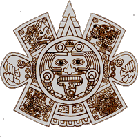 Nasza cywilizacja odnajduje ślady potężnych katastrof na całej Ziemi. Są to zarówno ślady materialne jak i ślady w nielicznych, ocalałych dokumentach pisanych. Faktem jest także, że wiedza spisana jest uboga, gdyż ogromna jej część prawdopodobnie przepadła w takiej katastrofie, a pozostała część dokumentów została bezpowrotnie utracona poprzez ludzką bezmyślną działalność. Przy okazji podbojów nowych ludów unicestwiono też znawców starego pisma. Dziś czytamy stare dokumenty jak dzieci uczące się elementarza, sylabizując i przekręcając wyrazy. Dużo języków jest utraconych dla świata i jest już wiadomo, że nigdy ich nie odczytamy.

Zarozumiałość i nonszalancja niektórych ludzi nauki, przyjmowanie niedorzecznych hipotez, niewiara w mądrość starożytnych, to tylko niektóre przesłanki do tworzenia fałszywego obrazu historii dzisiejszego człowieka i jego cywilizacji. Odwieczny spór między ewolucjonistami a kreacjonistami nie ma końca. Wprowadzony aksjomat o liniowości postępu zaczyna się rozbijać o niezrozumiałe znaleziska. Ukrywa się je lub fałszywie ocenia, byle tylko nie zburzyć istniejącego porządku.

Co może zmieść życie z powierzchni Ziemi? Sadzę, że tylko dwie siły mają taką zdolność - Kosmos i sama planeta Ziemia. Co więcej, tłumaczenia dostępnych jeszcze dokumentów mówią w większości o udziale samej Ziemi, jako burzycielce starego i matce nowego na niej porządku.

**Hopi** - Drugi świat skończył się, gdy kula ziemi przesunęła się i zmieniła swoją oś, a wówczas lód pokrył wszystko.

**K'ü Jüan "Pytam niebiosa"** - Gdy runął K'ang-huei, czemu ziemia na południowy wschód się kłoni? \[...\] Gdzie osiem słupów? Czemu zbrakło jednego na południo-wschodzie?

Dwa pierwsze fragmenty z dwóch przeciwległych krańców Ziemi mówią w zasadzie o jednym - o przesunięciu się całej skorupy ziemskiej. Dwa następne - to przestroga, że coś podobnego się powtórzy.

**Kodeks Rios** - Kiedyś, w dniu Naui Ollin, nastąpi koniec świata. Wszystko, co żyje, ulegnie zniszczeniu na skutek trzęsienia ziemi. Będzie to już czwarte zniszczenie ludzkości. Ale nie wiemy, czy i tym razem ludzkość będzie miała szczęście - po raz piąty - pozostawić nasienie...

**Annales de Cuauhtitlan** - Piąte Słońce - Jego znakiem jest 4-Ollin. Zwie się Słońcem Ruchu, bo się porusza, bo kroczy swoją drogą. I jak powiadają starcy, podczas tego Słońca nastąpi wstrząs, będzie głód i tak zginiemy. Powiadają, że powstało w roku 13-Acatl (Trzcina), że wtedy się narodziło owo Słońce, które teraz istnieje. Jego znakiem jest 4-Ollin. To jest piąte Słońce, które się utrwaliło, podczas tego Słońca nastąpi wstrząs, podczas niego będzie głód.

Czy wstrząsem takim może być "wielki uskok skorupy ziemskiej"? Czy jest możliwe przesunięcie się całej skorupy ziemskiej? Jako pierwszy taką hipotezę stworzył i ogłosił Charles Hapggod. Nauka od razu uznała ją za niemożliwą i wszystkie działania podporządkowała nie jej obaleniu, a jej zignorowaniu. Czy jest to naprawdę niemożliwe? Zapoznajmy się z tą hipotezą.

**Charles Hapgood i jego hipoteza**

Istnienie zjawiska zwanego "wielkim uskokiem skorupy ziemskiej" Jest moim podstawowym ałożeniem i niektóre problemy staram się wyjaśniać pod tym właśnie kątem. Taki jest ten nasz świat. Jedni obalają, starają się ukryć, a inni odkrywają to na nowo. Twórca tej logicznej i prostej zarazem hipotezy był gorąco popierany przez Alberta Einsteina.

**Einstein** pisał: "W strefie polarnej trwa nieustanne nawarstwianie się lodu, występujące nierównomiernie wokół bieguna. Rotacja Ziemi oddziałuje na tę masę lodu, wytwarzając moment odśrodkowy, który przenosi się na twardą skorupę naszej planety. Siła ta, osiągnąwszy pewną wartość, powoduje przesuwanie skorupy ziemskiej". Natomiast **John Wright**, prezes Amerykańskiego Towarzystwa Geograficznego, napisał, że Hapgood "przedstawił hipotezę, która wręcz domaga się sprawdzenia"

Charles Hapgood, nie doczekał się chwały. Wręcz przeciwnie, jego hipoteza z 1953 r. została wyśmiana przez naukowców. Napisał, że każda próba dyskusji nad jego teorią "przesiąknięta była gruboskórnym sarkazmem, a niemożliwe do zweryfikowania, drugorzędne drobiazgi stawały się pretekstem do odrzucenia całej hipotezy bez zadawania sobie trudu dotknięcia istoty rzeczy". Był człowiekiem spoza branży i śmiał mieć inne zdanie. Ponadto, jak mi się wydaje, w upadku, a właściwie w zignorowaniu hipotezy dopomogło zaangażowanie się jej autora w tematy zagłady Atlantydy czy poszukiwań wielkiej cywilizacji na Antarktydzie. Miast kontynuowania pracy wdał się w spekulacje poza naukowe, co nie przysporzyło mu zwolenników. Ale czy tylko dlatego należy hipotezę wyrzucić do kosza? Postaram się jej bronić i zacznę od lodu.

Pewne, podkreślam pewne, wyobrażenie o zasięgu lodu daje mapka poniżej obrazująca największy zasięg zlodowaceń. Prawdopodobnie jest to cały obraz wiedzy dzisiejszej nauki wymalowany na jednej mapce w rodzaju "all in one". Naniesione na nią wyniki badań, jak sądzę, nie ukazują zasięgu położenia lodowca w określonym przedziale czasowym (rozróżnia się przecież kilka zlodowaceń). Stwierdza się tylko fakt, że w tym miejscu był kiedyś (lub jest dzisiaj) lodowiec. Ponadto, czego nauka nie potrafi stwierdzić i nie ma tego na mapce, to jakie miejsca zostały pokryte lodowcem już w naszych, historycznych czasach, a które były wolne od lodu 12,5 tysiąca lat temu.

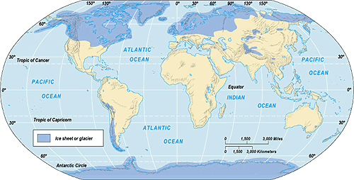

Hapggod twierdził, że na biegunach cały czas odkładała się, tak jak i dzisiaj odkłada się warstwa śniegu i lodu, która posiada swoją wagę i to niemałą. Ziemia podczas obrotu wytwarza pewną siłę odśrodkową, która powoduje dążenie całej kuli ziemskiej do równowagi stałej, a jedyną możliwością jest zmiana położenia całej skorupy ziemskiej. Skorupa ta wraz z płaszczem nie jest w żadnym miejscu przymocowana do płynnego wnętrza i może się, przynajmniej teoretycznie, ślizgać po nim swobodnie. Temu jednak zapobiegają siły tarcia pomiędzy nimi. Gdy siły tarcia i odśrodkowa są zrównoważone nic nie zakłóca obrotu dookoła osi. Gdy jednak wystąpi zakłócenie równowagi spowodowane przez wzrost masy skupionej na biegunie Ziemi nastąpi zachwianie równowagi.

Spróbujmy wykonać doświadczenie - puśćmy kulkę w ruch obrotowy na płaskim stole. Poczekajmy jak się ten ruch ustabilizuje. Teraz w okolicę osi obrotu spuśćmy delikatnie kropelkę oleju. Rozpocznie się gwałtowny, chaotyczny ruch, który uspokoi się dopiero, gdy kulka osiągnie stabilizację (równowagę obojętną), ale już w nowym położeniu. Gdybyśmy przedtem na kulce zaznaczyli jakiś punkt odniesienia zauważylibyśmy, że w nowym położeniu zajmuje nowe, zupełnie inne miejsce.

O to właśnie chodziło Charles'owi Hapgood'owi. Masa lodu na biegunie północnym, nie zrównoważona na biegunie południowym, spowodowała takie zachwianie równowagi. Jak mogła powstać taka masa lodu? Możliwe, że w wyniku globalnej działalności wulkanicznej. Możliwe, jak chce Daeniken, że kiedyś na Ziemi doszło do konfliktu z użyciem broni atomowej. Możliwe, że Ziemia w pewnym okresie czasu odsunęła swą orbitę od Słońca. Nie wiem. Naukowcy są zgodni co do tego, że około 12,5 tysiąca lat temu Ziemia została dotknięta jakimś kataklizmem. Nazywają to "gwałtownym ociepleniem klimatu", a bardziej groźnie "ogólnoświatowym potopem". Wszyscy jednak są zgodni co do tego, że w tym okresie wydarzyło się "coś", czego skutki odczuł cały ówczesny świat. Naukowcy uważają także, że około 12,5 tysiąca lat temu obszar w okolicy wyspy Akpatok koło Labradoru w Kanadzie znajdował się w okolicach bieguna północnego.

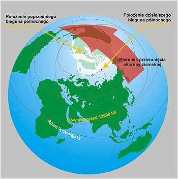 Spojrzenie na globus, gdy okolice Akpatok znajdowały się w rejonie bieguna północnego, uprzytomni nam jak wielkie połacie lądu znajdowały się pod lodami. Lodowiec przykrywał Kanadę i Grenlandię. Na antypodach lodowiec mógł objąć tylko połowę Antarktydy i pokryć lodem kawałek powierzchni oceanu. Można stwierdzić gdzie tego lodu było więcej i o ile więcej. Nie wiadomo co rozpoczęło ten proces, ale wiadomo w przybliżeniu kiedy. Około 12,5 tysiąca lat temu skorupa Ziemi rozpoczęła ruch w kierunku południowym wzdłuż 70° zachodniego południka. Zatrzymała się dopiero po przebyciu 3000 km.

Biegun północny, jako że oś obrotu Ziemi nie zmieniła swego miejsca, zajął dzisiejsze miejsce. Nie wiadomo ile to trwało, być może kilka dni, ale wody ruszyły do ataku natychmiast. Najpierw bezwładnie przesunęły się w kierunku południowym, a następnie gigantycznym tsunami ruszyły z powrotem. Fala o wysokości kilku kilometrów, miażdżąca masa wody, spłukiwała wszystko co stanęło na jej drodze. Musimy sobie uprzytomnić, że promień równikowy jest o 22 km dłuższy od biegunowego. Na tych 3000 km (między 60° a 30° szerokości geograficznej) różnica w odległości od środka Ziemi wynosi około 10 km.

Nie wiemy także jak długo woda uspokajała się w tych oceanicznych "wannach". Ile razy to gigantyczne tsunami przewaliło się tam i z powrotem. Była to katastrofa o niewyobrażalnych skutkach. Trzęsienia Ziemi o sile tak olbrzymiej, że dzisiejsze przy nich to ledwie drgawki. Czas wstrząsów mierzony nie w sekundach, a w dniach. Atmosfera, mająca też swoją bezwładność, wyrównywała swoje ciśnienie przy akompaniamencie huraganów i ulew o niespotykanej sile. Wielkie trzęsienia ziemi być może uaktywniły wulkany. Tak opisuje się tylko koniec świata. Ziemia zmieniła swoje oblicze, ale czy już na zawsze?

Dziś nikt nie interesuje się tą hipotezą. Nie słyszałem o komputerowych symulacjach ruchu obrotowego Ziemi z uwzględnieniem oddziaływania siły odśrodkowej na masy lądów i lodów. Nieopłacalność, błoga nieświadomość czy ignorancja? Społeczeństwo światowe jest uspakajane: "stopienie wszystkich lodów na biegunach podwyższy poziom wód o ileś tam metrów". Cóż to jest? Drobnostka. Będziemy chodzić w kaloszach, a w każdym bądź razie zdążymy uciec na tereny położone wyżej. Być może efekt cieplarniany to obrona samej matki Ziemi? Może roztopi nadmiar lodów i uchronić nas przed kataklizmem. Być może jesteśmy świadkami początku następnej ery lodowcowej? Kto to wie...

Co może znaczyć dla nas przyjęcie hipotezy o "wielkim uskoku skorupy ziemskiej" jako podstawowego założenia? Sądzę, że dużo i to bardzo dużo. Przede wszystkim pozwoli zrozumieć, że ogólnoświatowy potop jest możliwy. Pozwoli inaczej spojrzeć na niektóre opisy starożytnych. Pozwoli też na pewną ulgę. Nie byliśmy jaskiniowcami, nie jedliśmy surowego mięsa, nie gryźliśmy się wzajemnie przy akompaniamencie nieartykułowanych wrzasków i wreszcie - małpa nie jest wcale naszą prababcią. Jesteśmy kontynuacją wielkiej cywilizacji, która dała nam podstawy nauki i uczyniła z nas takich, jakimi teraz jesteśmy.

Patrząc na przekrzywiony globus, można zrozumieć, dlaczego kiedyś w Tiahuanaco panował tropikalny klimat, dlaczego w Egipcie nie budowano miast na pustyni, dlaczego w Maribie istnieje tama na nieistniejącej rzece, dlaczego zniknęła Atlantyda, dlaczego zmieniło swoje położenie lustro wody jeziora Titicaca, dlaczego w żołądkach zamarzniętych mamutów odnajdywano resztki niestrawionego pokarmu... Wiele z tych rzeczy, nawet dla laika, staje się zrozumiałe. Prawdopodobnie to ten kataklizm był powodem wyludnienia miast półwyspu Jukatan, Teotihuacan i Tiahuanaco. Jedna zmiana podstawowego założenia, a ile może wytłumaczyć.

Megatsunami wywołane przez "wielki uskok...", jeśli było, prawdopodobnie wpływa też na wnioski wyciągane przez dzisiejszą naukę. Dlaczego?

• Mogło przenieść i pozostawić daleko od brzegu lub wysoko w górach wszelkiego rodzaju morskie organizmy. Szkielety ryb, muszle itp. znajdowane wysoko w górach nie muszą świadczyć o tym, że kiedyś istniało tam morze.  
• Mogło przemieszać osady denne tak, że warstwa starsza zalega dziś nad młodszą. Mogło także poprzesuwać je na duże odległości, a także na większe głębokości.  
• Mogło przenieść spłukaną z powierzchni lądu ziemię do oceanu czy morza. Wraz z nią mogły się tam znaleźć kości ludzi, zwierząt, resztki domostw czy przedmioty użytku itp. i to nie koniecznie tylko najmłodszych.  
• Spłukana ziemia niesiona wraz z falą mogła pokryć grubą warstwą duże obszary ziemi i to co się na niej znajdowało.

Jak z tego widać wszystko to, co dziś odkopujemy czy odnajdujemy z przeszłości, nie musi świadczyć o tym, że było tam od samego początku. Tak mogą powstawać błędy w ocenie znalezisk.

Poparcie dla hipotezy Hapgood'a znalazłem także w książce prof. Zajdlera "Dzieje zegara". Analizując błędy zegarów egipskich doszedł on do wniosku:

Można \[...\] znaleźć źródło błędów zegarów egipskich i udowodnić istnienie Atlantydy na Oceanie. Wystarczy przyjąć, że około 11500 lat temu z Ziemią zderzyło się jakieś ciało niebieskie (np. kometa Halleya) i spowodowało przesunięcie się dotychczasowych biegunów o 30° w stosunku do nowej osi obrotu (która nie zmieniła swego położenia w przestrzeni i nadal wskazuje biegun północny świata). W konsekwencji zmieniły się szerokości geograficzne wszystkich miejsc na Ziemi. Wody oceanów skierowały się w okolice "nowego" równika, zatapiając dotychczasowe lądy, nawet te najwyższe - sięgające powyżej 5000 metrów.  
Przyjmując, że owo ciało niebieskie trafiło w okolice Wysp Antylskich nadbiegając od strony północnej, można dokładnie wyrysować na mapie oba (poprzedni i nowy) równiki ziemskie i wykazać, że Egipt znajdował się przed tą katastrofą kosmiczną dokładnie w rejonie, w którym "obowiązywała" rachuba czasu zgodna z kanonem odnalezionych zegarów słonecznych i wodnych.

Zaprzągł, co prawda do tego siły kosmosu, ale idea przesunięcia skorupy ziemskiej może świadczyć o tym, że hipoteza Hapgood'a nie jest całkowicie pozbawiona słuszności.

W tym kataklizmie poprzednia cywilizacja została śmiertelnie ranna. Ilu zginęło ludzi? Prawdopodobnie znaczna większość populacji wszystkich żyjących istot. Przepadła prawdopodobnie baza przemysłowa i naukowa. Nieliczni "wielcy", którzy pozostali przy życiu rozpoczęli misję odnowy. Zbierali ocalonych, uczyli wszystkiego od nowa, przekazywali kodeks etyczny, opowiadali o starej historii. To oni tchnęli nowego ducha w pozostałych i mogli pozostać w ludzkiej pamięci jako Bogowie lub wielcy Nauczyciele.

Co na to wszystko nauka? Ogromna większość uważa, że taki uskok i ogólnoświatowe trzęsienie ziemi są   **n i e m o ż l i w e.**

**Laik i trzęsienia Ziemi**

Dlaczego na Ziemi występują wstrząsy? Ogólnie dlatego, że płyty kontynentalne napierając na siebie kondensują ogromną energię, która jest wyzwalana w bardzo krótkim czasie podczas ich przesunięcia się względem siebie. Jest może więcej przyczyn, ale ta jedna jest zasadniczą.

Moją hipotezę, być może niedorzeczną w świetle dzisiejszej wiedzy, chcę uzasadnić inaczej. Z tego też względu najpierw muszę postawić inne wstępne założenie. Podstawą będzie hipoteza Zecharii Sitchina, gdzie sumeryjski przekaz o walce Marduka z Tiamat należy odczytać jako kosmiczną katastrofę z udziałem praZiemi.

Około 4 mld lat temu (500 mln lat po powstaniu układu słonecznego) praZiemia (Tiamat) krążyła po orbicie między Marsem i Jowiszem. Nazywana była "potworem wodnym" gdyż cała ponoć była pokryta płaszczem wody. Wtargnięcie do układu słonecznego obcego ciała niebieskiego (tu zwanego Mardukiem) spowodowało katastrofę kosmiczną, w wyniku której praZiemia utraciła część swej masy (ile? - trudno powiedzieć; widoczna jest tylko utrata ponad 2/3 skorupy) i została zepchnięta na dzisiejszą orbitę Ziemi. Zderzenie tłumaczyłoby powstanie pasa planetoid, "przybranie na wadze" Jowisza, powstanie komet i pomniejszego gruzu kosmicznego, którego w zasadzie być nie powinno. Przyjęcie "sumeryjskiej hipotezy" musiało by mieć także i inne naukowe skutki. Przyjmując, że stopniowe stygnięcie Tiamat przebiegało w niezakłóconych warunkach, utworzona na niej skorupa powinna była mieć jednakową grubość na całej powierzchni. Ustalenie jej grubości mogło by pomóc w odnajdywaniu jej największych szczątków krążących do dziś w Kosmosie, a których jeden z wymiarów nie mógłby przekraczać grubość jej skorupy.

Uderzenie w praZiemię musiało spowodować wyrzucenie w kosmos ogromnej ilości materii stałej i wody, "wciśnięcie" części skorupy praZiemi do środka planety (amerykańscy sejsmolodzy odnaleźli ją ponoć 400 km w głębi Ziemi), odsłonięcie półpłynnego, gorącego płaszcza oraz spłynięcie wód w wyrwę po uderzeniu. Zetknięcie się wody z gorącym płaszczem musiało spowodować powstanie ogromnej ilości pary wodnej, która "utworzyła" pierwszą atmosferę z grubej powłoki chmur utrzymywaną siłą grawitacji.

W zgodzie z nauką, że obracające się wokół własnej osi ciało niebieskie powyżej określonej masy, a przede wszystkim o półpłynnej lub zbliżonej konsystencji, dąży do przybrania kształtu kuli, pozostała część skorupy zaczęła pękać i rozpoczęła "wędrówkę" sunąc po półpłynnym płaszczu Ziemi. Oczywiście nie mogło to być nic chaotycznego, choć mogło sprawiać takie wrażenie. Części skorupy ziemskiej pod wpływem ruchu obrotowego i bezwładności własnej masy rozkładały się na powierzchni Ziemi tak, by tworząca się kula uzyskała stan równowagi obojętnej. Prawdopodobnie nie mogło się obejść także bez gigantycznych zderzeń, które powodowały wypiętrzanie się części płyt bądź pękania na mniejsze. Ziemia odzyskiwała kształt kuli, ale kosztem wielkości.

Bajka? Wcale nie. Całkiem realna możliwość. Nie można oczywiście tego udowodnić wprost, ale pewne fakty dają dużo do myślenia. Gdzie szukać śladów pęknięcia? Jedno jest bardzo widoczne. To Grzbiet Atlantycki, miejsce działalności wulkanicznej tego oceanu. Żaden ocean nie posiada nic takiego na całej swojej długości. Ocean Spokojny działalność wulkaniczną skupia na obrzeżach w postaci "kręgu ognia". Dno oceanu Indyjskiego jest popękane w kilku miejscach bez wyraźnego "porządku". Wiadomo też, że kontynenty i dna oceanów to dwie różne litosfery. Dna oceanów to zastygły, półpłynny płaszcz Ziemi, który zaczął się kształtować wraz z pierwszym rozpadem kontynentów. Proces ten chyba jeszcze się całkowicie nie zakończył.

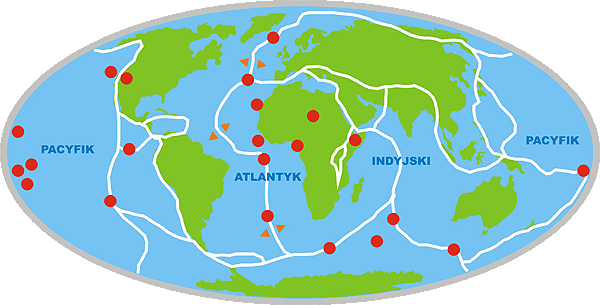

Przypuszczalne granice płyt tektonicznych pokrywające się z rejonami sejsmicznymi i tzw. gorące plamy

Wróćmy do problemu. Za głównego winowajcę, odpowiedzialnego za trzęsienia Ziemi, uważam Grzbiet Atlantycki. To jest główny "rozpychający się łokciami" na Ziemi. Nauka stwierdziła, że ocean Atlantycki rozszerza się od grzbietu środkowoatlantyckiego na zachód i wschód. Powodem jest ciągły wypływ magmy z wnętrza Ziemi. Czyim kosztem? Na pewno oceanu Spokojnego, który według nauki kurczy się. O oceanie Indyjskim i jego tendencjach, przyznam się, nie słyszałem. Sądzę jednak, że i on musi podlegać jakimś wahaniom powierzchni, bo stanowi część całego organizmu jakim jest Ziemia. Ponieważ wszystkie kontynenty wraz z kawałkami płyt zastygłego dna oceanów tworzą oddzielne "płyty kontynentalne" stykające się ze sobą, to najmniejszy nawet ruch Grzbietu Atlantyckiego winien powodować przeniesienie nacisku na pozostałe płyty.

Drugiej przyczyny upatrywałbym w ruchu obrotowym Ziemi i jej dążeniu do stanu równowagi obojętnej. Skorupa Ziemi nie jest materiałem jednorodnym. Składają się na nią materiały stałe (litosfera) i materiały płynne (hydrosfera). Ponadto masa skorupy nie jest rozłożona równomiernie. W miejscach łańcuchów górskich jest dużo większa niż na nizinach. Jak wiadomo, na pewnej głębokości skorupa Ziemi przechodzi stopniowo w półpłynny płaszcz i zapewne gdzieś w tym miejscu, na głębokości 400-600 km, traci swą "przyczepność". To w tym miejscu może dochodzić do "poślizgu" twardej litosfery na półpłynnym płaszczu. Jeśli powierzchnia Ziemi, a w zasadzie masa skorupy jest rozłożona równomiernie na całej powierzchni kula obraca się płynnie zachowując równowagę obojętną. Jeśli nie, to wtedy...

Ziemia jest kulą, która poprzez ruch obrotowy wytwarza moment odśrodkowy, który dąży do równomiernego rozłożenia masy na całej jej powierzchni. Czy nasza Ziemia jest w stanie równowagi obojętnej? Na pewno nie. Zgodnie z tym co piszę, największe masy skorupy ziemskiej powinny być skupione na równiku lub w jego pobliżu, gdzie siła odśrodkowa jest największa. Tam winny się znaleźć największe łańcuchy górskie. Tak jednak nie jest. Sądzę, że trzęsienia ziemi o ograniczonym zakresie terytorialnym mogą być uwerturą do czegoś, co Hapgood nazwał "Wielkim uskokiem skorupy ziemskiej" lub też nie zakończonym jeszcze formowaniem się "nowej" geoidy po ostatnim "wielkim uskoku..."..

Ci co mieli możność zapoznać się z hipotezę Hapgood'a, a także dopuszczający możliwość zaistnienia "wielkiego uskoku..." na pewno nie mają złudzeń. Nagromadzenie się nadmiernej ilości lodu w okolicach bieguna jest zachwianiem równowagi obojętnej i mogło być przyczyną uskoku, który "ustawił" skupiska mas całej skorupy ziemskiej w równowadze obojętnej. Siłą rzeczy, po stopieniu się lodów przyczyna znika i skorupa Ziemi ponownie wchodzi w stan niezrównoważony. Sytuacja się powtarza. Nie znamy tylko mechanizmu, a właściwie jedynego "bodźca" który zapoczątkowuje ten proces. Jeśli przyjąć taki scenariusz, musimy także przyjąć, że zjawisko "wielkiego uskoku..." było, jest i będzie zjawiskiem powtarzalnym, na które my nie mamy żadnego wpływu. Teorię Hapgood'a odrzucono, bo nie jest wiadomo, jak może nagromadzić się tak wielka ilość lodu i nie wiadomo jaki jest mechanizm nastawania epoki lodowcowej.

Co może jeszcze powodować szybkie narastanie pokrywy lodowej? Skorupa Ziemi na dnie oceanów jest cienka jak pierwszy lód na kałuży. Grubość jej liczy się w kilometrach, ale siły napierających na siebie płyt nie są w stanie jej skruszyć. Co innego, jeśli zaprzęgniemy do tego "pomocnika". Średnia głębokość oceanów nie przekracza 3-4 km. Meteoryt o średnicy kilku-kilkunastu kilometrów uderzając w ocean z dziecinną łatwością może przebić dno i zagłębić się w płynne warstwy płaszcza Ziemi. Średnica powstałej dziury nie może być mniejsza od średnicy "agresora", może być równa lub większa albo dużo większa. Czy można wyobrazić sobie skutki? Oprócz skutków samej eksplozji, które nie raz zostały już opisane, dochodzi do wylewu płynnej magmy z dna oceanu. Zanim otwór zostanie "zalepiony", gorąca magma bez przerwy w połączeniu z wodą tworzy trudną do określenia ilość pary wodnej, która w postaci chmur unosi się do atmosfery tworząc grubą, nieprzepuszczającą światła warstwę. Ile to trwa? Nie umiem odpowiedzieć, ale na pewno dłużej niż dni, tygodnie czy miesiące. Tym, według mnie, można tłumaczyć długotrwałe opady deszczu opisywane przez starożytnych. Wprowadzenie do ziemskiej atmosfery takiej ilości pary wodnej w postaci chmur może być też przyczyną gwałtownego ochłodzenia ziemskiego klimatu, a tym samym do nadmiernego wzrostu pokrywy lodowej na biegunach. Sądzę, że dalszy scenariusz możesz dopowiedzieć już samemu. A dowody? Trzeba zacząć szukać na dnie oceanów.

Jest to mój punkt widzenia, a że nie jestem z wykształcenia geonaukowcem, myślę, że pewne sformułowania mogą mieć pewne braki.

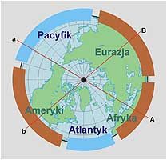  
Spojrzenie na biegun

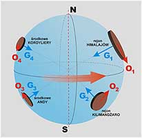  
Rozłożenie mas (przykładowe)

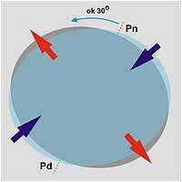  
Deformacja powierzchni

Spojrzenie na rozłożenie kontynentów od strony bieguna północnego już powinno uświadamiać, że masy kontynentalne nie są rozłożone równomiernie. Rozpatrując tę figurę jako płaskie obracające się koło widać wyraźnie, że punkt "A" nie ma przeciwwagi w punkcie "a", podobnie jak punkt "B". Już nawet bez rozpatrywania wielkości mas, mechanik stwierdziłby, że takie koło w czasie obrotu nie będzie obracało się bez wstrząsów spowodowanych tzw. "biciem". Dopiero dodanie "ciężarków" w odpowiednich miejscach może spowodować, że koło to zacznie obracać się bez wstrząsów. Niestety, nikt nie jest w stanie tego zrobić w stosunku do Ziemi.

Rysunek drugi ma wyobrażać kulę ziemską z nierównomiernie rozłożonymi skupiskami mas na jej powierzchni. Cała zewnętrzna sfera kuli wraz z "ciężarkami" jest powierzchnią zestaloną, co znaczy, że poszczególne masy nie mogą samodzielnie wędrować po jej powierzchni. Jest to coś w rodzaju kuli wody skutej na powierzchni cienką warstwą lodu, która uniemożliwia swobodne "pływanie" poszczególnych mas. Co to może oznaczać? To, że ustalanie obracającej się kuli w równowadze obojętnej nie będzie odbywać się poprzez przesuwanie poszczególnych mas, a przez przesunięcie się całej skorupy wraz z zalegającymi na niej masami. Jest to cała filozofia "wielkiego uskoku...". Ziemia cały czas dąży do uzyskanie równowagi stałej, a uzyskać ją może tylko poprzez przesunięcie całej skorupy. Wiemy też, że ta równowaga obojętna jest bardzo niestabilna. Zakłócić ją może każdy, nawet niewielki stosunkowo przyrost masy w obojętnie jakim punkcie na jej powierzchni. Czy to będzie warstwa lodu, czy uderzenie potężnego bolidu. Ale nie musimy czekać aż na tak spektakularne wydarzenie. Najcięższe masy winny, a w zasadzie ich wypadkowa, znaleźć się w okolicach równika. W miejscu, gdzie siła odśrodkowa jest największa. Następny "wielki uskok skorupy ziemskiej" jest więc tylko kwestią czasu.

Pozostaje jeszcze do wyjaśnienia sprawa szybkości zatapiania czy podnoszenia się obszarów lądu. Ziemia jak wiadomo nie jest idealną kulą, a formą nazwaną geoidą. Siła odśrodkowa spowodowana obrotem kuli ziemskiej wokół własnej osi powoduje "wybrzuszenie" na równiku, co z kolei ma odbicie w różnicy między promieniami biegunowym i równikowym (około 22 km). Ile czasu potrzeba, by po "wielkim uskoku..." kształt Ziemi powrócił z powrotem do kształtu geoidy? Dziesiątki, setki czy tysiące lat? Czy powrót ten odbywa się w sposób ciągły i prawie niezauważalny, czy też ma charakter skokowy, gwałtowny połączony z trzęsieniami ziemi i pękaniem skorupy?

Odnoszę wrażenie, że człowiek usilnie chce, a właściwie już pomógł Ziemi w przyspieszeniu biegu wydarzeń. Efekt cieplarniany już działa destrukcyjnie. Legendarne śniegi Kilimandżaro zniknęły, gwałtownie roztapiają się lodowce Himalajów, zmniejszają się masy lodów na biegunach, w Europie nadmierne zimowe opady śniegu, a w innych krajach niespotykane ilości letniego deszczu. Coraz częstsze huragany przenoszące z oceanów nad lądy ogromne masy wody. Można się domyśleć o co mi chodzi? Wcale nie o zatruwanie atmosfery dwutlenkiem węgla. Ja myślę o gwałtownych, punktowych zmianach masy skorupy ziemskiej. "Czara" równowagi być może się już napełniła. Możliwe, że wystarczy "efekt motyla" - przelot jednego bociana z Egiptu i jego miękkie lądowanie gdzieś w Polsce zapoczątkuje katastrofę. Kropla, która przepełni czarę.

**Po co zrobiono dziurę w Grenlandii?**

Swego czasu, w ramach programu naukowego, na Grenlandii wykonano odwiert w głąb lodowca w celu pobrania i zbadania próbek. Badano skład atmosfery, zawartość zanieczyszczeń oraz średnią temperaturę w danej warstwie. Na tej podstawie sporządzono wykres średniej temperatury w poszczególnych warstwach i dla konkretnego przedziału czasowego. Na wykresie brakuje "zera", bo ktoś był łaskaw zapomnieć o jego zaznaczeniu. Podano tylko, że pomiędzy 12 a 10 tysiącami lat temu wzrost średniej temperatury wyniósł około 7°C.

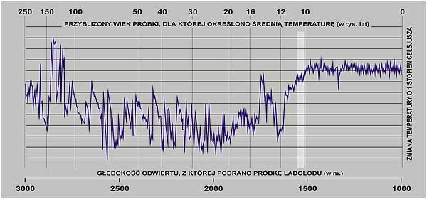

Na tej podstawie wyciągnięto wniosek, że epoka lodowcowa zakończyła się "z hukiem" około 12,5 tysiąca lat temu. Drugim wnioskiem był ten, że przez okres ponad stu tysięcy lat na Ziemi panowała epoka lodowcowa oraz ten, że klimat na Ziemi przypomina huśtawkę.

Jako laik nie mogę kwestionować wyników badań, ale mogę postawić kilka pytań. Pierwsze i zasadnicze - jak można badania jednego małego punktu rozciągnąć na cały glob? Czy znaczy to, że jak w mojej polskiej wiosce leje jak z przysłowiowego cebra, to farmer w USA też tego doświadcza w tym samym czasie? Moje wnioski są zupełnie inne. Szanowni luminarze nauki żartują sobie ze zwykłych ludzi? Przecież to jest normalne, że epoka lodowcowa wokół obu biegunów trwała, trwa i będzie trwać wiecznie.

Owszem widzimy zmiany temperatury, ale są to zmiany tylko i wyłącznie dotyczące Grenlandii. Nie ma żadnej pewności, że takie same wahania temperatury obejmowały rejon równika. Z wykresu wyciągam też wniosek, że przez ostatnie 100 tysięcy lat Grenlandia znajdowała się w strefie biegunowej. 12 tysięcy lat temu nastąpił gwałtowny wzrost średniej temperatury, spowodowany, być może, przesunięciem się całej wyspy poza rejon bieguna. Widać także, że stopniowe podnoszenie się temperatury trwało około 2000 lat. Mam prawo również wyciągnąć wniosek, że pomiędzy 100-150 tysięcy lat temu Grenlandia leżała poza klimatem polarnym. Mogę też przypuszczać, że Grenlandia ponad 100 tysięcy lat temu rozpoczęła swą "wędrówkę" przez okolice bieguna północnego i być może trasę wyznaczał 70 południk.

Czy może to oznaczać, że kontynenty nie są na stałe związane z jednym geograficznym położeniem? Oczywiście. I może to oznaczać także, że Hapgood ma rację. Ziemia nie jest planetą stabilną i jeszcze długo nią nie będzie. Ale to jest zbyt proste, by mogło zostać uznane za rzeczywiste. Natura pokazała tę możliwość, ale ci co ją ujrzeli, swych "wrażeń" nie mogli przekazać nikomu, bo w wyniku "doświadczenia" stracili życie, a ci co usiłują to przekazać są uważani za idiotów z nadmiernie wybujałą fantazją. Cytowany przekaz Hopi wkłada się między bajki, bo jak "czerwony" może być mądrzejszy od "białego".

**Czy jest możliwy ogólnoświatowy potop ?**

Czy jest możliwy ogólnoświatowy potop? Uczeni obliczyli, że gdyby stopić jednocześnie obie czapy lodowe na biegunach, poziom wody na całej kuli ziemskiej podniósł by się o kilka czy kilkanaście metrów, ale gdzie tu mamy do czynienia z wodą sięgającą najwyższych szczytów górskich?

Czy jest możliwe zatopienie całej Ziemi aż po najwyższe szczyty? Nie. W taki sposób na pewno nie. Skąd bowiem wziąć tyle wody? Musiałoby jej być objętościowo kilka a nawet kilkakrotnie więcej niż jest dzisiaj we wszystkich oceanach, morzach, lodowcach, w Ziemi i w atmosferze razem wziętych, a i prawdopodobnie tego było by za mało. Wraz ze wzrostem wysokości objętość wody musiałaby wzrastać w tempie wykładniczym. Jest to według mnie koronny dowód na to, że tego rodzaju potopu być nie mogło.

Spotykane opisy mogą być opisami naocznych świadków, ale prawdopodobnie odnoszą się tylko do zjawisk miejscowych. W przeciwnym wypadku musiałoby dojść do ogólnoświatowego (ówczesnego oczywiście) sympozjum w celu uzgodnienia jednolitego poglądu, a jak zapewne wiemy nic takiego nie miało miejsca. Jedno co jest pewne to fakt, że opisy potopu występują na całym świecie, niezależnie od miejsca, rasy czy kultury.

Opisy w stylu: "ziemia kilkakrotnie zapadała się pod wodę i wynurzała się" może być opisem następujących po sobie fal tsunami. Kataklizmu na ogólnoświatową skalę nie wywoła lokalne trzęsienie ziemi, trzęsienie podmorskie czy osunięcie dna morza. Sądzę, że taki kataklizm, może wywołać tylko coś w rodzaju "wielkiego uskoku...". Zjawisko globalne i jednoczesne. Jednak opisy tego będą różnić się znacznie, w zależności od miejsca obserwatora. Zamieszkujący wybrzeża czy wyspy oceaniczne nie napiszą nic ze względów oczywistych. Ci co przeżyją, to mieszkańcy gór, niekoniecznie kwiat inteligencji, a opisy ich siłą rzeczy nie będą "fachowe", a tylko subiektywne i do tego zależne od inteligencji i zasobu słownictwa opisującego.

Teoria Haapgod'a tłumaczy wiele choć na pewno nie wszystko. Przy założeniu istnienia "wielkiego uskoku..." można jednak wytłumaczyć wiele zjawisk w starożytnej historii Ziemi bez odwoływania się do hipotez wziętych "spod kapelusza". Prosto i logicznie.

**Czy "wielki uskok..." pozostawił ślady ?**

Osobiście odnoszę wrażenie, że tak, choć mam świadomość, że mogę być w tym osamotniony. Jak wiadomo, nauka ma na wszystko odpowiedź. To, że w piramidach nie znaleziono szczątków władców zawdzięczamy złodziejom. To, że wiele starożytnych posągów i budowli odnaleziono rozbitych, zawdzięczamy "gniewowi uciskanego ludu". Mam wrażenie, że to bajeczki dla grzecznych dzieci. Proszę, oto kilka wybranych "krajobrazów" po przejściu tłumu "uciskanych i niezadowolonych". Moim jednak zdaniem zadziałały tu o wiele większe siły.

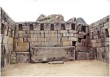

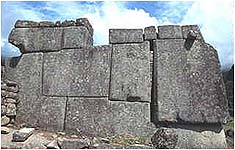

Dwa zdjęcia z Machu Picchu. Po lewej "Świątynia główna", której zapadnięty narożnik może świadczyć o jakiejś podziemnej konstrukcji. Po prawej fragment "Świątyni trzech okien". Widać wyraźnie poprzesuwane bloki, które ważą po kilka, kilkanaście ton. Małe trzęsienie ziemi, ze względu na specyfikę budowy, nie byłoby w stanie ich poruszyć. Ludzie też nie.

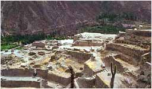

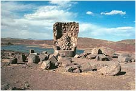

Oznaki totalnego "bałaganu" w Ollantaytambo, a po prawej w Puno. Rozrzucone "drobiazgi" mają ogromną wagę. Nie zdołali ich ruszyć konkwistadorzy, nie zdołali także i współcześni próbujący "uporządkować" teren dla turystów. Ze względu na wagę elementów nie należy się też spodziewać szybkiej rekonstrukcji.

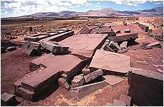

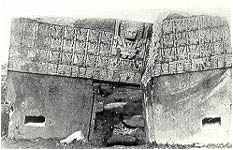

Ogromne zniszczenia w Puma Punku (Tiahuanaco). Do dziś nie ma "silnego" by ułożyć z powrotem te puzzle. Po prawej jedna z pierwszych rycin przedstawiająca "Bramę Słońca". Pęknięcie było wyraźne, a także widać, że do połowy była zagrzebana w ziemi. Naniesienie takiej warstwy ziemi, według mnie, spowodował atak wody z jeziora Titicaca, poprawiony być może przez tsunami, które przelało się przez Andy.

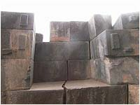

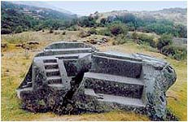

Kto lub co jest w stanie doprowadzić do pęknięcia tak dużych, jednolitych bloków kamiennych? Po prawej blok kamienny z Corichanchy w Cusco, po lewej z jego okolic, wyglądający tak, jakby pod nim zdetonowano ładunek wybuchowy lub zrzucono go z dużej wysokości.

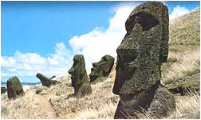

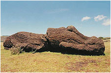

Wyspa Wielkanocna i bezładnie stojące posągi Moai. Czy to przypadkiem nie tsunami przesunęło je od brzegu pod górę na zbocze wulkanu przykrywając warstwą ziemi i mułu? Osuwająca się z góry ziemia winna je wszystkie powalić, tymczasem stoją, z nielicznymi wyjątkami, pionowo. Swoją drogą, jestem ciekaw, czy ktoś próbował odkopać choćby jedną rzeźbę do jej podstawy, by zobaczyć jak jest duża oraz pobrać próbki ziemi, by sprawdzić czy nie zawierają śladów działania tsunami (muszle, szkielety ryb lub szczątki innych, typowo morskich organizmów, sól morska itp.). Obok pęknięty wpół posąg. Czy rozbicia posągu mógł dokonać człowiek? Dziesięciokilowy młot mieści się swobodnie w jego dziurce od nosa.

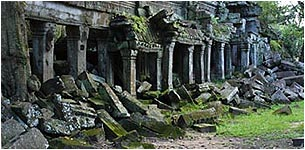

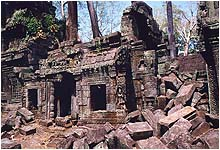

Angkor w Kambodży. Klasyczne "pobojowisko" po trzęsieniu ziemi. Te ruiny nie rozpadły się ze starości. Gdyby tak miało być, w gruzach legło by zapewne wszystko. Nie uczynili tego także ludzie. Nie niszczy się własnych świątyń, a wróg starałby się zrównać wszystko z ziemią.

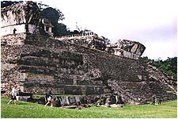

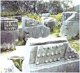

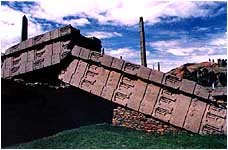

Na zdjęciu z Palenque widać brak zewnętrznych ścian budynku stojącego na szczycie piramidy. Z każdej jego strony pozostała tylko połowa łukowatego sklepienia. Wygląda tak, jakby zostało rozsadzone od środka. Część gruzu leży na stokach piramidy, część została uprzątnięta. Na środkowym zdjęciu potrzaskane "klocki Lego" z greckich Delf. Na ostatnim zdjęciu roztrzaskana kolumna w Aksum. Gdyby tu miała działać teoria o gniewie ludu, to dlaczego pozostałe kolumny stoją nietknięte?

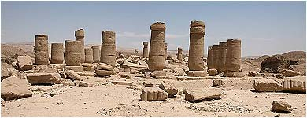

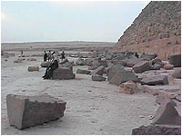

Na koniec przenieśmy się do Egiptu. Leżące bezładnie roztrzaskane elementy, posągi, rozbite i poprzekrzywiane kolumny, rozrzucone części okładziny z piramid, pozarywane stropy budowli. To nie jest dzieło wzburzonego tłumu, jak chcieliby niektórzy. To jest pokaz sił natury. Potężnej natury.

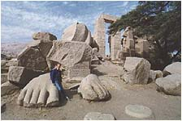

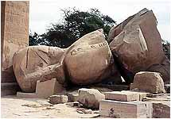

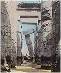

Czy wszystko to, co pokazałem, ma udowodnić tezę o ogólnoświatowym trzęsieniu ziemi? Nie. Chciałem tylko pokazać, że jest to możliwe. "Słuszność" interpretacji zależy od tytułów naukowych i siły przebicia interpretatora. Nikt dotychczas nie pokwapił się o ustalenie czasu kataklizmu poszczególnych kompleksów. Zresztą chyba jest to niemożliwe, bo naukowcy nie potrafią go jednoznacznie określić. Wszystko to jednoczy jedynie ogromna skala zniszczeń, a zauważmy, że niektóre tu pokazane miejsca nie należą do najaktywniejszych rejonów sejsmicznych.

I jeszcze jedno. Na pewno znana jest czynność zwana "wykopaliskami". Praca archeologa jest bardzo ciężka chociażby ze względu na to, że prawie wszystko musi odkopać lub wykopać. Ogromna ilość budowli starożytnych jest po prostu zasypana ziemią. Przecież, za wyjątkiem pustyń gdzie burze piaskowe przemieszczają olbrzymie ilości piasku, pozostałe ruiny winny znajdować się na powierzchni Ziemi. Dlaczego są zakopane? Czy to jest przypadek? Chyba nie. To prawdopodobnie ogromne tsunami, przetaczając się przez ląd, oprócz wody niosło z sobą olbrzymie ilości osadów i wypłukanej ziemi. To one, oprócz zniszczeń, spowodowało także ich zasypanie. Logiczne?

Sądzę, że zdjęcia pokazują zniszczenia spowodowane "wielkim uskokiem...". Budowle nie zostały odbudowane, bo nie miał kto tego zrobić lub nie miał środków. Zwyczajny człowiek nie był i nie jest w stanie tego zrekonstruować. Zniszczyć w taki sposób też nie. Materiały wybuchowe i broń atomowa to stosunkowo niedawny wymysł.

**Czy woda może być śladem?**

Jakiż to ślad, co może spłynąć, wsiąknąć lub wyparować? A jednak. Może nie tyle ślad, co poszlaka wskazująca na zaistnienie "wielkiego uskoku...", a w zasadzie jego niszczycielskiego następstwa - wielkiego, ogólnoświatowego tsunami. Ten ślad, to wody śródlądowe, a w zasadzie ich wyjątki - śródlądowe wody słone. Czym różni się woda morska od słodkiej? Woda morska to roztwór zawierający rozpuszczone jony chlorkowe (55%), sodu (30%), a także siarki, magnezu, wapnia i potasu. W wodzie słodkiej przeważa krzemionka (15%), jony wapnia (17%) i siarki (21%). Woda morska ma "stałego dostawcę" swoich składników w podmorskiej działalności wulkanicznej gdzie wypływająca magma to nic innego jak stop krzemianowy, w skład którego oprócz krzemionki wchodzą: żelazo, magnez, wapń, sód oraz substancje lotne, między innymi chlor, dwutlenek węgla oraz przegrzane roztwory wodne.

Obieg wody w przyrodzie nie zmienił się od samego początku i paradoksalnie największym i jedynym "dostawcą" słodkiej wody są słone oceany. Ogromne ilości parującej wody z oceanów dostają się do atmosfery i byłaby to zapewne czysta woda destylowana, gdyby nie zanieczyszczenia atmosfery, których także dostarcza ludzka działalność szczególnie przez ostatnie dwa wieki. Te ogromne "latające cysterny" słodkiej wody są przenoszone nad lądy gdzie woda jest uwalniana w postaci deszczu, śniegu lub gradu. Woda wsiąka w ziemię i przechodząc przez kolejne jej warstwy filtruje się oraz nasyca solami mineralnymi zbierając się w warstwach wodonośnych, które znalazłszy ujście tryskają poprzez liczne źródła tworząc zaczątki rzek. Rzeki z kolei spływają do mórz i oceanów i cykl powtarza się od nowa. Nie wszystkie jednak rzeki kończą swój bieg w morzu. Pewna ich część na nieprzepuszczalnej warstwie (gliny, skały) tworzy nie mające nigdzie ujścia zbiorniki śródlądowe dodatkowo zasilane opadami. Wynika z tego, że wszystkie zbiorniki wodne utworzone w środku lądu powinny zawierać tylko słodką wodę. Tak jednak nie jest. Znane są wyjątki jak jezioro Titicaca w Andach, morze Kaspijskie czy umierające morze Aralskie w Rosji lub morze Martwe na pograniczu Izraela i Jordanii. Wszyscy słyszeli także o takich pozostałościach jak Wielkie Słone Jezioro w USA, obok którego znajduje się Wielka Pustynia Słona czy ogromne "salinas" Uyuni w południowej części andyjskiego Altiplano i Wielka Pustynia Słona w dzisiejszym Iranie. Skąd się wzięły?

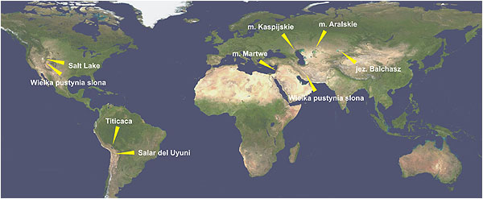

Uczeni twierdzą, że jezioro Titicaca było w przeszłości morską laguną zamkniętą przez wypiętrzające się Andy. Jak zatem tą hipotezę zastosować do nizinnego morza Kaspijskiego? Jak wypiętrzyło się morze Aralskie mające za stosunkowo bliskiego sąsiada zbiornik w połowie słonej (zachodnia część) i w połowie prawie słodkiej wody (wschodnia część) - jezioro Bałchasz? Przyjmując, że wypiętrzanie gór zakończyło się około 100 mln lat temu, to wszystkie słone zbiorniki śródlądowe winny być rajem dla zwolenników ewolucji i co jakiś czas winniśmy mieć do czynienia ze światowymi sensacjami o odnalezieniu kolejnego reliktu epoki dinozaurów. Dlaczego nie mamy? Dlaczego ta hipoteza nie działa jednakowo wszędzie? A jeśli geneza powstania słonych zbiorników śródlądowych jest zupełnie inna?

Sądzę, że te zbiorniki słonej wody to pozostałość po "wielkim uskoku..." i jego gigantycznym tsunami. Wody oceanów i mórz uwięzione w środku lądów, a jeśli tak, to jezioro Titicaca jest "oceanem Spokojnym" uwięzionym wysoko w Andach, podobnie jak morze Martwe może być cząstką uwięzionego morza Śródziemnego. Morze Kaspijskie to wody oceanu Lodowatego, które spłynęły na najniżej położone tereny nie mając możliwości powrotu. Tam gdzie utworzyły się głębokie zbiorniki woda dotrwała do dziś. Płytkie zbiorniki wyparowały i dziś oglądamy wielkie solne równiny jak w Salt Lake czy Uyuni. Morze Martwe, w którym jak wiemy, nie można się utopić jest zbiornikiem o najwyższym stężeniu soli. Dlaczego tak się dzieje? Sądzę, że w tym klimacie ogromnych ilości parującej wody nie jest w stanie uzupełnić jedna rzeka Jordan i rzadkie opady deszczu. Werset 14,3 Księgi Rodzaju brzmi: "Wszyscy ci zeszli się w dolinę Leśną, która teraz jest morzem Słonym.". Czy to o czymś mówi? A co się stało z morzem Aralskim? Po odcięciu dwóch źródeł zaopatrzenia Amu-Darii i Syr-Darii, których wody skierowano na pola bawełny, w ciągu niespełna półwiecza zmniejszyło swą powierzchnię o ponad połowę, pozostawiając pokłady soli, które dziś po okolicznym stepie rozwiewa wiatr czyniąc glebę nieurodzajną.

Takich śladów powinno być więcej, ale nic o nich nie wiadomo, bo nie prowadzi się badań tego typu. Szkoda, bo na podstawie warunków klimatycznych, wielkości zbiornika, szybkości parowania wody, możliwości jej naturalnego uzupełniania można by stworzyć model, który mógłby zaprowadzić nas w czasie do początków jego powstania. Badania osadów dennych powinny dać odpowiedź na pytanie czy woda w takim zbiorniku uległa gwałtownej "wymianie" czy jest tam od samego początku. Badania starej linii brzegowej też winny dać odpowiedź na pytanie, czy powierzchnia takiego zbiornika nie wykazuje żadnych odchyleń, tak jak to ma miejsce z linią brzegową jeziora Titicaca. W końcu należało by zbadać chemiczny skład wody i porównać go ze składem oceanów czy mórz.

Znana jest też ciekawa hipoteza "odsunięcia się" brzegu zatoki Perskiej od starożytnych miast Mezopotamii (Ur, Eridu,Larsa czy Lagasz), które tłumaczy się tysiącleciami nanoszenia mułu z głębi lądu przez Eufrat i Tygrys. Dlaczego ta hipoteza nie pasuje do Nilu, rzeki wielokroć potężniejszej od dwóch pozostałych? Na dnie morza u wybrzeży Aleksandrii odnaleziono pozostałości pałacu Kleopatry (ponoć) w ogóle nie przykryte mułem, a także stare koryto Nilu sięgające daleko w morze. Czy przypadkiem za zasypanie miast starożytnej Mezopotamii i "odsunięcie się" linii brzegowej zatoki Perskiej nie odpowiadają masy wody gigantycznego tsunami po "wielkim uskoku..." uwięzione w dolinie Eufratu i Tygrysu, spływające jedyną możliwą drogą do zatoki Perskiej? Czy nie warto przeprowadzić analiz warstwy osadów pokrywających starożytne miasta Mezopotamii?

Jeśli zbadamy słone wody śródlądowe przynajmniej w większej części świata, wnioski mogą być nader interesujące.

**Siedemnaście stopni Daenikena**

Pozwolę sobie zwrócić jeszcze uwagę na zjawisko natury czysto geograficznej, które można wytłumaczyć tylko "wielkim uskokiem skorupy ziemskiej". Nie pomoże tu żadna teoria "wędrówek kontynentów", przytapiania lądów czy też wielkich trzęsień ziemi. Mogą one zmienić wygląd powierzchni ale nie zmienią radykalnie kierunków geograficznych. Na początek cytat z książki Ericha von Daenikena "Dzień, w którym przybyli bogowie", gdzie opisuje swoją wizytę w Tikal:

Staliśmy na szczycie świątyni I. \[...\] Kompas potwierdzał to, co widziałem: świątynia IV, I i V tworzyły trójkąt prostokątny. Ale co w tym dziwnego? Dlaczego nie miałby to być przypadek? Powiedziałem to na głos. - Nie o to chodzi - pouczył mnie Julio. - Zauważył pan, że ani jedna ze świątyń nie jest zorientowana zgodnie ze stronami świata. Przed chwilą przyznał pan, że świątynia IV, I i V tworzą trójkąt prostokątny. Ale w jakim kierunku odchodzą od osi północ-południe ramiona tego trójkąta prowadzące do świątyni V i I? Rozbawiony oddał mi kompas.

---

Spojrzałem na świątynię V. - Tak na oko 15 do 17 stopni na północny wschód - odparłem niezdecydowanie - może ten stary kompas nie jest za dokładny... - Dokładnie 17 stopni! - triumfował Julio Chaves, inżynier, który to musiał to wiedzieć na pewno. - Mówię panu, że nic tu nie jest przypadkowe! Nic nie rozumiałem. Co ma znaczyć ta bzdura z siedemnastoma stopniami odchylenia na północny wschód?

---

Don Eric! - Julio teraz mówił spokojnie i stanowczo. Podniosłem wzrok ku jego twarzy. - Tula. Chitzen-Itza. Mayapan. Teotihuacan... To tylko kilka słynnych miast Majów, które można znaleźć w każdym przewodniku. W każdym z tych miast osie budynków odchylają się o siedemnaście stopni na północny wschód. Przypadek? \[...\] Powoli zaczęła do mnie docierać niesamowitość tej informacji. Julio chciał dowieść, że ośrodki kultowe Mezoameryki zbudowano według planu, określającego szczegółowo zorientowanie budowli.

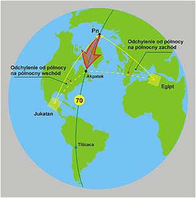

Koncepcję oparłem na założeniu, że projekty pojedynczych budowli czy kompleksów budowlanych uwzględniały położenie ich według kardynalnych kierunków geograficznych. Chodzi tu oczywiście o budowle mające bardzo ważne znaczenie dla całej społeczności, religii czy państwa. Czy było to dyktowane wiedzą o oddziaływaniu pola magnetycznego Ziemi, tradycją czy wymogami religii trudno mi powiedzieć, pozwala jednak stwierdzić, że społeczeństwa te (a przynajmniej ich projektanci) musiały dysponować wiedzą o Ziemi.

Przypuszczam, że tak jak my, tak i oni za najważniejszy uważali kierunek północy, który pokrywa się z osią obrotu Ziemi oraz wyznacza jednocześnie kierunek wschodu Słońca w dniu równonocy. Takie "dziwne" odchylenia nie są jedynie domeną Mezoameryki, spotyka się je na całym świecie, choć z reguły są pomijane jako mało ważne lub w ogóle nie zwraca się na nie uwagi.

O wędrówce bieguna północnego przez kontynenty mówi się niezmiernie rzadko, a odnalezienie jego współrzędnych w określonym przedziale czasowym jest raczej niewykonalne. Lakonicznie stwierdza się, że biegun północny wędrował gdzieś od Alaski i około 12 tysięcy lat temu znajdował się w okolicy wyspy Akpatok na północy Labradoru. Muszę więc opierać się tylko na tej informacji i na tym próbować budować dowody. Przemieszczenie całej skorupy ziemskiej spowodowało przesunięcie się bieguna w nowe miejsce, dzisiejsze. Spójrzmy na rysunek i zrozumiemy, że na Jukatanie musiało to spowodować przesunięcie się kierunków osi budowli na północny wschód, natomiast w Europie i północnej Afryce w stronę odwrotną na północny zachód.

Niestety u boku archeologa nie pracuje zawodowy geodeta, bo archeolog nie widzi potrzeby angażowania go do badań. Stąd "dziwne" przypuszczenia i jeszcze dziwniejsze teorie. Powinno się przeprowadzić dokładne wyliczenia dla każdego kompleksu i porównać to ze współrzędnymi obecnego bieguna. Przyjęcie założenia o zaistnieniu w przeszłości uskoków skorupy ziemskiej pozwoliło by także na umiejscowienie w czasie budowy tych kompleksów. Dlaczego się tego nie robi? Prawdopodobnie w celu uniknięcia szoku i jego następstw wśród rzeszy naukowców, gdyby się okazało, że datowane przez nich miasta powstały w zupełnie innych czasach.

Podobne badania winno się przeprowadzić z linią brzegową jeziora Titicaca i sprawdzić, czy zmiana położenia lustra wody nie została spowodowana przez ten sam kataklizm. Poza tym należało by użyć sieci geodezyjnych satelitów do zeskanowania współrzędnych biegunowych punktów skorupy Ziemi. Punkt w środku kwadratu o wymiarach metr na metr lub większy, winien zawierać trzy wymiary - kąt położenia względem równika, kąt odchylenia od południka zerowego oraz bezwzględną odległość od środka Ziemi. Utworzyło by to trójwymiarowy globus ziemski bez jego wód. Wprowadzenie do programu równania powierzchni wody z uwzględnieniem powierzchni geoidy i oznaczenie na niebiesko jej punktów ukazało by obraz Ziemi w każdym położeniu biegunów zaś symulacja ruchu wody przy zmianach położenia biegunów mogła by pokazać wielkość i zasięg powstałego przy tym tsunami. Proste, prawdaż? Wtedy, przy symulacji "wielkiego uskoku..." okazałoby się dlaczego wysoko w górach odnaleziono szczątki wieloryba, a nie mówić, że dawno, dawno temu było tam morze. Wtedy też można by sprawdzić czy Piri Reiss i jemu podobni mieli rację.

W ten sposób można by udowodnić istnienie nie tylko Atlantydy, ale i lądów na Pacyfiku czy oceanie Indyjskim. Można by także uwiarygodnić istnienie zaginionych miast, które dziś leżą zapomniane pod powierzchnią wody, a także dziwnych śladów prowadzących wprost do morza czy oceanu. Ta sama symulacja winna wyjaśnić klimat w ówczesnym Egipcie, na półwyspie Arabskim, w dorzeczu Eufratu i Tygrysu, że tylko o nich wspomnieć. Za pomocą tej samej symulacji można sprawdzić, co stało się z punktem wschodu słońca podczas równonocy w Egipcie. Moją hipotezą jest ta, że znak podwójnego lwa z symbolem wschodu słońca w Egipcie (dwie pumy w Ameryce środkowej) mówią o tym, że "dom" Słońca, w wyniku "wielkiego uskoku...", dwukrotnie, raz po razie znajdował się w znaku lwa.

Wspomnieć też trzeba o badaniach warstw lawy wypływającej z grzbietu atlantyckiego i odkryciu, że w zastygłych pokładach zachował się układ linii ówczesnego pola magnetycznego. To być może pozwoli na określenie położenia biegunów w dawnych czasach. Uporczywie wraca tu myśl, że w dzisiejszych czasach badania archeologiczne nie mogą obejść się bez współpracy z innymi dyscyplinami, a przede wszystkim z geodezją, geologią, astronomią i podobnymi. I jeszcze jedna myśl. Dlaczego starożytni budowniczowie tak ogromną wagę przywiązywali do budowania w kierunkach kardynalnych, przede wszystkim północ-południe? Czy znali wielki wpływ pola magnetycznego Ziemi na ludzi? Czy kontynuacją tej myśli są dzisiejsi radiesteci?

**Jak to wygląda w praktyce ?**

  
  

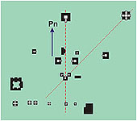

Tikal

Wykonałem kilka rysunków, które ilustrują wspomniane wyżej odchylenia budowli, czy całych kompleksów od kierunku północy. Na pierwszy ogień wziąłem kompleks Tikal w Ameryce Środkowej. Na jego przykładzie chcę pokazać na jakie trudności można napotkać w określaniu odchylenia. Na szkicu widać dwa, wykreślone linią przerywaną, kierunki. Jeden pokrywa się z dzisiejszą północą, drugi zaś przebiega na wschód od niej. Który z nich jest właściwy? Nie wiem. Aby to stwierdzić należy wziąć pod uwagę, które budowle powstały najwcześniej, co miało wytyczać ten a nie inny kierunek, przez jakie budowle on przebiega, czy są podstawy do przyjęcia takiego założenia itd.

Takich kierunków w samym Tikal można wytyczyć kilka, jeśli nie kilkanaście. Gdy weźmiemy pod uwagę grubszy, czerwony kierunek, stwierdzimy, że pokrywa się z dzisiejszym kierunkiem północy. Druga, cieńsza linia wskazuje już inny kierunek. Ponadto nie wiemy, co miało wyznaczać ten kierunek. Czy w budowanych piramidach o podstawie kwadratu kierunek północy wytyczały boki, czy też przekątne piramidy? I na koniec, czy jesteśmy pewni, że archeolog wykonujący szkic dokładnie wyznaczył kierunek północy na planie wykopalisk? Już widzę ich obrażone miny. Panowie archeolodzy, kierunku północy nie powinno się wyznaczać na podstawie wskazania kompasu. Dlaczego? Choćby z kilku powodów.

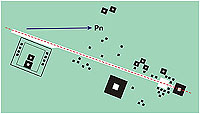

Teotihuacan

Kompas nie zawsze trzyma się idealnie prostopadle do ziemi i nie ma pewności czy w pobliżu, np. pod ziemią nie zalegają rudy żelaza, czy nie ma jakiegoś "składu złomu", czy w pobliżu nie przebiega naziemna lub podziemna trakcja elektryczna itd. Dokładność wyznaczenia kierunku północy zapewnia tylko użycie giroskopu. To jest jedna z przesłanek, aby przy prowadzeniu wykopalisk był obecny zawodowy geodeta i jemu w zasadzie powinno się powierzać wykonywanie dokładnych map badanego miejsca.

Kompleks Teotihuacan w Meksyku jest uważany za najstarszy na tym kontynencie. Miejsce "narodzin bogów" lub "miejsce gdzie staje się bogiem". Tutaj kierunek zdaje się narzucać szeroka aleja nazwana, nie wiedzieć czemu, aleją zmarłych. Jest odchylona od kierunku dzisiejszej północy o około 18° w kierunku wschodnim. Powstanie Teotihuacan nauka umieszcza pomiędzy 100 a 600 rokiem naszej ery. Prawie 1000 lat później hiszpańscy konkwistadorzy zastają już tylko zapomnianą i zasypaną ziemią ruinę?

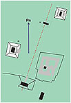

Palenque

Czy to jest właściwa data powstania tego kompleksu? Obawiam się, że nie. Przekazy starożytne mówią, że Teotihuacan zbudowały olbrzymy w epoce drugiego "Słońca". Nie wiadomo co kryją największe piramidy. Świątynia Quetzalcoatla została odkopana spod grubej warstwy ziemi. Naukowcy przypuszczają, że piramidy Słońca i Księżyca kryją w sobie trzy lub cztery mniejsze piramidy usypywane każda na poprzedniej. Ponadto istniejący kompleks odkopano z pod warstwy ziemi, co wytłumaczono tym, że cały naród zasypał swoje budowle, by nie dostały się w inne ręce. Pomyślmy logicznie - Teotihuacan opuszczono z powodu głodu, ale ten głodny, wycieńczony naród zdołał jeszcze własnymi rękami zasypać tyle hektarów. Niewinny żarcik? Teotihuacan świadczy bez wątpienia o jednym. Wiele pokoleń kontynuowało tu swe życie. Dlaczego więc w ciągu zaledwie niecałego tysiąclecia miasto popadło w ruinę? Stara śpiewka - zaraza, głód, wybuch pobliskiego wulkanu, pożar i wojny religijne. Ja sądzę, że przyczyny należy szukać w tych 18 stopniach. "Droga śmierci" powinna dokładnie wskazywać kierunek północy, ale poprzedniego bieguna. Wyludnienia zaś dokonało megatsunami, które przetoczyło się przez Jukatan około 12,5 tysiąca lat temu. Fala wysokości kilku kilometrów zatopiła cały Jukatan. Miasto zostało pokryte warstwą ziemi niesioną przez wodę i popadło w ruinę, bo nie było już komu go odbudować.

Zapewne podobny los musiał spotkać także Palenque. Główna oś całego kompleksu też jest odchylona w kierunku wschodnim. Tu wyludnienie też tłumaczy się tym samym, pominąwszy tylko wulkan, bo takiego nie ma w całej okolicy. Dziwna rzecz. Miasta w rozkwicie, doskonałe warunki komunikacji (jak wiemy zdjęcia satelitarne pokazały niebywałą sieć szerokich na 12 m dróg na całym Jukatanie) i nagle trach! ludzie wynoszą się gdzie indziej (gdzie - nie mówi się). Nie można nawet wskazać miejsca, gdzie te uciekające populacje założyły nowe miasta. W około nędzne chaty, tak jakby z opuszczeniem starych miast wszyscy nagle zapomnieli jak się buduje. Czy to jest wiarygodne wytłumaczenie? Na pewno nie. Brak nowych miejsc osiedlenia się wskazywać może na jedno. Ta cała populacja zginęła nagle. Jak? Pisałem wyżej.

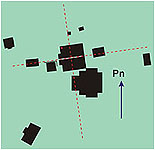

Tiahuanaco

Z Ameryki Południowej - przykład Tiahuanaco. Jest uważane przez niektórych za najstarsze miasto świata. Główny kompleks Kalasasaya, piramida ziemna Apacana i Puma Punku - każde inaczej skierowane w stosunku do głównych kierunków geograficznych. Jeśli za podstawę przyjąć kompleks główny (to ten w którym znajduje się słynna Brama Słońca), to wszystko jest w jak najlepszym porządku. Jeśli za punkt wyjścia przyjmiemy ukierunkowanie Apacany sytuacja się komplikuje i hipoteza zaczyna się chwiać. Ale to nie jest rzetelne podejście, tylko nagięcie faktu do teorii. Możliwe tłumaczenie to takie, że Tiahuanaco być może budowano w kilku etapach, o których nie mamy pojęcia. Koronnych dowodów należałoby szukać gdzie indziej, w pobliskim jeziorze Titicaca. Odnaleziono tu poprzednią linię brzegową nachyloną w stosunku do dzisiejszej. Gdyby jezioro wysychało w niezmiennych warunkach, to stara linia brzegowa byłaby równoległa do dzisiejszego lustra wody, a nie jest.

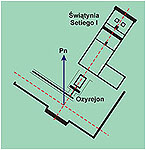  
Abydos - Ozyrejon

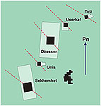  
Sakkara

Wykonajmy teraz skok do Afryki. Jeśli obejrzane pierwsze rysunki w miarę dokładnie oddają treść teorii, to zgodnie z nią kierunki najstarszych budowli Egiptu winny przebiegać w lewo od kierunku dzisiejszej północy, a więc w kierunku zachodnim. Moje przykłady (Ozyrejon i Sakkara) się zgadzają. W Abydos znajduje się Ozyrejon oraz świątynia Setiego II. Oś długa obydwu, przed wielkim uskokiem, skierowana była na wschód Słońca w dniu równonocy. Dlaczego? Budowano tak, by wschodzące Słońce oświetlało główne wejście do świątyni. Coś w rodzaju "wejścia boga". Takie rozumowanie narzuca kierunek północy dla jednego z boków świątyni. I tak jest przedstawione na szkicu. Inaczej rzecz się ma z piramidami. W artykule o Orionie i piramidach, założyłem, że piramidy były skierowane na północ swoimi przekątnymi i to w Sakkara z grubsza by się zgadzało.

Czy zastanowiło już kiedyś kogoś, dlaczego kromlech Stonehenge jest tak dziwnie ukierunkowany? Dlaczego nie według stron świata? Wały wytyczające "aleję" wejściową kierują się gdzieś w stronę północnego wschodu, czyli astronomicznie "nigdzie". Z tego kierunku nigdy nie wschodzi Słońce ani jakaś "znacząca" gwiazda. Sytuacja byłaby rozwiązana, gdyby ten kierunek wskazywał punkt, gdzie wschodzi Słońce w dniu równonocy. Tak, tylko wtedy kierunek północy musiałby wskazywać na okolice Akpatok - miejsce bieguna północnego sprzed 12,5 tysiąca lat.

Moim celem nie było, ani nie jest zdruzgotanie obowiązującej teorii. Moim celem było pokazanie, że "coś w tym jest" i jeżeli moja interpretacja jest do przyjęcia, to mnie cieszy. Jest jakiś punkt zaczepienia dla własnych przemyśleń.

**Co wyszło z obliczeń ?**

  
  

Dla ciekawych, chcących sprawdzić te obliczenia, dodałem rysunek, na którym oparłem się w swoich wyliczankach. Siłą rzeczy nie są to obliczenia dokładne i to z kilku powodów: 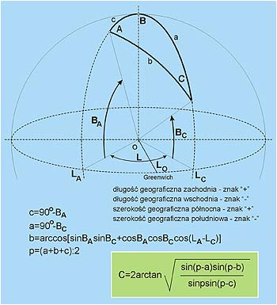

•  nie znam dokładnych współrzędnych bieguna w okolicy wyspy Akpatok,  
•  współrzędne miejsc brałem z atlasu geograficznego i nie wszystkie zdołałem odczytać (brak miejscowości, mapka złożona z dwóch oddzielnych stron itp.),  
•  znalazłem różne wyznaczenie kierunku północy na szkicu miejscowości (z tym spotkałem się na szkicach Monte Alban),  
•  brak pewności, czy określony kierunek, jest tożsamy z tym, który zakładali budowniczy.  

To tylko kilka przyczyn, dla których nie mogę mieć pewności co do prawidłowości swoich obliczeń. Poniżej, w tabelce, zestawiłem wyniki. Wnioski nie są budujące. Przykładowo, wyliczenia dla Gizy, stawiają pod znakiem zapytania moją hipotezę na temat piramid i Sfinksa.

Zakładając jednak, że "wielki uskok..." miał miejsce, rodzi się pytanie następne. Czy ten, o którym mówimy, był jedynym i ostatnim, czy przedtem było ich więcej? Czy takich epok lodowcowych kończących się z "wielkim hukiem" było na Ziemi kilka? Czy każda kończyła się "wielkim uskokiem..."? Teoretycznie możemy to przyjąć. Przecież potop, według Sumerów, po którym królestwo ponownie zstąpiło z nieba miał miejsce, według moich obliczeń około 37 tys. lat temu. I jeszcze jedno. Czy zaistnienie "wielkiego uskoku..." jest uzależnione tylko od masy zgromadzonego lodu?

Można też postawić pytanie - piramidy zbudowano przed potopem, ale przed którym? Jak widać stąpam po dość grząskim gruncie. Historia ludzkości opisywana przez starożytnych tego rejonu świata sięga kilkudziesięciu, a nawet kilkuset tysięcy lat wstecz. Co przez ten okres czasu przechodziła nasza Ziemia, a dokładniej jej powierzchnia? Ile wydarzeń z tego okresu zostało zapisanych lub przetrwało w ustnych przekazach? Nie był to zapewne okres sielskiego spokoju, skoro kilka odrębnych cywilizacji mówi o kilku narodzinach ludzkości i to zwykle po wielkich kataklizmach.

W tabelce przedstawiłem dane, jakie uwzględniłem w swoich obliczeniach.

| NAZWA MIEJSCA | Szerokość \[B\] | Długość \[L\] | Kąt zmierzony | Kąt obliczony |
| --- | --- | --- | --- | --- |
| Akpatok Tula Teotihuacan Villahermosa Monte Alban Uxmal Palenque Tikal Tiahuanaco Machu Picchu Giza Abydos Sakkara | 60,00° N 20,27° N 19,47° N 18,00° N 16,27° N 20,27° N 19,75° N 17,05° N 26,93° S 27,14° S 29,98° N ? ? | 70,00° W 99,57° W 94,88° W 92,94° W 96,94° W 87,79° W 90,86° W 87,47° W 67,50° W 72,82° W 31,32° E ? ? | ? 18° ? ? ? 15° ? 1,5° 1,5° 20° \- \- | 24,5° 19° 11° 23° 16° 19° 15,5° 2° 2° 24° \- \- |

Jak widać, zawodowy geodeta mnie i moje obliczenia umieściłby w wiadomym miejscu. Zastrzegłem jednak na początku, że obliczenia te są bardzo orientacyjne. Jedno co z nich wynika, to tylko to, że zgadzają się w ogólnych zarysach. "Wielki uskok..." mógł być przyczyną przesunięć tych kardynalnych kierunków.

**Zielony promień Słońca**

  
  

Dzisiejsza nauka twierdzi, że budowanie świątyń na szczytach piramid, zigguratów, czy innych wzgórz, miało służyć temu, by być bliżej Boga. Można spytać - którego? Dlaczego nie ma świątyń rytych w ziemi, by być bliżej Pana Podziemi? Dlaczego nie ma świątyń podwodnych, by być bliżej Króla Oceanów? Gdzie budować świątynie dla czcicieli boga wiatru? Jak powinna wyglądać świątynia Boga ognia? Coś tu chyba jest nie w porządku. A jeśli to, co dziś uczeni nazywają świątyniami, wcale nimi nie było? Czy te świątynie nie miały innego, bardziej określonego celu?

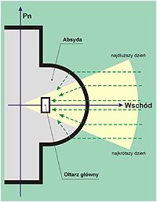

Tradycja czy wiedza ?

Umieszczanie budowli na szczytach miało niewątpliwie jedną zaletę. Obserwacja wschodu Słońca była niczym nie zakłócana. Czy istnieje coś takiego jak "zielone promieniowanie"? O nim to pisali Egipcjanie opisując zmartwychwstanie Ozyrysa twierdzili, że to właśnie zielone promieniowanie przywróciło go do życia. O promieniowaniu zielonym mówią też radiesteci opisujący energetyczne działanie piramidy jako kształtu. Ogólnie jest promieniowaniem dobrym, leczącym. Istnieje też "zielony promień Słońca". Pierwsi zaobserwowali go marynarze podczas zachodu słońca. Trwa krótko, około sekundy. Jeśli teraz połączymy - wzgórze, wschód słońca oraz jego zachód, kapłana witającego wschód lub żegnającego modlitwą zachodzące słońce, czy to jest tylko tradycja, czy może coś więcej?

Kościoły chrześcijańskie absydę mają skierowaną w kierunku wschodu. Kształt absydy jest półkolisty lub wielokątny, ale zawsze oparty na okręgu. W niej znajdował się i znajduje ołtarz główny. Wiadomo też, że kształt i ukierunkowanie zostało przejęte od starożytnych. Czy nie mamy tu do czynienia z działaniem kształtu, mającym na celu skupić w rejonie ołtarza energię zielonego promieniowania wschodzącego Słońca?

Przeciwieństwem promieniowania zielonego jest promieniowanie czarne, złe. Nazywane jest też promieniowaniem Ziemi (tellurycznym). Radiesteci w kształcie piramidy umieszczają go od podstawy do 1/3 jej wysokości. Tu mam inne skojarzenie. Wśród budowli "Inkaskiego kręgu" w Cusco, Machu Picchu i Pisaq spotkać można tzw. świątynie Słońca, które swym półokrągłym murem otaczają olbrzymie bloki kamienia. Z promieniowania ziemi czerpali swą siłę giganci. Jednym z nich był Anteusz, którego zabił Herakles, ale dopiero wtedy, gdy oderwał go od ziemi i udusił w powietrzu. Czy kontynent praAmeryki nie był siedzibą "złych Bogów"? To przecież z niej uszedł bóg Quetzalcoatl zmuszony do tego przez demona Tezcatlipocę. To właśnie tam, a nigdzie indziej w historycznych czasach zapanował kult krwi i rytualnych masowych morderstw. Największa wojna starożytności też przyszła z zachodniego kraju, z Atlantydy. Może to tylko przypadek.

**Po co przekazano nam wiedzę astronomiczną ?**

Wszyscy bez wyjątku uczeni są zachwyceni ogromną wiedzą astronomiczną starożytnych. Chaldejczycy, Sumerowie, Egipcjanie, Majowie - wszyscy zadziwiają wiedzą astronomiczną dorównującą naszej dzisiejszej. Większość skłania się do stwierdzenia, że osiągnięcie takiego poziomu jest nie do przyjęcia, choćby z powodu nie odnalezienia przyrządów astronomicznych, a jeśli takowe znaleziono, to były nader prymitywne i do uzyskania takiej wiedzy potrzeba by było dziesiątków tysięcy lat obserwacji.

Faktem jest, że starożytni znali gwiazdozbiory Zodiaku, znali ruchy planet, mieli swoje "obserwatoria". Nauka twierdzi, że astronomia służyła starożytnym do wyznaczania pór roku, do ustalania czasu siewów i zbiorów, do tego, by przebiegli kapłani wykorzystywali zaćmienia Słońca do swych niecnych celów i utrwalania władzy. Czy rolnikowi potrzebny jest kalendarz by na czas zasiać czy zebrać? Wydaje się, że nie. Zarówno wtedy jak i dzisiaj potrzebny jest tylko po to, by nie spóźnić się z zapłaceniem daniny największemu złodziejowi jakim jest państwo. Nonszalancka nauka od lat twierdzi, że nasi praprzodkowie byli kupą durniów i żeby nie astronomiczna wiedza kapłanów siali by zimą, a zbierali jeszcze nie dojrzałe i tylko wiedza astronomiczna pozwalała utrzymać porządek w przyrodzie. Jest to ewidentna bzdura, ale żaden historyk nie przyjmuje tego do wiadomości.

Zgadzam się z twierdzeniem, że tak wysoki poziom zapewniło by tylko bardzo długie prowadzenie obserwacji, ale nie można ustalić czy była ona w ogóle prowadzona. Majowie nie mieli dogodnej pogody do obserwacji. Egipcjanie, Sumerowie i Chaldejczycy nie mieli przyrządów. Skąd więc u Majów tak dokładne tabele zaćmień? Po co Majom obserwatoria z otworami do obserwacji tylko określonych gwiazd? Skąd u Sumerów taka dokładna znajomość wszystkich planet? Dlaczego Egipcjanie mieli obsesję na punkcie Syriusza czy Oriona? Religia? Tym słowem zatyka się wszystkie dziury dzisiejszej niewiedzy.

Stwierdzenie, że tak dokładnych obserwacji nie mógł poczynić prymitywny człowiek musi doprowadzić do innej konkluzji - wiedzę taką otrzymali od Bogów, lecz takie słowa nie przejdą przez usta żadnemu wyznawcy Darwina. Należy jednak przypuszczać, że tak wielka wiedza astronomiczna została starożytnym przekazana. Czy dawców nazwiemy Bogami, czy też wyższą cywilizacją nie ma znaczenia. Zasadniczym pytaniem winno być - dlaczego wiedza ta została przekazana. Po co prymitywnym ludziom zostawiono tak skomplikowaną naukę? Po co kazano cały czas obserwować niebo? Odpowiedź może być tylko jedna - kolejny wielki kataklizm, kolejny "wielki uskok skorupy ziemskiej". Ostrzeżenie i data zapisana w niezniszczalnym i poza zasięgiem ludzi miejscu - na niebie, by móc się przygotować. Starożytnym przekazano wiadomość - jeśli określone gwiazdy i planety zaczną ustawiać się w takim, a nie innym położeniu, będzie to zapowiedziany termin początku końca. Po to zapewne obserwatoria z otworami do obserwacji tylko konkretnych miejsc nieba. Po to zapewne rozsiane po całym świecie megalityczne kromlechy zbudowane nie wiadomo przez kogo i po co. Być może dlatego kolejni faraonowie wstępujący na tron w starożytnym Egipcie składali przysięgę iż w żadnym wypadku nie zmienią kalendarza, gdyż zmieniło by to obliczenia twórców kalendarza.

Całą tę wiedzę starożytnych dzisiejsza nauka przezwała astrologią i zdegradowała ją do roli wróżb, przepowiedni, mitów i bajek. Nikt nie pokusił się nawet o sprawdzenie dlaczego budowle, zwane obserwatoriami, są skierowane w takim a nie innym kierunku, dlaczego w kamiennych kręgach wyróżniono tylko niektóre kamienie. Na jakie gwiazdozbiory są skierowane, a są to zapewne jasne gwiazdy i nie trzeba ich szukać po całym niebie. Niektóre leżą w ekliptyce i są uwzględniane przez każdą cywilizację, choć są inaczej nazywane i co ważne, są widoczne z każdego miejsca na Ziemi. Mając takie założenie należało by jeszcze raz zbadać wszystko co wiąże się z astronomią starożytnych i sprawdzić czy nie mówią o słynnej już dacie 23 grudnia 2012 roku. Dla ludzi to bardzo ważne o ile nie najważniejsze.

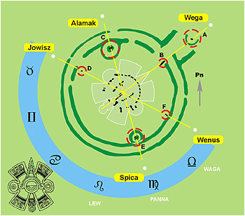

Naui Ollin i Stonehenge

Tajemniczy kromlech w Stonehenge. Nie wiemy o nim nic. Kiedy go zbudowano, kto go zbudował, a przede wszystkim po co został zbudowany. Zastosowany budulec wskazuje, że budowla ta musiała mieć kapitalne znaczenie. Podobnych, choć nie tak wspaniałych, kręgów kamiennych jest dużo i są rozrzucone po wszystkich kontynentach. Ile jest niezidentyfikowanych, a ile zniszczonych nie wiadomo. Ktoś, kto stawiał te megalityczne budowle musiał mieć jakiś cel i ten cel nie mógł być błahy. Czy "Ktoś" w przeszłości wiedział, że Ziemi co pewien czas zagraża totalna katastrofa i w ten sposób przekazał termin nastepnej? Czy ten "Ktoś" przewidywał, że kiedyś w przyszłości ludzie będą w stanie to zrozumieć i posiadając odpowiednią technikę poczynią odpowiednie kroki? Sądzę, że tak. Nie przewidział jedynie ich braku wiary w to, co starali się przekazać.

To co przedstawiłem na szkicu to resztki kamiennego kręgu, naruszonego prawdopodobnie przez jakieś trzęsienie Ziemi w dalekiej przeszłości. Pewne jednak ocalałe fragmenty są zastanawiające. Punkty A, C i E, jako jedyne, są "wyróżnione" obwałowaniem z ziemi, Kamienie D i F leżą na kręgu złożonym tylko z tzw. jam Aubreya. Linia łącząca obserwatora z punktami A i B, najbardziej chyba wyróżniona, wskazuje kierunek na północne niebo, gdzie na pewno nie odnajdziemy żadnej planety. Linie prowadzone przez wyróżnione punkty kreślą wyraźną symetrię. Czy na ich przedłużeniu w dniu 23 grudnia 2012 roku ukażą się określone gwiazdy lub planety? Jakie to gwiazdy i jakie planety? W jakim czasie należy dokonać obserwacji? Czy chodzi o heliakalny wschód Wenus? Czy to będzie nasz ostatni wschód Słońca? Czy Gaja ukarze nas za ignorancję?

Może będzie tak - współczesny, ciepło ubrany druid tuż po północy 22 grudnia 2012 roku zajmie miejsce w środku kręgu. Jako inteligentny i wykształcony darwinista, ot na wszelki wypadek, na kamieniu ofiarnym złoży dary dla Bogów. Trzy godziny przed wschodem Słońca, w dołach "E" i "C" poleci swym pomocnikom rozpalić ogniska. Około 6.00 Wega zacznie nasuwać się nad Heel Stone (kamień "A"), Spica nad ognisko "E", a Alamak (gamma Andromedy) nad "C". Jowisz pomału będzie chylił się ku zachodowi. O 6.23 nad kamieniem "F" rozbłyśnie Wenus zapowiadając wschód Słońca, a jednocześnie Jowisz zniknie nad kamieniem "D". Po głowie zaczną przelatywać budzące grozę myśli. Mieli rację czy nie?

Znak Majów, Ollin umieściłem jedynie dlatego, że on sam wykazuje też pewnego rodzaju symetrię. Czy ta symetria wskazuje na jakiś związek? Nie wiem. Może... Środek znaku przypomina oko. Miejsce obserwatora? Przyjmując założenie, że większość lub wszystkie kamienne kręgi przekazują nam ostrzeżenie z przeszłości, należałoby jeszcze raz je zbadać i wyciągnąć wnioski. Ja zaś czekam na wiadomość od astronoma bez uprzedzeń. Być może pobłądziłem, ale dla mnie będzie to bardzo miłe rozczarowanie.

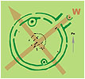

Zakładając jednak, że "wielki uskok..." miał miejsce, to spójrzmy na Stonehenge trochę inaczej. Tak monumentalnych obiektów nie budowano tylko po to, by zwykły chłop miał uświadamiać sobie pory siewów czy zbiorów. To są zwykłe bajki obliczone na nieświadomość zwykłych czytelników, a także jako zasłona dymna dla bezsilności uczonego rozumu. Projekt i wykonanie Stonehenge służyło zapewne komuś innemu. To nie była budowla dla zwykłych ludzi i zapewne przez ludzi nie zbudowana. Zwykli ludzie budowali proste chaty nie przejmując sie zbytnio kardynalnymi kierunkami geograficznymi. Jeśli Stonehenge było czymś w rodzaju kamiennego obserwatorium astronomicznego, to musiano przy jego budowie uwzględnić kierunki geograficzne, a najważniejszym zarówno dla nas jak i budowniczych Stonehenge był kierunek północy, a właściwie punkt wschodu Słońca w dniu równonocy. Jeśli tak, to "wejście" do kromlechu winno wskazywać ten właśnie kierunek. Na jaki zatem kierunek północy wskazuje takie ustawienie kręgu? Z pobieżnych wyliczeń wynika, że wskazuje kierunek na Akpatok, na biegun północny sprzed 12,5 tysiąca lat.

**Czy możemy spać spokojnie?**

Cokolwiek bym napisał może zabrzmieć nieszczerze. Co piszą na ten temat inni? Piszą bardzo ciekawie:

Bogusław Jeff Leng - Ujmując to brutalnie - Orion i Gemini są już prawie na swoich miejscach; 187-letni okres aktywności Słońca jest niemal w szczycie; Wenus z kolei zmierza nieubłaganie ku swojej pozycji, identycznej, jaką miała w tym układzie w roku 9792 pne. Precyzyjne obliczenia orbity Wenus przez tamtych astronomów wykazały, że zajmie tę pozycję (w wyniku korekty ery Lwa, po okresie 11 804 lat od dnia 27 lipca 9792 roku pne) dokładnie 22-23 grudnia 2012 roku. Koniec kalendarza, rok Apokalipsy.  
Dlatego liczba ta była u Majów święta. Tak im to nakazali ich przodkowie, kimkolwiek byli. Jak twierdzą nasi badacze, to właśnie zapisała nam tamta cywilizacja tysiące lat temu. Piramidy w Gizie krzyczą o ruchach Oriona - obserwujcie Oriona, on niesie zagładę! Faktem jest, że w 2012 roku ustawienie piramid względem Oriona będzie identyczne jak w roku 9792 pne, co potwierdzają współczesne symulacje komputerowe. Piramidy powstały podobno po tamtym kataklizmie, około roku 9400 pne, ale ustawiono je z taką precyzją, żeby przekazały ostrzeżenie potomnym. Jeszcze wcześniej powstał Sfinks, w hołdzie dla ery Lwa, pierwszej ery nowego świata.

Czy po wydarzeniach z 26 grudnia 2004 r. w rejonie oceanu Indyjskiego jesteśmy już w stanie sobie uzmysłowić, czym każdej ziemskiej istocie grozi "wielki uskok..."? Matka-Ziemia pokazała to w mikroskopijnej skali. Czy nie widać, jakie trudności ma społeczność całego świata z ratowaniem pozostałych przy życiu "tylko" kilku milionów ludzi? Jeśli taki kataklizm dotknie całego świata, to kto wystąpi w roli ratujących? Czy teraz można zrozumieć, dlaczego pomiędzy 12,5 a 5 tysiącami lat pne., historia naszej cywilizacji nie istnieje?.

Co jeszcze dodać?

Kronika z Akakor zawiera tajemnice wybranych plemion \[...\] Opisuje rozwój i upadek wybranego przez Bogów ludu aż do końca świata, kiedy to Bogowie powrócą po trzeciej wielkiej katastrofie, **która zniszczy ludzi** \[...\] Tak jest napisane. Tak powiadają kapłani. Tak jest zapisane w dobrym języku, wyraźnym pismem.

Rozumiem, że to spora dawka adrenaliny, ale czy data "23 grudnia 2012 r." jest datą wiążącą i prawdziwą? Może tak i może nie. Moim zamiarem nie było zasianie niepokoju, a tylko pokazanie możliwości katastrofy, jaką może nam zgotować nasza Ziemia. Jest jasne, że tego rodzaju katastrofie nikt nie jest w stanie zapobiec i to musi dotrzeć do naszej świadomości. Jedynym rodzajem ratunku jest ucieczka w kosmos, a takiej możliwości jeszcze długo mieć nie będziemy i takiej możliwości nie miała chyba także cywilizacja Bogów, skoro ze starożytnych przekazów dowiadujemy się, że można było ocalić tylko nielicznych. Ale wróćmy do daty. Nikt ze zwykłych ludzi nie ma cienia szansy na sprawdzenie czy tę datę ustalono prawidłowo. Dlaczego tę datę tak chętnie powiązano z ponurą przepowiednią zupełnie innego ludu? Na jakiej podstawie? W jaki sposób ustalono jej korelację z naszym kalendarzem?

Przypuszczać należy, sądząc z techniki liczenia czasu, że kalendarz Ameryki Środkowej określał czas ważnych wydarzeń od początku jakiejś epoki, jakiegoś punktu zerowego, który definitywnie kończył jedną erę i rozpoczął następną. Dziś za taki zerowy punkt uznano jakieś wydarzenie sprzed ponad 8 tysięcy lat temu i był to ponoć heliakalny wschód Wenus. Ja zaś jestem przekonany, że taką datą zerową musiał być kataklizm, który zniszczył całą poprzednią cywilizację i to nie tylko w Ameryce. Jedyny taki kataklizm, który także nieśmiało dopuszcza w tej chwili nauka, mógł się zdarzyć około 12,5 tysiąca lat temu. Jeśli tak, to prawdopodobnie słynna data "23 grudnia 2012 r." dotyczy wydarzenia, które już się wydarzyło i to dość dawno.

Śpijmy więc spokojnie pamiętając jednak, że nasz spokój niczego w sumie nie zmienia.
