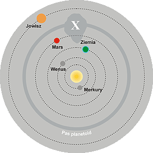
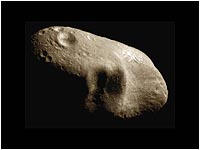

**Strach w 52-letnim cyklu**  
A imiona ich to "wielu" i "świder ognisty".

**O czym pisze Erich von Daeniken**

Kalendarz Majów dostarczył nauce nie lada sensacji. Stwierdzono, że istniały równolegle dwa kalendarze tzolkin i haab. Tzolkin to rok boski liczący 260 dni (20 miesięcy po 13 dni), natomiast haab traktowano jako kalendarz "roboczy" liczący 18 miesięcy po 20 dni, na którego końcu dokładano 5 dni uznawanych za "feralne" otrzymując w sumie 365 dni. Oba kończyły jednocześnie każdy 52-letni, niezrozumiały cykl zamykający się datą 4-Ahau 8-Cumhu.

Erich von Daeniken w swojej książce "Dzień, w którym przybyli Bogowie" opisuje swoją korespondencję z dr. Kisslingiem. Pozwolę sobie zacytować obszerny fragment jego książki.

Tzolkin i haab składają się na "calendar-round", liczący 18980 dni albo 52 lata. Koło tzolkin obejmujące 260 dni jest mniejsze od koła haab, mającego 365 sektorów na 365 dni. W ciągu 52 lat koło haab obraca się tylko 52 razy, gdy tymczasem koło tzolkin musi wykonać 73 obroty, żeby nie wypaść z gry. Ale w ciągu 52 lat każdemu z kół udaje się jakoś wypełnić plan:

52 × 365 = 18980 dni      73 × 260 = 18980 dni

Tzolkin był kalendarzem świętym, boskim, bez jakiejkolwiek wartości praktycznej - 73 lata boskie odpowiadały 52 latom ziemskim. W okresie tych 52 lat, zgodnie z odczytanymi hieroglifami, na firmamencie dziesięć razy ukazywali się określeni bogowie o nader skomplikowanych imionach - co 52 lata obawiano się powrotu tych "strasznych istot". Jeżeli w trakcie owych 52 lat (18980 dni) bogów było widać na firmamencie dziesięć razy, to logiczne jest, że w ciągu 5,2 roku (1898 dni) tylko raz.

---

Dr Kiessiing zadał sobie pytanie: Co pojawiało się więc co 5,2 roku (albo co 1898 dni) na niebie? Kometa? Statek kosmiczny? Boska planeta Wenus? Zaciekawiony badacz skrupulatnie sprawdził wszystkie dane orbit planet Układu Słonecznego i poczynił zadziwiające spostrzeżenie:

Nazwa planety

obieg Słońca w dniach ziemskich

obieg Słońca w latach ziemskich

   Merkury

88

0,24

   Wenus

225

0,62

   Ziemia

365

1,00

   Mars

687

1,88

   **Planeta X**

**1898**

**5,20**

   Jowisz

4329

11,86

Jeśli spojrzymy na schemat Układu Słonecznego, od razu rzuci nam się w oczy wielka luka między Marsem a Jowiszem. Porusza się tam dokoła Słońca zgodnie z prawami Keplera olbrzymia, widoczna tylko przez teleskop gromada niewielkich ciał niebieskich zwanych planetoidami. Jeżeli założymy, że planetoidy te są szczątkami jakiejś planety, to będzie można obliczyć, że planeta owa, w czasie kiedy stanowiła całość, wykonywała jeden obrót wokół Słońca w ciągu 1898 dni, czyli dokładnie 5,2 roku ziemskiego!

---

Z tego punktu widzenia kombinacja kalendarza tzolkin i haab byłaby nieprzypadkowa - określałaby dokładny okres obiegu Planety X wokół Słońca. Określałaby zarazem nie tylko to - 1898 dni razy 10, równa się 18980 dni (52 lata), a co 52 lata Planeta X znajdowała się najbliżej naszej planety. Tego właśnie dnia dzieci Ziemi obawiały się przybycia bogów i dlatego przed upływem cyklu kalendarzowego narastało wśród Majów takie napięcie.

---

Z tego powodu co każde 52 lata ze strachem i ze szczególną uwagą obserwowano niebo - oczekiwano pojawienia się boga Kukulcana albo Quetzalcoatla. Zbieganie się dat boskiego kalendarza tzolkin i ziemskiego haab w 18980 dniu zwiastowało niebezpieczeństwo. Istoty pozaziemskie i Ziemianie przygotowywali się do spotkania na najwyższym szczeblu.

Tu chyba pana Daenikena trochę poniosła fantazja. Sądzę, że wyciągnął zbyt daleko idące wnioski. Dlaczego? Wydaje się, że nie chodzi o spotkanie z Bogami, a raczej o spotkanie z czymś gorszym - z kosmiczną śmiercią. Ale po kolei.

**Kłopoty z kalendarzem Majów**

...a właściwie z kalendarzem całej Mezoameryki, gdyż jak twierdzą uczeni, kalendarza tego używały wszystkie ludy od Meksyku po Jukatan. Odkrycie go było wielką sensacją, która niebawem zamieniła się w wielki kłopot. Jak oni go używali?

Do dnia dzisiejszego zdania uczonych są podzielone. Bardzo mała, wręcz uznawana za skąpą ilość materiału spowodowana konkwistą ówczesnej Hiszpanii oraz szczególnym działaniem "naziemnego personelu" Najwyższego, zaowocowała zniszczeniem tubylczej "bazy danych" - spisanych dziejów liczących setki, jeśli nie tysiące lat. Materiały, na których opiera się dzisiejsza nauka, to kilka tzw. "kodeksów" oraz zapiski mnichów hiszpańskich, którzy opamiętawszy się po początkowym szale niszczenia raczyli zauważyć, że zniszczyli kulturę, która pod pewnymi względami, przewyższała nawet ich własną. Powód tej kulturowej restauracji był zapewne bardziej prozaiczny - mnisi chyba doszli do wniosku, że w orgii niszczenia mogli spalić też cenne informacje o miejscach bajecznych skarbów Indian, ale to tylko mój domysł.

Co można powiedzieć o tym kalendarzu? Jest tak skomplikowany, że do dziś nie ustalono jednolitego poglądu na sposób liczenia czasu. Jego interpretacja odbywa się na wałęsowskiej zasadzie: "jestem za, a nawet przeciw". Nie ustalono ani początku, ani końca kalendarza, a co za tym idzie brak jest punktu zaczepienia z naszym dzisiejszym kalendarzem i naszą chronologią. Jeśli zaś nie można tego ustalić, to wprowadza się teorię zabobonu. Mówi się, że jest to "kalendarz bosko-astrologiczno-astronomiczny z elementami matematyki w systemie dwudziestkowym uwzględniającym cyfrę zero, służący do odmierzania czasu pozostałego do śmierci Matki-Ziemi ze wskazaniem terminów modlitw do Boga aktualnie dominującego na firmamencie". Żarty, żartami, ale co tak naprawdę można o nim powiedzieć. Jest kalendarzem posiadającym trzy, a właściwie cztery elementy:

-   Liczbę dni, jaka upłynęła od jakiegoś określonego wydarzenia będącego początkiem kalendarza.

-   Kalendarz "boski" nazywanym przez twórców "tzolkin" lub "tonalpohualli", co tłumaczy się jako "rachunek dni" lub "rachunek losu". Składa się z 20 elementów podzielonych jeszcze na 13 składowych dających razem 260 jednostek nazwanych przez nas dniami. Nazwy "dni" to: Imix, Ik, Akbal, Kan, Chicchan, Cimi, Manik, Lamat, Muluc, Oc, Chuen, Eb, Ben, Ix, Men, Cib, Caban, Eznab, Cauac i Ahau. Nazwy przetłumaczone na język narodowy nie dają w zasadzie nic, a tylko gmatwają sprawę.

-   Kalendarz "ziemski" nazywany haab - 18 "miesięcy" po 20 "dni" dającym w rezultacie 360 dni, po upływie których dodawano 5 dni feralnych (nemontemi). Wyróżnia się tu w zasadzie dwa terminy: "tun" - liczący 360 dni oraz "haab" liczący 365 dni. Czy Majowie znali rok przestępny? Chyba tak. Mnich hiszpański, Sahagun, pisze: "... istniały określone lata, które posiadały 6 nemontemi." co wskazywałoby na to, że Majom nieobce były niedoskonałości kalendarza. Nieznany jest także sposób kończenia roku. Czy po 360 dniach kalendarz zatrzymywał się na 5 dni, czy koła czasu obracały się przez całe 365 dni? Nazwy "miesięcy" to: Pop, Uo, Zip, Zotz, Tzec, Xul, Yaxkin, Mol, Chen, Yax, Zac, Ceh, Mac, Kankin, Muan, Pax, Kayab i Cumhu.
-   Kalendarz, o którym się prawie nie wspomina, nazywany "xiuhamatl" - księga lat. Składał się z 4 elementów podzielonych na 13 części, które w kombinacji (13 × 4) dawały liczbę 52.

Jak ich używano, do dziś toczą się spory. Najczęściej wspomina się o trzyczęściowym kalendarzu, składającym się z liczby dni, kalendarza tzolkin i kalendarza haab. Każdy cykl kalendarza (boskiego i ziemskiego współdziałających razem) trwał 52 lata. W tym okresie nie powtarzała się żadna kombinacja złożona z liczby i nazwy elementu "tzolkin" oraz liczby i nazwy elementu "haab". Przykładowo data "12-Men 18-Mac" nie mogła się powtórzyć w jednym cyklu 52-letnim. Na potrzeby nauki stworzono dwa systemy liczenia dni: krótkie i długie liczenie. Daty w tych systemach wyglądają następująco:

krótkie - **4-Ahau 8-Cumhu**, albo długie - **13.0.0.0.0. 4-Ahau 8-Cumhu**.

Wprowadzony przykład kalendarza Majów z trzema obracającymi się kołami całkowicie, według mnie, zaciemnił sprawę. Nigdzie, w żadnym miejscu Mezoameryki, nie znaleziono czegoś takiego i raczej wprowadzono go dla udowodnienia "naukowości" tej teorii. Majowie czy Aztekowie nie obracali kółkami, a mozolnie dzień po dniu zapisywali daty i wydarzenia z nimi związane. Co więcej, z opisów (Naród Słońca, Dawni Meksykanie) wynika, że daty zapisywano w trzech księgach: rachunku dni "tonalpohualli", rachunku lat "xiuhpohualli" i księdze lat "xiuhamatl". Ponadto nauka jest zgodna co do tego, że istniejąca ówcześnie cywilizacja tego kalendarza nie stworzyła. **Ten kalendarz został im dany**. Z tego względu, sądzę, musiał być prosty w użyciu i zawierać tylko niezbędne elementy pozwalające ostrzegać przed niebezpieczeństwami z przyszłości. Sprawa wplątania w to Bogów była chyba sprawą wtórną i obliczoną na łatwiejsze "zapamiętanie" zdarzeń przez ludzi.

Nie spodziewaj się ode mnie gotowej recepty na kalendarz Majów. Gdybym ją znał, to zapewne i ty znałbyś mnie od dawna z imienia i nazwiska jako wielkiego odkrywcę. Niestety brak mi gruntownej wiedzy matematycznej i astronomicznej, a ta leży zapewne u podstaw kalendarza. Chcę tylko zwrócić uwagę na najważniejsze, moim zdaniem, elementy oraz postawić trochę kłopotliwych pytań.

Na początek dwie daty odczytane w ruinach Mezoameryki i trzy odpowiedzi:

**Autor obliczeń (rok) / Data**

**13.0.0.0.0. 4-Ahau 8-Cumhu**

**0.0.0.0.0. 4-Ahau 8-Cumhu**

      Makemson (1946)

11 luty 3373 r. pne      

2 październik 8499 r. pne      

      Spinden (1930)

15 październik 3373 r. pne      

5 czerwiec 8498 r. pne      

      Thompson (1935)

13 sierpień 3113 r. pne      

2 kwiecień 8238 r. pne      

Jak na ilość lat, prócz "drobnych" rozbieżności, można przyjąć, że nauka jest zgodna. Nie spotkałem pełnego opisu zastosowanych metod, oprócz tego, że były skomplikowane, mozolne, praco i czasochłonne. Dość ścisły i naukowy opis metody, ale nie pozwalający na sprawdzenie prawidłowości obliczeń. Czy wynika z tego, że wspomniani badacze też pisali księgi dni i lat, lecz do tyłu? Ta sama nauka przekazała nam także, że "Majowie" określili długość roku z zadziwiającą precyzją - 365,2422 doby. Czemu więc nie wykorzystać tej informacji do określenia upływu lat? Zbyt prostackie i mało "naukowe"?

Zanim spróbuję coś policzyć trzeba jeszcze wspomnieć, że nauka określa zapis liczb Majów jako podobny do naszego dziesiętnego (wielkość liczby zależna jest od pozycji cyfry) ale nie jest zgodna co do mnożników, wykonam więc dwa rodzaje obliczeń dotyczące wieku początku kalendarza. Jako datę przyjmiemy - **19.19.19.19.19.12-Ahau.19-Cumhu** - ostatniego dnia cyklu poprzedzającego początek kalendarza przy jednoczesnym założeniu, że rok ma 365 dni i nieuwzględnieniu lat przestępnych.

**Liczba**

**Mnożnik logiczny**

**Wynik I**

**Mnożnik naukowy**

**Wynik II**

19

20 × 20 × 20 × 20  

3 040 000   

baktun=144 000  

2 736 000   

19

20 × 20 × 20  

152 000   

katun=7 200  

136 800   

19

20 × 20  

7 600   

tun=360  

6 840   

19

20  

380   

unial=20  

380   

19

1  

19   

kin=1  

19   

12-Ahau

19-Cumhu

340   

340   

W obliczeniach nie uwzględniłem kalendarza Tzolkin, gdyż liczył on ilość dni w innym, "boskim" roku, a w zasadzie był chyba tylko potrzebny do utworzenia jednej niepowtarzalnej nazwy daty w cyklu 52 lat. Tak mi się przynajmniej wydaje. Policzmy zatem ilość dni i zamieńmy na lata trwające po 365,2422 dnia.

Ilość dni

3 200 339   

2 880 626   

Ilość lat

**8762,24**

**7886,89**

Wynik zbliżony, choć z rozrzutem szrapnela. Jedno co jest pewne - było to bardzo dawno temu. Pozostają dwa problemy: Który sposób oddaje właściwe obliczenie liczby dni, a co za tym idzie lat oraz jaką naszą datę należy przyjąć za "zerową"? Nadto nic nam nie wiadomo kiedy powstał ten kalendarz i jakie wydarzenie jest jego początkiem. Trudności z uzyskaniem materiału badawczego (czytaj - nie umieją odczytać hieroglifów, bo materiału badawczego jest ogromna ilość) nie posuwają sprawy naprzód.

Następne pytanie, bardziej już retoryczne. Dlaczego uczeni unikają objaśnienia istoty trzeciego kalendarza zwanego "ksiegą lat"? Po co używano by dwóch kalendarzy mających wspólną liczbę 52? Kalendarz (tzolkin i haab) był stworzony dla 52-letniego cyklu. Maiści twierdzą, że jedna data mogła się powtórzyć najwyżej dwa razy w cyklu jednego pokolenia Indian, a i to byłby przypadek, bo ci nie żyją zbyt długo, ale zastosowanie trzeciego kalendarza w systemie "bardzo długie liczenie" wykluczyło by powtórzenie się daty przez okres bez mała 2700 lat. W kalendarzu tym używano 4 "kwartałów" podzielonych na 13 części. Były to: Acatl (trzcina), Tecpatl (krzemień), Calli (dom) i Tochtli (królik). Czy spotkano już datę zapisaną w takim formacie?:

**13.0.0.0.0. 4-Ahau 8-Cumhu 1-Acatl**.

I kolejne: skąd uczeni posiadają pewność, że liczba dni poprzedzająca nazwę w 52-letnim cyklu składała się tylko z pięciu pozycji? Czy nie mogła składać się z sześciu? Chyba mogła. Majowie mogli równie łatwo jak my dopisywać liczby z przodu. Co to może oznaczać? Na przykład to, że data **19.19.19.19.19.19.12-Ahau.19-Cumhu** oznaczała by wydarzenie z przed 175 227 lat! Tylko co wtedy mogło być wydarzeniem wyznaczającym "start" kalendarza?

Czy przypadkiem sami naukowcy nie skomplikowali sprawy, by dodać sobie powagi? Pomyśl logicznie: skoro pierwsza część daty zawiera liczbę dni od początku kalendarza, to wystarczy podzielić ją przez 365,2422 i otrzymujemy liczbę lat z dokładnością do jednego roku. Ale stawiam pytanie: czy przypadkiem licznik ten nie "przeskakiwał" o 1 dopiero po upływie 52-letniego cyklu? Jeśli tak, to liczba z przodu winna wskazywać ilość cykli po 52 lata każdy i wszystkie dzisiejsze wyliczenia można spokojnie wyrzucić.

Kalendarz Majów jest podobny do kalendarza egipskiego, ale tylko w miejscu gdzie jest mowa o roku składającym się z 360 dni i dodatkowych 5 dniach. Mam niejasne przeczucie, że w liczbie 360 dni zawiera się także jakaś informacja o kole i kącie pełnym. Coś w rodzaju mitologicznego - "koło się zamknęło" lub "cykl się zakończył", bogowie udali się na 5-dniowy wypoczynek. Czy nie oznaczało to, że koło czasu należy zatrzymać i puścić w ruch ponownie dopiero po upływie 5 dni feralnych? Nie mam żadnego pomysłu.

W sumie, wydaje mi się, że dla Majów naistotniejszy był kalendarz o 52-letnim cyklu oraz data 4-Ahau 8-Cumhu, która pojawiała się na 19 dni przed jego zakończeniem. Dlaczego? O tym niżej.

**Pierścień z dużym kamiennym oczkiem**

Będąc niejako poza naukowym gremium i laikiem w dziedzinie astronomii mogę pozwolić sobie na wszystko to spojrzeć z boku i zarazem inaczej. Nie zwalnia to wszakże od jednego. Moja hipoteza nie może urągać logice. Przesłanki naukowe dopuszczają, że w miejscu, gdzie dziś rozciąga się pas planetoid, po ich orbicie kiedyś krążyła planeta. Została rozbita lub wybuchła. Z teorią wybuchu planety byłbym ostrożny więc pozostańmy przy kosmicznej katastrofie.

Potężnie uderzona planeta bądź cała rozpadła się na kawałki, bądź wierząc Sumerom została rozbita na dwie części. Jedna część stała się naszą Ziemią, pozostałość krąży wokół Słońca w kawałeczkach po jej dawnej orbicie.  Kolizja spowodowała wyrzucenie w przestrzeń ogromną ilość gruzu kosmicznego. Część uleciała bezpowrotnie w kosmos, część zapewne opadła na Słońce, część pochłonął Jowisz, część spadła na inne planety, część oglądamy jako widowiskowe komety, a reszta zaś w postaci planetoid w dalszym ciągu okrąża naszą gwiazdę.

Niektórzy wręcz twierdzą, że żadnej katastrofy nie było. Pokażcie nam "winowajcę", który spowodował rozbicie! Nie ma takiego! Takie rozumowanie prowadzi do paradoksu - jeżeli jest trup, a nie ma mordercy, to czy mamy prawo twierdzić, że nieboszczyk jest żywy?

To jednak nie wszystko. Nie myślmy, że planetoidy to rząd koralików, gęsiego okrążający Słońce w równym i karnym rządku. Nie. Zamiast o pasie winno się mówić raczej o rurze planetoid i to rurze o zmiennej średnicy. W moim przekonaniu w miejscu dawnej kolizji gruz utworzył zapewne wielką chmurę odłamków planety, stanowiących coś w rodzaju "oczka" w tym pierścieniu planetoid (na rysunku oznaczyłem to jako X).

Czy co 10 okrążeń Słońca pozostałość po Planecie X zbliżała się i zbliża w dalszym ciągu do Ziemi na najmniejszą odległość? Co 52 lata Majowie oczekiwali w trwodze na przybycie Bogów. Jakich Bogów? Przecież Bogowie byli ich stworzycielami, dali im ziarna kukurydzy i nauczyli uprawy roli, polewali pola życiodajnym deszczem, codziennie dawali ciepło i światło. Jak można bać się dobroczyńców? Czego więc Majowie się obawiali?

Chyba tego, że Ziemia co 52 lata zbliżała się i zbliża w dalszym ciągu do wielkiego "oczka" pierścienia planetoid, do miejsca tworzącego "chmurę" kamieni, miejsca w którym kiedyś istniała planeta. Grawitacja zbliżającej się Ziemi być może jest zdolna do "wyrwania" z tej chmury jednej lub kilku planetoid i spowodować ich upadek na Ziemię. Bernardin de Sahagun (1500-1590), mnich hiszpański w "Historii ogólnej spraw Nowej Hiszpanii" pisze:

Powiadano, że kiedy nadeszła noc, bardzo się bano, oczekiwano, że gdy świder ognisty nie spadnie szczęśliwie, wówczas wszystko zginie, wszystko się skończy, nastanie zupełna noc. \[...\] A wszyscy byli owładnięci wiarą w czary do tego stopnia, że każdy starał się mieć na baczności przed niebem, przed gwiazdami, których imiona to **wielu** i **świder ognisty**.

Majowie nie bali się Bogów. Majowie obawiali się kosmicznego "przybłędy", owego świdra ognistego, który może przynieść tylko śmierć wszystkim i wszystkiemu. Bogowie, wiedząc o takiej możliwości, poinformowali ich o takiej ewentualności i przekazali kalendarz, który będzie im o tym przypominał co 52 lata. Być może pouczenie brzmiało: Jeśli chcecie przeżyć, oglądajcie pilnie niebo szczególnie pod koniec cyklu, jeśli zauważycie zbliżające się niebezpieczeństwo chowajcie się pod ziemię, w grotach, ale nie pozostawajcie bierni.

Widać naszym uczonym jak zwykle coś umknęło. Może popełnili błąd w tłumaczeniu lub w interpretacji tekstów. Być może jest prawdą stwierdzenie, że:

**nasz Armagedon nazywa się 4 Ahau 8 Cumhu**

 Może my, cywilizowana społeczność, także powinniśmy zacząć się obawiać i rozpocząć dokładniejsze badania pasa planetoid, a w szczególności określić położenie tej "chmury" odłamków, rozmiar tego "oczka" pierścienia i obliczyć, czy takie zdarzenie jest możliwe. Musimy jeszcze raz sprawdzić, kiedy nastapi zakończenie 52-letniego cyklu Majów i zacząć dokładniej przypatrywać się niebu.

Na zdjęciu obok można zobaczyć jak wygląda jeden "Bogów" Majów, których tak się obawiali. To planetoida Eros, jedna z mniejszych. Ma tylko 35 km średnicy i porusza się po orbicie, której średnia odległość od Słońca wynosi około 213 mln km, a więc bliżej niż Mars! Dotychczas zidentyfikowano około 400 tys. planetoid, ale orbity tylko około 2000 są nam znane. Największe z nich mają średnicę: Ceres - 768 km, Pallas - 492 km a Juno - 204 km, ale te raczej nam nie zagrażają gdyż krążą w dalszym ciągu pomiędzy Marsem a Jowiszem. Ponadto uczeni od dawna zastanawiają się nad księżycami Marsa. Twierdzą, że Dejmos i Fobos, to przechwycone planetoidy, ale nie wiedzą jak to się stało. Czy przypadkiem Mars nie dokonał tego w dalekiej (lub nie) przeszłości przechodząc przez "oczko" pierścienia?

---

Zauważyłem też pewną rzecz, która zaczyna napawać mnie niepokojem. Od 2-3 lat w prasie zaczynają pojawiać się notatki o mijaniu Ziemi przez meteoryty różnej wielkości i to w coraz mniejszej odległości od naszej planety. Czy nie jest to oznaką, że Ziemia zbliża się do jakiegoś skupiska "gruzu kosmicznego", owego "oczka pierścienia", o którym pisałem wyżej? Jak do tej pory astronomowie zauważają "gości" z kosmosu dopiero w pobliżu Ziemi lub tuż po jej minięciu. Czy na takim poziomie stoi wykrywanie niebezpieczeństwa, czy też astronomowie nie chcą siać paniki wśród ludzi? Czy w drodze już są "wielu" i "świder ognisty"? Na pewno są i na pewno nie będą czekały na nasz rozwój nauki i techniki, ale priorytetem ziemskiej cywilizacji jest w dalszym ciągu wyścig zbrojeń.

A co nas może czekać? Asteroida o średnicy sięgającej 400 metrów zagraża Ziemi. Mniejsza niż 65 mln lat temu, ale większa on meteorytu tunguskiego. Jak obliczyli astronomowie, może ona uderzyć w naszą planetę 13 kwietnia 2029 roku (Piątek!!! I jak tu nie być zabobonnym?). Naukowcy uspokajają jednak, że na razie nie ma powodów do obaw. Prawdopodobieństwo, że dojdzie do katastrofy, jest w tej chwili szacowane na 1:300. Ponadto dalsze dokładniejsze obserwacje mogą skorygować prognozy i - jak to się zdarzyło już wiele razy - będziemy o tej asteroidzie mogli całkowicie zapomnieć. Asteroida, która astronomowie oznaczyli kryptonimem 2004 MN4 obiega słońce w czasie nieco krótszym od ziemskiego roku, prawie w płaszczyźnie orbity naszej planety. Podobno NASA ogłosiła nawet "alarm żółty", ale po odnalezieniu starych zdjęć, odwołała go.

Jaki jest cel całego zamieszania? Przypomina to dziecięcą zabawę w "wilka i owce", w której czasem krzyczy się "wilk" a wilka nie ma. Może i tu chodzi o zobojętnienie ludzi na takie komunikaty. Własną indolencję można przecież zasłonić zobojętnieniem społeczeństwa.
