**Cywilizacja Bogów**

Zmieńcie definicję Boga, a wszyscy w niego uwierzą. Casey Wadowski

**Brakujące ogniwo**

Czy kiedyś, przed naszą istniała jakaś wyższa cywilizacja? Czy nasza, dzisiejsza cywilizacja powstała na gruzach starszej i potężniejszej od nas. Czy taka rzeczywiście istniała? Sądzę, że nie powinniśmy tego kategorycznie wykluczać. Daeniken twierdzi, że Ziemię często odwiedzali kosmici. Myślę, że nie trzeba szukać aż tak daleko. Być może pierwsze ziarno zasiane zostało z kosmosu, ale następne, siane tutaj na Ziemi, były już rodzime. Przekazy starożytnych stwierdzają, że człowiek został stworzony w bardzo dawnych czasach. Co chcę udowodnić? Udowodnić to może powiedziane za dużo, ale chcę pokazać, że:

• Istnienie wysokiej cywilizacji (cywilizacji Bogów) w dawnych czasach uważam za więcej niż prawdopodobne.  

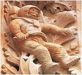

• Cywilizacja Bogów opuściła Ziemię przed światowym kataklizmem, nazwanym przez Hapgood'a "wielkim uskokiem skorupy ziemskiej", pozostawiając ludzi samym sobie.  
• Cywilizacje "znikąd lub niewiadomego pochodzenia" są efektem planowej kolonizacji prowadzonej przez cywilizację Bogów, która przed przybyciem ludzkich osadników najpierw budowała ośrodki władzy oraz przygotowywała tereny pod względem gospodarki wodnej.  
• Twierdzenie, że Bogów wymyślił człowiek na własne potrzeby jest bezsensowne. Wynikało by z tego, że możliwości abstrakcyjnego myślenia u naszych przodków były takie same lub dużo większe niż dzisiejszych ludzi. Czy postać na zdjęciu obok (Salamanca w Hiszpanii) jest produktem średniowiecznego fantasty czy echem dawnej, zaginionej i zapomnianej epoki? Czy w ręku trzyma "boski sierp", znany ze starożytnych przekazów?  
• Dzisiejszy podział na ery i epoki możemy spokojnie odłożyć na najniższą półkę, podobnie jak twierdzenie, że istniał dziki pierwotny człowiek. Uwzględnienie cywilizacji Bogów w naszej historii doskonale tłumaczy to, czego nie są w stanie wyjaśnić dzisiejsi historycy.  
• Skorupa ziemska nie jest platformą stabilną. Przyjęcie założenia, że zarys dzisiejszych kontynentów od tysiącleci pozostaje niezmienny nie daje żadnych szans na znalezienie odpowiedzi na pytania w rodzaju - dlaczego niektóre starożytne drogi prowadzą wprost do morza, dlaczego nie znaleziono ani jednej całej starożytnej budowli, dlaczego ogromna większość starożytnych ruin została zasypana ziemią czy wreszcie dlaczego na Antarktydzie utworzyły się pokłady węgla kamiennego.

Cały czas poszukujemy "brakującego ogniwa".  To ogniwo istniało i istnieje.  Nazywa się Cywilizacja Bogów.

**Historia obowiązkowa czy obowiązująca?**

Okres Renesansu i reformacji średniowiecznego Kościoła zapalił zielone światło dla niezależnych europejskich umysłów. Dokonano trwałego rozdziału religii od nauki i kościoła od organizacji państwa. Początki tej pierwszej w dziejach Europy "rewolucji kulturalnej" sięgają lat 1500 ne., a więc stosunkowo niedawno. To, co miało być zwycięstwem racjonalizmu nad religią wydało jednak wątpliwej jakości naukowe owoce o pochodzeniu człowieka i pojmowaniu historii, którą my nazywamy starożytną. Ta pierwsza wielka rewolucja odrzuciła cały dotychczasowy kanon nauki będący w gestii kościoła i rozpoczęła poszukiwanie własnej i jedynej prawdy.

Średniowiecze było okresem patentu na naukę zawłaszczonego przez kościół, który do pilnowania prawomyślności miał w swojej dyspozycji "wymiar sprawiedliwości" - Świętą Inkwizycję. Renesans przyniósł wyzwolenie nauki spod władzy kościoła i na zasadzie przekory stworzył swoją naukę, ale już pozbawioną starożytnych korzeni. Wszystko, co w treści zawierało słowo "Bóg" i "stworzenie" zostało wyrzucone poza nawias nowej, "racjonalnej" nauki. O ile w naukach ścisłych i postępie technicznym każdy błąd oznaczał ludzką tragedię, o tyle w naukach humanistycznych rozpoczęto wielkie poszukiwania prawdy, która nie musiała być okupiona ludzkimi ofiarami. Jak powstał rozumny człowiek? Jaka jest historia ludzkości? Pytania, na które do dziś nie znaleziono odpowiedzi. W nauce o człowieku i historii zwanej starożytną prym zaczęły wieść elity naukowców, które na dzień dzisiejszy stworzyły dwie wielkie, lecz dalekie od prawdy teorie - darwinizm i historię starożytną. Dzisiejsza nauka to kwiat, ale kwiat pozbawiony korzeni stojący w wazonie, w którym od lat nie zmieniono wody.

Zastosowanie darwinizmu do historii starożytnej zaowocowało człowiekiem jaskiniowym, który po kolei musiał wynajdywać wszelkie potrzebne do rozwoju rzeczy. Najpierw uczył się chodzić, mówić, "wynalazł" ogień, koło, narzędzia oraz broń by po kilkuset tysiącach lat rozbić jądro atomu. Najważniejszym bodaj wynalazkiem człowieka jest pismo, które umożliwiło mu stworzenie bazy naukowej. Dziwne jest jednak to, że najstarsze pisma są dla nas nie do odczytania. Co jest tego powodem? Mętne wyjaśnienia nie wnoszą kompletnie nic do wytłumaczenia tego fenomenu. Kolejną zagadką są budowlane osiągnięcia starożytnych, których dzisiejsza wielka technika nie potrafi skopiować nawet w skali mikro. Naukowe teorie o ich budowie wzbudzają śmiech i politowanie dla "wybitnych" twórczych umysłów. Naukę o pochodzeniu człowieka i historię starożytną zmonopolizowali ludzie, którzy wprowadzają w błąd wszystkich na całym świecie. To nowa, współczesna "Święta Inkwizycja", która za cel postawiła sobie nie dopuszczenie do ujawnienia prawdy. Nie palą już na stosie, ale stosują indoktrynację od najmłodszych lat. Kłamstwo powtarzane przez wiele lat stało się obowiązującą prawdą.

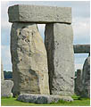  
Druidzi?

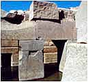  
Egipcjanie?

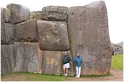  
Inkowie?

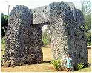  
Polinezyjczycy?

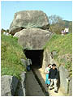  
Japończycy?

Jakie to ludy epoki kamiennej potrafiły obrabiać tak wielkie kamienne bloki? W jaki sposób transportowano budulec na miejsce budowy? W jaki sposób unoszono te ciężary na znaczną niekiedy wysokość? Dlaczego tego rodzaju budowle spotykamy na całym świecie? W jakim celu wznoszono te budowle? Na te pytania współczesna nauka nie daje odpowiedzi. Jako odpowiedź można usłyszeć tylko bajeczki, jak ta głoszona przez Zahi Hawass'a, że piramidy zbudowano tylko po to, by uwiecznić dążenie człowieka do wieczności. Miliony ton kamienia dla "uwiecznienia" tylko jednej myśli?

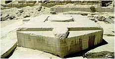

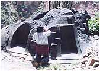

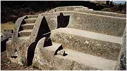

Jakimi to narzędziami z kamienia osiągnięto taką precyzję obróbki w Egipcie i Ameryce Południowej?

Do czego mogły służyć precyzyjnie wycięte z jednego kawałka kamienne bloki o tak skomplikowanych kształtach? Nauka wie wszystko. Są to ołtarze pogańskich przodków. Można też zauważyć, że wszystkie starożytne ruiny to tylko świątynie, świątynie i tylko świątynie. Nasi przodkowie nie robili nic innego tylko trwonili swe siły i środki na budowy świątyń, ołtarzy i grobowców. Ostatkiem zaś sił płodzili potomstwo czyli nas, z którego wywodzą się elity zarozumialców. Przyjęcie dwóch dogmatów - darwinizmu wraz z liniowym rozwojem postępu technicznego zaowocowało tezami, których nie wolno obalić, a które wyznaczają obowiązkowe wyniki badań:

• Człowiek jest tworem ewolucji, która miliony lat kształtowała jego fizyczną postawę i rozum. On sam dopiero po dojściu do rozumu mógł zacząć rozwijać postęp techniczny. Postęp, jak widać stał się faktem, a co z rozumem?  
• Wszystko, co istnieje na ziemi, a czego nie stworzyła przyroda musi być dziełem człowieka i nie ważny jest przy tym stan jego możliwości technicznych i intelektualnych.  
• Wszystkie stworzone dzieła nie mogą być starsze niż 8 tysięcy lat, bo na tyle "wyceniono" sobie najstarszą cywilizację starożytnego Egiptu.

Dlatego dzisiejsza historia starożytna to jeden worek, który mieści wszystko co tylko odnaleziono. Wrzucono tam wszystko począwszy do piramid w Giza, przez znaleziska w Glosel aż do glinianych odpustowych gwizdków środkowoamerykańskich Indian. Tworzy się zatem fantazyjne teorie, które z logiką nie mają nic wspólnego. Historyk starożytności zamienił się w adwokata diabła, którego jedynym zadaniem jest udowodnienie, że czarne jest białe.

**Weda Narajana** - Kto zrezygnuje z pewnego i podąży za niepewnym, straci pewne i niepewnego także nie dosięgnie.

**Ewolucja małpiego rozumu**

Prof. **Brunon Vollmert** - Uważam darwinizm za nieszczęśliwą pomyłkę, zawdzięczającą swój bezprzykładny sukces tylko i wyłącznie antropocentrycznemu myśleniu życzeniowemu.

Kiedy i w którym miejscu powstała cywilizacja na Ziemi? Na to pytanie chyba nigdy (przynajmniej moje pokolenie) nie otrzymamy odpowiedzi. Polemika pomiędzy ewolucjonistami a kreacjonistami stoi w martwym punkcie. Ani jedni ani drudzy nie chcą ustąpić. Ani jedni ani drudzy nie mogą znaleźć niezbitego dowodu, który przechyliłby szalę zwycięstwa. Czy dzisiejszy człowiek to już korona ewolucji? Czy wzniesie się jeszcze wyżej, skoro ewolucja jest przecież procesem, który trwa i trwać będzie bez końca? Czy dzisiejszy człowiek jest tylko marną formą przejściową, która kiedyś znów rozpadnie się na atomy, powstaną pierwsze bakterie i cykl rozpocznie się od nowa, aż wyewouluje następny Darwin?

Poszlaki są jednak za kreacjonistami. Coraz więcej uczonych, zwłaszcza genetyków, stwierdza, że na ewolucję od bakterii do człowieka w warunkach ziemskich brakuje kilku miliardów lat. A skoro z braku czasu ewolucja nie mogła się dokonać w naszych, ziemskich warunkach, to wniosek jest jeden - ktoś musiał tej "ewolucji" dopomóc. Ktoś musiał usunąć "brakujące ogniwo", a w jego miejsce wstawił inne, lepsze, którego dzisiejsza nauka nie umie (lub nie chce) rozpoznać. Jeżeli Biblia i inne przekazy starożytnych mówią prawdę to zasadnicze pytanie musi przybrać formę - kto i kiedy?

Sumerowie twierdzą, że było to kilkaset tysięcy lat temu. Przekazy Egiptu określają to mniej więcej na około 40 tysięcy lat temu. Niektóre ludy Ameryki Północnej powstanie człowieka umiejscawiają na 20-15 tysięcy lat wstecz od naszych czasów. Różnice ogromne, ale i tak odległe w czasie. Ponadto, jak sądzę, większość twierdzeń tego typu opiera się na przekazach pisanych. A co z cywilizacjami, które nie umiały pisać? Czy mamy prawo odebrać im miano cywilizacji? Co w końcu z cywilizacjami, które zniknęły z kart historii w wielkich kataklizmach pozostawiając tylko nikłe ślady lub nie zostawiając ich wcale?

Czytając stare źródła można stwierdzić, że stworzeń człowieka mogło być co najmniej kilka i wszystkie miały miejsce po wielkich kataklizmach, jakie dotykały ludzkość. Oczywiście czytając tylko te, które zachowały się do naszych czasów. Większość przekazów została zniszczona przez "nawiedzony" personel naziemny Nowego Pana lub przez całkowitych ignorantów. Część, być może, ukryta przed światem, zalega półki najbardziej tajnej biblioteki świata w Citta del Vaticano, a te, które są dostępne, są w większości ignorowane już w majestacie nauki. Czy poniższe stwierdzenia pisali ludzie o wybujałej fantazji? Czy to co piszą można zaliczyć do uroczego mijania się z prawdą?

**Platon**: Najpierw, wzmiankujesz jeden tylko potop ziemski, podczas gdy dawniej było ich wiele. Następnie, nie wiecie, że w waszym kraju żyła najpiękniejsza i najlepsza rasa ludzka, ani że od tych właśnie ludzi pochodzisz ty i całe wasze obecne miasto dzięki temu, że zachowała się mała ilość nasienia: wy nie wiecie tego, ponieważ w ciągu licznych generacji pomarli ci, co przeżyli owe czasy, lecz nie byli w stanie nic zapisać.

**Gilgamesz** - Ty, mężu z Szurippak, Utanapisztim, synu Ubara-Tutu, wybuduj arkę z drzewa, wybuduj ją na korabiu! Kiń swe bogactwa, pogardź pożytki swymi, zbaw żywot swój - szukaj życia! Z wszystkiego, co żywoistne, z każdego rodzaju - nasienie wprowadź do nawy.

**Kodeks Rios** - Kiedyś, w dniu Naui Ollin, nastąpi koniec świata. Wszystko, co żyje, ulegnie zniszczeniu na skutek trzęsienia ziemi. Będzie to już czwarte zniszczenie ludzkości. Ale nie wiemy, czy i tym razem ludzkość będzie miała szczęście - po raz piąty - pozostawić nasienie...

Trzy przykłady z krańców świata wskazują na to, że starożytni doskonale wiedzieli o czym pisali. Zdawali sobie sprawę z tego, że najważniejszą częścią Ziemi są istoty na niej żyjące, a przede wszystkim człowiek. Doskonale odróżniali też nasienie od istot żywych.

Pójdźmy dalej. Co zrobić z tak kłopotliwymi znaleziskami?:

•  w warstwie określanej na ok. 450 mln. - ślad obuwia o wyglądzie buta astronauty,  
•  w warstwie geologicznej sprzed ok. 200 mln. lat - ślad bosej stopy,  
•  ślad wielkiej stopy obok śladu dinozaura w warstwie geologicznej określanej na ok. 100 mln. lat.

Wszystkie te ślady odnaleziono w Ameryce Północnej i wszystkie zostały zakwalifikowane przez naukę jako sprytne fałszerstwa. Współczesna nauka wmawia nam, że pochodzimy od małpy, tylko jakoś nie może wskazać od której. Niezrozumiałe jest przy tym to, że ewolucji spodobał się tylko jeden gatunek z naczelnych, a resztę odrzuciła. Dlaczego, skoro według darwinistów, ewolucja działa wszędzie i jednakowo na wszystko i na wszystkich?

Wniosek nie jest optymistyczny. Ewolucja, jako teoria, wymyka się nauce bo nie jest konsekwentna w stosunku do całości życia na naszej planecie, a przynajmniej małp. Natura nie lubi przypadkowości, a nauka nie umie wytłumaczyć tego fenomenu. No i do tej pory nie może znaleźć tego brakującego ogniwa, które na wieki połączyłoby nas z atrakcyjnym przodkiem żyjącym do dziś w środku afrykańskiej dżungli. Są jeszcze dwie prawdy uznane przez naukę:

•  4-3,8 mld. lat temu - **okno czasowe** - powstanie pierwszych organizmów na Ziemi,  
•  535 mln. lat temu - **wielki wybuch biologiczny** - nagłe i jednoczesne pojawienie się wielu gatunków roślin i zwierząt,

Czy można je przyjąć za dwa etapy wielkiego tworzenia życia? Najpierw zostaje "zasiane" życie pierwotne mające stworzyć warunki życia dla wyższych form, a przede wszystkim mające rozpocząć "produkcję" tlenu, a dopiero później stworzone są wyższe formy życia, które stanowić mają bazę dla istoty stworzonej na wzór i podobieństwo. Człowiek wkracza na arenę najpóźniej, już po stworzeniu dla niego bazy życiowej. Jeśli wierzyć Sumerom tworzenie człowieka sięga ponad 400 tysięcy lat wstecz i nie było to od razu doskonałe stworzenie. Nauka na podstawie badań DNA i mitochondrialnego DNA twierdzi, że nasz myślący przodek powstał nagle około 290-140 tysięcy lat temu w Afryce.

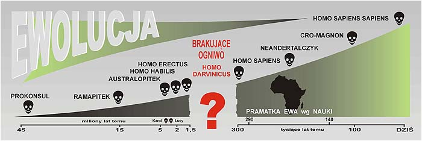

Widać, że istnieje potężna luka pomiędzy 1,5 mln a 300 tysięcy lat. Tu nauka milczy, bo nie ma żadnych dowodów na ewolucyjne formy przejściowe i prawdopodobnie ich nie znajdzie jeśli wierzyć przekazom starożytnych. Na dzień dzisiejszy darwinizm i jego ewolucja to "czarna dziura" światowej nauki, w której znikają pieniądze podatników i energia uczonych, bo żeby znaleźć dowody trzeba przekopać całą Ziemię i tysiące "prazupek" porazić prądem, nie mając żadnej pewności, że da to jakiś pozytywny rezultat.

Teoria ewolucji nadal jednak ma się dobrze i dzięki reklamie w mediach "darwiniada" trwa dalej. W październiku 2004 prasa obwieściła całemu światu, że na indonezyjskiej wyspie Flores odkryto szczątki małpoludka, którego natychmiast okrzyknięto człowiekiem. Kości odkryto w doborowym towarzystwie karłowatych słoni, waranów i kamiennych narzędzi. On sam był podobno krasnalem o mózgu grejfruta, a skarłowaciał, bo żył odizolowany na wyspie gdzie nie było porządnego wzorca. Jak twierdzą uczeni - "Karlenie w takich warunkach, zwłaszcza na wyspach, to przypadek znany z dotychczasowych obserwacji zwierząt". No proszę, niby człowiek, a zachował się jak zwierzę? Wiek tego prapigmeja określono na 18 tysięcy lat, nazwano Homo florensiensis i na wszelki wypadek już włączono do panteonu - Homo habilis, Homo erectus, Homo neanderthalensis i Homo sapiens. Biorąc pod uwagę stosunkowo młody wiek znaleziska można spytać - czy to było gwałtowne cofnięcie się ewolucji czy też jej niewinne "wypsnięcie"? Na to pytanie głosiciele małpiej ewolucji, nie dali odpowiedzi.

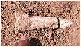

Czy to dziadek Lucy?

Najbardziej poszukiwanymi elementami małpiej doktryny są tzw. formy pośrednie, czyli coś między prawdziwą małpą a dzisiejszym homo. Co prawda genetycy wręcz twierdzą, że forma pośrednia nie ma prawa istnieć, ale wyznawcom Darwina to nie przeszkadza i uparcie ich poszukują. Do tzw. Lucy, małpy z Etiopi sprzed 3 mln lat, doszedł ostatnio jej "dziadek" sprzed 4 mln lat. Też z Etiopi i mieszkający tylko 60 km od wnuczki. Problem w tym, że z dziadka Lucy pozostało niewiele. Jak z tego kawałka kości wywnioskować czy już chodził na dwóch kończynach czy jeszcze podpierał się ogonem? Bez obawy, dzisiejsi wyznawcy Darwina potrafią wszystko. Już niedługo dowiemy się, że chodził wyprostowany jak carski oficer i na pewno nie wchodził już na drzewo bo nie miał pazurów, a samą gębę się jakoś uśredni między wszystkimi "pitekami", tak by przypominał daleką wnuczkę. Proponuję nazwać go Karol.

Następne odkrycie. Po czterech latach dyskusji nad fragmentem czaszki z Czadu uczeni doszli do wniosku, że mają do czynienia z prapradziadkiem "Karola", który żył tamże już przed 7 milionami lat. Oczywiście natychmiast włączono go panteonu człowieczej generacji pod nazwą Sahelanthropus tchadensis, ale "żyje" dla naukowców pod pieszczotliwą nazwą - Toumai. Rekonstrukcji z paru zębów i fragmentu czaszki dokonano rzecz jasna przy pomocy komputera, choć nadal są trudności z rekonstrukcją drogi do Wielkiego Rowu Afrykańskiego gdzie przeprowadzili się potomkowie wodza Toumai. Są też wątpliwości, bo jak wzruszająco piszą entuzjaści - "Toumai miał wysoką, charakterystyczną dla całego naszego drzewa rodowego twarz z delikatnie opadniętymi łukami brwiowymi nadającymi obliczu wyraz zatroskania, z dużymi, okrągłymi oczodołami i szerokim nosem" ale "wygląd twarzy Toumai nie współgrał z wielkością jego mózgu". Jakiż to program komputerowy potrafi wyczarować z kawałka czaszki wyraz zatroskania? Takich rozczulających momentów czeka nas zapewne jeszcze wiele, gdyż nie znaleziono rozstajnych dróg małpy i człowieka.

W codziennej prasie raz po raz ukazują się sensacyjne artykuły o ustaleniu drzew genealogicznych coraz to innych stworzeń. Naukowcy amerykańscy po wieloletnich badaniach mogą się pochwalić znajomością pochodzenia nietoperza, czyli latającej myszy. Nie tej zwykłej, ale jej kuzynki pracującej w lotnictwie. Tutaj też w grę wchodzą miliony lat, podczas których przodek Darwina, cierpliwie dzień po dniu rzucał zwykłą mysz w powietrze, aż któraś z kolei bojąc się wytrzebienia gatunku rozpoczęła normalne loty. Która z kolei i po ilu latach eksperymentu rozpoczęła nową genetyczną gałąź, naukowcy nie podają. Ważne jest to, że zaczęła latać.

Na tym nie koniec. Okazuje się, że nic już nie jest pewne. W grudniu 2004 r. okazało się, że już nie pochodzimy od małpy ale od... ryjówki, małego zwierza ryjącego pod dinozaurami już około 75 mln lat temu. Do takiego wniosku doszedł prof. Dawid Haussler z Uniwersytetu Kalifornijskiego po zmiksowaniu genów kilku współcześnie żyjących ssaków i wyciągnięciu średniej. Brawo. Co tam jeszcze zostało...?

Czy działanie ewolucji można zaobserwować dzisiaj? Oczywiście, że można. Człowiek od iluś tysięcy lat jakoś nie może wytworzyć mechanizmów obronnych przed takimi chorobami, jak choćby malaria, grypa czy zwykłe przeziębienie. Przez dziesiątki tysięcy lat mając do czynienia z ogniem nie wykształcił ani krzty odporności na oparzenia. Jakoś przez tyle lat nie może się przystosować do oddychania smogiem w wielkich miastach. Małpy mając tak doskonały wzorzec i wspaniałych nauczycieli nie mogą nauczyć się pisać i czytać. Żadnemu rekinowi jeszcze nie przyszło do głowy pospacerować po plaży pełnej ludzi, gdzie pokarm sam wchodzi do paszczy. Ewolucja doskonale działa na papierze, gdzie można do woli szastać milionami i miliardami lat. Nikt i tak nie jest w stanie tego udowodnić i być może o to w tym wszystkim chodzi.

Darwiniści, owi "marksiści natury", mają też potężnego orędownika w postaci filozofa starożytnej Grecji, choć nie wiem dlaczego nie chcą się na niego powoływać. Dlaczego ci luminarze ewolucji nie uwzględniają w swych opracowaniach tak znamienitego antenata? Może nie znają jego znakomitej sentencji:

**Platon** - W ten sposób, zarówno w dawnych czasach jak i teraz, wszystkie jestestwa żywe przemieniają się jedne w drugie, przechodząc z jednego gatunku do drugiego w miarę, jak tracą lub nabywają inteligencji względnie głupoty.

Jednak cała prawda o teorii Darwina jest trochę inna niż się powszechnie uznaje. Sam Darwin pisał tylko, że ewolucja posiada selektywną właściwość, polegającą na eliminacji osobników słabiej wyposażonych genetycznie, a przeżywaniu lepiej przystosowanych i w ten sposób dochodzi do utrwalenia biologicznych cech korzystnych dla przetrwania gatunku. Tę część pracy wykorzystał Adolf Hitler głosząc przetrwanie tylko najsilniejszych i najlepszych gatunków, w tym wypadku rasy aryjskiej. Natomiast nadinterpretacji prowadzącej do wniosku, że człowiek jest ewolucyjnym potomkiem małpy wprowadził nie kto inny, jak jeden z ojców komunizmu - Fryderyk Engels i to właśnie komunistom zawdzięczamy tak zawrotną karierę teorii gadającej małpy.

**Kosmiczna arka Noego**

Dzisiejsza nauka, szczególnie ta badająca najstarsze dzieje Ziemi, oparta jest na wielkim "gdybaniu" i nadużywaniu słówka "prawdopodobnie". Po przyjęciu głównego aksjomatu, że Układ Słoneczny powstał około 4,5 mld lat temu ustalono, że należy tak balansować wiekiem dowodów, by nie wyskoczyć poza główne ramy czasowe oraz nie przeczyć logice w rodzaju - matka nie może żyć w jakimś kolejnym pokoleniu po swoim synu. Ponadto nie wiadomo, czy brakujący 1 mld lat jest adekwatny do prawdy. Wiek wszechświata określany jest na około 12 mld lat i kompletnie nikt nie jest w stanie odpowiedzieć na pytanie ile trwać może ewolucja od bakterii do złożonej formy inteligentnego homo. Odwieczny problem darwinistów czy krowa jest wielorybem, który zapragnął zmiany pastwiska, czy wieloryb jest krową, której znudziło się skubanie trawy, nie może doczekać się definitywnego rozwiązania.

Niektórzy być może pamiętają, jak na lekcji biologii pokazywano planszę, na której pływająca ryba na granicy z lądem zamieniała swój przód na gadzi z rybim ogonem, a już na lądzie paradował okazały gad. Miało to trwać setki milionów lat i tak wyglądała ewolucja. Jak dokładnie to wyglądało nauczyciel nie potrafił wytłumaczyć. Powiedział tylko, że tak było naprawdę i tak proszę to przyjąć. Wynika z tego, że poszczególne części ryby zmieniały kształt w tempie ułamka mikroskali na rok. Jak i kiedy zmuszono pierwszego osobnika, by zaczął oddychać tlenem? Ochotnik czy wypchnięty na siłę? Jak głupia ryba wpadła na pomysł, że potrzebne będą nogi? Czym odżywiała się ta gadoryba przez te kilkaset milionów lat, gdy jeszcze nie chodziła po lądzie, a już nie pływała w wodzie? Kto chronił ten eksperymentalny egzemplarz od strony wody, a kto od strony powietrza?

W dawnych czasach nauka stanowiła rodzaj jednego naczynia w rękach czegoś co zwano filozofią. Dawało to swego rodzaju rękojmię jednolitości poglądów. A dzisiaj? Nowoczesna nauka rozbiła to naczynie na drobne skorupy i każda z nich od tej pory żyje własnym życiem. Każda skorupka otrzymała swoją nazwę i swoich wyznawców w postaci tzw. wyspecjalizowanych uczonych. Stracono zaś ową jednolitość i brak spójności poszczególnych części nauki. Do dziś odbija się czkawką brak sensownego podstawowego założenia, któremu podporządkowano by wszystkie inne badania naukowe. Totalny bałagan, bezładne miotanie się tam i z powrotem, nie przemyślane kierunki badań, głupie doświadczenia i jeszcze głupsze wyniki - taki jest obraz dzisiejszej nauki o Ziemi, człowieku i jego historii. Żaden naukowiec nie jest obiektywny, bo do tego potrzeba wiedzy absolutnej, ale tylko nieliczni mają odwagę przyznać, że jej nie mają.

Nie mogę także zrozumieć swego rodzaju hipokryzji. Większość uczonych, szczególnie na Zachodzie, wierzy w Boga, czemu daje niejednokrotnie wyraz. Lecz wystarczy, że przekroczą próg swoich uczelni i natychmiast o tym zapominają, głosząc wręcz coś odwrotnego. Dlaczego tak jest? Oddzielenie nauki od starożytnej mądrości oraz wprowadzenie na siłę teorii Darwina założyło psychologiczny kaganiec wszystkim bez mała uczonym. Słowo "stworzenie" wykreślono z naukowego słownika i zastąpiono słowem "ewolucja". Skutki tego posunięcia będą miały takie reperkusje, że pochodzenie człowieka może nigdy nie zostać wyjaśnione. Jedno z głównych założeń, że człowiek jest koroną stworzenia i jest jedyny we wszechświecie musiało zaowocować odrzuceniem hipotezy o obcej ingerencji, a podstawowy dowód - człowiek, chodzi po ziemi i urąga całej nauce.

Jak powstało życie na Ziemi i kiedy doszło do jego powstania? Nauka określiła tzw. "okno czasowe" pomiędzy 4,0-3,8 mld lat temu, w którym powstawać miały pierwsze organizmy na Ziemi. Zwodnicza choć brzmiąca naukowo nazwa. "Okno czasowe" wymyślono! Wymyślono po to, by zmieścić jakoś w historii Ziemi czas na ewolucję, w wyniku której miał powstać człowiek. To, że czasu i tak jest za mało nie ma tu żadnego znaczenia, bo nikt nie jest w stanie tego udowodnić. Odkrycie bakterii kopalnych, których wiek ustalono na 3,1 mld lat też jest problematyczne. Tutaj też nikt nie jest w stanie udowodnić, nawet w przybliżeniu, czy wiek ustalono prawidłowo. Tu działa powyższa zasada mieszczenia się w granicach umownego okresu czasu. Nauka ustaliła dalej, że w okresie Proterozoiku na Ziemi pojawiają się już glonowce, pierścienice i jamochłony. Około 2,5 mld lat ewolucja strawiła na przejściu od bakterii do organizmów złożonych. Jakie to proste i jakie szybkie. 2,5 mld lat i mamy stułbię, następne "drobne" 1,5 mld lat i mamy już człowieka.

Mało tego. 535 mln lat temu, według nauki, na Ziemi następuje "wybuch biologiczny". Nagle i jednocześnie pojawia się niezliczona ilość gatunków roślin i zwierząt. Pozwolę sobie zapytać z czego? Z tych jamochłonów i pierścienic? Jaka przyczyna spowodowała nagłą wielotorowość ewolucji? Przecież podstawą darwinizmu jest przystosowanie się do określonego środowiska. Czy Ziemia była w stanie stworzyć setki tysięcy środowisk? Czy różnorodność gatunków w obrębie rodzin oznacza, że każde środowisko wytwarzało jeszcze tysiące podśrodowisk? Przecież to jest paranoja.

Jest logiczne, że życie na Ziemi jest nierozerwalnie związane z nią samą i jej losem. Odpowiedź na pytanie kiedy na Ziemi zaistniały warunki do rozwoju życia, musi dać równocześnie odpowiedź na pytanie o jego początki. Z tym też są problemy. Do tej pory nie ma w nauce jednolitej hipotezy tłumaczącej powstanie Układu Słonecznego, nie mówiąc już o samej Ziemi. Zwykłych ludzi karmi się teoriami w rodzaju: "kontynenty liczą miliardy lat", ale "oceany nie są starsze niż kilkaset milionów lat". To, za przeproszeniem, skąd nagle wzięło się tyle wody i do tego słonej? Co przez tyle setek milionów lat znajdowało się między kontynentami? Czy życie wyszło z wody dopiero kilkaset milionów lat temu? W imię nauki robi nam się wodę z mózgu.

Moja hipoteza jest prostsza, ale zmuszająca do opuszczenia kręgu nauki i ukłonu w kierunku mądrości starożytnych. Wiadomo z kosmogonii sumeryjskiej, że Ziemia w przeszłości doznała katastrofy kosmicznej oraz, że życie na Ziemi zostało zasiane z kosmosu. O dziwo, można z tego ułożyć sensowną hipotezę. Oczywiście hipotezę także nie do udowodnienia, ale za to ładniejszą, bardziej fascynującą i bardziej zrozumiałą.

•  W zaraniu tworzenia się Układu Słonecznego praZiemia krążyła po orbicie między Marsem i Jowiszem, cała jej powierzchnia pokryta była wodą. Czy posiadała atmosferę? Być może, lecz była to zapewne cienka warstwa tego, co wyparowało z jej powierzchni, o ile w ogóle coś parowało w tak niskiej temperaturze.  
•  Około 500 mln lat po uformowaniu się Układu Słonecznego w jego granice wtargnęła obca planeta. Dochodzi do kolizji z nią lub z jej księżycem, w wyniku której praZiemia traci około połowy swej masy, ponad 2/3 skorupy i zostaje zepchnięta na orbitę bliższą Słońcu. Z utraconej części skorupy i wody tworzy się pas planetoid, komety i pomniejsze asteroidy.  
•  Część praZiemi, która nie uległa rozbiciu, rozpoczyna wędrówkę w okolice bliższe Słońcu, stabilizując się w końcu na dzisiejszej orbicie.  
•  W wyrwę powstałą po uderzeniu spływa pozostała część wody, która w zetknięciu się z gorącym płaszczem planety tworzy niezliczoną ilość pary wodnej. Utrzymywana siłą grawitacji para wodna staje się pierwszą atmosferą Ziemi.  
•  Jako ciało niebieskie o znacznej masie zaczyna dążyć do odzyskania kulistego kształtu, co jest bezpośrednim powodem rozerwania pozostałej części skorupy, które już jako prakontynenty rozpoczynają wędrówkę po gorącym, półpłynnym płaszczu Ziemi. Wtedy też zaczyna się formowanie kształtów przyszłych oceanów i wtedy też zapewne dochodzi do kolizji wypiętrzających systemy górskie. Woda krążyła jeszcze w atmosferze w postaci chmur pary wodnej.  
•  Po osiągnięciu kulistego kształtu, rozmieszczeniu się prakontynentów na jej powierzchni, stwardnieniu dna oceanów i względnym ustabilizowaniu się skorupy w stanie równowagi obojętnej Ziemia zaczynała przypominać dzisiejszą planetę.  
•  Po ochłodzeniu się powierzchni Ziemi i opadnięciu wody z atmosfery, Ziemia była gotowa do "przyjęcia" życia.

A co na to nauka? Nauka nieśmiało przebąkuje, że coś musiało się stać 500 mln lat po powstaniu Układu Słonecznego. Nie mówi wprost o katastrofie kosmicznej, ale o jakimś "wielkim odgazowaniu", które utworzyło atmosferę Ziemi. Do dziś jednak nie ma jednolitego poglądu na powstanie komet czy pasa planetoid. Nauka nie jest w stanie odpowiedzieć kiedy i dlaczego Mars wszedł w posiadanie tak dziwnych księżyców.

Za to uczeni francuscy przesunęli początek rozpadu prakontynentu na 800 mln lat temu. I chwała im za to, bo bardzo uprawdopodobnili warunki do zaistnienia "wielkiego biologicznego wybuchu" 535 mln lat temu. Czy taki termin może być prawdopodobny? Czy na uformowanie nowego kształtu i ochłodzenie powierzchni nasza planeta potrzebowała bez mała 3 mld lat? Chyba w dalszym ciągu gubimy się w domysłach.

Co mogło spowodować ten "wielki biologiczny wybuch"? Tu w moją hipotezę wkraczają ONI i ich "Kosmiczna arka Noego". Nie jest niemożliwe i nie można całkowicie wykluczyć, że życie zostało przyniesione z kosmosu. Przemawia za tym ogromna różnorodność form życia, a przede wszystkim nagłe ich pojawienie się. Tu prawdopodobnie pojawia się też pierwsze niedopatrzenie. Z "kosmicznych nasion" wyrastają gigantyczne zwierzęta i rośliny. Zarodki zabrane zapewne z rodzimej planety, lub tworzone w warunkach kosmicznych, gdzie siła ciążenia mogła być większa niż na Ziemi, rodząc się w warunkach mniejszej grawitacji osiągają olbrzymie rozmiary. Czy rozmiary tych potworów zmniejszały się w następnych pokoleniach, czy też 65 mln lat temu mieliśmy do czynienia z pierwszą interwencją Stwórcy? Na to nie jestem w stanie odpowiedzieć, choć wygląda prawdopodobnie. Dla cywilizacji wędrującej przez kosmos, skierowanie w kierunku Ziemi dużego asteroidu było zapewne dziecinną igraszką. Może jednak za masowe wyginięcie dinozaurów także odpowiada "wielki uskok skorupy ziemskiej"? Jak bowiem wytłumaczyć "zagładę", która według nauki trwała 2 miliony lat?

Można wysnuć z tego jeszcze jeden bardzo ważny wniosek. Wynikało by z tego, że w całym Układzie Słonecznym tylko jedna planeta nadawała się do życia, tylko Ziemia oferowała warunki gwarantujące rozwój i przetrwanie dla form żywych. Być może ostatnie odkrycia w meteorycie z Marsa wskazują tylko na jakiś nieudany kosmiczny eksperyment. Eksperyment, który wykazał, że nawet organizmy pierwotne nie wytrzymały próby przetrwania na tej planecie.

**Cywilizacja Bogów**

Jak w tym wszystkim umiejscowić Bogów i Ich ingerencję w inteligentne życie na Ziemi? Sądzę, że pierwszym krokiem musi być danie wiary temu, co piszą starożytni, a przede wszystkim zrozumienie tego co piszą. Drugim zaś, wymagającym niemałej odwagi, jest inne spojrzenie na samych Bogów. Postawienie znaku równości między Bogami a przedstawicielami bardzo wysokiej, pozaziemskiej cywilizacji powinno zmienić nasz sposób myślenia. Wszystko zaczyna być klarowne i zrozumiałe. Wiem, że takim stwierdzeniem skazuję siebie na stos, ale żeby zacząć to wszystko rozumieć i tak musimy zmienić nasze podejście do świata i samych Bogów.

Jeśli poddaliśmy w wątpliwość istnienie ewolucji, to musimy przyznać, że zaistnienie na Ziemi wielkiej różnorodności roślin i zwierząt musiało być efektem czyjejś ingerencji. Skoro wtedy na Ziemi nie było człowieka, to wniosek może być tylko jeden. Nazwanie tego Kogoś jest w tym momencie nieistotne, a istotny jest czyn którego dokonał. Kolejnym pytaniem, bodaj najważniejszym jest dlaczego powstał człowiek? Nie kiedy, ale dlaczego i po co. Jedną z odpowiedzi jest odpowiedź Sumerów. Człowiek powstał po to, by wyręczać Bogów w ciężkiej pracy oraz po to, by im służyć. Dość konkretna przyczyna choć coś innego można przeczytać w Sabhaparwie. Tu stwierdza się, że w odległych czasach, z odległego miejsca Bogowie przybyli na Ziemię aby studiować ludzi. Logika podpowiada, że możemy tu mieć do czynienia z inną ekipą, lądującą w czasach, gdy na Ziemi ludzie już istnieli.

Człowiek został stworzony kilkaset tysięcy lat temu i jak twierdzą Sumerowie od razu miał możność mówienia. Wszak zwierzętom i roślinom nazwy nadał Adam w ogrodzie Eden. Przez Bogów został nauczony pisać i przekazana mu została podstawowa wiedza. Po akceptacji Adama, jako pierwszego sprawdzającego się modelu człowieka, postanowiono stworzyć drugie ogniwo niezbędne do prokreacji. Tak powstała kobieta. Genetycznie identyczna z drobnym liftingiem w wiadomych miejscach. Do "produkcji" ludzi nie trzeba już było wykorzystywać "bogiń życia". Rasa ludzka rozpoczęła własną egzystencję.

Nie obyło się wszakże bez kolejnej wpadki. Nie zdyscyplinowana, czy wręcz zbuntowana grupa boskich przedstawicieli, wbrew zakazom, dokonała gwałtu na ziemskich kobietach, co wydało przerażające owoce.

**Biblia** - Synowie Boga, widząc, że córki człowiecze są piękne, brali je sobie za żony, wszystkie, jakie im się tylko podobały. A w owych czasach byli na ziemi giganci; a także później, gdy synowie Boga zbliżali się do córek człowieczych, te im rodziły. Byli to więc owi mocarze, mający sławę w owych dawnych czasach.

Dziś ta grupa jest znana pod nazwą "upadłych aniołów". Czy znów dał znać o sobie przypadek złączenia kosmicznych genów z ziemskimi? Czy nie jest dziwne, że przekazy starożytnych są w tej materii nad wyraz zgodne? Giganci czy olbrzymy umieszczani są w pierwszym okresie panowania Bogów na Ziemi. Gdy zaczynają zagrażać pozostałej ludzkości, a przede wszystkim Bogom, podjęta zostaje decyzja o ich zniszczeniu. Bóg podejmuje także inną, brzemienną w skutki decyzję. Cała grupa (skażona pierwiastkiem ziemskim) zostaje skazana na wieczny pobyt na Ziemi. Nie zostają przyjęci z powrotem do grona kosmicznej ekspedycji. Biblia wspomina o jakiejś niebiańskiej bitwie. Być może ukarani chcieli siłą wywalczyć sobie utracone prawo, ale zostali pokonani. Pozbawieni możliwości powrotu do swojej cywilizacji, zmuszeni byli założyć pierwszą boską cywilizację na Ziemi. Jednak wtedy, zakładając istnienie miłosierdzia, nie zostają pozbawieni wszystkiego. Zatrzymują przy sobie wytwory najwyższej techniki, zapewne pozostawione im zostają stacje na orbicie Ziemi, środki bliskiego transportu kosmicznego itp. Sami zaś muszą zbudować bazę techniczną na Ziemi. Nie otrzymują tylko jednego. Nie otrzymują środka umożliwiającego im powrót na rodzimą planetę.

Kiedy to mogło się wydarzyć? Nasza nauka twierdzi, że pramatka ludzkości pochodzi z Afryki i było to około 200-300 tys. lat temu. Ile trzeba czasu, by populacja wzrosła na tyle, by liczyć się jako naród? Nie potrafię na to pytanie odpowiedzieć. Ale wtedy populacja ludzi musiała być już dość znaczną, gdyż synowie boży jak piszą starożytni, mieli możliwość przebierania w ziemskich pannach.

Cóż, na tym można by zakończyć dywagację, lecz chciałbym jeszcze zwrócić uwagę na dwa czynniki, które nie ułatwiały życia na Ziemi. Pierwszy to ciągłe zagrożenie z kosmosu, gdzie praprzyczyną była wielka katastrofa kosmiczna z początków formowania się Układu Słonecznego, a druga to ciągła niestabilność samej skorupy Ziemi spowodowana tą samą praprzyczyną. Oba czynniki zagrażają i dzisiaj, choć przez większość są bagatelizowane. Wbrew temu jak sądzi większość wierzących, bunt aniołów był błogosławieństwem dla rasy ludzkiej. Nikt inny, tylko pierwsza boska, ziemska dynastia, wielokrotnie ratowała ciągłość życia na Ziemi. Miała po temu możliwości, przede wszystkim techniczne. Czy nie jest zastanawiające, że zawsze po wielkich kataklizmach "królestwo ponownie zstępowało z nieba"?

Ziemię równolegle zamieszkiwały dwie cywilizacje. Cywilizacją wiodącą była oczywiście cywilizacja boska, a obok niej żyła cywilizacja jej służących - cywilizacja ludzi. Jak w każdym świecie, tak i w naszym istniały zapewne mezalianse, być może zamierzone, owocujące mieszańcami, których starożytni zwali półbogami lub herosami (półboginiami, boginkami lub heroinami). Zecharia Sitchin zwrócił uwagę na dziwny, według niego, sposób zawierania małżeństw, stosowany jeszcze w tzw. wyższych sferach. Co tu dziwnego? Zachowanie czystości genów było główną zasadą zachowania czystej rasy (trochę nieładnie brzmi). To dlatego Bogowie egipscy czy greccy utrzymywali stosunki ze swoimi siostrami, przy czym obowiązywała zasada, że ojciec mógł być ten sam, ale matka musiała być inna.

Bardzo możliwe, że wyrażenia takie jak "szlachetnie urodzony" czy "błękitna krew" odnosiły się początkowo do ludzi spokrewnionych z "synami bożymi" czy "półbogami" i pozostawały w ścisłym związku z tą elitą. Pierwiastek ten, czy bardziej gen, zaczął zanikać, gdy tą ścisłą czołówkę zaczęli uzupełniać szlachetnie urodzeni "z nadania", ale o genach najzwyczajniej ludzkich. Być może ten boski gen jeszcze dzisiaj ujawnia się sporadycznie w geniuszach, o których mówi się, że talent otrzymali od Boga, czy też, że posiadają "iskrę bożą".

Chciałbym jeszcze zwrócić uwagę na znamienny fakt. We wszystkich "rozkopanych" cywilizacjach nie znaleziono nic, co świadczyłoby o wykorzystywaniu "wysokiej technologii" przez ówczesnych ludzi. Dlaczego? Sądzę, że ludziom nie wolno było jej mieć. To samo ograniczenie dotyczyło także mieszańców (półbogów), z których rekrutowali się królowie ziemscy i kapłani. Najwyższa technologia była zastrzeżona wyłącznie dla Bogów. Człowiek mógł mieć tylko najprostszą broń - oszczep, łuk, miecz, tarczę, rydwan oraz narzędzia do pracy - pług, żarna, wozy itp. Wszystko to człowiek otrzymał (!!!) od Bogów, podobnie jak został nauczony rzemiosła, uprawy roli czy hodowli i tylko takie obrazy można oglądać na wszystkich odnalezionych reliefach starych cywilizacji. O broni jaką posiadali Bogowie odnaleźć możemy jedynie wzmianki w starożytnych przekazach. A te jak myślę, spisywano bez wiedzy Bogów i stąd prymitywny, "nietechniczny" opis naocznego obserwatora.

Bogowie prowadzili wojny między sobą na Ziemi, ale tu zasadniczym mięsem armatnim byli ludzie. Jak pamiętamy z greckiej mitologii Bogowie tylko pomagali w walkach, mogąc przechylać szalę zwycięstwa. Podobnie jak w mitologii hinduskiej. Natomiast walki Bogów między sobą były toczone na firmamencie, w przestrzeni pozaziemskiej, a tam jak wiadomo z przekazów hinduskich, w użyciu była najwyższa technologia, do dziś przez nas nie rozpoznana. Technologia, jaką znamy dziś i jaką posiadamy, powstała wyłącznie w wyniku ewolucji technicznej i stworzona została już przez samych półbogów i ludzi lecz dopiero wtedy, gdy Bogowie opuścili Ziemię.

Podobnie, jak sądzę, było z pełnieniem władzy na Ziemi. Królowie czy kapłani byli mieszańcami genów boskich i ludzkich i tylko ci mogli dostąpić tych zaszczytów. Partnerkami mogły być tylko kobiety z domieszką krwi boskiej. Była to kasta, która obowiązki pełniła dożywotnio i władzę czy kapłaństwo przekazywała z ojca na syna i tylko wewnątrz tej elity. Była to kasta pierwszych "urzędników państwowych" kształcona w dodatku przez Bogów. A kapłani? Prawdopodobnie obowiązywał tam ścisły celibat, ale tylko w odniesieniu do zwykłych "ludzkich" kobiet. Znane są z historii "kapłanki", czy "klasztory dziewic" i chyba można się domyślać po co istniały.

Czy nie o degradacji umysłów pisze Platon opisując przyczynę najazdu mieszkańców Atlantydy na Europę?

**Platon** - Gdy jednak zanikł w nich boski pierwiastek dlatego, iż w wielkiej mierze i często zastępował go element śmiertelny i brał w nich górę ludzki charakter, wówczas nie potrafili już dłużej znosić swego obecnego powodzenia i zaczęli zachowywać się haniebnie.

Możliwe jest także to, że już wtedy człowiek nie doznawał "opieki" boskiej i był świadom tego, że został opuszczony przez Bogów. Brak widma nieuchronnej "kary Bożej" owocował samodzielnym podejmowaniem decyzji, nierzadko wbrew ustalonemu przez Bogów porządkowi. Zaczynało obowiązywać "ludzkie" prawo - prawo silniejszego.

Jak ziemia długa i szeroka do tej pory nie znaleziono szczątków, które można by uznać za szczątki innej cywilizacji. Czy świadczy to o tym, że innej niż nasza cywilizacja na Ziemi nie było, czy też nie potrafimy nic odnaleźć? Z jednej strony, przez tyle tysięcy lat nie powinno pozostać po nich nawet śladu, z drugiej zaś czy potrafilibyśmy je zidentyfikować? Wiele miejsca stare przekazy poświęcają wzięciu żywych do nieba lub "umieszczeniu" kogoś na nieboskłonie. Starzy Bogowie odchodzili do nieba, półbogów grecki Zeus umieszczał na niebie. Niebo nad nami roi się od herosów i "boskich" stworów. Dlaczego nie ma gwiazdozbiorów Bogów? Dlatego, że Bogów uosabiały planety.

Czy w niebie istniał boski dom starców i intensywna opieka medyczna? Chyba tak. Przecież Heraklesa Zeus umieścił na niebie dopiero po skażeniu go "bronią chemiczną" centaura Nessosa. Ra udał się do nieba, gdy był już trzęsącym się starcem, któremu z ust ciekła ślina. Czy zmarłych na Ziemi należących do ich cywilizacji także zabierano do nieba? Historycy twierdzą, że umieszczenie półbogów na firmamencie było zwykłą poetycką przenośnią. Naprawdę? Jak wytłumaczyłbyś nierozumnemu dziecku by nie ruszał psiej kupki. Zanim skończył byś wykład o szkodliwości bakterii kałowych dla ludzkiego układu pokarmowego, byłoby już za późno. Krzyknął byś krótko: nie rusz, to be. Tak samo tłumaczyło się mało rozumnemu człowiekowi, bo z resztą, nie była to jego sprawa.

Nurtuje mnie jeszcze jedno. Zdaję sobie absolutnie sprawę z tego, że mówimy o okresie czasu liczącym co najmniej dwie setki tysięcy lat. Dla wieku samej Ziemi to mrugnięcie okiem, ale dla historii rozumnego życia to szmat czasu. Skoro dopuściłem możliwość ingerencji obcych, to czy "desant" Bogów na Ziemię był tylko epizodem, czy też Ziemię odwiedziło kilka pozaziemskich cywilizacji? Tego nie można całkowicie wykluczyć. Skąd bowiem na Ziemi wzięło się tyle ras? Przy czym dlaczego krąg biblijny znał tylko trzy rasy - białą, żółtą i czarną? Dlaczego w Ameryce nie roi się od Mongołów (skoro zasiedlono ją przez cieśninę Beringa) lecz dominującą rasą jest rasa Indian? Czy nagłe pojawianie się na określonym terenie określonych grup ludzkich (określane dziś jako "znikąd" czy "niewiadomego pochodzenia") nie było planowym "zasiedlaniem" czynionym przez Bogów? Czy kiedykolwiek sprawdzimy czy genotyp Neandertalczyka i człowieka z Cro-Magnon jest identyczny?

Skąd na Ziemi tyle religii, z których każda uważa, że jej Bóg jest jedyny i prawdziwy? Skąd na Ziemi wzięły się trzy podstawowe systemy liczenia - dziesiętny, dwudziestkowy i sześćdziesiętny? Nie liczę oczywiście wielu systemów liczenia od jeden do "mnóstwo wiele". Skąd wreszcie tyle odmian pisma? Klinowe, hieroglify egipskie, hieroglify Majów, pismo Etrusków czy wreszcie sanskryt, że wymienię nieliczne. Dlaczego uczeni nie potrafią odczytać wielu rodzajów starożytnych inskrypcji? Sądzę, że z prostego powodu - Bogowie dali ludziom pismo, a nie alfabet. Wraz ze śmiercią znawców pisma umierała wiedza zawarta w pisanych przekazach.

Odbiegając, lecz niezbyt daleko, od tematu chciałbym przytoczyć pewien cytat ze starożytnego Sumeru, z epickiego poematu "Enmerkar i władca Aratty":

Niegdyś nie było węża, nie było skorpiona, nie było hieny, nie było lwa,  
nie było dzikiego psa ni wilka, nie było strachu ani przemocy,  
Człowiek nie miał rywala.

Czy są to wynurzenia pogryzionego przez hienę albo majaki ukąszonego przez skorpiona, czy też opis dawniejszych, lepszych czasów? Wygląda jak opis greckich warunków "złotego wieku ludzkości". Czy dopuszczając istnienie kilku boskich cywilizacji, które odnawiały życie na Ziemi po wielkich kataklizmach, można dopuścić także odtwarzanie lub tworzenie nowego żywego inwentarza? Niektóre zwierzęta jakby nie pasują do ziemskiej sielanki. Czy po kataklizmach nie pozostawały gdzieś w zakamarkach Ziemi ocalałe gatunki dawniejszych zwierząt? Twierdzi się przecież, że krokodyl czy latimieria, to relikty epoki dinozaurów. Czy wraz z odbudową życia rozumnego "dokładano" także nowe gatunki zwierząt? Czy drapieżne i jadowite zwierzęta miały regulować ilość ludzkiej populacji, czy też były tylko "ochroną" ściśle boskich terytoriów? Jaki czynnik mógł spowodować, że ludzie i zwierzęta zaczęli pożywiać się mięsem?

Jak długo bogowie rządzili na Ziemi? Chyba dostatecznie długo, by pozostawić po sobie niezatarty ślad. Jak widać nie żyli wiecznie, ale dostatecznie długo by stworzyć takie wrażenie na ludziach. Czy to właśnie ta zazdrość stworzyła naukową "odwieczną tęsknotę ludzi za nieśmiertelnością"? Dla życia boskiego Sumerowie operowali jednostką czasu zwaną "sar", która liczyła 3600 lat. Panowanie Bogów w Egipcie czy Mezopotamii liczono w dziesiątkach tysięcy lat. W egipskich przekazach można zaś wyczytać o starzejących się bogach, których opis, wypisz wymaluj, pasuje do opisu dzisiejszych starych, schorowanych ludzi. Dziś nie ma już bogów i półbogów. Czy naturalnie wymarli, czy też zbudowali to, co im było najbardziej potrzebne - pojazd, którym wrócili do swej kosmicznej ojczyzny? Kiedy to mogło być? 14-15 tysięcy lat temu? Prawdą jest, że wojujących Atlantów i Greków nikt już nie ostrzegł przed kataklizmem. Jedno jest pewne. Na Ziemi ich nie ma. Nie ma też ich "zabawek". Czy powrócą jak obiecali, czy tylko obiecali?

Dzisiaj sam człowiek zaczyna kreować się na Boga. Wynalazł już boski piorun i rozpoczął zabawę z genami. Przypomina to zabawę brzdąca z nożyczkami i kontaktem elektrycznym w ścianie. Może nie trafić w dziurki, ale jak trafi to może się poparzyć lub co gorsza może zginąć. Ktoś, kiedyś ujął to bardzo trafnie: "Ludzkość znalazła się w bardzo niebezpiecznych rękach - we własnych". Ale, czy opuszczeni, mamy inne wyjście?

**Gigantyczna sprawa**

Czyli rzecz o olbrzymach. Czy faktycznie istnieli w zamierzchłych czasach? Czy starożytni, jak twierdzi dzisiejsza nauka, mieli tak wybujałą fantazję? Namacalnych dowodów nie ma, choć można przeczytać tu i ówdzie, że jeszcze na początku ubiegłego wieku, w chińskich aptekach, można było nabyć kości należące do olbrzymów. Podobno na Jawie znaleziono szczątki olbrzyma, ale te zaginęły w zawierusze II wojny światowej. W Transwalu w Południowej Afryce też ponoć natrafiono na szkielet olbrzyma. Co się z nim stało? Ślady prowadzą też na pustynię syryjską, gdzie podobno w Tadmurze (Palmyra) kalif Walid I odkrył grób i napis "Oto jest grób i katafalk pobożnej Bilkis (królowa Saby po arabsku) małżonki Salomona". Kiedy na polecenie kalifa otwarto grobowiec, ten przerażony kazał go natychmiast zamknąć i nigdy nie otwierać. Był to podobno grób olbrzymki.

W księdze Henocha, apokryfie nie uznawanym przez oficjalną religię chrześcijańską, znajdujemy takie opisy:

I oto strażnicy Wielkiego Świętego zawołali mnie, Henocha, pisarza i rzekli do mnie: "Henochu, pisarzu sprawiedliwości, idż ogłoś Strażnikom Niebios, którzy opuścili wysokie niebo, wieczną siedzibę, splamili się z niewiastami, tak jak czynią to istoty człowiecze, wzięli je sobie i pogrążyli się w wielkim zepsuciu na ziemi".

---

Zbliż się i słuchaj mej mowy. Idź tam i tak przemów do Strażników Niebios, którzy cię przysłali, abyś się za nimi wstawił: "Właściwie to wy powinniście wstawić się za ludźmi, a nie ludzie za wami. Dlaczego opuściliście wysokie i wieczne niebo, dlaczego spaliście z kobietami, dlaczego zbrukaliście się z ziemskimi córkami, wzięliście je sobie za żony i czyniliście jak ludzie i spłodziliście gigantów? Chociaż byliście nieśmiertelni, splamiliście się krwią ziemskich córek, krwią ciała swego spłodziliście dzieci, łaknęliście krwi ludzkiej i spłodziliście krew i ciało, jak czynią ci, którzy są śmiertelni i przemijający.

---

Udali się do córek ludzkich, spali z nimi, stali się nieczyści i wyjawili im wszystkie grzechy. I kobiety zrodziły gigantów, z powodów których cała ziemia napełniła się krwią i nieprawością.

---

Poszli do cór rodzaju ludzkiego, spali z nimi, splamili się kobietami. \[...\] Czemuż porzuciliście wysokie i wieczne niebiosa, spaliście z kobietami, splamiliście się córami rodzaju ludzkiego i postępowaliście jak dzieci ziemi i spłodziliście olbrzymy?.

Apokryficzna księga Barucha wspomina nawet o ilości olbrzymów zamieszkujących ziemię:

I sprowadził Bóg potop na Ziemię i zniszczył wszystko życie, a także 4 090 000 gigantów. Woda sięgała piętnaście łokci ponad najwyższe góry.

Istnieją też inne, mniej znane opisy, jak te z Księgi Mojżeszowej:

Widzieliśmy też tam olbrzymów, synów Anaka, z rodu olbrzymów, i wydawaliśmy się sobie w porównaniu z nimi jak szrańcza, i takimi też byliśmy w ich oczach.

---

Gdyż ów Og, król Aszanu, był ostatnim z rodu olbrzymów; wszak jego grobowiec, grobowiec żelazny znajduje się w Rabbat synów Ammonowych, a ma dziewięć łokci długości, cztery łokcie szerokości według zwykłego łokcia męskiego.

Bogowie zapewne nie byli ułomkami. Zbliżenie z nimi, jak widać z cytatu z tabliczki z Nippur, napawało lękiem ziemskie kobiety. Na glinianej tabliczce wyryto słowa ziemskiej kobiety imieniem Ninlil:

Moja pochwa jest za mała, nie umie spółkować. Moje usta są za małe, nie umieją całować.

Znamiennym jest fakt, że wzmianki o olbrzymach czy gigantach występują niemal na całym świecie. Występują u ludów nawet odizolowanych wielkimi obszarami wód. Czy jest możliwe, żeby taki sam wątek został wymyślony w tylu odrębnych miejscach? Biblia, mitologia grecka, sagi skandynawskie, germańskie, fińskie, ba nawet Polska ma swojego Waligórę i Wyrwidęba. Eskimosi stwierdzają lakonicznie, że naonczas na Ziemi żyły olbrzymy. Przekazy azteckie mówią, że piramidy w Teotihuacan zostały usypane przez olbrzymów. Nie znam przekazów pisanych z Indii czy Egiptu, ale i tu można znaleźć olbrzymie postacie na reliefach i rysunkach starożytnych.

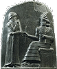

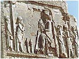

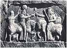

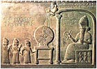

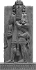

Starożytna Mezopotamia. Postacie Bogów i królów nadnaturalnej wielkości. Czy to zamierzony efekt, czy tak wyglądali naprawdę? Król Hammurabi otrzymujący kodeks od siedzącego Boga. Królowie siedzący na koniach i "zamiatający" ziemię nogami. Wizyta u Boga i królowie lub kapłani ledwie sięgający mu powyżej kolan. Czy narodowy bohater Sumeru - Gilgamesz zabił kotka czy lwa? Jakiego musiał być wzrostu skoro trzyma lwa na przedstawionej rzeźbie? Dorosły lew ma chyba 2 m długości.

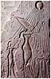

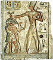

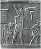

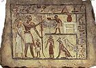

Reliefy i rysunki z Egiptu. Faraon modlący się do Słońca, a za nim ludzka postać. Ramzes zabijający wrogów. Czy to ten sam, którego "egiptologiczna" mumia ma tylko 1,70 m wzrostu? Chyba nie. Środkowy fresk chyba nie wymaga komentarza, a osoba trzymająca olbrzyma za nogę na pewno nie jest dzieckiem. Faraon Narmer dwa razy wyższy od zwykłych ludzi, a na ostatnim rysunku poczęstunek faraona wykonywany ze specjalnego podestu.

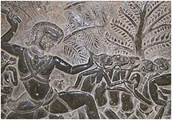

Czy kiedyś naprawdę istnieli ludzie tak dużego wzrostu? Nauka już od lat szkolnych wpaja nam, że to królowie, zadufani w sobie, próżni i nonszalanccy kazali rzeźbić i rysować siebie w tak wielkich rozmiarach, by odróżniać się od pospolitej hołoty. Giganci w rodzaju Goliata, to przenośnia mająca wykazać, że nawet największe zło może być zwyciężone przez małe dobro. Olbrzymami z bajek straszono niegrzeczne potomstwo. Niektórzy na takich obrazach widzą dzieci. Jak to dzieci... Przecież dzieci mają zupełnie inną proporcję ciała. A na wojnie też dzieci? Palestyńska intifada w zamierzchłych czasach? Wolnego...

Ostatni relief znajduje się w kambodżańskiej świątyni Angkor. Przedstawia olbrzyma (króla?, demona?), który zabija lub bije dużo mniejszych od niego ludzi. Ludzi należących do tej samej, co on rasy - rasy "długouchych", rasy, po której już dawno zaginął ślad. Bici są ciekawie skrępowani - bijący trzyma w ręku sznur, który jest przewleczony przez ich uszy. Jak wyglądały ich uszy obejrzysz dalej w rozdziale "Znaki szczególne zaginionych".

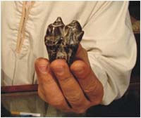

Ząb znaleziony w okolicach Giza

Czy ktoś się zastanawiał, dlaczego starożytni byli tak nieekonomiczni? Dlaczego budowano tak wysokie świątynie i pałace, dlaczego wejścia do nich były wielokrotnie wyższe od wzrostu przeciętnego człowieka? Jak sądzę dlatego, że świątynie budowano dla Bogów, a pałace dla królów - dzieci Bogów. Boski gen wzrostu występował także u ich dzieci. Do dziś mówi się - Bóg jest wielki. Początkowo miano chyba na myśli wzrost, jako że język starożytnych był językiem oszczędnym i jednoznacznym. To dopiero rozwój języka w naszych czasach doprowadził do takiej wieloznaczności jednego określenia. Starożytni określali wzrost olbrzymów na 100-200, a czasem więcej stóp. Przyjmując proporcjonalną siłę przestaje dziwić, że igraszką dla Bogów było postawienie cyklopowych murów, a giganci z łatwością ciskali olbrzymimi głazami.

Ktoś może zapytać: no dobrze, a czemu malowany na wazach greckich, Herakles syn Boga zabijający lwa jest już taki proporcjonalny? Sądzę, że odpowiedź tkwi w czasie. Grecy, jeden z najbardziej inteligentnych, ale już współczesnych, historycznych ludów nie widzieli wokół siebie olbrzymów. Nie mieli autentycznego, żyjącego wzorca, a w rysunkach chcieli oddawać prawdę.

Dlaczego nie znajdujemy grobów gigantów? Sądzę, że wyjaśnienie tej kwestii leży już w sferze bardziej duchowej, w sferze miłości ojcowskiej. Pierwsi ziemscy królowie byli dziećmi Bogów i śmiertelnych kobiet. Bardzo możliwe, że u schyłku życia ojcowie "zabierali ich do nieba", by ostatnie chwile spędzili już bez ziemskich trosk. Oczywiście mówimy tu tylko i wyłącznie o boskich dzieciach. Czytając Teksty Piramid po odrzuceniu tysiącletnich "zanieczyszczeń" można dojść do wniosku, że czyta się reportaż ze startu pojazdu kosmicznego. Dojście do statku poprzedzone jest przechodzeniem przez różne pomieszczenia, gdzie podróżnik jest sprawdzany przez obsługę naziemną i przygotowywany do lotu. Przeczytać można, że faraon był nawet zatrzymywany przez "gadające drzwi" i dopiero po podaniu hasła przepuszczany dalej. W końcu zajmował miejsce w "oku Horusa" i rozpoczynał swą podróż w kosmos. Olbrzym Ra-meses to przecież syn Boga Ra. Istnieją także przekazy, że do nieba zabierane były też matki boskich dzieci. Takiego zaszczytu w najbliższych nam czasach dostąpił przecież syn Boga Jezus i jego matka Maria. Czy mówiąc o Nich, mówimy o właściwych czasach? Czy nasza, chrześcijańska religia ma "tylko" dwa tysiące lat?

**Jak zwolennicy Allaha dowodzą prawdy**

Nie tylko chrześcijanie chcą za wszelką cenę dowieść prawdy. Robią to także bracia w Allahu. Mistyfikacji dokonali nie zwolennicy Biblii a zwolennicy Mahometa.

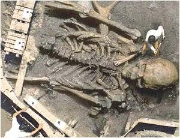  
Trzydziestometrowy Adam

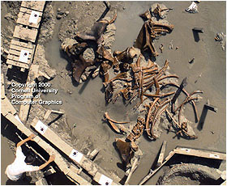  
i mastodont z USA

Jak napisano w artykule "[Gigantyczny szkielet ludzki znaleziony w Arabii Saudyjskiej](http://www.ekumenizm.pl/article.php?story=20040706004909287)" - "Wcale nie chodzi o potwierdzenie prawd biblijnych, lecz koranicznych. Mahomet twierdził, że Bóg stworzył Adama na swoje podobieństwo - posiadającego 30 metrów wzrostu. Od czasu, gdy Adam postawił swą stopę na ziemi, kolejne pokolenia malały. Cyfrowo sfałszowane zdjęcie ma na celu potwierdzenie, że Mahomet mówił prawdę. Zdaniem Faith Freedom, zgodnie z tradycyjnym nauczaniem islamskim, kłamanie w celu budowania wiary w Allaha jest jak najbardziej etyczne.". Oszustwo wytropiła Elli z Wiednia. Dzięki Elli.

**Shareware czy zwykłe demo ?**

Czym jest człowiek w na Ziemi? Koroną stworzenia czy szczytem ewolucji? Władcą Ziemi czy tylko najrozumniejszym wśród małorozumnych? Czy jest tylko małym płomykiem, który może zgasić najlżejszy nawet podmuch. Jakie zdanie na jego temat miały wyższe, boskie sfery, przeczytać można u Ajschylosa:

**Prometeusz**: Oprócz zaś tego jeszczem dał im ogień. **Okeanidy**: Dziś jasny ogień mają jednodniowi?

Dlaczego nasze życie jest takie, a nie inne? Czy tak być musi? Tak. Przynajmniej na razie. Postarali się o to Bogowie, nasi stwórcy. Jak wiadomo, pierwsi ludzie (w Biblii nazywani patriarchami) wiek swój liczyli w setkach lat. Widać Stwórca nie obawiał się wtedy konkurencji albo zbyt mocno uwierzył w intelektualną doskonałość swego dzieła. Im dalej tym gorzej ... dla nas. Piszą o tym starożytni:

**Popol Vuh** - Zostali obdarzeni rozumem; spojrzeli i natychmiast wzrok ich sięgnął daleko, zdołali ujrzeć, zdołali poznać wszystko, co istnieje na świecie. Kiedy patrzyli, w jednej chwili widzieli wszystko, co ich otaczało, i oglądali wokół siebie sklepienie niebieskie i okrągłe oblicze ziemi. Widzieli wszystkie rzeczy zakryte, bez potrzeby ruszania się z miejsca; natychmiast widzieli świat i jednakowo dobrze z miejsca, gdzie się znajdowali, widzieli go.

---

Wówczas Serce Nieba cisnął im oparem w oczy, które zamgliły się jak powierzchnia lustra, gdy na nie chuchnąć. Oczy ich zaćmiły się i mogli widzieć jedynie to, co było blisko, tylko to było dla nich jasne. W taki oto sposób zostały zniszczone mądrość i wszelka wiedza owych czterech ludzi, którzy są źródłem i początkiem \[rasy quiche\]. Tak zostali stworzeni i utworzeni nasi dziadkowie, nasi ojcowie, za sprawą Serca Nieba, Serca Ziemi.

**Opowieść o Adapie** - Wydoskonalił jego rozum \[...\] Dał mu mądrość \[...\] Dał mu poznanie; Wiecznego życia mu nie dał.

Księga Rodzaju - Tuż przed potopem, Stwórca widząc, że rodzaj ludzki zaczyna wymykać się spod kontroli

Wtedy Bóg rzekł: Nie może pozostawać duch mój w człowieku na zawsze, gdyż człowiek jest istotą cielesną; niechaj więc żyje tylko sto dwadzieścia lat.

Ingerencja producenta we własny produkt spowodowała ograniczenie jego trwałości. Cóż, miał do tego prawo. Szkoda tylko, że jednocześnie zlikwidował instytucję gwarancji.

Nie sposób nie zauważyć, że mowa jest tu o manipulacjach genetycznych. Każdy, kto cokolwiek wie o życiu istot żywych, tylko taką ewentualność weźmie pod uwagę. Nie istnieje inna możliwość zmian właściwości organizmów żywych. Na ten temat pisało, a właściwie przepisywało od Daenikena, bardzo wielu. Istnienie w głębokiej historii dziwacznych istot, chimer, potworów itp. przypisuje się "zabawom" Bogów. Czy naprawdę? Nawet my, ludzie dzisiejsi, uważamy badania genetyczne za rodzaj najniebezpieczniejszej zabawy. Czym więc mogło to być? Może mieliśmy tu do czynienia z przejęciem starego laboratorium przez jakąś nową ekipę, która pozbawiona dokumentacji robiła doświadczenia na znanej zasadzie "jakoś to będzie". Może "potwory" tworzono jako elementy ochrony ściśle boskich terytoriów?

Dziwi mnie natomiast, że tylu znawców rzeczy, nie zwróciło uwagi na fakt stosowania klonowania. Wydaje się, że oprócz naturalnej prokreacji ocalonych z kataklizmów, w niektórych miejscach miał miejsce akt odtwarzania rodzaju ludzkiego poprzez klonowanie. Przykład z przekazów dawnych ludów Meksyku:

I natychmiast skrzyknęli się bogowie. Rzekli: Kto zamieszka ziemię? \[...\] I wnet udał się Quetzalcoatl do Mictlanu, zbliżył się do Mictlantecuhtli i do Mictlancihuatli, i tak do nich rzekł: Przybywam w poszukiwaniu drogocennych kości, które ty przechowujesz, przychodzę by je zabrać. \[...\] Co z nimi uczynisz Quetzalcoatlu? Odrzekł mu Quetzalcoatl: Bogowie pragną, by ziemia była zamieszkana. \[...\] Ale potem udał sie w głąb, zagarnął drogocenne kości. Z jednej strony znajdowały się kości mężczyzny, z drugiej kości kobiety. \[...\] *Tu następuje opis zabierania kości, ale wskutek intrygi kości zostają rozsypane i zmieszane. Quetzalcoatl zbiera je i składa w jedną wiązkę i przynosi je do Tamoanchan* \[...\] Wtedy przybyła ta, która zwie Quilaztli, a która jest Cihuacoatl, i zmełła je, i włożyła je do drogocennego naczynia, Quetzalcoatl zrosił je wtedy własną krwią. \[...\] ...i rzekli: och bogowie narodzili się macehuales.

Dla wyjaśnienia - "Macehuales - ludzie, członkowie niższej warstwy społecznej". Sądzę, że to nie wymaga żadnego komentarza. Można tylko zapytać, czy to wtedy narodziła się nowa ludzka rasa - Indianie? Czy był to odosobniony przypadek i tylko na tym terenie? Jaka część dzisiejszej światowej populacji to potomkowie ocalonych, pierwszych ludzi? Widać także z tego zaoceanicznego przykładu, że (tak też twierdzili Sumerowie), człowiek należał do najniższej warstwy ówczesnej cywilizacji. Potwierdza to także istnienie azteckiego Boga o imieniu Titlacauan, co tłumaczy się jako "ten, którego niewolnikami jesteśmy".

Co z tego wynika? Nic radosnego. Stwórca wprowadził nas w życie na zasadzie produktu shareware. Działa owszem dobrze, ale nie wszystkie funkcje można uruchomić. Gdy po ziemi chadzali Bogowie, wszelkie poprawki i naprawy wykonywali oni sami (słynne przykładowo Epidauros w Grecji). Gdy ich zabrakło zostaliśmy zmuszeni do naprawy samych siebie. Kiedyś zapewne byli od tego specjaliści, istniały chyba instrukcje, ale wiatr historii nie ma chwili spoczynku. Dzisiejsza nauka poszła już na tyle do przodu, że po względnym poznaniu działania poszczególnych mechanizmów niektórzy zaczęli już grzebać w kodzie źródłowym (genotyp), poznali ogólną budowę programu, ale mają problemy z procedurami, a właściwie z ich ogromną ilością. Brak dokładnej znajomości stałych i zmiennych oraz brak dostatecznej wiedzy na temat jakości, ilości i kolejności wprowadzanych danych nie wróży temu dobrze. Dobrze, że jest ponad 3 mld kopii zapasowych. W momencie gdy jesteśmy gotowi do "kupienia" pełnej wersji zabrakło producenta. Jeśli kiedykolwiek w historii znajdzie się jednak hacker, który zrozumie kod źródłowy programu "HOMO" i będzie umiał uruchomić pełną wersję zasłuży na miano nowego Boga.

Na koniec rozmowa Ezdrasza z Bogiem. Zdanie, które mocno utkwiło w mojej pamięci dając wiele do myślenia:

**Ezdrasz**: Kto będzie szczęśliwszy w chwili powrotu Pana z nieba, żywi czy zmarli?  
**Pan**: żywi będą o wiele szczęśliwsi od zmarłych.

Burzy to wprawdzie moje marzenia o szczęśliwym życiu pozagrobowym, ale zawsze mogę stwierdzić za uczonymi, że starożyni nie mówili prawdy. Nadzieję jednak definitywnie rozwiewają słowa Chrystusa, który mówi: "Bóg jest Bogiem żywych, nie umarłych". Cóż, Murzyn zrobił swoje, Murzyn może odejść.

**Cywilizacja sierot**

Czy my, mieszkańcy Ziemi, jesteśmy jedną cywilizacją? Dla kogoś z zewnątrz prawdopodobnie tak. Jednak już sami mieszkańcy planety twierdzą, że na Ziemi istnieje co najmniej kilka cywilizacji, co zresztą nie powinno dziwić, bo wyróżnianie cywilizacji zależy od kryteriów ustalanych przez samych ludzi. Jednym z takich kryteriów jest język i pismo. Ale, na dobrą sprawę, czy można twierdzić, że jest to (czy też był) jedyny sposób porozumiewania się? Jak definiuje się cywilizację?

**Wikipedia** - Cywilizacja - poziom rozwoju społeczeństwa w danym okresie historycznym, który charakteryzuje się określonym poziomem kultury materialnej, stopniem opanowania środowiska naturalnego, nagromadzeniem instytucji społecznych. Stanowi ona najwyższy poziom organizacji społeczeństw, z którym jednostki identyfikują się.

**Kopaliński** - Cywilizacja - stan kultury materialnej osiągnięty przez społeczeństwo w danej epoce historycznej; stan rozwoju społecznego przeciwstawny stanowi barbarzyństwa; potocznie - rozwój materialny, techniczny, w odróżnieniu od rozwoju kultury duchowej, moralności, obyczajów.

Już tylko na podstawie tych dwóch definicji możemy wyróżnić wiele cywilizacji zamieszkującej Ziemię. Za pewnik można przyjąć, że nie stanowimy cywilizacji jednolitej. Gdybyśmy taką byli, nie byłoby zapewne takich różnic w kulturze, technice, mentalności czy stosunku do innych, obcych ludzi. Można jednak wyróżnić jeden czynnik, który konsoliduje daną społeczność bez względu na warunki materialne, techniczne czy nawet pismo i język. Jest to wyznawana religia. To łączy każdą społeczność nawet zwaśnioną wewnętrznie. Przyjrzyjmy się światu, a zobaczymy bezwzględną solidarność wyznawców. Z tego też względu dzisiejszy świat, według mnie, dzieli się na cztery wielkie ludzkie cywilizacje: chrześcijańską, muzułmańską, hinduistyczną i judeistyczną. Istnieją też oczywiście inne i jest ich dużo więcej, ale pozostają w liczebnej mniejszości. Istnieje też paracywilizacja wmieszana w pozostałe - są to wyznawcy "niczego", pospolicie zwani ateistami czy też wyznawcami Billona i Konsumpcji. Oni sami najchętniej nazywają siebie obywatelami świata.

Czy jesteśmy pierwszą i jedyną cywilizacją Ziemian? Stanowczo odpowiadam - nie. Na Ziemi do niedawna istniały co najmniej trzy cywilizacje. Jedna na bardzo wysokim stopniu rozwoju (boska), druga - półbogów, stanowiąca ziemską administrację i łącznik pomiędzy cywilizacją Bogów i ludzi oraz nasza, ludzka. Problem leży w tym, że nasi historycy nie potrafią ich wyróżnić i odróżnić. Najpewniej nie pozwala im na to obecność ducha Darwina, a i podział na epoki do którego dołożono zasadę liniowości postępu, z którego wynika, że człowiek z epoki kamienia, kamiennymi narzędziami tworzył kilkuset tonowe, prostopadłościenne bloki z kamienia i na dodatek żonglował nimi z dziecinną łatwością. Nadszedł już chyba czas, by zweryfikować te założenia, a przede wszystkim wprowadzić do historii logikę jako przedmiot obowiązkowy.

Historia, jak sądzę, popełnia jeszcze jeden kardynalny błąd. Wrzuca wszystko do jednego worka. Strach przed wyrzuceniem poza "towarzystwo wzajemnej adoracji" zabił zdolność logicznego myślenia lub, co gorsze, popchnął do zwyczajnych oszustw i to nie tylko w mowie i piśmie. Pisałem już o tym, lecz jeszcze wspomnę. Założenie, że my jesteśmy pierwsi i jedyni spowodowało, że nie dopuszcza się myśli o istnieniu w przeszłości cywilizacji o wyższym poziomie technicznym niż nasza. Stąd człowiek z epoki kamienia buduje piramidy, a przekazy starożytnych traktuje się jako wytwory nadmiernie wybujałej fantazji.

Kiedy nastał świt naszej dzisiejszej cywilizacji? Nie wiem czy na to pytanie ktokolwiek jest w stanie odpowiedzieć. Można by zapytać co pozostało z dawnych cywilizacji. Tu odpowiadam - tylko my, ludzie. Jesteśmy potomkami tych, co przeżyli ostatni kataklizm na Ziemi. Ponieważ historia nie zna w ostatnich wiekach przypadku katastrofy kosmicznej, a tylko potopy, można stwierdzić, że jesteśmy potomkami ludzi gór, ludzi z wyżyn, ludzi z miejsc, gdzie nie dotarły fale ostatniego potopu, ale też i mogła nie dotrzeć starożytna mądrość.

Z ocalałych pism starożytnych ludów wynika, że po wielkim katakliźmie, w wielu rejonach świata pojawili się Wielcy Nauczyciele. Oni to przekazywali rozległą wiedzę, a przede wszystkim kodeks etyczny i moralny, który nakazami i zakazami tworzył podwaliny nowych społeczności, mających w przyszłości jeśli nie zastąpić ginącą cywilizację, to przynajmniej zostać jej namiastką i kontynuatorką. Problem jest w tym, że Bogowie nie pozostawili nam ani swojej wiedzy ani techniki. Nawet półbogowie posiadali zakres "boskiej" wiedzy ograniczający się tylko do sprawnego administrowania i podstawowych umiejętności (pismo, umiejętność liczenia, podstawy astronomii czy przyrodoznawstwa). Przepaść między bogami i ludźmi można porównać do różnicy pomiędzy elitarnym, najnowocześniej wyposażonym żołnierzem armii USA a papuaskim wojownikiem z dżungli Gwinei.

Odbudowa cywilizacji, po hipotetycznym kataklizmie 12,5 tysiąca lat temu, nie odbywała się w jednym miejscu. Misja ratunkowa prowadzona była na całym świecie, co ma odbicie w najstarszych dokumentach różnych ludów. Niestety są one ignorowane przez naukę, wpychane między bajki, traktowane jako mity lub bredzenie niedouczonych prymitywów. Pytanie tylko, skąd taka ilość fantazji w tak prymitywnych ludziach oraz czym wytłumaczyć ogromne podobieństwo w treści przekazów powstałych w tak odległych od siebie miejscach. Odnoszę wrażenie, że ignorowanie wiadomości zawartych w dokumentach starożytnych jest głównym powodem dzisiejszego mijania się z prawdą historyczną. Ponadto, przyjęcie założenia, że nasza cywilizacja w całości zaczynała od zera prowadzi do nieprawdziwych wniosków. Stąd naciąganie faktów oraz ignorowanie niektórych dowodów i ukrywanie innych. Od zera zaczynała współczesna nauka i technika, bo cóż innego było robić skoro starożytna "mądrość" uległa zniszczeniu. Nasza nauka polega na badaniu. Badamy, czyli nie wiemy co robimy, jak się wyraził pewien uczony amerykański.

Ciekawe spostrzeżenie łączy się z wprowadzaniem ładu i prawa. Najstarsze prawa nie są prawami typu karnego (jak późniejszy kodeks Hammurabiego), ale bardziej zbliżone do kodeksu etycznego. Najbardziej znane to oczywiście 10 przykazań, znane ze starego testamentu, ale udało mi się odnaleźć inny przykład w opowiadaniu Indian Hopi (z publikacji Blumricha - Kaskara i siedem światów), który jak sądzę został "podrasowany" przez współczesnych znawców.

• Nikt nie może czerpać korzyści kosztem innego człowieka.  
• Nikt w pojedynkę, ani wspólnota nie może nikomu nic zabrać siłą.  
• Wszystkie bogactwa naturalne powinny pozostać własnością państwa lub wspólnoty i nie mogą być uważane za własność osobistą ani przez pojedynczego człowieka ani przez wspólnotę, nie stanowiącą całego społeczeństwa.  
• Każdy obywatel i każde dziecko jest uprawnione do otrzymania takiego samego wykształcenia, równych możliwości wyrażania swych zdolności i równości wobec prawa.  
• Każdy wzrost pozycji \[*społecznej*\] powinien opierać się na zasługach i osiągnięciach, wyłącznie w służbie \[ *wspólnoty*\].  
• Żaden człowiek nie może uznać za osobistą własność niczego, czego nie zrekompensował w równej wartości.  
• Żaden człowiek nie może mieć prawa do zmiany środowiska lub spraw osobistych innych ludzi, o ile nie jest o to przez inną osobę proszony. Wspólnota lub rząd może zrobić tak, tylko jeśli można udowodnić zamiary przestępcze, lub gdy naruszone zostały prawa osobiste innych ludzi.  
• Nikt nie może celowo spowodować śmierci lub zranienia innej osoby, chyba że w obronie życia lub państwa.  
• Powinna zostać zachowana świętość domu i żadna kobieta nie może zostać siłą poślubiona bez jej zgody.  
• We wszystkich sprawach dotyczących wspólnego dobra i gdy nie wchodzi w grę naruszenie Prawa Naturalnego wiążąca jest opinia większości, zależna jedynie od Starszych, których decyzja jest ostateczną.

Istnienie podobnego kodeksu etycznego można doszukać się także w starożytnym Egipcie, choć tu poszczególnych nakazów można się domyśleć po spowiedzi przed Ozyrysem idącego "ku nieśmiertelności" faraona.

• Nie zgrzeszyłem przeciwko ludziom.  
• Nie zagrabiłem rzeczy biednym.  
• Nie zrobiłem tego, czego nie lubią bogowie.  
• Nie buntowałem sługi przeciwko panu jego.  
• Nie trułem.  
• Nie zabijałem.  
• Nie rozkazywałem mordercy.  
• Nie wyrządziłem krzywdy nikomu.  
• Nie spółkowałem z mężczyzną.  
• Nie uprawiałem samogwałtu w miejscach świętych należących do boga mojego miasta.  

Zwrócić należy uwagę na nakaz poszanowania nasienia ludzkiego. Musiało być ważne ono same, jak i cel jego użycia. Wynika z tego, że człowiek i jego prokreacja były dla Bogów jednym z priorytetów. Dlaczego boski kodeks był dawany w porcjach po 10? Czy nie jest to zastanawiające? Jak należy tłumaczyć fakt, że pierwsze nakazy miały charakter typowo etyczny? Sądzę, że samo już przebywanie Bogów na Ziemi lub w jej pobliżu powodowało bojaźń przed karą. Ze strzępków przekazów wiemy, że kara za wykroczenia przeciw prawom boskim była natychmiastowa i czasem straszliwa.

To, że kiedyś na ziemi istniała wysoka cywilizacja można udowodnić nie wprost, zadając kilka oklepanych pytań. Jak człowiek z epoki neolitu wykonał tak wspaniałe budowle i rzeźby? Dlaczego technika starożytnego Egiptu w miarę upływu wieków ulegała degradacji? W jaki sposób pierwotny obrabiał i transportował olbrzymie bloki kamienia na duże odległości? Skąd w starożytnych przekazach hinduskich opisy techniki, która dla nas jest pieśnią dalekiej przyszłości? To tylko kilka z wielu pytań jakie można postawić. Można by jeszcze zapytać - dlaczego tak wiele starożytnych, wielkich budowli nie zostało odbudowanych? Skoro ludzie zbudowali piramidy, Luxor, Marib, Mykeny, Machu Pichu czy Ollantaytambo - dlaczego nie dokonali ich restauracji po zniszczeniu? Odpowiedź może być tylko jedna - ludzie tego nie zbudowali, a ci, którzy mogli to zrobić byli już nieobecni.

Sądzę, że w miarę upływu czasu zniszczeniu ulegały i narzędzia i techniki. Mówimy przecież o tysiącach lat. Nie odnowiono zniszczonej w kataklizmie bazy technologicznej. Być może nie miał kto tego zrobić. Wymierali też nauczyciele, uczniowie nie byli zbyt pojętni. Gdy odeszli ostatni znawcy "starożytnej mądrości", najniższe instynkty dały o sobie znak niszczycielskimi wojnami. Mordowano całe narody. Niszczono i palono stare, niezrozumiałe rękopisy, spuściznę Pierwszego Rozumu. Zabijano światłych ludzi jako synów złego. Chrześcijanie wymordowali cywilizacje obu Ameryk i puścili z dymem ich spuściznę intelektualną. Ekspansja Islamu obróciła w niwecz nauki Egiptu, Chaldei czy Indii. Świat spowiła epoka ciemności i zabobonu. Światełko zaświeciło dopiero niedawno. Ówczesny świat wszedł na nową drogę, całkiem nową i całkiem inną drogę.

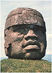

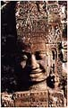

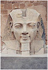

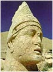

Bogowie? Półbogowie? Nauczyciele? Przodkowie?

Czy człowiek mógł sam z siebie i na własne potrzeby stworzyć Bogów? Nie. Wzorzec istniał, choć w bardzo odległej przeszłości. Czczenie Bogów miało, być może, charakter podziękowań za dokonane czyny, a figury były portretami. Było to coś, co nazywamy dzisiaj kultem przodków, a było w zasadzie przywołaniem wspomnień o Wielkich Nieobecnych. Bardziej możliwe jest jednak to, że oddawanie hołdu Bogom było niejako wpisane w zakres obowiązków ich służących - ludzi. Dopiero za naszych czasów dorobiono im atrybuty, zaczęto obwiniać za niepowodzenia, dziękować za powodzenia. Dopiero za naszych czasów poprzydzielano różne funkcje i rejony odpowiedzialności. Ten od piorunów, ten od wody a ten jeszcze od czegoś innego. Z wysokiej katedry ustala się jak było i jak ma być.

Czy słowa indiańskiego poety są przysięgą daną nauczycielom?

Nigdy nie zaginie, nigdy nie zostanie zapomniane to co przyszli zrobić,  
co przyszli utrwalić w rysunkach: swoją sławę, swoją historię, swoje wspomnienia ...  
Na zawsze zachowamy to w pamięci, my, ich synowie ...  
Będziemy o tym mówić, będziemy to przekazywać, tym, którzy będą jeszcze żyli, tym którzy się narodzą ...

Czy słowa egipskiego pisarza nie mówią o wielkich nauczycielach?

Ci mądrzy pisarze z czasów następców bogów,  
Ci, którzy zapowiadali przyszłość,  
Dąstąpili tego szczęścia, że imiona ich trwają wiecznie,  
Choć oni sami odeszli, dobiegłszy kresu życia,  
I choć cała ich rodzina popadła w zapomnienie.  
Nie zbudowali sobie piramid z brązu ani pomników z żelaza.  
Nie zostawili dziedziców-dzieci, które by przy życiu utrzymały ich imiona,  
Lecz uczynili dziedzicem księgi i nauki, które stworzyli ...

Z tego co napisałem jawi się pewien podział cywilizacji ludzi związany nierozerwalnie z jej pierwotnym przeznaczeniem:

• **Królowie** - kasta "półbogów", przywódcy bezpośrednio wyznaczani przez Bogów do sprawowania władzy w danej społeczności, jedyni upoważnieni do kontaktów z Bogami, władza administracyjna i wykonawcza na Ziemi.  
• **Kapłani** - kasta "półbogów" przeznaczona do bezpośredniej "obsługi" przedstawicieli boskiej cywilizacji, dbająca o przyjmowanie i magazynowanie danin dla Bogów, pilnująca wszelkich rytuałów związanych ze służeniem Bogom.  
• **Wojownicy** - ludzie, najbardziej sprawni fizycznie, najlepiej wyszkoleni w rzemiośle wojennym mężczyźni, których zadaniem była tylko i wyłącznie ochrona danej społeczności, posiadali broń tylko do walki wręcz,  
• **Rzemieślnicy** - ludzie o umiejętności produkcji prostej broni, narzędzi i przedmiotów codziennego użytku dla ludzi,  
• **Kupcy** - ludzie parający się handlem wymiennym wytwarzanymi dobrami między społecznościami, prawdopodobnie też pierwsi szpiedzy,  
• **Chłopi** - najliczniejsza grupa ludzi zajmująca się produkcją żywności w celu utrzymania Bogów, półbogów i ludzi.

Kobiety w cywilizacji zajmowały szczególne miejsce i otaczane były szczególną ochroną i czcią z racji bodaj najważniejszej funkcji - rodzenia nowych członków społeczności i tym samym zapewnienia ciągłości rodzaju ludzkiego. Dlatego kobietom nie wolno było brać udziału w wojnach, nie wolno było wykonywać ciężkich prac w polu, nie wolno było być rzemieślnikiem czy kupcem. Wszystkie te funkcje wiązały się z możliwością utraty życia, a tym samym stawiały pod znakiem zapytania przeżycie populacji. To dlatego były jednym z najcenniejszych łupów wojennych.

...jak czynią to ludzie, którzy umierają i ulegają zniszczeniu. Dlatego dałem im żony, żeby siali w nich nasienie i żeby dzięki nim mogły się rodzić dzieci, tak, aby niczego nie brakowało na ziemi. \[z księgi Henocha\]

Jak już pisałem, półbogom i ludziom nie wolno było posiadać własnej techniki, która w swoim rozwoju mogłaby kiedyś zagrozić Bogom. Najwyższa technologia była zastrzeżona tylko i wyłącznie dla Bogów. Być może pierwszym przejawem "technicznego" nieposłuszeństwa było samowolne wybudowanie wieży Babel, która została natychmiast unicestwiona, a zespół twórców rozpędzony "na cztery wiatry".

Pamiętamy zapewne z historii, że najstarsze organizacje społeczne skupiały się wokół ośrodków, nazywanych dzisiaj miastami-państwami. Jest to logiczne. Każdy Bóg tworzył ośrodek władzy, z którego zarządzał podległą sobie społecznością. Centrum - dom Boga i pałac królewski - zabezpieczone przed pospólstwem (wzgórza, "cyklopowe mury", wysokie terasy), wokół centrum świątynie (magazyny danin), pomieszczenia dla kapłanów i wojowników, jeszcze dalej warsztaty i ośrodki handlu. Czy starożytne "teatry" lub "boiska do kultowej gry w piłkę", położone obok "centrum" lub w bliskiej od niego odległości, nie były miejscami gdzie ogłaszano wszystkim ludziom "wolę Bogów"? Przyjmując tezę dzisiejszych historyków o miejscach prezentacji kultury, budowle tego typu winny znajdować w każdym bogatszym ośrodku".

Nie było żadnych państw w dzisiejszym znaczeniu, nie było granic. Istniały zapewne jakieś ustalenia między Bogami co do zasięgu terytoriów, a bezprawne wtargnięcia kończyły się konfliktami granicznymi. Być może granice były tak wyraźne, że nie trzeba było ich oznaczać (całe kontynenty, wyspy, łańcuchy górskie). Ludzie mieszkali w czymś, co dziś nazwalibyśmy barakami albo pomieszczeniami socjalnymi. Nie budowali trwałych budynków i dlatego dziś nie można ich odnaleźć. Być może jednym z powodów była niespokojna, nękana wstrząsami Ziemia. Prymitywne, lekkie budownictwo zwiększało szansę przetrwania populacji.

Cała ta organizacja zaczęła upadać po opuszczeniu Ziemi przez Bogów. To co mamy dzisiaj jest typowym wzięciem sprawy w swoje ręce. Ludzie, by przetrwać, musieli rozpocząć rozwijanie własnej nauki i techniki od zera i pierwszymi "wynalazcami" byli zapewne półbogowie - królowie i kapłani. Z upływem wieków, wiedza dana przez Bogów ulegała zniszczeniu i zapomnieniu. Królowie i kapłani, inteligencja cywilizacji, wymierali naturalnie lub "nagle". Do upadku "mądrości" przyczyniały się również kataklizmy o globalnym zasięgu, których dzisiejsza nauka nie dopuszcza do swoich hipotez. Człowiek został skazany na samego siebie.

**Znaki szczególne zaginionych**

Przenieśmy się w rejon, gdzie według mnie egzystowała cywilizacja nie mająca odpowiednika w innych rejonach świata. Jest to rejon dzisiejszych Indii, częściowo Chin, Japonii, półwyspu malajskiego, wysp Indonezji sięgający aż po wyspę Wielkanocną. Ślady tej cywilizacji można znaleźć nawet na wyspie Tobago (u północno-wschodnich wybrzeży Ameryki Południowej), gdzie znajduje się kilkunastometrowy pomnik Hanumana - hinduskiego króla małp. Jest to rejon obejmujący wyznawców buddyzmu, bodaj najstarszej dziś panującej religii. To rejon cywilizacji "długouchych". Najważniejsi tej cywilizacji, czy jak kto woli główni Bogowie, mieli imponująco długie uszy.

O wiele ważniejszy dowód można znaleźć w przepięknych świątyniach Angkor, gdzie na wielu reliefach występuje istna eksplozja przedstawicieli tej rasy. Stanowczo twierdzę, że mamy tu do czynienia z odrębną rasą. Na reliefach począwszy od króla i jego dworu, a skończywszy na wojownikach, rzemieślnikach i rolnikach, wszystkich wyróżnia ta charakterystyczna cecha - długie uszy. Czy takim nakładem sił i na takim obszarze ukazywano by fikcyjne postacie? Przypatrzmy się głowie Buddy. Zwisające poza brodę uszy, świadczą według mnie o tym, że to cecha genetyczna, a nie sztuczne upiększanie ciała, jak czynią to dzisiaj niektóre afrykańskie plemiona. Uczeni tłumaczą to noszeniem od małego ciężkiej biżuterii.

Co głosi nauka? Otóż głosi, że Budda, historyczna postać, filozof i twórca religii urodzony około 560 r. ne. wszedł w stan nirwany w wieku 80 lat, z którego już nie wyszedł, ale pozostawił po sobie trwającą do dziś i jedną z największych religię. Inaczej przedstawia się sprawa ludu zwanego Khmerami, zamieszkującego tereny dzisiejszej Kambodży, którego uważa się za twórcę kompleksów Angkor. Według nauki, władca, tyran i gnębiciel własnego ludu w XII wieku naszej ery nakazał zbudować sobie okazałe pałace na 750 tysięcy ludzi, by tylko dogodzić własnej chuci. Po upływie jakiś 100-200 lat "wymęczony" naród znika bezpowrotnie z kart historii.

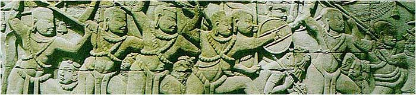

Panowie akademicy, pozwólcie, że zadam kilka pytań. Naród zdolny do budowy takich dużych kompleksów budowlanych i kilkudziesięciometrowych rzeźb nie mógł być ani mały ani prymitywny. Jest również niemożliwe, by nie prowadził handlu przynajmniej z najbliższymi sąsiadami. Płaskorzeźby wskazują również na to, że prowadził wojny i chyba nie sam z sobą (postacie przeciwników wyglądają zupełnie inaczej), natomiast łodzie na reliefach świadczą o tym, że i żegluga nie była mu obca, przynajmniej ta śródlądowa. Jak wobec tego wytłumaczyć, że sąsiedzi np. Chiny, nie wspominają w swych kronikach o cywilizacji "długouchych"? Chińska cywilizacja posiadająca ciągłość kilku tysięcy lat, musiała być przecież świadkiem i narodzin i śmierci tej cywilizacji (działającej także na ich terenie). Czy przekazy chińskie wspominają "długouchych"? Nie.

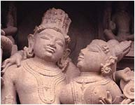

Wszyscy zapewne wiedzą co oznacza słowo "kamasutra". Od dawna wmawia się nam, że sztuka kochania, znana pod tą nazwą, pochodzi z dzisiejszych Indii. Terytorium się zgadza, lecz to nie Hindusi są jej twórcami. Cały ten podręcznik został wyrzeźbiony w kamieniu w "świątyni kamasutry" w Khajuraho. Rzecz w tym, że wszystkie przedstawione w kamieniu postacie należą do cywilizacji "długouchych".

Najstarsze, niekiedy ogromne, kamienne rzeźby od Japonii po południową i wschodnią Azję przedstawiają postacie cywilizacji "długouchych". Podobnie jak płaskorzeźby w Angkor i w wykuwanych (lub wycinanych) świątyniach Indii. Śmiem twierdzić, że ta właśnie cywilizacja stworzyła najstarsze kamienne pomniki i budowle na tych terenach. Mówienie o twórcach żyjących w czasach współczesnych jest wielkim nieporozumieniem. Współcześni raczyli je tylko odziedziczyć po wielkich, zaginionych przodkach.

Cywilizację "długouchych" spotykamy także tysiące kilometrów dalej, na Pacyfiku. Wyspa Wielkanocna jest usiana posągami z wielkimi uszami. Trudno orzec, czy jest to ta sama cywilizacja, gdyż mieszkańcy wyspy byli chyba zwolennikami kubizmu. Ciekawą rzeczą jest jednak to, że ostatni przedstawiciele tej cywilizacji istnieli jeszcze w czasach historycznych. Rysunki kobiety i mężczyzny pochodzą z roku 1774. Ostatnia ich garstka została wymordowana w bratobójczej wojnie.

Absolutny kres znających jeszcze historię wyspy mieszkańców i jej pisma "rongo-rongo" położyły polowania na ludzi w XIX wieku. Dwa razy uczynili to Amerykanie, a ostatni raz w roku 1862 Peruwiańczycy, porywając około 1000 ludzi sprawiając pozostałym masakrę. Czy tak duża odległość, dzieląca wyspę Wielkanocną od azjatyckiego lądu neguje tożsamość tych dwóch ośrodków cywilizacyjnych, czy też winna skłonić do twierdzenia, że nieobca im była także żegluga oceaniczna? A może kiedyś istniał pomost lądowy, który dziś ukrywają fale Pacyfiku?

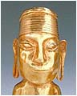

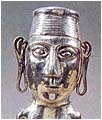

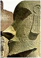

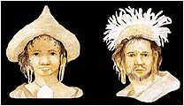

Istnieje jeszcze trzecie źródło mówiące o "długouchych". Jest to legenda znad jeziora Titicaca, mówiąca, że w zamierzchłej przeszłości, kiedy nie było jeszcze ludzi, na wyspie na środku jeziora wylądował srebrny statek, z którego wysiadła kobieta o wydłużonej twarzy i z długimi uszami. U rąk miała po cztery palce spięte błoną. Nazywała się Orejona. Tyle legenda, ale w sztuce dawnych Inków można spotkać wyroby ze złota i srebra przedstawiające postacie ludzkie (tylko mężczyzn) z długimi uszami.

Czy można z tego wyciągnąć wniosek, że cywilizacja "długouchych" obejmowała cały basen Oceanu Spokojnego? Postacie z długimi uszami spotykamy na wyspie Wielkanocnej oraz na wschodnim i zachodnim wybrzeżu Pacyfiku. Cywilizacja ta jest także obecna na północno-wschodnich obrzeżach oceanu Indyjskiego. Kilkunastometrowy posąg Hanumana (indyjski król małp) jest także obecny na wysepce Tobago u północno-wschodnich wybrzeży Ameryki Południowej. Dlaczego cywilizację o takim znaku szczególnym historycy skazują na niebyt? Nonszalancja, brak zmysłu obserwacji czy chęć nie sprawiania sobie kłopotów?

Czy przedstawione zdjęcie murzynki z Kenii, może świadczyć, że cywilizacja "długouchych" istnieje nadal. Niczego to nie dowodzi. Uszy "wyciągnięto" sztucznie pod wpływem ciężaru i jest to raczej ciekawostka niż dowód. To nie jest cecha genetyczna. Na reliefie z Angkor wszyscy wojownicy posiadają długie uszy, ale żaden z nich nie ma ciężkich ozdób w uszach.

Czy drugą z tych cywilizacji była cywilizacja "długogłowych"? Tę, a właściwie czaszki, dla odmiany spotykamy w Egipcie i w Ameryce Południowej. Czy kształt czaszki jest autentyczny czy faktycznie specjalnie je deformowano, by upodobnić się do Bogów? Czy, jeszcze inna możliwość, są to czaszki "mieszańców"? Na to pytanie mogą dać odpowiedź tylko badania genetyczne, ale nie dzisiejszej genetyki, tylko tej za ... dzieści lat.

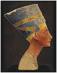

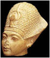

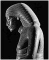

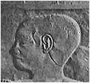

Czy nakrycia głowy i fryzury (lub peruki) miały ukryć kształt czaszki ?

Czy twierdzenie nauki, że ludzie specjalnie deformowali czaszki niemowlętom i małym dzieciom nadając im "boski" wygląd, nie jest upraszczaniem sprawy? W Egipcie roi się od dowodów w postaci rzeźb i płaskorzeźb, które ukazują prawdopodobnie prawdziwy obraz tamtej cywilizacji. Czy te płaskorzeźby to następny fantastyczny komiks?

Nikt do tej pory nie powiązał specyficznych nakryć głowy z ich zawartością. Nie zwracano uwagi na fakt, że tak noszone nakrycie na ludzkiej głowie nie miałoby szans na utrzymanie się w takiej pozycji. Owszem, człowiek może nosić takie nakrycie głowy pod warunkiem, że mocno przywiąże je pod brodą, a takiego rozwiązania nigdzie nie zauważyłem. Są jednak wyjątki. Na niektórych reliefach czy rysunkach widać, że "broda" Boga ma połączenie z nakryciem głowy i chyba jest to połączenie "sztywne". Widać to w posążku Boga Ptaha czy na posągu Ramzesa Wielkiego znalezionego w Memfis.

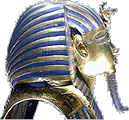

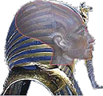

Wszyscy bez wyjątku są zachwyceni "łabędzią", długą szyję Nefretete. Czy ktoś zwrócił uwagę, że szyja jest nienaturalnie wysunięta do przodu? Tego rodzaju ukształtowanie tej części ciała widać nie tylko u królowej. Sądzę, że taka budowa, to konieczność dla ułożenia środka ciężkości czaszki wzdłuż kręgosłupa dla utrzymania równowagi.

Czy słynna maska Tuthankamona zawierała autentyczną czaszkę zmarłego? Czy przypadkiem w pośmiertną trumnę nie "wślizgnął" się nuworysz ludzkiej cywilizacji? Czy można jeszcze mieć pewność, że w sarkofagu leżał właściwy nieboszczyk? W tej materii nauka ma pole do popisu. O ile "długouchych" ciężko będzie zidentyfikować ze względu na rozpad tkanek miękkich, o tyle szczątki kostne cywilizacji "długogłowych" winny się zachować. Problem tylko w raczkującej genetyce i ortodoksyjnych historykach.

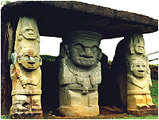

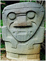

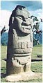

W północnej części Ameryki Południowej istnieje dziś państwo o nazwie Kolumbia. Na jego terenie, nad brzegami oceanu Spokojnego leży wioska San Agustin.

To, że kiedyś była pod wpływami "budowniczych z Peru" świadczą ulice i wysokie kamienne podmurówki domów łudząco przypominające te z Cusco. Także miejsce, nazwane przez archeologów, "wzgórzem obmycia nóg" przypomina "zabawy w kamieniu" z Qenko. Wieś słynna jest wszakże z czego innego - z kamiennych rzeźb istot człekopodobnych z charakterystycznym uzębieniem Drakuli.

Znalazłem także rzeźbę bóstwa o nazwie Bharvi po drugiej stronie kuli ziemskiej, w Indiach. Stomatolog znalazł by na pewno podobieństwo w uzębieniu. Czy mogło dojść do bardziej niż bliższego kontaktu między rasami Bogów? Czy to jest zamierzony owoc współpracy obu cywilizacji? Czy może jest to ta sama rasa? Trzeba też wiedzieć, że my pod pojęciem demona wyobrażamy sobie potwora lub inne monstrum, podczas gdy w Indiach demona od Boga różni tylko charakter. Fizyczna postać podobna lecz charakter zły i złośliwy. Należy jeszcze wspomnieć, że postacie z tak charakterystycznymi kłami spotkać jeszcze można w rzeźbach i rysunkach w Chavin de Huantar.

Bardzo dziwne postacie można spotkać w sztuce Ameryki Środkowej - w El Baul i Toninie. W samym El Baul jest więcej rzeźb przedstawiających zwierzęce dziwolągi. Na zdjęciach widzimy postacie przypominające ludzi. Po lewej stronie stronie rzeźba z El Baul przedstawiająca istotę w hełmie przypominającym trochę stare hełmy nurków, ale wyraźnie widać, że pod hełmem kryje się zupełnie inna twarz, bardziej przypominająca ludzką. Wychodzące z "paszczy" coś w rodzaju strumienia ognia interpretowane jest jako oddech, mowa lub krzyk. Z tyłu hełmu widać wyraźnie rurę skierowaną do tyłu, która być może jest częścią filtra doprowadzającego powietrze do hełmu.

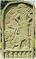

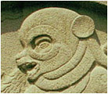

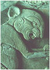

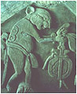

Po prawej stronie już zupełnie inna istota, choć głowa przypomina tę z El Baul nie wygląda na hełm. Twarz podobna do szczura z filmów rysunkowych, ale cała postać przypomina istotę człekopodobną.

Czy wzorem mogła być postać w dziwnym hełmie? Są bardzo do siebie podobne. Nie wiem, która z rzeźb stanowi pierwowzór i dlatego trudno jest powiedzieć, czy istniała cywilizacja istot o głowie szczura, czy też głowa szczura z Tonina jest późnym echem opowiadań o istotach w dziwnych hełmach przypominających głowę zwierzęcia. Sądzę jednak, że łatwiej jest wymyśleć głowę szczura na podstawie widoku hełmu niż wykoncypować, że głowa szczura jest hełmem kryjącym inny wizerunek twarzy. Ucho szczura znajduje się dokładnie w miejscu, gdzie w hełmie znajduje się połączenie rury z hełmem przykryte okrągłą tarczą. Czy są to przedstawiciele następnego rodzaju cywilizacji? Tu nie podejmuję się wyciągnięcia jakichkolwiek wniosków. Jest na to zbyt mało dowodów, choć zastanawia używanie urządzeń do oczyszczania czy uzdatniania powietrza. A może jest to specjalne urządzenie powodujące, że "ogień wychodził z ust"?

**Ofiary - pomysł ludzi czy Bogów**

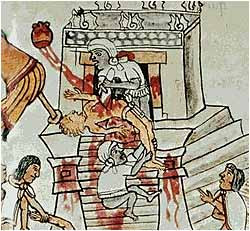

Zatrzymajmy się na chwilę przy krwawych obrzędach składania ofiar z ludzi przez Indian środkowo i południowo amerykańskich. Oficjalnym wytłumaczeniem tych obrzędów jest barbarzyństwo tamtych cywilizacji, niższy stopień rozwoju czy wręcz wypaczenie wiary. Wydaje mi się, że sprawa została maksymalnie uproszczona przez naukowców. Dziwi także fakt usprawiedliwiania niejako konkwisty, bo przecież wyrżnięcie w pień dziesiątków tysięcy Indian tłumaczy się ówczesną koniecznością wprowadzania nowej wiary. Też barbarzyństwo, ale nasze, a więc lepsze i usprawiedliwione.

Moja hipoteza jest zapewne fantastyczna, ale nie pozbawiona logiki. Musimy jednak uwzględnić w niej cywilizację Bogów, jak też zaistnienie wielkiego kataklizmu zwanego "wielkim uskokiem...". Zakładam także, że mówimy o czasie tuż po wielkim kataklizmie, bo tylko ten mógł zostać zapamiętamy przez pokolenia żyjące współcześnie na tych terenach. Sytuacja po wielkim kataklizmie była daleka od dobrej. Ziemia uprawna została skażona przez morskie wody gigantycznego tsunami i nie dawała wysokich plonów. Występowała tu maksymalna zależność między wielkością populacji a wysokością zbiorów. Małe zbiory i duża populacja ludzi równała się powszechnemu głodowi, a ta zagrażała przede wszystkim małej liczebnie grupie inteligencji - królom i kapłanom (łącznikom pomiędzy Bogiem a ludźmi).

Tu na arenę wkracza Bóg, który w swoiście pojęty sposób dokonuje redukcji populacji tak, by reszta mogła przetrwać na określonej ilości pożywienia. Nie jest to niemożliwe, bowiem ludzie dla Bogów byli tylko niższą rasą (macehuales) stworzoną do określonej pracy. Nie było mowy o żadnym stosunku uczuciowym do ludzi. Dla Bogów była to masa mająca wytwarzać określone dobra, a zachowanie populacji w dobrej kondycji fizycznej zależało przecież od wyżywienia. Na podstawie przekazów starożytnych wiemy też, że wśród samych Bogów Ameryki starły się dwie koncepcje. Jedna "miłosierna" reprezentowana przez Quetzalcoatla i druga "drastyczna" Boga Huitzilopochtli. Jak wiemy zwyciężył Huitzilopochtli i jego koncepcja składania ofiar z ludzi. Oczywiście nie mam żadnych dowodów, by to potwierdzić gdyż wiadomo, że prawie wszystkie źródła pisane zostały zniszczone przez konkwistę, ale pewne przesłanki zdają się potwierdzać moją teorię.

•  Redukcji populacji dokonywano nie poprzez pojedyncze ofiary, a przez eliminację tysięcy istnień i to w bardzo krótkim czasie.  
•  Krwawe ofiary osiągały swe maksimum w latach "chudych" i tłumaczono je ofiarami dla Boga deszczu, by zakończyć okres posuchy.  
•  Każdorazowo liczbę ofiar ustalał Huitzilopochtli, decydując o rozpoczęciu wojny i wzięciu do niewoli określonej liczby jeńców z przeznaczeniem ich na krwawe ofiary.

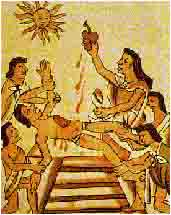

Bóg mając pod opieką ludność całego rejonu, a więc kilka lub kilkanaście plemion mógł pozwolić sobie na swego rodzaju "miłosierdzie". Na ofiary byli przeznaczani jeńcy wojenni, a więc ludzie nie z tego samego plemienia, co w pewnym sensie nie wzbudzało podejrzeń co do prawdziwych intencji Boga. Pozwalało też uniknąć problemów religijnych w obrębie jednego plemienia, a tym samym zamieszek na tle religijnym (jak to, Huitzilopochtli który jest naszym opiekunem każe zabijać naszych współbraci?).

Kapłani wypełniali rozkazy Boga mając (lub nie) pojęcie o prawdziwych jego intencjach, które w jego zamyśle były uzasadnione bezwzględną ekonomią. Cała hipoteza nie mieści się w naszych zasadach humanitarnych, ale jak mi się zdaje takie kanony były obce cywilizacji Bogów (oczywiście tylko w relacji Bóg-człowiek). Sądzę, że tak może wyglądać geneza krwawego rytuału, którego świadkami byli pierwsi konkwistadorzy, nie rozumiejąc ich pierwotnej przyczyny.

Czy jest to niedorzeczność? Spójrzmy na działalność człowieka w naszej rodzimej Puszczy Białowieskiej, ostoi żubra. Ograniczona powierzchnia rezerwatu wystarcza do hodowli, a więc do wyżywienia, określonej liczby tych zwierząt. Co robi człowiek? Sztucznie ogranicza liczebność żubra i to w dwojaki sposób - albo zezwala na odstrzał określonej liczby zwierząt (ofiara), albo część odsprzedaje lub podarowuje dla hodowli na innym terenie (przesiedlenie). Człowiek ma taki sam stosunek do żubra, jaki do ludzi mieli Bogowie (być może tylko niektórzy).

**Ślady dawnej cywilizacji**

Znane mi miejsca, w których odnaleziono budowle jakoś nie pasujące do "ręki" budowniczych epoki kamiennej, naniosłem na mapę świata. Po zaznaczeniu strefy (skośna, w kolorze jasnoszarym), w której znajduje się większość z nich, można zauważyć przekrzywienie nie pasujące do naszego podziału geograficznego. Człowiek najchętniej zamieszkuje strefy zwrotnika, podzwrotnikowe i umiarkowane. Czy strefy klimatyczne przebiegały kiedyś inaczej? Czy skośne ułożenie pasa może potwierdzać, że mogło dojść do przesunięcia skorupy ziemskiej podczas "wielkiego uskoku..."?

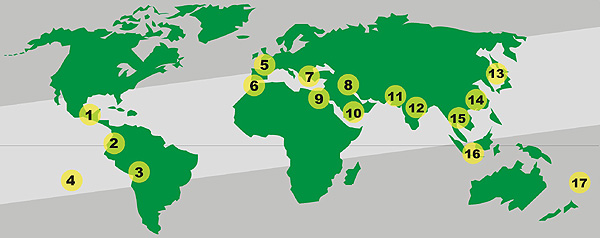

1 • Meksyk, Jukatan  
2 • San Augustin  
3 • Cusco i Tiahuanaco  
4 • Wyspa Wielkanocna  
5 • menhiry, dolmeny, kromlechy  
6 • Gadir, Liksos

  7 • starożytna Hellada  
  8 • Mezopotamia  
  9 • Egipt, Meroe  
10 • Marib  
11 • Mohendżo Daro, Harappa  
12 • India

13 • Japonia  
14 • Chiny  
15 • Khmerowie (świątynie Angkhor)  
16 • Borobudur  
17 • Wyspy Tonga (triliton)

Miejsc takich jest zapewne więcej, ale zaznaczyłem te najbardziej znane i oczywiście te, które znam. Przyglądając się wielkim budowlom starożytnych nie sposób nie zauważyć różnic w ich wyglądzie. Ale według jakich kryteriów dokonać klasyfikacji? Czy kryteria będą w stanie pomóc w ustaleniu, choćby w przybliżeniu, ich twórców? Czy jest możliwość ustalenia czasu ich powstania? Obawiam się, że nie. Nauka jest bardzo uboga w narzędzia pomiarowe, a już w ogóle nie potrafi określić czasu obróbki kamienia. Okrzyknięta rewelacyjną metoda określania wieku za pomocą izotopu węgla w tym przypadku jest całkowicie nieprzydatna. Badać za jej pomocą można tylko szczątki organiczne i do tego z niezbyt odległego czasu, a i do dzisiaj nie rozwiązano kwestii, czy ilość izotopu węgla w atmosferze jest wielkością stałą. Sama metoda zawodzi już w stosunku do szczątków o wieku powyżej 5 tysięcy lat. Ponadto niektórzy badacze historii zbyt nonszalancko podchodzą do znalezisk, nie zwracając uwagi na kontekst i najzwyklejszą logikę. Nie miejmy złudzeń. Jak w każdym środowisku, znajdą się tacy, co nie lubią komplikować sobie życia.

Wróćmy jednak do tematu. Ogromny okres czasu, nieznajomość ilości twórców, niemożność określenia tendencji rozwoju oraz kompletna nieznajomość stosowanej technologii w żadnym wypadku nie pozwala na ustalenie jakiegokolwiek kryterium oceny tego rodzaju zabytków. Tego nie rozwiąże żaden archeolog. Tu może pomóc tylko drobiazgowe śledztwo prowadzone przy pomocy najnowocześniej wyposażonych kryminologów. Ja mogę tylko opisać swoje spostrzeżenia i domysły.

• • •  Pan zstąpił na ziemię na słupie ognia..., Aniołowie zstąpili z nieba..., Ojcze nasz, któryś jest w niebie... Każdy z nas zna te cytaty. Załóżmy, że opisują prawdę. Wynika z tego, że Bogowie mieszkali w niebie i nie mieli domu na ziemi, a jeśli już, to coś w rodzaju garsoniery. Nikt dobrowolnie nie wyrzeknie się wygód, szczególnie jeśli się do nich przywyknie. Mając do wyboru spokojny apartament w Niebie i Ziemię nękaną ciągłymi wstrząsami, zapewne wybrałbym to pierwsze. Skoro odbywali podróże pomiędzy Niebem a Ziemią, winni także posiadać na Ziemi jakieś zaplecze obsługujące ich boskie pojazdy. Magazyny paliwa, warsztaty itp. Czy coś takiego można znaleźć na Ziemi? Przy odrobinie woli chyba tak. Znamy przecież bardzo starożytne budowle nie przypominające wyglądem pięknych apartamentów czy wyniosłych świątyń, a i w naszych już warunkach potrafimy dostrzec różnice między Wawelem a Hutą Katowice. Weźmy na przykład budowle Sacsayhuaman, Machu Picchu czy Ollantaytambo. Potężne mury, brak zdobień, położone zwykle na wzniesieniach (czasem sztucznych), zabezpieczone potężnymi terasami przed osunięciem. Bardziej przypominają budowle typu przemysłowego niż pałace. No i to wrażenie zabezpieczenia ich przed czymś lub kimś. Być może w nich przechowywano lub produkowano niebezpieczne środki, które należało zabezpieczyć przed nieświadomymi, a ciekawskimi ludźmi.

Kamienna ściana w Ollantaytambo (Peru)

Czy w Cusco odnaleziono choćby namiastkę jakiś ozdobnych pomieszczeń? Doskonałe mury, mury i tylko mury oraz niezliczona ilość trapezoidalnych nisz. W ogóle te nisze są zastanawiające. Nigdzie nie znaleziono podobnych poza Ameryką Południową. Do czego służyły? Czy faktycznie do ustawiania w nich figurek Bogów? W Tiahuanaco istnieją rozbite potężne, kamienne bloki o bardzo skomplikowanych kształtach, precyzyjnych wycięciach, nacięciach czy otworach niemożliwych do uzyskania za pomocą prymitywnych narzędzi. Czy to też była świątynia? Sama nazwa Akapana w miejscowym języku oznacza miejsce, gdzie giną ludzie. Jak to? W świątyni? Możliwe, że ginęli, ale byli to nieostrożni lub zbyt ciekawi, niepomni na ostrzeżenia. Czy Stonehenge wygląda na świątynię? Do czego mogły służyć tzw. dolmeny, uznawane przez uczonych za grobowce, choć nigdy w nich nie znaleziono żadnego grobu?

Czy wrażenia "przemysłowego" nie sprawiają budowle Ozyrejonu, świątyni Sfinksa czy Chefrena w Egipcie? Nawet piramidy nie wyglądają na świątynie czy grobowce. Niektóre sarkofagi mogące pomieścić całe rodziny wraz z wyposażeniem na ostatnią podróż - czy były trumnami? Skąd pewność, że napisy na nich umieszczono w czasie ich budowy, a nie dużo później? Skąd pewność czy dzisiejsze dywagacje na temat przeznaczenia tych obiektów odnoszą się do właściwych czasów? To, że czasem znajdujemy w nich mumie liczące kilka tysięcy lat oznacza tylko to, że zostały wykorzystane w tym okresie przez naszą, ludzką już cywilizację. Określanie czasu stworzenia budowli na podstawie zwłok uważam za wielkie nieporozumienie. Skąd pewność, że słynna mumia Tuthankhamona nie została "ubrana" w dużo starsze wyroby? Kto jest w stanie stwierdzić, kiedy jego złote popiersie zostało wytworzone? I w końcu dlaczego twarz złotego popiersia nie jest twarzą nieboszczyka? Panowie egiptolodzy, więcej pokory. Wszystko zganiacie na złodziei albo na gniew ludu. Wasi złodzieje leżą w złotych trumnach. To nuworysze naszej cywilizacji przywłaszczyli sobie i budynki i sprzęty i kto wie czy nie imiona, bo nie trzeba było mozolnie wydrapywać nowych, a tylko usunąć nie pasujące (uczeni nazywają to karą usunięcia w niebyt). Porównajcie sobie piękno i precyzję starych rytów i niechlujstwo najmłodszych...

Petra. Czy to wykuł arabski koczownik?

• • •  Przenieśmy się w inny rodzaj starożytnych dzieł budowlanych. Świątynie wykuwane (a może wycinane?) w litej skale. Perły precyzji i artystycznego smaku. W Egipcie - Abu Simbel, dalej - Petra i niezliczona ich ilość w dzisiejszych Indiach. Znane są i dużo mniej efektowne jak grobowiec Midasa w Europie czy Aramu Muru w Ameryce Południowej. Czy i te dzieła sztuki wykonał prymityw z epoki kamienia? Na to historia nie mogła już pójść. Zbyt skomplikowane do wykonania i dlatego Petrę przypisano... Nabatejczykom. Dziwi wszak jedno. Skąd taka technika u arabskich koczowników i to w I wieku pne? Dlaczego nic takiego nie wykonali gdzie indziej? Dlaczego tylko w tym jednym miejscu? Dlaczego po wybudowaniu Petry rozpłynęli się bez śladu? Powrócili do koczowniczego życia?

Oglądając te "kamienne torty" nie mogę zrozumieć jak przy pomocy narzędzi podrzędnego zakładu kamieniarskiego można wykonać takie cuda. Jak skale o najwyższej twardości, której nawet zarysowanie stalowym nożem sprawia ogromne trudności, można nadać tak wymyślne kształty. Kto lub co mogło nadać skale tak idealną gładkość. Może jest, jak twierdzą uczeni, że to gładzące dłonie niezliczonych pielgrzymów i wyznawców przez tysiące lat... Tylko jak oni chadzali po dachach, szczytach, iglicach? Nie mogę zrozumieć jak kilku tysięcy rzeźbiarzy mogło zapamiętać całość projektu, jak organizowano pracę, by nie wchodzić sobie w drogę, ile lat trwało wycięcie takiej jednej świątyni? A są ich dziesiątki. Uczeni twierdzą, że słynne kopuły kambodżańskich świątyń ustawiały słonie. Ciągnęły i pchały po kilkukilometrowej, wąskiej, pochyłej rampie z piasku i ziemi, bloki z kamienia ważące nierzadko po kilkadziesiąt ton na wysokość kilkudziesięciu metrów, tam ustawiały z dokładnością milimetra i z lekkością baletnicy schodziły po następne. Jak schodził słoń ciągnący tego uczeni jeszcze nie wymyślili. Wszystko mogę przełknąć, ale słonia chodzącego po górach z wdzięcznością kozicy jakoś nie mogę.

Podziemna cysterna w Yerebatan (Turcja)

• • •  Co to jest cysterna na wodę? Oczywiście, że wiadomo! Beczka na czterech kołach z silnikiem i szoferem. Bingo, Ale nie o tych cysternach chcę pisać. Chcę pokazać starożytne cysterny na wodę w Aleksandrii? Nie jedną czy dwie. Naliczono ich już ponad dwadzieścia. Nie są to studnie, są to olbrzymie zbiorniki wyglądające jak pałace, podziemne pałace. Kto je wykonał? Oczywiście oficjalnie firma "Made in Macedonia" dyrektora Aleksandra. Problem jest jednak w tym, że musiały zostać wykonane przed zbudowaniem miasta jako część planu całej podziemnej infrastruktury. Trudno bowiem umieścić już pod zabudową miejską pomieszczenia o wysokości kilkunastu metrów o powierzchni kilkuset metrów.

Odnoszę wrażenie, że Macedończycy budując Aleksandrię nie mieli zielonego pojęcia na czym stawiają swoje miasto. Przecież nie mogli o tym zapomnieć zaraz po wybudowaniu, skoro dopiero dzisiejsza archeologia odkryła je na nowo i to przez przypadek po zapadnięciu się kilku domów. Co ciekawsze, prawie identyczne budowle możemy odnaleźć na terenie dzisiejszej zachodniej Turcji. Czy i tam budowali Grecy? Czy kiedyś znajdzie się dociekliwy archeolog i zbada dokładniej fundamenty, czy przypadkiem nie są dużo starsze od tego co na nich stoi? Bo być może faktycznie zbudowali to Grecy, tylko którzy? Czy to były naprawdę cysterny? Nikt nie bierze pod uwagę teorii "wielkiego uskoku...", który spowodował obniżenie nie tylko dna Atlantyku, ale też Azji Mniejszej czy Afryki. Być może te dzisiejsze "cysterny" stały kiedyś na powierzchni ziemi i były tym na co wyglądają - pałacami. Po obniżeniu się poziomu powierzchni zalały je wody gruntowe i dlatego po znalezieniu w nich wody uznano je za cysterny wodne. Jaki był sens budować pałace dla wodnego robactwa?

• • •  Będąc przy podziemiach wspomnieć należy o całych podziemnych miastach. Najbardziej znane są te z ziemi tureckiej, np. Derinkuyu. A przecież nie tylko tam istnieją. Są na całym świecie. Większości zapewne jeszcze nie odnaleziono. Na niektóre nałożono tajemnicę, jak na te z Ameryki Południowej odkryte przez dr Moricza i pokazane swego czasu Daenikenowi. Czy na Ziemi był okres czasu, w którym takie budowle były niezbędne dla przetrwania? Perska Awesta mówi o czasach mrozu, które można było przetrwać tylko pod ziemią. Podobne przekazy istnieją wśród Indian Ameryki Północnej (Hopi).

Podziemne miasto w Derinkuyu (Turcja)

Czy egipska Dolina Królów nie jest tego przykładem? Mam nawet na ten temat swoją hipotezę. Być może niektóre z piramid, czy innych budowli starożytnego Egiptu, faktycznie było grobowcami królów czy wielkich kapłanów. Kataklizm z przed 12,5 tysiąca lat spowodował ich częściowe lub całkowite zniszczenie. Wówczas to być może, podjęto decyzję o przeniesieniu szczątków znamienitych przodków do niezniszczonego podziemnego miasta w Dolinie Królów. Wówczas też być może, dokonano przeróbek i ozdobień tych pomieszczeń. Dla tych, dla których nie starczyło miejsca lub mniej znaczyli w historii państwa, pośpiesznie znajdowano naturalne groty i tworzono grobowce zbiorowe, gdzie przenoszono same mumie. Być może to właśnie ta "przeprowadzka" jest dziś postrzegana przez uczonych jako dawna wielka "grabież" grobowców przez mających ich strzec - samych kapłanów. Być może to zaowocowało naukowym "wynalazkiem" cenotafów, czyli grobów bez głównego bohatera.

Oglądając zdjęcia z wielu miejsc świata ukazujące ruiny budowli zastanawiam się co było powodem takiego ich zniszczenia. Na pewno nie dokonał tego człowiek ani czas. Dlaczego prawie we wszystkich miejscach panuje taki nieopisany bałagan? Porozrzucane i porozbijane bloki o masie dziesiątek ton, powywracane i rozbite kolumny i posągi kilkunastometrowej wysokości jakby były z gipsu, a przecież wykonane nierzadko z najtwardszych kamieni. Prawie wszystkie budowle pozbawione są płyt stropowych. Tłumaczenie tego przez niektórych gniewem ludu czy zemstą wrogów wydaje się nieprawdziwe. Owszem mamy tu do czynienia z gniewem, ale z gniewem natury. Tego mogło dokonać tylko potężne trzęsienie ziemi. Ale dlaczego dotknęło aż tylu miejsc? Czy mamy tu do czynienia z wieloma pojedynczymi katastrofami czy z jednym potężnym kataklizmem? Nikt dotychczas nie przeprowadził tego typu badań, bo i po co, skoro nauka nie dopuszcza "wielkiego uskoku...". Nikomu nie przyszło nawet do głowy, że pewne miejsca nie są zaliczane do niebezpiecznych sejsmicznie. Andy, Indie owszem, ale Europa? Grecja - rzadkość, Bretania i Anglia - w ogóle. To co poprzewracało menhiry? Co tak uszkodziło kromlech Stonehenge? Co zniszczyło Delfy czy Mykeny? Gniew ludu? Nieubłagany czas? Chyba przesada.

Dlaczego przeważająca część ruin znajduje się pod warstwą ziemi? Współczesna archeologia piramidy w Teotihuacan mozolnie odkopała spod warstwy ziemi. Dlaczego zostało zasypane? Jako anegdotę można przyjąć wyjaśnienia niektórych luminarzy nauki. Oficjalna teoria głosi, że starożytne miasta rejonu Meksyku i Jukatanu zostały opuszczone nagle i prawdopodobnie z przyczyny głodu. W Teotihuacan było podobnie, ale na dodatek ten wygłodzony, ledwo trzymający się na nogach naród zmuszono do zasypania całego kompleksu by uniemożliwić jego wykorzystanie przez innych. Blednie przy tym nawet fantazja starożytnych. A wystarczyło wziąć parę kubełków tej ziemi, przesiać i sprawdzić, czy przypadkiem nie zawierają śladów zadziałania morskiego tsunami. Tego jednak nie było w założeniu.

Pytanie czy Ziemią władała jedna czy kilka cywilizacji Bogów? Czy jesteśmy w stanie określić jakieś kryterium, na podstawie którego można by dokonać jakiegoś sensownego podziału? Ludzką miarą jest sztuka i architektura, a w zasadzie jej inność czy odrębność spowodowana tradycjami kulturowymi, a także zastosowanymi materiałami i technologiami. Dziś ludzkość skupiona jest przede wszystkim w miastach, z których nieliczne osiągają przerażające rozmiary. Czy kompleksy, takie jak Giza, Tiahuanaco, Machu Pichu, Ollantaytambo, Mykeny, Tiryns, że tylko wymienię kilka, można nazwać miastami? Najstarsza (?) Giza to zapewne kompleks trzech piramid, Sfinks i parę świątyń. Tiahuanaco, to tylko trzy obiekty - Kalassaya, Puma Punku i Akapana. Machu Picchu to obszar cirka 300 na 200 m. Ollantaytambo jest niewiele większy, do tego z jednej strony okolony wysokim murem. O Cusco prawie nic nie można powiedzieć, gdyż Hiszpanie zniekształcili je dokładnie burząc i przebudowując na swoją modłę. Kompleks obok Cusco, Sacsayhuaman zajmuje obszar około 500 na 300-400 m. Wszystkie posiadają jedną, wspólną cechę - są małe w zajmowanym obszarze. Czy to faktycznie były miasta? A jeśli były to miasta, to gdzie ich nekropolie?

Kompleksy peruwiańskie jeśli nie są obwarowane cyklopowymi murami, to są budowane w trudno dostępnych miejscach. Czy dlatego, by utrudnić do nich dostęp ludziom, czy dlatego by uchronić ich przed trudnym do zdefiniowania niebezpieczeństwem? Już z tego powodu trudno nazwać je miejscami kultu. Czym były? O tym wiedzą tylko ci, co je zbudowali. Wielkość i surowość stylu bardziej predestynuje je do ośrodków przemysłowych niż na miejsca kultu.

Czy można zauważyć coś ciekawego, oglądając zdjęcia ruin z Ameryki Środkowej? Należy zwrócić uwagę na fakt, że brak tam, z nielicznymi wyjątkami, budowli z olbrzymich, pojedynczych kamiennych bloków? Budowle też potężne, ale... wypełnienie murów, podpór i stropów stanowią nieobrobione, małe otoczaki zespojone "czymś" (nic o tym nie znalazłem), a dopiero zewnętrzną okładzinę stanowią ładnie obrobione, zdobione duże kamienne płyty. Podobny styl budowy odnaleźć można także w Europie, północnej Afryce czy Bliskim Wschodzie.

Z tego światowego galimatiasu można jednak wyróżnić obszary, które zdają się świadczyć o przynależności do jednego kręgu kulturowego. Meksyk i Jukatan, San Agustin, krąg Cusco, królestwo kromlechów i menhirów w Europie, krąg najstarszej Grecji, Azja Mniejsza, Mezopotamia i Mohendżo-Daro, Egipt oraz Meroe i Marib, Południowo-wschodnia część Azji, a to jeszcze nie wszystko. Czy świadczy to o różnych epokach (czas) czy odrębności sztuki (cywilizacja)?

Czy tak mógł wyglądać podział świata między Bogów 25 tysięcy lat temu?

Mapka wyżej, to oczywiście moja fantazja, jak i to co piszę dalej. Czas...? Być może po potopie około 37 tysięcy lat temu, o którym jak sądzę wspomina Biblia, Sumerowie i Egipt. Schyłek rządów Kronosa i Ptaha. Ziemia zniszczona kataklizmem, gdzie niegdzie z tlącym się jeszcze życiem. Nowi Bogowie obejmują świat we władanie i dokonują nowego podziału świata między siebie. To wtedy Posejdon obejmuje we władanie morza, Atena Europę, Ptah jeszcze podnosi Egipt z upadku. Wtedy być może w Azji zjawia się Indra. Bogowie sami zaczynają wznosić swoje stolice. Posejdon na Atlantydzie (ponoć później wraz z Apollinem wznosi mury Troi), Atena - Akropol na wzgórzu Ateńskim, Hefajstos buduje w Egipcie, być może Memphis. Wielkie budowle i posągi Azji wznosi jakiś "długouchy" Bóg.

Można jednak zauważyć pewne cechy odróżniające okręgi od innych, chociaż niektóre technologie wydają się być wspólne (ogromne wymiary elementów, precyzja w dopasowaniu, mury antysejsmiczne, terasy zabezpieczające przed osunięciami). Posejdon nie zwraca uwagi na artyzm wykonania, budowle ogromne, solidne ale toporne. Być może pozostałości to Sacsayhuaman, Machu Picchu czy Liksus i Gadeira. Krąg ateńsko-egipski bardziej zdobny, wszystkie jednak ustępują finezyjnemu budownictwu w Azji. Czy to był jeden krąg cywilizacji Bogów czy kilka, nie wiem, mówimy wszak o dziesiątkach tysiącleci. Wkradają się pomiędzy nie budowle wycinane w litej skale w Indiach, w Petrze czy Abu-Simbel. Powstaje krąg budujących z małych cegieł na terenie Mezopotamii czy Indusu.

Ile tysiącleci cywilizacja Bogów przebywa na Ziemi? Wymiera czy odlatuje. Czy odwiedzają nas następni? Skąd wzięli się ci z długimi zębami? Kto 16 tysięcy lat temu buduje twierdzę Akakor? Kto ostrzega plemię Ogha-Mogulala o nadchodzącym katakliźmie? Dlaczego nie zostają ostrzeżone wojska Atlantydy czy Grecji? Czy ostatnie dynastie półbogów i kasty kapłańskiej schodzą z tego świata przed 7 tysiącami lat? Czy to właśnie wtedy cywilizacja ludzi rozpoczyna kroczyć własną drogą? Pytania, pytania, pytania...

**Podsumujmy ...**

Czy kiedykolwiek Ziemia była odwiedzana przez przybyszów z kosmosu nie sposób ustalić. Ślady, o których pisałem na początku są ignorowane przez naukę i sprowadzane do sprytnego fałszerstwa, natomiast pisane przekazy starożytnych zaliczono do radosnej twórczości, fantazji i majaków. Od małego wmawia nam się, że nasz przodek był nierozgarniętym, małpowatym debilem zamieszkującym jaskinie, zajętym tylko zdobywaniem jedzenia i przypadkiem wymyślającym coś nowego raz na kilka tysięcy lat.

Taka indoktrynacja sprawiła, że dziś światowa nauka posiada kilkumilionową armię fundamentalistów gotową umrzeć za Darwina, byle tylko nie dopuścić do głosu inaczej myślących. To zaś, że najstarsza historia ludzkości nie zgadza się z większością faktów nie ma dla nich znaczenia. Te fakty się usuwa, ukrywa, niszczy lub fałszuje i w ten sposób pozbywa problemu. Najstarsza historia człowieka jest niespójna i wymyśla się coraz bardziej dziwaczne historie, byle tylko ją uprawdopodobnić. Wszystko to stwarza wrażenie dziejowego spisku małej, ale silnej grupy historyków, mającego na celu nie dopuszczenie zwykłych ludzi do poznania prawdy. Czy nie lepiej zbudować nową hipotezę bazującą na przekazach starożytnych i spróbować ją zweryfikować?

• Przygoda życia rozumnego zaczyna się, jak przekazują starożytne teksty, ponad 400 tys. lat temu. Jakaś grupa Obcych rozpoczyna eksplorację naszej planety. W celu zrzucenia ciężkiej pracy na inne barki postanawiają stworzyć rozumnego robotnika. Tak, według Sumerów, dochodzi do stworzenia pierwszego człowieka. W drugiej kolejności stworzona zostaje kobieta, by zapewnić ciągłą reprodukcję siły roboczej. Stwórcy absolutnie nie zamierzali stworzyć sobie konkurenta, dlatego tworzą człowieka niedoskonałego. Przede wszystkim blokują gen długiego życia i pozbawiają go innych "boskich" właściwości, których my nawet się nie domyślamy.

• W pewnym momencie dochodzi do aktu mającego kapitalne znaczenie dla przyszłości ludzi. Grupa Obcych zaczyna współżyć z ziemskimi niewiastami, zapoczątkowując nową rasę mieszańców, zwaną półbogami. Co więcej, ta grupa Obcych zostaje odrzucona przez resztę "boskiej" społeczności, jako skażona pierwiastkiem ziemskim i otrzymuje zakaz opuszczania Ziemi i kontaktowania się z pozostałymi. Nie obyło się chyba bez walki. Stare przekazy wspominają o jakiejś walce między Bogami w przestrzeni kosmicznej. Z konieczności grupa ta tworzy pierwszą boską dynastię na Ziemi. Odlatując, Obcy pozostawiają skazanym technikę kosmiczną bez możliwości podróżowania w głębinach kosmosu. Ta właśnie grupa, pozbawiona możliwości powrotu do swej kosmicznej ojczyzny, rozpoczyna organizację społeczności na naszej planecie stając się pierwszymi Bogami.

Zastanawiający jest także fakt, dlaczego w akcie mezaliansu uczestniczą Bogowie tylko płci męskiej. Wygodnictwo Bogów czy gorzka świadomość Bogiń kłopotów związanych z ciążą i porodem? A może boginie, dorównujące wzrostem bogom, nie odczuwały żadnej przyjemności, gdy w okolicy łona plątał się jakiś ludzki, męski kurdupel?

• Bogowie dokonują podziału terytorium ówczesnego świata pomiędzy siebie. Z rasy półbogów wyznacza się bezpośrednich władców (królów) danej społeczności oraz kastę kapłanów, której zadaniem było "obsługiwanie" Bogów. Ustanowione zostają prawa i powinności. Z rasy ludzi dokonuje się selekcji wojowników, rzemieślników i kupców, pozostałych zaś czyni się łowcami, pasterzami i chłopami, na barki których zrzucono odpowiedzialność za produkcję żywności dla wszystkich. Główną rolą kobiet było rodzenie dzieci i ich wychowanie. Półbogowie i ludzie muszą oddawać cześć Bogom, utrzymywać ich i spełniać ich żądania. Bogowie, używając swojej techniki, budują na Ziemi ośrodki władzy (domy Boga), pałace królewskie i główne świątynie okalając je potężnymi murami. W bezpośredniej bliskości organizują koszary, warsztaty, miejsca handlu itp. Półbogom i kapłanom przekazana zostaje podstawowa wiedza, pismo i prosta broń (miecze, włócznie, tarcze, rydwany) oraz podstawowa technika. Ludzie od Bogów otrzymują najprostszą broń do obrony własnej, proste narzędzia i proste środki transportu. Jeszcze raz podkreślam - wysoka technika była zastrzeżona wyłącznie dla Bogów.

• Życie na Ziemi kilkakrotnie zostało zagrożone wielkimi kataklizmami o skali ogólnoświatowej. Potop sumeryjski (biblijny?) około 37 tysięcy lat temu był prawdopodobnie przyczyną zniszczeń na niewyobrażalną skalę. Ale istniejąca jeszcze cywilizacja Bogów zdołała odbudować cywilizację ludzi (królestwo ponownie zeszło z nieba). Drugi, podobny kataklizm wydarzył się około 12,5 tysiąca lat temu. Czy wtedy interweniowali Bogowie? Nie wiem, czy jeszcze byli obecni. Prawdopodobnie byli, choć chyba już nieliczni. Po nich schodzi ze sceny rasa półbogów pozostawiając ludziom wiedzę i znajomość pisma (nie mylić z alfabetem, który dopiero później wymyślili sami ludzie). Ludzie zostali pozostawieni samym sobie, chociaż jeśli uwierzyć Sumerom, ostatnia wizyta Bogów miała miejsce około 3760 r. pne. Od tego czasu człowiek rozpoczyna swoją już przygodę z nauką i techniką, jednak w ciągu tysiącleci naturalne kataklizmy i wojny powodują, że wiedza starożytna zostaje zniszczona i zapomniana. Rozpoczyna się błądzenie po omacku, które w niektórych dziedzinach wiedzy trwa po dzień dzisiejszy.

Czy moja hipoteza jest prawdziwa? Nie wiem. Nie mam możliwości jej sprawdzenia poprzez badania czy wykopaliska, ale nie sądzę że jest niemożliwa. Niektóre twierdzenia poświadczają przekazy starożytnych, niektóre logika. Pozostawiam to subiektywnemu osądowi.
