**Ludzie, giganci czy Bogowie ?**  
Wcale nie jest to niewiarygodne, albowiem naonczas  
w wielu miejscach istniały wielkoludy (Aztekowie).

**Demony siły**

Przedstawione przeze mnie budowle łączy jedna wspólna cecha - wielkość. Nie chodzi tu bynajmniej o ogromne kamienie pozostawione przez lodowiec, ale o bloki kamienne wykonane i postawione ręką kogoś cywilizowanego. Bloki kamienia, których waga nie rzadko sięga setek ton. Wykuć (lub wyciąć), oddzielić od podłoża, przetransportować, podnieść nierzadko na wysokość kilkudziesięciu metrów i dokładnie ustawić. Jakie siły były tu użyte? Nadludzkie czy nieludzkie. Olbrzymia większość bloków nie posiada żadnych znaków. Widać budowle były tak charakterystyczne, że budowniczy nie musiał ich oznaczać. Drugą charakterystyczną cechą jest zasięg tych budowli. Spotykamy je na całym świecie - od Europy po Oceanię. Niektóre wręcz bliźniaczo podobne.

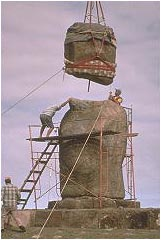

A jak robili to **ONI** ?

Świadczy to jeśli nie o kontaktach osobistych to o wspólnej, ogólnoświatowej technologii. Archeolodzy i historycy karmią nas uczoną papką, która każe nam wierzyć, że wszystko to uczynił człowiek z epoki kamienia. Kto lub co upoważnia ich do takiego twierdzenia?

Wystarczy by w okolicy bloku z kamienia ważącego kilkadziesiąt lub kilkaset ton odnaleziono kawałek skorupy i jakieś resztki kości i już tryumfalnie ogłasza się światu, że znany jest wiek budowli i jej budowniczy. Metodę badania wieku za pomocą radioaktywnego węgla uznano za panaceum na wszystko, choć nawet uczeń szkoły średniej wie, że zawodzi ona już powyżej kilku tysięcy lat. Nonszalancja, brak samokrytycyzmu i nawet odrobiny logicznego myślenia prowadzi do jednego - do fałszowania historii. Dzisiejsze badania archeologiczne przypominają pracę na wielkim historycznym śmietnisku, gdzie potrafimy z grubsza posortować śmieci, ale odnalezienie kogoś kto je wyrzucił i kiedy tego dokonał jest już absolutnie niemożliwe. Możliwość, że budowle cywilizacji Bogów zostały "zaśmiecone" przez cywilizację ludzi odrzuca się całkowicie.

Przyjęcie założenia o liniowości postępu intelektualnego i technicznego naszej cywilizacji sprawiło, że historia starożytna zamienia się w kiepski teatr. Każde nowe odkrycie jest mierzone tą linijką postępu. Dochodzi do absurdów. Do przesuwania kamiennych bloków "zatrudnia" się tysiące ludzi nie bacząc na brak miejsca przy samym kamieniu i dokłada się wtedy kilometry lin. Historia starożytna jako nauka wraz z przyjęciem błędnego podstawowego założenia skazała się na okłamywanie samej siebie. Nie ma żadnego nadrzędnego celu, któremu podporządkowano by badania, nie ma żadnej, nawet ogólnej koncepcji badań.

Podporządkowując historię teorii Darwina oraz wprowadzając (skądinąd słuszną) teorię liniowego postępu historycy stworzyli mieszankę wybuchową i zapalili lont, którego nie potrafili w porę zgasić. Nastąpił wybuch teorii i hipotez na temat niektórych budowli, które znaleziono na Ziemi a które siłą rzeczy i wbrew logice musiano przypisać ludziom. Przeczy to zdrowemu rozsądkowi, ale wycofać się nie wypada, bo cała historia starożytna runęła by w gruzy. Brnie się więc dalej wymyślając hipotezy, które normalnych ludzi wprawiają w bezgraniczne zdumienie i to nie ze względu na ich błyskotliwość ale ze względu na ograniczoność ich utytułowanych twórców. Piewcy starożytności wpadli we własne sidła i nie potrafią się z nich wyplątać bez zachowania twarzy.

Jak tłumaczy się to w pracach przy budowie piramidy? Erich von Daeniken opisuje jak austriacki egiptolog pan prof. dr. Dieter A. wymyślił sposób na budowę piramidy, a konkretnie rozwiązał problem unoszenia bloków kamiennych na coraz to wyższe poziomy. Według niego sprawa jest dziecinnie prosta. Zbudowano z drewna kołyskę - przecięto drewniane koło na pół i wykonano bujankę. Na górną, płaską część kładziono monolit o średniej wadze 4 ton i zaczynano bujać całość. Dalej już szło jak po maśle. Kołyska w przód, a z tyłu natychmiast dwóch starożytnych osiłków podkładało belkę, teraz kołyska w tył i taka sama akcja z przodu. Blok powoli unosił się na deskach. Po osiągnięciu zadanej wysokości robiono ruch w kierunku piramidy, ale już bez deski i kamień wskakiwał na swój poziom. Teraz paru zmyślnych udokładniało położenie i gotowe. Problem w tym, że pan profesor nie podał sposobu, jak ten blok ułożyć na kołysce i jak przymocować. Jaka drewniana kołyska jest zdolna wytrzymać nacisk kilku ton? Następny problem, to wielkość kołyski dla bloków z "wielkiej galerii". Tu profesorski mózg prawdopodobnie nie wytrzymał "bujania".

Drugi "kwiatek" też od Daenikena i też austriacki prof. Oskar R. podał sposób na transport bloków kamiennych i ich unoszenie tak prosty, że aż oczywisty. Do ciężkiej pracy zaprzągł wodę. Otóż transportowano te bloki z Assuanu pomiędzy dwoma drewnianymi łódkami egipskich fellachów. Po pokonaniu prądów, wirów, zakrętów, mielizn i płycizn oba statki równocześnie zawijały do portu pod piramidami, po czym je przytapiano na przygotowane pod wodą drewniane sanie i ciągnięto je plac budowy pod piramidą. Potem ciężar przejmowały drewniane dźwigi unoszące te drobne kilka ton na swoje miejsce. Proste jak... chciało by się rzec, gdyby nie parę niedomówień w tym austriackim gadaniu. Pan profesor nie podał takich drobiazgów: jaką wyporność musiały mieć owe łodzie, z czego wykonywano tak wytrzymałe liny i jakiej "firmy" były te genialne konstrukcje dźwigów. I jeszcze jedno. Ile łodzi liczyła ta flota cargo, by dostarczyć jeden blok co 2 minuty z Assuanu do Gizy? Czy Nil nie był zbyt wąski? Z lotu ptaka łodzie na Nilu musiały przypominać piłę łańcuchową będącą w ruchu przez całe 23 lata. Kto by zawracał sobie głowę takimi drobiazgami, prawda?

Takich teorii jest mnóstwo. Wymyślają je ludzie, którzy nie mają zielonego pojęcia o technice, a jedynym warunkiem by ogłosić te rewelacje światu jest odpowiedni wiek i tytuł naukowy. W jaki sposób może reagować na to zwykły myślący człowiek, skoro jest pozbawiony jakiejkolwiek możliwości?

**Pierwsze budowle pierwotnych**

Obejrzyjmy dzieła kamienne dokonane czyjąś ręką, mniej efektowne pod względem artyzmu, ale bardzo efektowne pod względem wielkości. Takie budowle kamienne są rozrzucone po całym niemal świecie i nie dają się sklasyfikować ani jako świątynie ani jako budowle innej użyteczności. Ale od czego mamy historyków? Wszystkie jak jeden zakwalifikowano jako starożytne... grobowce, choć w żadnym nie znaleziono głównego bohatera. Czas ich powstania określono, jak zwykle, na podstawie wszystkiego co w nich lub obok nich znaleziono słynnym już ze swych wad izotopem węgla. Wyszło, że te twory są stosunkowo młode i zostały wykonane gdzieś parę tysięcy lat przed naszą erą przez "mięśniaków" epoki kamiennej.

Najwięcej z nich znaleziono we Francji, Hiszpanii i Wielkiej Brytanii. Znajdują się jednak na całym świecie, choć nie wszędzie są szukane. Kraje takie jak były ZSRR czy Chiny uważają je chyba za tajemnicę państwową. W innych krajach z powodu biedy lub lekceważącego do nich stosunku poszukiwań się nie prowadzi. Nie sposób pokazać wszystkich. Wybrałem kilka najbardziej okazałych by mieć ogólne pojęcie o ich wielkości, a co za tym idzie trudnościach w ich zbudowaniu.

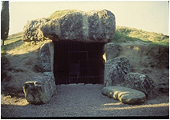

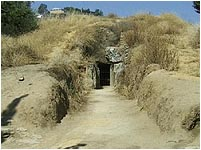

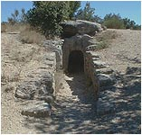

Menga

Viera

Gallardet

To nie są schrony z okresu II wojny światowej ani też przeniesione na grunt europejski amerykańskie schrony przeciwatomowe. To co widać wzniósł europejski przedstawiciel "homo darvinicus" z okresu kamienia.

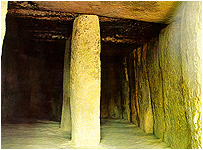

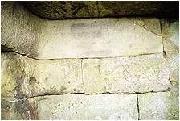

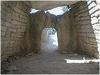

Menga

Neksis

Gallardet

W budowie wnętrz widać "ludzką"(?) rękę, popartą zapewne obliczeniami wytrzymałościowymi. Zwrócić należy uwagę na wygląd narożników. Nasza cywilizacja tak nie buduje, choć można już wytwarzać tak specjalnie wykuwane narożniki. Żmudne i nieopłacalne. Dlaczego "oni" wybrali taki rodzaj narożników? Po co nieboszczykowi tak przemyślane i tak wytrzymałe rozwiązania?

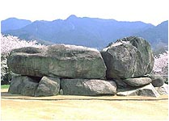

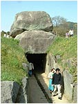

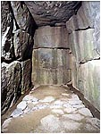

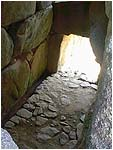

Ishibutai. Japonia.

Czy w Japonii działało to samo "megalityczne plemię"? Jak potężne są bloki z kamienia można sobie uzmysłowić po wzroście zwiedzających. To nie są "cegiełki" pasujące do ludzkiej reki. Jakiej siły potrzeba by unieść, przesunąć i ustawić ciężary rzędu kilkuset ton? Oglądając wnętrze widać także, że nie jest to zbiorowisko bezładnie ustawianych kamieni oraz to, że te kamienie były przedtem obrabiane.

Zestaw poniżej (z miejsc znanych i nieznanych) powinien skłonić do zadumy. To nie są byle jak ustawiane i przypadkowo zebrane bloki kamienne. Na niektórych widać jeszcze ślady obróbki, a niektóre są tak uszkodzone przez czas, że już tej obróbki nie widać. Przy odrobinie wyobraźni można ujrzeć, że początkowo te płyty miały wygląd doskonałych prostopadłościanów i były do siebie doskonale dopasowane. Zwrócić należy uwagę na doskonale wycięte koliste otwory oraz na wycięcia i nadcięcia (Neksis).

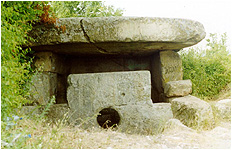

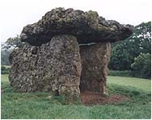

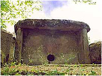

Neksis

Walba

Djubga

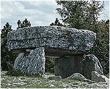

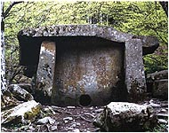

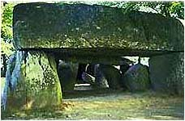

Czy to naprawdę wykuł (czy wyciął) człowiek dysponujący kamiennymi tłuczkami i dłutami z krzemienia? Czy jednemu zmarłemu grobowiec stawiało całe plemię? Jak liczne musiało być plemię zdolne do wykonania tak tytanicznej pracy przez krótki okres oczekiwania na śmierć wodza?

Archeolodzy nie wiedzą kto, nie wiedzą jak, nie wiedzą kiedy i nie wiedzą po co. Jak na współczesnych uczonych to i tak bardzo dużo. Wyraz "prawdopodobnie" jest tu w wielkiej cenie. W poszukiwaniu celu budowy Erich von Daeniken zaproponował dwa rozwiązania - ochrona przed promieniowaniem ultrafioletowym (ogromna dziura ozonowa) lub ochrona przed atakiem Bogów z powietrza. Oba nie głupie i oba oczywiście nie do przyjęcia przez oficjalna naukę. Skoro nie można domyśleć się celu budowy, to może zastanowić się, czym na pewno te budowle nie były?

• **pałace, świątynie** - zbyt prymitywne i za małe. Brak miejsc dla Bogów (nie znaleziono nic, co można by nazwać ołtarzem). Brak miejsc dla rodziny królewskiej, służby itp.  
• **grobowce** - "ukochana" i jedyna wersja oficjalnej nauki, ale... nie znaleziono żadnego nieboszczyka (podobno złodzieje), a jeśli był to grobowiec, to bardzo rzadko i bardzo młody. Brak sarkofagów czy innych trumien. Brak choćby namiastki upamiętniającego epitafium. W niektórych "podłogi" wyłożone kamieniami.  
• **budynki mieszkalne** - w większości zbyt mała powierzchnia przestrzeni życiowej. Brak "okien" i otworów dla ujścia dymu. Brak jakichkolwiek rysunków, jak to robiono w jaskiniach.  
• **pomieszczenia gospodarcze** - jak wyżej, ponadto brak np. uchwytów do wiązania bydła, brak kamiennych (taka epoka) poideł, brak pomieszczeń na magazynowanie paszy.  
• **magazyny żywności** - absolutny brak ochrony przed inwazją szkodników, niektóre zbyt "przewiewne" nie zabezpieczające przed wilgocią.  
• **szalety plemienne** - brak otworu przyjmującego (fachowo zwanego "oczkiem"), archeolodzy nie potwierdzają istnienia dołów kloacznych, brak uchwytów na papier toaletowy, no i brak rzeczy najważniejszej - starożytnych efektów trawienia.

Można wysnuć jednak kilka wniosków. Były budowane w sposób jak najbardziej prosty, a jednocześnie bardzo wytrzymały, bez przepychu i zdobnictwa. Nieliczne posiadają rowy prowadzące do jedynego wejścia, obudowane kamiennymi płytami. Niektóre obudowane ze wszystkich stron, posiadają tylko otwór, przez który można wślizgnąć do wnętrza. Budowane na całym świecie mogą świadczyć, że budowano je w obliczu jakiegoś ogólnoświatowego zagrożenia, którego nie umiemy sprecyzować. Wielką uwagę zwracano na grubość pokrywy dachowej (choć dziś niektóre są bardzo naruszone przez warunki pogodowe). Niektóre dolmeny są tak małe, jakby stanowiły tylko wejście do podziemnego schronu, jednak nie słyszałem, by w którymś kopano w głąb. Czy bliższy prawdy nie jest Daeniken?

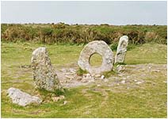

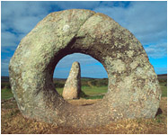

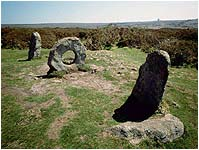

Menantol w Kornwalii. Do czego służył ten dziwny "celownik"?

Na zakończenie coś, co przypominać może tor przeszkód w obozie szkoleniowym pierwotnych terrorystów. Obiegamy kamień, "przewlekamy" się przez kółko, obiegamy drugi kamień... i tak kilkadziesiąt razy, aż do uzyskania wymaganej sprawności. Poczekajmy jednak, bo może jakiś uczony "myślący inaczej" dopatrzy się w tym motka do wełny.

**Cegiełki wprost dla ludzkiej ręki**

To co pokazałem wyżej to budowle wykonane przez człowieka bardzo pierwotnego z epoki tak bardzo sta-rego kamienia, że historycy mają prawdopodobnie problem w ustaleniu przymiotnika. Wtedy to człowiek nie wymyślił jeszcze sztuki i stąd toporne ledwo ociosane kamienne bloki. W miarę rozwoju intelektualnego w swoich budowach zaczął poszukiwać piękna i faktycznie budował coraz "milej dla oka". Używał w dalszym ciągu ogromnych elementów co świadczy o jego ogromnej sile fizycznej.

**Egipt**

  
  

Na początek dwie "świątynie" starożytnego Egiptu wykonane z wielkich, kamiennych i oszlifowanych perfekcyjnie bloków w formie doskonałych prostopadłościanów. Kąty proste świadczą o używaniu jakiegoś starożytnego kątownika, którego nie znaleziono być może dlatego, że był drewniany i nie zachował się do naszych czasów. Sprawa uniesienia kilkudziesięciotonowych bloków na wysokość paru metrów też według archeologów nie sprawiała żadnych trudności. Ludzi do pracy było mnóstwo, lin i drewna też. Dodać należy kilka starożytnych wielokrążków i gotowe. I jeszcze jedno ważne spostrzeżenie - w Egipcie występował jeszcze "koordynator jednolitości wysiłku" przedstawiany na starożytnych rysunkach jako człowiek z batem.

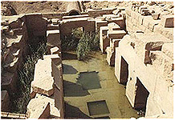

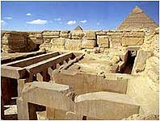

Ozyrejon w Abydos

Świątynia Chefrena w Giza

Takie jak tu bloki, ale w większej skali oglądać możemy w Baalbeck i też w Egipcie (zdjęcia poniżej), gdzie w assuańskim kamieniołomie odkryto największy blok, jeszcze nie oddzielony od skały macierzystej. Miał to być (tak głosi nauka) obelisk dla królowej Hatszepsut, jednak zrezygnowano z jego oddzielenia od podłoża z powodu pęknięcia. Skąd wiadomo, że dla Hatszepsut skoro brak jakiegokolwiek napisu? Czy tylko dlatego, że wiek obelisku określono na czas jej panowania?

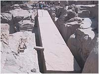

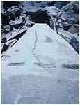

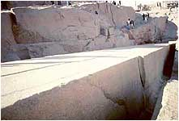

Wszystko jasne, ale ... Czy pęknięcie jest wynikiem "złego" obchodzenia się z kamieniem, czy pokazem działania sił natury. Na domiar złego, nauka nie jest w stanie odpowiedzieć kiedy to się stało. Pozostaje tylko gdybanie i myślenie życzeniowe, tak powszechnie stosowane przez historyków w udowadnianiu hipotez. A jeśli blok pękł z przyczyn naturalnych 12,5 tysięcy lat temu?......

**Baalbeck**

  
  

Przenieśmy się bardziej na północ, do libańskiego Baalbeck. Tutaj też odnaleziono bloki kamienia przewyższające jednak wagą te z Abydos. Na skrajnych fotografiach pokazane są fundamenty świątyni Jowisza zbudowane z potężnych kamiennych bloków. Waga? Bagatela. Po kilkaset ton.

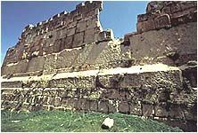

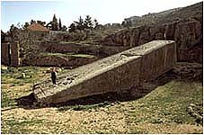

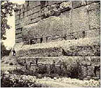

Baalbeck. fenickie miasto Baala. Od imienia tego boga prawdopodobnie wywodzi się imię naszego diabła - Baalzebub (z polska Belzebub, zwany też Lucyferem). Czy to przypadek, że imię Lucyfer oznacza - niosący światło?. Grecy utożsamiali go z Heliosem. Kanon nauki umieszcza tę budowę na około 3 tysiące lat pne., natomiast budowę świątyni Jowisza przypisuje się Rzymianom gdzieś między I a III wiekiem ne. Ze świątyni Jowisza pozostało kilka kolumn o wysokości 20 m, które cudem ostały się po jakiś trzęsieniach ziemi. Znając "technikę" Rzymian nie wydaje mi się, by byli oni twórcami fundamentów świątyni. W Rzymie nie odnaleziono tak gigantycznych bloków kamiennych. Ponadto nie mogę sobie uświadomić w jaki sposób, jaką techniką Grecy lub Rzymianie transportowali ciężkie bloki (mówimy o dziesiątkach ton) na znaczne wysokości.

**Mykeny**

  
  

Przenieśmy się teraz do grodu Atreusza w Argolidzie na greckim Peloponezie. Powstanie grodu nauka umieszcza w drugiej połowie II tysiąclecia pne i wiąże go z tak zwaną kulturą mykeńsko-egejską. Z pobieżnych obliczeń wynika, że ta kultura jest młodsza od sumeryjskiej. Jak wyglądały budowle Sumerów? Przede wszystkim inny budulec. W Mykenach olbrzymie kamienne bloki, w Sumerze cegły ze słomy, gliny i mułu.

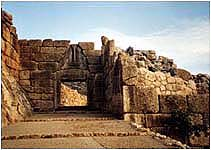

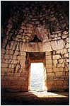

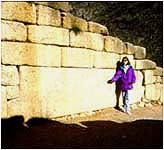

Porównując styl Achajów ze stylem w Sumerze nie sposób oprzeć się wrażeniu, że postęp techniczny jest w tym wypadku na wstecznym biegu. Tłumaczenie, że Sumerowie używali tylko miejscowego surowca jakoś mnie nie przekonuje. Dlaczego inne ludy zdolne były sprowadzać kamień z odległości setek kilometrów, a Sumerowie nie? Lwia brama, wejście do twierdzy achajskiej jest łudząco podobna do głównej bramy Machu Picchu. Podobna belka stropowa, podobny górny łuk belki. W Machu Picchu brakuje tylko rzeźby lwów. Zwróćmy uwagę na mur w prawo od bramy. Czy nie przypomina murów "antysejsmicznych" w Ameryce Południowej czy Delfach?

Dwie następne fotki to skarbiec Atreusza. Spójrzmy na belkę stropową nad wejściem. Potężna i do tego wyprofilowana. Waga - 120 ton. Przed wejściem do skarbca ogromny blok w murze, poprzycinany po bokach. Mam wrażenie, że ten styl budowy sprawia wrażenie posępnego. Czy nie miał wzbudzać strachu? Czy nie miał pokazywać charakteru i potęgi władcy? Czy wreszcie nie miał oznajmiać przybyszowi - ten który tu mieszka jest potężniejszy od ciebie, jest półbogiem? A może potężne mury chroniły dostępu zwykłym ludziom do niebezpiecznych materiałów znajdujących się wewnątrz?

**Ollantayambo**

  
  

Teraz przenieśmy się do Ameryki Południowej. Zacznę od największych "kamieni" jakie udało mi się znaleźć. Znajdują się one w małej wiosce Ollantaytambo w tak zwanym "kręgu inkaskim". Obszar ten, zajmujący prostokąt 150 na 80 km grupuje największe zabytki prehistorii Peru. Machu Picchu, Ollantaytambo, Pisac, Tambomachay, Qenko, Tipon, Sacsayhuaman oraz perłę kamieniarki Cusco.

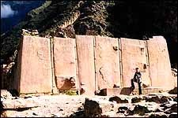

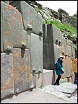

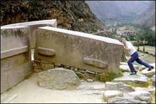

Miałem duży problem z doborem zdjęć, które mówiły by wszystko o tej potężnej budowli. Wybrałem trzy. Z lewej stwarzający wrażenie jednolitego blok, zwany przez uczonych świątynią Słońca, a składający się z sześciu ściśle dopasowanych bloków. Luki pomiędzy kamiennymi blokami uszczelniono kamienną "plasteliną". W środku wejście w murze poniżej "świątyni" oraz blok kamienia, który usiłuje "przesunąć" turysta.

Widać ogrom, ogrom i jeszcze raz ogrom. Czy była to świątynia Słońca? Śmiem wątpić. Brak tu ozdobnych wejść, miejsc na obiekty kultu. Bardziej przypomina to jakiś obiekt przemysłowy. Nikt zapewne jeszcze nie próbował ustalić, co znajduje się za kamiennym murem. Uczeni w nazywaniu takich miejsc idą raczej rozpędem niż rozsądkiem. Cały obszar wokół budowli wygląda jak po wielkim trzęsieniu ziemi, w około porozrzucane olbrzymie bloki, niektóre można znaleźć nawet u podnóża góry. Można sądzić, że straty były tak duże, że nie zdecydowano się na odbudowę. A może nie miał kto odbudować? Duże trudności nastręcza określenie charakteru budowli. Dzisiejsza technika nie pozwala na złożenie odłamków i części ze względu na ich wagę w jedną prawdopodobną całość. Stąd bezsensowne nazwy i domysły.

**Machu Picchu**

  
  

Najlepiej utrzymane ruiny w całym Peru. Można rzec pozamiatane, wygrabione, trawka przystrzyżona. Tu i ówdzie dostojnie wałęsają się lamy. No i oczywiście zawsze tłum turystów. Nie widać natomiast żadnego śladu poważniejszych badań archeologicznych. Przenosi się tylko mniejsze kamienie (bo takie może unieść człowiek) z miejsca na miejsce i to jest cała działalność tamtejszych archeologów.

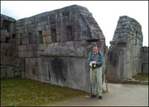

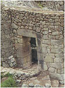

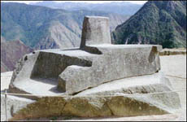

Miasto sprawia wrażenie zniszczonego, a następnie odbudowywanego lub też budowanego w kilku "technologicznych" etapach. Widać to po ułożeniu kamiennych murów. Jedne z wielką precyzją i dbałością, inne bardziej niedbale i trochę chaotycznie. Czuć po prostu jakąś zmianę technologii w obróbce i układaniu kamieni. Jak już wspomniałem, nie spotkałem fachowych opracowań archeologicznych. Absolutny brak pomiarów, same ogólniki. Tu proszę państwa świątynia główna, tu trzech okien, a tu Słońca. Zwykła gadanina w aureoli nauki. Na fotografiach: świątynia główna, główna brama i Intihuatana - kamień Słońca prawdopodobnie wycięty (a nie wyrzeźbiony) z jednej bryły skały.

**Tiahuanaco**

  
  

Najsłynniejsze ruiny świata. Znane dzięki pracy Artura Poznanskyego (nazwisko z rodowodem polskim nie ma nic wspólnego) i Edmunda Kissa. Znane przede wszystkim z bramy Słońca wyciętej z jednego bloku andezytu. Miasto, które według Poznanskyego, doświadczyło kataklizmu około 12 tysięcy lat temu.

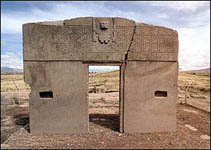

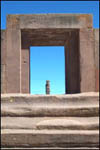

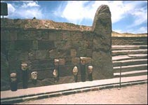

Obok miasta, w wykopie podczas budowy drogi znaleziono wymieszane ze sobą szczątki ludzi, zwierząt, ceramiki. Jest tego bardzo dużo. Tak dużo, że nikomu nie udało się jeszcze dokonać klasyfikacji. Miasto zniszczyła olbrzymia powódź. Ale czy to była powódź, czy też tsunami z jeziora Titicaca? Oficjalna nauka pomija ten fakt milczeniem. Jest tylko zdziwienie, dlaczego kiedyś linia brzegowa jeziora przebiegała inaczej i dlaczego jej płaszczyzna nie jest równoległa do obecnej. Przyjęcie założenia "wielkiego uskoku..." doskonale to tłumaczy. Najpierw jezioro cofa się na północ, by po jakimś czasie ze zdwojonym impetem ruszyć na południe i zatopić miasto. Linia brzegowa zajmuje nowe miejsce, ale płaszczyzna wody, na skutek zmiany położenia geograficznego, nie jest już równoległa do poprzedniej.

**Tarxien • Mnajdra • Hagar Qim**

  
  

Przenieśmy się na teren Europy. Tutaj też można odnaleźć cyklopowe budowle. O Mykenach już wspomniałem. Jeszcze mamy Tiryns, Gigantję, mnóstwo rozrzuconych po kontynencie budowli megalitycznych. Czy fundamenty Aten, Delf i innych starych miast greckich też pamiętają czasy Bogów? Przedstawiam budowle na małej wyspie na morzu Śródziemnym - na Malcie.

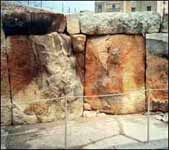

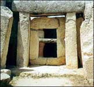

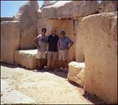

Od lewej ruiny Tarxien, dalej Mnajdra i Hagar Qim. Rzadko można je znaleźć w literaturze, bo nie pasują zupełnie do niczego. Budowane na planach okręgu czy owalu, nie przypominają zupełnie nic znanego. No i te olbrzymie bloki kamienne. Jakaś światowa zaraza, moda czy jeszcze coś innego? Od pozostałych w innych częściach świata odróżnia je stopień zniszczenia. Sądzę, że jest to wpływ zmian klimatycznych oraz warunków atmosferycznych w Europie, oddziałujących na nie przez tysiące, jeśli nie więcej lat.

**Stonehenge**

  
  

Najsłynniejszy krąg świata. Obserwatorium astronomiczne pierwotnych, miejsce kultu Druidów, krąg składania ofiar? Nie ma sprecyzowanego celu, dla którego zostało zbudowane. Wiek ustalono na 1900-1400 lat pne. Mnóstwo teorii, ale żadna nie jest pewna. Wiek obiektu określono na podstawie badań C-14 szczątków niespalonego drewna i szkieletu jakiejś padłej zwierzyny.

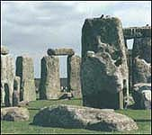

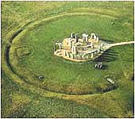

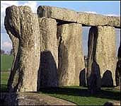

To co dzisiaj widzimy, to ruiny w opłakanym stanie, a prawdopodobnie kiedyś były to doskonałe prostopadłościenne bloki. Czas i klimat zrobiły swoje. Erozja zniszczyła pierwotne kształty. Kilka podpór leży przewróconych na ziemi. Czy nie jest to efektem potężnego trzęsienia ziemi? Kamienny kromlech Stonehenge jest jedynym w swoim rodzaju. Znanych jest jeszcze kilka, ale żaden mu nie dorównuje.

Kiedy faktycznie został wzniesiony? Kiedy uległ zniszczeniu? Być może został zniszczony przez wielkie trzęsienie ziemi 12,5 tysiąca lat temu. Wielka Brytania nie jest terenem sejsmicznym. Zwróćmy także uwagę na sposób połączenia podpór z legarami. Wszystkie łączone są za pomocą czopów i wypustów.

**Ha'amonga - Wyspy Tonga**

  
  

Trylit, czyli obiekt złożony z trzech części kamiennych. Znajduje się w archipelagu wysp Tonga na Pacyfiku. Okazuje się, że także na wyspach oceanu Spokojnego istniała cywilizacja zdolna obrabiać olbrzymie kamienne bloki.

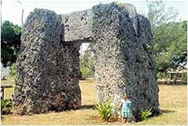

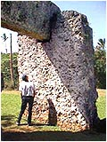

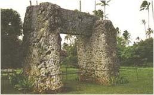

Ten o tyle jest ciekawy, że poziomy blok kamienia jest dokładnie wpasowany w specjalnie wykonane wycięcia w pionowych kolumnach. To co dziś widać, to efekt działania wiatru i deszczu. Na początku obiekt ten miał zapewne wygląd doskonałych prostopadłościanów. Ciekawe ile trzeba lat oddziaływania sił przyrody, by doprowadzić do takiej erozji?

**Dzbanuszki z Laosu**

  
  

Jaka ludzka cywilizacja używała tych naczyń w gospodarstwach domowych? Na terenach dzisiejszego Laosu znaleziono całe pola usiane takimi naczyniami. Dlaczego wykonano je z tak trudnego w obróbce surowca jakim jest kamień? Co przechowywano w tak trwałych naczyniach?

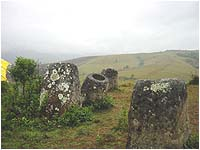

Co mogło spowodować rozbicie tak potężnych naczyń? Jaka siła spowodowała taki nieporządek? Czy naczynia od początku były zagrzebane w ziemi, czy zasypało je wielkie tsunami wywołane "wielkim uskokiem skorupy ziemskiej"?

**Światowy rozrzut**

  
  

Jak już zdążyliśmy zauważyć, używanie do budowy olbrzymich kamiennych bloków nie jest domeną jednego kraju, czy obszaru. Na podstawie pokazanych przykładów można wysnuć wniosek, że ta technologia była obecna na całym świecie. Nie wszystkie wyglądają jak "spod igły", lecz jest to efektem działania różnych warunków atmosferycznych i jak sądzę, także sejsmicznych.

Na terenie Iranu stoi budowla z dużych, kamiennych bloków oczywiście ochrzczona przez naukę grobowcem. Czy takie było pierwotne przeznaczenie? Nie wiadomo. Obok piramida w greckiej Argolidzie, której wiek określa się na dużo starszy od wielkiej piramidy. Zahi Hawass z powodów czysto komercyjnych ma inne zdanie i oczywiście protestuje. Dlaczego jednak rząd Grecji zabronił przeprowadzenia tu dokładnych badań? Na trzecim zdjęciu przejście w murze zamku "Biała czapla" w Japonii. Zamek określany jako współczesny, ale skąd pewność co do fundamentów i murów?

Abydos

Indie

Peru

Petra

Qenko

Jaka to cywilizacja na całym świecie używała technologii pozwalającej ciąć kamień? Oczywiście, obowiązująca teoria mówi tylko o mozolnym skuwaniu skały przez ludzi z epoki kamiennej, bo żadnemu badaczowi nie przyszło na myśl, by przyjrzeć się z bliska takim schodom i to w miejscach, gdzie najrzadziej stawia się stopy. Nikt nie zastanowił się, dlaczego w tych miejscach powierzchnie też są gładkie. Tu nie pomogą bajania o czasie i o wygładzaniu przez tysiące bosych, pielgrzymich stóp.

Mykeny

Karystos

Liban

Sacsayhuaman

Czy takie bramy wznoszono tylko przy pomocy drewnianych drągów, ziemnych nasypów, lin wykonywanych z dostępnych roślin i ludzkiej siły fizycznej? Jak przesuwano później te kamienne bloki na swoje miejsce? Dlaczego, w celu udowodnienia tej teorii nie zebrała się grupa tych naukowych geniuszy, by zbudować choć podobną bramę? Powód jest tylko jeden - łatwiej powiedzieć niż wykonać.

Dlaczego tak się dzieje, że wszyscy bez wyjątku archeologowie i historycy są zgodni, że to wszystko wykonał i wybudował człowiek? Dlatego, że jak w każdej poważnej organizacji tak i tu obowiązuje zakaz samodzielnego myślenia i należy wyrażać ściśle określone poglądy zaakceptowane przez naukową gerontokrację. Sankcje dla nieposłusznych są określone tak ściśle, że aż matematyczne - usunięcie poza nawias, zredukowanie do zera itd., co powoduje skutki już bardziej bliższe humanizmowi - żegnajcie darmowe podróże, żegnaj sławo czy żegnaj wystawne życie.

**Kamienne torty**

Tytuł pasuje chyba do tego, co można zobaczyć. Kilka zdjęć z zakątków prawie całego świata. To, co je łączy, to wykonanie tych wspaniałych dzieł w jednym bloku kamienia. Wykonane z taką finezją z jaką cukiernik ozdabia tort.

Qenko - Peru

U góry rzeźba w jednym bloku kamienia, znajdująca się w pobliżu Cusco. O wielkości kamienia świadczy widoczna głowa turysty. Co ma przedstawiać? Trudno określić. Wygląda na model jakiegoś miejsca, którego nie potrafię skojarzyć. Delikatne, wężowate rowki i kaskady mogą sugerować, że płynęła w nich woda, która z kolei miała odpływy na krawędziach. Dziwne aż, że do tej pory żaden uczony nie rozpoznał w tym wszechobecnego "Boga nieskażonej wody użyźniającej nawet kamień". Zarysy schodów, budynków, fundamentów, a nawet zwierząt. Wszystko to na podstawie w formie półkuli. Interpretacja zależy od fantazji patrzącego.

Ellora - India

? - India

Cztery następne fotografie przenoszą nas na subkontynent indyjski. Nie sposób nie zauważyć też, że dzieła te powstały w jednym bloku kamienia. Jak nauka tłumaczy ich powstanie? Dziesiątki pokoleń rzeźbiarzy mozolnie kuło skałę i nadawało jej kształty. Następne kilka tysięcy lat pracowite dłonie wiernych tak długo ją głaskały, aż uzyskano piękną, gładką i wypolerowaną powierzchnię. Nie ważne skąd doskonała precyzja, zachowane proporcje. Ważne, że jest wytłumaczenie.

Mahabalipuram - India

Kailasa - India

Petrę oficjalnie zbudowali Nabatejczycy w I w. pne, a przejęli i rozbudowali Rzymianie, by mieć kontrolę nad handlem z Azją. Oczywiste, że człowiek o zdrowych oczach nie doszuka się tutaj ręki arabskiego kamieniarza z pustynnego plemienia i wniosek może być tylko jeden. To nie Nabatejczycy wykonali te piękne budowle, te budowle już stały i to od dawna, gdy Nabatejczycy zaczęli okupować te ziemie. Rzymianie także nie przyłożyli tu ręki, bo prawdopodobnie nie mieli zielonego pojęcia, że istnieje Petra. To historia, by nie przekroczyć przyjętych ramach czasowych musiała zrobić z nich budowniczych. W Petrze nie znaleziono ani grama pozostałości "made in Roma" po rzymskim żołnierzu.

Iran

Petra - Jordania

Grobowce w Iranie wykonano jakby według jednego projektu. Są ogromne. Człowiek jest niewiele większy od kamienia leżącego przed nimi. Czy i to wykonał starożytny Pers? Jakimi narzędziami i w jakim czasie? Czas budowy takiego "grobowca" był przecież ograniczony wiekiem życia monarchy. Jak więc określano termin zakończenia budowy?

Poniżej świątynia skalna Abu Simbel. Wykuta podobno na rozkaz Ramzesa Wielkiego około 1500 r. pne. po to, by pokazać Nubijczykom "kto tu rządzi". Ta, w obecnej chwili, składa się z olbrzymich, pociętych bloków kamiennych. W pierwowzorze stanowiła jeden monolit, a została pocięta podczas przenoszenia jej w inne niezagrożone miejsce. Arabskiemu prezydentowi Nasserowi zachciało się zmieniać przyrodę na wzór Związku Radzieckiego i w Assuanie wybudował tamę i zbiornik wodny, który groził zatopieniem świątyni. Świat nie mógł na to pozwolić i organizacja UNESCO z własnych funduszy przeniosła zabytek wyżej. Pozostałe zabytki zatopiły spiętrzone wody Nilu.

Abu Simbel - Egipt

To co widać z wierzchu, nie oddaje tego co jest w środku. W litej skale wycięte są olbrzymie pomieszczenia zdobione posągami faraonów, pełne kolumn i płaskorzeźb niebywałej precyzji wykonania. Trzeba przyznać, że jak na ludzi z epoki kamienia posiadali olbrzymią wiedzę o technice jego obróbki.

Villahermosa - Jukatan

Copan - Jukatan

U góry "torty" pochodzące z Ameryki Środkowej, z półwyspu Jukatan. Pierwszy z lewej ochrzczono ołtarzem ofiar dziecięcych. Jak oni wdrapywali się na ten "ołtarz", żeby spowodować rytualne zejście dziecięcia nauka nie podaje. Odnoszę wrażenie, że starożytni uwielbiali wprost komplikować sobie życie. Tego pana wychylającego się z głębi w amerykańscy uczeni ochrzcili Bogiem pszczół. Drugi kamień, to oczywiście też "ołtarz ofiarny". Kłopoty kapłanów podobne jak w przypadku pierwszego.

Aramu Muru, Ameryka Południowa

Yazilikaya

Jordania

Czy tak mogły wyglądać "wprawki" kamieniarskich czeladników tamtych czasów? Jak duże obszary skały należało wyciąć z zegarmistrzowską precyzją można sobie uprzytomnić porównując otwory wejściowe, które są mniej więcej wysokości człowieka. Gładkości ścian nie uzyskano z pewnością skuwając mozolnie centymetr po centymetrze i wygładzając potem starożytnym papierem ściernym. Nie otrzymano by idealnej, płaskiej powierzchni. Do czego miały służyć gigantyczne pochyłe linie wycięte w litej skale w Aramu Muru i dlaczego "drzwi" są ślepe?

**Ostatni szlif**

Przypatrzmy się kilkunastometrowemu posągowi Ramzesa Wielkiego. Rzeźba przetransportowana, zapewne z wielkim trudem, do egipskiego muzeum jest w znacznym stopniu uszkodzona. Czy to przez "gniew ludu" czy "gniew matki natury" trudno osądzić, bo na obie hipotezy nie ma dowodu.

Na pozostałości widać, że cały pomnik został precyzyjnie doszlifowany w najmniejszych nawet szczegółach, nie mówiąc o precyzyjnym wyfrezowaniu detali. To chyba nie było mozolne użycie papieru ściernego czy pasty szlifierskiej na całej ogromnej powierzchni. Powierzchnia szlifu jest jednakowa na całym posągu, nawet na szczególe dysku słonecznego w kartuszu na nadgarstku. Jak drobny musiał być materiał szlifierski? I czy w ogóle był to szlif w naszym mniemaniu, czy inna metoda (być może termiczna) nadania tak doskonałej gładkości?

**Dynastia Qin jest niewinna**

Kto zbudował chiński mur? Oficjalna, podręcznikowa historia starożytna podaje, że budowę chińskiego muru rozpoczął cesarz Szy-huang-ti gdzieś w 200 roku pne. Mur liczy około 2400 km, jest wysoki na 4-16 m i szeroki 4-8 m. Budowa trwała około 100 lat, czyli mur ukończono około 100 roku pne. Jakich to narzędzi używali Chińczycy 2200 lat temu? Czy to były tylko drewniane drągi i brązowe noże? Jaka to rasa wołów była zdolna wciągać na szczyty gór kilkusetkilogramowe, kamienne bloki z regularnością zegarka?

Według dzisiejszej hipotezy mur budowali chińscy niewolnicy w liczbie 3/4 całej ówczesnej społeczności metodą "podaj cegłę". Czy te 3/4 populacji należy liczyć w odniesieniu do państewka cesarza Szy-huang-ti czy do całych ówczesnych Chin? Tego się nie podaje i co nie powinno dziwić, bo trzeba by było wytłumaczyć sposób transportu setek tysięcy ludzi z zachodu i południa Chin. Egipcjanie przy budowie piramid (w jednym tylko miejscu) żywili się ponoć cebulą w ilości idącej w dziesiątki ton dziennie, a jak wyglądało wyżywienie budowniczych muru na tak rozciągniętym obszarze budowy? Czy stoki gór były usiane ryżowymi poletkami, a jeśli były to jak rozwiązano nawadnianie tych poletek? A co, zapytam wstydliwie, robiono z tysiącami ton odchodów? Ten logistyczny temat jakoś historycy omijają z daleka, ale wiadomo dlaczego.

Obejrzyjmy dokładnie z jakich elementów składa się mur chiński, a od razu stwierdzimy, że ktoś delikatnie mówiąc mija się z prawdą. Możliwe, że układanie cegiełek, z których składa się najwyższa część muru mogło odbywać się w ten sposób, ale reszta? W jaki sposób metodą "podaj cegłę" przerzucano kamienne bloki ważące przynajmniej tyle co przeciętny Chińczyk i do tego zawsze pod górę?

Na zdjęciach wyżej widać te fragmenty muru, które mógł zbudować człowiek. Tutaj do budowy użyto tylko słomy i ziemi, którą ubijano drewnianymi tłuczkami. Tylko na taki wysiłek stać było ludzi. Historycy umieszczają też w murze tysiące zwłok niewolników, którzy padli w tej morderczej pracy. Jest to zapewne chwyt skierowany na "wrażliwych" turystów. Czy twórcy tej hipotezy nie wiedzą, że zwłoki po rozłożeniu tracą ponad 3/4 pierwotnej objętości? Przecież taki mur wymieszany z trupami już po kilku latach najnormalniej by się zapadł i rozpadł.

Powtarza się ta sama "nieścisłość", co przy super cywilizacji rzymskiej. Dlaczego nigdy nie odbudowano zniszczonych części Wielkiego Muru? Przecież Chińczyków jest "mnóstwo wiele", więc siły roboczej nie brakuje. Sądzę, że nie można odbudować, bo jak na szczyty wzgórz wciągać ciężkie dźwigi, jakiego rodzaju transportu należało by użyć by przewozić materiał po górskich grzbietach? A czy taką technikę posiadali chińscy cesarze sprzed 2000 lat? Czy dzisiejsza technika jest w stanie pomóc w odbudowie. Oczywiście że jest, ale widać jest nieopłacalna, skoro nawet dzisiaj odbudowa muru posuwa się wolniej niż w żółwim tempie lub nie prowadzi się jej wcale.

Jak wytłumaczyć obecność "rzymskich" łuków w budowlach muru? Skąd takie podobieństwo do "rzymskich" budowli w Europie i Afryce? Czy istniały kontakty między obiema super cywilizacjami? Dlaczego chiński mur nie jest zbudowany z tych samych materiałów na całej długości, a z kamienia zbudowano go tylko we wschodniej części Chin? Co znajduje się wewnątrz muru? Czy jest pełny, czy też przez całość przechodzi jakiś korytarz lub kanał? Czy faktycznie mur miał stanowić obronę przed dzikusami z północy? Na te pytania nie ma odpowiedzi, bo co można odpowiedzieć, jeśli twórcą ma być cesarz małego, prymitywnego chińskiego państewka bez przerwy wojującego ze "swoimi" o utrzymanie władzy.

Dlaczego mur zbudowano na grzbietach górskich, a nie u podnóży gór, gdzie transport surowca i sama budowa jest dużo łatwiejsza? Spełniał by zapewne to samo zadanie. Mam tu pewną koncepcję. Podobnie jak w innych rejonach świata, tak i w Chinach znany był sposób zabezpieczania zboczy przed osuwaniem się za pomocą kamiennych teras. Zauważyć należy, że zbocza gór, na których zbudowano mur, nie są umocnione terasami zabezpieczającymi stok przed obsunięciem? Dlaczego? Sądzę, że budowa muru przed lub za grzbietem góry stwarzała by zagrożenie zniszczenia go przez osuwające się zbocze podczas trzęsień ziemi lub nadmiernych opadów deszczu. Zbudowanie zabezpieczających teras byłoby w sumie zbudowaniem dwóch lub trzech równoległych murów, co musiało by pomnożyć wysiłek budowniczych i zużycie materiałów. Zbudowanie muru na szczytach grzbietów górskich, a nie wątpię że zbudowano go na litej skale, okazuje się być dobrze uzasadnione ekonomicznie. Mur mógłby ulec zniszczeniu tylko wraz ze zniszczeniem samych gór, a w takim wypadku nie pomogły by także i terasy.

Sądzę, że Chińskiego muru nie zbudowali historyczni Chińczycy. Nie mieli takiej możliwości. Spójrzmy na zdjęcia obok. Wystarczy odjąć współczesne chińskie "ozdóbki" by ujrzeć obraz znajomy z terenów Europy. Oglądając najstarsze zabytki chińskiego budownictwa spróbujmy w wyobraźni pozbawić je typowych, chińskich dachów, a naprawdę ujrzymy coś innego. Zobaczymy budownictwo typowo "rzymskie", budownictwo przedpotopowej Atlantydy i ogólnoświatowej technologii, stosowanej przed kataklizmem sprzed 12,5 tysiąca lat. Budownictwo cywilizacji, której ruiny rozsiane są po całym prawie świecie.

Chińscy naukowcy doszli do wniosku, że ich super cywilizacja nie może być gorsza od super cywilizacji Rzymu. Ostatnio (marzec 2005) ukazały się informacje o odkryciu chińskiej "pucolany". Wielki Mur Chiński jest tak trwały, bo Chińczycy zamiast cementu używali... kleiku ryżowego. Tak wyszło z badań promieniowaniem podczerwonym, bo analizy chemicznej jak wynikało z komunikatu nie przeprowadzono.

Cała powierzchnia ziemi jest pełna pozostałości po cywilizacji, która unicestwił kataklizm 12,5 tysiąca lat temu. Nie wolno jednak tego zauważać, bo nie pasuje to do koncepcji uczonych, którzy naszą historię utworzyli z kłamliwych hipotez i dowodów i nie chodzi mi bynajmniej o ostatnie 2000 lat, a wyłącznie o początki naszej dzisiejszej cywilizacji.

**Po nas choćby potop?**

