**Nie tylko piramidy**  
O, Egipcie, Egipcie! Z twojej wiedzy pozostaną tylko bajki, które  
przyszłym pokoleniom wydawać się będą nie do wiary. Apulejusz

**Jezioro Mojrisa**

Jeśli ktoś uważa, że piramidy są największą zagadką starożytnego Egiptu, to jak sądzę jest w błędzie. Opisy starożytnych przekazują nam większą zagadkę niż piramidy, o wiele bardziej tajemniczą, bo oglądaną w zamierzchłej przeszłości, zaginioną i nie odnalezioną do tej pory - egipski Labirynt. Jednak i on blednie przy największej budowie wszechczasów jaką jest jezioro Mojrisa. Jeśli moje rozumowanie jest słuszne, to mamy do czynienia z największym przedsięwzięciem hydrotechnicznym - ogromnym zbiornikiem retencyjnym, dzięki któremu dolina Nilu stała się największym spichlerzem starożytności i bezpiecznym miejscem dla monumentalnych budowli Egiptu. W tej koncepcji piramidy są tylko elementem w wielkim systemie nawadniania i okiełznania wylewów wielkiej rzeki.

Labirynt egipski stanowi chyba największą zagadkę ostatnich dwóch tysięcy lat. To, że istniał, świadczą relacje naocznych świadków (ich relacje poniżej). Z opowieści starożytnych wynika, że był zbudowany z potężnych płyt kamiennych.

**HERODOT** - O Minie, pierwszym królu Egiptu, opowiadali kapłani, że naprzód budową tamy ubezpieczył Memfis przed zalewami Nilu, \[...\] Skoro więc temu Minowi (opowiadają), pierwszemu królowi Egiptu, odgrodzone ramię Nilu zamieniło się w ląd stały, założył tam miasto, które teraz nazywa się Memfis, \[...\] a od zewnątrz wokoło niego wykopał jezioro, od rzeki ku północy i zachodowi (bo w kierunku wschodnim sam Nil stanowił granicę); nadto wybudował w tym mieście świątynię Hefaistosa, która jest wielka i jak najbardziej zasługuje na wzmiankę. 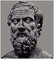

---

Postanowili także pozostawić po sobie \[dwunastu królów\] wspólny pomnik, i stosownie do tej decyzji zbudowali labirynt, który leży nieco powyżej Jeziora Mojrisa, całkiem blisko tak zwanego Miasta Krokodyli. Ten ja widziałem, a przewyższa on zaiste wszelki opis, bo gdyby nawet ktoś razem zliczył wzniesione przez Hellenów mury i wykonane przez nich budowle, pokazałoby się, że kosztowały one mniej trudu i wymagały mniejszych wydatków niż ten labirynt. A przecież także świątynie w Efezie i na Samos godne są uwagi. Były wprawdzie i piramidy wyższe ponad wszelki opis, a każda z nich dorównywała wielu i wielkim helleńskim dziełom; ale oczywiście labirynt nawet piramidy prześcignął.

---

Ma on mianowicie dwanaście krytych podwórców, których bramy stoją naprzeciw siebie, sześć zwróconych jest na północ, a sześć na południe, jedna obok drugiej; a od zewnątrz otacza je jeden i ten sam mur. Są w nim dwojakie komnaty, jedne podziemne, drugie nad tymi w górze, w liczbie trzech tysięcy, po tysiąc pięćset z każdego rodzaju. Otóż nadziemne komnaty sam widziałem i przeszedłem, natomiast o podziemnych dowiedziałem się tylko z opowiadania. Przełożeni bowiem nad nimi Egipcjanie w żaden sposób nie chcieli ich pokazać, oświadczając, że są tam groby królów, którzy pierwotnie ten labirynt wybudowali, oraz świętych krokodyli. Tak więc o podziemnych komnatach mówimy tylko to, cośmy usłyszeli, a górne, większe od dzieł ludzkich, widzieliśmy sami. A do tego naroża, w miejscu gdzie kończy się labirynt, przylega piramida czterdziestosążniowa (ok. 72 m), na której wyryte są wielkie figury. Droga do jej wnętrza idzie pod ziemią.

---

Chociaż ten labirynt jest tak wielkim dziełem, jeszcze większy wzbudza podziw tak zwane Jezioro Mojrisa, obok którego ten labirynt jest wybudowany \[...\] Że zaś stworzyły je i wykopały ręce ludzkie, ono samo to zaświadcza. Bo mniej więcej w środku jeziora stoją dwie piramidy, każda wystająca z wody na pięćdziesiąt sążni (ok. 90 m), a pod wodą jest równie głęboka ich podbudowa. Na każdej znajduje się kamienny kolos, siedzący na tronie.

---

Bo najrozmaitsze wyjścia przez sale i zakręty poprzez podwórce wzbudzały w nas tysiączny podziw, gdyśmy z jednego podwórca przechodzili do komnat, a z komnat do korytarzy, a z korytarzy do innych sal i znowu do innych podwórców z komnat. Dach tego wszystkiego jest z kamienia, podobnie jak ściany, ściany zaś pełne są wyrytych figur. Każdy podwórzec jest dokoła otoczony kolumnami z białego i jak najściślej spojonego ze sobą kamienia. \[...\] z całego kraju, który teraz leży poniżej jeziora Mojrisa, a do którego żegluga od morza w górę rzeki trwa siedem dni, ani jeden punkt wówczas nie wystawał z wody. Opowiadali też krajowcy, że to jezioro pod ziemią ma ujście do libijskiej Syrty, ciągnąc się wzdłuż gór powyżej Memfis ku zachodowi w głąb kraju libijskiego.

**DIODOR** - Po śmierci króla Egipcjanie ponownie wywalczyli sobie niepodległość i posadzili na tronie swojego władcę, Mendesa, zwanego przez niektórych Marrosem. Nie dokonał on wprawdzie żadnych wojennych czynów, wybudował sobie jednak grobowiec, tak zwany labirynt, który zdobył sławę nie tyle z powodu wspaniałości budowy, ile z powodu jej niezwykłej pomysłowości. Kto bowiem do niego wszedł, ten nie tak łatwo znajdzie wyjście, jeśli nie ma u boku zmyślnego przewodnika. Niektórzy powiadają też, że Dedal przybył do Egiptu, podziwiał pomysłowość tego dzieła i potem zbudował Minosowi na Krecie labirynt, podobny do egipskiego, w którym według legendy przebywał Minotaur. Labirynt na Krecie zniknął całkowicie, nie wiadomo czy dlatego, że władcy kazali go rozebrać, czy też czas zniszczył owe dzieło, natomiast całość budowli egipskiej po dziś dzień przetrwała w stanie nienaruszonym. W dziesięć pokoleń po wymienionym wyżej królu władanie nad Egiptem objął Mojris i wybudował w Memfis północne przedsionki \[...\] Kazał też wykopać o dziesięć schojnów na północ od miasta jezioro nadzwyczajny pożytek dające i o niewiarygodnej wprost wielkości. Jego obwód wynosić miał bowiem 3600 stadiów (ok. 643,5 km) i głębokość przeważnie 50 sążni (ok. 90 m). Kto zatem zastanowiwszy się nad ogromem tego dzieła, nie zada sobie pytania, ile tysięcy ludzi przez ile lat musiało przy nim pracować."

**STRABON** - Jezioro Mojrisa przez swoją wielkość i głębokość nadaje się zatem do tego, by w czasie przyboru Nilu przyjąć przelewające się wody \[...\] u obu ujść kanału znajdują się też jednak śluzy, którymi budowniczowie kierują wpływem i wypływem wody.  Ponadto znajduje się tu także labirynt, dające się porównać z piramidami dzieło budowlane, a obok grobowiec króla, który kazał wybudować labirynt \[...\] jest tam tyle otoczonych kolumnadami i przylegających do siebie pałacowych sal, wszystkie w jednym szeregu i wszystkie przy jednej ścianie \[...\] Przed wejściami znajduje się wiele długich, krytych korytarzy, które mają między sobą kręte połączenia, tak że bez przewodnika żaden obcy nie zdołałby odnaleźć wejścia czy wyjścia z każdej sali.

---

Najbardziej godne podziwu jest jednak to, że strop każdej z komnat składa się z jednego kamienia i że także szersze strony krytych korytarzy wyłożone są płytami z jednego kamienia nadzwyczajnej wielkości, przy czym nigdzie nie dodano ani drzewa, ani innego materiału budowlanego. Jeśli wejść na dach, który nie znajduje się na bardzo znacznej wysokości, to ujrzy się kamienną powierzchnię z takich samych ogromnych płyt \[...\] również ściany zrobione są z kamienia nie mniejszej wielkości. Przy końcu \[...\] znajduje się grobowiec, czworoboczna, mierząca u każdego boku około cztery plethrony (ok. 120 m) piramida o tejże wysokości. Imię w niej pogrzebanego jest Ismandes \[...\]

---

Jeśli przepłynąć obok tej budowli i jeszcze sto stadionów (ok. 18 km) dalej, napotyka się miasto Arsinoe. Nazywało się dawniej Miastem Krokodyli \[...\] Nasz gospodarz, jeden z najznamienitszych mężów, który pokazywał nam tam święte przedmioty, poszedł razem z nami do jeziora."

**PLINIUSZ STARSZY** - "Powiedzmy i o labiryntach, bo to chyba najbardziej niesamowite dzieło wzniesione ludzkim kosztem, choć bynajmniej - wbrew temu, co by można przypuszczać - niefantastyczne!  Jeden znajduje się do dzisiaj w Egipcie, w nomie herakleopolitańskim. To podobno pierwszy w ogóle labirynt, zbudowany przed 3600 laty przez faraona Petesucha, czyli inaczej Tithoesa. Przeznaczenie budowli podaje się rozmaicie. \[...\] Nie ulega wątpliwości, że stąd właśnie zaczerpnął Dedal wzór owego labiryntu, który wybudował na Krecie; ale jego naśladownictwo ograniczyło się tylko do jednej setnej części tegoż \[...\] To był drugi labirynt po egipskim. Trzeci jest na Lemnos, czwarty w Italii. Wszystkie zbudowane były z polerowanego kamienia, kryte sklepieniami, a przy tym egipski - rzecz dla mnie w wysokim stopniu zdumiewająca - ma przy wejściu kolumny z marmuru paryjskiego. Reszta jest z czerwonego granitu, ze spojonych z sobą olbrzymich głazów, których nie potrafią obruszyć stulecia, nawet przy walnej pomocy Herakleopolitów (bo ci nienawistnej sobie budowli w dziwnie uparty sposób stale zagrażali).

---

Poza tym są tam też świątynie wszystkich bóstw egipskich, a ponadto czterdzieści kaplic Nemezys i niezliczone piramidy o boku po 40 sążni (ok. 72 m), sześć zawierających u podstawy arura. Porządnie już zmęczony marszem przychodzi człowiek do owych pozbawionych wyjścia błędnych korytarzy. A tu są jeszcze sale wysoko na piętrach i krużganki, z których się schodzi dziewięćdziesięciu stopniami. Wewnątrz kolumny z porfirytu, wyobrażenia bogów, posągi królów, potworne jakieś postacie. Niektóre pałace tak są położone, że przy otwarciu drzwi powstaje wewnątrz straszliwy grzmot, po większej też części wędruje się tam w ciemnościach. Poza murem leżą znów dalsze ogromne budynki należące do labiryntu tzw. skrzydła. Dalej jeszcze inne, podziemne komory, do których wiodą przekopane w ziemi korytarze."

Dość ciekawie w tym kontekście brzmią dwie wypowiedzi - **Strabona** - "Jeśli wejść na dach, który nie znajduje się na bardzo znacznej wysokości, to ujrzy się kamienną powierzchnię z takich samych ogromnych płyt." i **Zajdlera** (Atlantyda) - "Na terenie Sahary znaleziono pokryte dziś piaskami tajemnicze płyty, które niektórzy uważają za resztki lotniska prehistorycznego.". Co z tego wynika? Zajdler pisze o czymś dużym powierzchniowo, a jeśli to nie lotnisko tylko dach dużej budowli? Szkoda, że Zajdler nie podaje miejsca znaleziska.

Poniższe, wybrane przeze mnie, cztery fotografie satelitarne ukazują tą część Egiptu, w której prawdopodobnie należałoby poszukiwać jeziora Mojrisa, a przy okazji Labiryntu.

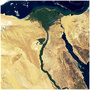

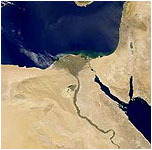

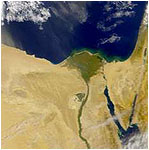

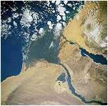

Labirynt, jak utrzymują starożytni, leżał nad jeziorem Mojrisa, stąd pierwszym krokiem winno być umiejscowienie tego jeziora. Na każdym zdjęciu widzimy plamę w kształcie trójkąta z wierzchołkiem zwróconym na południe leżącą na lewym brzegu Nilu i zajmującą spory obszar pustyni. W górnej części widzimy też kilka łańcuchów wzniesień na pustyni. Jest dość prawdopodobne, by część tego obniżenia mogło zajmować jezioro Mojrisa. Od piasków pustyni wyraźnie odbija się zielona część delty Nilu jak również sama dolina rzeki. A swoją drogą, czy ktoś zbadał już wiek delty rzeki? Czy jest pewność, że Nil płynął w ten sposób od zawsze? Czy jest możliwe, że Nil rozpoczął toczyć swe wody w tym korycie dopiero po "wielkim uskoku skorupy ziemskiej"? Jeśli tak, to badania wieku delty Nilu winny to wyjaśnić.

Z relacji starożytnych i badań archeologów wiemy, że delta w obecnym kształcie istnieje już kilka tysięcy lat i przechodziła raczej nieznaczne zmiany spowodowane głównie trzęsieniami ziemi, dość częstymi w tym rejonie świata. Ostatnie największe, te które rzekomo zatopiło pałac Kleopatry i latarnię morską na Faros miało mieć miejsce w roku 365 pne. Dolina Nilu jest wyrzeźbiona w podłożu skalnym na dość dużą głębokość. Ile czasu, a przede wszystkim jakie ilości wody dokonały takiej erozji. Być może ma to związek z okresem wielkich opadów, jakie miały miejsce w Egipcie przed tysiącami lat, z tymi samymi opadami, które dokonały erozji Sfinksa. Takich badań się jednak nie prowadzi. Na mapce poniżej starałem się określić choć w przybliżeniu położenie legendarnego Labiryntu. Z opowiadań starożytnych wiemy, że:

• na północ od Memfis znajdowały się tzw. "północne przedsionki" jeziora,  
• jezioro leżało po zachodniej stronie Nilu,  
• jezioro liczyło w obwodzie ok. 3600 stadiów, co odpowiada mniej więcej 650 km,  
• jezioro wybudowano po to, by zbierać wody powodziowe z Nilu i regulować nawadnianie delty Nilu,  
• nadmiar wody mógł być "zrzucany" bezpośrednio do morza Śródziemnego, do zatoki Syrta  
• labirynt znajdował się powyżej jeziora Mojrisa (chodzi zapewne o położenia względem tafli jeziora),  
• Labirynt leżał w pobliżu miasta krokodyli (Krokodylopolis, Arsinoe) w odległości około 18 km i był obiektem permanentnie zagrożonym atakiem ze strony mieszkańców Herakleopolis (konflikt religijny Egipcjan z Arabami?)

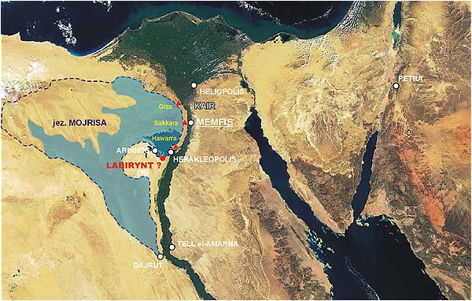

Stworzyłem prawdopodobny zarys brzegów jeziora gdzie granatowa przerywana linia zakreślona wokół niecki liczy sobie około 1100 km. Po wyłączeniu pasm wzgórz leżących w północnej części "napełniłem wodą" to hipotetyczne jezioro. Długość nowej linii brzegowej zawiera się pomiędzy 600 a 700 km, a więc jest zbliżona do długości podanej przez Diodora. Jak powstało jezioro? Mówienie o jego budowie w całości jest chyba lekką przesadą. W moim przekonaniu wkład budowniczych polegał zapewne na zbudowaniu śluz oraz sztucznych brzegów tam, gdzie poziom gruntu był obniżony i nie zapewniał utrzymania wody w zamierzonych granicach. Było to i tak gigantyczne przedsięwzięcie geodezyjno-budowlane.

Jak napełniono ten, liczący prawie 3057000 mln metrów sześciennych zbiornik? Wlewając do niego wodę z prędkością 100 metrów sześciennych na sekundę potrzeba by było około 970 lat!!! Być może pomogła sama przyroda. Jeśli przyjąć, że potop, który nawiedził Egipt był spowodowany jednym z poprzednich "wielkich uskoków...", to jest całkiem prawdopodobne, że miejsce to zostało zalane wodami morza Śródziemnego. Tysiące lat parowania i zasilania go sztucznym kanałem z Nilu być może uzdatniło wodę na tyle, że stała się przydatna do uprawy roli. Nie można chyba też wykluczyć, że cywilizacja Bogów dokonała tego przy pomocy środków chemicznych.

Aby uchronić dolinę i deltę Nilu przed powodziami, należało odbierać nadmierną część wody rzece w jej górnej części zanim ta zaczęła przybierać po opadach w głębi afrykańskiego lądu. Na mapie można ujrzeć, że w miejscowości Dairut (po drugiej stronie Nilu leży Tell el Amarna) Nil oddziela od siebie małą odnogę płynącą wzdłuż rzeki na północ. Jest to kanał Józefa (Bahr Jusuf). Czy tu należy szukać południowej śluzy? Bardzo możliwe choć mało prawdopodobne. Z tego miejsca rozpoczyna się moje hipotetyczne jezioro. Brak opisu jakie tereny można było nawadniać z jeziora Mojrisa utrudnić może odnalezienie śluzy (lub śluz) północnych. Logicznie - nawadniana powinna być delta Nilu ze śluz w pobliżu Memfis (blisko Memfis znajduje się Giza). Zakładając, że moje rozumowanie jest słuszne, można w przybliżeniu wskazać położenie Labiryntu, chociaż pisząc te słowa w roku 2003 jestem prawie pewien, że miejsce położenia Labiryntu jest już doskonale znane. Skoro amerykański satelita sporządził mapę, na której widoczne są koryta rzek pod piaskami Sahary, to na pewno poznano już miejsce położenia tego, najważniejszego chyba zabytku na Ziemi. Dlaczego trzyma się to w tajemnicy? Jestem chyba w stanie to wyjaśnić - pieniądze, pieniądze i jeszcze raz pieniądze. A ponadto najzwyklejsi złodzieje, których interesuje tylko materia, a nie treść. Być może także, w zgodzie z teorią spiskową, przeciwna jest liczna rzesza egiptologów bojąca się utraty prestiżu i dochodów z owoców dotychczasowej pracy.

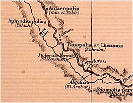 Znalazłem też coś bardzo ciekawego. Fragment starszej i trochę dokładniejszej mapy Egiptu, na której Nil rozgałęzia się dużo dalej na południe. Czy coś może to zmienić. W moim przekonaniu tak. Poprzednio pisałem, że kanał Józefa, a właściwie jego początek, jest miejscem gdzie należy szukać śluz południowych jeziora Mojrisa. W tej sytuacji początek pobierania wody z Nilu należało by przenieść niżej na południe. Jak się później przekonamy, to jeszcze nie koniec poszukiwań.

Stawiam ciekawą, być może obrazoburczą hipotezę. Pamiętamy zapewne opis tzw. Ozyrejonu w Abydos. Do dziś nie wiadomo co to mogło być i do czego miało służyć. Zbyt toporne i za małe na świątynię, brak "podłogi" i stojąca tam wiecznie woda. Brak jakichkolwiek ornamentów czy inskrypcji. Ogólnie budowla sprawia wygląd, jakby musiała wytrzymać napór jakiś ogromnych sił natury. Ponadto całość położona jest o 15 m niżej niż pełna przepychu i ornamentyki oraz dużo większa świątynia faraona Setiego II, co być może świadczyć o tym, że Ozyrejon zbudowano wcześniej. Wokół budowli wykonano terasy, które jak sądzę, miały zabezpieczać ją przed zasypaniem lub obsuwaniem się ziemi podczas ulewnych deszczów czy trzęsień ziemi. Środki zabezpieczające świadczą, że dla budowniczych była na pewno ważną budowlą.

Hipotezę swoją sformułowałbym pytaniem. Czy to przypadkiem nie są pozostałe fragmenty jakiejś budowli hydrotechnicznej, a więc może pozostałości śluzy południowej? Monumentalny, jakby toporny wygląd budowli wskazuje, że nie miała pełnić funkcji reprezentacyjnych lecz inną nie znaną nam funkcję. Nie ma w niej także "ludzkich" miejsc - osobnych pokoi czy komnat, posągów Bogów czy miejsc na ołtarze. Budowla zrekonstruowana (oczywiście tylko na papierze) przez egiptologów posiadać miała przykrycie z prostych i ciężkich kamiennych płyt. Egiptolodzy wysnuli także wniosek, że ponieważ ciągle stała tam woda po świątyni poruszano się łódką. Wielkie brawa! Ale czy to była na prawdę świątynia? Wygląd bardziej predestynuje ją do typu "przemysłowego". Czy tak mogły wyglądać śluzy jeziora Mojrisa lub jakieś urządzenie hydrotechniczne z nimi związane? Bardzo podobny wygląd ma świątynia "Chefrena" w Giza. Styl podpór i legarów jest prawie identyczny.

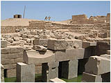

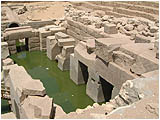

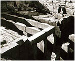

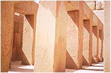

Abydos tzw. Ozyrejon

Giza - "świątynia" Chefrena

Strabon pisał o Ozyrejonie: "... niezwykła budowla z litego kamienia ze źródłem na dużej głębokości. Schodzi się tam wysoko sklepioną galerią z ogromnych, doskonale obrobionych kamieni. Miejsce to połączone jest kanałem z wielką rzeką...". Jest także ciekawe skąd w Ozyrejonie bierze się woda? Budowla znajduje się powyżej Nilu a deszcz jest tam rzadkością. Woda gruntowa? A może nieznany podziemny zbiornik?

Ciekawie też w tym kontekście przedstawia się rola egipskiego bóstwa imieniem Hapy. Jego zadaniem było regulowanie wzbieraniem wód Nilu, w okolicach I katarakty, w grocie koło Assuanu oraz dozorowanie wylewów Nilu w Dolnym Egipcie z "Domu Hapy" znajdującego się na wyspie Roda na Nilu w pobliżu Memfis. Ponadto dodatkowym zadaniem Boga o imieniu Chnum była opieka nad źródłami Nilu, które Egipcjanie umieszczali w okolicach I katarakty, a więc też w pobliżu Assuanu. Czy pod piaskami pustyni znajduje się jeszcze jakiś nieodkryty kanał biegnący aż od Assuanu do jeziora Mojrisa?

Starożytne przekazy o skrzydlatej tarczy słonecznej w Edfu mówią, że "Bog Ra ze swoim orszakiem wylądował na zachód od Edfu, na wschód od kanału Pechennu". Wniosek jaki się nasuwa, to taki, że Ra wylądował pomiędzy Edfu a jakimś istniejącym kanałem na zachód od niego. Edfu jest znacznie powyżej Assuanu, a na zachód od niego dziś rozciąga się pustynia. Czy chodzi tu o kanał łączący Nil (Assuan) z jeziorem Mojrisa? Prawdopodobnie.

Zastanawiający jest jeszcze jeden fakt. Wzdłuż całego Nilu powyżej Assuanu, tuż nad jego brzegami, zbudowano olbrzymie kompleksy świątynne i pałacowe. Żadnego nie otoczono wałami przeciwpowodziowymi. Budowano także na wyspach na rzece. Luksor, Karnak, Memfis, budowle na wyspie Elefantyna czy Roda. Czy ktoś zagrożony corocznymi, potężnymi wylewami rzeki zdecydował by się na budowę w takich miejscach? Na pewno nie. Ci co budowali byli pewni, że zalanie terenu budowy im nie grozi. Mieli przecież ochronę w postaci potężnego zbiornika retencyjnego - jeziora Mojrisa.

**DODATEK** (15 października 2005)

 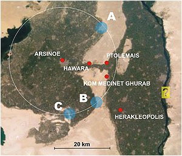 Pozwoliłem wykonać sobie trochę dokładniejszą mapkę prawdopodobnego rejonu położenia Labiryntu, a właściwie kompilację ze zdjęciem satelitarnym. Oczywiście nie jest to praca stricte kartograficzna, ale przybliżona dająca ogólne pojęcie co do rejonu moich zainteresowań. Jest to rejon określany mianem Oazy Fajum, na terenie której znajduje się jezioro o nazwie Moeris (czarna plama po lewej). Różnica wysokości pomiędzy jasnymi obszarami zachodniego brzegu Nilu a dzisiejszą taflą wody jeziora Moeris wynosi ponad 60 metrów. Strabon pisał: "Jeśli przepłynąć obok tej budowli i jeszcze sto stadionów (ok. 18 km) dalej, napotyka się miasto Arsinoe. Nazywało się dawniej Miastem Krokodyli." Biały okręg z centrum w dzisiejszym Arsinoe wyznacza odległość około 18 km od miasta. Przecina on zółty obszar, który być może leżał powyżej lustra wody legendarnego jeziora i jak sądzę na jego obrzeżach należałoby szukać Labiryntu.

Ponadto jak wspomina Pliniusz Starszy: "Reszta jest z czerwonego granitu, ze spojonych z sobą olbrzymich głazów, których nie potrafią obruszyć stulecia, nawet przy walnej pomocy Herakleopolitów (bo ci nienawistnej sobie budowli w dziwnie uparty sposób stale zagrażali).", z czego można wywnioskować, że Labirynt leżał w pobliżu Herakleopolis. Najlogiczniej pasuje tu obszar oznaczony przeze mnie literą "B". Dość intrygująco brzmi też ostatnie zdanie u Pliniusza. Czy w grę wchodziła walka o hegemonię ośrodka religijnego wśród samych Egipcjan, czy też w tle widać walkę dwóch różnych religii? Trudno powiedzieć.

Na zdjęciach satelitarnych w przesmyku pomiędzy linią Hawara-Ptolemais a Kom Medinet Ghurab (niestety nie dysponuję wyraźnymi zdjęciami) widoczne są prawdopodobnie płynące wody jako ciemne linie. 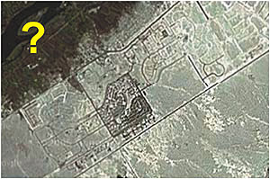 Jedna linia wygląda jak naturalna rzeka z widocznymi meandrami, natomiast druga jest złożona z długich prostych odcinków wzdłuż których biegnie jasna linia (prawdopodobnie droga). Obie zmierzają w kierunku Nilu. Być może w tym przesmyku należałoby poszukiwać resztek potężnej zapewne śluzy, ale takich poszukiwań się nie prowadzi. W Hawara i Lahun znajdują się piramidy, po drugiej stronie przesmyku piramid już nie ma (być może czekają na odkrycie).

Ciekawszym jednak obiektem jest "coś", co znajduje się po drugiej stronie Nilu (żółty prostokąt ze znakiem zapytania). Do złudzenia przypomina tajemnicze obiekty znajdujące się obok Gizy, które opisywałem jako "Kosmodrom Giza?". Długość obiektu wynosi kilka kilometrów. Część tego terenu wygląda na zamieszkały, ale nie słyszałem o pracach badawczych w tamtym rejonie. Czy nie czas zająć się koncepcją "hydroenergetyczną"? To nie religia i kapłani stanowiły o potędze Egiptu, o jego potędze decydowała gospodarka rolna doliny Nilu, a tą z kolei regulował potężny system nawadniający - jezioro Mojrisa i cały system hydroenergetyczny jemu podporządkowany. Trzeba baczniej zacząć się przyglądać lewemu brzegowi Nilu od Giza po Assuan i szukając ujść wodnych oraz starych kanałów nawadniających ułożyć te puzzle w jedną logiczną całość.

**Czy to na pewno grobowce ?**

Historia starożytnego Egiptu spowita jest w gęstych oparach tajemnicy, na którą składają się mity, niejasne lub wręcz dziwaczne tłumaczenia tekstów, nieadekwatne określanie wieku znalezisk i najzwyklejsze naginanie faktów do wymyślonych teorii. Cenotafy - symboliczne grobowce bez grobów, sarkofagi bez zwłok, serdaby - specjalne pokoje dla posągów zmarłych mających udawać prawdziwych nieboszczyków, to tylko niektóre wybiegi egiptologii mające uwiarygodnić hipotezy, które z logiką mają mało wspólnego.

Moja koncepcja nie łączy piramid z życiem pozagrobowym starożytnych Egipcjan. Swoją hipotezę konsekwentnie opieram na teorii "dwóch cywilizacji", która według mnie potrafi wytłumaczyć dużo więcej niewyjaśnionych faktów niż współczesna historia starożytna. W tym wypadku stare, polskie przysłowie "Co boskie Bogu, a co cesarskie cesarzowi" nabiera prawdziwego znaczenia. 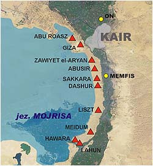

Czy oficjalna egiptologia, tak twardo stojąca na stanowisku "grobowce i tylko grobowce", dała odpowiedż na pytania:

• Dlaczego żadna piramida, będąc grobowcem króla, nie posiada wyraźnego, okazałego i zdobionego zewnętrznego wejścia?  
• Dlaczego korytarze i przejścia w piramidach nie są dostosowane do wzrostu ludzi?  
• W jaki sposób we wnętrzu piramidy poruszał się orszak pogrzebowy, by okazać należny szacunek zmarłemu władcy?  
• Dlaczego komory "grobowe" znajdowały się w centrum piramid i były otaczane tak grubym, kamiennym murem?  
• Dlaczego niektóre komory "grobowe" posiadały tak skomplikowane rodzaje zabezpieczeń, w rodzaju kilku zsuwanych z góry, w specjalnych prowadnicach, kamiennych płyt?  
• Dlaczego sarkofagi w komorach grobowych raz są stawiane na wierzchu, raz częściowo, a raz całkowicie wpuszczane w podłogę?  
• Dlaczego żadna piramida, oprócz oczywistych i udowodnionych oszustw, nie zawiera imienia inwestora?  
• Dlaczego w piramidach, a przynajmniej na sarkofagach, nie wyryto nawet imienia faraona, który w nim spoczywa?  
• Dlaczego sarkofagi w piramidach są pozbawione jakichkolwiek ozdobień, podczas gdy sarkofagi, w których faktycznie znaleziono zwłoki wprost kipią od reliefów, ozdób i złoceń?  

Czy to przypadek, że:

• W niektórych, zbadanych piramidach istnieją wysokie "korytarze" zbudowane w ten sam sposób co "wielka galeria" w wielkiej piramidzie?  
• W niektórych, zbadanych piramidach wejście do "komory królewskiej" jest wąskim i niskim tunelem położonym z boku tuż przy ścianie?  
• W żadnej "komorze królewskiej" nie znaleziono nawet maleńkiej wnęki na postawienie opiekuńczego bóstwa?  
• Obok żadnej "komory królewskiej" nie natrafiono na chociażby małe pomieszczenie na dary czy ofiary pogrzebowe dla faraona?

Postawiłbym dalsze pytania:

• Dlaczego piramidy zbudowano przede wszystkim w wąskim pasie od Abu-Roasz do Lahun?  
• Dlaczego piramidy zbudowano tylko po lewej, zachodniej stronie Nilu i w niewielkiej od niego odległości? Czy jedynym powodem był skalisty grunt?  
• Czy ktoś zadał sobie trud, by ustalić, czy rzeczywiście miały miejsce rzekome "katastrofy budowlane", czy też piramidy uległy zniszczeniu w wyniku naturalnego kataklizmu? Kiedy to mogło nastąpić i czy zniszczenia wszystkich nie nastąpiły "przypadkowo" w jednym i tym samym czasie?  
• Czy łodzie znajdowane w pobliżu piramid, czy też na pustyni, to faktycznie tylko wotywne "święte barki" do przewozu zmarłych faraonów do świata Bogów? A może są to budowane przez ludzi "modele redukcyjne" wzorowane na boskich barkach?  

Na te pytania nie otrzymamy żadnej zadowalającej odpowiedzi. Możemy usłyszeć jeden i ten sam monolog o czających się wszędzie złodziejach, piramidach budowanych "na próbę", przedłużaniu ich budowy "bo faraon nie chciał umrzeć o czasie", niedokończonych "bo zmarł przedwcześnie", błędach budowniczych itd. Nie ma się czemu dziwić. Te i inne hipotezy stworzyli ludzie dzisiejszej cywilizacji chrześcijańskiej i islamskiej. Jak zapewne wiadomo ostatni Egipcjanin zszedł ze sceny już w VIII wieku ne., w czym niemałą zasługę mają Arabowie.

Sadzę, że odpowiedź można znaleźć pod warunkiem całkowitego przewartościowania dotychczasowej funkcji piramid jako grobowców i powiązania ich z największą zagadką Egiptu - z jeziorem Mojrisa. Większość piramid łańcuszkiem ulokowano od Abu-Roasz wzdłuż wschodniego brzegu hipotetycznego jeziora Mojrisa po Lahun. Czym mogły być? Sądzę, że ich funkcja musiała być ściśle związana z jeziorem, a dokładniej z gospodarką wodną tego zbiornika. Bardzo możliwe, że były to swego rodzaju centra energetyczne, pozwalające na obsługę śluz, a być może także do zaopatrywania w energię większych ośrodków "religijnych" czy ośrodków władzy.

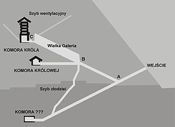 Zabezpieczenie w postaci grubych ścian, brak wyraźnych, ozdobnych zewnętrznych wejść wskazuje, że być może wytwarzano w nich niebezpieczny rodzaj energii lub używano niebezpiecznego surowca do jej wytwarzania. My ludzie, jak dotąd znamy tylko jeden najniebezpieczniejszy rodzaj energii, ale jesteśmy dopiero w początkach poznawania, więc nie pokuszę się nawet o odgadnięcie jej rodzaju.

Brak widocznych wejść, grube ściany, dodatkowe zabezpieczenia komór, wszystko to miało stworzyć system zabezpieczeń chroniących przed niebezpieczeństwem porażenia wszystkiego co żyje w pobliżu - ludzi i zwierząt oraz zabezpieczało przypadkowe ich dostanie się do wnętrza. "Kto naruszy spokój tego miejsca - zginie". Czy w takiej sytuacji klątwa faraona nie brzmi racjonalniej? A łodzie? Cóż, po jeziorze pełnym krokodyli bezpieczniej pływa się łodzią aniżeli wpław. Może, nie zdając sobie sprawy, odkryto porty dla łodzi przeznaczonych do pływania po wodach jeziora Mojrisa?

Czy wszystkie piramidy należy zaliczyć do "przemysłowych"? Trudno powiedzieć. W niektórych miejscach jest ich po prostu za dużo, by pełniły jednocześnie tę funkcję. Chyba, że przyjąć tezę o ich jednorazowości, tzn. piramida, która uległa uszkodzeniu lub przestała z jakiś przyczyn pełnić swoją funkcję zostawała porzucona (np. ze względu na niebezpieczne materiały, nieopłacalność odbudowy), a budowano nową obok niej. Niektóre, w późniejszych być może czasach, budowano jako grobowce albo przekształcano w nie nieużywane. Na przestrzeni tylu tysięcy lat wszystko mogło się zdarzyć.

Potwierdzenie takiej koncepcji jest bardzo trudne z tego powodu, że piramidy od lat badano tylko jako grobowce. Do badania ich nie zapraszano ludzi z wykształceniem technicznym, ekspertów od budownictwa przemysłowego, a być może z góry ustalone przeznaczenie piramid nie skłaniało tych drugich do udziału w badaniach. Co może świadczyć o takim charakterze piramid?

**Był czas, gdy po Ziemi stąpali Bogowie**

  
  

Moja teoria "dwóch cywilizacji" - żyjących równolegle cywilizacji Bogów, półbogów i ludzi winna wprowadzić nas w najdawniejsze czasy. Wkraczamy w wieki, gdy po Ziemi stąpali Bogowie, a władzę w ich imieniu nad ludźmi sprawowali królowie i kapłani, owoce zamierzonego chyba mezaliansu Bogów i ludzi - półbogowie. Wywód nierozłącznie związany też będzie ze sprawą zaginionego jeziora Mojrisa, największego bodaj osiągnięcia starożytnej nauki i techniki. Herodot pisał:

Postanowili także pozostawić po sobie \[dwunastu królów\] wspólny pomnik, i stosownie do tej decyzji zbudowali labirynt, który leży nieco powyżej Jeziora Mojrisa ...

Z treści można też wywnioskować, że labirynt i jezioro Mojrisa było budowane i zostało zbudowane przez dwunastu królów jako wspólne dzieło. Gdyby budowa trwała etapami pokoleń, treść przekazu miałaby zapewne inny charakter. Dwunastu królów. Królami w początkach Egiptu byli Bogowie. Gdzie można znaleźć wzmiankę o takiej a nie innej liczbie królów? Też u Herodota:

... siedemnaście tysięcy lat upłynęło do panowania Amasysa od czasu, kiedy z ośmiu bogów powstało dwunastu, z których jednym jak sądzę, był Herakles.

Czy wolno mi łączyć Bogów Egiptu z Bogami Grecji? Sądzę, że tak. Mają więcej ze sobą wspólnego niż inni. To Grecy wywodzą swoich Bogów z Egiptu. To do Egiptu schronili się greccy Bogowie przed Tyfonem, zamieniając się przy tym w zwierzęta (między innymi Hermes w ibisa, a Hefajstos w byka). To kapłan egipski Maneton wymienia Hefajstosa jako pierwszego króla Egiptu. Liczba dwanaście nie jest też liczba spotykaną "na codzień". Oprócz dwunastu znaków Zodiaku, liczby świętych Apostołów i dzisiejszej liczby miesięcy w roku spotkałem ją jeszcze w dwóch przytoczonych cytatach. Według mnie prawdopodobieństwo, że jezioro Mojrisa, labirynt i piramidy zbudowali Bogowie jest nader wysokie. Kiedy to mogło być? Najmłodszy z greckich Bogów Dionizos panował na Ziemi około 15000 lat pne., Ozyrys został zamordowany około 21000 lat pne., rządy po nim objęła Izyda, potem wymienia się Neftydę, Seta, Horusa, Ptaha i ostatniego króla-Boga Thota (Hermesa).

Kiedy rozpoczęto budowę? Ile lat trwała budowa? Na te pytania nie potrafię udzielić odpowiedzi, lecz osobiście mniemam, że kompleks "jezioro-labirynt-piramidy" mógł działać jeszcze 13000 lat pne. Nauka odkryła coś bardzo ciekawego w historii starożytnego Egiptu - "wielką rewolucję rolniczą", a ta na pewno nie mogła mieć miejsca bez wody. Rozpoczęła się nagle 13000 lat pne., i równie nagle skończyła 10500 lat pne. Od 13000 lat pne. w Egipcie dominującą rolę odgrywała hodowla i gospodarka rolna, a po roku 10500 pne. znów znajdowano dowody tylko na uprawianie łowiectwa z dominacją łowienia i spożywania ryb. Wielki kataklizm 10,5 tysiąca lat pne. mógł uszkodzić system nawadniający, co było bezpośrednim załamaniem się reformy rolnej. Mógł być też początkiem końca jeziora Mojrisa, które od tej pory zaczynało wyparowywać. Wprowadzenie rolnictwa do Egiptu nauka przypisuje Ozyrysowi. Rzeczony, jeśli wierzyć dziejopisom, nie żył od prawie 7000 lat, ale wiadomo, że dzięki Izydzie zmartwychwstał i działał dalej jako władca podziemnego świata. Mniejsza z tym.

By rozpocząć gospodarowanie w dolinie Nilu należało być niezależnym od jego wylewów, a takie uniezależnienie dawało tylko jezioro Mojrisa. Zbierając wody Nilu już od okolic Assuanu, nie dopuszczało do powodzi i nawadniało pola po deltę Nilu za pomocą sieci przekutych w skale lub specjalnie wybudowanych kanałów odpływowych. To być może dlatego, jak łatwo zauważyć, większość zielonych terenów położona jest między Nilem a zachodnim brzegiem pradoliny. To stamtąd, z zachodniego brzegu, z jeziora Mojrisa spływała życiodajna woda i to pozostałości tamtego systemu irygacyjnego są wykorzystane do dziś, choć teraz źródłem wody jest Nil.

Gwałtowny upadek gospodarki rolnej w roku 10500 pne. był, być może, skutkiem kataklizmu spowodowanego przez "wielki uskok skorupy ziemskiej". To wielkie trzęsienie ziemi najprawdopodobniej zakończyło działanie wielu śluz, uszkodziło piramidy, zniszczyło ośrodki państwowe i religijne. Dzieła zniszczenia dopełniły zapewne wody morza Śródziemnego, Czerwonego i samego jeziora Mojrisa. Ile lat Egipt podnosił się z katastrofy? Prawdopodobnie kilka tysięcy. Nie podjęto prób odbudowy wielkich budowli, bo już nie było Bogów i ich techniki. Pozostali przy życiu królowie i kapłani podjęli dzieło odbudowy, ale tylko na polu intelektualnym organizując od nowa społeczność, ucząc na nowo praw i podstaw życia w ocalałym społeczeństwie. To być może w tym kataklizmie zniszczone zostały najstarsze dzieła pisane. Pozostały tylko te wykute w kamieniu. Egipt odnawiał się od podstaw. Przetrwał różne koleje losu aż do VIII wieku naszej ery, gdzie definitywnie unicestwiła go ekspansja Arabów, którzy o dziwo, dziś uzurpują sobie prawo do sukcesji po Wielkim Egipcie.

Kiedy znikło samo jezioro? Naoczny świadek Herodot widział je jeszcze w roku 430 pne., ale już za rządów dynastii Ptolemeuszy (III-I w. pne.) pozostaje po nim jeziorko o nazwie Moeris i mały zielony obszar znany dziś pod nazwą Oaza Fajum.

Historia lubi się jednak powtarzać. Potrzebę zbudowania zbiornika wodnego, który by regulował wylewy Nilu zauważyła współczesna Zjednoczona Republika Arabska budując z "bratnią pomocą" ZSRR "ludzką" namiastkę - tamę assuańską i jezioro Nassera, niszcząc przy okazji wiele zabytkowych budowli.

**Wycieczka od Abu-Roash do Lahun**

  
  

Zróbmy mały przegląd piramid, oczywiście nie wszystkich, bo w sumie jako piramidy sklasyfikowano około 80 budowli. Obejrzyjmy te największe, lub to, co po nich zostało.

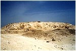

**Abu Roash**  
wysokość - 57-67 m  
podstawa - 106×106 m  
nachylenie - 48-52°(?) inwestor - Dżedefre  
budowniczy - ???  
rok budowy - ok. 2500 pne

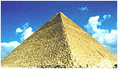

**Giza (Wielka)**  
wysokość - 146,6 m  
podstawa - 230×230 m  
nachylenie - 51°50'50" inwestor - Cheops  
budowniczy - Hemiunu  
rok budowy - ok. 2500 pne

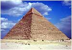

**Giza (Średnia)**  
wysokość - 143,5 m  
podstawa - 215×215 m  
nachylenie - 53°10' inwestor - Chefren  
budowniczy - ???  
rok budowy - ok. 2500 pne

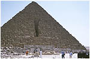

**Giza (Mała)**  
wysokość - 66,5 m  
podstawa - 102×105 m  
nachylenie - 51°20'25" inwestor - Mykerinos  
budowniczy - ???  
rok budowy - ok. 2500 pne

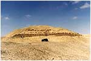

**Zawiyet el\_Aryan**  
wysokość - około 40 m  
podstawa - 84×84 m  
nachylenie - 68° (rdzeń)  
inwestor - Khab  
budowniczy - ???  
rok budowy - ok. 2700 pne

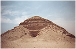

**Abusir**  
wysokość - 48 m  
podstawa - 78,5×78,5  
nachylenie - 50°30'  
inwestor - Sahure  
budowniczy - ???  
rok budowy - ok. 2400 pne

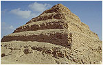

**Sakkara**  
wysokość - 62,5 m  
podstawa - 109×121 m  
nachylenie - schodkowa  
inwestor - Dżoser  
budowniczy - Imhotep  
rok budowy - ok. 2700 pne

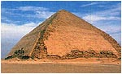

**Dashur**  
wysokość - 105 m  
podstawa - 188×188 m  
nachylenie - łamana  
inwestor - Snofru  
budowniczy - ???  
rok budowy - ok. 2500 pne

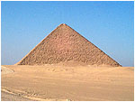

**Dashur (czerwona)**  
wysokość - 105 m  
podstawa - 220×220 m  
nachylenie - 43°22'  
inwestor - Snofru  
budowniczy - ???  
rok budowy - ok. 2500 pne

Jak można zauważyć, wszystkie piramidy są albo uszkodzone, albo rozpadły się. Czy to są katastrofy budowlane? Czy dokonywano zmian w trakcie budowy? Bez żartów, tego nie budowali dzisiejsi "fachowcy". Zachowałbym też ostrożność co do imion inwestorów czy wykonawców. Bardzo kruche podstawy i raczej wprowadzane na zasadzie "ktoś to musiał zrobić". Wszędzie widać też, że piramidy jakby "otrząsnęły się" z okładziny. Czy to wynik katastrof budowlanych, czy efekt wielkiego trzęsienia Ziemi?

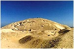

**Lisht**  
wysokość - około 49 m  
podstawa - 105×105 m  
nachylenie - 49°24'  
inwestor - Senuseret I  
budowniczy - ???  
rok budowy - ok. 1900 pne

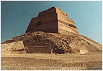

**Meidum**  
wysokość - 92 m  
podstawa - 144×144 m  
nachylenie - 51°50'35"  
inwestor - Huni/Snofru  
budowniczy - ???  
rok budowy - ok. 2500 pne

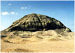

**Hawara**  
wysokość - 58 m  
podstawa - 102×102 m  
nachylenie - 48-52°  
inwestor - Amenemhat III  
budowniczy - ???  
rok budowy - ok. 1900 pne

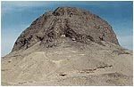

**Lahun**  
wysokość - około 48,5 m  
podstawa - 107×107 m  
nachylenie - 42°35'  
inwestor - Senuseret II  
budowniczy - ???  
rok budowy - ok. 1900 pne

Wszystkie widoczne wejścia do piramid zostały wykonane już w czasach współczesnych i przez współczesnych "ciekawskich". Na pewno nie mają nic wspólnego z oryginalnymi, bo takich nie znaleziono. Zostały wykute niemałym nakładem sił przez starożytnych złodziei albo wykonane przez takich ludzi jak Bellzoni czy Vyse metodami nowocześniejszej, bardziej "eksplozywnej" archeologii.

Jak można zauważyć wysokość większości piramid waha się pomiędzy 40 a 100 m. Al-Makrisi pisze że "... To on był twórcą obydwu wielkich piramid pod Misr." Czy to oznacza, że mała piramida już stała? Interpretacje mogą być różne. Mogła już stać, ale równie dobrze mogło jej jeszcze nie być. Badający kompleks w Giza przebąkują coś nieśmiało o kanałach wodnych, ale nie mogą znaleźć dla nich miejsca w jakiejś ogólnej koncepcji. Czy przykładowo, małą piramidę łączy jakiś kanał ze "świątynią Chefrena"? Nie stwierdzono, bo odkrycia w Giza są bardziej przypadkowe niż planowane. Nie ma żadnej alternatywnej hipotezy co do kompleksu piramid i dlatego nie wiadomo czego szukać, a zmiana charakteru "świątynnego" na "przemysłowy" na razie nie wchodzi w rachubę.

Czy hipoteza "centrów energetycznych" może znaleźć potwierdzenie na innych obszarach starożytnego Egiptu? Cóż, nikt tego jeszcze nie brał pod uwagę i zapewne nic nie szukano pod tym kątem. Hipoteza jest szokująca, ale czy jest aż tak niemożliwa?

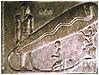

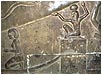

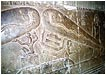

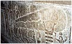

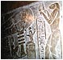

Czy płaskorzeźby olbrzymich "żarówek" w Denderze to tylko fantazja autorów? Dlaczego w podziemnych pomieszczeniach Doliny Królów (i nie tylko), ozdobionych napisami na ścianach i sufitach, nie odnaleziono śladów okopceń? Czy artyści pracowali po omacku? Czym oświetlali pomieszczenia? Egiptologia odpowiedziała - pomieszczenia oświetlano za pomocą systemu luster. Owszem można, ale trzeba mieć najwyższej jakości lustra odbijające prawie 100% światła. Czy takie lustra posiadali starożytni Egipcjanie? Tu archeologom kłania się najzwyklejsza fizyka.

W piramidach, które zbadano dokładniej, odkryto puste sarkofagi. Duże kamienne wanny musiały mieć jakieś przeznaczenie, ale czy były to miejsca przeznaczone dla nieboszczyków? Jakoś nie mogę zrozumieć dlaczego są tak anonimowe. Dlaczego, żaden z faraonów, budując grobowiec tylko i wyłącznie dla siebie nie pozostawił najmniejszego nawet podpisu, choćby po to, by po śmierci trafić do właściwego sarkofagu? Nie podejrzewam, że sarkofagi wykonano jako trumny wielorazowego użytku. Czy służyły do przechowywania czegoś, co nie wchodzi w żadne reakcje z kamieniem? Powinni to zbadać poważni naukowcy o technicznym wykształceniu. Pytanie tylko, czy zostaną dopuszczeni do badań. Pomiędzy piramidami biega cały czas arabski Humbaba. Czy badania starożytnego Egiptu są prowadzone uczciwie? Czy zakazując badań innym, Hawass nie dopuszcza się ukrywania, lub co gorsza do niszczenia niewygodnych dowodów?

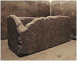

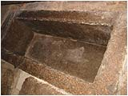

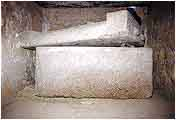

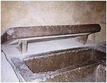

Jak widać są też różne metody posadowienia sarkofagów. Jedne stoją na wierzchu inne wpuszczone całkowicie w podłogę. Znajduje się i takie, które są wpuszczane na 1/3 lub do połowy wysokości. Skąd taka różnica w projektach? Czy w taki sposób ułatwiano sobie wkładanie nieboszczyka? Czy nikt jeszcze nie zauważył różnicy pomiędzy kamiennym "poidłem dla koni", a innymi wspaniale rzeźbionymi sarkofagami?

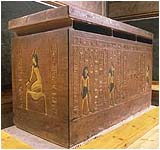

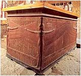

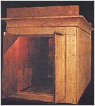

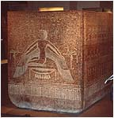

Jak widać powyżej, w Egipcie znaleziono też inne sarkofagi, w których faktycznie znajdowały się mumie królów. Widać zasadniczą różnicę między anonimowymi, kamiennymi "wannami" a sarkofagami przeznaczonymi do pochówku faraona. Piękne reliefy postaci Bogów mających chronić zmarłych królów, wyryte hieroglificzne napisy. I jeszcze jeden, znamienny fakt - żadnego z tych sarkofagów nie znaleziono w piramidzie.

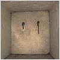 Ślady w piramidach mogące dawać jakąś wskazówkę są niezauważane lub świadomie pomijane. Wiele medialnego szumu uczyniono z odkrycia zamknięć tzw. szybów wentylacyjnych. Poświęcony temu program na naukowym kanale TV "very disco" był tylko jednym, wielkim show Zahi Hawassa. Przez całą prawie audycję oglądać było można jedną i tą samą gębę mówiącą bardzo dużo o ... swoich zasługach. Główny bohater, Gattenbrink pozostał w cieniu. Najbardziej rozśmieszyło mnie nazwanie dwóch cienkich drutów (nie wiadomo z czego) uchwytami. Kto, za przeproszeniem, mógł to chwytać w kanaliku o przekroju 20 na 20 cm i długości prawie 60 metrów? Czy nie są to części jakiejś dawnej instalacji np. elektrycznej? Po przewierceniu kamiennej płyty kamera zajrzała na drugą stronę. I co? I nic. Pustka... ale z gębą Zahi'ego na pierwszym planie. 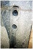

W Sakkara też znaleziono zagadkową rzecz. Dwa okrągłe otwory wywiercone w kamiennej płycie prowadzące gdzieś w głąb budowli. Gdzie prowadzą? Czy zbadano jakieś ślady czegoś, co kiedyś mogło się w nich znajdować? Nie, bo po co. Wiadomo, że tędy miała uchodzić dusza. Warto też zauważyć, że podobne otwory, niknące gdzieś w głębi piramidy, odnaleziono także po drugiej stronie Atlantyku - w Teotihuacan. Czy w badaniach piramid długo jeszcze będzie dominować radosna twórczość, naukowe samouwielbienie i kompletny brak logiki? Sądzę, że poważne badania w Egipcie będzie można przeprowadzić dopiero po odejściu starej, ortodoksyjnej ekipy i podjęciu interdyscyplinarnych badań przez młodszych, nie obciążonych uprzedzeniami badaczy.

Jeśli piramidy były czymś w rodzaju stacji energetycznych można pokusić się o ich ogólną charakterystykę.

• Prawie każda piramida ma kształt ostrosłupa i jest to jak się wydaje, najlepszy kształt pod względem stabilności, odporny na uderzenia silnego wiatru, nie stawiający większych przeszkód dla wody podczas silnych opadów. Budowla jest także odporna na silne trzęsienia ziemi i uderzenia tsunami.  
• Komora główna była umieszczana w środku budowli, mniej więcej w jej geometrycznym środku lub w środku podstawy a nawet poniżej poziomu podstawy. Była obudowana najbardziej trwałymi i o dużych gabarytach materiałami. Odległości od komory głównej do ścian zewnętrznych są mniej więcej jednakowe i duże. Czy odległość ta podyktowana była warunkami bezpieczeństwa na zasadzie im większa moc źródła energii tym większa piramida?  
• Budowla była zabezpieczana przed wtargnięciem do środka przez istoty niepowołane - brak zewnętrznych wejść, wąskie korytarze i przesmyki, kamienne zasuwy, zaczopowane korytarze, ślepe zaułki.  

Jeżeli piramidy służyły faktycznie jako "fabryki energii", a "sarkofagi" były zbiornikami na "paliwo energetyczne", to jaki rodzaj energii mógł być tam stosowany? Moje myśli uporczywie krążą wokół hinduskich przekazów o latających pojazdach. Tym, jak zapewne wiadomo, energii dostarczała rtęć i to rtęć podgrzewana do wysokich temperatur. Sama rtęć, a szczególnie jej opary są śmiertelnie trujące dla ludzi. Czy dlatego budowano kamienne "sarkofagi" z bardzo ciężkimi, dopasowanymi wiekami? Czy właśnie dlatego musiały być wykonane z jednego bloku kamienia, by zapobiec przeciekom? Czy dlatego wszystkie piramidy czy zigguraty zostały zbudowane jako hermetyczne budowle? Czy dlatego były tak ogromne, by sama grubość murów zabezpieczała przed wydostawaniem się trujących oparów? Czy przekładki z miki, znajdowane w niektórych tego typu budowlach, nie służyły jako izolatory przed gorącymi oparami rtęci? Odnalezienie samych maszyn do przetwarzania energii uważam za niemożliwe, choć cuda się zdarzają nawet w naszym "zracjonalizowanym" świecie. Jeśli jednak nie zabrali ich lub nie zniszczyli sami Bogowie, to o ile nie były z kamienia rozpadły się zapewne w pył po tylu tysiącach lat.

Grobowce, grobowce i tylko grobowce !!!

Czy faktycznie dwie wielkie piramidy zbudowano tylko po to by przechować w nich najcenniejsze rzeczy i wiedzę na czas potopu? Po tym co napisałem, odnoszę wrażenie, że nie. Piramidy zapewne już stały, gdy król Saurid (lub ktoś inny) rozkazał na ich okładzinach wyryć całą dostępną wiedzę i to tylko wiedzę przydatną ludziom i tylko tu na Ziemi. Czy można się już domyślać, dlaczego nie zrobił tego wewnątrz piramidy?

Zastanowić się trzeba nad jeszcze jednym problemem. Jak to się stało, że wszelkie reliefy czy rysunki starożytnego Egiptu starannie pomijają temat budowy piramid? Ba, brak nawet najmniejszego opisu czy wzmianki na ten temat. Jak można było pominąć najważniejsze i największe bodaj budowlane wydarzenie w historii Egiptu? Spotykamy przecież mniej ważne, a czasem pospolite jak np. zbiór zboża czy łowienie ryb. Nie znajdujemy także żadnych opisów budowy piramid w tekstach państw ościennych. Czy to był temat tabu dla całego regionu? Czy obowiązywał jakiś surowy zakaz ich opisywania? Sądzę, że przyczyna tkwi gdzie indziej i są dwie możliwości - albo w czasie wykuwania historii w kamieniu piramid jeszcze nie było, co uważam raczej za niemożliwe, albo piramidy już stały, lecz nikt nie wiedział kto i kiedy je zbudował, a poszanowanie prawdy, nawet w sztuce, starożytni cenili dużo wyżej niż my współcześni. Twierdzę, że historyczni Egipcjanie nie mieli z tym nic wspólnego.

Podsumujmy naszą wiedzę o piramidach i wyciągnijmy wnioski.

• Gdyby piramidy od początku były grobowcami, to z pewnością otrzymałyby piękne, szerokie wejścia ozdobione napisami komu są poświęcone. W środku piramid oprócz okazałego grobu faraona byłyby zapewne sale do odprawiania uroczystych modłów, do których wiodły by wygodne dojścia, a ściany kipiały by wprost historią zasług nieboszczyka. Słowem musiałyby stanowić mauzolea w pełnym tego słowa znaczeniu.

• Piramidy zostały zbudowane jako hermetyczne obiekty nie mające żadnego, nawet zamaskowanego wejścia. Dzisiejsze wejścia do piramid zostały wykonane brutalnym włamaniem, nierzadko przy pomocy materiałów wybuchowych. Jeśli posiadają jakieś dojścia do wewnętrznych pomieszczeń, to są one zapewne umieszczone poza piramidami i prawdopodobnie prowadzą pod ziemią.

• Jeżeli w piramidach umieszczono urządzenia wymagające obsługi, to muszą istnieć także "sterownie", z których kierowano pracą urządzeń. Być może istniała grupa "kapłanów" przyuczonych przez Bogów do ich obsługi. Grupa ta otrzymała także bezwzględny nakaz dochowania tajemnicy przed pozostałymi ludźmi. Stąd być może wzięła się tajemna część wiedzy kapłanów, której ujawnienie karano śmiercią. Współcześni badacze włamali się prawdopodobnie tylko do części "produkcyjnej", do której od samego początku nikt nie miał dostępu i ta część stanowiła hermetycznie zamkniętą całość.

• Jeżeli to, co odkryto w piramidach, stanowiło pomieszczenia zawierające najbardziej niebezpieczną zawartość (reaktor, zbiornik paliwa lub podobne), to nie dziwi fakt, że posiadają utrudnione dojścia i "przemyślne" zabezpieczenia, a z tych pomieszczeń nie ma żadnych przejść do innych, które z pewnością istnieją.

• Jeśli naprawdę chcemy przeniknąć tajemnice piramid, to musimy odnaleźć prawdziwe wejścia do nich, odnaleźć inne pomieszczenia, zbadać dokładnie znaleziska pod kątem techniki (nie dopatrując się w każdym personifikacji Boga), albo w najgorszym wypadku, rozebrać piramidy kamień po kamieniu by poznać przynajmniej wewnętrzny plan budowy, co raczej nie wchodzi w rachubę ze względu na nasz absolutny brak technicznych możliwości ponownego ich złożenia.

Zachęcam do innego spojrzenia na budowle starożytnego Egiptu, które nie przypominają świątyń ale są zbudowane z prostotą i bardzo solidnie. Budowli nie posiadających ozdobnych reliefów, nie otoczonych rojem posągów, nie mających szerokich alej prowadzących do wielkich, ozdobnych wejść. Budowli, we wnętrzu których nie ma miejsc dla Bogów i ludzi. Budowli, których "masywność" może stwarzać wrażenie zabezpieczenia "czegoś" przed "kimś". Budowli, które umownie można nazwać "przemysłowymi". I nie muszą to być tylko piramidy.

**"Słoneczne barki" starożytnego Egiptu**

  
  

Powróćmy jeszcze do tzw. "słonecznych barek" występujących w starożytnym Egipcie. Nam, współczesnym, barka kojarzy się tylko ze środowiskiem wodnym i tylko z urządzeniem pływającym po wodzie. Co innego w starożytnym Egipcie. Potrafiła pływać, latać w powietrzu, a nawet przemierzać kosmos. Nazwę "słoneczna" nadali jej współcześni egiptolodzy biorąc ją zapewne od Słońca, które według wierzeń egipskich, wędrowało w barce po nieboskłonie.

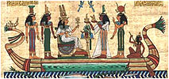

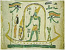

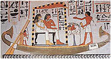

Najstarsze rysunki i reliefy wskazują na to, że początkowo barki służyły tylko do przewożenia Bogów. "Nawigatorami" też byli bogowie. Podróżnicy byli chronieni, na co wskazuje kobra w koronie otaczająca pasażera oraz wszystkowidzące oko Ra. Przypatrzmy się dokładnie rysunkom. Na żadnej z barek nie widać nic, co służyło by do jej poruszania. Każda posiada tylko urządzenie do sterowania i tylko na niektórych są jakieś pomieszczenia. Co było jej napędem? Zwróćmy uwagę na dziwne zakończenie rufy i dziobu. Na niektórych rysunkach oba elementy są zakończone "kwiatem lotosu", czymś w rodzaju dyszy, a co więcej, zakończenia te są ruchome, mogą wyginać się i do przodu i do tyłu. Zapomniana technika cywilizacji Bogów? W naszej współczesnej technice próżno by szukać takiego rozwiązania.

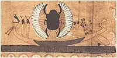

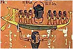

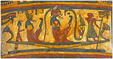

Drugą charakterystyczną cechą barek jest to, że są bardzo niskie, rzec można płaskodenne. W naszym, dzisiejszym wyobrażeniu o maszynach pływających, nie widać w nich miejsca gdzie można by umiejscowić współczesny napęd. Musiały to być jednak potężne urządzenia pływające, skoro na jednym z rysunków widać transport kamiennego obelisku (istnieje rysunek barki transportującej dwa obeliski). Czy kilkutonowy obelisk można transportować łodzią z drewna lub trzciny? Gdyby istniały takie możliwości, Arabowie (i nie tylko) już dawno porozwoziliby je po całym świecie. A czym przetransportowano skradzione w Egipcie obeliski do Europy czy Ameryki? Dopiero wielkimi statkami i to w nieodległej przeszłości.

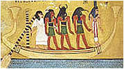

Czas Bogów przeminął. Na późniejszych rysunkach barki zaczyna zaopatrywać się najpierw w wiosła, a potem w żagle, choć gwoli prawdzie, istnieją też reliefy przedstawiające barki z żaglami, ale te jak sądzę przedstawiają "ludzką" jej wersję. Ówczesny artysta rozumiał, że barka sama pływać nie może i dorysował to, co stosował człowiek. Dzisiejsze łodzie pływające po Nilu budowane są z drewna lub trzciny, bo tylko na takie stać biednych fellachów. Czy nie są to tylko ludzkie namiastki boskich barek?

Obok rysunek na papirusie przedstawiający boską barkę z ptakiem Benu. Benu, to egipski Feniks, ptak przylatujący co 500 lat do Heliopolis do swojego gniazda, by ponownie się "odrodzić". Przypatrzmy się samej barce. Moja interpretacja każe dopatrywać się tu technicznych elementów, przedstawionych za pomocą symboli. Tarcze interpretuję jako rodzaj energii, a nie jak egiptologia, Słońce. Zielone Słońce? Benu nad głową ma zieloną tarczę, która może symbolizować "zielone promieniowanie", które według Egipcjan przywracało do życia bądź uzdrawiało. Nad "rufowym kwiatem lotosu" widać inny rodzaj energii i być może to stanowi sens napędu boskiej barki. Jak można zauważyć barka posiada tylko wiosło sterowe i trudno uważać je za napęd. Na dziobie widać "oko Ra", które ja interpretuję jako system nawigacji, obserwacji i ostrzegania "załogi". Według mnie jest to wysoka technika przedstawiona językiem symboli. Technika, w którą ludzie nie byli wtajemniczani, ale byli jej obserwatorami. Być może otrzymali wyjaśnienia jak to działa lub do czego służy i przedstawiali to w swoim, nie technicznym języku.

**Czy pierwsi egiptolodzy byli bliżej prawdy ?**

  
  

Egiptolodzy "starej daty" mieli bardziej trzeźwe i twórcze spojrzenie na Egipt niż cała rzesza ich następców. Angielski uczony Flinders Petrie pisał, że Egipcjanie z czasów pierwszych dynastii posiadali w wielu dziedzinach o wiele wyższe umiejętności aniżeli ich następcy. Ujemny postęp liniowy? Dowodem na to są naczynia z przed 6000 lat, toczone z czarnego granitu, które jakością wykonania przewyższają wszystkie wykonane w okresach późniejszych oraz reliefy hieroglificzne na naczyniach z diorytu (wykonane dwoma równoległymi liniami w odstępie 0,8 mm!), które mogły być wycięte, według Petriego, tylko za pomocą diamentowych frezów. W jaki sposób wykonano rysunki wewnątrz alabastrowego naczynia, które uwidaczniają się dopiero po włożeniu do środka źródła światła?

Papirus Rhind z połowy II tysiąclecia pne, uważany za najstarszy "podręcznik" matematyki, zawiera tak prymitywne rodzaje obliczeń, że nijak nie można ich odnieść do wiedzy matematycznej jaką stosowali budowniczy piramid. Celne stwierdzenie znaleźć można u Mereżkowskiego w jego książce "Tajemnice Wschodu" (cytat za A. Mostowiczem):

Nagłe pojawienie się Egiptu gmatwa nasze przekonanie o postępie i ewolucji ludzkości. Według tych teorii ciemności byłyby za nami, światło przed nami, a ludzkość miałaby kroczyć drogą wiodącą od ciemności do światła. Ale oto okazuje się, że droga Egiptu jest odwrotna; pojawia się od strony jakiegoś wielkiego światła. Im więcej cofamy się w przeszłość, tym natężenie tego światła jest silniejsze, jak gdyby jego źródło mieściło się gdzieś w otchłani wieków. Cóż to za światło? Skąd się ono wzięło? Cóż się znajduje na dnie tej niezgłębionej, wywołującej zawrót głowy, starożytności? Nasza sonda nigdy chyba nie dosięgnie dna...

Czy nie doskonale powiedziane? Tym wielkim światłem promieniowała dawna cywilizacja Bogów. Światło zgasło, gdy Bogowie opuścili Ziemię, a ludzie, ta osierocona cywilizacja rozpoczęła samodzielne życie, samodzielną walkę o przetrwanie, odziedziczając materialną schedę po Bogach. Współczesna historia ludzkości, oparta na założeniach materializmu, nie może dopuścić do zaistnienia w historii cywilizacji Bogów, bo przecież Bóg nie istnieje.

**Egipt w czasach Bogów**

Historia starożytnego Egiptu, według starożytnych, rozpoczęła się w tak dawnych czasach, że dzisiejsi naukowcy wzięli dziejopisów za niespełna rozumu fantastów. Nie zgadzało się to absolutnie z powszechnie obowiązującą teorią liniowego postępu technicznego oraz z hipotezą ewolucji. Wiek ponad pięciu tysięcy lat dla niektórych naukowców już stanowi "mnóstwo wiele" i jako taki nie może zmieścić się w głowie. Ponadto, jako poprawni darwiniści, nie mogą mieszać Bogów do pracy naukowej. Stąd jeden krok do stwierdzenia, że wszystko co znaleziono w Egipcie musiał wykonać człowiek.

Według nauki ta krucha i słaba istota rzucała na lewo, prawo i do góry blokami o wadze od kilku do kilkuset ton. Cierpliwie, kamiennym dłutkiem wykuwała ogromne, kamienne sarkofagi dla byków. Kamiennymi pięściakami formowała dwudziestometrowe posągi i za pomocą drewnianych dźwigów, kołowrotków i sznurów ustawiała je w pionie. By nie zgnuśnieć, między pracami na roli, wszyscy mężczyźni stawiali faraonom piramidy, by król po śmierci mógł złożyć w nich swą ziemską powłokę. Bogów zaś wymyślono, bo inaczej cała ta praca nie miała by sensu. Trwało tak do czasu, aż kiedyś kolejne pokolenie zbuntowało się pracą ponad siły i porozbijało wszystko, co uczynili ich przodkowie. Tak pokrótce można opowiedzieć historię Egiptu, którą z wysokiej katedry serwuje się nam - zwykłym ludziom.

Wszystko dla Ciebie przetoczym po Niebie!  
Czy to slogan i logo Chepri-Trans S.A.?

Nie neguję energii włożonej w prace wykopaliskowe, mozolne zbieranie dowodów i klejenie z tego historii. Oglądałem w telewizji czołowego egiptologa Zahi Hawassa przy pracy, jak delikatnie i cierpliwie podnosił płytę sarkofagu... najzwyklejszym łomem. Był to piękny i budujący widok nowoczesnej archeologii i subtelnego archeologa. Denerwuje mnie jednak, jak z nonszalancją i lekceważeniem pozostałej społeczności głosi się zwykłą nieprawdę. Historię nieznanej cywilizacji próbuje się przypisać egipskiej cywilizacji, cywilizacji ludzi ostatnich kilku tysięcy lat przez tworzenie dziwacznych teorii oraz naciąganie faktów i dowodów.

Dane na temat wieku Egiptu zebrałem i przedstawiłem w formie graficznej, gdyż łatwiej je sobie uzmysłowić. Cytaty starożytnych przedstawiłem już w jednym z poprzednich rozdziałów. Próbowano już wszystkiego by zdyskredytować podane liczby. Zamieniano lata słoneczne na księżycowe, wprowadzano dziwne przeliczniki, wykonywano jakieś myślowe wolty, posądzano dziejopisów o złe przepisywanie cyfr od innych, o specjalne wyolbrzymianie liczb, by dołożyć splendoru panującym. Nic z tego nie wyszło, więc po prostu ogłoszono, że piszący nie byli w pełni władz umysłowych i po prostu zaczęto ich nie dostrzegać. Nie może istnieć to, czego nie ma. Proste? Proste i skutecznie stosowane przez dzisiejszą naukę.

**Bajka z dwu tysięcznego i czwartego roku**

  
  

Zapraszam do mojej bajki o Egipcie. Może będzie zbyt mało dowodów, ale może będzie ciekawsza, gdyż nie mam uprzedzenia do Bogów, a hipotezę pana Darwina uważam za wybitnie nietrafioną.

Jeszcze tylko gwoli wyjaśnienia. Jako dowody preferuję przede wszystkim monumentalne budowle i reliefy wykonane na ich ścianach. Dlaczego? Sądzę, iż są to najstarsze dowody starożytnego Egiptu, które zdołały przetrwać. Być może istniały inne dowody, być może w postaci papirusów, ale te zapewne zaginęły w zawierusze kataklizmów. Być może niektóre do dziś leżą zagrzebane w legendarnym już labiryncie. Papirusy spotykane obecnie są wytworem już współczesnych ludzi i wykonane może parę tysięcy lat temu, gdy prawda już mocno mieszała się z legendą.

Zacznijmy od wprowadzenia pewnych ram czasowych, które będą przydatne w rozważaniach. Pierwszy punkt, to biblijny potop, który sięgnął także Egiptu, a który prawdopodobnie miał miejsce około 37 tysięcy lat temu. Drugi, to kataklizm, który mógł mieć miejsce około 12,5 tysięcy lat temu i który zakończył epokę lodowcową naszej, północnej półkuli. To ten, jak sądzę, kataklizm jest odpowiedzialny za zniszczenia do dziś widoczne w zabytkach najstarszego Egiptu.

Stare przekazy Egipskie mówią o zalaniu wodą Egiptu, gdzie po potopie pojawia się Bóg Ptah "od dawna żyjący na ziemi", który wydobywa kraj z wody i błota poprzez zbudowanie tam i grobli na Nilu. Stwierdzenia tego, jak sądzę, nie należy brać dosłownie. Na Nilu nie ma żadnych tam, oprócz tamy Nassera. Chodzi tu zapewne o to samo, co w naszym powiedzeniu "zastał drewnianą, a zostawił murowaną", o podkreślenie jakiegoś historycznego przełomu. Ptah po wypełnieniu misji tajemniczo znika z historii Egiptu, a jego miejsce zajmuje Ra - Bóg Słońca. Czy mogą to być reminiscencje jakiejś walki między Bogami? W mitologii greckiej po "wojnie na górze" Zeus zrzuca z tronu Kronosa, zostając królem Bogów. Czy Zeus może być tożsamy z Ra? Nie wykluczałbym tego definitywnie. Bogowie Egipscy i Greccy mają ze sobą wiele wspólnego.

Wizerunek Ptaha jest skromny. W rękach trzyma boską laskę przyozdobioną krzyżem ankh i dżed'em, w konfiguracji przynależnej chyba tylko jemu, a pod brodą ma nieodłączną "boską bródkę". Zwróć uwagę na skromność korony czy raczej tylko nakrycia głowy. Nie posiada żadnych ozdób czy atrybutów. Czy oznacza to, że wtedy Egipt jako taki nie stanowił jeszcze jednolitego państwa? Stwierdzenie o wydobywaniu kraju z błota może sugerować, że na tym terenie istniało już coś przed potopem, w przeciwnym wypadku napisano by zapewne o tworzeniu czegoś od podstaw. Jeśli istniało, to co? Archeologia na pewno nie odpowie na to pytanie. W jej mniemaniu, przed Menesem, po Egipcie wałęsali się tylko nomadowie epoki kamiennej.

Drugą granicą czasową, którą sugeruję, był prawdopodobnie "wielki uskok..." sprzed około 12,5 tysięcy lat. Oglądając ruiny egipskich budowli zastanowić się należy, co było przyczyną takiego ich zniszczenia. Takich spustoszeń nie mógł zapewne dokonać "gniew ludu" - zbyt wielkie, zbyt powszechne i na zbyt wielkim obszarze. Skala zniszczeń i ich rozległość sugeruje wielkie trzęsienie ziemi, ale do dziś egiptolodzy nie mogą stwierdzić, czy zniszczenia te powstały jednocześnie. Nie podjęli nawet tematu. Widoczny brak prób odbudowy wielkich budowli sugeruje także, że nie miał kto tego zrobić. Widać nie było ani sił ani środków. Bogów na Ziemi już nie było, lub przebywali w znikomej ilości, albo też uznali odbudowę za nieopłacalną, co według mnie jest raczej mało prawdopodobne.

**Co śmiem sądzić**

  
  
  

Osobiście uważam, że czas budowy egipskich monumentów należy umieścić pomiędzy dwiema granicami gdzieś pomiędzy 37-12,5 tysięcy lat temu lub, co też jest prawdopodobne jeszcze głębiej. Uważam też, że Bogowie nie byli także wszechmocni i nie potrafili robić "czegoś" z "niczego". Z pewnością ich prace cechowała przede wszystkim logiczność i efektywność działania. Po prostu nie robili rzeczy niepotrzebnych. Jak mogło to przebiegać?

• Na początek Bogowie stworzyli podstawową bazę i była to baza "energetyczno-budowlana". W pierwszym rzędzie zajęli się ujarzmieniem wielkiej rzeki - Nilu. W tym celu stworzyli (lub wykorzystali już istniejący) wielki zbiornik retencyjny, który dziś znamy pod nazwą jeziora Mojrisa. Z tego, co można wywnioskować czytając o Hapy (Bogu Nilu), początkowe ujęcie wody wykonano w jakiejś grocie koło Assuanu, skąd kanałem, naturalnym bądź sztucznym lub ich kombinacji, kierowano nadmiar wody do wspomnianego jeziora. Kanału do tej pory nie odnaleziono z prostego powodu - nie szukano go. Wzdłuż lewego, wyższego brzegu pradoliny Nilu zbudowano szereg śluz do nawadniania doliny podczas całego roku. Czy coś znaleziono? Nic. Powód, jak wyżej. Dlaczego więc Hapy posiadał świątynię na wyspie Rode u wierzchołka delty Nilu oraz w Assuanie? Z Assuanu i Rode, wedle podań, zarządzał wylewami Nilu.

• Po uregulowaniu rzeki Bogowie przystąpili do budowy "centrów energetycznych", za które ja uważam piramidy rozrzucone wzdłuż lewego brzegu rzeki. Dlaczego wzdłuż lewego? Dlatego, że miały regulować przepływ wody z jeziora Mojrisa do doliny Nilu. Coroczne wylewy nieuregulowanej rzeki zagrażały by każdej budowie. Szczególne zagęszczenie piramid występuje od Abu Roasz po Lahun, na wschodnim brzegu hipotetycznego jeziora Mojrisa. Ta część Nilu wraz z deltą "zużywała" chyba najwięcej wody. To był główny spichlerz Egiptu.

• "Centra energetyczne" musiały wykorzystywać nieznany nam rodzaj paliwa, dlatego równolegle lub w następnej kolejności Bogowie budują podziemne "fabryki i magazyny" do jego produkcji. Tysiąclecia zrobiły z nich grobowce byków. Dotychczas odnaleziono je w Abusir, Sakkara, Heliopolis ("On" północne) i w Luksorze.

• Po uporządkowaniu hydroenergetyki w rejonie, Bogowie przystępują do budowy ośrodków administracyjnych, i co ciekawe, już na prawym brzegu Nilu i na jego wyspach. Czy byłoby to możliwe, gdyby Nil co roku wylewał i niszczył prowadzone lub ukończone budowy? Jedno z najstarszych "miast" On północne, znane bardziej jako Heliopolis, zostało zbudowane według Strabona "na znacznym, sztucznie usypanym wzgórzu". Memfis zostaje "stolicą" części północnej, a Teby - południowej. Być może to wtedy zarządcą Bogów w Egipcie zostaje Ramzes, którego ogromne posągi spotykamy od Tanis po Abu Simbel. Samo imię Ramzes (Ra-meses) oznacza syna Ra i na pewno nie jest nim cherlawy faraon, którego mumię okrzyknięto szczątkami największego króla Egiptu.

• Starożytny Egipt funkcjonuje jako prężne państwo, którego byt kończy wielka katastrofa około 12,5 tysięcy lat temu, po której już nie wraca do dawnej świetności. Bogów już nie ma na Ziemi. Ocalona kasta królów i kapłanów (półbogów) próbuje od nowa zorganizować państwo, ale tylko na niwie organizacyjnej i intelektualnej. W pierwszym rzędzie musi się odrodzić potencjał ludzki, ale ile zabrało to czasu nie jestem w stanie odpowiedzieć. Na odbudowę ruin nie ma po prostu sił. To być może wtedy, rozpoczynają swą pracę rozrzucone po Egipcie ośrodki intelektualne skupione na ruinach dawnych ośrodków "religijnych" i to być może od tej pory historia, spisywana od nowa, nosi indywidualne cechy i nie wykazuje spójności z pozostałymi.

• Jest chyba zrozumiałe, że od tej pory materiałem, któremu powierza się historyczne zapisy, zostaje papirus. Materiał poręczny lecz nietrwały i podatny na zniszczenie. Z czasów bezpośrednio po kataklizmie nie ma go wcale, młodsze zostały zniszczone przez Rzymian, chrześcijan i Arabów w spalonej bibliotece aleksandryjskiej. Reszta została rozproszona być może po całym świecie. Dzisiejsze strzępki wiadomości egiptologia usiłuje jakoś sklecić w jedną całość, lecz jakoś jej nie wychodzi.

Zdjęcia powyżej dowodzą przezorności Bogów, a może inaczej, na rozumienie siły żywiołu wody. Tak mogły wyglądać budowy na całym, prawym brzegu Nilu lub na jego wyspach bez uprzedniego ujarzmienia rzeki. Zdjęcia pokazują kompleks w Philae leżący w pobliżu Assuanu przed i po wybudowaniu tamy Nassera. Jest to także dowód "wielkiego szacunku" z jakim Arabowie zamieszkujący Egipt traktują zabytki starożytności. Oczywiście tylko nie swoje.

Naniesione na zdjęcie satelitarne Egiptu znane miejsca, tworzą jakby dwa wielkie skupiska, coś w rodzaju ośrodków, pokrywających się z historycznymi. Jeden na północy ze stolicą w Memfis, drugi w środkowej części ze stolicą w Tebach. Nie jest możliwe ustalenie wyraźnych granic, bo tak naprawdę nie wiemy, jak ustalali je Bogowie, widać jednak wyraźnie, że taki podział jest możliwy. Czy to jest dzisiejszą genezą Egiptu Górnego i Dolnego?

Czerwonymi trójkącikami zaznaczyłem położenie odkrytych piramid, natomiast czerwonymi kwadracikami tzw. sanktuaria świętych byków. Białe kółeczka zaś, to znane mi miejscowości starożytnego Egiptu.

Można zauważyć, że piramidy i grobowce świętych byków są umiejscowione w pobliżu tych dwóch wielkich ośrodków. Czy to jest przypadek, czy celowe rozmieszczenie? Czy sanktuaria nie powinny być umieszczane w wielkich ośrodkach religijnych. Może tak, ale jakie mamy dowody, że były to centra wyłącznie religijne? To są twierdzenia dzisiejszych uczonych.

**Czy można coś udowodnić?**

  
  
  

Czy można coś udowodnić? Jeżeli przyjmiemy moją hipotezę, to chyba tak, chociaż wiadomo, że w Egipcie odsłonięto zaledwie nikłą część tego, co można odkryć. Ponadto odkrycia dotyczą przeważnie tego co widać na powierzchni, a te podziemne odkrywa się przez zwykły przypadek. Ogromna większość dowodów w dalszym ciągu spoczywa pod ziemią, zasypana piaskami Sahary. Sama Sakkara odsłoniła, wedle francuskich naukowców, zaledwie 20% swoich zasobów archeologicznych. To w Sakkara Francuzi odnaleźli pod ziemią nową piramidę. A co z dowodami? Zajmijmy się na początek świętymi bykami. Egipcjanie, według nauki, czcili trzy byki uważane przez nich za święte (poczęte przez boski promień, jak pisał Herodot). Były to Apis, Buchis i Mnewis. Były ponoć ucieleśnieniem Boga i dlatego po śmierci były balsamowane i chowane z honorami w specjalnych sanktuariach. W sztuce przedstawiane są z dyskiem między rogami symbolizującym Słońce.

Czy tak było zawsze? Historia bykomanii jest, jak sądzę, dziełem kilku ostatnich tysięcy lat, echem jakiejś prawdy sprzed tysiącleci lub wymyślona, bądź stworzona przez ludzi i powierzona papirusom. Może mamy tu do czynienia z efektem "głuchego telefonu" gdzie z początkowej "słynnej praczki" wychodzi na końcu coś bardzo niesmacznego. Kto się w to bawił, ten wie, o co mi chodzi. Rozbierzmy te dziwne wiadomości na części:

• Kult byków był rozpowszechniony, bez mała, w całym Egipcie, ale jego geneza jest nie jest znana, a więc nie do udowodnienia.  
• Do tej pory znaleziono kilka takich sanktuariów, w których znajdowały się potężne sarkofagi i w których nie znaleziono żadnej mumii byka i są to sanktuaria umiejscowione pod ziemią.  
• Byk jako ucieleśnienie Boga jest do przełknięcia, pod warunkiem przyjęcia właściwości przeistaczania się Bogów w różne zwierzęta, ale być może miał też ucieleśniać jakąś wielką energię a nie jak chcą tego uczeni tylko wielką ludzką płodność.  
• Apis był ucieleśnieniem Ptaha, Buchis i Mnewis nie wiadomo kogo, ale podobno Mnewis odwiedzał Apisa. Cóż, z Memfis do Heliopolis jest bardzo blisko i byka można było przenieść nawet na plecach. Buchis z Teb miał już za daleko.

Czy są to jakieś bardzo dawne wiadomości, zapisane po tysiącleciach przez ludzi? Czy nie jest to ludzkie zobrazowanie wielkiej energii i promieniowania, symbolicznie przedstawianego złotą tarczą między rogami? Ptah, jak pamiętamy, był najstarszym Bogiem Egiptu. Hewajstos uciekł do Egiptu przed Tyfonem zamieniając się własnie w byka. Grecy twierdzą, że Hewajstos, jako najstarszy Bóg Egiptu budował egipskie Heliopolis. W mitologii greckiej był boskim kowalem mającym swoja kuźnię pod ziemią. Czy są to tożsami Bogowie? Czy wielkość Boga, postać byka i podziemne warsztaty nie zaowocowały w końcu serapeum?

Przypatrzmy się zdjęciom "byczej" świątyni. Czy tak powinno wyglądać sanktuarium do przechowywania świętych relikwii i do tego relikwii Boga? Surowe, chropawe korytarze kute pod ziemią bez najmniejszej choćby ozdoby czy napisu? Korytarze, w których swobodnie poruszać się może traktor z przyczepą. Odkryte przez Mariette'a pomieszczenie miało korytarz o długości 300 m, od którego odchodziły "krypty" na sarkofagi. Drugie, podobne zawierało dwanaście takich sarkofagów i to jakich sarkofagów. Jeden ze zmierzonych miał wymiary 3,79x2,30x2,40 metrów i ważył bez wieka około 70 ton. Wieko, to następne 25 ton. Czy ktoś wpadł na pomysł aby porównać wymiary wszystkich odnalezionych sarkofagów? Nikt, bo po co. Czy ktoś odczytał już, oczywiście poprawnie, napisy na niektórych z nich. Może, bo trudno coś znaleźć w dostępnej literaturze. Może się tego nie rozpowszechnia, bo występują tam słowa: wlać, przelać, ostrożnie, niebezpieczne lub podobne?

Z czym kojarzymy kobrę? Na pewno nie z czymś miłym. Tego zwierzątka nie nikt przytulił by do twarzy, nie pocałował w pyszczek ani nie pogłaskał. Już pierwsze spojrzenie wywołuje strach i chęć natychmiastowej ucieczki. Czy na zasadzie szybkiego kojarzenia nie stosowano w starożytności znaków ostrzegawczych? Czy znak ten nie był pomyślany jako wywołujący natychmiastowe poczucie niebezpieczeństwa u człowieka? Widząc taki znak przed budynkiem czy pomieszczeniem każdy zastanowiłby się na pewno, czy warto tam wejść. Przez głowę przelatywały by myśli: szybkość..., niespodziewany atak..., pewna śmierć.

W Sakkara, w pobliżu piramidy Dżossera, znajduje się osobliwie oznaczony budynek. Cały gzyms fasady jest udekorowany wizerunkami kobr. Czy to widzimisię autora, czy widomy znak oznaczający niebezpieczeństwo? Nie jest to zapewne znak nomu. Ponadto budynek ten jest usytuowany, jakbyśmy dziś rzekli, na terenie zamkniętym. Cały obiekt wraz z piramidą był ogrodzony wysokim murem. Czy to "egiptologiczne" zabezpieczenie przed wszędobylskimi złodziejami? Sądzę, że nie przed nimi. Mur był pierwszym zabezpieczeniem przed ciekawymi wszystkiego ludźmi, natomiast fasada budynku wyraźnie ostrzegała - wejdziesz, zginiesz. Pamiętajmy także, że w Sakkara, kilkaset metrów dalej, znajduje się podziemne serapeum, "magazyny" lub "fabryka" niebezpiecznej substancji.

Czy to przypadek, że setki kilometrów na południe w Kom Ombo też możemy znaleźć "świątynię" przyozdobioną wizerunkami kobr? Może i przypadek, bo te posiadają już dyski na głowie, które ja odczytuję jako ostrzeżenie przed energią promieniującą. Czy to była tylko mania zdobnicza? Dlaczego wybrano akurat kobrę? Czy dlatego, że ładnie się "wpasowywała" jako detal architektoniczny? W Egipcie spotykamy bardzo dużo przypadków.

Czy to kolejny przypadek, że po drugiej stronie Atlantyku spotykamy podobną ostrzegającą konfigurację? Potężna piramida w Tenayuca na terenie dzisiejszego Meksyku, przypominająca bardziej mezopotamski ziggurat niż egipskie piramidy, jest otoczona z trzech stron wizerunkami węży posadowionych na specjalnych ławach, a wejścia po schodach na górę strzegą dwa inne, większe. Ławy mają taką wysokość, by głowa węża znalazła się na wysokości twarzy podchodzącego do piramidy człowieka. Nieprzypadkowy jest tylko wizerunek węża. W Egipcie mamy kobrę, a w Tenayuca grzechotnika, gdyż jak wiemy w Ameryce kobry nie uświadczysz. Czy mamy do czynienia z uniwersalnym światowym znakiem - uwaga, niebezpieczeństwo śmierci?

Następny mój dowód dotyczy usytuowania piramid. Przenieśmy się na południe, do Teb północnych, a dokładniej na lewy brzeg Nilu, w rejon Doliny Królów, do świątyni Hatszepsut w Deir el-Bahari. Tam, jak przypuszczają egiptolodzy, obok świątyni Hatszepsut stała piramida i jak twierdzą był to grobowiec Mentuhotepa II - faraona z XI dynastii (około 2000 r. pne). Sama Hatszepsut, pierwsza ponoć kobieta-faraon, jest fundatorką ogromnej świątyni, która na jednej "mszy" zdolna była pomieścić całą chyba okoliczną ludność Górnego Egiptu wraz z jej notablami.

Do świątyni prowadzą ogromne, szerokie podjazdy, ze schodami pośrodku. Czy oznacza to, że ówcześni dygnitarze wjeżdżali do świątyni na rydwanach? Czy to nie obraza boska? A może to nie była świątynia? Tak wielkich przybytków Boga nie buduje się nawet w dzisiejszych, wspartych wysoką techniką, czasach. Część świątyni poświęcona jest bogini Hator. Jej drugim wcieleniem jest krowa ze "słonecznym" dyskiem między rogami. Jeszcze ciekawsze jest to, że tuż obok, po drugiej stronie Nilu w Luksorze, znajduje się podziemne sanktuarium poświęcone świętemu bykowi, też ze "słonecznym" dyskiem między rogami. Para specjalistów od wielkich energii? Wszystko jakoś układa się w logiczny, choć jeszcze mało zrozumiały ciąg.

Czy Bogowie podziemi wraz ze wszystkimi pomocnikami byli pracownikami tych podziemnych fabryk? Dla człowieka było jasne, że skoro schodzą pod ziemię, muszą być panami podziemnego świata,

ale dlaczego podziemny świat był wyposażony w najstraszliwsze stwory mające go chronić przed ludźmi? Czyżby w podziemnym świecie wytwarzano i przechowywano śmiertelnie niebezpieczne dla ludzi rodzaje substancji czy energii?

Jednym ze stosunkowo niedawnych odkryć jest piramida w el-Kula niedaleko Esny. Jest to kamienna, o trzech warstwach, schodkowa piramida przypisywana komuś z III dynastii. Oczywiście okrzyknięto ją grobowcem, choć nie znaleziono w niej żadnego nieboszczyka. Określona została przez znawców jako cenotaf (czyli film bez aktora). Wokół niej nie znaleziono żadnego innego cmentarzyska. Czy to znowu przypadek, że leży niedaleko Esny, "ośrodka" mumifikacji ryb?

Pójdźmy dalej. Zapewne znane jest określenie - mastaba. W tłumaczeniu z egiptologicznego na nasze, to też grobowiec w kształcie piramidy, ale nie dokończonej, bo ponoć w tych czasach nie potrafiono jeszcze ich budować i dlatego kończono zwykle na trochę podwyższonej podstawie. Najchętniej zagłębiano je w ziemi, by utrudniać pracę złodziejom, bo jak wiemy, egipscy złodzieje stali najwyżej na drabinie ewolucji. Gdy poczuli złoto nic nie było w stanie ich powstrzymać. Włamanie do piramidy? Fraszka. Przebicie się przez kilkumetrowy kamienny mur? Drobiazg. Odnalezienie grobowca pod warstwami piachu lub w skałach? Głupstwo.

Próbki mastab starożytnego Egiptu przypominają potężne bunkry z drugiej wojny światowej. Czy miały faktycznie opierać się złodziejom, czy też siłom przyrody? Dlaczego w niczym nie przypominają miejsca ostatniego spoczynku? Dlaczego są tak toporne i anonimowe? Odpowiedź może być tylko jedna - to nie były żadne grobowce. Czy można znaleźć odpowiedzi na pytania?

\- Czy to przypadek, że mastaby spotyka się przeważnie w pobliżu piramid?  
\- Czy to przypadek, że niektóre usytuowane są pomiędzy piramidami a Nilem?  
\- Czy to przypadek, że niektóre połączone są z piramidami wyraźnymi "drogami"?  
\- Czy to przypadek, że większość z nich jest położona niżej poziomu gruntu?  
\- Czy to przypadek, że niektóre dojścia przypominają bardziej kanał wodny z kaskadami niż wygodną, "ostatnią drogę"?  
\- Czy to przypadek, że widoczna za "wejściem" budowla jest podobna do Ozyrejonu i "świątyni" Chefrena?

Moim zdaniem, mastaby (z małymi wyjątkami) należałoby powiązać z systemem hydrotechnicznym lub hydroenergetycznym, gdzie głównym elementem było jezioro Mojrisa. Co zawierały tuż po wybudowaniu nie dowiemy się zapewne nigdy.

Znalazłem kilka fotografii, które obrazują pewną nierozłączność Nilu i starożytnych budowli. Na pierwszym od lewej tunel wybudowany (a nie wykuty w skale) i prowadzący do Nilu w okolicach Esny. Drugie pokazuje zejście do studni w Kom Ombo, nazywane przez egiptologów urządzeniem do pomiaru poziomu wody w Nilu tzw. Nilemeter. Trzecie wymaga pewnego omówienia. Zrobiono je w pobliżu Assuanu. Widać tu współczesne egipskie urządzenie do nawadniania poletek położonych powyżej poziomu Nilu. Nowoczesny, wołowy kierat porusza koło wodne zaopatrzone w czerpaki. W tle widoczny wysoki, skalny brzeg, za którym rozpoczyna się pustynia. Zwróćmy jednak uwagę na fundament tego urządzenia. Kto go wybudował? Czy na pewno ten, co zbudował drewniany "kierat"? Wygląda jak ujście jakiegoś tunelu prowadzącego w kierunku ... pustyni?. Czy kiedyś woda nie płynęła odwrotnie? Na ostatnim też "Nilemeter" w pobliżu Assuanu. Po co tyle zachodu dla wybudowania urządzenia do pomiaru poziomu wody? A jak mierzono, gdy woda zalała tunel?

Jeżeli moja hipoteza o systemie hydroenergetycznym Egiptu jest trafna, to w niedługim czasie możemy spodziewać się odkryć podziemnej jego części. Podejrzewam, że cały skalny pas od Abu Roasz po Lahun, który oddzielał dolinę Nilu od jeziora Mojrisa, jest wprost pocięty podziemnymi tunelami i sztolniami do doprowadzania i odprowadzania wody. Być może także pod ziemią znajdują się swego rodzaju "przepompownie", które wykorzystywały "paliwo" przechowywane w kamiennych "sarkofagach". Być może w tych kanałach i sztolniach jest jeszcze woda z jeziora Mojrisa. Ciekaw jestem czy znajdzie się choć jeden trzeźwo myślący badacz, pobierze próbki wody oraz osadu z takiej sztolni i podda je badaniom laboratoryjnym?

**Krótko o mumifikacji zwierząt**

  
  

W Egipcie, jak nigdzie indziej, panowała mania na mumifikowanie zwierząt i to wszelkiego gatunku. Uczeni szacują na grube miliony ilość zwierzęcych mumii i nie są w stanie określić religijnego impulsu, który rozpoczął wykonywanie tej gigantycznej pracy. Egipcjanie mumifikowali dosłownie wszystko, co tylko można było wziąć do ręki. Dlaczego wszystkie mumie chowali pod ziemią? Dlaczego te czynności wykonywali tylko kapłani? I na to mam swoją hipotezę.

• Bogowie postanowili stworzyć "bank genów" lub "bank zarodków", a być może i swoiste muzeum biologiczne (tak jak my trzymamy żaby w formalinie) u siebie, czyli w niebie. Być może stanowić to miało swego rodzaju "arkę", którą zamierzano wykorzystać po następnym wielkim kataklizmie. Możliwe jest także to, że mając już doświadczenie z własnym "bankiem zwierząt", który wydał dinozaury i inne wielkie potwory, stworzyli "bank zwierząt" typowo ziemskich.

• Czynności te wykonywane były w podziemnych laboratoriach i być może pomocnikami w tej, bądź co bądź, brudnej pracy byli kapłani przyuczeni oczywiście przez boskich specjalistów. Poszczególne laboratoria były wyspecjalizowane w preparowaniu poszczególnych gatunków, co miało odbicie i w późniejszych, współczesnych już nam czasach (np. ryby w Esna, krokodyle w Fajum).

• Wiedza w kaście kapłańskiej przechodziła z ojca na syna i była utrzymywana w najgłębszej tajemnicy, być może nakazanej przez Bogów. Kapłani stanowili armię wykwalifikowanych robotników, aczkolwiek nie wtajemniczonych w cel tej operacji. Wiedzieli doskonale jak robić, ale nie wiedzieli dlaczego i po co.

• Po opuszczeniu Ziemi przez Bogów, kapłani samorzutnie wykonywali dalej powierzone im kiedyś czynności. Bardzo możliwe, że nikt nie nakazał im zaprzestania mumifikacji albo, co jest też możliwe, czynili to dalej z chęci przypodobania się lub z nadzieją na nagrodę za pracę po powrocie Bogów.

• Upływ tysiącleci, jak w krzywym zwierciadle, zmienił zwykłą laboratoryjną pracę w niezrozumiały dla nas dziwny rytuał.

O wybujałej fantazji, delikatnie ujmując, dzisiejszych uczonych można poczytać u Daenikena. Francuz, Jean Philippe Lauer, badając skupisko zmumifikowanych pawianów, odnalazł tamże przypadkowo stos gipsowych odlewów przedstawiających części ludzkiego ciała. Cóż wymyślił?

Bez wątpienia mamy tu do czynienia z "**medycznymi darami wotywnymi**" pozostawionymi przez chorych, szukających uzdrowienia pielgrzymów, którzy robili to bądź dlatego, aby poinformować bóstwo o rodzaju choroby i dotkniętej nią części ciała, bądź jako znak wdzięczności za dokonane już wyleczenie.

Ręce opadają... Panie profesorze, a czy brak tzw. części intymnych oznacza, że Egipt był wolny od chorób wenerycznych? A co trzeba było złożyć w ofierze, gdy miało się wrzód na d...?

**Podsumujmy...**

  
  

Na zakończenie kilka moich przemyśleń, z którymi rzecz jasna, nie koniecznie trzeba się utożsamiać.

• Budowniczych piramid, Sfinksa, Memfis, Karnaku, Luksoru czy Abu-Simbel, że wspomnę tylko kilka, należy szukać w czasach pomiędzy 37 a 12,5 tysiącami lat temu, a kto wie czy nie głębiej. Należy ich szukać nie wśród ludzi, a wśród zaginionej wysokiej cywilizacji, która dla ludzi była Bogami. Historii cywilizacji ludzi należy szukać tam gdzie było ich miejsce - między nędznymi chatami fellachów i na uprawianych przez nich polach.

• Sądzę, że przez minione tysiąclecia wytwory cywilizacji Bogów zostały "zaśmiecone" przez cywilizację ludzi i stąd piramidy liczą sobie 5000 lat, a Ramzes Wielki żył stosunkowo niedawno i też nie tak dawno kazał wykuwać w litej skale ogromne świątynie. Sadzę ponadto, że człowiek nowożytny "wślizgnął" się w pozostałości cywilizacji Bogów i półbogów przywłaszczając sobie ich imiona, a nie "pasujących" do swojego życiorysu usuwał w "niebyt" przy pomocy prostych środków - dłutka i młotka.

• Nie uwzględnienie istnienia w przeszłości Egiptu wysokiej cywilizacji nigdy nie doprowadzi do zrozumienia jego przeszłości, a co za tym idzie, ustalenia choćby minimalnej części prawdy. Będą dalej powstawać jak grzyby po deszczu, coraz głupsze teorie mające udowodnić, że to człowiek był w stanie wybudować wielkie, kamienne budowle, młotkiem i dłutkiem obrabiał wielotonowe monolity, które potem małymi drewnianymi łodziami spławiał Nilem na wielkie budowy.

• Utrzymywanie, że Bogów wymyślili przebiegli kapłani, by otumaniać "ciemny" lud, uważam za ciężką obrazę naszych praprzodków, którzy w wielu przypadkach mogliby być nauczycielami niektórych, którzy dziś tak myślą.

• Nie przeprowadzenie wnikliwych badań, dlaczego budowle uległy tak wielkim zniszczeniom, będzie zawsze skutkowało twierdzeniami o "gniewie ludu", złodziejach, piramidach "na próbę" i katastrofach budowlanych, a które stanowią tylko zasłonę dymną dla zwyczajnej bezsilności rozumu.

Gdyby wszystkich egiptologów zastąpić dziś dobrze wykształconymi inżynierami, dołączyć do nich specjalistów od kryminalistyki i udostępnić im zebrane dotychczas dane, to prawdopodobnie w krótkim czasie otrzymalibyśmy spójną hipotezę, dalece bardziej zbliżoną do prawdy niż głosi dzisiejsza egiptologia.
