**Tiahuanaco - Giza Ameryki?**  
Siłą życia Ziemi jest woda \[dogoński kapłan Ogotemmeli\].

**Mało obiecujący początek**

Na początek kilka zdań o tym, o czym są przekonani dzisiejsi uczeni.

Tiahuanaco - ruiny miasta prekolumbijskiego w zachodniej Boliwii, na południe od jeziora Titicaca, na wys. ok. 3800 m npm. Zespół budowli kultowych, piramida Acapana z platformą na szczycie, resztkami budowli i cysterną z systemem kanałów, Dziedziniec zw. Calasasaya (128,74 × 118,26 m) z Bramą Słońca i kilkoma monolitycznymi posągami (najwyższy 7 m) - miejsce kultu i obserwacji nieba. Pozostałości murów kamiennych. Tiahuanaco było głównym ośrodkiem kultury Tiahuanaco, która rozwijała się III-XII w. (rozkwit VI-XI w.) i swym zasięgiem obejmowała dzisiejsze Peru, Boliwię, część Argentyny i Chile. Poprzedzała kulturę Inków. Monumentalne kamienne budownictwo, wielobarwna ceramika, wyroby z metali szlachetnych (złoto, srebro, miedź), kamienia i brązu, tkactwo. Zmarłych grzebano pod przykryciem dużych naczyń glinianych.

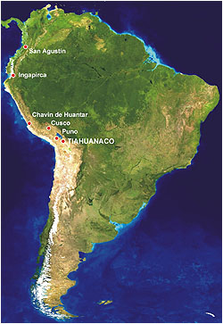

W zasadzie nie ma o czym pisać, ośrodek kultowy sprzed niecałych dwóch tysięcy lat, położony w górach na terenie jednego z najbiedniejszych krajów świata. Promieniował w około swą kulturą, przyczyniając się zapewne do budowy takich ośrodków jak Sacsayhuaman, Machu Picchu czy Cusco, chociaż oglądając styl wymienionych można się dopatrzeć tylko jednej, wspólnej cechy jaką jest kamień, to uczeni najwyraźniej nie chcą tego dostrzec. Jako ośrodek kultu i obserwacji nieba, wysyłał zapewne co roku sygnały do rozpoczynania i kończenia prac polowych do wszystkich okolicznych mieszkańców.

Dochodzę do wniosku, że nasz świat nie ma szczęścia do najstarszych zabytków. Gdzie nie spojrzeć położone są, jak nie w biednych, to w najbiedniejszych rejonach Ziemi lub w krajach, gdzie tajemnica państwowa jest wiodącą "religią". Tubylcy tych krain nie są zainteresowani badaniami archeologicznymi o pustym żołądku, a bogate państwa nie mają zamiaru trwonić pieniędzy na skorumpowanych urzędników. Dobrze, że większość tych zabytków wykonana jest z kamienia, co daje nadzieję, że dotrwają do lepszych czasów.

Tiahuanaco usadowione na północy wyżyny Altiplano pośród Andów, sąsiaduje z jeziorem Titicaca. Jezioro Titicaca, mierzy 220 km długości i jest największym wysokogórskim jeziorem świata, a jednocześnie największym jeziorem Ameryki Południowej. Leży na wysokości 3820 m npm., a jego powierzchnia wynosi blisko 8300 km kwadratowych. Jezioro jest podzielone na dwie części cieśniną Tiquina. Jedna zwie się Chucuito (Titi), druga Huińaymarca (Caca). Jest jeziorem żeglownym, a jego główny port nazywa się Puno i leży już w Peru.

Samo jezioro jest pewnym ewenementem. Jego woda jest słona, chociaż spotkałem się też z wieloma stwierdzeniami, iż jest odwrotnie. Osobiście nie próbowałem i dlatego jestem w kropce komu dać wiarę. Pewne dane wskazują jednak, że jezioro posiada wodę pochodzenia morskiego. Graham Hancook w książce "Ślady palców Bogów" tak o nim pisze:

Choć jezioro leży na wysokości prawie czterech kilometrów nad poziomem morza, otaczający je obszar pokryty jest milionami morskich muszli. Oznacza to, iż cała Altiplano została kiedyś wyniesiona do góry z dna morskiego w wyniku procesu geologicznego, który doprowadził do ukształtowania kontynentu południowoamerykańskiego. Wielkie ilości wody morskiej wraz z niezliczonymi miliardami morskich stworzeń rozlały się wówczas pośród pasm górskich. Uważa się, iż nastąpiło to nie później niż sto milionów lat temu.

---

Jezioro Titicaca zachowało do dnia dzisiejszego "faunę typu morskiego", innymi słowy, w oddalonym o setki kilometrów od oceanu jeziorze żyją liczne morskie ryby i skorupiaki. W sieciach rybaków znalazło się wiele zaskakujących okazów, na przykład z rodzaju hippocampus (konik morski). Jeden z wybitnych autorytetów naukowych pisze \[...\] "że było ono kiedyś bardziej słone, a mówiąc dokładniej, znajdująca się w nim woda pochodziła z morza. Została ona uwięziona w górach podczas formowania całego kontynentu".

---

Linia ta \[brzegowa\] nie jest równa, lecz na znacznej długości wykazuje spadek w kierunku północnym. W najdalej na północ wysuniętym punkcie, który zmierzono, leży osiemdziesiąt siedem metrów powyżej tafli jeziora, zaś trzysta kilometrów na południe - osiemdziesiąt dwa metry poniżej powierzchni wody. Geolodzy wysnuli z tego wniosek, iż Altiplano podnosi się nieustannie, lecz nierównomiernie, na północy bardziej niż na południu.

---

Miasto Tiahuanaco było niegdyś normalnym portem z licznymi dokami, a leżało wówczas na brzegu Titicaca. Kłopot w tym, iż ruiny Tiahuanaco znajdują się obecnie około szesnaście kilometrów od jeziora, trzydzieści metrów powyżej linii brzegowej.

Swego czasu czytałem o hipotezie, jakoby Tiahuanaco w przeszłości było portem morskim. Oczywiście, że nieprawdopodobne. Musiałoby mieć tyle lat co Andy, których wypiętrzenie umieszcza się na około 100 mln. lat temu. Ciekawe też co by z niego pozostało po takiej "podróży" na wysokość bez mała 4 kilometrów. W późniejszych publikacjach miasto określano jako port "jeziorowy", choć na dobrą sprawę do dziś nie wiadomo, jaką spełniało rolę w tamtym systemie kulturowym.

**Hipoteza niedzielnego badacza**

Założenie, że jezioro Titicaca jest wypiętrzoną wraz z Andami zatoką morską, musi nasunąć pytania:

• W jaki sposób postąpiła ewolucja ze wszelkimi istotami żywymi w jeziorze?  
• Czy przez bez mała 100 mln lat zaszły jakieś widoczne zmiany we faunie i florze jeziora?

Otóż, zmiany nie zaszły. Dziś wyławia się organizmy nie wykazujące żadnych różnic w stosunku do pobratymców z Pacyfiku. To jak właściwie jest z tą ewolucją? Czy 100 mln lat to za mało? Czy ewolucja działa zawsze i identycznie we wszystkich środowiskach, nawet w tych izolowanych? Przecież warunki na wysokości ponad 3000 m npm. są zupełnie inne niż na poziomie morza. Panuje tu diametralnie odmienne ciśnienie, inna temperatura, inne oświetlenie, inna zawartość tlenu w powietrzu i w wodzie. Ponoć ewolucyjna przemiana Neandertalczyka w człowieka Cro-Magnon zajęła bez porównania mniej czasu.

Płaszczyzna starej linii brzegowej jeziora jest pochylona w stosunku do obecnej i tłumaczy się to nieregularnym unoszeniem się rejonu. Hola, hola panowie. Tak wielkie zmiany skorupy ziemskiej na długości tylko 300 km? Dowód wydumany z przebiegu linii brzegowej jeziora? Czy Altiplano nie jest nieodłączną częścią Andów? Czy Altiplano wykonuje jakieś dziwne ruchy tektoniczne, a reszta pozostaje w bezruchu? Skoro różnica poziomów na długości całego jeziora wynosi około 170 m, to jakie różnice powinny być na skrajach Altiplano? Czy coś takiego stwierdzono? Dlaczego tak się nie dzieje w innych rejonach Ziemi?

Samo powstanie jeziora można wytłumaczyć także w inny sposób, ale wymaga to uwzględnienia kataklizmu, jaki wydarzył się około 12,5 tysięcy lat temu - "wielkiego uskoku skorupy ziemskiej" - hipotezy Charlesa Hapgood'a. Uwzględnienie tej hipotezy wskazuje na zgoła zupełnie inny przebieg wydarzeń w tej części świata.

• Przed "wielkim uskokiem..." jezioro było słodkowodne i zajmowało obszar wytyczony przez poprzednią linię brzegową. Nikt do tej pory nie zajmował się zbadaniem, czy w osadach jeziora są jakieś pozostałości fauny i flory słodkowodnej. W tym czasie nad brzegami jeziora być może funkcjonuje już port Tiahuanaco.  
• Cała okolica znajduje się o 3000 km na północ od dzisiaj zajmowanego położenia, a więc prawie na ówczesnym równiku. Klimat tropikalny, wilgotny z bogatą szatą roślinną i zwierzęcą. W okolicach jeziora odnaleziono sztuczne terasy, które jakoby świadczą o rozwiniętym rolnictwie.  
• **Nadszedł jeden dzień i jedna noc okropna.**  
• W ciągu krótkiego czasu skorupa ziemska, a wraz z nią cały rejon, przesuwa się na południe około 3000 km. Pierwszym efektem jest atak wód jeziora na okoliczne brzegi. Tiahuanaco zostaje zniszczone. W tym samym czasie następuje gwałtowne cofnięcie się wód oceanu Spokojnego na południe, by po krótkim czasie ruszyć ze zdwojoną siłą na północ. Czoło megatsunami po osiągnięciu wybrzeża osiąga wysokość kilku kilometrów i atakuje szczyty Andów, być może przelewając się przez nie aż na drugą stronę. Ten szczegół jest niemożliwy do przyjęcia przez współczesnych geologów gdyż jest dla nich więcej niż nieprawdopodobny.  
• Wody jeziora Titicaca w krótkim czasie zostają "wymienione" na słoną wodę wraz z zawartością, a samo jezioro zajmuje już zupełnie inną horyzontalnie pozycję. Tak powstaje nowa linia brzegowa. Wtedy też być może Tiahuanaco doznaje wtórnego, potężnego uderzenia wody.  

Przy takim przebiegu zdarzeń nie trzeba przywoływać na pomoc ewolucji. Nie trzeba także kombinować ze zróżnicowanymi zmianami tektonicznymi. Nowe jezioro zalewa stare urządzenia portowe i "odsuwa" się od centrum Tiahuanaco na kilkanaście kilometrów. Nowe położenie geograficzne zmienia także położenie płaszczyzny powierzchni jeziora, która musi być prostopadła do linii "pionu". Artur Poznansky, naukowiec niemieckiego pochodzenia, który na badaniu ruin Tiahuanaco spędził 50 lat, pisał:

Badacze odkryli kości ludzkie i zwierzęce pośród bezładnie rozrzuconych narzędzi kamiennych, naczyń i innych przedmiotów. Każdy, kto dokopał się do głębokości dwóch metrów, miał okazję przekonać się, że ta niesamowita mieszanina kości, naczyń, biżuterii i narzędzi, mogła powstać jedynie w wyniku niszczącego działania wody i ziemi. \[...\]. Wokół szczątków murów nagromadziła się warstwa mułu. piasku i popiołów wulkanicznych, w której spoczywają muszle z jeziora Titicaca.

Potwierdza to także drugi z badaczy Tiahuanaco, Edmund Kiss.

Kości ludzi i zwierząt, a wśród nich takich zwierząt, które dziś już wymarły, leżą zmieszane w namule Tiahuanaco. W jednym z miejsc, gdzie istniało takie zbiorowisko kości, grubość warstwy jaką utworzyły wyniosła 3,5 metra! Miejsce znajduje się obok jednej z ruin Tiahuanaco... Na tym miejscu przebiegają dzisiaj szyny, a pod nimi widać jak gdyby jednorodną, robiącą straszne wrażenie, biało-szarą masę, która składa się z milionów większych i mniejszych kości, ze skorup naczyń ceramicznych, fragmentów ozdób z brązu, być może także ze srebra lub ze złota, pereł, z malachitu i wielu innych jeszcze resztek.

Wszystko wskazuje na to, że ta "mieszanina" to być może efekt niszczycielskiego jeziorowego tsunami podczas tej właśnie katastrofy. Czy ktoś wykazał zainteresowanie określeniem wieku kości, nawet za pomocą C-14? Nikt. Powód? Mogło by się okazać, że Tiahuanaco jest dużo starsze niż oficjalna wersja nauki, która budowę umieszcza w 500 r. ne.

**Tiahuanaco - świątynia, obserwatorium, miasto?**

Oto i nasz obiekt zainteresowań. Niecały, bowiem brak na nim najbardziej interesującego obiektu jakim jest Puma Punku.

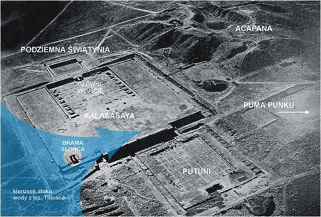

Co na temat samego kompleksu mówi współczesna nauka wzmiankowałem już na poczatku. Poczytajmy więc, co mówią o nim najstarsze zachowane przekazy. Są to przekazy spisane już po konkwiście gdyż, jak zapewne wiadomo, puścili z dymem cały dorobek intelektualny Indian. Pedro Cieza de Leon był jednym z nielicznych konkwistadorów biegłych w piśmie, natomiast Garcilaso de la Vega był synem Hiszpana i indiańskiej księżniczki.

**Pedro Cieza de Leon** - Odpowiedzieli śmiechem na moje pytanie, wyjaśniając, że budowle powstały na długo przed panowaniem Inków. Od swoich przodków Indianie wiedzieli, że wszystko to pojawiło się nagle w ciągu jednej nocy. \[...\] Współczesny hiszpański badacz zanotował podanie, według którego kamienie zostały w cudowny sposób uniesione z ziemi: "Leciały w powietrzu na dźwięk trąbki".

**Pedro Cieza de Leon** - Opowiadają oni (Indianie), że w dawnych czasach na wyspie Titicaca żyli ludzie biali, jak my \[...\] Wkrótce po tym, jak pojawiło się Słońce nad wyspą Titicaca, pojawił się tam również biały człowiek, wobec którego Indianie, jak twierdzą, byli bardzo posłuszni. Posiadał on wielką moc i czynił cuda. Uczył ludzi, jak mają żyć... Nazywano go Tikiwirakocza. Wielkie budowle Tiahuanaco pochodzić mają z tego okresu. \[...\] Indianie opowiadali temu kronikarzowi, że ów Wirakocza potrafił podnosić wielkie bloki kamienne, jakby były z kory.

**Garcilaso de la Vega** - Musimy teraz rzec słów kilka o ogromnych, prawie niewyobrażalnej wielkości budowlach Tiahuanaco. Jest tam sztuczne wzgórze wielkiej wysokości wzniesione na kamiennych fundamentach, aby zapobiec obsuwaniu się ziemi, i gigantyczne posągi wyrzeźbione z kamienia. Są one bardzo zniszczone, co dowodzi ich starożytności. Oglądałem mury zbudowane z kamieni tak olbrzymich, ze trudno sobie wyobrazić, jaka ludzka siła mogła je tam umieścić, i szczątki dziwnych gmachów, zwłaszcza kamiennych portali wyciosanych z jednej skały. Stoją one na podstawach o długości dochodzącej do dziesięciu metrów, szerokości pięciu i grubości dwóch metrów. Portal i podstawa zrobione są z tej samej skały. \[...\] Jakimi narzędziami i w jaki sposób wykonano te ogromne dzieła, nie umiemy powiedzieć. \[...\] Nie potrafimy też sobie wyobrazić, jak przetransportowano tutaj te gigantyczne kamienie.

**Garcilaso de la Vega** - Inka Garcilaso przekazuje słowa swego krewnego, autentycznego Inki z rodu królewskiego: "Musisz wiedzieć, że w dawnych czasach cały ten teren, który widzisz, pokryty był lasami i roślinnością".

**Avila** - mówili oni, że wszystkie te tereny znajdowały się dawniej w klimacie ciepłym. Kwitło tu rolnictwo, żyło wiele ptaków i zwierząt.

Co warto zapamiętać z tych przekazów:

• Tubylcy nie wiedzieli kto i kiedy zbudował Tiahuanaco. Do przemieszczania bloków kamiennych używano energii dźwięku.  
• Rejon zamieszkiwali ludzie białej rasy. Pojawił się Bóg dysponujący ogromną siłą fizyczną.  
• Mówi się o sztucznym wzgórzu (prawdopodobnie chodzi o piramidę ziemną zwaną Apacama) zabezpieczonym kamiennymi fundamentami przed obsuwaniem się ziemi.  
• W dawnych czasach wokół Tiahuanaco panował inny klimat, prawdopodobnie tropikalny lub subtropikalny. Teren pokryty był bujną roślinnością i żyło wiele gatunków zwierząt.

Joseph Blumrich w swojej książce "Kaskara i siedem światów" przekazał opowieść Indianina z plemienia Hopi, Białego Niedźwiedzia, który opowiada o wędrówce swojego plemienia z zatapianego lądu położonego na Pacyfiku do Ameryki Południowej, którą organizowali i przeprowadzali Kaczyni (boscy nauczyciele).

Pierwsi przybysze mieli wybudować nad wielkim jeziorem czy też częścią morza wielkie miasto. Również to miasto, pierwsze wybudowane na tym lądzie miasto nosiło nazwę Taotooma. Miasto było bardzo duże, a jedna jego część, to znane dzisiaj Tiahuanaco. Kaczyni, opiekując się przybyszami i rozbitkami, nauczyli ich jakie mają tutaj hodować zwierzęta i jakie uprawiać rośliny. Upływały tysiąclecia... Po pewnym czasie część ludności przestała przestrzegać praw Stwórcy. Kaczyni starali się nawrócić ją na słuszną drogę ale nie dało to wielkich rezultatów. Stwórca wiedział doskonale, co się dzieje na nowym kontynencie i wkrótce sam się tu zjawił. Grzesznicy zostali srodze ukarani. Stwórca "uniósł całe miasto do góry, obrócił je i z powrotem rzucił na Ziemię... Cały kontynent się zatrząsł".

**Kalasasaya**

  
  

Nazwa w miejscowym języku oznacza "miejsce pionowych kamieni". Najczęściej pokazywany obiekt w całym Tiahuanaco. Czy był to główny obiekt kompleksu trudno powiedzieć, gdyż nie wiemy po co Tiahuanaco zbudowano, jakie pełniło zadanie i co tak naprawdę w nim się odbywało. Wejście do kompleksu jest imponujące. Zbudowane z olbrzymich, kamiennych bloków, ściśle do siebie dopasowanych, bez śladów użycia zaprawy.

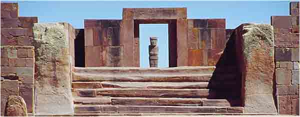

Nazwę swą miejsce zawdzięcza prawdopodobnie czterometrowym monolitom, ustawionych co kilka metrów, pomiędzy którymi ustawiono ściany z kamiennych cegieł. Zwróć uwagę, że najbardziej zniszczone są schody i nie wygląda to na oddziaływanie wody. Czy tak mogą wyglądać schody po tysiącach lat wchodzenie i schodzenia? Bardzo możliwe. Wiek tego kompleksu, poprzez obliczenia astronomiczne, Poznansky określił na 15 tysięcy lat. W latach 1927-30 zespół naukowców (Ludendorf, Becker, Kohlschutter i Muller) po trzech latach prac ogłosił, że wnioski Poznansky'ego są słuszne i data 15 tysięcy lat pne, podana przez Poznansky'ego mieści się w granicach prawdopodobieństwa. Uczonych nie interesowało Tiahuanaco. Sprawdzili tylko słuszność obliczeń.

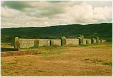

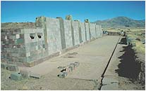

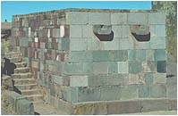

Na fotografiach powyżej - widok muru znajdującego się po przeciwnej stronie wejścia głównego. Ustawiony także pomiędzy pionowymi obeliskami charakteryzujący się prostopadłościanami "cegieł". W murze widoczne kamienne elementy będące prawdopodobnie częścią systemu odwadniającego. Co znajdowało się na tym dużym, ogrodzonym obszarze? Jeśli prawdą jest, że wielka fala jeziora Titicaca unicestwiła cały ośrodek, to budowle znajdujące się wewnątrz ogrodzenia musiały być nieporównanie mniej odporne na działanie sił przyrody, niż otaczające je mury. Na zdjęciu z powietrza widać fundamenty jakiegoś budynku stojącego pośrodku oraz dwa rzędy czegoś, co z góry przypomina egipską aleję Sfinksów. Co mogło znajdować się w miejscu nazywanym Putuni? Z góry widać tylko regularną kratę. Magazyny czy miejsce, w którym mieszkała "ludzka" lub półboska obsługa kompleksu?

**Brama Słońca**

  
  

Kto pierwszy wymyślił tę nazwę nie wiadomo. Na pewno nie budowniczy Tiahuanaco. Stanowi gigantyczną "futrynę" wykonaną z jednego bloku andezytu, ważącą około 10 ton. Wrębienia czy wycięcia nie zostały, według mnie, wykute. Brama wygląda jak doskonały odlew. Tych wszystkich "specjalistów od wykuwania" należało by zebrać w jedną grupę i kazał wykuć ówczesnymi narzędziami choćby mały rowek o głębokości pół i długości jednego centymetra. Ciekawe ile czasu by na to poświęcono, ale prawdopodobnie zakończyło by to niemądre dywagacje na temat obróbki kamienia przez starożytnych.

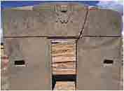

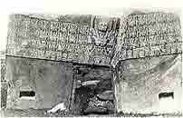

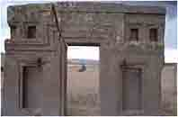

Zdjęcie po prawej przedstawia "Bramę Słońca" w początkowym okresie badania Tiahuanaco. Pęknięcie spowodował zapewne nie byle jaki wstrząs. Brama jest zagrzebana w ziemi, którą naniosły fale potopu. Można sobie wyobrazić ile trudu i czasu musiało zabrać odgrzebanie całego kompleksu. Na frontonie bramy widoczna jest płaskorzeźba, którą Kiss "odszyfrował" jako kalendarz. Bardzo dziwny kalendarz. Opisuje go prof. Zajdler w swojej książce "Atlantyda".

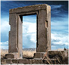

Ziemia obracała się dookoła swej osi w czasie 30,23 obecnych godzin. Rok liczył 290 dni i był podzielony na 12 miesięcy po 24 dni z 2 dniami "wyrównującymi". Zaćmienia Słońca były bardzo częste. Występowały 19 razy w ciągu 24 dni.

Gdyby, jak pisze Zajdler, przyjąć, że Ziemia opóźnia obrót dookoła własnej osi o 0,005 sekundy na 100 lat, to kalendarz musiałby powstać 450 tysięcy lat temu.

Brama Słońca to nie jedyna "brama" w kompleksie Tiahuanaco. Znajduje się tu jeszcze jedna, lecz wyglądająca nieporównywalnie skromniej. Wykonana także z jednego bloku kamienia, posiada także wycięcia i frezy. Nazwano ją dla odróżnienia Bramą Księżyca. Dokąd prowadziła? Nie wiadomo, podobnie jak nie wiadomo, co kiedyś oglądano po przekroczeniu Bramy Słońca.

**Podziemna świątynia**

  
  

Nazywając tak ten obiekt, zasugerowano się chyba położeniem poniżej wejścia głównego. Ze zdjęć nie wynika, by coś tu było pod ziemią, a tym bardziej świątynią. Coś musiało jednak sobą przedstawiać i spełniać jakieś niewiadome zadanie. Wydaje się, że na pewno nie był to basen. Na ścianach umieszczono głowy wykute z kamienia, które nie wiadomo kogo przedstawiają lub co mają sobą symbolizować.

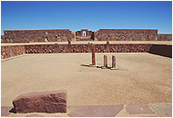

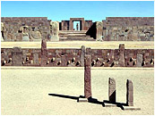

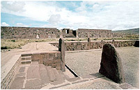

Zejście w głąb umieszczono pomiędzy potężnymi monolitami, które może kiedyś były prostokątnymi obeliskami, a dziś widzimy je zniszczonymi przez czas. Na środku trzy monolity. Wyglądają jak kubistyczne przedstawienie jakiś postaci. Czy tak stały od samego początku? Czy były to pierwotnie kolumny podtrzymujące jakieś zadaszenie? Dlaczego tylko trzy? Same pytania. Czy to, co widzimy to już wszystko, czy też pod ziemią kryją się jeszcze jakieś nie odkryte pomieszczenia?

Najwyższy z monolitów na boku posiada wyrzeźbioną sylwetkę węża. Nikt jednoznacznie nie odpowiedział jeszcze na pytanie, jaką rolę w zaginionych cywilizacjach spełniał wąż, a musiał spełniać i to na pewno nie drugorzędną. Zbyt wiele razy jest pokazywany, ale nikt jeszcze nie określił jego roli, choć najstarsze przekazy mówią o tym, że wąż potrafił latać.

**Piramida ziemna - Apacama**

  
  

Strome wzgórze po południowej stronie Kalasasay'i. Wznosi się na wysokość około 15 m. Najbardziej zniszczony obiekt i prawdopodobnie przez wodę. Pierwotnie, prawdopodobnie umocniona przez obudowanie terasami, z których niewiele pozostało. Rekonstruuje się ją jako piramidę o 16 bokach skierowaną według kardynalnych kierunków geograficznych. Średnie długości boków wynoszą około 210 m. Wejście na górę tworzyły prawdopodobnie schody z dużych andezytowych płyt.

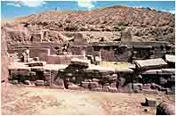

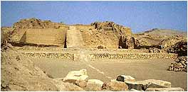

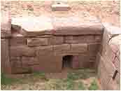

Sama nazwa Apacama, w miejscowym języku, oznacza miejsce gdzie ginęli ludzie. Tradycyjna nazwa wskazuje, że nie było to miejsce kultu, a wręcz miejsce, które należało omijać z daleka. Wewnątrz piramidy archeolodzy odkryli całą sieć kanałów i oczywiście pierwszą myślą było związanie piramidy z kultem wody - "miejscem, w którym oddawano cześć potędze i właściwościom szybko płynącej wody". Kto wymyślił taki dziwoląg? Inna hipoteza głosi, że piramida była miejscem do technologicznego płukania rud. Powiązanie piramidy z wodą nie wyjaśnia jednak jednego - skąd brała się tam woda. Czy czerpano ją z podziemnego zbiornika czy też źródłem było jezioro Titicaca. Nikt nie zgłębił tematu i nikt też nie szukał wyjaśnienia.

Na zdjęciach widać część zachowanych kamiennych budowli, "nadszarpniętych" trochę warunkami atmosferycznymi, wciąż jednak z widoczną precyzją wykonania. Piramida od góry posiada ogromną dziurę, ale nie wiadomo czy to pozostałość po pracach wykopaliskowych, działaniu deszczu czy po złodziejskiej eksploatacji kamiennych elementów, z których to budowano La Paz.

**Puma Punku**

  
  

Najciekawszy obiekt, szeroko omijany przez wszelkiej maści uczonych, którzy na widok połamanych kamiennych płyt, natychmiast zapominają, po co kończyli studia. Faktycznie, przy takim podejściu do znalezisk, nie ma co dyskutować o samym miejscu. Boga wody tu nie uświadczymy. Żadnego stołu, który można ochrzcić ołtarzem. Brak kamiennych nisz na figurki Bogów.

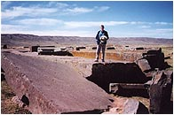

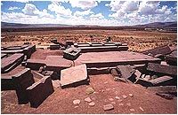

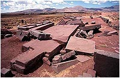

Pełno za to odłamków kamiennych płyt, których otwory, nacięcia, wycięcia czy wrębienia wprost nie mogą pasować do kamiennego dłutka i pięściaka. Tu koncepcja archeologa chowa się w najdalsze zakamarki mózgu. Jak bowiem wytłumaczyć precyzję wykonania elementów przez prymitywnego przodka z jego prymitywnymi narzędziami?

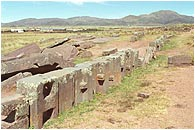

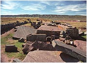

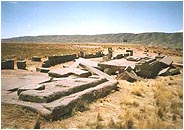

Te artefakty najchętniej by zasypano i postawiono tablicę z informacją, że w tym miejscu znajduje się kurhan z ciałem wybitnego wodza Indian, a nie prowadzi się wykopalisk dlatego, by uszanować święte dla miejscowych Indian miejsce i nie zakłócać spokoju duszy wodza.

**Precyzja obróbki kamiennych bloków**

Na zdjęciach zgromadziłem próbki precyzyjnej obróbki kamiennych bloków. Nie są to zapewne wszystkie znajdujące się w Tiahuanaco, ale reprezentacja jest i tak doskonała.

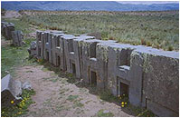

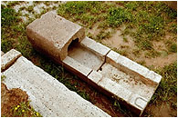

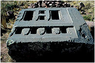

Na pierwszym zdjęciu widzimy starożytne klocki "lego", każdy o wadze co najmniej kilkuset kilogramów i wcale nie byłbym zdziwiony, gdyby okazało się, że mają identyczne wymiary, co mogło by znaczyć o ich "taśmowej" produkcji. Gdyby tak było, to nie ma mowy o żadnym wykuwaniu czy cięciu. To musiały by być odlewy. Na środkowym "coś" przypominające rynnę do odprowadzania wody. Z równym powodzeniem mogło służyć jako ochrona przewodów energetycznych. Co przedstawia trzecia fotografia nie próbuję nawet zgadywać.

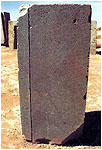

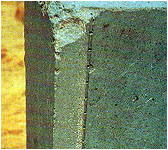

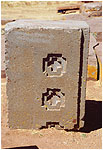

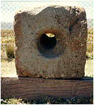

Wyżej, kamienny blok, w którym po wyfrezowaniu rowka nawiercono, w równych odstępach, otwory o średnicy cirka 10-14 mm. Jakiego narzędzia tu użyto? My, takie otwory w betonie wiercimy dopiero od niedawna wiertłami z diamentowymi ostrzami.

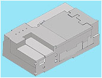

Obok kawałek bloku z tzw. krzyżami Tiahuanaco. Czy krzyże nie mają jednakowych wymiarów?. Wykonać coś takiego można tylko wrębiarką (lub poprzez odlew). Jak małych użyto narzędzi, by otrzymać tak precyzyjne kąty proste? Czy to był element zdobniczy, czy miejsce do osadzenia innego elementu? Na ostatniej fotografii przewiercony kamień, ale otwór wejściowy ma powiększoną średnicę. Po co tyle zachodu dla zwykłej dziury?

Po lewej stronie rysunek bloku kamiennego. Wymiary? Bagatela. 2,78 x 1,57 x 0,88 metra! Precyzja wykonania porównywalna tylko z zegarmistrzowską. Płaszczyzny wpuszczane na głębokość 8 mm. Czy dzisiaj ktoś by się podjął wykonania takiego bloku kamienia? Jeśli tak, to ile czasu zabrałoby jego wykonanie? Jakich precyzyjnych narzędzi z diamentowymi ostrzami by użyto? I najważniejsze, jaka była by cena tego elementu?

Najważniejsze jednak pytanie, jakie się ciśnie na usta, to - po co to wykonano? Czy są to kamienne części jakiś maszyn? Bo na pewno nie są to elementy starożytnej świątyni.

**Bogowie, półbogowie, ludzie ?**

W Tiahuanaco znaleziono stosunkowo mało artefaktów przedstawiających istoty człekopodobne. Wykonane w sposób, można rzec, zgoła prymitywny, aczkolwiek zachowujący proporcje. Sztuka stylem przypominająca rzeźby kubizmu, nadszarpnięta zębem czasu, z trudem lub wręcz nie dająca zidentyfikować przedmiotów trzymanych w rękach.

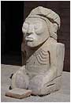

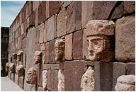

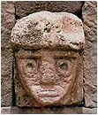

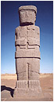

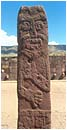

Czy głowy wmurowane w ścianę, to mauzoleum przypominające wielkich przodków, czy też aleja zasłużonych budowniczych Tiahuanaco? Twarze podobne jedna do drugiej mają zarysowane główne części twarzy - usta, nos, oczy. Okrągłe oczy przypominają bardziej okulary. Głowy przykryte prostymi nakryciami. Klęcząca postać jest bardzo wychudzona z wyraźnymi kośćmi policzkowymi i wystającymi żebrami, na głowie jakiś zawój przypominający trochę nakrycie z Sumeru. Czy to człowiek w pokornej postaci wobec Boga? Stojące postacie, według nauki, to postacie Bogów nazywane nie wiedzieć czemu idolami.

**Zwierzyniec Tiahuanaco**

Graham Hancook w cytowanej książce opisuje jakoby na dole fryzu Bramy Słońca (w trzecich kolumnach po prawej i po lewej) ujrzał wizerunki słoni z uszami, trąbami i kłami, ale mógł to być też wizerunek cuvieronius'a podobnego do słonia, który wymarł około 10 tysięcy lat temu. Jak się do tego dochodzi, opisuje sam autor:

Postępuję kilka kroków naprzód, aby dokładniej przyjrzeć się słoniom. Składają się z dwóch zwieńczonych grzebieniami głów kondorów umieszczonych szyja przy szyi. Grzebienie stanowią "uszy" oraz górną część szyi i "kłów" słonia. Mimo wszystko stworzenia te nadal przypominały mi słonie. Rzeźbiarze Tiahuanaco z nadzwyczajną wprawą posługiwali się charakterystyczną techniką przedstawiania czegoś za pomocą wizerunków innych obiektów. Dokonywali dzięki temu rzeczy niezwykłych: to, co wyglądało jak ludzkie ucho, mogło się okazać na przykład ptasim skrzydłem, ozdobna korona mogła się składać z głów ryb i kondorów, brew z szyi i głowy ptaka, pantofel - z głowy zwierzęcia. Wizerunki trąbowców nie muszą być zatem złudzeniem optycznym, wręcz przeciwnie - te pełne inwencji obrazy doskonale pasują do ogólnej koncepcji artystycznej fryzu.

Nie znalazłem nigdzie wyraźnej płaskorzeźby tego słonia przedstawionego za pomocą kondorów i być może zarzucić mi można szukanie taniej sensacji, ale znalazłem jeszcze inny fragment "wizji" pana Grahama.

Wykuty z czerwonego piaskowca, zniszczony, pradawny El Fraile \[...\] przedstawia postać ludzką, której płci nie sposób odgadnąć, z wydatnymi ustami i dużymi oczyma. W prawej dłoni ściska przedmiot przypominający nóż o falującym ostrzu niczym malajski kris. W lewym ręku trzyma coś, co wygląda jak sztywno oprawiona książka. Jednak z górnej części owej "książki" wystaje podłużny obiekt niby miecz wsadzony w pochwę. Od pasa w dół postać odziana jest w strój z rybich łusek; rzeźbiarz podkreślił jeszcze tę aluzję, nadając łuskom kształt wielu rzędów maleńkich, silnie stylizowanych rybich głów. Posnansky zinterpretował posąg jako symboliczny wizerunek człowieka-ryby. Na biodrach postaci wisi pas składający się z kilkunastu płaskorzeźb skorupiaków, co zdaje się potwierdzać tezę Posnansky'ego. Jakie było zamierzenie twórcy?

Jakie było zamierzenie twórcy? Chyba nie takie, aby opisywał go Hancook.

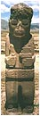

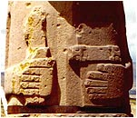

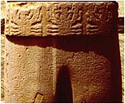

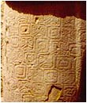

Postać "mnicha" w spodenkach faktycznie coś trzyma w rękach, ale jakim cudem Hancook przez pochwę ujrzał falujące ostrze? Ujrzał też dziwną "zakładkę" w książce i jeszcze dziwniejsze łuski w formie "mocno stylizowanych rybek", a także dziwnie jakoś chude kraby. Te łuski są łudząco podobne do ozdób drugiego posągu stojącego w osi głównego wejścia, na którym jednak pan Graham żadnych łusek nie dojrzał. Dlaczego?

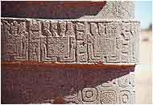

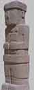

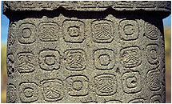

Prawdopodobnie dlatego, by uwiarygodnić indiańską legendę o bogach jeziora, którzy mieli rybie ogony, a w konsekwencji płynnie powiązać Tiahuanaco z Sumerem, gdzie jak wiemy nauczycielem ludzi był Oannes pół-człowiek, pół-ryba. A gdzie "mnich" ma rybi ogonek? W spodenkach? Jeżeli tak się uwiarygodnia hipotezy, to nic dziwnego, że archeolodzy mają ubaw po pachy. Zwróćmy jeszcze uwagę na ręce "mnicha". Czy nie można odnieść wrażenia, że prawa dłoń jest przekręcona o 180°?

Wśród stylizowanych postaci na fryzie uczeni ujrzeli jeszcze toksodonta, a na znalezionych w okolicy naczyniach czwronożnego shelidoterium i macrauchema - trójpalczastego zwierza trochę większego od konia. Wszystkie te istoty zakończyły żywot około 12 tysięcy lat temu.

**Wirakocza - Bóg Ameryki Południowej**

Początki społeczności ludzi w Ameryce Południowej mają różne korzenie. W jedne wersji Bóg-Słońce zsyła swoje dzieci nad jezioro Titicaca, które zostają rodzicami ludzkości. W innej, nad jeziorem pojawia się biały człowiek, któremu istniejący już ludzie są bardzo posłuszni. Posiada wielką moc i czyni cuda, uczy ludzi jak mają żyć. Nazywa się Tikiwirakocza. To z tego okresu mają pochodzić budowle Tiahuanaco. Jeszcze inne przekazy mówią, że w dawnych czasach miał miejsce potop, a Indianie przybyli na tę ziemię z bardzo daleka, zza morza. Wirakocza, Bóg stojący najwyżej w hierarchii Indian Ameryki Południowej posiada niezwykłe cechy:

• Posiada wielką moc, a także wielką siłę fizyczną, potrafi zamieniać góry w doliny, a płaszczyzny w góry.  
• Posiada umiejętność czynienia cudów. Potrafi wydobywać wodę ze skał. Potrafi latać, a także chodzić po wodzie.  
• Jest pierwszym Wielkim Nauczycielem pierwszych ludzi. Uczy podstaw dających szanse na przetrwanie, a przede wszystkim uprawy i hodowli.  
• Po wypełnieniu misji, opuszcza ludzi unosząc się do nieba. Jak pisze Molina: "Światło, jakie towarzyszyło temu odlotowi do Nieba było tak silne, jak światło Słońca i huk był olbrzymi".

Wirakocza występuje sam lub z kilkoma towarzyszami, ale cel misji jest ten sam.

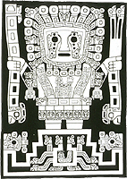

Ważnym stwierdzeniem jest także to, że ludzie na tym terenie nie zostali stworzeni, a zostali zrodzeni przez pierwszych rodziców albo przybyli z daleka lub już na tych terenach istnieli (być może ci, którzy przeżyli potop). W odróżnieniu, w Ameryce Środkowej, ludzie zostają stworzeni (lub sklonowani ze "starożytnych" kości) przez Quetzalcoatla. Z przekazów starożytnych wyłaniają się wielkie praośrodki (mieszkania Bogów): w Ameryce Południowej - Tiahuanaco, a w Środkowej - Teotihuacan.

Ludzka pamięć zbiorowa, wbrew temu co sądzą niektórzy naukowcy, jest jak dotąd najlepszą bazą danych, zawierającą wiadomości od początku istnienia danej społeczności. Zaczynają się zwykle wspomnieniem jakiegoś kataklizmu, z którego ratują się praprzodkowie społeczności, lub przybywa Bóg i tworzy nowe życie. Jeśli Indianie mówią, że nie wiedzą kto zbudował Tiahuanaco, świadczyć to może o tym, że ta społeczność w czasach budowy jeszcze nie istniała. Podobnie jak w Egipcie, gdzie pierwszym elementem przekazów jest potop, po którym pojawia się Ptah i następuje stworzenie ludzi. Ludzie natomiast nie wiedzą, kto zbudował piramidy, bo społeczność, która to opowiada, w czasie ich budowy jeszcze nie istniała.

Rysunek obok przedstawia Wirakoczę. Tego samego, który zajmuje centralną część fryzu na Bramie Słońca. Nie wiem ile zawiera inwencji autora, gdyż płaskorzeźba jest bardzo zniszczona. Pełno tu głów kondorów i pum, ale najbardziej dziwną rzeczą, która rzuca się w oczy, to ręce Boga. Obie mają tylko po cztery palce. Jest to zgodne ze starą legendą o Orejonie, która wylądowała na wyspie jeziora Titicaca w czasach, gdy nie było jeszcze ludzi. Miała mieć wydłużoną głowę i po cztery palce u rąk spięte błoną.

**"Promieniowanie" Tiahuanaco**

Spotyka się stwierdzenie, że Tiahuanaco jest kolebką kultury Ameryki Południowej, która promieniowała wokoło, tworząc jednolitą kulturę, którą nazwano Huari. Przypatrzmy się przykładom tego "promieniowania":

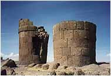 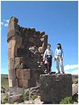 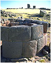 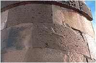  
Port nad jeziorem Titicaca. Puno (Sillustani). Ogromne "silosy" wypełnione kamieniami. Do czego służyły?

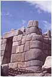 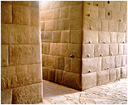 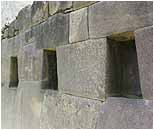   
Rejon Cusco. Od lewej Sacsayhuaman, Cusco, Ollantaytambo i Pisaq. Doskonała obróbka kamienia.

     
Chavin de Huantar nad wybrzeżem Pacyfiku. Daeniken widzi tu świątynię, którą pokazano Ezechielowi.

      
Dwa pierwsze - Ingapirca, dalej San Agustin - postacie Bogów? Zwróć uwagę na "tygrysie" siekacze.

O jakim promieniowaniu mówimy? To co widać na zdjęciach prezentuje zupełnie odmienne stylowo dzieła. Promieniowanie można zauważyć tylko w przypadku zastosowanego surowca - kamienia, jego wielkości i doskonałego dopasowania elementów. Współgrać stylowo z Tiahuanaco może ewentualnie Chawin de Huantar, ale tu w murze widać zupełnie inną głowę (w Chavin de Huantar głowy posiadają ogromne kły). Ponadto styl w jakim wykonano tzw. lanzon (kamienną klingę) nie ma odpowiednika w Tiahuanaco.

Owszem, można mówić o kulturze Huari pod warunkiem, że uczynimy zastrzeżenie iż mówimy tylko i wyłącznie o kulturze ludzi. Bogowie nie lepili garnków, nie budowali ludziom chałup, nie hodowali bydła i wreszcie nie uprawiali za nich roli. Całą historię Ameryki należy podzielić na działalność dwóch cywilizacji - cywilizacji Bogów i cywilizacji ludzi. Jeżeli przypiszemy Bogom wszystkie gigantyczne budowle i inne ogromne przedsięwzięcia budowlane, jak np. terasy na stokach gór, sieć dróg czy kamienne kanały melioracyjne, to okaże się, że ludzie wykonywali tylko prace na miarę swych skromnych możliwości i w dużo mniejszym zakresie.

Przyjmując założenie, że Ziemia pod koniec epoki lodowcowej około 12,5 tysiąca lat temu przeżyła światowy kataklizm, który zniszczył cały dorobek cywilizacji Bogów i ówczesnych ludzi, musimy uświadomić sobie, że nasza, współczesna historia, liczy sobie "tylko" około 12,5 tysiąca lat, z czego przez pierwsze kilka tysięcy lat ludzkość musiała odtworzyć swój potencjał biologiczny walcząc o przeżycie. Opuszczenie Ziemi przez Bogów zmusiło ludzką cywilizację do wejścia na drogę własnego postępu technicznego, który tak naprawdę rozpoczął się dopiero kilka tysięcy lat temu, nabierając rozpędu w ciągu ostatnich 100-200 lat.

**Dlaczego Giza Ameryki Południowej**

Czytając literaturę na temat Tiahuanaco przyznać muszę, że nie jestem zbudowany zawartą tam wiedzą. Wszyscy powtarzają te same, oklepane frazesy, jakby przepisywali jeden od drugiego. Książkę "Ślady palców Bogów" okrzykniętą bestselerem nie poleciłbym nikomu. Czytając to dzieło trzeba być uważnym i cierpliwym, jak wędkarz na polskich wodach, by coś w ogóle wyłowić. Jeśli ktoś opisując posąg, zniszczony przez tysiąclecia widzi twarz o dokładnie wygolonych policzkach i przystrzyżonych wąsach, to mają rację naukowcy mówiący o bardzo niskiej zawartości tlenu na wysokości 3800 m. Jeżeli sławny uczony, znawca mitologii, Joseph Campbell widzi w Bramie Słońca "moc łaski spływającą na wszechświat poprzez słońce jako tę samą energię, która pod postacią niezniszczalnego piorunu niesie zagładę", to sama próba przełknięcia tego "naukowego dania" może spowodować odruch wymiotny.

Wszyscy opisujący Tiahuanaco trzymają się kurczowo tezy, że "miasto" leżało nad morską laguną, wyniesioną przez ruchy górotwórcze na dzisiejszą wysokość. Panowie! Czy Tiahuanaco zbudowano 100 mln lat temu? Co by z niego zostało po takim "wystrzeleniu" na 3,8 kilometra w górę? Lubię żartownisiów, ale nie przekraczających norm zdrowego rozsądku.

Jak wygląda moja interpretacja powstania Tiahuanaco?

Budowę Tiahuanaco należy umieścić pomiędzy 37-12,5 tysiąca lat temu. Wynika to nie z obliczeń astronomicznych, a umiejscowieniu w latach dwóch kataklizmów, które zmieniły życie na całej ziemi. Kataklizm sprzed około 12,5 tysięcy lat temu zakończył istnienie Tiahuanaco. Co więcej, fala tsunami wywołana "wielkim uskokiem..." zniszczyła jezioro słodkowodne, "wymieniając" jego słodką wodę na wodę morską wraz z jej morską florą i fauną. Można by zapytać:

• Dlaczego do tej pory prawie w całych Andach istnieją ośrodki pozyskiwania soli zwane "salinas", gdzie sól otrzymuje się metodą odparowania wody? Skąd wzięła się sól w tak wysoko położonych miejscach?  
• Dlaczego sól nie występuje w postaci soli kamiennej? Czy dlatego, że było zbyt mało czasu, by przyjąć taką formę?  
• Skąd w południowej części Altiplano wzięły się dwa ogromne, słone i wysychające jeziora Salar de Uyuni i Salar de Coipasa?  
• Dlaczego w naszych warunkach sól wydobywa się spod ziemi, a wysoko w Tatrach nie uświadczysz nawet ziarenka?  
• Dlaczego w starożytnych przekazach można spotkać stwierdzenie, że w czasach pierwszych ludzi ziemia była nasycona solą i nie dawała nadzwyczajnych plonów?  
• Dlaczego na tak znacznych wysokościach spotyka się szczątki morskich zwierząt? Przecież po 100 mln lat nie powinno pozostać z nich ani śladu.

W dawnych czasach, jak podają zgodnie starożytne przekazy, wokół Tiahuanaco panował klimat tropikalny lub subtropikalny. Teren pokryty był bujną roślinnością i żyło wiele gatunków zwierząt. Wiadomo też, że ostatnie ruchy górotwórcze, które wypiętrzyły Andy miały miejsce około 100 mln lat temu i nie mogą być odpowiedzialne za zmianę klimatu. Zmianę klimatu mógł spowodować "wielki uskok..." sprzed około 12,5 tysiąca lat, który przesunął cały rejon około 3000 km na południe. On też jest jak sądzę odpowiedzialny za masowe wyginięcie zwierząt w tym rejonie.

Tiahuanaco zbudowała cywilizacja, umownie nazywana przeze mnie cywilizacją Bogów, dysponująca wysoką, nieznaną nam techniką, a także używająca nieznanego nam rodzaju energii. Tiahuanaco nie było nigdy kompleksem religijnym. Świadczą o tym rozbite elementy nie noszące żadnych śladów informacji kultowych, a wyglądające wręcz na elementy urządzeń technicznych. Ponadto, jakoś głupio wymagać od Bogów, by oddawali cześć samym sobie.

Piramida Acapana kryła w sobie urządzenie do wytwarzania jakiejś nieznanej energii, która była śmiertelnie niebezpieczna dla ludzi, gdy znaleźli się w pobliżu jej źródła. Nazwa, w języku Aymara, oznacza miejsce, gdzie giną ludzie. Trudno nazwać miejsce świątynią, gdzie za okazywaną pobożność otrzymuje się najwyższy wymiar kary. Odbiorcą energii były zapewne ośrodki rozmieszczone wokół Apacany. Jeśli przyjąć, że Tiahuanaco było kiedyś portem, to zapewne tej energii używano także do obsługi urządzeń portowych. Ponadto, jak piszą pierwsi oglądający Apacanę, piramida ziemna była pokryta i umocniona kamiennymi płytami, które później użyto do budowy La Paz. To, co pozostało określa się na 10% z całości.

Obiekt zwany Kalasasaya, jest obszarem w kształcie prostokąta, ogrodzonym (przynajmniej był) na całej długości wysokim, potężnym murem. Czy w środku znajdowało się "coś" niebezpiecznego, do czego nie powinni byli zbliżać się zwykli ludzie? Podobnie ogrodzony obiekt znajdował się w Sakkara. Tam zachowały się "ostrzegające kobry". Tutaj nie zachowało się nic takiego. Pozostałości tzw. Puma Punku świadczą o istnieniu w tym miejscu jakiejś bazy technicznej o nie znanym przeznaczeniu. Odnalezione w pobliżu kamienne bloki ułożone na odcinku 300 m uznano za część portu, co może świadczyć, że Puma Punku była budowlą techniczną obsługującą ten właśnie port.

Tiahuanaco w przeszłości leżało nad brzegiem słodkowodnego jeziora Titicaca. Nie można więc wykluczyć, że Tiahuanaco było z nim związane i to nie tylko jako port. Można przypuszczać, że było także jakimś centrum systemu nawadniającego północne Altiplano. Możliwe, że jezioro Titicaca spełniało podobną rolę, jak egipskie jezioro Mojrisa w stosunku do doliny Nilu. Całość, dotychczas odkrytego kompleksu, uważam za centrum przemysłowo-hydroenergetyczne wybudowane przez cywilizację Bogów, swoim charakterem przypominające podobne na terenie starożytnego Egiptu i stąd moje porównanie Tiahuanaco do Gizy.

Przyglądając się mapce można przypuszczać, że ośrodki podobne do Tiahuanaco istnieć powinny także w środkowej i południowej części Altiplano, ale jak dotychczas nic takiego nie odnaleziono. Czy zostały zmiecione z powierzchni ziemi przez kataklizm 12,5 tysiąca lat temu? Sądzę, że wielkie odkrycia archeologiczne na Altiplano są jeszcze przed nami. Trzeba tylko wiedzieć czego szukamy. Gdyby potwierdziły się moje przypuszczenia, to sądzę, że Wielka Zaginiona Cywilizacja, Cywilizacja Bogów znalazła by wreszcie swoje miejsce w naszej historii.

Współczesna nauka jak na razie nie umie, nie usiłuje lub wręcz nie chce ujawniać prawdy dotyczącej naszej wspólnej, ludzkiej historii.
