**Atlantyda istnieje nadal**  
Atlantyda tylko na Oceanie Atlantyckim albo wcale - prof. L. Zajdler

**Gonić króliczka**

Tę trwającą do dziś burzę rozpętał Platon ponad dwadzieścia wieków temu w swoich rozprawach Kritias i Timajos. Burzę, która umiejących czytać podzieliła na dwa wrogie obozy. W tej sprawie nie ma w zasadzie obojętnych. W obozie zwolenników można spotkać takich, którzy wierzą w każde słowo napisane przez Platona, zaciekłych wrogów którzy na samo słowo Atlantyda dostają "gęsiej skórki" i takich, którzy dla pięciu minut sławy gotowi są głosić surrealistyczne hipotezy. Czytając niektóre wypowiedzi odnosi się wrażenie, że Atlantyda była pchłą, którą Platon zabił ją jednym ruchem paznokcia i w odruchu żałości napisał alegoryczną powieść. Od tego czasu zapisano tony papieru i wylano morze atramentu, ale nie zrobiono rzeczy podstawowej - nie podjęto ani jednej próby jej odnalezienia. Przez cały ten czas nie wykonano najmniejszego ruchu, by raz na zawsze wyjaśnić sprawę, choć dziś już są i doskonałe możliwości techniczne i środki. Nie o to chodzi by złowić króliczka, ale by gonić go? Dlaczego?

Okres europejskiego średniowiecza był okresem patentu na naukę zawłaszczonego przez kościół, który do pilnowania prawomyślności miał w swojej dyspozycji "zbrojne ramię" - Świętą Inkwizycję". Renesans przyniósł wyzwolenie nauki spod władzy kościoła i na zasadzie przekory stworzył swoją naukę, ale już pozbawioną korzeni. Wszystko, co w treści zawierało słowo "Bóg" i "stworzenie" zostało wyrzucone poza nawias "racjonalnej" nauki. Pozostawiono otwarte już drzwi i obok rozpoczęto wykuwać nowe. O ile w naukach ścisłych i postępie technicznym każdy błąd oznaczał ludzką tragedię, o tyle w naukach humanistycznych rozpoczęto wielkie poszukiwania prawdy, która nie musiała być okupiona ofiarami. Jak powstał rozumny człowiek? Jaka jest nasza historia? Pytania, na które do dziś nie znaleziono odpowiedzi. W nauce o człowieku i historii zwanej starożytną prym zaczęły wieść elity, które na dzień dzisiejszy stworzyły dwie wielkie, choć dalekie od prawdy teorie - darwinizm i historię starożytną.

Owe elity do ochrony własnych, niemałych korzyści, zaprzęgły także wielką politykę. W roku 1955 Międzynarodowa Konferencja UNESCO wydała wykaz tematów, który nakazywał rozpatrywanie ich z najwyższą ostrożnością, a w którym to zestawie znalazły się między innymi:

• odkrycie tajemnic piramid, Sfinksa i innych starych budowli,  
• odkrycie i interpretacja znaków w starych księgach i manuskryptach,  
• odkrycie zaginionych kontynentów takich jak Atlantyda i Mu.

Co w praktyce oznacza opublikowanie takiego wykazu? Nic innego, jak tylko zamknięcie publicznych dotacji na badania i poszukiwania prowadzone przez ludzi myślących inaczej niż oficjalna nauka. Oznacza to także praktyczny zakaz publikacji w oficjalnych mediach czegokolwiek na ten temat, co odbiegało by od powszechnie przyjętego schematu. Jest to oficjalny zakaz poszukiwania i głoszenia prawdy w imię ochrony garstki ludzi, dla których prawda może oznaczać tylko koniec kariery, koniec łatwych pieniędzy i koniec "la dolce vita".

Cała dzisiejsza nauka o pochodzeniu człowieka i historia najstarszych dziejów cywilizacji to nic innego jak tylko marnotrawstwo publicznych pieniędzy i ludzkiej energii na badania pozbawione sensownego celu. To prawie dwa wieki marazmu polegającego na przepisywaniu "naukowych" prac bez żadnych racjonalnych wniosków. To prawie dwa zaprzepaszczone wieki na możność zrozumienia prawdy o pochodzeniu nas wszystkich i na zrozumienie prawdy o zagładzie naszych wielkich antenatów. Następny taki sam kataklizm, który dotknął Atlantydę może dotknąć także nas i będzie tym ostatnim, po którym nie będzie już nikogo, ani kłamców ani okłamanych. Nie będzie też satysfakcji i osądu historii.

**Główny winowajca - Platon**

 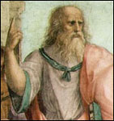 Człowiek, który wywołał tak wielkie zamieszanie, był Grekiem. Urodził się w roku 427 pne. w Atenach w znakomitej królewskiej rodzinie, poprzez którą był spokrewniony z Solonem "najmędrszym z siedmiu mędrców". Żył w czasach rozkwitu myśli greckiej, ale też w czasach gdy Grecja chyliła się ku upadkowi. W wyniku walk wewnętrznych został zmuszony do opuszczenia Grecji i dwanaście lat podróżował zwiedzając między innymi Egipt. Pięćdziesiąt lat później napisał Dialogi Kritias i Timajos i wkrótce po napisaniu tego dzieła zmarł w Atenach w roku 347 pne.

Późniejsi badacze zarzucą Platonowi dosłownie wszystko, gdzie najlżejszym określeniem jego dzieła jest słowo "bajka". Jest to naturalna kolej rzeczy w dzisiejszej nauce. Tam, gdzie nie można rzeczowo udowodnić nieprawdy, wprowadza się skomplikowane meandry myślowe mające pozory naukowości, które mają zdyskredytować twórcę. Od "szczerych chęci" po literackie kłamstwo.

Poniżej wybrane fragmenty "Dialogów", te które dotyczą Atlantydy.

Solonie, Solonie, wy Grecy jesteście zawsze młodzi, a Grek stary w ogóle nie istnieje". Gdy Solon to usłyszał, zapytał go: jak to rozumiesz? Co chcesz przez to powiedzieć?. Wy, odpowiedział kapłan, jesteście wszyscy młodzi duszą, bo w niej nie macie złożonego żadnego poglądu, który by pochodził od starej tradycji, ani żadnej nauki wyblakłej przez czas. A przyczyna tego leży w tym, że wielu ludzi było i jeszcze będzie zniszczonych na nieprzeliczone sposoby; największe \[zniszczenia\] powodowane są przez ogień i wodę, inne, mniejsze, przez inne liczne przyczyny. To bowiem, co jeszcze u was się opowiada, że raz Faeton, syn Słońca, zaprzągł konie do wozu swojego ojca, a ponieważ nie umiał nim kierować po drodze, spalił wszystko na ziemi i sam zginął rażony piorunem, wygląda na bajkę.

---

**Prawda jest taka: ciała, które krążą po przestrzeni niebieskiej około Ziemi, zbaczają ze swej drogi. Wtedy ci, co mieszkają na miejscach wzniesionych i suchych, giną w większej liczbie od tych, co mieszkają blisko rzek i morza... Kiedy zaś bogowie czyszczą Ziemię wodami i zalewają ją, wtedy tylko wieśniacy i pasterze, którzy zamieszkują góry, zachowują się przy życiu, podczas gdy mieszkańców waszych miast niosą rzeki do morza.**

---

Przeciwnie, w tej tutaj okolicy ani wtedy, ani w ogóle nigdy, wody nie schodzą ze wzgórz na pola, lecz zawsze naturalnie wypływają z głębi. Dzięki temu, jak mówią, zachowały się tutaj najstarsze tradycje. W rzeczywistości we wszystkich miejscach, w których ani surowe zimno, ani upał nie stają na przeszkodzie, zawsze istnieje rasa ludzka w mniejszej lub większej ilości. Toteż gdy u was, lub w naszym kraju, czy w innym miejscu, które znamy z opowiadania, zaszło coś pięknego lub wielkiego, lub dla innych względów zadziwiającego, wszystko to **od starożytności jest tu zapisane i w świątyniach zachowane i strzeżone.** Lecz u was i u innych narodów, ile razy się ustali posługiwanie się pismem i wszystkim tym, czego potrzeba państwu, znowu w zwykłych odstępach czasu, jak jakaś choroba, spływa potop z nieba i pozwala tylko analfabetom i ignorantom spośród was przeżyć katastrofę. I tak znowu stajecie się na powrót młodymi i nic nie wiecie, co się stało tutaj lub u was w dawnych czasach. Te genealogie bowiem, które dopiero co cytowałeś, Solonie, lub przynajmniej to, co pobieżnie opowiadałeś z wypadków waszego kraju, niewiele się różni od bajek dla dzieci.

---

**Najpierw, wzmiankujesz jeden tylko potop ziemski, podczas gdy dawniej było ich wiele.** Następnie, nie wiecie, że w waszym kraju żyła najpiękniejsza i najlepsza rasa ludzka, ani że od tych właśnie ludzi pochodzisz ty i całe wasze obecne miasto dzięki temu, że zachowała się mała ilość nasienia: wy nie wiecie tego, ponieważ w ciągu licznych generacji pomarli ci, co przeżyli owe czasy, lecz nie byli w stanie nic zapisać. Tak, Solonie, **w pewnym okresie, wyprzedzającym największą katastrofę spowodowaną przez wodę**, miasto Ateńczyków było najlepsze w wojnie, a przede wszystkim było rządzone zgodnie z dobrymi prawami. Jemu przypisują najpiękniejsze czyny; w nim były najlepsze organizacje polityczne spośród wszystkich tych, o których słyszeliśmy dotąd.

---

**Wasze miasto jest o tysiąc lat starsze, bo otrzymało ono wasze nasienie od Ziemi i Hefaistosa. Nasze jest młodsze.** Nasze Księgi Święte podają 8000 lat od chwili zorganizowania tego kraju. Zatem przedstawię ci pokrótce prawa waszych ziomków, którzy żyli przed 9000 lat, i najpiękniejszy z ich czynów, którego dokonali. Gdy chodzi o dokładne szczegóły wszystkiego, wyłożymy je innym razem w wolnej chwili: **oprzemy się na tych samych tekstach pisanych**.

Jak na bajkę za dużo tu trafnych spostrzeżeń zarówno z dziedziny astronomii jak i z innych dziedzin. Ci, którzy twierdzą, że Platon wymyślił Atlantydę dla potrzeb własnej koncepcji filozoficznej nie potrafią tego wytłumaczyć. Po co tyle rzeczowych relacji dla jednego kłamstwa? Czy dlatego pisał o przechowywaniu dokumentów pisanych w świątyniach egipskich, bo wiedział że zaginą? Oskarżenia są wyjmowane jak króliki z kapelusza, ale żaden z piszących te rewelacje nawet nie stara się ich udowodnić.

Licznych i wielkich czynów dokonało wasze miasto. Znajdują się one spisane tutaj i budzą nasz podziw. Lecz jeden szczególnie przewyższa wszystkie inne wielkością i heroizmem. W rzeczy samej, nasze Księgi opowiadają, jak wasze miasto zniszczyło kiedyś wielką armię, która do pewnego czasu najeżdżała nie tylko Europę, lecz także Azję, wyruszając od Oceanu Atlantyckiego. W owym czasie bowiem można było żeglować po tym morzu. Potęga owa posiadała wyspę przed cieśniną, która się nazywała u was Kolumnami Heraklesa. Wyspa ta była większa od Libii i Azji razem wziętych. Podróżni owych czasów mogli się dostawać z tej wyspy na wyspy inne, a z nich na cały kontynent przeciwległy, który się rozciągał dokoła tego prawdziwego morza. Całe to morze, które się znajduje z tej strony cieśniny, o której mowa, wygląda na port o wąskim wjeździe. A co jest po tamtej jej stronie, można by nazwać prawdziwym morzem, a ziemi, która je zewsząd otacza, można by dać, w ścisłym tego słowa znaczeniu, miano kontynentu.

---

Na tej wyspie Atlantydzie kwitła wielka i zdumiewająca potęga królewska, której **podlegała cała wyspa oraz wiele innych wysp i części kontynentu. Ponadto z tej strony cieśniny królestwo to obejmowało okolice Libii aż do Egiptu i Europę aż po Tyrrenię**. Cała ta potęga zebrała raz wszystkie swoje siły i próbowała jednocześnie podbić wasz kraj i nasz oraz wszystkie okolice, które rozciągają się po tej stronie cieśniny. Wtedy właśnie, Solonie, potęga waszego miasta wykazała wszystkim narodom swój heroizm i swoją tężyznę, bo przewyższyła wszystkie siłą ducha i sztuką wojenną; z początku na czele Hellenów, potem z konieczności samo jedno, bo opuszczone przez wszystkich innych i doprowadzone do ostatecznego niebezpieczeństwa, zwyciężyło najeźdźców, zabrało łupy wojenne, uratowało od niewoli narody, które nie były nigdy niewolnikami, i ochroniło z wielką wspaniałomyślnością wszystkie inne ludy, które mieszkają z tej strony Kolumn Heraklesa.

---

W następnym okresie czasu **pojawiły się trzęsienia ziemi oraz powodzie; w ciągu jednego dnia i jednej strasznej nocy cała wasza armia w jednym momencie zapadła się naraz pod ziemię. Podobnie znikła także wyspa Atlantyda, pochłonięta przez morze**. Dla tej właśnie przyczyny to morze jest tam jeszcze do dzisiejszego dnia nieżeglowne i nawet niezbadane wskutek przeszkód, jakie stawia dno pełne szlamu i płycizn - szlamu zostawionego przez pochłoniętą wyspę.

Niektórzy zarzucają Platonowi błędne podanie ilości lat, gdyż twierdzą jako by Solon pomylił liczby "tysiąc" i "sto". Być może byłoby to prawdą, gdyby Solon przepisywał egipskie teksty. Solon jednak nie znał egipskiego pisma, Solon te liczby usłyszał. W dalszych dialogach Platon opisując wygląd dawnej Grecji pisze:

Miały bowiem miejsce w ciągu tych dziewięciu tysięcy lat liczne i okrutne potopy. Taki bowiem okres czasu dzieli dzisiejszą epokę od dawnej. \[...\] Najpierw, Akropol nie wyglądał tak, jak teraz. Teraz mianowicie jedna jedyna noc potopu roztopiła ziemię i obnażyła to miejsce do naga, podczas gdy w tym samym czasie wystąpiły trzęsienia ziemi i trzeci z rzędu zalew wody przed katastrofą z czasów Deukaliona.

Atlantyda zginęła w jakimś wielkim kataklizmie, który Platon powiązał z wielkimi trzęsieniami ziemi i powodziami. Nie był to także kataklizm, który można by nazwać lokalnym. Zagłada nastąpiła i na terenie gdzie walczyły wojska greckie i na terenie samej Atlantydy, a więc na znacznym obszarze. Czy są inne opisy podobnego kataklizmu? Są, chociaż trudno powiązać je z Atlantydą, bowiem nie wymieniają Atlantydy dokładnie z nazwy, a także trudno umiejscowić je w czasie.

**Kataklizm w innych źródłach**

Czy w opisach podanych niżej chodzi o ten sam kataklizm? Definitywnej odpowiedzi nie będzie i jest po temu kilka przyczyn, z których dwie są najważniejsze. Trudność w umiejscowieniu w czasie (nie mamy żadnej pewności czy prawidłowo interpretujemy kalendarz Ameryki Środkowej) oraz w odnalezieniu miejsca podanego w opisach (kształt kontynentów zmienił się na skutek kataklizmu). To, że może chodzić o ten sam kataklizm świadczą tylko opisy jego wielkości. To nie są opisy zwykłego trzęsienia ziemi czy lokalnego potopu, to są opisy wielkiego kataklizmu.

**Codex Troano** - W roku 0. Kan, w dniu 11. Muluc miesiąca Zac rozpoczęły się straszne trzęsienia ziemi, trwające bez przerwy do dnia 13. Chuen (trzy dni). Kraj bagnistych wzgórz, kraj Mu, padł ich ofiarą. Dwukrotnie wzniesiony w górę, w ciągu jednej nocy zniknął po nieprzerwanym działaniu podwodnych wulkanów. Ląd unosił się i opadał wielokrotnie. W końcu ziemia się zapadła i dziesięć państw zostało porozrywanych na części i zniszczonych. Zatonęły wraz z ludnością, liczącą 64 miliony, 8000 lat przed napisaniem tej księgi.

O jakich dziesięciu państwach mówią mieszkańcy Mezoameryki? Czy to przypadkowa zbieżność, że Atlantyda składała się z dziesięciu królestw? Wrażenie unoszenia i opadania lądu mogły stwarzać następujące po sobie fale tsunami wywołane "wielkim uskokiem skorupy ziemskiej" gdzie po zakończeniu przesuwania się skorupy ziemskiej woda zalała ląd na zawsze.

**Chilam Balam** - Stało się, gdy Ziemia zaczęła się odradzać. Nikt nie wiedział, co może nastąpić. Spadł ognisty deszcz, spadł popiół, kamienie i drzewa chyliły się ku ziemi. Kamienie i drzewa zostały rozbite... Zerwał się Wielki Wąż z nieba... i spadły na ziemię jego skóra i kawałki jego kości... a strzały trafiały sieroty i starców, wdowców i wdowy, którzy jeszcze żyli, choć już sił nie mieli do życia. I zostali oni pogrzebani na piaszczystym wybrzeżu morza. Wtedy nadeszły potworne fale wody. A wraz z Wielkim Wężem spadło na ziemię niebo i zatopiło ziemię...

Z opisu Chilam Balam przed końcowym akordem zatopienia wybrzeży przez "potworne fale wody" wynika, że stało się coś, co mogło być przyczyną ataku wód. Czy przyczyną kataklizmu było uderzenie wielkiego meteorytu? Bardzo możliwe. Jeszcze inny opis znajdujemy w manuskrypcie fryzyjskim gdzie opisu dokonać musiał człowiek, który został doskonale poinformowany o zasięgu kataklizmu. Przez kogo? Tu możemy snuć tylko domysły.

**Oera Linda Boek** - Podczas całego lata Słońce kryło się za chmurami, jak gdyby nie chciało więcej patrzeć na ziemię. Panowała tu wieczna cisza i wilgotna mgła zawisła na kształt mokrego żagla ponad domami i polami. Powietrze było ciężkie i przygnębiające, a ludzie nie wiedzieli, co to radość i wesele. W czasie tej ciszy rozpoczęło się trzęsienie ziemi, jak gdyby zwiastujące jej zgon. Góry zionęły ogniem i płomieniami. Niektóre znów zapadały się w łono ziemi, w innych natomiast miejscach góry wyrosły ponad powierzchnię ziemi. Aldland, nazywana przez żeglarzy Atlan, zniknęła, a rozszalałe fale wzniosły się tak wysoko ponad góry i doliny, że wszystko zostało zniszczone, a ci, którzy uciekli przed ogniem, zostali strąceni do wody... Nie tylko w kraju Finda ziemia płonęła, lecz także w Twiskland (Germania). Wszystkie lasy płonęły jeden za drugim, a gdy wiatr powiał w tej części ziemi, cały nasz kraj został pokryty popiołem. Rzeki zmieniły swój bieg, a u ich ujścia powstały nowe wyspy z piasku i z tego, co woda naniosła.

---

Trwało tak trzy lata, kiedy nastąpił wreszcie spokój i lasy ukazały się ponownie... Wiele krajów zniknęło pod wodą, w innych miejscach wynurzyły się nowe lądy ponad poziom wody, w Twiskland lasy zostały zniszczone w połowie kraju. Lud Finda nadciągnął grupami i osiedlił się na bezludnych terenach. A nasz naród został bądź wytępiony, bądź przemieniony w niewolników... Inka, który w porcie Kadik (Kadyks?) oddzielił się ze swymi statkami od statków Neef-Tuna, pożeglował w kierunku zachodnim Oceanu w nadziei, że może uda mu się znaleźć część zatopionego kraju Atlan, może jakąś jego część wyżynną, która być może ocalała, i tam znajdzie możność osiedlenia się... A Neef-Tuna pożeglował na Morze Środkowe (Śródziemne?), ale o Ince i jego towarzyszach już nigdy więcej nic nie usłyszał.

---

Ja, Hiddo Tonomath Ovira Linda Wak, nakazuję mojemu synowi, Okke: ksiąg tych masz strzec jako ciała i duszy. Zawierają one historię całego naszego narodu. W ubiegłym roku uratowałem je podczas powodzi wraz z tobą i twoją matką. Niestety, bardzo zmokły, więc musiałem je przepisać na cudzoziemskim papierze... napisane w Ljudwerd w roku 3449 po zalaniu wodą Atland.

---

Proszę was po tysiąc razy, nie dajcie tych starych pism żadnemu Papekappe (mnichom). Są oni bardzo przebiegli i chcieliby podstępnie zniszczyć wszystko, co przynależy do nas, Fryzów.

Doskonały reportaż i choć niektóre nazwy brzmią znajomo nie należy wyciągać zbyt daleko idących wniosków. Zastanawia jednak przypadkowa zbieżność. Rękopis przechowywany przez rodzinę de Linden wspomina także o kapłance "Burgtmaad zwanej Min-Erva" oraz o królu Fryzów imieniem Minno, który ponoć udzielał porady prawnej Kreteńczykom. Imię bogini przypomina etruską boginię Menrwa, która to z kolei u Rzymian stała się Minerwą.

**Czy są jakieś dowody ?**

  Zagorzali zwolennicy mówią, że tak. Dowody przedstawiam obok. Krzyż podobny do egipskiego lecz z rozdwojoną nóżką oraz kamienny pierścień (znaleziony w Dolinie Królów w Egipcie). Przeciwnicy twierdzą, że to żaden dowód, zwolennicy, że aż za wiele. Przyznam szczerze, że takie dowody też mnie nie przekonują. Nie wiadome mi jest miejsce odnalezienia, a nic nie wskazuje na drobną choćby odmienność.

Od Platona dowiadujemy się, że Atlantyda obejmowała część królestwa Libii i graniczyła z Egiptem. Jeśli tak, to terenem zajętym przez Atlantów mogły być wybrzeża Libii, a także północno-zachodniej Afryki, chociażby z powodu dogodnej komunikacji z rodzimym krajem poprzez morze. Czy Atlanci wybudowali stare Lixus? Nikt nie jest pewien jego pochodzenia, a Fenicjanie, którym się je przypisuje, byli przecież narodem żeglarzy, a nie wielkich budowniczych. Jeszcze jedna rzecz godna uwagi. Z tego, co usłyszał Solon, Atlanci nie byli zaangażowani w wojnę z Egiptem. Dlaczego? Kapłani z Sais powiedzieli Solonowi, że historia Greków jest o tysiąc lat starsza od egipskiej. Czy Egiptu wtedy jeszcze nie było? Czy istniejące państwo przed Egiptem historycznym nazywało się inaczej? Czy była to inna cywilizacja? Czy tej właśnie, a nie egipskiej, cywilizacji zawdzięczamy piramidy, Ozyrejon, kolosy Memnona czy Abu-Simbel?

Platon pisze także, że w Europie królestwo Atlantów panowało aż po Tyrrenię. Tyrrenami jak wiemy, Grecy nazywali Etrusków, zajmujących część "włoskiego buta" na północ od Rzymu. Wniosek jaki się nasuwa to taki, że pod panowaniem Atlantów znajdować się mógł także cały półwysep Iberyjski, a przynajmniej jego nadmorskie rejony, dzisiejsze wybrzeża Francji, a nawet południowe Wielkiej Brytanii (glacjolodzy twierdzą, że półwysep Kornwalii, Normandia i Bretania były wolne od lodowca), a tajemnicze Stonehenge leży przecież na półwyspie Kornwalijskim.

Jeśli tak było, to trudno uważać Atlantów za państwo odizolowane od ówczesnego świata. Na pewno utrzymywało kontakty handlowe ze wszystkimi sąsiadami. Platon pisał przecież, że w stolicy Atlantydy rozbrzmiewały wszystkie języki świata. Tam gdzie jest wymiana handlowa, tam muszą przenikać się kultury i cywilizacje.

Skoro doszedłem do takich wniosków, nie sposób nie zastanowić się nad jeszcze jednym aspektem. Opanowanie rejonów nadbrzeżnych Europy i Afryki świadczy o tym, że Atlanci musieli być narodem wyśmienitych żeglarzy. Skoro tak, to zapewne nieobce im były także zachodnie rubieże Atlantyku. Pewne zabytki Mezoameryki wskazują jakby na inną kulturę. Nie łudźmy się, że głowy olmeckie, gigantyczne rzeźby azteckie jak Tlaloc czy Coatlicue, ogromne piramidy w Teotihuacan wykonali przodkowie dzisiejszych Indian.

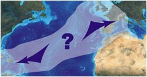

Jednoznacznych i oczywistych artefaktów z Atlantydy nie ma. Te zapewne leżą na dnie oceanu Atlantyckiego, a nie mając wzorca nie potrafimy nic rozpoznać. To co wiadomo do tej pory może tylko wskazywać pośrednio na istnienie lądu w miejscu, gdzie szumi dziś ocean. Jeśli Atlantyda istniała, to wokoło prawdopodobnie roi się od dowodów, lecz nie potrafimy, lub co bardziej prawdopodobne, nie chcemy ich zidentyfikować. Szukamy daleko na horyzoncie nie patrząc pod własne nogi. Pisałem na wstępie, że cywilizacja Atlantów, to prawdopodobnie cywilizacja "wielkich kamieni". Dzisiejsza nauka nie ma zielonego pojęcia, kto i po co budował dolmeny, kto ustawiał menhiry, kto tworzył fundamenty Lixus i innych miast o "cyklopich" murach, czy wreszcie kto jest budowniczym Stonehenge. Odrobina wiary, dobrej woli i odejście od skostniałego dogmatu dzisiejszej historii może rzucić pewne światło na najstarszą historię.

A inne dowody?

• W roku 1898 podczas naprawy kabla leżącego na dnie Atlantyku na północ od wysp Azorskich, wydobyto z głębokości ponad 2000 m kawałek zastygłej lawy. Uczony francuski Termier stwierdził, że lawa ta do stanu krystalicznego mogła przejść tylko na wolnym powietrzu i nie później niż 15 tysięcy lat temu.  
• Na dnie środkowego Atlantyku odkryto pokłady gruboziarnistego piasku kwarcowego, który powstaje z wietrzenia skał granitowych i tylko na lądzie.  
• W latach 1947-1962 prowadzono ekspedycje pobierające próbki z dna Atlantyku. Niejako przy okazji stwierdzono braki osadów w okolicach podwodnych górskich szczytów (tłumaczy się to osunięciem), ale też braków części osadów dennych lub ich wymieszanie (warstwa młodsza znajdowała się pod starszą). Czy nie może być to efektem zadziałania globalnej tsunami? Na podstawie tych badań stwierdzono także, że wiek Atlantyku wynosi co najmniej 40 mln. lat (dziś granicę powstania oceanów przesunięto znacznie głębiej).  
• Ekspedycja radziecka statku "Sadko", na podstawie analizy chemicznej wody morskiej stwierdziła, że ciepły prąd Golfstrom płynie od równika opływając wschodnie wybrzeże Ameryki Północnej do północnych brzegów Azji dopiero od 10-12 tysięcy lat.

Przeprowadzano też i inne badania związane z biologią oceanu. Ciekawych wniosków dostarczyło badanie osadów dennych, a szczególnie otwornic "globorotalia truncatulinoides". Pierwszy zwrócił na to uwagę M. Żyrow w roku 1961, twierdząc, że przed 10 tysiącami lat na wschód od Grzbietu Atlantyckiego nie było otwornic lewoskrętnych, co znaczyłoby iż zasiedlenie ich w tym miejscu miało miejsce po zagładzie Atlantydy.

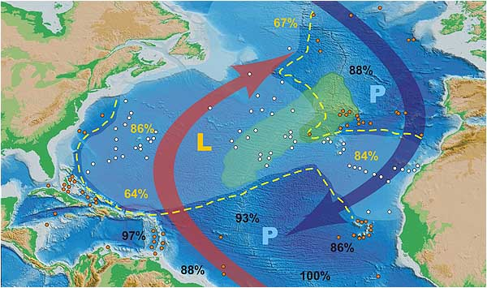

Rozmieszczenie globorotalii w osadach. P - prawoskrętne (zimnolubne), L - lewoskrętne (ciepłolubne).

Mój wniosek jest troszkę inny. Żyrow nie brał pod uwagę położenia lądów przed "wielkim uskokiem...". Wtedy Atlantyk był podzielony na dwie części, a sam grzbiet był ustawiony prawie równoleżnikowo. Stąd po zachodniej stronie (wtedy północnej) ciepły prąd równikowy stymulował rozwój ciepłolubnych otwornic, zaś wracający prąd od północy jako zimny, płynący po wschodniej (wtedy południowej) stronie grzbietu stymulował rozwój zimnolubnych. Przeniesienie się ciepłolubnych na drugą stronę grzbietu mogło być skutkiem zniknięcia naturalnej przeszkody jaka była wyspa i zmian klimatycznych oceanu 12,5 tysiąca lat temu.

Wniosku tego nie wypowiadam jednak stanowczo. Badanie węglem C-14 ma swoje wady. Badaniu poddano tylko wierzchnie warstwy, gdzie w szkielecikach otwornic można było odnaleźć resztki szczątków organicznych, a ponadto można postawić pytanie - skąd pewność, że warstwy te przez tysiące lat istnieją w stanie nienaruszonym?

**Ze sprawozdania badania dna Atlantyku Obserwatorium Lamonta** - "Stwierdzono poza tym pewne luki w osadach; w niektórych punktach dna oceanu brakowało całych dziesiątków metrów osadu, a luki te obejmują miliony lat. W pewnym miejscu okazało się, że pokład osadu sprzed 26 do 34 milionów lat pokryty był późniejszym osadem, pochodzącym z epoki plejstocenu. Prawdopodobnie w okresie późniejszego plejstocenu nastąpiło trzęsienie ziemi i na skutek tych wstrząsów część osadów zsunęła się po zboczu wzniesienia, odsłaniając pokłady dawne sprzed milionów lat. Bezpośrednio po tym zaczęły się gromadzić nowe osady.

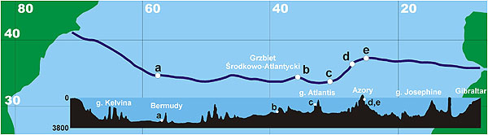

Wyprawa naukowa Obserwatorium Lamonta - trasa i kształt wysondowanego dna

Raczej dla zaspokojenia ciekawości zamieściłem powyższy rysunek obrazujący wyprawę naukową Obserwatorium Lamonta na statku "Atlantis". Celem wyprawy nie było poszukiwanie zaginionego lądu, a gdyby nawet coś odkryto nie wspomniano by o tym ze względu na "powagę naukową" przedsięwzięcia. Górę podwodną w rejonie Azorów nazwano tak na cześć statku. Profil dna jest dość wiarygodny, gdyż sporządzono go echosondą pracującą nieprzerwanie i automatycznie.

Istnieją też inne hipotezy bedące raczej pytaniami, gdyż wiele z nich jest dotychczas nie zbadanych, a dotyczących tzw. pamięci zwierząt. Przykładowo:

• Dlaczego europejskie węgorze odbywają tarło tylko w Morzu Sargassowym?  
• Dlaczego siewki z Labradoru podczas swych, liczących tysiące kilometrów, wędrówek na południe do Brazylii i Argentyny nie lecą nad lądem a środkiem oceanu Atlantyckiego?

Najlepszym jednak dowodem byłyby jakieś ruiny w głębinach Atlantyku, rzeźby czy przedmioty codziennego użytku. Ale to są w dalszym ciągu marzenia. Zejście na głębokość ponad 3000 m to przedsięwzięcie ryzykowne i kosztowne. Brak też pewności, czy znajdzie się cokolwiek i czy kosztowna ekspedycja nie zamieni się w kosztowną wycieczkę.

Czy nie lepiej rozpocząć poszukiwań na lądzie? Czy nie lepiej odkurzyć niezrozumiałe znaleziska, powyciągać z ciemnych muzealnych magazynów artefakty nie pasujące do kultur i epok oraz jeszcze raz przyjrzeć się im dokładniej? Historycy znają na pewno coś takiego, jak oddziaływanie czy przenikanie kultur. Przecież według Platona Atlantyda utrzymywała szerokie kontakty handlowe.

**Moje poszukiwania**

Do przeprowadzenia swoich poszukiwań muszę jednak założyć pewne tezy, które uznaję za podstawowe. Oto one:

• Platon opisał prawdę i jego opisy należy brać dosłownie. Odnajdywanie Atlantydy w różnych częściach świata uważam za przejawy naciągania faktów, wybiórcze traktowanie tekstu i szukania "5 minut" popularności.  
• Ziemia w przeszłości była areną ogólnoświatowych kataklizmów, które Hapgood nazwał "wielkim uskokiem skorupy ziemskiej".  
• Twierdzenie, że Bogów wymyślił człowiek na własne potrzeby jest bezsensowne. Wynikało by z tego, że człowiek pierwotny myślał bardziej abstrakcyjnie niż jego dzisiejsze "uczone" potomstwo.  
• Gigantyczne budowle nie są dziełem człowieka. Nawet współczesna cywilizacja, mając do dyspozycji najnowocześniejsze środki techniczne, miałaby ogromne trudności ze zbudowaniem samej tylko atrapy, tak jak to było z małym, kilkumetrowym modelem piramidki w Giza.  

Chcę się skupić na dowodach i poszlakach nam najbliższych, a więc z terenu Europy, Bliskiego Wschodu i Afryki północnej. Czasem wynikają z tego naprawdę zaskakujące wnioski.

Mówiąc o Atlantydzie, stolicy Posejdona należy uzmysłowić sobie, że mówimy o architekturze wielkich kamieni podobnych do tych z Myken i Tirynsu, a więc o epoce istniejącej na długo przed klasycznymi Grekami. Epoce rozpoczętej w wieku Bogów i półbogów, w którym Zeus usilnie pracował nad uszlachetnianiem ludzkiego rodzaju płodząc na prawo i lewo Półbogów-Herosów. Takim był między innymi Herakles, który ustawił słupy na zachodniej granicy ówczesnego świata lub jak kto woli na wschodzie Atlantydy. Współcześni Grecy uznali, że Słupami Heraklesa są skały cieśniny gibraltarskiej prawdopodobnie dlatego, że za nimi na zachód nie znaleźli już nic, wszystko zostało zalane. Jednak według mitologii greckiej, Herakles ustawił słupy na wyspie Erytei położonej na zachodnich krańcach świata, gdzie miał wykonać swoją dziesiątą pracę - zdobycie trzód olbrzyma Geriona. Na wyspę dopłynął w złotej czarze boga Heliosa. Być może chodzi o jakąś nieistniejącą już wyspę, zalaną wodami Morza Śródziemnego, na której znajdowały się kamienne kolumny zwane Słupami Heraklesa i być może ta wyspa leżała w pobliżu cieśniny Gibraltarskiej. Kolumny, wykonane i ustawione przez herosa, bardziej pasują do stwierdzenia "Słupy Heraklesa" niż dwie nagie skały cieśniny Gibraltarskiej. Morze Śródziemne przed "Wielkim uskokiem..." też wyglądało zapewne zupełnie inaczej. Platon opisuje je - "Całe to morze, które się znajduje z tej strony cieśniny, o której mowa, wygląda na port o wąskim wjeździe". Stąd też zapewne kłopoty tych wszystkich, którzy odnaleźć chcą na dzisiejszym morzu Śródziemnym, trasę podróży Odyseusza spod Troi do Itaki.

Czy istniała Atlantyda? Według mnie istniała. Została pochłonięta przez wody Atlantyku, które w wyniku "wielkiego uskoku..." zakryły ją kilkukilometrową warstwą. Należy jej szukać tam, gdzie wskazał Platon - na Atlantyku, na przeciwko słupów Heraklesa, między Gibraltarem a Ameryką Północną pod kilkukilometrową warstwą wody.

Wytypować można obszar, który spoczywa na głębokości około 2-3 km pod wodą. Nie należy się natomiast spodziewać wielkich dzieł sztuki, czy monumentalnych budowli. Jeśli Atlantydę zmiotły masy wody to nic nie znajdziemy, a jeśli coś w ogóle znajdziemy możemy mówić o wielkim szczęściu. Możemy natomiast odkryć zarysy wyspy i słynne koliste kanały oraz porównać ukształtowanie terenu z opisem Platona. Być może peryferiami cywilizacji Atlantów jest słynna już Bimini Road. Jeżeli odnajdziemy resztki stolicy Posejdona, to prawdopodobnie odnajdziemy budowle kamienne "typu" Mykeny, Tiryns czy Machu Picchu lub Oltantaytambo. Takie potężne, cyklopowe budowle wznoszone przez Bogów królowały tam od samego początku.

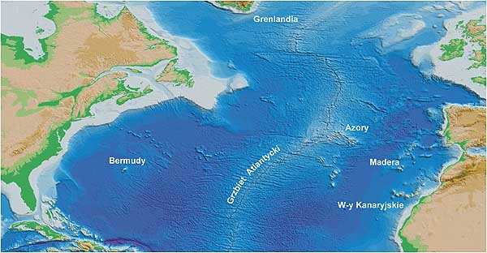

Atlantyk północny między Euroafryką i Ameryką północną

Atlantydy szukano wszędzie. Od Meksyku po Syberię. Przyczyn zagłady dopatrywano się od uderzenia planetoidy po wielkie pływy wody spowodowane przez Księżyc, lecz każda z teorii miała jakiś mankament, co ją czyniło nie do przyjęcia. Wszystkie natomiast zakładały, że Ziemia, a w zasadzie jej skorupa, cały czas trwała i trwa niezmiennie w swych posadach. Spójrzmy, gdzie już umiejscawiano Atlantydę:

• Girolamo Fracastoro (1530) - **Meksyk**, • Athanasius Kircher (XVII w.) - **w trójkącie w. Zielonego Przylądka, Azory, w. Kanaryjskie**, • Olaus Rudbeck - **Skandynawia, Uppsala**, • Robert Vaugoudy - **Brazylia**, • J. S. Bailly - **Spitsbergen**, • Buffon - **w. Wniebowstąpienia i w. Św. Heleny**, • Cadet - **wyspy północnego Atlantyku**, • A. Norow - **m. Śródziemne, między Sycylią i Cyprem**, • A. Karnożycki - **wyspy morza Egejskiego**, • Ignatius Donelly - **środkowy Atlantyk**, • K. T. Frost, Bayley - **Kreta**, • Leo Frobenius - **zatoka Gwinejska**, • Fessenden - **Kaukaz**, • Fosset - **dżungla Amazonki**, • B. Bogajewski - **północna Afryka**, • P. Borchardt - **Tunezja**, • A. Schulten - **płw. Pirenejski**, • Nikola Russo - **na m. Tyrreńskim**, • J. Spanuth - **Helgoland**, • A. Galanopoulos - **Kreta**, • N. Żyrow - **środkowy Atlantyk**.

W pewnym sensie przyznałbym wszystkim rację. Atlantyda to nie tylko zatopiona wyspa na Atlantyku wraz ze stolicą Posejdona. Atlantyda to także jej kolonie, jej styl i technika budowy, jej kultura i sztuka rozrzucone po całym obszarze jej oddziaływania. Nie dziwią mnie zatem "rzymskie" łuki w dalekiej Azji, Afryce czy Ameryce Środkowej. Jak wielki obszar zajmowała sama Atlantyda i jej kolonie nie wiemy. Być może większość tych lokalizacji trafia w granice obszaru tego przed potopowego państwa. Przyjmując, że 12,5 tysiąca lat temu miał miejsce ogólnoświatowy kataklizm w postaci "wielkiego uskoku skorupy ziemskiej" można przyjąć następujący scenariusz zagłady Atlantydy: nagromadzona warstwa lodu na ówczesnym biegunie północnym powoduje gwałtowne przesunięcie się całej skorupy ziemskiej wzdłuż 70° południka zachodniego i w ciągu 1-3 dni przemieszcza się o 3000 km w kierunku południowym.

Co się wówczas działo? Masy wody oceanu Atlantyckiego siłą bezwładności ruszają w kierunku równika i bieguna południowego, by po jakimś czasie ze zdwojoną siłą ruszyć z powrotem na północ. Było to tsunami o wysokości kilku kilometrów miażdżące wszystko na swojej drodze. To samo działo się ze wszystkimi oceanami, morzami, jeziorami i rzekami na całym świecie. Wybrzeża kontynentów zostały spłukane do morza wraz ze wszystkim co na nich było. Nie wiadomo, czy woda nie dosięgła także najwyższych partii gór. Wybrzeża Ameryki Północnej, wyspy na Atlantyku powyżej dzisiejszego zwrotnika Raka, szelf europejski, wszystko to znalazło się pod wodą. Już na stałe. Do dziś przecież odnajduje się ślady dróg prowadzących wprost do oceanu, czy zagadkowe budowle znajdujące się pod wodą.

Dzisiejsza technika zrobiła olbrzymi krok do przodu. Dlaczego więc nie przeprowadzi się podwodnych poszukiwań w rejonie Bermudów czy wysp Azorskich? Nawet w atlasie szkolnym widać w tym miejscach pod wodą istniejące wyniesienia dna, będące na głębokości 2-3 km. Opuszczenie sonaru i zeskanowanie dna w tym miejscu mogłoby ukazać ukształtowanie terenu dna, a być może nawet zarysy kompleksów budowlanych (regularność kształtów), a już na pewno pełnię szczęścia dałoby odkrycie czegoś zbliżonego do współśrodkowych kręgów, które znajdowały się w stolicy Atlantydy.

Po takich przygotowaniach można by było zorganizować już konkretną ekspedycję poszukiwawczą. Podwodne roboty z łatwością dostarczyłyby konkretnych dowodów.

Odejdźmy na chwilę od tematu. Jest na ziemi taki twór składający się ze współśrodkowych kręgów. Nie wiadomo, co to może być, a tym bardziej co lub kto mógł coś takiego wytworzyć. Nazywa się "strukturą Richat" i znajduje się w Mauretanii w Afryce zachodniej. Jak wygląda?

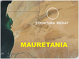

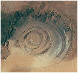

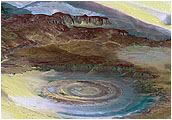

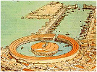

Naukowcy nazywają to kraterem, choć nie wiem z jakiego powodu. Krater wulkaniczny wygląda trochę inaczej, podobnie jak krater meteorytowy i żaden z nich nie przypomina spirali jak Richat. Całość ma 50 km średnicy i jest umieszczona w głębokiej szczelinie. Jeśli nie jest to twór natury, to kto był w stanie wykonać coś takiego, po co i kiedy? Czy to przypadek, że rekonstrukcja portu w Kartaginie ukazuje nam okrągłą budowlę w samym porcie, coś w rodzaju mini Atlantydy? Chyba nie, bo przecież zgodnie z moją hipotezą Kartagina była jej kolonią.

Spróbujmy teraz wyłuskać z Platona wiadomości na temat warunków geograficzno-fizycznych wyspy.

**Platon (Timajos)** - Potęga owa posiadała wyspę przed cieśniną, która się nazywała u was Kolumnami Heraklesa. Wyspa ta była większa od Libii i Azji razem wziętych. Podróżni owych czasów mogli się dostawać z tej wyspy na wyspy inne, a z nich na cały kontynent przeciwległy, który się rozciągał dokoła tego prawdziwego morza. Całe to morze, które się znajduje z tej strony cieśniny, o której mowa, wygląda na port o wąskim wjeździe. A co jest po tamtej jej stronie, można by nazwać prawdziwym morzem, a ziemi, która je zewsząd otacza, można by dać, w ścisłym tego słowa znaczeniu, miano kontynentu.

---

Na tej wyspie Atlantydzie kwitła wielka i zdumiewająca potęga królewska, której podlegała cała wyspa oraz wiele innych wysp i części kontynentu. Ponadto z tej strony cieśniny królestwo to obejmowało okolice Libii aż do Egiptu i Europę aż po Tyrrenię.

**Platon (Kritias)** - Blisko morza i przez środek całej wyspy leżała równina, która miała być najpiękniejsza ze wszystkich równin, o niezwykłej urodzajności. W pobliżu zaś równiny wznosiło się niewysokie wzgórze, w odległości mniej więcej pięćdziesięciu stadiów (900 m) od jej środka.

---

W obfitości była woda, zarówno zimna jak gorąca. Każdy z tych gatunków wody nadawał się znakomicie do użytku dzięki swej łagodności i zaletom. Wyzyskiwały je specjalne konstrukcje i plantacje odpowiadające naturze wód. Umieścili dokoła baseny, jedne otwarte, drugie kryte, przeznaczone do ciepłych kąpieli w okresie zimowym.

---

Po pierwsze, cała okolica była położona bardzo wysoko i spadzisto schodziła ku morzu. Jednak teren, na którym leżało miasto, był płaski. Równina ta otaczała miasto, będąc sama otoczona górami, które sięgały aż do morza. Była płaska, równa, cała wydłużona. Liczyła po bokach trzy tysiące stadiów (540 km) oraz dwa tysiące stadiów (360 km) w środku od morza, które znajdowało się w dole.

---

Ta okolica w całej wyspie była pochylona ku południowi, osłonięta przed wiatrami północnymi. Chwalono góry, które ją otaczały: pod względem ilości, wielkości i piękna przewyższały one te wszystkie, które istnieją obecnie. W górach tych było wiele wsi bogatych w mieszkańców, jak również wiele rzek, jezior, łąk zdolnych wyżywić olbrzymią ilość zwierząt dzikich i oswojonych, oraz także mnóstwo lasów o tak różnej naturze, iż dostarczały w obfitości materiału niezbędnego do wszelkich możliwych prac.

---

Równina ta, zarówno z natury jak i dzięki pracy włożonej przez królów w ciągu długiego okresu czasu, miała następujący wygląd: tworzyła - jak powiedziałem - po większej części prostokątny, podłużny czworobok; tam, gdzie boki odchylały się od linii prostej, poprawiono tę nieregularność wykopując ciągły rów, opasujący równinę.

Względnie dobrze do tych opisów pasuje rejon Grzbietu Atlantyckiego w rejonie Azorów, który zaznaczyłem na mapce. Czy tak wyglądała Atlantyda? Na pewno nie, i tego jak wyglądała nie wie nikt. By "wynurzyć" wyspę należało by wykonać ogromną pracę kartograficzno-obliczeniową dla współrzędnych geograficznych odpowiadających biegunowi w okolicy Akpatok.

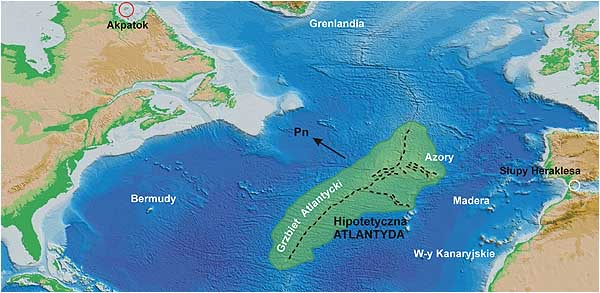

Uzasadniając położenie Atlantydy zacznę od przypomnienia, że sprawę zaginionego lądu rozpatruję z punktu hipotezy Hapgood'a. Wyspa widniała na powierzchni oceanu w czasach, gdy biegun północny znajdował się w okolicach wyspy Akpatok, więc w odległości około 3400 km od niego. Mniej więcej w takiej odległości leżą dziś Niemcy czy północna Francja. Wynika z tego, że leżała w klimacie umiarkowanym, co zresztą potwierdza Platon pisząc o basenach wykorzystywanych w okresie zimowym.

Wielkości samej wyspy nie określono. Ograniczono się tylko do porównania jej z Libią i Azją. Z tego porównania trudno wysnuć jakikolwiek wniosek. Nie znamy obszaru Libii w rozumieniu Egipcjan, jak również nie wiemy jak wielki obszar krył się pod nazwą Azji. Wiemy natomiast, że równina miała kształt nieregularnego prostokąta o długości boków około 540 km.

Najważniejszą rzeczą, którą musimy sobie uprzytomnić to ta, że przed "wielkim uskokiem..." wyspa położona była wyżej o prawie 5 km i jej góry mogły sięgać wysokości 2 km lub większej. Obliczyłem, że w miejscu dzisiejszych Azorów do środka Ziemi jest około 6369,4 km (promień geoidy) przy odległości od dzisiejszego bieguna około 4680 km. W tym samym miejscu (cały czas mowa o Azorach) przed "wielkim uskokiem..." było około 6364,5 km i do ówczesnego bieguna około 3360 km, a to daje różnicę 4,9 km wysokości.

Zaznaczona przeze mnie hipotetyczna wyspa może odpowiadać Atlantydzie. Wielką równinę od północy ochraniał łańcuch górski (na mapce czarna przerywana linia), stanowiący część dzisiejszego Grzbietu Atlantyckiego. Opisywane gorące źródła na wyspie można tłumaczyć bliską działalnością wulkaniczną rowu atlantyckiego, aktywnego zresztą do dzisiaj. Platon wspomina także o wydobywaniu trzech rodzajów kamienia - białego, czarnego i czerwonego. Czarnym kamieniem mógł być zapewne bazalt, co też świadczyłoby o tworach wulkanicznych znajdujących się na wyspie. Przy odrobinie fantazji można także ujrzeć wspominaną równinę okoloną zewsząd górami opadającą w kierunku morza na południu. Być może samo ukształtowanie terenu tworzyło swoisty mikroklimat pozwalający na dwa zbiory w ciągu roku. Dlaczego nie wybrałem obszaru na północ od Azorów? Z dwóch powodów. Szerokość istniejącej tam "równiny" od "gór" Azorskich do łańcucha górskiego położonego na północ od nich miała by w przybliżeniu szerokość Portugalii czyli około 800 km, a więc dłuższa od platońskiej o prawie 300 km. Po drugie "równina" ta nie leży na przeciw Słupów Heraklesa.

De Sousa (portugalski historyk z XVII w.) pisze, że wkrótce po odkryciu Azorów znaleziono na szczycie góry na wyspie Corvo - posąg jeźdźca bez siodła, z gołą głową; lewą ręką gładził końską grzywę, a prawą wskazywał na zachód. Posąg stał na cokole z tego samego kamienia; u dołu wykute były litery, których nie udało się przeczytać.

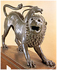

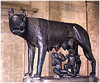

Portugalczycy zniszczyli pomnik jako figurę pogańskiego bożka. Ponoć do dzisiaj wśród miejscowej ludności na Corvo znane jest podanie o dawnym posągu. Jak wyglądało otoczenie wyspy nie wiemy. Platon pisze tylko o otoczeniu wielu innych wysp. Ważnym stwierdzeniem jest też, że królestwo to posiadało także włości na naszym kontynencie po Tyrrenię we Włoszech oraz w Afryce sąsiadowało z Egiptem. Tyrrenami Grecy nazywali Etrusków, których pochodzenie do dziś nie jest znane, podobnie jak Basków czy Guanczów z wysp Kanaryjskich. Etrusków historia umieszcza na terytorium położonym w okolicach dzisiejszego Rzymu (w języku Etrusków - Ruma) i na północ od niego. Pozostały po nich tylko grobowce i trochę dzieł sztuki przypominające sztukę najdawniejszych Achajów. Znali obróbkę metali. Najbardziej znane dzieła sztuki wykonane z brązu to "chimera", "wątroba do wróżenia" i "wilczyca kapitolińska". Takich dzieł sztuki nie wykona nie cywilizowany naród. Czy mieli do czynienia z technologią Atlantydy?

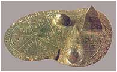

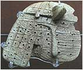

Czy chimera nie świadczy o tym, że Etruskom znane były hybrydy? Artefakt obok określany jest jako "wątroba do wróżenia". Czy znalezisko z Mezopotamii (bodaj przypisywane Sumerom), które pokazuję obok, nie przypomina tej etruskiej "wątroby"? Czy dalej można wierzyć, że to jest wątroba do wróżenia? Przecież w Sumerze nie wróżono z organów! Czy ktoś dokonał porównania tych znalezisk? Wątpię. Na koniec można jeszcze napomknąć, że dwie postacie, które karmi wilczyca są wynikiem działalności politycznej późniejszych Rzymian, którzy "dorobili" dzieci wilczycy, by usankcjonować "starożytność" Rzymu.

**Wielka "spłuczka" historii**

"Wielki uskok skorupy ziemskiej" zniszczył nie tylko starożytną cywilizację i zmienił bieg naszej historii. Zmienił przede wszystkim ukształtowanie linii brzegowej i to w znacznym stopniu. Wiele skupisk ludzkich zniknęło z powierzchni ziemi zalane wodami mórz i oceanów. Na to, że istniały, wskazują dziwne i niezrozumiałe ślady prowadzące w głębiny wód. Stąd właśnie drogi wprost w morze, stąd zatopione miasta odnajdywane przy okazji podwodnych badań. Wynika to z tego, że przed wielkim uskokiem, powierzchnia kontynentu europejskiego (także Bliskiego Wschodu czy północnej Afryki) położona była wyżej i czasem stanowi to wielkość nawet rzędu setek metrów. Pisałem już, że hipotetyczne miejsce położenia Atlantydy zmieniło swoją odległość od środka ziemi o około 5 km. Podobnie jest z kontynentami. Przed "wielkim uskokiem..." Europa leżała wyżej, znacznie wyżej niż w dzisiejszych czasach. Pierwszą poszlaką mogą być starożytne mapy.

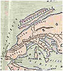  
Dionizjusz

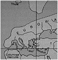  
Dicaearchus

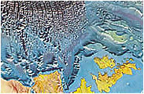  
Dzisiejszy ląd (żółty)

  
Rzym

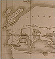  
Erastotenes

Zwrócić należy szczególną uwagę na północną i północno-zachodnią zachodnią granicę kontynentu. Co w rogu swojej mapy napisał Piri Reis? Pisał, że mapa powstała na podstawie starszych źródeł, do których jeszcze wtedy miał dostęp. Podobnie mapy pokazane powyżej. Prawdopodobnie autorzy mieli dostęp do map starszych niż nam się wydaje. Do map sprzed "wielkiego uskoku...". Dlaczego tak sądzę? Map nie rysuje się z głowy. Tak postępują dzieci i twórcy gier komputerowych, ale nie kartografowie. Jak te tereny mogły wyglądać przed "wielkim uskokiem..." można sobie wyobrazić oglądając zdjęcie satelitarne północnego i zachodniego skraju Europy. Zarys kontynentu wzdłuż tzw. szelfu leżącego na głębokości 200-300 metrów jakby pasuje do map starożytnych. W każdym bądź razie widać tu problem, nad którym powinno się zastanowić.

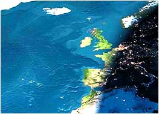

Mapy starożytnych były wykonywane kilka tysięcy lat temu, ale też kilka tysięcy lat po wielkim kataklizmie. Basen morza Śródziemnego był już stosunkowo dobrze zbadany. Tam, gdzie nie było pewności, kopiowano zapewne mapy starożytnych. Stąd zapewne na mapie starożytnych Rzymian tajemnicza Taprobana u wybrzeży Indii, ale także znana Rzymianom Brytania. Rzymianie nie znali się na kartografii i dwie wyspy będące na starych mapach uznali za Brytanię (porównaj rzymską mapę ze zdjęciem satelitarnym). Na mapie Dicaerchusa obok Grenlandii zaznaczona jest tajemnicza Thule.

Na mapie Dionizjusza Wyspy Brytyjskie obrazują dwie wydłużone wyspy, a Thule umieszczono bardziej na północ. Na mapie Erastotenesa nie ma natomiast Wysp Brytyjskich, a u północnych wybrzeży Europy znajduje się Grenlandia z jeszcze jedną nieopisaną wyspą. Natomiast na żadnej mapie nie ma półwyspu Skandynawskiego ani morza Bałtyckiego. Czy nie były jeszcze odkryte, czy też nie było ich na najstarszych mapach? Wagę tej poszlaki zostawiam do subiektywnej oceny, ale nie sądzę by można ją zbyć milczeniem.

Platon pisał, że głównym powodem wojny Atlantów z Grekami był zanik pierwiastka boskiego i przeważenie pierwiastka ludzkiego. Jak to można rozumieć? Z mojego punktu widzenia nastały czasy, gdy na Ziemi nie było już Bogów. Linia półbogów zaczęła się krzyżować z rasą ludzką i stąd stopniowa ale nieuchronna degeneracja kasty królów i kapłanów. Ludzie nie mając już strachu przed "karą boską" rozpoczynają swoje rządy. Nastają czasy podbojów słabszych ludów. Na terenie dzisiejszej Europy zaczynają się ścierać interesy boskich niegdyś państw - Posejdona i Ateny.

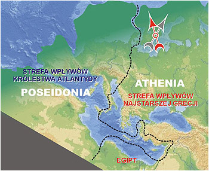

Królestwo Atlantydy, według Platona, sięgało granic Egiptu i Etrurii. Sadzę, że to nie wszystko. Atlantydzi założyli prawdopodobnie kolonie na wschodnim wybrzeżu Morza Śródziemnego w okolicach Sydonu i Tyru, gdzie dziś nauka umieszcza Fenicjan (Platon pisze, że Atlantydzi najeżdżali także Azję). Prawdopodobnie też skolonizowała południową i wschodnią część Azji mniejszej. Cypr i Kreta były prawdopodobnie też włączone w krąg interesów Atlantydy (podobny styl budownictwa). Stwarzało to zagrożenie dla handlu Grecji z blisko spokrewnionym Egiptem, albo inaczej - Atlantyda widziała cel w zaatakowaniu Grecji chcąc mieć niezakłóconą morską łączność ze swymi wschodnimi koloniami. Zlikwidowanie greckiego "łuku" dawało w przyszłości możliwość zaatakowania samego Egiptu.

Dlaczego starożytni prowadzili wojny? Powodami lansowanymi przez historyków do dziś, to chęć szybkiego wzbogacenia się, zabór terytoriów, zdobycie taniej siły roboczej. Czy to były główne powody? Być może od czasów Rzymian tak. Ja stawiam jednak tezę, że w czasach przedrzymskich głównym powodem wojen była starożytna wiedza znana bardziej jako "mądrość boża". Wiedza otrzymana od Bogów. Drugim celem mogło być zdobycie źródeł wody i nie jest to bynajmniej hipoteza śmieszna. Niezbędną do przeżycia całych narodów była gospodarka rolna oparta w całości na dystrybucji wody. Wiedza potrzebna była rządzącym. Stąd być może "dziwna" kampania Aleksandra Wielkiego, któremu bynajmniej nie chodziło o podbój całego świata bo doskonale rozumiał, że nie zdoła go utrzymać. On poszukiwał wiedzy Bogów (niektórzy twierdzą, że szukał potwierdzenia iż jest synem Boga). Nie znalazłszy jej w Egipcie udał się do drugiego, jedynego jeszcze istniejącego ośrodka "boskiej mądrości", do Indii.

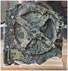

Znane jest także kilka przykładów starożytnej techniki, której do dziś nie rozszyfrowano. Wspomnę tylko o greckim ogniu, tronie Salomona i jego pojazdach latających czy maszynie z Antykitery. Współczesna nauka albo nie wie o co chodzi, albo przebąkuje o nieznanych specjalistach, którzy mieli jednorazowe przebłyski geniuszu. Dowody są, ale milczą, za to teorie najczęściej tworzą ludzie, dla których problemem jest obsługa odkurzacza czy młynka do kawy.

Ponad 12,5 tysięcy lat temu dwie armie stanęły naprzeciw siebie. Do walki przeciw wojsku królestwa Atlantydy stanęli osamotnieni Grecy i zwyciężyli. Gdzie stoczono bitwę nie można się nawet domyśleć, ale z pewnością gdzieś na terenie ówczesnej Europy. Dopiero jakiś czas po bitwie "nadszedł jeden dzień i jedna noc okropna", która położyła kres i cywilizacji najdawniejszej Grecji i samej Atlantydy. Wydawać by się mogło, że to gniew samej Matki-Ziemi pogodził zwaśnione strony. Gdzież tam, animozje odżyły prawie 10 tysięcy lat później. Napiszę o tym w dalszej części.

**Atlantydzi wśród nas**

Kataklizm sprzed 12,5 tysięcy lat zdziesiątkował cywilizację ludzi i zniszczył cały prawie dorobek cywilizacji. Wiele państw zostało na zawsze zatopionych przez wody oceanów i mórz. Ośrodki leżące nad brzegami zostały spłukane przez ogromne fale tsunami wraz ze wszystkim co było na powierzchni ziemi. Zmieniły się granice całych kontynentów. Pozostali musieli rozpocząć walkę o przeżycie i jak widać udało się. Trwało to jednak tysiące lat. Dzisiejsza historia jest w stanie odtworzyć życie ludzi, ale dopiero od kilku tysięcy lat wstecz. Co zaszło pomiędzy 12 a 7 tysiącami lat temu? Nauka nie odpowie na to pytanie z tego względu, że nie uznaje istnienia wysokiej cywilizacji. Dlatego interpretacja znalezisk musi być taka a nie inna, a wszystko to bierze w łeb w konfrontacji z rzeczywistymi faktami.

Mieszając do naszej historii cywilizację Bogów otrzymujemy odpowiedzi prawie na wszystkie pytania, a które są proste i nie kłócą się z podstawową logiką. Zapoznaj się z moją hipotezą, co działo się w Europie po "wielkim uskoku..."

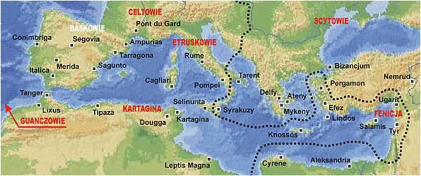

Historia nie wie co zrobić z tajemniczymi cywilizacjami, które nie pasują do ludów autochtonicznych. Pojawiają się nie wiadomo skąd, posiadając w pełni wykształconą religię i organizację. Tworzy się teorie o wielkich migracjach (najlepiej ze stepów Azji) i stopniowym asymilowaniu się. Problem w tym, że nie chcą mówić językiem zrozumiałym dla historyków, posiadają pismo, którego nie można odczytać, a i język nie pasuje do żadnych im znanych. Co więcej nie można go odnaleźć nawet w rejonach, z których rzekomo przyszli.

Według mnie, te ludy są jak najbardziej autochtoniczne. Etruskowie, Kartagińczycy, Fenicjanie, Celtowie, Baskowie, Guanczowie to potomkowie ludów, które przeżyły kataklizm i przetrwały trudny okres walki o przetrwanie. Ich języki i pismo, to języki i pismo sprzed kataklizmu. To języki i pismo ludów, które wchodziły w skład królestwa dawnej Atlantydy. To między innymi dlatego napisy fenickie spotykamy u Etrusków i w Brazylii, to dlatego pismo Kreteńczyków jest podobne do archaicznej greki, to dlatego sposób liczenia Basków nie tylko przypomina liczenie ludów Ameryki Środkowej, ale także Francuzów i Duńczyków. Etruskowie zostali wchłonięci przez Rzymian, Kartagińczycy i Fenicjanie rozpłynęli się w miejscowym folklorze, Guanczowie zostali wytępieni przez zdobywców z półwyspu Iberyjskiego, Celtowie przepadli w mrokach średniowiecza. Zostały jedynie ludy Brytanii i Baskowie, ale ci jak wiadomo, bezskutecznie walczą o swoją wolność.

A czego uczy historia? Etrusków sprowadza się zza północnych Alp, Fenicjan wypędzają Asyryjczycy i zakładają oni kolonię w Kartaginie, Celtów sprowadza się z nadwołżańskich stepów. Basków do dziś nie udało się zidentyfikować. Taka kołomyja, że faktycznie trzeba mieć dużo samozaparcia, by to jakoś zrozumieć.

Spójrzmy na moją hipotetyczną granicę wpływów. Można zauważyć, że stanowi pewną granicę pomiędzy językami. Po prawej ludy mówiące śpiewnym językiem, melodycznie zbliżonym do greckiego. Po lewej ludy o twardym języku. Ponadto, jak opiszę później, granica ta rozdziela także styl budownictwa, a także techniczne podejście do dystrybucji podstawowego surowca jakim jest woda.

Jak pamięć ludzka przechowuje dawne animozje można wywnioskować po wydarzeniach sprzed 2500 lat. W roku 535 pne. połączone floty Kartaginy i Etrurii zwyciężają Greków pod Alalią. Grecy "odgryzają" się prawie 100 lat później, zwyciężając Etrusków pod Kyme. Po 10 tysiacach lat na nowo odżył konflikt między Atlantami a Grekami. A co sądzić o wręcz genetycznej nienawiści Greków i Turków na Cyprze?

**Styl budowniczych z Atlantydy**

Jaki styl budowlany stosowano w królestwie Atlantydy? Zgodnie z hipotezą "cywilizacji Bogów" powinniśmy kierować się kryteriami budowniczy-materiał. Pierwsze budowle, gdy jeszcze na Ziemi nie było ludzi, wykonywali sami Bogowie. Są to budowle olbrzymie i z ogromnych elementów. Bogowie posiadali wielką siłę fizyczną oraz technikę, której my nie potrafimy sobie wyobrazić.

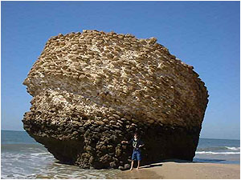

To Bogowie zbudowali piramidy w Giza, ośrodki w Sacsayhuaman, Mykeny czy Delfy. W miarę zwiększania się liczebności ludzi, część prac zostaje zrzucona na ich barki. Bogowie i półbogowie wykonują częściowo prace, tam gdzie człowiek by temu nie podołał, lecz pozostałe prace wykonuje już człowiek pod ich nadzorem. Tu elementy muszą być dopasowane i rozmiarem i ciężarem. I takie spotykamy.

Najczęściej spotykamy budowle z małych i średnich kamieni spojonych zaprawą, które obkładano wielkimi płytami. Spotykamy też wielkie kamienne narożniki, pomiędzy którymi znajdują się kamienie lub cegły już "pasujące" do ludzkiej ręki.

Czym mógłby być element, który znajduje się na zdjęciu obok? Znajduje się na wybrzeżu Morza Śród-ziemnego w dzisiejszej południowo-zachodniej Hiszpanii. Widać, że element jako całość jest potężny, ale przy jego budowie mógł pracować człowiek, składa się bowiem z kamieni spojonych zaprawą. Wygląda na część ogromnej kolumny. Mógł stanowić także podstawę czegoś, co mogło rozbić tylko potężne trzęsienie ziemi. A może to kawałek Słupa Heraklesa? Historycy twierdzą, że Grecy za słupy Heraklesa uważali skały cieśniny Gibraltarskiej. Sądzę, że Grecy doskonale odróżniali słup od skały i wiedzieli o czym mówią.

Styl budowy polegający na wznoszeniu budowli, której wypełnieniem były kamienie spajane zaprawą, spotykamy od Ameryki Środkowej po starożytną Fenicję. Od północnej Afryki po budowle w Brytanii. Spotykamy je także na Krecie i w starożytnym Rzymie. Czy to przypadek? Ciekawe jest także to, że pokrywają się z hipotetycznym królestwem Atlantydy na kontynentach.

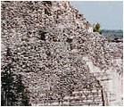  
Jukatan

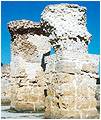  
Kartagina

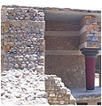  
Kreta

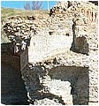  
Rzym

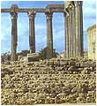  
Hiszpania

Być może nie wyglądają jednakowo, ale łączy je wspólna cecha. Ogromne elementy budowlane tworzono z drobnych kamieni spajanych zaprawą. Formy być może sporządzali Bogowie im tylko wiadomą techniką. Zauważmy jeszcze jedną charakterystyczną cechę. Mury i stropy są niesłychanie grube. Czy było to swoiste zabezpieczenie przed trzęsieniami ziemi?

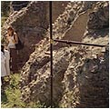  
W-y Kanaryjskie

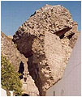  
W-y Azorskie

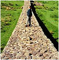  
Mur Hadriana

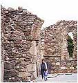  
Irlandia

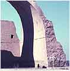  
Ktezyfon

Grube mury spajane nieznaną zaprawą, to jedno z kryteriów jakie zastosowałem do pokazania wspólnej technologii budowlanej. Na terenie dawnego królestwa Atlantydy nie brakuje też budowli z wielkich bloków kamiennych, co prawda nie wielkości Sacsayhuaman, ale też o imponujących wymiarach.

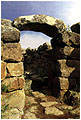  
Azory

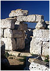  
Syrakuzy

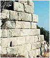  
Knidos

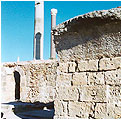  
Kartagina

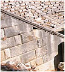  
Priene

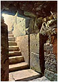  
Tipaza

Na wyspach Azorskich spotkać można ruiny trochę przypominające "świątynię Księżyca" z Machu Picchu. W Syrakuzach mury jakich nie wstydzą się Mykeny. Spójrzmy na mury tureckiego Knidos. Czy takie mury był w stanie wznieść zwykły człowiek? Oczywiście, że mógł, ale musiał mieć do dyspozycji potężne wsparcie techniczne. Bloki kamienia spotykamy też w Kartaginie. Trudno powiedzieć czy to, co widzimy to pełne bloki czy też tylko kamienne okładziny. A czym przycinano i wygładzano bloki kamienia w Priene czy w Tipaza (Mauretania)? Z Priene "fachowcy" nie mają problemu. To zrobili Rzymianie, jak wszystkie "teatry" w swoim imperium. Ciekawe tylko dla kogo i dlaczego aż tak duży.

Są także bardzo interesujące szczegóły, szczególnie w krajach Bliskiego Wschodu, a konkretnie w krainie dawnej Fenicji. Pierwsze zdjęcie przedstawia jeszcze kopulastą budowlę etruską z potężnych kamiennych bloków, ale już następne to same zagadki. Do czego w Pompejach mogły służyć kamienne kolumny osadzone na potężnych podstawach, przypominające obrotowe bloki do łańcuchów kotwicznych?

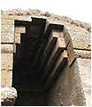  
Caere

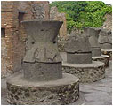  
Pompeje

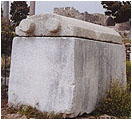  
Byblos

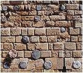  
Sydon

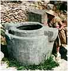  
Ugarit

Po co w Sydonie wmurowano w ścianę kamienne walce? Są na pewno z innego materiału niż zbudowany mur. Komu lub do czego służył kamienny "sarkofag" z Byblos nie ustępujący wielkością tym z Egiptu. Czy za kamienne występy chwytał jakiś starożytny podnośnik unoszący wieko? A kto w Ugarit używał tego kamiennego "dzbanuszka" wlewając sobie śmietankę do porannej kawy? Tu naprawdę trudno przyjąć koncepcję naukowców, że takimi rzeczami operowali ludzie.

Wspomniałem już o wodzie. W poprzednich artykułach starałem się udowodnić istnienie "Bogów wody" i nie sposób pominąć ich i tutaj. Obszar morza Śródziemnego jest wprost usiany starożytnymi wodociągami nazwanymi akweduktami. Lecz o dziwo, żaden historyk nie wspomina nic o bogach wody. Czyżby byli przypisani tylko do cywilizacji starszych niż 3000 lat? A co się stało z nimi potem? Wszystkie akwedukty jakie tylko znaleziono wokół morza Śródziemnego zgodnie okrzyknięto wyrobem imperium rzymskiego. Chyba historycy zbyt uprościli sobie proces myślowy stwarzając hipotezę, która całkowicie zaciemniiła obraz historii naszej cywilizacji.

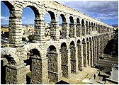  
Segovia

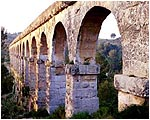  
Tarragona

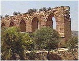  
Kartagina

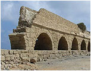  
Cezarea

Zapomniano przy tym przypatrzyć się samej kolebce cywilizacji rzymskiej. Czy nie jest dziwne, że w samych Włoszech akwedukty znaleźć można tylko w samym Rzymie i na północ od niego? Dlaczego nie ma ich na południu? Czy to przypadek, że akwedukty znajdują się tylko na terenie dawnej Etrurii? Chyba nie. Przykłady, które pokazuję znaleźć można na terenie dawnego królestwa Atlantydy. Czy Lesbos, tradycyjnie grecka wyspa, też należała do Atlantydy? A dlaczego nie. Skąd pewność do kogo należała ponad 12 tysięcy lat temu? Leży przecież bliżej Azji Mniejszej niż Grecji.

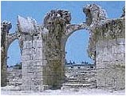  
Tyr

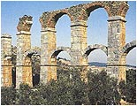  
Lesbos

  
Salamis

  
Pont du Gard

Nieliczni z archeologów zwracają uwagę na to, w jaki sposób dana społeczność korzysta z wody. Gdzie są najbliższe jej źródła, jak woda jest doprowadzana do miast, w jaki sposób nawadniane są pola uprawne. Jest to w najlepszym wypadku temat uboczny i zaraz też szuka się bogów wody, by kłopot mieć z głowy. Wykazałem poprzednio, że cywilizacja Bogów problem wody uważała za pierwszorzędny i rozwiązywała go w pierwszej kolejności. Tak było i w tym przypadku.

Brak wielkich zbiorników słodkiej wody (naziemnych lub podziemnych) wymusił budowę kamiennych wodociągów. Były to solidne budowle, często łączone z mostami, prowadzące wodę napowietrznymi estakadami, wykorzystując darmową siłę grawitacji ziemskiej.

Każdy akwedukt był przykrywany kamiennymi płytami uniemożliwiającymi zanieczyszczenie wody przez zwierzęta i pogodę. Jest to majstersztyk sztuki inżynierskiej, odporny na działanie warunków klimatycznych czy mniejsze trzęsienia ziemi. Nikt jednak nie zbadał skąd doprowadzano wodę i jakie rejony były jej odbiorcą. Nikt nie dopatrzył się zniszczeń spowodowanych "wielkim uskokiem...", a przecież akwedukty powinny były zachować profil ziemi sprzed 12,5 tysiąca lat.

  
Rzym

  
Meksyk

Także budowa niektórych z nich wskazuje na technologię stosowaną w całym królestwie Atlantydy. Drobne kamienie spajane nieznaną zaprawą. Nie dziwi zatem, że akwedukt odnalazłem także w Meksyku.

Starożytne Rume także było zaopatrywane w wodę przy pomocy akweduktów, jednak tysiącletnia dewastacja miasta przez nowych mieszkańców nazywających siebie Rzymianami doprowadziła do zatarcia wszelkich śladów. Odnalazłem jeden z fragmentów akweduktu, który dziś się określa jako bramę "porta maggiore". Szczyt "bramy" posiada trzy kanały do przepływu wody i bardzo możliwe, że gdzieś było rozgałęzienie prowadzące wodę do trzech różnych miejsc czy dzielnic mieszkaniowych. Budowę pierwszego rzymskiego wodociągu tzw. "aqua Appia" historia przypisuje Appiuszowi Klaudiuszowi dopiero w roku 312 pne. Jest jeszcze jeden szczegół nie brany w ogóle pod uwagę. W samej Rumie po "wielkim uskoku..." mogło dojść do przerwania zaopatrzenia w wodę. Nie wiadomo też, czy przed kataklizmem Tybr płynął aktualnym korytem. Bardzo możliwe, że sami Rzymianie nie mieli zielonego pojęcia do czego mogły służyć te dziwne budowle, po których nie dało się ani chodzić ani jeździć. Dlatego przez cały czas mogły służyć za tanie źródło doskonałego budulca.

Następną sporną sprawą stają się mosty, którymi rzekomo Rzymianie uszczęśliwiali wzdłuż i wszerz całą Europę i zachodnią Azję. Przejść przez most nie jest jednoznaczne z jego wybudowaniem, a tak zapewne sądzą historycy. Most jest najtrudniejszą budową także i dla naszej cywilizacji, a jak widać nie były to kładki nad strumykiem.

  
Kładka z litego kamienia

  
Brytania

  
Hiszpania

Na pierwszym zdjęciu most zbudowany całkowicie z kamiennych bloków. Przęsła to kamienne płyty ułożone na podporach. Widać na nim działanie czasu i pogody, ale nie mają one wpływu na pytanie w jaki sposób wycięto ze skały tak duże bloki, jak je przetransportowano na teren budowy i za pomocą czego ułożono. Jak zbudowano most w Brytanii? Jak posadowiono filary w rzece? Nawet gdyby Rzymianie używali pontonów, to w jaki sposób prowadzili prace pod wodą? W jaki sposób transportowali budulec na środek rzeki? Dlaczego w Hiszpanii zbudowano most na nieistniejącej rzece? Tu nie było błędu. Rzeka kiedyś istniała. To dlaczego? Czy ktoś pomyślał, że powodem mógł być wielki kataklizm sprzed 12,5 tysięcy lat, który całkowicie zmienił bieg rzeki? Czy to sprawdzono? Nie, bo po co.

  
Azerbajdżan

  
Cuenca

  
Syria

  
Turcja

  
Bejing

Mosty budowano w oparciu o łuki, które rzekomo po raz pierwszy wprowadzili Rzymianie. Skąd ta niezachwiana pewność? By zbudować pojedynczy łuk trzeba najpierw umieścić w rzece potężne rusztowanie, albo chwilowo zmienić jej bieg. Tu naprawdę nie trzeba wymysłów archeologów, ale wypowiedzi inżynierów budowlanych. Nie robi się tego, bo postawili by więcej pytań niż historycy zdołali by dać odpowiedzi. Porównajmy kamienne mosty z Azerbajdżanu i Bejing (Chiny). Po zdjęciu współczesnych chińskich ozdób są prawie identyczne. Nauka nazywa to koincydencją. Różne rasy, ale jeden mózg i można wymyślać identyczne rzeczy na różnych krańcach świata. Jak widać wszystko jest proste i wytłumaczalne.

  
Hiszpania

  
Francja (?)

  
Shaharah

  
Etiopia

  
Maroko

Na koniec majstersztyki starożytnych budowniczych. Czy Rzym posiadał fachowców do wybudowania czteropoziomowego mostu nad doliną? Skąd czerpano budulec? Jak gigantyczne rusztowania musiano zastosować by wybudować most w Ronda w Hiszpanii, a na czym posadowiono rusztowania przy budowie wiszącego mostu w Shaharah? Historię o wielkim Rzymie należy faktycznie umieścić we właściwym miejscu, w dziale baśni. Te mosty powstawały już wtedy, gdy Mars, Bóg wojny nawet nie przypuszczał, że kiedyś urodzi się Rea Sylwia, a on zostanie szczęśliwym ojcem Romulusa i Remusa.

W królestwie Atlantydy budowano mosty, które służą do dzisiaj. Wiele mostów uległo zniszczeniu, ale kiedy nie wiadomo, bo nikt tego nie badał, a jeśli już, to znajduje się jakieś lokalne trzęsienie ziemi, które wystąpiło w jakimś stosunkowo niedawnym, bliżej nieokreślonym czasie.

Aztekowie? Majowie? Rzymianie? Nie, to kaplica księcia Mieszka I

O ile historia współczesnych ludzi jest dobrze poznana oraz datowana po skorupach i innych pozostałościach, to pochopne przypisywanie wszystkiego ludziom, co tylko znaleziono w pobliżu jest nieporozumieniem. W ten sposób nie zbadawszy dokładnie budowli, a przede wszystkim ich fundamentów, dochodzi się do "dziwnych" wniosków. Historycy wtłoczeni w gorset liniowego postępu, z klapkami darwinizmu na oczach, niedopuszczający myśli o istnieniu w przeszłości wysokiej cywilizacji, nadal będą nas karmić wyimaginowaną wiedzą. Starożytną mądrość zamieniono na współczesną przemądrzałość. Nikt nie neguje, że postęp jest procesem liniowym, ale stosujmy tę liniowość do cywilizacji ludzi i nie mieszajmy z nią zaginionej cywilizacji.

Królestwo Atlantydy zginęło w wielkim kataklizmie nazwanym przez Hapgood'a "wielkim uskokiem skorupy ziemskiej" 12,5 tysięcy lat temu. Nie tylko zresztą one. Zginął cały ówczesny cywilizowany świat. Dziś negując taki kataklizm, na siłę stara się znaleźć dowody, które umożliwiałyby wytłumaczenie zniszczeń jakie widać dosłownie wszędzie. Piramidy "zgubiły" okładzinę około 1000 r. pne., północną część Aleksandrii z pałacem Kleopatry i latarnią morską na wyspie Faros pochłonęło morze w 365 r. pne. Morze Czarne powiększyło swą objętość w kataklizmie sprzed 7000 lat. Wszystko zdarzyło się stosunkowo niedawno, byle tylko nie wyjść poza zaklętą granicę kilku tysięcy lat sięgając "wielkiego uskoku...".

Jakie zatem trzęsienie ziemi zniszczyło kamienne budowle w Wielkiej Brytanii? W którym roku trzęsienie ziemi nawiedziło Hiszpanię i zniszczyło wszystkie "rzymskie" akwedukty i budowle? Czy naprawdę kulturę Krety zniszczył dopiero wybuch wulkanu 1500 lat pne? Dlaczego te wszystkie potężne trzęsienia ziemi nie mają żadnego śladu w przekazach starożytnych. Skoro zginęła Aleksandria, na pewno uwiecznili by to Grecy w swoich annałach.

Zniszczenia w Hiszpanii opisali by ich sąsiedzi. Historia potworzyła osobne grajdoły cywilizacyjne, które rzekomo nic o sobie nie wiedziały. Tak naprawdę, to każdy archeolog grzebie w jednej dziurze, nie mając pojęcia co znalazł jego sąsiad. Nic tylko dziwaczne tezy, dowody, spory, polemiki i bezpłodna gadanina, które do historii wnoszą tylko zamęt. Czy nie najwyższy czas, by ktoś spojrzał na to wszystko z góry i objął wzrokiem całość historii ziemskiej cywilizacji?

Weźmy do ręki zwykłą drewnianą kredkę, połammy ją na trzy części i ukryjmy środkową część. Pokażmy pozostałe dwie części rozumnemu już dziecku i zapytajmy co mogło być w środku. Prawdopodobnie w odpowiedzi usłyszymy, że w środku było coś takie same, jak pozostałe dwie części. Moja ukryta część kredki leży na dnie Atlantyku i tam widzę "swoją" Atlantydę. Teraz pora na tych, co odnaleźli wraki Titanic'a i Bismarck'a. Możemy jednak nie zdążyć i wtedy my będziemy Atlantydą dla pokolenia, które przeżyje następny kataklizm, jeśli nie zrodzi tylu "błądzących" co nasze.

Atlantyda przeżyła swoją wielką katastrofę. O wiele większą katastrofę szykują jej historycy i archeolodzy, którzy chcą ją całkowicie wymazać z ludzkiej pamięci. Do tego ma służyć, być może niezamierzony, ale największy błąd współczesnej historii - cywilizacja starożytnego Rzymu, ale o tym w następnym rozdziale.
