**Oszustwo wszechczasów**  
Synu człowieczy!  
Mieszkasz pośród domu przekory, który ma oczy aby widzieć, a jednak nie widzi,  
ma uszy, aby słyszeć, a jednak nie słyszy, gdyż to dom przekory. Księga Ezechiela

Czy przeglądając historię starożytnego Rzymu znaleźć można wzmiankę o trasie przemarszu wojsk rzymskich do Numancji w Hiszpanii? Ile tego wojska było i jak wyglądało jego zaopatrzenie? Ja nie znalazłem. Czy znaleźć można wiadomości w jaki sposób armia rzymska znalazła się pod Nową Kartaginą? Czy przeszła brzegiem zachodniej Hiszpanii czy przepłynęła na okrętach? Ja nie znalazłem. Czy znaleźć można opis trasy przemarszu wojsk rzymskich do Armenii? Ja nie znalazłem. Czy znaleźć można choć jedno nazwisko rzymskiego architekta, który zaprojektował i wykonał przynajmniej jeden amfiteatr? Ja nie znalazłem. Czy znaleźć można opis - ilu rzymskich żołnierzy przepłynęło do Brytanii? Skąd wypłynęli i w jakim miejscu wylądowali, a przede wszystkim skąd wzięli i ilu użyli okrętów? Ja nie znalazłem. A może wiadomo, po co Rzymianie wybudowali mur Hadriana, skoro za murem żyło wtedy kilkanaście szkockich plemion? Tak, bo były to bitne plemiona. A skąd to wiadomo, skoro nie było z nimi żadnej walnej bitwy?

Znany jest też zapewne termin "pucolana". Tak nazwano słynny "rzymski" cement złożony z wapna, wody i popiołu wulkanicznego, dzięki któremu Rzym wznosił tak wspaniałe budowle, a przede wszystkim "rzymskie" łuki (tak naprawdę budowa łuku architektonicznego nie zależy wcale od cementu). Czy znany jest jego dokładny skład? Nie, bo nie podano do wiadomości. A dlaczego nie podano? Dlatego, że ten rzekomy super cement po wyschnięciu dał się skruszyć w palcach. Ponadto, skoro był tak rewelacyjny, dlaczego włoskie budownictwo nie rzuciło się na tę starożytną recepturę? Dlaczego Etny i Wezuwiusza nie wykorzystuje się dzisiaj na skalę przemysłową? Nikt nie chce darmowego surowca? Prawdopodobnie ta rzymska "pucolana" mogła służyć tylko do tynkowania budowli, co Rzymianie skwapliwie wykorzystali ukrywając pod nią nie swoje dzieła.

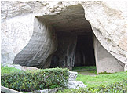

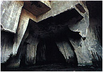

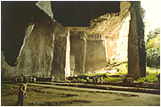

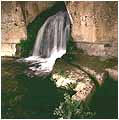

Kto i kiedy wykuwał tę skalną grotę w Cordari na Sycylii? Grecy? Kartagińczycy? Rzymianie?

Historia starożytnego Rzymu stała się dogmatem. Stała się Pismem Świętym Nowej Historii, w którym nie wolno zmienić ani słowa. Traktowana jest jak wiara, gdzie wszystko musi być uznawane pod groźbą anatemy. Historia starożytnego Rzymu jest tak lakoniczna, jak cezarowe "veni, vidi, vici" - mówi wiele i jednocześnie kompletnie nic. Dlaczego tak jest? Dlatego, że przyjęto założenie - "gdziekolwiek w Europie są kamienne ruiny i sterczy lub leży połamana kamienna kolumna, tam musieli być Rzymianie". Dobrze, że jest tych ruin mało, bo imperium rzymskie zalało by cały świat.

W szkołach od zawsze uczono, że współczesna cywilizowana Europa istnieje dzięki cywilizacji starożytnego Rzymu. Uczelnie prawnicze wpajają studentom, że prawo jest tak doskonałe, bo zbudowano je na trwałych fundamentach prawa rzymskiego (niby tak, ale proszę pokazać choć jeden cywilizowany naród, który jest zadowolony ze swojego prawa). Twierdzi się, że wynalazki Rzymian skierowały postęp techniczny na nowe tory i dlatego dziś możemy latać w kosmos, a dzięki wynalezieniu cementu przez Rzymian możemy budować szybciej, taniej i wyżej. Czy te twierdzenia są prawdziwe? Obawiam się, że zbyt odbiegają od rzeczywistości. Sądzę, że wynalazki dawnego Rzymu dotyczyły głównie organizacji wojska, doskonaleniu sprzętu do zabijania i ulepszania administracji służącej do sprawnej dystrybucji rabowanych dóbr. Rzymianie nie wynaleźli żadnego cementu. Twierdzenie to archeolodzy oparli o zbadane budowle, faktycznie spajane czymś w rodzaju cementu lecz zbyt pochopnie przypisane Rzymianom.

Osobiście uważam, że cywilizacja starożytnego Rzymu była tylko systemem polityczno-wojskowym i w pełni totalitarną, która dzięki sprytnej polityce (divide et impera), wyszkolonej i licznej sile militarnej oraz wielotysięcznej rzeszy urzędników przez prawie tysiąc lat niszczyła i ograbiała podbite przez siebie państwa. Prawie tysiąc lat przy pomocy wojska i administracji utrzymywała z grabieży małą grupę władców, oligarchów i polityków. Nawet religię w całości przejęła po Grekach i Etruskach zmieniając tylko imiona, co i tak nie przeszkodziło Rzymianom w chwilach zagrożenia (Hannibal ante portas) składać ofiar z ludzi (sic!). Kulturę materialną i dzieła sztuki przejęła od innych, kradnąc i sprowadzając do Rzymu oraz swoich kolonii. Literaturę skopiowała od Greków tłumacząc je na łacinę. Jak ceniła naukę widać było po zdobyciu Syrakuz, gdzie bezpardonowo zabito bezbronnego, największego uczonego tamtych czasów - Archimedesa (tuż przed śmiercią wypowiedział słynne - "nie niszcz moich kół").

Republika Rzymska około 500 r. pne. uderzyła na południe wypędzając Greków i przy okazji rujnując gospodarkę rolną regionu. W IV wieku pne. Rzymianie ruszyli na północ i zmienili kwitnący rolniczy kraj w gospodarczą pustynię. Czy współcześni historycy nie poszli po najmniejszej linii oporu? Czy nie przyjęli bezkrytycznie wszystkiego, co napisali Rzymscy historycy, nie zważając na to, że przywłaszczyli sobie przywilej czołowej cywilizacji Europy? Sądzę, że Imperium rzymskie było tylko maszyną do rabowania, zdobywania niewolników i zaspakajania luksusu dla wąskiej grupy oligarchów. Była to nacja, która zniszczyła u siebie starożytną mądrość.

Jako jedyne "państwo" na świecie doprowadziło do upadku gospodarczego nie tylko podbite państwa, ale przede wszystkim własny naród. Niezaprzeczalnym spadkiem tej "cywilizacji" jest trwająca w najlepsze do dziś korupcja, nepotyzm, kumoterstwo i tzw. "kiełbasa wyborcza". Największym zaś osiągnięciem Rzymu jest utrwalenie w umysłach ludzi swojej "wielkości", dokonanym umiejętną propagandą i fałszowaniem historii. Wybitny badacz historii Rzymu, Andreas Alfolldi, ujął to w sposób następujący:

... wszystko, co dotyczy wczesnego Rzymu u Liwiusza i Dionizjusza z Halikarnasu jest pozbawione wartości, zależne jest bowiem od świadomych kłamstw Fabiusza Piktora. Cała annalistyka rzymska pozostawała pod fatalnym wpływem tego "pierwszego fałszerza" historii Rzymu.

Pokażę dalej, że dotyczy to nie tylko wczesnego okresu.

**Gdy w Europie diabeł mówi dobranoc ...**

Według historyków jedynym cywilizowanym krajem Europy w czasie gdy powstawał Rzym była chyląca się ku upadkowi Grecja. Pozostała część Europy to barbarzyńcy.

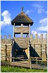

nasz Biskupin

Wizygoci i Frankowie mają dopiero w dalekich planach utworzenie państw. Anglia żyje we wspólnocie plemiennej, Ludwik Niemiecki niedługo będzie próbował połączyć księstwa plemienne. Po terenach Polski wałęsają się hordy dzikich plemion, które dopiero za 800 lat utworzą zrąbek pierwszego państwa, a które w międzyczasie założą w VI wieku pne. obronną osadę bagienną w Biskupinie. Całą Europę oprócz Grecji spowija intelektualna miernota i bieda.

Co o tych czasach przekazuje historia? Europa żyje we wspólnych, drewnianych chatach, domorosłe "złote rączki" próbują lepić pierwsze gliniane garnki, a gospodarka rolna jest w powijakach podobnie jak hodowla. Męska część ugania się po lasach za zwierzyną, która dostarcza białka i materiału na ubrania. Barbarzyńcy żyją z tego co upolują, zbiorą lub ukradną. Boją się wszystkiego co niezrozumiałe i na wszelki wypadek wymyślają różne bóstwa mające ich chronić przed nieszczęściem, w szczególności od uderzenia pioruna.

W takich to mrocznych czasach rozbłyska małe światełko w środku półwyspu Apenińskiego, które w mgnieniu oka wyprzedzi całą cywilizację Europy o 1500 lat. Ci zdolni rolnicy prawie natychmiast "wymyślają" cement i już 500 lat pne. rozpoczynają wznosić wspaniałe murowane budowle, które dwadzieścia wieków później kompletnie zdezorientują współczesnych historyków.

**... Rzym powstaje z baśni i życzeń**

Do dziś uczeni wiodą spory skąd pochodzą Rzymianie. O prym walczą dwa plemiona - Latynów i Samnitów. Sami Rzymianie wywodzą swój ród od legendarnego Eneasza, który po upadku Troi udał się na tułaczkę wraz z ocalałym ludem i osiadł w pobliżu dzisiejszego Rzymu.

Sam okres wojny trojańskiej jest dla mnie dość niejasny. Resztek Troi jeszcze nie odnaleziono, bowiem to, co odkrył Henryk Schliemann zaczynają coraz częściej kwestionować współcześni badacze. Sądzę, że starożytna Troja spoczywa gdzieś na dnie morza. Dlaczego? Grecy twierdzą, że miasto posiadało "cyklopowe" mury wzniesione przez samego Posejdona i Apolla, za które z resztą nie otrzymali zapłaty. Czy wojnę toczono rzeczywiście dla jednej kobiety? Także nie sądzę by tak było. Starożytna Troja najprawdopodobniej broniła morskiego dostępu do kolonii greckich leżących nad morzem Czarnym i była kolonią Atlantydy (budował przecież sam Posejdon). Według Greków wojna trojańska miała miejsce 1200 lat pne, ale w tamtym okresie odnotowano tylko jeden kataklizm spowodowany wybuchem wulkanu Thiera i to w roku 1500 pne. Morze Czarne w dzisiejszej postaci ukształtowało podobno trzęsienie ziemi 7000 lat pne. i tu być może należy dopatrywać się zniknięcia pozostałości Troi. Sądzę także, że sama wojna trojańska miała miejsce na długo przed tą datą i to stąd zapewne kłopoty z ustaleniem trasy tułaczki Osydeusza.

Przybycie uciekinierów w rejon Rumy (Ruma - etruska nazwa Rzymu) ma też racjonalne uzasadnienie. Jako wrogowie Grecji nie mogli osiąść na żadnym terenie pod jej jurysdykcją. Przyjęła ich Etruria, kolonia Atlantydy granicząca z koloniami Greckimi na półwyspie Apenińskim. Czas pokazał, że przyjęła pod dach wilka w owczej skórze.

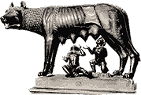

Ród Rzymian powstał także w cudowny sposób. Rea Sylwia, kapłanka Westy (ślubująca zresztą bezwzględną czystość), za sprawą Boga Marsa powiła bliźnięta - Romulusa i Remusa, które król Amuliusz kazał wrzucić do Tybru. Uratowane przez Opatrzność, wykarmione przez wilczycę i wychowane przez królewskiego pasterza, po osiągnięciu pełnoletności dokonali obowiązkowej zemsty na Amuliuszu, a w miejscu cudownego ocalenia założyli miasto, które jak się można domyśleć stało się dzisiejszym Rzymem. Dowodem na to ma być rzeźba wilczycy karmiąca dwójkę dzieci. Sama wilczyca jest odlewem z brązu wykonanym przez Etrusków, ale jak można zauważyć dziecięce postacie nie dotykają w ogóle sutek wilczycy i nic dziwnego, bo dodano je kilka wieków później. Wilczyca mogła wreszcie pozbyć się nadmiaru mleka, a Rzymianie usankcjonować swoje pochodzenie. By wieść ugruntowała się pospolitych umysłach wypuszczano stosowną monetę. Było to jedno z wielu, skądinąd doskonałych, propagandowych posunięć zastosowanych przez rodzącą się "cywilizację" Rzymu. Proszę porównać wykonanie monety z rzeźbą wilczycy. Artyzm i technika wykonania etruskiej rzeźby ma sie nijak do nędznej i prymitywnie wykonanej monety. Już samo to nasuwa podejrzenie, że oba artefakty należą do zupełnie innych cywilizacji.

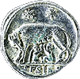

Sama wędrówka Eneasza wraz z ludem jest także owiana tajemnicą. Osiadł on w nowej ziemi ponoć około 800 r. pne. Gdzie ten cały naród podziewał się przez 500 lat (przyjmują grecką datę wojny trojańskiej)? Jakie tereny odwiedził przez pięć wieków tułaczki? Nie wiadomo. Domyśleć się tylko można, że wielokrotnie pobił rekord Odyseusza. Same rządy Rzym rozpoczął od morderstwa. Rozpoczęło się od przepowiedni z lotu ptaków. Bliźniakom ukazały się sępy - Remusowi sześć, a Romulusowi dwanaście. Romulus wokół wzgórza Palatyn zaorał granicę miasta (tak ponoć granice wytyczali Etruskowie), której nie wolno było nikomu przekroczyć. Remus się ośmielił i w ten sposób Romulus został pierwszym i jedynym królem Rzymu. Był jeszcze jeden poważny problem. Rzymianie nie mieli kobiet i młoda nacja stanęła przed widmem biologicznej zagłady. Poradzono sobie i z tym porywając w podstępny sposób kobiety sąsiedniego plemienia Sabinów. Można było już płodzić przyszłą "rasę panów".

Co na to nauka? Oczywiście część spraw traktuje jako legendę, bo kto niby ich nie posiada. Założenie Rzymu umieszcza gdzieś w roku 750 pne., natomiast samą rozbudowę miasta, już murowaną, około roku 575 pne. Jest to efektowne minięcie się z prawdą, ale już dzisiejszej nauki. Nie trzeba przypominać, że wiek budowli ustalono na podstawie skorup znalezionych w ich pobliżu oraz szkieletów ludzi żyjących stosunkowo niedawno. Pisze szwedzki archeolog Einar Gjerstad:

Dopiero od przekształcenia się luźnej zabudowy wiejskiej w zwarty ośrodek miejski można mówić o początkach właściwej państwowości rzymskiej. To epokowe wydarzenie można datować dzięki importom attyckiej i lakońskiej ceramiki czarnofigurowej z lat 580-560 pne. Przyjmuję zatem możliwość przesunięcia proponowanej daty założenia miasta 575 o ± 25 lat.

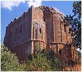

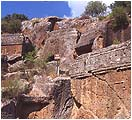

Na takie "dictum" mózg spływa zgodnie z prawem ciążenia. Skąd ta niezachwiana pewność, że skorup używali akurat budowniczy? Do niedawna także skrzętnie pomijano cywilizację Etrusków, która jakoby napłynęła gdzieś z północy, gdy państwo Rzymian już zostało utworzone. Kiedy zatem Etruskowie zdążyli wybudować Chiesa i wykuć grobowce w Weje? (na zdjęciach obok).

Rzym założono na siedmiu wzgórzach, które uczeni określają jako trzy wzgórza o siedmiu wierzchołkach. Potem zaś zamieniono wzgórza na cztery rejony - Palatyn, Sucusana, Eskwilin i Kwirynał. Za najstarszą część Rzymu uważa się Kapitol leżący tuż obok Palatynatu. Do kanonu weszło powiedzenie "Rzym - wieczne miasto", ale ten, który to pierwszy powiedział nie był chyba świadom tego, że przypadkiem ujął to nader trafnie, choć z zupełnie innego powodu.

**Rzym stawia fundamenty**

  
  

Powędrujmy po starożytnym Rzymie. Zgodzić się należy z twierdzeniem, że zanim postawiono coś na powierzchni ziemi, musiano przeprowadzić prace podziemne. Trudno bowiem postępować odwrotnie nie narażając na zawalenie wzniesionych już budowli. Logicznie, prace te powinny być zakończone do roku 575 pne. Przypatrzmy się zatem jednej z największej kanalizacji wszechczasów, rzymskiej cloaca maxima.

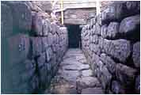

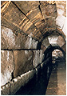

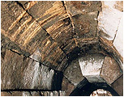

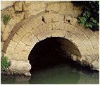

Największy podziemny ściek świata - rzymska cloaka maxima. Czy to zbudowali Rzymianie?

Czy to zbudował ludek, który około 800 roku pne. stawiał w okolicach drewniane chaty? W jaki sposób, a przede wszystkim jakimi narzędziami, ludek ten wyciął tak olbrzymie bloki skalne? Skąd ta precyzja w dopasowaniu kamieni ułożonych bez żadnej zaprawy? Skąd i czym transportowano te olbrzymie elementy? Czym dźwigano i precyzyjnie ustawiano tak duże kamienne bloki? Czy to znów tylko ludzie i osły? Dlaczego nauka tak usilnie mydli oczy tym, którym ma służyć? Czy można sądzić, że 250 lat "ewolucji" wystarczy w pełni na taki skok technologiczny? Kto w takim razie zbudował coś podobnego w Caere 40 km od Rzymu, skoro w tym czasie Rzymianie nie wytknęli nawet czubka nosa poza "swój" Rzym?

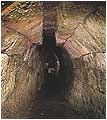

Caere to miasto leżące na terenie Etrurii, zwanej przez Greków Tyrrenią, która zajmowała północne tereny dzisiejszych Włoch i na terenie której leżała także starożytna Ruma. Pod władzę Rzymu mogło się dostać nie wcześniej niż w roku 445 pne., a jeśli tak, to wynika z tego, że Rzymianie budowę podziemnych kanalizacji rozpoczęli dopiero 100 lat po wybudowaniu Rzymu i prawdopodobnie nie oni są twórcami cloaca maxima! Gwoli prawdzie trzeba wspomnieć, że sprawa Etrusków nie jest wyjaśniona do dzisiaj. Dotychczas archeolodzy odkryli kilka stanowisk i w zasadzie same nekropolie. Nie potrafią także odczytać języka Etrusków. Wszystkie budowle są zasypane ziemią i przyjęto to jako regułę (piramidy w Teotihuacan też zasypano). Nikt nie wpadł jeszcze na pomysł, by powiązać to z wielką falą tsunami po "wielkim uskoku...".

Tu sprawdza się moja hipoteza. Ruma, leżąca na terenie Etrurii, będącej dawną kolonią Atlantydy, została zbudowana przed co najmniej 12,5 tysiącami lat. To wtedy istniała technologia i technika pozwalająca na wybudowanie takich podziemnych instalacji. Wyjdźmy zatem na powierzchnię i popatrzmy co "zbudowali" Rzymianie w "swoim" mieście.

Dopiero w II wieku naszej ery Rzymianie zaczęli wytwarzać w przydomowych warsztatach wypalaną cegłę i dachówkę

**Rzym się ogradza**

  
  

W celu bezpiecznego rozwoju miasta należało przede wszystkim ogrodzić miasto murami obronnymi. W Rzymie jest jakby inaczej. Od roku 575 pne miasto wchodzi w erę budowy z kamienia i cegieł, czyli Rzym jest bezbronny jak dziecko, bo dopiero 200 lat później, w roku 378 pne. mieszkańcy, a właściwie władcy, wpadają na pomysł zbudowania murów miejskich. Co prawda mówi się o jakiś wcześniejszych wałach ziemnych z czasów początków miasta, w których znaleziono dla odmiany skorupy ceramiki czerwonofigurowej, ale dlaczego dopiero po 400 latach od założenia miasta wpada się na pomysł zbudowania murów? I to od razu jak potężnych murów.

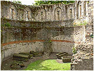

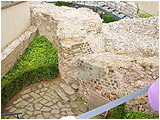

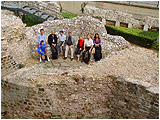

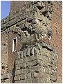

Szczątki, które oglądamy są imponujące, ale... no właśnie, znowu technologia nie pasująca do Rzymian. Skąd ją znali, skoro w tym czasie nie myśleli jeszcze o podbojach? Spójrzmy jeszcze na narożnik rzymskiego domu. Czy nie przypominają kamiennych budowli zza Atlantyku? Problem jest jeszcze w tym, że według historyków słynny "rzymski" cement tzw. "pucolana" został wynaleziony dopiero w II w. pne. Jakiej zatem zaprawy używali do wznoszenia tak potężnych budowli w Rzymie w V wieku pne., trzysta lat wcześniej?

**Rzym się modli**

  
  

Rzym był państwem religijnym (szczególnie w okresach zagrożenia). To oni wymyślili hasło chętnie powtarzane i dzisiaj "ora et labora" czyli módl się i pracuj. Początkowo pierwszym Bogiem Rzymu był ich protoplasta Mars - bóg wojny, utożsamiany z greckim Aresem. Później Rzym przejął religię i bóstwa etruskie ale z biegiem lat wymieniał je jak przysłowiowe rękawiczki, by wreszcie Bogami ustanawiać swych władców, a nawet jednego konia. W zasadzie przejęli całą grecką dwunastkę Bogów zmieniając tylko ich imiona. Bogom rzecz oczywista wznoszono świątynie, lecz co dziwne w Rzymie zachowało się ich mało, za to w rzymskich prowincjach jest ich zatrzęsienie.

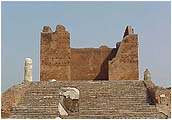

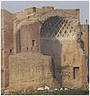

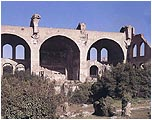

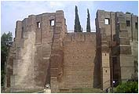

Pierwsza z lewej, to świątynia Jowisza w Ostii (port Rzymu), dalej to świątynia Wenus, bazylika Makstensjusza i bazylika Konstantyna. Ostię i Konstantyna dzieli co prawda "urzędowe" prawie 800 lat ale łączy budulec i, co dziwne, historykom i archeologom wcale to nie przeszkadza.

**Rzym zamieszkuje**

  
  

A jak wyglądało budownictwo mieszkalne? Nie mówię tu oczywiście o rzymskim proletariacie, bo nim interesowano się tak jak i u nas, tylko przed wyborami. Mieszkali zapewne w slumsach, z których do czasów dzisiejszych nie pozostał nawet opis, a prawdopodobnie jedne z najstarszych poszły z dymem już za czasów Nerona. Popatrzmy zatem jak mieszkali bogatsi Rzymianie. Trzeba przyznać, że rozmachem przeskoczyli wszystkich.

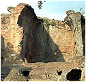

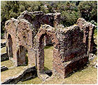

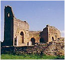

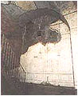

Pierwszy "domek" od lewej to "villa Hadriana" - pałac cesarski przypisywany Hadrianowi. Takiego "schronu przeciwatomowego" nie powstydzili by się nawet dzisiejsi Amerykanie. Pozostałe, to domy bogatych Rzymian na prowincji. Też wygodne i duże, a przede wszystkim wysokie. Zastanawiające jest jak oni ogrzewali tak wysokie pomieszczenia, a może nie ma się nad czym zastanawiać, bo grube mury zatrzymują ponoć ciepło z całego lata. Budulec, jak widać - cegła, kamień i "rzymski" cement. Po prawej prywatny dom Trajana. Zauważmy potężne, kamienne elementy łuku przypominające te z cloaca maxima. Czy to były naprawdę domy mieszkalne?

**Rzym pracuje i wytwarza**

  
  

Rzym posiada także inne ciekawe budowle. Gmach nazywany biblioteką albo archiwum miejskim. Czy otrzymał taką nazwę by usprawiedliwić tak grube mury? Dlaczego jednak gmach jest położony równo z poziomem gruntu? Czy początkowo była to budowla podziemna odsłonięta dopiero przez zawalenie się budynku? Czy można wyobrazić sobie regały wysokie na kilkanaście metrów? Te miliony woluminów, z których przetrwało parę wierszy i trochę panegiryków? Dlaczego mając tak wielką bibliotekę Rzym wydał tak zadziwiająco mało inteligentnych twórców?

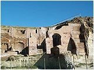

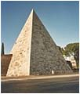

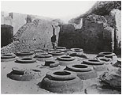

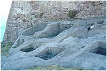

Rzym posiada także swój mały "Egipt". Mała piramidka przypisywana Caesiusowi. Czy to jest pełny, kamienny ostrosłup czy też są w środku jakieś pomieszczenia, trudno powiedzieć. Skąd u Rzymian taka precyzja w dopasowaniu kamiennych bloków? Czy było to naśladownictwo? Chyba nie. Rzymianie nie mieli raczej pojęcia o budowie piramid, bo choć pierwszy raz "odwiedzili" Egipt w roku 168 pne., to piramidy obejrzeli prawdopodobnie dopiero za Cezara. W niedalekiej Ostii, porcie Rzymu, znaleziono ogromne naczynia (podobno na wino). Co przechowywano w tym magazynie? Jak większość zabytków Rzymu (i nie tylko Rzymu) są zasypane, ale można się chyba domyśleć dlaczego. Na ostatnim zdjęciu tajemniczy "wyrób" w litej skale na wyspie Capraia (na północ od Elby). Czy Rzymianie potrafili wycinać prostopadłościenne bloki i oddzielać je od macierzystej skały? Uczeni określili to jako część wytwórni wina.

**Rzym się bawi**

  
  

Chleba w Rzymie nigdy nie było dosyć. Chłopstwo, a w zasadzie pracujący na roli, musiało wyżywić władców, kapłanów, polityków, wojsko a także nie utrzymujący się z niczego proletariat. Rzymski proletariat, jak wiadomo, był bardzo liczną klasą ludzi nie mającą ani źródła utrzymania ani też nie przynoszącą dochodów, za to produkującą mnóstwo nowych konsumentów pożywienia. Lichwiarski system pożyczek spowodował upadek wolnego chłopstwa i powstanie wielkich latyfundiów zatrudniających niewolników i upadłych chłopów. Rolnictwo w Rzymie pomimo kilku reform nigdy nie było w rozkwicie, wręcz przeciwnie, polityka państwowa doprowadziła je do całkowitej ruiny, bo reformy miały na celu tylko zwiększenie zysku dla właścicieli ziemskich. Wszystkie zdobyte kraje doświadczyły tego samego wkrótce po podboju.

Rozkwitało za to życie zastępcze, mające obłaskawiać buntujące się tłumy. Wprowadzono rozmaite igrzyska, wyścigi konne, darmowe uczty dla plebsu, darmowe rozdawnictwo żywności (nasilające się zwykle przed każdymi wyborami) czy wreszcie walki gladiatorów między sobą, potem z dzikimi zwierzętami, by w końcu gladiatorów zastąpić chrześcijanami. Krew miała zastępować dobrobyt.

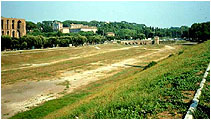

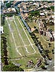

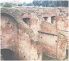

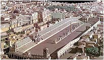

Wszelkie igrzyska organizowano w starożytnych budowlach - colosseum i circus maximus. Na jakiej podstawie ich budowę przypisano Rzymianom, trudno zrozumieć. Nikt nie jest w stanie określić ich pierwotnego przeznaczenia jak i wieku.

Circus Maximus zbudowany rzekomo przez Tarkwiniusza Starego (w 329 r. pne. wybudowano "stajnie") jest dziś najzwyklejszą łąką o wymiarach 544x129 m, otoczoną wałem ziemnym i kilkoma ruinami na obrzeżach. Ten rzymski hipodrom mieścił jednorazowo ćwierć miliona ludzi. To tu podobno odbywały się słynne wyścigi kwadryg, w których czasem powoził sam Neron. Ruiny na obrzeżu są pozostałością po jakiejś potężnej budowli o grubych murach wypełnionych wewnątrz drobnymi kamieniami.

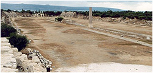

Czy tak potężnych murów wymagało podtrzymanie paru rzędów kamiennych ławek, czy też konie były tak silne i narowiste? Patrząc na wysokość ruin stajennych pomieszczeń aż trudno wyobrazić sobie rzymskiego konia. Na jakiej podstawie zrekonstruowano ten "hipodrom"? Rekonstrukcja, to chyba życzenie na zasadzie - Rzym był "wielki", to i budowle musiały być imponujące. Ciekawe, że identyczny hipodrom posiada fenicki Tyr, a Syrię zdobyto dopiero w 63 r. pne. Czy rzymska dokumentacja "techniczna" przeleżała w archiwum prawie 300 lat? Przyglądając się tzw. hipodromowi w Tyrze można podejrzewać, że to on stał się on modelem do wykonania rzymskiej rekonstrukcji, bo z rzymskiej "piaskownicy" nie dało się chyba nic wywnioskować.

Mam także wątpliwości, czy faktycznie były to tory do wyścigów konnych. Jakie było zamierzenie prawdziwego twórcy nie dowiemy się chyba nigdy, podobnie jak z przeznaczeniem rzymskiego colosseum, budowanego także w różnych miejscowościach i w najróżniejszych wymiarach.

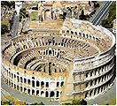

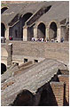

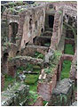

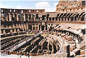

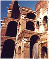

Rzymskie colosseum to największe "jajko" świata. Budowę rozpoczął ponoć Wespazjan, a ukończył Flawiusz w 80 r. ne. Nie ma równie wielkiej budowy tego typu w całym imperium. Dłuższa oś liczy 188 m, krótsza 156 m, zaś wysokość 51 m. Mieścił około 50 tysięcy widzów. Czym było naprawdę? Potrójny mur okalał owalną "scenę", a pod "sceną" znajdowały się rozbudowane podziemia rzekomo przeznaczone dla gladiatorów i dzikich zwierząt, co absolutnie mnie nie przekonuje. Gdzie siedziała widownia, skoro nie zachowało się nic, co by na to wskazywało. W ocalałych ruinach widać tylko pochyłe, gładkie dachy lecz współczesne rekonstrukcje posiadają już miejsca dla widzów. Na jakiej podstawie? Sposób budowy jest identyczny jak w "stajniach" Tarkwiniusza. Jak to się mogło stać, że wszystkie obiekty w imperium rzymskim budowano według jednego i tego samego sposobu (małe kamienie i cement) i prawie według jednego planu przez cały okres trwania państwa? Czy oznacza to 1000-letni zastój techniczny i używanie jednego i tego samego projektu? Dlaczego zrekonstruowane colosseum jest też bardziej życzeniowe niż rzeczywiste?

**Rzym się ukulturalnia**

  
  

Własnej sztuki i literatury Rzym jako taki posiadał jak na lekarstwo. Przez cały okres bazowano na obcych autorach, szczególnie Grekach, tłumacząc na łacinę ich dzieła. Znanych rzymskich autorów można policzyć na palcach obu rąk. Dzieł stricte naukowych nie pozostawił prawie wcale. Wygląda na to, że Rzymianie nigdy nie byli miłośnikami sztuki i literatury. Być może dlatego Rzym posiadał tylko trzy "teatry" - Marcellusa, Balbusa i Pompejański. Odnalazłem zdjęcie tylko jednego i tylko od strony elewacji. Pozostałe chyba rozebrano na budulec już bardzo dawno.

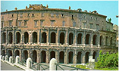

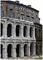

Na zdjęciach można zobaczyć, co faktycznie Rzymianie mogli budować w swoim "wiecznym" mieście. Tu widać część mieszkalną, dobudowaną jako trzecie piętro nad "teatrem" i tu w pełni można się zgodzić z archeologami, że to może być zbudowane przez cywilizację rzymską. Na takie "przybudówki" stać było tę młodą cywilizację. Sądzę, że wszystkie obiekty zbudowane przez Rzymian, to przeróbki, nadbudówki i domy nowobogackich budowane z elementów starożytnej Rumy. Rzymianie nie musieli szukać budulca, mieli go w około aż nadto.

Można by też spytać - po co Rzymianie budowali "teatry" w każdym zdobytym mieście, skoro nie było co wystawiać, a i zapełnienie widowni łączyć się musiało ze spędzeniem ludzi z całych prowincji? Każde przedstawienie przy pełnej publiczności mogło też w każdej chwili przekształcić się w powstanie ludowe. Altruizm czy niefrasobliwość?

**Rzym się kąpie**

  
  

Higiena i czystość społeczeństwa jest i dzisiaj jednym z podstawowych priorytetów polityki państwa i chyba dlatego jednymi z najbardziej potężnych budowli starożytnego Rzymu są termy, czyli miejskie łaźnie. Kto wpadł na taką nazwę oficjalna historia milczy, choć z lubością ją powtarza. Popatrzmy na termy Karakalli. Grube na kilka metrów mury, dwie potężne, sześciokątne wieże broniące wejścia, wysokie łuki i to wszystko tylko dla basenów z ciepłą i zimną wodą, a nawet podobno wykryto natryski. Po co pospólstwu łaźnie wysokie na kilkanaście metrów przypominające bardziej obronne twierdze? W samym Rzymie jest ich kilkanaście, ale najpotężniejsze są przypisywane cesarzom Karakalli i Dioklecjanowi.

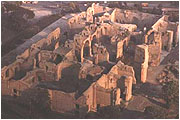

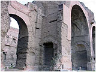

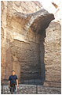

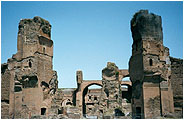

Sposób wypełnienia murów znany z Ameryki Południowej, Kartaginy itd., czyli drobne kamienie spojone mocną zaprawą. Jakie było ich prawdziwe przeznaczenie? Czy miejsca ablucji plebsu musiały być tak ufortyfikowane? Tak grube mury mają tylko najpotężniejsze zamki średniowiecznej Europy, ale budowane dopiero 1500 lat później. Dlaczego tylko w Rzymie mamy do czynienia z taką rozrzutnością państwowych środków dla zapewnienia kąpieli zwykłemu plebsowi?

**Rzym się załatwia**

  
  

Archeologia, nauka skądinąd poważna, potrafi czasem doskonale rozbawić. Rzymianie sądząc po wybudowanych u siebie "termach" byli narodem dbającym o higienę, ale higiena to nie tylko kąpiel, dlatego też odnalezione na terenie imperium tajemnicze detale budowlane uznano za publiczne szalety i przypisano je oczywiście rzymskiej nacji. Jak widać każdy otwór o średnicy większej od pięści można przypisać rzymskiemu odbytowi, tym bardziej że wycięcie mogło służyć jako otwór technologiczny przeciwdziałający otarciu wiadomego narządu.

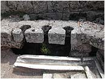

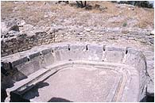

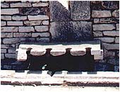

Są jednak drobne niejasności. Żaden odnaleziony szalet nie posiada rzeczy najważniejszej - dołu kloacznego. Dlaczego zawartość kloaki była prawie natychmiast usuwana wprost do zewnętrznych kanałów wypływając między nogami skupionych na wydalaniu? Spytać też można, czy Rzymianie byli całkowicie pozbawieni wstydu wydalając wprost na ulicy? Czy "technologiczne" wycięcia wskazują na przybytek "tylko dla mężczyzn"? Czy masywność użytych elementów była podyktowana "współczynnikiem bezpieczeństwa" opartym na wadze rzymskiego żołnierza z pełnym wyposażeniem? Dziwne jest także to, że te "rzymskie" toalety odnaleziono na razie tylko w Grecji, Afryce i w dzisiejszej Turcji. Dlaczego? Czy w starożytnym Rzymie po staremu załatwiano się w okolicznych krzakach lub za najbliższym rogiem?

**Rzym buduje drogi**

  
  

Wszystkie drogi prowadzą do Rzymu, jak mawiali starożytni Rzymianie ale zapewne mieli na myśli kierunek przepływu wszystkich zrabowanych bogactw z podbitych krajów. Kto pierwszy wpadł na pomysł przypisania Rzymianom budowy wszystkich kamiennych dróg w całym imperium historia milczy. Może to i lepiej, bo nie wiadomo na jakiej podstawie dokonano takiego "odkrycia". Trudno nawet dokonać jakiegoś sensownego podziału tych dróg, jako że wszystkie wyglądają prawie jednakowo. Pośród czterech zdjęć ukryłem drogę zbudowaną przez starożytnych Inków. Można pobawić się w archeologa.

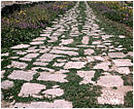

Pierwszą kamienną drogę zbudował podobno ten sam Appiusz Klaudiusz, co pobudował pierwsze akwedukty w roku 312 pne. Sam pomysł budowania kamiennych dróg nie wymagał Rzymian, ale historycy "doszli" do takiego wniosku i nikt tego nie zanegował, bo nikt nie potrafił postawić alternatywnej hipotezy. Nikt też nie potrafił i nie potrafi do dziś określić wieku kamiennej drogi.

Czy można sobie wyobrazić liczbę kilometrów sześciennych kamiennego budulca, jaki zużyli Rzymianie na wszystkie drogi, budynki, mury obronne, akwedukty, colossea i teatry w całym imperium? Mniemam, że na taki rozmach nie pozwoliła by sobie nawet dzisiejsze zjednoczona Unia Europejska.

**Zgoda buduje, niezgoda... jeszcze więcej?**

Cała, z nielicznymi wyjątkami, historia cywilizacji starożytnego Rzymu to pasmo podbojów, wojen, kampanii i tłumienia buntów wewnętrznych i zewnętrznych. Spójrzmy na diagram by uzmysłowić sobie jak mało było czasu na zbudowanie czegokolwiek. Skąd Rzym wziął liczną armię inżynierów i techników zajmujących się tylko budownictwem, skoro nie posiadał szkolnictwa? Czy wzmiankowano gdzieś, jak dużo i w jaki sposób transportowano "rzymski" cement na wszystkie budowy, a przynajmniej jego "super" składnik - popiół wulkaniczny? W Europie oprócz trzech włoskich wulkanów (Etna, Stromboli i Wezuwiusz) innych nie ma, a najbliższy jest dopiero na Islandii. Według archeologów i historyków Rzymianie wprost upstrzyli cały antyczny świat swoimi budowlami.

Należy zrozumieć jak Rzym prowadził swoje zdobywcze kampanie. Na początek jednak trochę o głównej sile Rzymu, czyli o jego armii. Jako państwo Rzym był w stanie wystawić jednorazowo 700-tysięczną armię wraz ze sprzymierzeńcami. Podstawą armii była jednostka zwana legionem, która liczyła 4500 żołnierzy piechoty i 300 jazdy. Do każdego legionu dołączano zwykle auxilia (wojska sprzymierzonych) zwykle w sile 5000 piechoty i 300 jazdy. Armia pod wodzą jednego konsula liczyła przeważnie dwa legiony. Armie mogły walczyć samodzielnie lub łączyć swe siły. Jak widać była to siła niemała, jednakże takie siły można było zebrać tylko w ekstremalnych przypadkach.

W normalnych podbojach stosowano taktykę polityczno-militarną. Jak pisałem, Rzym był mistrzem w stosowaniu polityki "divide et impera". Doskonale wykorzystywał krótkotrwałe sojusze skierowane przeciwko jednemu państwu, by po pewnym czasie tę samą metodę zastosować do byłych sojuszników. W pierwszej fazie używano dyplomacji z propozycją "nie do odrzucenia" i jeśli dane państwo nie chciało się podporządkować Rzymowi "dobrowolnie", wówczas do dyplomacji włączała się armia. Po zdławieniu oporu wyznaczano miasto mające być siedzibą prowincji i miastem garnizonowym, wyznaczano naczelnika prowincji, dawano mu do ochrony żołnierzy i dołączano armię urzędników, której celem było ściąganie podatków i kontrybucji, a na mapie zaznaczano nowego wasala Rzymu. Główne siły wojskowe kierowano na następny "dyplomatyczny" odcinek.

Jak z tego widać, w każdej prowincji mogło być tylko kilka miast garnizonowych, gdzie faktycznie panowała władza Rzymu, a i te musiały leżeć blisko morza, gdyż uzależnione to było od morskiego transportu. Jak zatem Rzym mógł zbudować tyle obiektów na całym zdobytym terenie? Skąd brał nie mniej liczebną armię specjalistów budowlanych? Skąd brał tyle wojska, by zabezpieczyć wszystkie tereny budowy i utrzymać w ryzach pracujących niewolniczo ludzi? Skąd brał tak ogromną ilość środków ciężkiego transportu? Gdzie wreszcie znajdowały się rzymskie kombinaty produkujące cement, którego musiano zużyć niewiarygodne wprost ilości? Odpowiedź jest prosta. Nie musiał mieć, bo nie zbudował niczego.

Jak mogły wyglądać podboje rzymskie według mnie - sceptyka, pokazuję na mapce. Przyjąłem całkiem odmienne założenie niż współcześni historycy, którzy każde kamienne ruiny przyjęli za rzymskie budowle i stąd zapewne ta wielkość imperium. Zasięg imperium określony na podstawie znalezionych rzymskich dóbr i pieniędzy też uważam tylko za zasięg handlu rzymskimi przedmiotami. Wyprawy rzymskie nie były wycieczkami turystyczno-krajoznawczymi a wyprawami wojskowymi, dlatego ich powodzenie zależało od liczby wojska, uzbrojenia i zaopatrzenia. Państwo rzymskie być może posiadało duże zasoby ludzkie, jednak nie znaczy to, że były nieograniczone. Podobno dopiero za Cezara ludność samego Rzymu oblicza się na około miliona, choć i tę liczbę uważam za zbyt optymistyczną. Na jakich przesłankach to oparto nie wiadomo. Jeśli podstawą była ilość rozdawanego darmo zboża, to można pogratulować dobrego samopoczucia.

Wszelkie lądowe wyprawy prowadzono znanymi od wieków szlakami, szczególnie wzdłuż wybrzeży morskich czy wzdłuż rzek. Dawało to większe możliwości obrony i ułatwiało zaopatrzenie drogą wodną. Rzymianie nie zmuszeni, nigdy nie poruszali się poprzez góry, gdzie w przesmykach czy wąwozach mogliby ponieść klęski. Wszędzie dokąd dotarły wojska rzymskie natychmiast budowano warowny, drewniano-ziemny obóz wojskowy, o który opierały się dalsze wyprawy.

Sądzę, że i rzymski handel opierał się tylko o graniczne faktorie, do których docierali handlarze z krajów ościennych. Rzym nie miał dobrej opinii, był postrzegany jako najeźdźca i okupant i każda rzymska karawana kupiecka musiałaby wędrować pod silną wojskową eskortą. Dobra rzymskie, a przede wszystkim ich złote i srebrne pieniądze zostały rozprowadzone po całej Europie tylko przez kupców handlujących z Rzymem.

Rzymianie nigdy też nie byli narodem żeglarzy. Flotę, z pilnej potrzeby rozprawienia się z korsarstwem, rozbudowali dopiero w połowie II wieku pne. Wszystkie dalekie wyprawy prowadzili wzdłuż morskich brzegów i dlatego mam wątpliwości czy dopłynęli do Brytanii przez Atlantyk (prawdopodobnie ani jeden atlantycki port nie był w rękach Rzymian, gdzie można by było uzupełniać zapasy żywności i wody). Krótki odcinek kanału La Manche pokonali zapewne na statkach zbudowanych gdzieś u ujścia Renu, z miejscowych zasobów i przy pomocy zniewolonych miejscowych specjalistów.

Jak z tego widać granice imperium wyznaczały tylko rzymskie obozy wojskowe oraz miejscowości w których stacjonowało rzymskie wojsko. Ukazywana na historycznych mapach wielkość imperium rzymskiego jest raczej życzeniem współczesnych historyków na podstawie błędnego podstawowego założenia. Być może pomylono zasięg ściąganych kontrybucji z fizyczną obecnością. Na mojej mapce nie znajdziesz też wszystkich miejscowości. Niektóre udało mi się znaleźć, ale większość podawana jest tylko w rzymskim nazewnictwie i mam pewne wątpliwości czy sami historycy potrafią je zlokalizować.

**Łuki tryumfalne - fakt czy zwyczajny mit?**

Co to jest łuk tryumfalny? Wedle archeologii jest to budowla w kształcie monumentalnej, łukowato zakończonej bramy, którą budowano specjalnie dla uczczenia zwycięstwa jakiegoś rzymskiego wodza, by po powrocie do Rzymu mógł pod nim przejść jednorazowo i pokazać swoje zdobycze. Jak planowano budowę, by zdążyć na czas nie mogę sobie tego wyobrazić, podobnie jak planowania zwycięstw czy klęsk. Dlaczego tak rozrzutnie trwoniono materiał i ludzką energię na kilkugodzinny pokaz pychy? Albo Rzymianie byli tak bezgranicznie niefrasobliwi, albo co jest bardziej prawdopodobne ich "budowa" polegała głównie na zawieszeniu paru flag, girland i transparentów na budowlach już istniejących od wieków, na których później przytwierdzali stosowną inskrypcję upamiętniającą uroczystość. Co dziwniejsze, nie dość było łuków w samym Rzymie, bo stawiano je wszędzie na świecie.

  
Bukareszt

  
Tarragona

  
Delhi

  
Paryż

  
Trypolis

  
Chiny

I tak od lewej - w Rumunii, Hiszpanii, w Afryce, we Francji czy nawet w Indiach i Chinach, nie licząc tych stawianych w samym Rzymie. Co jest charakterystyczne, wszystkie jak jeden posiadają wspaniałe łuki architektoniczne rzekomo "wynalezione" przez rzymskich budowniczych. Jak są natomiast zbudowane trudno powiedzieć, bo zostały przez Rzymian lub współczesnych "konserwatorów" kompletnie zapacykowane i nie wolno tego tynku usunąć, bo zabytek. Na ich murach wykuto lub przymocowano tablice z inskrypcjami zawierającymi nazwiska bohaterów i zapewne dlatego dziś nazywa się wszystkie od ich imienia, a co niektórzy interpretują jako budowniczych. Same inskrypcje można zaliczyć do najstarszych przejawów "kultury turystów", którzy bez mała na wszystkim co zwiedzają pozostawiają ślady.

  
Francja

  
Dougga

  
Volubilis

  
Saintes

Pewne wyobrażenie o budowie rzymskich łuków tryumfalnych można wywnioskować z tych, których nie zdążono pokryć "rzymskim" cementem, a tu już widać wielkość i precyzję poszczególnych elementów. Pod ostatnim w Saintes, mogło paradować nawet dwóch zwycięzców na raz. Czy tak zbudowane są pozostałe, tego się nie dowiemy, bo żaden konserwator zabytków nie wyrazi zgody na zdjęcie tego rzymskiego "makijażu". Mogłoby to także zagrozić tak wypieszczonej teorii o "wielkim Rzymie".

Jakie było pierwotne założenie budowy tych "łuków" nie wiadomo, gdyż obok nich zachowało się bardzo niewiele budowli towarzyszących. W łukach, których nie zdążono otynkować występują charakterystyczne nisze. W jakim celu je wykonano i co kiedyś zawierały nie wiadomo. Niektóre łuki "tryumfalne" występują jeszcze w pozostałościach murów, co mogło by świadczyć o ich charakterze jako bramy wjazdowej (np. w Rimini czy w Tyrze).

**Rzymskie czy nie rzymskie?**

Postaram się przedstawić dowody, dlaczego Rzymianie nie byli w stanie wybudować tego, co im przypisuje dzisiejsza archeologia. Oczywiście, że nie udowodnię wszystkiego, ale postaram się przedstawić te najbardziej charakterystyczne z krańców imperium rzymskiego, na podstawie których można wykreować sobie własną opinię na temat nieomylności współczesnej archeologii i historii starożytnej.

**Kartagina**

  
  

Kartagina, zgodnie z nauką, powstała około 814 r. pne. Założona ponoć przez Fenicjan wypędzonych z własnej ojczyzny przez Asysryjczyków. Pozostawili swoje miasta Tyr, Sydon czy Byblos, by rozpocząć nowe życie w dalekiej Afryce. Przyszło im to łatwo, gdyż jak powszechnie wiadomo Fenicjanie byli najlepszymi żeglarzami tamtych czasów. Nie mogę jednak zrozumieć, dlaczego po przepłynięciu morza nagle zmienili nazwę swego ludu? Na to pytanie historia nie odpowiada. Swoją gehennę rozpoczęli w roku 264 pne w tzw. wojnach punickich z Rzymem prowadzonych ze zmiennym szczęściem aż do roku 146 pne., co nie przeszkodziło im w międzyczasie założyć na ziemi hiszpańskiej następnej kolonii nazwanej Nową Kartaginą, którą i tak utracili na rzecz Rzymian po walce w roku 209 pne.

Czy Rzymianie mogli zbudować coś w samej Kartaginie? Nie. W roku 146 pne. po zdobyciu Kartaginy przez Scypiona, senat rzymski nakazał jej całkowite zburzenie. Co wtedy zburzono nie wiem, ale sądzę że złość wyładowano na drewnianych chatach i kilkunastu być może murowanych budynkach wielmożów. W jaki sposób ówczesny człowiek mógł zniszczyć tak potężne mury? Ile czasu i ilu ludzi musiało by to robić? Sama walka kosztowała zapewne dużo mniej wysiłku. Rzymianie nie dysponowali ani młotami pneumatycznymi ani materiałami wybuchowymi. Nikt z Rzymu nie sprawdzał też jak przebiegało niszczenie Kartaginy, ale propagandowo osiągnęli wielki sukces. Wszyscy uwierzyli, że rzymska armia potrafi wszystko.

Całość miasta zaorano i poświęcono bogom podziemi. Według ówczesnego prawa rzymskiego, po takim poświęceniu "pod karą śmierci" na takim terenie nie wolno było niczego zbudować. Skąd wobec tego wzięły się tam budowle rzymskie? Kiedy zbudowano mniejszą kopię rzymskiego colosseum? Rzymianie mogli budować, ale tylko poza zburzonym terenem i może dlatego "budowali" w Dougga, Utica, Hippone, Uzna, Hanszir Kasabat, Hanszir Subajtila, Timkad czy Dżamila? Tam nie było klątwy ale, z drugiej strony, nie było też specjalistów, bo Rzym ich nie posiadał. Kto jest zatem budowniczym?

Kto mógł być twórcą potrzaskanej kolumny? Na pewno nie Rzymianie, bo jest to doskonały, jednolity walec z doskonale wypolerowaną powierzchnią. Kto w tych czasach umiał wytoczyć(!) granitową kolumnę o przekroju idealnego koła na całej kilkumetrowej długości? Dlaczego w samym Rzymie nie spotykamy tak doskonałych wyrobów?

Być może budowle pokazane wyżej można by przypisać Rzymianom, gdyby technika budowy znowu nie przypominała tej z kolonii Atlantydy. Grube mury, wypełnienie z drobnych kamieni spojonych zaprawą. Duże kamienne bloki nie pasujące do ręki człowieka. I jeden szczegół powtarzający się we wszystkich ośrodkach "zbudowanych" przez Rzymian - niesamowite zniszczenia powstałe nie wiadomo kiedy i z jakiego powodu.

**Petra**

  
  

Wpierw nauka, choć mam prawo nie wierzyć w ani jedno słowo. Petra - w IV wieku pne. stolica państwa Nabatejczyków. Występuje w Biblii pod nazwą Sele, po arabsku Wadi Musa (Dolina Mojżesza). Shellenizowana w I w. ne. W roku 105 ne. podbita przez Rzymian zaczęła upadać.

Znane są oczywiście zabytki Petry słynącej przede wszystkim ze "świątyń" wykutych w litej skale przez arabskich pasterzy(?), dlatego pokazuję tylko część uznaną za "rzymską". Rzymianie, a szczególnie ich armia byli narodem szczególnie "wrażliwym" na sztukę i chyba dlatego wszędzie, gdzie tylko doszli w pierwszym rzędzie budowali teatry. Pomińmy nawet to, że budowali z kamienia "na styk" doskonale dopasowując elementy. Dla archeologii to i tak nieistotny szczegół, bo ogrom budowli i niespotykany w Rzymie kształt kolumn jest też widać mało ważny. Na ostatnim zdjęciu grobowiec rzymskiego żołnierza wykuty w litej skale. Czy dla jednego szeregowca armia rzymska rzucała wszystko i wykuwała w tak niewdzięcznym materiale miejsce ostatniego spoczynku?

Dlaczego, oprócz kamiennych budowli, nie znaleziono kompletnie nic po rzekomych rzymskich budowniczych? Czyżby przed opuszczeniem Petry legioniści wysprzątali całe miasto? Podrzucenie paru monet czy rzymskich narzędzi bardzo by uwiarygodniło te "rzymskie" budownictwo. Sądzę, że Rzymianie nie mieli zielonego pojęcia, że istnieje starożytna Petra i nigdy tam nie byli, a jeśli już byli, to mogli zrobić tylko jedno - oniemieć ze zdumienia.

**Conimbriga**

  
  

Nic nie znalazłem na temat tego portugalskiego miasteczka oprócz cielęcego zachwytu turysty, który pisał: "Jak zwykle zaskakująca swym bogactwem kultura Rzymu kontrastująca ze średniowieczną prostotą. Wspaniałe mozaiki czy wyroby jubilerskie musiały porażać ludzi którzy odkrywali je setki lat po nagłym odejściu ich właścicieli." Sadzę, że faktycznie porażały, ale Rzymian, o ile tam w ogóle doszli.

Budowle "rzymskie" w Conimbriga w Portugalii, oddalonego od Atlantyku o około 50 km, są cokolwiek zagadkowe. Najbardziej zagadkową z nich jest budowla zbudowana na wzór plastra miodu. Jeden z "plastrów" jest zamknięty "rusztami" w kształcie pajęczyny, drugi z równoległych ceglanych "prętów". Jakie było przeznaczenie tej budowli? Łuki są budowane z wąskich, czerwonych cegieł. Podobne można spotkać też w samym Rzymie, a także w Bari i nie tylko. Natomiast nigdzie nie spotkałem kolumn zbudowanych z pojedynczych, zaokrąglanych cegieł, nawet w samej stolicy imperium. Czy Rzymianie zdecydowali się na przemarsz ponad 1500 km tylko po to, by zbudować tak niewielki obiekt i na dodatek w tak ubogim kraju? "Świątynia" z plastrów miodu, to jedyny obiekt tego rodzaju w całym imperium.

**Mur Hadriana**

  
  

Znawcy twierdzą, że mur zbudowała armia rzymska za czasów cesarza Hadriana około roku 122 ne., który chciał nim odgrodzić swoich żołnierzy od napastliwych barbarzyńców. Mur zbudowano do wysokości 4,5 i na szerokość do 3 m. Długość muru to 117 km. Do budowy zużyto 750 tysięcy metrów sześciennych kamienia. Dzisiaj nie jest jednolity, ponieważ Anglicy "rozkradli" część na własne potrzeby. Ponoć były nawet znaki milowe (oczywiście też rzymskie co 1481 m) i wieżyczki (po dwie między parą znaków). Na linii muru Rzymianie zbudowali 14 strażnic. Budowa trwała około 8 lat. W Brytanii według źródeł historycznych stacjonowało 10 tysięcy żołnierzy, ale historycy twierdzą, że mur Hadriana budowały trzy legiony rzymskie. Daje to 4800 x 3 = 14400 ludzi. Jeszcze inni historycy piszą, że w pobliżu muru stacjonowało stale około 15 tysięcy żołnierzy. To ilu ich wreszcie okupowało Brytanię? Mur Hadriana Rzymianie opuścili około roku 380 ne.

Mur, jak widać, zbudowano z ociosanych kamieni, czasem bez użycia zaprawy, dopasowując ściśle kamienie do siebie. Czy żołnierz rzymski był także tak doskonałym kamieniarzem, czy też byli to fachowcy z Brytanii? Obróbka kamieni do złudzenia przypomina tę stosowaną przy budowie Machu Picchu (lubię się czepiać szczegółów). Jak wyglądały wieżyczki, nie wiadomo. Rozebrali Anglicy, podobnie jak kamienie milowe i dlatego nie można sprawdzić jak wyglądała ta rzymska mila na ziemi Brytyjczyków. Za to zostały fundamenty strażnic. Ciekawe, ilu żołnierzy mieściło się w tych dwóch pokojach z kuchnią? Ilu pilnowało muru? Podobno dużo, ale chyba nieuważnie, bo rozbiórki fragmentów były na porządku dziennym, aż cesarz Septimus Sewerus wydał rozkaz do jego odbudowy w roku 200 ne.

Trudno mi zrozumieć dlaczego w Rzymie, kolebce cywilizacji, nie można odnaleźć nawet centymetra podobnego muru. Skoro zbudowali tak udaną zaporę w Brytanii, czemu nie odgrodzili się takim samym murem od bitniejszych plemion galijskich czy germańskich? Dlaczego mury obronne samego Rzymu wykonane są w zupełnie w innym stylu i w innej jakby technologii? Można przypuszczać, że Hadrian napotkawszy mur wykorzystał go do prywatnych celów. Pisząc do Rzymu (nieliczni umieli pisać) ogłosił się budowniczym, by wyłudzać od senatu dotacje na dalszą budowę i utrzymanie. Takiej ewnetualności nikt nie przyjmuje, bo Rzym nadal jest postrzegany jako wzór uczciwości i rzetelności.

To jeszcze nie wszystko. Rzymianie wznieśli podobny, ale już ziemny, w roku 140 ne. 160 km na północ, zwany wałem Antonina (widocznie wszystkie kamienie wykorzystał Hadrian). Długi prawie na 60 km, wysoki na 3 i szeroki na 4,5 m. Co 3 km zbudowano 19 fortów, a przed całym wałem wykopano fosę głęboką na 4 metry i szeroką na 12 metrów. Czy armia rzymska była tak zajęta budową i obroną muru, że nie zdążyła sobie wybudować nawet jednego małego, kamiennego teatrzyku, ani nawet jednego maleńkiego colosseum? Po co zbudowali taki mur, skoro z tych materiałów powstało by kilka, jeśli nie kilkanaście zamków i to nie do zdobycia?

Archeolodzy, ci wspaniali detektywi przeszłości albo nie wiedzą wszystkiego albo nie chcą zauważać podobnych kamiennych budowli położonych poza wałem "Hadriana". Może Rzymianie zbudowali to w tajemnicy?

Irlandia

Szkocja

Orkady

Podobny "hadrianowy" mur, choć niższy, istnieje przecież w sąsiedniej Irlandii. Tam też są ruiny kamiennego domu z "rzymskim" cementem pomiędzy kamieniami. A kto budował w Szkocji z kamienia wzmacniając wejście ogromnymi skalnymi belkami? Kto wreszcie na Orkadach, wyspach jeszcze dalej na północ od Szkocji, wybudował tę salę z wielkich kamiennych belek? Czy tam też byli Rzymianie? Budowle rzymskie w Brytanii są tak samo wiarygodne jak czaszka człowieka z Pitdown.

Szanowni Brytyjczycy, a może to Rzymianie wznieśli wam Stonehenge, a wy nic o tym nie wiecie? Podejrzewam, że Rzymianie nie zbudowali wam nawet pół cala Londynu ani innych miast im przypisywanych, a jeśli już to tylko małe obozy wojskowe i to z samego drewna obsypanego ziemią. Podejrzewam też, że nie zbudowali nawet jednego yarda tzw. muru Hadriana. To Wy prawdopodobnie jesteście, oprócz Basków, jedynymi żyjącymi potomkami najstarszej cywilizacji świata. Etruskom, Celtom, Fenicjanom czy Kartagińczykom niestety nie udało się przeżyć. Wygubili ich właśnie Rzymianie.

**Jak wygląda prawdziwy rzymski mur graniczny ?**

Jakie rodzaje umocnień granicznych mogli budować Rzymianie?

Najpierw fragment Historii starożytnego Rzymu Marii Jaczynowskiej:

Największym dziełem Domicjana na pograniczu germańskim było rozpoczęcie budowy "limes", czyli systemu umocnień granicznych. Trzon "limesu" stanowiły obozy legionów - "castra" oraz mniejsze obozy wojsk pomocniczych - "castella", przestrzeń między nimi wypełniały wieże strażnicze - "burgi", zbudowane z drzewa. Hadrian uzupełnił ten pas umocnień drewnianą palisadą, a w III w. zbudował wał ziemny i fosę. Jakkolwiek "limes Germanicus" i "limes Raeticus" są dziełem wielu pokoleń, Domicjanowi przypisuje się zasługę podjęcia pierwszych prac nad zabezpieczeniem granicy nadreńskiej i naddunajskiej.

Jak to właściwie jest? U siebie mur graniczny i tylko drewniano-ziemny, budowały trzy pokolenia Rzymian, a w Brytanii kamienny mur armia postawiła w niecałe 8 lat. Skąd tak wielka różnica? Prawda może być taka, że wielkie imperium stać było tylko na budowę drewniano-ziemnych palisad, drewnianych strażnic, wałów i fos ziemnych. Na nic więcej. Na zdjęciach widać tzw. "limes" czyli graniczne umocnienia, jakie Rzymianie stawiali na granicach z Germanami czy Dakami. Prace ograniczały się tylko do robót ziemnych wzmacnianych drewnianymi palisadami. Budowano także tylko drewniane wieże strażnicze. Na zdjęciu obok widać wieżę strażniczą zbudowaną z kamienia, ale jest to jak sądzę swobodna rekonstrukcja, bo zbudowana na kamiennych fundamentach, które z góry przyjęto za rzymskie. Zbudowano więc atrakcję turystyczną z polnych kamieni i współczesnej "pucolany". Tu chyba zadziałało magiczne słowo "Rzym".

Jak mało logicznie podchodzi się do badań widać na mapce. Jest to fragment "limes" na granicy Retii i Germanii, której położenie określili archeologowie. Widać z tego, że historycy uważają Rzymian za kompletnych idiotów, którzy działają wbrew podstawowym zasadom wiedzy wojskowej. Linię określono zapewne na podstawie kamiennych pozostałości, z góry przyjętych za rzymskie i w konsekwencji "limes" prowadzona jest w poprzek rzek, jakby Rzymianie nie uznawali ich walorów obronnych. Drobny żarcik, celowe mijanie się z prawdą czy uparte trwanie przy błędnym założeniu?

**Most nad pięknym, modrym Dunajem**

Jedną z większych zagadek rzymskiej techniki wojennej stanowi most przez Dunaj. W roku 96 ne. na rzymski tron wstępuje Marek Ulpiusz Trajan. Jest to w historii Rzymu okres krótkotrwałych zwycięstw nad państwem Daków, rządzonych przez Decebala. Jest to także okres zadziwiających osiągnięć technicznych Rzymu. W roku 101 ne. Trajan wysyła na wojnę około 100 tysięcy żołnierzy, które przeprawia po moście pontonowym na Dunaju. Twórca tej hipotezy był zapewne pod wrażeniem współczesnego wojska szybko i sprawnie przeprawiajacego się przez wodę lecz Dunaj oglądał tylko w atlasie geograficznym. Dunaj w rejonie przeprawy nie był i nie jest dziś rzeczułką, a ponad kilometrowym korytem wody z silnym nurtem pośrodku.

Turnu Severin i miejsce budowy mostu na Dunaju

Jak wyglądał rzymski "ponton" trudno wywnioskować, bo nawet sami Rzymianie nie pozostawili żadnego opisu. Dlatego nikt nie jest w stanie dokonać rzeczowej rekonstrukcji. Wiemy natomiast, że rzymska technika w owych czasach do dyspozycji mogła mieć tylko drewno, liny plecione z roślin i nadmuchiwane skóry baranie (na takich "baranich pontonach" przeprawiali się już starożytni Asyryjczycy przez Eufrat). Jak wielki mógł być taki odcinek pontonu? Nie sądzę, by przekraczał wymiary 5x10 m. Z pewnością też musiał być wyłożony z wierzchu drewnianymi okrąglakami, lub czymś podobnym, by żołnierz lub koń po prostu w nim w nim nie ugrzęźli.

By utrzymać taki ciężar na wodzie musiał mieć przymocowane pod spodem na całej powierzchni nadmuchane skóry baranie (przymocowanie skór tylko do boków groziło załamaniem się konstrukcji w środku). Biorąc pod uwagę wymiar skóry 0,5x1 m, pod pontonem należało przymocować około 100 takich nadmuchanych elementów. Dla prostego rachunku przyjmijmy także szerokość rzeki na 1 km. Daje to nam most pontonowy złożony z minimum 100 pojedynczych pontonów oraz 10 tysięcy zabitych baranów i są to dane zdecydowanie zaniżone. Być może piszę trochę humorystycznie, ale wnioski wypływające z tego są bardzo poważne.

Tropaeum Traiani

Most pontonowy musiano budować z jednej strony rzeki (druga była zajęta przez wroga) układając i wiążąc pontony jeden do drugiego. Jest to czynność prosta przy brzegu, jak więc Rzymianie radzili sobie z prądem rzeki, który musiał znosić pontony grożąc rozerwaniem mostu? Dzisiaj taki most muszą utrzymywać specjalne łodzie, które mocą swych maszyn równoważą siłę rzecznego prądu. Utrzymywanie pontonu przez żołnierzy nie wchodzi w rachubę ze względu na głębokość rzeki. Rzymianie mogli mieć do dyspozycji tylko liny, a które do utrzymywania ostatniego pontonu musiały mieć grubo ponad kilometr długości. Czy wtedy już wytwarzano tak długie i aż tak wytrzymałe?

W tej samej wojnie zimą Decebal kontratakuje Rzymian przechodząc zamarzniętą rzekę. Dunaj płynie z reguły w łagodnych warunkach klimatycznych i przy tak silnym prądzie prawdopodobnie bardzo rzadko zamarza, ale w tym konkretnym roku jednak zamarzł. Po zwycięstwie, Trajan dla upamiętnienia tego wydarzenia wznosi monument zwany Tropaeum Trajani w Adamclissi. Dlaczego jednak pomnika nie stawia w miejscu swej chwały, a wznosi go kilkaset kilometrów dalej od miejsca tryumfu?

Istnieje jednak możliwość powiązania przeprawy pontonowej z Tropaeum Traiani w Adamclissi. Sądzę, że Rzymianie nie zbudowali mostu, ale na pojedynczych pontonach chcieli osiągnąć drugi brzeg przepływając rzekę. Całą tę armadę prąd rzeki zniósł jednak 100 km w dół rzeki, gdzie z trudem dobili do drugiego brzegu, a pomnik nie jest żadnym pomnikiem zwycięstwa tylko Votum Traiani za cudowne ocalenie. Można także odnieść wrażenie, że pomnik ten wznieśli Trajanowi współcześni "czciciele wielkiego Rzymu" obudowując stojącą od dawna kolistą ruinę na podstawie własnego, wyimaginowanego modeliku (na zdjęciu).

Szczątki mostu i jego "papierowa" rekonstrukcja

Trajan doskonale wiedząc, że wojna z Dakami nie jest zakończona, sprowadza ponoć około roku 102 ne. architekta z Damaszku Apollodora, któremu powierza zadanie zbudowania mostu przez Dunaj. Jak to? W całym imperium nie ma rzymskiego specjalisty zdolnego zaprojektować i wybudować most? A jednak!

Armia rzymska, co już uważam za ewenement, buduje na zachodnim brzegu Dunaju kamienny obóz Turnu Severin mający bronić mostu. Syryjski architekt w ciągu trzech lat (światowy rekord!) buduje most przez Dunaj, po którym 150 tysięcy żołnierzy przechodzi na teren wojny z Dakami. Z samego mostu pozostał tylko jeden filar, jak widać bardzo wąski i bardziej przypominający akwedukt. Natomiast rekonstrukcja mostu pokazuje nam drewnianą konstrukcję wspartą na murowanych filarach. Daje to co prawda mniej budowlanego wysiłku i oszczędność materiałów, ale stawia kolejne pytanie - w jaki sposób broniono mostu po stronie dackiej, gdzie w każdej chwili mógł zostać podpalony? Co w końcu stało się z mostem? Gdzie się podziały kamienne filary ze środka rzeki? Kto go zniszczył? Kiedy? Kto i kiedy zniszczył Turnu Severin? Na te pytania znów nie ma odpowiedzi.

Jakie dzisiejsze państwo jest w stanie w ciągu trzech lat wznieść most przez tak potężną rzekę? Która współczesna armia podjęła by się zbudować w tym miejscu most pontonowy? W jaki sposób Rzymianie postawili kamienne filary w środku rzeki? Kto wtedy był w stanie prowadzić prace pod wodą na głębokości kilkunastu metrów? Jakiż to cement wiązał kamienne elementy filarów pod wodą? Może oprócz pontonów Rzym posiadał również ogromne kesony? Czym dostarczano budulec na środek rzeki? Czy w końcu, jak przeprawiono 150 tysięcy ludzi, kilka tysięcy koni, a przede wszystkim sprzęt wojskowy i tabory przez tak, sądząc po ocalałym filarze, wąski most?

Zmieńmy troche temat. Na zdjęciach powyżej widoczne są resztki stolicy Daków - Sarmizeteguzy. Jak na prymitywnych Daków była naprawdę imponująca. Dziwi przede wszystkim "rzymski" sposób budowy, "rzymskie" łuki oraz użycie wielkich kamiennych elementów. Kto w Dacji potrafił wycinać tak duże, kamienne koła i to z andezytu? Co trzeba było zdobywać skoro stolica Daków nie miała muru obronnego? Czy Rzymianie próbowali odbudować Sarmizeteguzę? Historia milczy. Kto więc postawił "rzymską" kolumnę w środku ruin?

Wszystko jednak skończyło się szczęśliwie. Trajan zdobywa Sarmizegetuzę, a w roku 113 ne. wznosi w Rzymie kolumnę opiewającą jego zwycięstwa (dlaczego nie łuk tryumfalny?), ale o dziwo według historyków, przedstawia na niej wersję artystyczną, a nie historyczną. Dlaczego? Bo ponoć nic się nie zgadza.

Kilka reliefów z rzeczonej kolumny i kilka pytań. Co robi tutaj Bóg wynurzający się z morza? Czy to Neptun? Rzymianie przejęli go od Etrusków, ale nie bardzo czcili, bo nie byli narodem morskim. Nie postawili mu też żadnej świątyni. A kim jest całkiem współczesny anioł? Rzymianie byli sceptykami i nie wierzyli w życie pozagrobowe. Na dwóch ostatnich walki Rzymian z Dakami. Dakowie, podobno dziki naród, lecz tu występują w zwiewnych tunikach bez hełmów. Rzymianie bronią zaś jakiejś twierdzy zarzucając Daków kamieniami. To być może prawda, bo wreszcie pokazano prawdziwe wykorzystanie kamieni przez Rzymian. Zdziwiło mnie natomiast używanie łuku przez Daków. Łuków na większą skalę w starożytności używały tylko armie Bliskiego Wschodu (Persowie, Nubijczycy), a w Europie dopiero średniowieczni Anglicy.

Sam most w Drobeta też wydaje się być wersją artystyczną, a nie historyczną, gdyż wymaga tego współczesna gloryfikacja Rzymu i czołobitność przed jego "wielkością". Wystarczy jednak przekłuć ten "rzymski" balon i nie zostaje dosłownie nic, oprócz bezkształtnego flaka.

**Grecko-rzymskie czy rzymsko-greckie**

Jest też pewien kłopot związany ze stylami budowlanymi, a szczególnie z ornamentyką kapiteli czyli górnych zakończeń kolumn. Pamiętam ze szkoły jak wbijano w mózg, że w starożytnej architekturze występują tylko trzy style - joński, dorycki i koryncki. Najprostszy, dorycki miał u góry coś w rodzaju talerza, joński dwa rzeźbione zakrętasy, a koryncki to już było pełne bogactwo rzeźby gdzie przeważnie motywem był liść akantu.

Kartagina

Agrigento

Pompeje

Evora

starożytny Rzym

Chiny

Jak przedstawia się sprawa w imperium? W Kartaginie kolumny zwieńczano kapitelami podobnymi do stylu korynckiego. W Agrigento surowy styl dorycki podobnie jak w rzymskich Pompejach. Hiszpańska Evora skłania się do korynckiego, ale już w samym Rzymie kapitele w świątyni Saturna przypominają styl joński (podobnie jak półkolumny w rzymskim colosseum), a ostatni to już finezja z liści akantu. Oglądając budowle rzymskie, te zbudowane w stolicy i te w "uszczęśliwianych" krajach nie mogę oprzeć się wrażeniu, że Rzym albo skopiował style swojego odwiecznego wroga albo Grecy zdążyli wszystko zbudować przed Rzymianami. Czy Grecy budowali w Kartaginie lub w Evorze? Jakim cudem styl joński zawędrował do Chin? Archeolodzy nie mają natomiast żadnego problemu. Te budowle, które są bliżej Rzymu otrzymują status rzymsko-greckich a leżące bliżej Aten grecko-rzymskich.

Prawda jest taka, że gdzie nie spojrzymy - cała Europa, Azja Mniejsza i Bliski Wschód - cały ten teren jest usiany kolumnami w każdej możliwej formie i nie sądzę, że podział na style coś tu zmieni. Za te budowle, jak sądzę, nie odpowiadają przecież ani Grecy ani tym bardziej Rzymianie.

**Zdobycie Atlantyku**

Według archeologów i historyków oraz sporządzonych przez nich map imperium rzymskiego wiemy, że cywilizacja Rzymu sięgała po sam Atlantyk. Czy brzegi dzisiejszej Portugalii zdobywali z morza czy też długim lądowym marszem zaskoczyli przeciwników, historycy wypowiadają się chyba nieoficjalnie, bo trudno coś odnaleźć. Jak w tak odległe rejony dostarczono niezbędną ilość "cementu"? Przez górzystą Hiszpanię czy przez morze Śródziemne i Atlantyk?

Alcobaca

Batalha

Catoira

Wybrałem specjalnie same rybackie wioski lub miasteczka portugalskie leżące nad samym Atlantykiem. W Alcobaca pochyły, kamienny mur zamku, przypominający piramidy zza Atlantyku, ale już w Batalha widać przepiękne "rzymskie" łuki w ruinach jakiejś zapewne "rzymskiej" willi. W Catoira natomiast mury spajane "rzymskim" cementem, ale tutaj już archeolodzy zgodnie orzekli, że to mogli zbudować... Wikingowie. Zresztą nie jest to aż tak ważne. Ważne jest to, że nad Atlantykiem panowali Rzymianie. Należy się tylko domyślać, że gdyby nie upadek imperium, Rzymianie prawdopodobnie bez trudu zdobyli by Amerykę Środkową. Szkoda, że tak się nie stało, bo "ich" budowle już tam są.

**Czy to też rzymskie ?**

Przenieśmy się w zupełnie inny rejon świata i przypatrzmy się ruinom budowli do złudzenia przypominającej rzymskie. Widać wyraźnie "rzymskie" łuki, słynną "rzymską" cegłę i wszystko to spojone zapewne najsłynniejszą rzymską "pucolaną".

Ten, kto nie widział tego na własne oczy i nie wie, gdzie znajdują się te ruiny bez wahania uwierzy, że chodzi o następne budowle zbudowane przez super cywilizację Rzymu. Na tym właśnie bazują dzisiejsza historia wysuwając hipotezy, których zwykły człowiek nie jest w stanie zweryfikować. Nie będę trzymał w niepewności. To co widać na zdjęciach, to fragmenty Wielkiego Muru Chińskiego przypisane także przez "zasiedzenie" dzisiejszym Chińczykom. Jest to kolejny zręczny chwyt, ale tym razem azjatyckich kolegów "po fachu".

**Kilka zasadniczych pytań**

Czy jakikolwiek archeolog lub historyk potrafi odpowiedzieć na pytania?

Jaka jest wiarygodność wieku rzymskich budowli określonego tylko na podstawie znalezionych w pobliżu skorup, które mogły zostać porzucone w każdym innym czasie? Jaka jest wiarygodność określenia wieku budowli określonego tylko na podstawie tzw. inskrypcji, które można umieszczać gdziekolwiek i w dowolnym czasie?

Gdzie, kiedy i ilu tak doskonałych specjalistów budowlanych wyszkoliło imperium rzymskie? Czy w Rzymie znana była choć jedna uczelnia? Pierwszy znany uniwersytet rzymski datuje się dopiero na rok 1303 ne. Czy znane jest choć jedno nazwisko rzymskiego architekta? Kto z imienia i nazwiska zaprojektował choćby colosseum czy circus maximus?

Gdzie znajdowały się i jak były duże kombinaty produkujące "rzymski cement", którego musiały przecież używać wszystkie budowy w całym basenie morza Śródziemnego? Nie mógł być wytwarzany na miejscu budowy, bo w jego skład wchodził ponoć popiół wulkaniczny, a ten jest wyłączną domeną rejonu półwyspu Apenińskiego.

Skąd Rzymianie wzięli tak wielkie ilości cegieł do budowy choćby colosseum, Circus Maximus czy niektórych budowli Forum Trajana skoro, według archeologów i historyków, wytwarzać cegłę i dachówki zaczęto dopiero w II wieku ne. i to w przydomowych warsztatach?

Jak duże musiały być siły zbrojne, które musiały chronić architektów, pracowników administracji, ich rodziny i same prace budowlane w całym rzymskim imperium przed buntem pracujących niewolniczo podbitych narodów?

Czy jakiekolwiek państwo wchodzące w skład imperium rzymskiego (a nawet sam Rzym) zapisało w swoich annałach tak pracochłonne i kosztowne przedsięwzięcia budowlane? Czy to były przedsięwzięcia państwowe czy praca chałupnicza kilku entuzjastów?

Dlaczego Rzymianie budowali w podbitych krajach "teatry" czy "kolossea" mieszczące swobodnie od kilku do kilkudziesięciu tysięcy ludzi wiedząc, że nigdy się nie zapełnią? Dlaczego "colossea" i "teatry" zbudowano nie we wszystkich miejscach, gdzie rzekomo przebywali Rzymianie?

Dlaczego Rzymianie nie zbudowali akweduktów u siebie, w południowej części półwyspu i dlaczego nic takiego nie znajdujemy w Egipcie?

Kto (lub co) i kiedy zniszczył najstarsze budowle Rzymu? Dlaczego nikt nie próbował ich odbudować nawet w samym Rzymie? Jakaż to siła "rozbiła" Forum Trajanum, bazylikę Maxtensjusza i Konstantyna, że wspomnieć tylko kilka - czyżby "gniew ludu"? W którym konkretnie roku?

W jaki sposób określono wiek kamiennych dróg zbudowanych rzekomo przez Rzymian? Czy słynne kamienne drogi przypisano Rzymianom na znanej zasadzie "ktoś to musiał zrobić"?

Kiedy armia rzymska, po przemaszerowaniu ponad 2000 km "moczyła" nogi w Atlantyku budując przy okazji w Conimbriga w Portugalii? W jaki sposób dokonywano zaopatrzenia tej armii, szczególnie w żywność i w jaki sposób uzupełniano zasoby ludzkie?

Czy to wojska Hadriana postawiły mur w Brytanii, czy też istniejący już mur zagrodził im drogę? Dlaczego na tym murze nie kończą się "rzymskie" budowle, a występują w niezdobytej Szkocji i jeszcze dalej na północ, nawet na wyspach?

Dlaczego Rzymianie nie przekazali potomnym wiedzy o grobowcach etruskich, czyżby o nich nic nie wiedzieli? Dlaczego wszystkie grobowce były zasypane ziemią? Czy Etruskowie znali "aztecką" zasadę ukrywania własnych budowli?

Dlaczego w ciągu kilkusetletniego okresu wznoszenia budowli nie zmieniono stylu architektury ani sposobu budowy? Czy zbadano i porównano skład "rzymskiego ementu" we wszystkich budowlach, rzekomo wzniesionych przez Rzymian?

Jak to możliwe, że żadna z nacji będąca pod wpływem Rzymu, nie przejęła ich technologii budowlanej? Dlaczego pierwsze murowane budowle zachodniej Europy powstają dopiero około X wieku ne., kilkaset lat po upadku Rzymu? Czy jedynym powodem jest hipoteza historyków, iż Rzymianie zabrali swój "cement" do grobu?

Dlaczego w większości miast prowincji imperium, w ruinach budowli nie znaleziono nic po ich rzekomych, rzymskich budowniczych? Nawet złomka narzędzia, broni czy innych typowo "rzymskich" artefaktów? A może Polska też była prowincją Rzymu, bo przecież znaleziono u nas zatrzęsienie rzymskich monet? Czy nie była tylko dlatego, że nie posiadamy ani jednego "rzymskiego" teatru, mostu czy nawet kawałka kolumny.

Dlaczego 100% wszystkich budowli "rzymskich" od Atlantyku po Mezopotamię i od północnej Afryki po Brytanię (łącznie z Rzymem) uległo zniszczeniu? Czy ktoś próbował ustalić okres tych zniszczeń, a przynajmniej ustalić dlaczego wszystkie i to bez wyjątku? Dlaczego zniszczeniu uległy nawet te położone w rejonach mało aktywnych sejsmicznie, lub na których zjawiska te nie występują?

Leptis Magna w dzisiejszej Libii. Tak są zniszczone wszystkie budowle, które przypisuje się Rzymianom

Za jeden z najważniejszych dowodów, że Rzymianie nie zbudowali niczego uważam to, że nie odbudowali żadnej, podkreślam żadnej, rzekomo przez siebie wzniesionej budowli. Nawet we własnym kraju. W samym Rzymie jeśli budowali coś nowego, używali do tego budulca z rozbieranych, już wtedy zabytkowych, budowli. Tak postępowali od samego początku wszyscy władcy i wszyscy mieszkańcy starożytnego Rzymu.

Imperium rzymskie nie posiadało w ogóle szkolnictwa, a jeśli już to tylko szkółki wojenne. Tylko bogaci Rzymianie prywatnie nauczali swoje dzieci w domach i to przeważnie z łacińskich tłumaczeń zrabowanych dzieł greckich autorów. Przykładem może być Lucjusz Emiliusz Paulus, zwycięzca spod Pydny, który na skradzionej bibliotece królów macedońskich wykształcił swoich synów. Rzym nigdy nie miał naukowych korzeni i w ogóle nie rozwinął żadnej z nauk (oprócz sztuki wojennej), za to w roku 71 ne. wygnał z Rzymu wszystkich filozofów i astrologów.

Cywilizacja starożytnego Rzymu nie była żadną super cywilizacją. Podlegała temu samemu liniowemu postępowi, co cała pozostała Europa, a ta zaczęła budować z cegieł i kamienia dopiero około X wieku ne. Jakimże to cudem Rzym jako jedyny mógł wyprzedzić postęp techniczny o całe 1500 lat? Jest to, przynajmniej dla mnie, jakieś ogromne nieporozumienie. Przypisanie Rzymianom wynalazku "cementu" i łuku architektonicznego wynika być może z ograniczonej tylko do "fachowej" wiedzy archeologów i uważam to za (delikatnie mówiąc) minięcie się z prawdą. Taki "cement", technologia i łuki architektoniczne były stosowane w Ameryce Środkowej już wtedy, gdy nikt nawet nie przypuszczał, że kiedyś zaistnieje słowo Rzym. Przyglądając się działaniom polityczno-militarnym (wewnętrznym i zewnętrznym), stanowi gospodarki i zaplecza technicznego, poziomowi nauki, technologii i rozmachowi budownictwa w samym Rzymie i później w imperium, użytego materiału, technologii i stylu budownictwa, doszedłem do jednego tylko wniosku:

**STAROŻYTNI  RZYMIANIE  NIE  ZBUDOWALI  NICZEGO,  CO  IM  SIĘ  PRZYPISUJE !!!**

Rzymianie od samego początku mieszkali wśród starożytnych ruin i może usiłowali coś sklecać używając materiałów z już istniejących starożytnych budowli. Nie sądzę także, by postawili stopę w Conimbriga czy w Italice w Hiszpanii (najdalej w głąb Hiszpanii doszli podobno do Numancji). To historycy przypisując im "ad hoc" wszystkie kamienne drogi, mosty, akwedukty, świątynie, "colossea" i teatry musieli wyciągnąć wniosek, że tam musieli być.

Jedyny spadek po imperium rzymskim !

Imperium rzymskie swoją zachłannością i brutalnością zniszczyło wszystkie podbite cywilizacje nie oszczędzając nawet siebie. Czy teraz można już zrozumieć dlaczego NIE WOLNO odnaleźć Atlantydy? Odnalezienie jej wywróciło by całą starożytną historię do góry nogami, łącznie z historią starożytnej Grecji.

Jeśli tak było, to staje się jasne, że Rzym nie potrzebował milionowej armii. Nie musiał zdobywać Hiszpanii po sam Atlantyk. Nie musiał rozlewać się po całej Francji i innych podbijanych krajach. Nie musiał rozsyłać po całym swoim świecie armii specjalistów budowlanych. Odpada także problem surowców, transportu i rzymskiego "cementu". Z wojskowego punktu widzenia armia rzymska musiała działać wzdłuż wybrzeży lub w niedalekiej odległości od brzegów morza, gdyż w całości była uzależniona od zaopatrzenia drogą morską. Żaden, nawet najmniej utalentowany wódz nie uzależniłby zaopatrzenia swojego wojska od podbijanych ludów. To dlatego podbój krajów zaalpejskich prowadzono wzdłuż rzek i w oparciu o tzw. obozy, które pełniły rolę baz zaopatrzeniowych i bezpiecznego schronienia. Tam gdzie tego zaniedbano, Rzymianie natychmiast ponosili klęski.

Do swojej polityki Rzym potrzebował tylko jednego-dwóch miast, gdzie stacjonował garnizon wojska i mieściły się jego urzędy. Jedynym problemem, który musiał naprawdę rozwiązać, to problem transportu zagrabionych dóbr do Rzymu po uruchomieniu tej swoistej "wyRZYMaczki". Imperium Rzymu jest godne swych pierwszych legendarnych symboli - sępów i wilczycy, która wykarmiła protoplastów cywilizacji, pierwszego "wilczego stada" starożytności. Nie jest też przypadkiem, że ideologia imperium rzymskiego była wzorem dla dwóch systemów mrocznego okresu Europy - faszyzmu i komunizmu, cywilizacja starożytnego Rzymu była bodaj pierwszą w znanej historii cywilizacją zwyrodnialców. To, co wprowadzał w życie pajacowaty Benito Mussolini oraz Adolf Hitler było kontynuacją i rozwinięciem "filozofii" wielkiego Rzymu. Nawet Stalin nie jest autorem masowych przesiedleń ludności, on tylko skopiował działania Trajana w Dacji.

**Czekając na ostatnie zdanie ...**

Czy to Rzym? Nie, to Irlandia.

Ostatnie zdanie należeć będzie do nowej generacji historyków. Nie tych ortodoksyjnych, spętanych doktryną liniowego postępu i teorią Darwina. Będzie należeć do nowej naukowej generacji zdolnej odrzucić te wszystkie "nieomylne" dogmaty, potrafiącej wykorzystać najnowsze zdobycze techniki, umiejącej zastosować do badań zdobycze innych gałęzi nauk. Nowej generacji, która umieć będzie wyciągać wnioski bardziej logiczne niż typowo życzeniowe.

Ruma pod względem wielkości była bodaj największym ze starożytnych miast Europy. Pozwala to wyciągnąć wniosek, że była największym ośrodkiem administracyjnym tej części Atlantydy przed 12,5 tysiącami lat, przed światowym kataklizmem. Prawdopodobnie to pod jurysdykcją Atlantydy rozwijały się kolonie zwane dzisiaj Fenicją i Kartaginą, kolonie w Brytanii, Francji, Hiszpanii i Afryce aż po granice z Egiptem. To ta cywilizacja budowała na "swoim" terenie amfiteatry, teatry, świątynie z "grecko-rzymskimi" kolumnami, mosty, akwedukty i kamienne drogi. To ta właśnie cywilizacja używała "rzymskiego" cementu do spajania murów z pojedynczych kamieni. Tylko ta cywilizacja posiadała rozwiniętą naukę, technologię i technikę zdolną do wznoszenia takich budowli. Tylko przed 12,5 tysiącami lat żyła na tych terenach liczna rzesza ludzi zdolna zapełnić każdy wybudowany amfiteatr czy prowincjonalny teatr. Czy dla dzisiejszych historyków Ruma i Roma znaczy dokładnie to samo?

Czy nasz Wielki Nauczyciel i syn Boga został schwytany i uwięziony przez żołnierzy z Rumy czy z Romy? To ogromna różnica. Może się bowiem okazać, że chrześcijaństwo jest dużo starsze niż cały "pogański" Rzym.

A moje zdanie? To co przedstawiłem stanowi pozostałość po cywilizacji zniszczonej w kataklizmie przed 12,5 tysiącami lat. Cywilizacji, której stolica spoczywa dziś na dnie Oceanu Atlantyckiego.

Chcę uświadomić też, że pisząc o cywilizacji imperium rzymskiego nie utożsamiam ich absolutnie z dzisiejszymi Włochami. Włosi to zupełnie inny naród, choć zamieszkujący te same ziemie. Dopiero po upadku imperium ludy półwyspu Apenińskiego zaczęły budować i budowały przez setki lat swoją dzisiejszą tożsamość i nie wolno ich utożsamiać z cywilizacją imperium rzymskiego.  
(P.S. droga Inków, to druga od prawej)
