**Ze stepów Azji czy potomkowie Atlantów?**  
"Atoli Celtowie mieszkają po drugiej stronie Kolumn Heraklesa i są sąsiadami  
Kynesierów, zamieszkujących najbardziej na zachód wysuniętą część Europy".  
Herodot

**Ciekawe mapy starożytnych**

Czy jest możliwe odnalezienie potomków dawnej cywilizacji w czasach współczesnych? Jednoznacznie na zadane pytanie nie można odpowiedzieć, choćby z tego powodu, że dzisiejsza nauka nie jest tym prawdziwie zainteresowana. Wiele materialnych śladów wbrew temu, co sądzi dzisiejsza historia, wskazuje na nasze dużo starsze pochodzenie. Jednak nastawienie dzisiejszych archeologów i historyków nie dopuszcza innych hipotez niż te, które uważa się za oficjalne (czytaj - tylko ich). Dlaczego? Łatwo się domyśleć. Ja spróbuję jednak, jeśli nie podważyć, to przynajmniej zwrócić uwagę na pewne niekonsekwencje wynikające z takiego a nie innego myślenia. Mój wywód będzie ciągiem dalszym rozdziałów o Atlantydzie i Rzymie. Przypomnę założenia, na których opieram swoje wnioski:

**•** Przed 12,5 tysiącami lat, ziemię zamieszkiwała wspólnota narodów podobna do dzisiejszej, o różnym stopniu rozwoju, o różnych kulturach, będących ze sobą w stałym kontakcie handlowym i kulturowym.  
**•** Podstawowym surowcem do budowy najważniejszych obiektów był kamień, łączony bliżej nieznanym spoiwem. Sztuka obróbki kamienia osiągnęła bardzo wysoki poziom.  
**•** 12,5 tysiąca lat temu Ziemię dotknął kataklizm, który przerwał rozwój wszystkich cywilizacji, w tym cywilizacji wspólnej dla naszego regionu nazwanej przeze mnie umownie "wspólnotą Atlantydy".  
**•** Nie wszystkie ślady zostały starte z powierzchni ziemi, jak i też nie wszyscy ludzie zginęli w tym kataklizmie.  
**•** Zmiana brzegów kontynentów i zalanie niektórych niżej położonych terenów ukształtowało "wyspy", na których ocaleli ludzie musieli organizować swoje życie od nowa. Niektóre społeczności pozostały w izolacji aż do najbliższych nam czasów.  
**•** W miarę upływu czasu następowała stopniowa degradacja cywilizacyjna z powodu utraty bazy technicznej i stopniowego zużycia ocalałej. Egzystencja sprowadzała się do podstawowych potrzeb i przypominała życie prymitywnych społeczeństw. Upływ czasu zacierał pamięć o przeszłości, która do naszych czasów przetrwała w formie szczątkowej.

Jedną z przesłanek obrazujących wygląd świata sprzed kataklizmu mogą być najstarsze mapy z widokiem konturów północno zachodniej Europy. Starożytni kartografowie, podobnie jak i dzisiejsi, mogli rysować mapy tylko na podstawie własnych obserwacji i pomiarów lub wykorzystywać starsze opracowania. Podkreślam, że map nie rysuje się z głowy. Tak można robić przy tworzeniu komputerowych gier. Kto twierdzi, że mapy starożytnych to czysta fantazja, jest człowiekiem nie orientującym się w realiach prac kartograficznych.

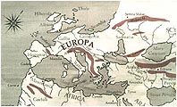  
Korybes

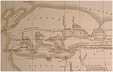  
Eratostenes

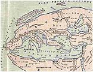  
Dionizjusz

Proszę obejrzeć kilka dzieł starożytnych kartografów. Najbardziej interesującymi są opracowania kartografów greckich gdyż, jak sądzę, są najstarszymi z istniejących map. Proszę zwrócić uwagę na zarys linii brzegowej północno-zachodniej Europy oraz na wyspy leżące u jej brzegów. Będzie to jednym z moich dowodów na prawdę starożytnych. Na mapie Korybesa dwie duże wyspy nazywają się Albion i Hibernia a powyżej nich znajduje się Thule. Na mapie Erastotenesa Albion zamienia się w Bretanię, zaś na mapie Dionizjusza widzimy dwie kiszkowate wyspy pod wspólna nazwą Britanni Issule i powyżej na obu także Thule.

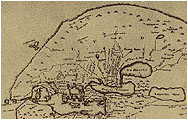  
Herodot

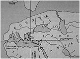  
Dicearchus

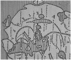  
Rzym

Na mapie Herodota u wybrzeży znajdują się trzy małe wysepki o nieodczytanej przeze mnie nazwie. Na mapie Dicearchusa widzimy tylko Thule i obok wielką nieopisaną wyspę, ale już na mapie Rzymu (tu przekręconej o 90°) Znajduje się wyspa Britannia oraz Thule w znacznym oddaleniu. Sensacją (przynajmniej dla mnie) jest brak... Morza Bałtyckiego. Ktoś może powiedzieć - przecież Grecy znali tylko rejon Morza Śródziemnego. Zgoda, to skąd w takim razie wiedzieli o Morzu Kaspijskim? Skąd o Zatoce Perskiej czy Oceanie Indyjskim z Taprobaną. Skąd Erastotenes powziął wiadomość o Oceanie Północnym? Morza Bałtyckiego nie ma, bo nie było go na najstarszych mapach tych sprzed kataklizmu. Bałtyk zaistniał dopiero po kataklizmie 12,5 tysiąca lat temu, gdy wody Atlantyku zalały szelf kontynentalny i wlały się w dzisiejszą nieckę zatapiając przy okazji legendarny Jomsborg. Nieprawdopodobne? Być może, ale nie aż tak niemożliwe.

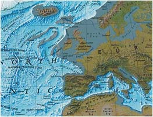  
Europa przed kataklizmem (?)

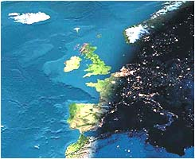  
Ten sam rejon z kosmosu

Pozwoliłem sobie na mały eksperyment. Zakładając że przed kataklizmem, który zatopił Atlantydę, kontynenty znajdowały się wyżej, "wynurzyłem" ponad wody szelf kontynentalny. Jest to oczywiście daleki od doskonałości zarys kontynentu nie uwzględniający zmian wysokości przy zmianie krzywizny geoidy w zależności od odległości od bieguna (jak wiemy różnica odległości punktu od środka ziemi na równiku i biegunie wynosi około 22 km). Daje to jednak ciekawy, zmuszający do zastanowienia efekt. Obok dla porównania zamieściłem zdjęcie satelitarne tego samego rejonu, gdzie widać ukształtowanie terenu znajdującego się pod wodą. Porównajmy zarys północno-zachodniego brzegu Europy sprzed kataklizmu z tym samym rejonem na mapach starożytnych. Widać dość duże podobieństwo, co może być dowodem, że starożytni korzystali z map wykonanych przed kataklizmem. Zarys brzegów Europy starożytnych oraz przybrzeżnych wysp nie pokrywa się idealnie z moim "eksperymentem", ale zasadnicze elementy wykazują duże podobieństwo.

Jak widać nie ma w tej konfiguracji miejsca na Morze Północne, Kanał la Manche, Morze Irlandzkie czy nasz Bałtyk. Prawdopodobnie mapy starożytnych mówią prawdę, choć nauka na temat powstania Bałtyku ma zupełnie inne zdanie. Wyprawy starożytnych Greków ograniczały się prawdopodobnie tylko do basenu Morza Śródziemnego i stąd dokładniejsze rozeznanie tego akwenu, natomiast tereny poza zasięgiem ich poznania zostały skopiowane z dużo starszych map (prawdopodobnie sprzed kataklizmu). Mapy starożytnych kartografów moga więc być kompilacją z kilku źródeł. Tak też powstała prawdopodobnie słynna mapa Piri Reisa z zarysem brzegów Ameryk i Antarktydy. W świetle tego co piszę jest też możliwe, że transgresja wód do Morza Czarnego miała miejsce także w tym czasie, a nie 7 tysięcy lat temu. To nie pęknięcie tamy lodowej a tylko potężne trzęsienie ziemi mogło utworzyć szczeliny zwane dziś Bosforem i Dardanelami, przez które wody Morza Śródziemnego wdarły się do Morza Czarnego. Dziś przebiega tam potężny, aktywny uskok tektoniczny odpowiedzialny za trzęsienia ziemi w tym rejonie świata. Obniżenie się terenu Europy i basenu Morza Śródziemnego w wyniku "wielkiego uskoku skorupy ziemskiej" zamieniło też naziemne pałace w podziemne "cysterny" odnajdywane dziś w Aleksandrii czy na terenie Turcji. Zwykła logika podpowiada, że do gromadzenia wody nie potrzebne są aż tak zdobne zbiorniki z pięknymi kolumnami.

Jednak głównym efektem mającym katastrofalne skutki dla przyszłej historii tego rejonu było "rozerwanie" jedności kontynentu. Większość terenu północno-zachodniej Europy została zalana wodami Atlantyku. Na powierzchni pozostały tereny położone najwyżej tworząc większe i mniejsze wyspy, dzisiejszą Europę i półwysep Skandynawski. Ludzie i ich zdobycze cywilizacyjne zostały pochłonięte przez wody nazywane dziś Morzami - Północnym, Irlandzkim, Bałtyckim i Kanałem la Manche. Rozerwane narody zmuszone były tworzyć od nowa swoje społeczności i czasem w zupełnej izolacji. Jako przykład tego chciałbym zatrzymac się na cywilizacji celtyckiej, jednej z najbardziej tajemniczych cywilizacji Europy.

**Skąd się wzięli Celtowie?**

W encyklopedycznym skrócie współczesnych historyków można ująć to tak: lud indoeuropejski, który około 2000 lat pne zajmował dorzecze górnego Renu, Dunaju i Menu skąd w ciągu następnych tysiącleci rozprzestrzenił się we wszystkich kierunkach od Pirenejów po Morze Czarne, docierając nawet do Azji Mniejszej.

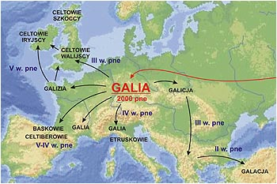

Naukowe wędrówki Celtów przez Europę

Około 700 r. pne wyłaniają się jako naród w południowo-zachodniej Europie środkowej. 1000 lat pne skolonizowali Brytanię, skąd wyparci 400 lat później wyemigrowali do Szkocji i Irlandii. W 390 r. spalili Rzym ale zmuszeni do odwrotu udali się na tereny Śląska i Małopolski, a część z nich ruszyła na Bałkany i w roku 279 spaliła Delfy. Religia Celtycka kształtowała się pod wpływem Rzymu. Składali ofiary z ludzi. Nigdy nie założyli jednolitego państwa choć pozostawili po sobie bogatą spuściznę materialną. Skąd się wzięli w Europie? Otóż historycy przypuszczają, że jak reszta ludów ze stepów środkowej Azji, będąc którąś z kolei grupą migracyjną.

Stereotyp współczesnej historii. Najpierw daleka Azja, potem przemarsz na nowe miejsce zamieszkania (pokojowy lub z bronia w ręku). Kilkaset lat oddechu na odrestaurowanie siły żywej, wymyślenie własnej religii, zrobienie paru wynalazków, dozbrojenie się i ponowna ekspansja gdzie się tylko da, aż do wyczerpania sił witalnych. Potem ustatkowanie się i albo założenie własnego państwa albo przepadnięcie w mrokach historii. Swoją drogą ta Azja to istna wylęgarnia drobiu na eksport. Dziwne tylko, że za każdym razem opuszczała ją nowa, inna rasa.

Odłóżmy na bok azjatyckie "nioski" i spójrzmy na Celtów z innej strony. Ponad 12,5 tysiąca lat temu kontynent europejski zamieszkują narody o wysokiej cywilizacji, których podstawowym materiałem budowlanym jest kamień. W Europie tamtych lat ścierają się interesy dwóch grup, które jak wiemy są pokłosiem podziału świata między Bogów. Na terenie europejskim - Posejdona i Ateny. Wiemy także, że około 12,5-13 tysiąca lat temu dochodzi do wojny Posejdonii (Atlantyda) z Atenią (Grecja). Możemy także w przybliżeniu ustalić gdzie przebiegały granice wpływów (pisałem o tym w kontekscie Atlantydy). Wynika też z tego, że większośc terenów Europy zamieszkuje ludność Posejdonii, którą możnaby nazwać ludnością celtycką. Kataklizm 12,5 tysiąca lat temu rozbija te wspólnotę na kilka mniejszych, która odbudowuje społeczność lecz już nie spójną narodowo, a czasem wręcz w całkowitej izolacji jak Irlandia, Brytania czy Skandynawia. Odbudowa trwa bardzo długo, bo ponad 6 tysięcy lat, co ma niewątpliwy wpływ na zróznicowanie poszczególnych grup - ich historii, praw, wierzeń i kultury materialnej. Ludnośc Europy to autochtoni, a nie przybłędy ze stepów Azji. Celtowie to miejscowa ludność, która przetrwała kataklizm i odrodziła na nowo swoją tożsamośc, choć w kilku miejscach porozdzielana wielką wodą.

Częściowo moją koncepcję mogą potwierdzać badania ogólnoświatowego Projektu Genograficznego, którego szefem jest amerykański genetyk dr Spencer Wells, a który ma doprowadzić do opracowania genealogicznej mapy Europy. Prof. Bryan Sykes z Oxford University po przeprowadzeniu szeroko zakrojonych badań genetycznych doszedł do wniosku, że współcześni Europejczycy, wywodzą się z siedmiu klanów. Naszymi pramatkami jest siedem kobiet, którym prof. Sykes nadał imiona:

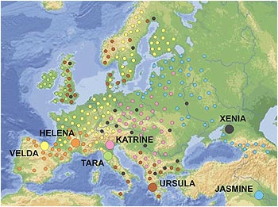

Matki Europy i ich potomstwo

**•** **Ursula** - żyła 45 tysięcy lat temu, jej potomkami jest 11% współczesnych Europejczyków. Najwięcej z nich zamieszkuje Wielką Brytanię i Skandynawię.  
**•** **Xenia** - żyła 25 tysięcy lat temu i jest pramatką 7% Europejczyków.  
**•** **Helena** - żyła 20 tysięcy lat temu i jest pramatką 41% Europejczyków zamieszkujących najliczniej północną Hiszpanię i południową Francję.  
**•** **Velda** - żyła 17 tysięcy lat temu i jej pokolenie stanowi 4% Europejczyków, którzy zamieszkują zachodnią i północną Europę oraz Finlandię i północną Norwegię.  
**•** **Tara** - żyła 17 tysięcy lat temu. Jej pokolenie to niespełna 10% Europejczyków z południowej i zachodniej Europy oraz zachodniej części Wielkiej Brytanii i Irlandii.  
**•** **Katrine** - żyła 15 tysięcy lat temu. Potomkowie stanowią 10% Europejczyków i rozproszeni są po środkowej i północnej Europie.  
**•** **Jasmine** - żyła 8 tysięcy lat temu w Mezopotamii. Jej potomstwo stanowi 12% Europejczyków głównie ze wschodniego wybrzeża Bałtyku, Rosji i Kaukazu.

Z mapki widać, że większość społeczeństw Europy wykazuje genetyczną spójność. Widać, że celtowie irlandzcy to jednorodna genetycznie grupa, podobnie Celtowie Iberyjscy i Francuscy Gallowie. Troszkę dziwne miejsce zajmuje matka Irów wywodząca się z dalekich północnych Włoch, z drugiej jednak strony Etruskowie mają więcej cech wspólnych z Celtami niż z Rzymianami. Można więc stwierdzić, że Europa to nie tygiel azjatyckich emigrantów, a widoczne grupy społeczeństw nie mające z Azją nic wspólnego. To ludność od samego początku związana z Europą, wyrosła z tego samego pnia a na jej zróznicowanie miał niewątpliwy wpływ kataklizm sprzed 12,5 tysiąca lat.

W artykule zamieszczonym we "Wprost" (Nr 1212 z 5 marca 2006) Zbigniew Wojtasiński pisze między innymi:

Grecy są bardziej spokrewnieni z Etiopczykami i innymi mieszkańcami Sahary niż z Włochami, Słowianami czy nawet Turkami. Węgrzy mają najwyższy wśród ludności niesemickiej udział haplotypów, czyli charakterystycznych dla danej populacji wariantów genów, typowych dla Żydów. Z kolei Polacy to genetyczny tygiel Europy. \[...\] Zostaliśmy dość równomiernie wymieszani z innymi nacjami: mieszają się w nas zarówno geny litewskie, ruskie i węgierskie, jak też nordyckie, germańskie, ormiańskie i geny Żydów aszkenazyjskich. \[...\] Chorwaci mają znaczny udział haplotypów charakterystycznych dla Polaków i Rosjan, ale u mieszkańców Dalmacji wykryto geny Awarów, koczowniczego ludu pochodzenia ałtajskiego, zamieszkującego teraz Dagestan. Włochy można podzielić na "genetyczne regiony", których dzisiejsi mieszkańcy są spokrewnieni z żyjącymi w starożytności na tych terenach Etruskami, Ligurami z okolic z Genui oraz Grekami z południa Włoch. Grecy różnią się od mieszkających na północy ich kraju Macedończyków, bo prawdopodobnie pochodzą od niewolników sprowadzanych z Afryki w starożytności. Potomkami niewolników z Afryki Północnej są też niektórzy mieszkańcy Półwyspu Iberyjskiego, szczególnie Portugalii, gdzie sprowadzono ich najwięcej. Z kolei w północnej Portugalii większe są wpływy Berberów, rdzennej ludności północnej Afryki i Sahary.

Jak z tego widać genetyka ma więcej do powiedzenia niż współczesni historycy. Wróćmy do Celtów nazywanych także Gallami, Galatami czy Galicyjczykami. Współcześni dziejopisarze nie mają o nich zbyt wysokiego mniemania. Naród owszem bitny, dobrze uzbrojony gdyż stosunkowo wcześnie opanował obróbkę żelaza, ale prymitywny. Kulturę przejmował od podbijanych narodów, kontakt z Rzymem spowodował zromanizowanie życia i religii. Czy naprawdę? Obejrzyjmy kilka artefaktów przypisywanych temu barbarzyńskiemu narodowi.

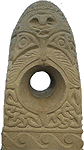

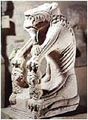

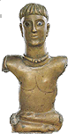

Z lewej strony coś w rodzaju kamiennego totemu z precyzyjnym reliefem o bliżej niesprecyzowanym motywie z doskonale okrągłym otworem i do tego o zmiennej średnicy (dla archeologów - w kształcie lejka). Kto i jakim narzędziem wykonał ten otwór w kamieniu? Znajomość prymitywnej obróbki żelaza absolutnie do tego nie wystarcza. Na środkowym zdjęciu mityczny potwór z Noves we Francji pożerający człowieka (z paszczy zwisa mu ludzka ręka) wsparty na dwóch ludzkich głowach. Po prawej rzeźba z brązu nazwana bogiem z Bouray. Widać z tego, że i obróbka brązu nie stanowiła problemu dla celtyckiego artysty. Co ciekawsze rzeźba ta w stylu przypomina dzieła etruskie. Istnieją jeszcze piękne rzeźby wykonane w kamieniu przedstawiające Galla zabijającego żonę i siebie oraz umierającego Galla, ale według uczonych są to kopie rzymskie. Ciekawa sprawa z punktu widzenia psychologii. Rzymianie jak tylko mogli przedstawiali Gallów w niekorzystnym świetle, a tu proszę poświęca się im nawet rzeźby i do tego wykonane w najtrwalszym surowcu jakim jest kamień.

Ciekawym kultem, z punktu widzenia współczesnej historii, był kult matron związany z pradawną Matką-Ziemią. Jak pisze Jerzy Gąssowski w Mitologii Celtów "w sztuce celtyckiej i galo-rzymskiej matrony były przedstawiane jako trzy siedzące postacie dojrzałych kobiet, karmiących niemowlęta, trzymających rogi obfitości albo kosze pełne owoców.

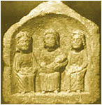

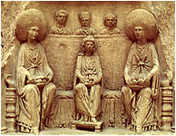

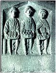

Ta przejrzysta symbolika wiedzie nas ku pojęciom sytości, obfitości i spełnienia - tego wszystkiego, co najlepsze u starych bóstw kobiecych". Piękne to, tylko czym dostojna babcia ma karmić niemowlaka? Jeśli przypatrzyć się matronom na ostatniej fotografii, to naprawdę jest trudno zauważyć biust nawet w stanie szczątkowym. A co mają oznaczać węże między ich nogami? Sytość, obfitość czy spełnienie? A może skąpstwo? Chyba nie, bo wtedy węże powinny wyłazić z kieszeni. W świecie Celtów kobieta zajmowała bardzo wysoką pozycję. Niektórzy poszli nawet tak daleko, że kalendarz celtycki wywodzą od menstruacyjnego cyklu kobiety, ale na wszelki wypadek określają go jako księżycowy ("Lunarny cykl miesięczny nieodparcie kojarzył się z powtarzalnością okresów płodności." Gąssowski).

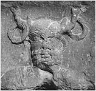

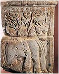

Kolejne artefakty to Cernunnos z torquesami na rogach oraz Tarvos Trigaranus na galo-rzymskim ołtarzu. Oba łączy jedna wspólna cecha - zostały wykopane spod katedry Notre-Dame w Paryżu. Nie rozumiem tu pojęcia galo-rzymski. Kto wykonał te rzeźby? Gallowie czy Rzymianie? Dwa narody nienawidzące się wręcz genetycznie, będące cały czas na stopie wojennej, a tu taka współpraca? Czy Gallowie dawali pomysł, a Rzymianie kuli w kamieniu, czy też Gallowie wykuwali rzeźbę, a Rzymianie wykuwali na nich tylko napisy? Dlaczego zakopano te rzeźby (będące przecież przedmiotem kultu) pod katedrą? A może było zupełnie inaczej? Przedmioty te prawdopodobnie znalazły się pod katedrą w wyniku trzęsienia ziemi a następnie przykryte osadami jakie naniosła ze sobą woda. Tak, to wynik "wielkiego uskoku..." i wniosek może być tylko jeden - zarówno rzeźby jak i napisy zostały wykonane przez Celtów, ale Celtów sprzed kataklizmu. Wynika z tego także to, że Rzymianie nie muszą być twórcami kroju pisma zwanego antykwą. Być może fundamenty Notre-Dame (a może i nie tylko) pochodzą z tamtego okresu, bo na dobrą sprawę nikt tego nie badał i chyba nie ma zamiaru.

Przypatrzmy się teraz słynnemu kociołkowi z Gundestrup w Danii. Oczywiście, według archeologów, nie wykonali go Celtowie a dostarczył go ktoś ze strefy naddunajskiej. Celtowie tylko umyślnie go rozbili i zatopili w bagnie (Schlette). Dwa fragmenty pokazują celtyckich bogów - Cernunnosa (z lewej) i Taranisa (z prawej). Zajmijmy się ich otoczeniem.

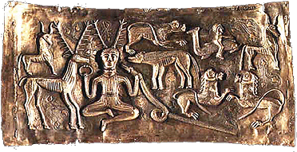

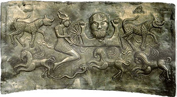

Bóg Cernunnos w prawej ręce trzyma bransoletę zwaną torquesem, a w drugiej ściska dość sporego węża lecz najbardziej chyba intrygującym fragmentem płaskorzeźby jest człowiek płynący na delfinie. Motyw delfina spotyka się przede wszystkim w sztuce minojskiej, a to są czasy na długo przed Rzymianami. Drugi bóg, to Taranis trzymający w ręku zwykłe koło od wozu, które dla historyków jest jednak atrybutem słońca (tzw. znak solarny). On sam występuje także w osobliwym otoczeniu. Na samym dole widzimy latające niby konie z ptasimi dziobami i potężnymi pazurami, po obu stronach występują tajemnicze zwierzęta o centkowanej sierści, koło zaś usiłuje mu wyrwać postać w hełmie z rogami. Za dużo tu tajemniczych postaci jak na Celtów żyjących prawie nam współcześnie.

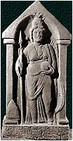  
Brigantia

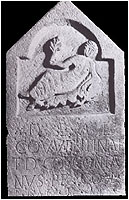  
Kowentyna

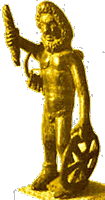  
Taranis

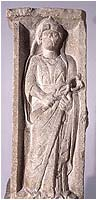  
Rosmerta

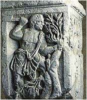  
Esus

Stelle wotywne z reliefami bogiń celtyckich. Pierwsza z lewej to Brigantia. Bogini wiedzy, poezji i wieszczbiarstwa. Jedna z najstarszych bogiń celtyckich, która przetrwała do naszych czasów, a nawet została świętą Brigit z Kildare. Ciekaw jestem w jakich to momentach wykorzystywała trzymaną przez siebie włócznię? A może celtycki bóg miłości biegał po ziemi z siekierą i dlatego do dziś nie został zidentyfikowany? Druga to Kowentyna, bogini wodna. Przyznam szczerze, że nie widzę tu żadnego atrybutu wody, chyba że w fałdach spódnicy dojrzymy falująca wodę. Stelle wotywne bardziej też przypominają mi nagrobki i bardzo możliwe, że ze znamienitych nieboszczek celtyckich uczyniono boginie, ale to już sprawa interpretatorów nagminnie lubiących gmatwać najprostsze sprawy. Bóg Taranis okrzyknięty celtyckim Zeusem chyba z powodu trzymanego w ręku "oscypka", wygląda na kołodzieja z zawieszonym na ramieniu kompletem podkładek. Tutaj też zwykłe koło do wozu awansowało do symbolu słońca. Dalej bóg o dość swojsko brzmiącym imieniu Esus (drwal, cieśla?) oraz Rosmerta, symbol śmierci i zniszczenia - to też ponoć rzeźby z grupy galo-rzymskiej.

Przekonanie historyków, że w owych czasach nie było cywilizacji zdolnych do rzeźbienia w kamieniu oprócz Rzymian i Greków spycha Celtów do roli pariasów cywilizacji. Jak zatem tłumaczyć mnogość dzieł "rzymskopodobnych" na tak wielkim obszarze? Czy za każdym legionem rzymskim maszerował legion inżynierów, kamieniarzy i artystów, by na każde skinienie wodza rzeźbić, malować i budować? Czy za legionem artystycznym wlókł się tabor dźwigów, ociosanych kamieni i "pucolany"? A może jeszcze specjalny oddział ciągnął na wozach rzymskie rzeźby, by tu i ówdzie podrzucić? Nigdy nie słyszałem o tak dziwnym wojsku.

Panuje powszechne przekonanie, że kultura Celtów w najczystszej postaci zachowała się tylko w Irlandii oraz zachodniej Anglii i Szkocji. Z mojego punktu widzenia jest to oczywiste, gdyż wyspy te najdłużej pozostawały w izolacji. Najwięcej też pozostało tam kamiennych budowli sakralnych, które o dziwo przypisuje się jednemu misjonarzowi, patronowi Irlandii św. Patrykowi. Sama postać jest bardzo ciekawa. Urodzony w Szkocji, nauki pobierał u kontynetalnych chrześcijan by w IV w. udać się z misją do Irlandii. Szybkość działanie jest zaiste imponująca. Dzisiejsi historycy są widać zdania, że już w tych czasach istniało regularne połączenie promowe i istniała dogodna komunikacja śródlądowa. Misja św. Patryka rozpoczyna się walką z druidami, których zwycięża za pomocą... czarów. Tak. Jest to nawet włączone w opis żywota świętego. Jego święty ogień wielkanocny pokonał święte ognie druidów. Przypatrzmy się zatem kościołom zbudowanym przez Patryka.

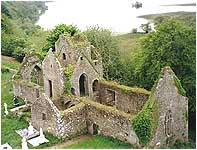

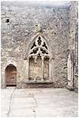

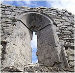

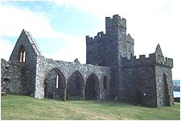

Jak na epokę i przysłowiową irlandzką biedę są to cuda techniki. Do budowy użyto najtrudniejszego w obróbce kamienia spajanego jakąś irlandzką "pucolaną". Budowano z płaskich kamieni, wygładzanych ze strony lica, a otwory okienne zdobiono cyzelowanymi, kamiennymi ramami. Proszę zwrócić uwagę na kształt okna. Wykonano je dla postawienia we wnęce rzeźby, która była otoczona poświatą światła padającego z zewnątrz wąską szczeliną. W środku musiał panować przyjemny półmrok podkreślający zarys rzeźb. Zaiste musiał to wymyśleć i wykonać przedstawiciel prymitywnej cywilizacji. Takich kościołów na terenie Irlandii są setki i łączy je jeszcze jedna cecha - prawie wszystkie są zniszczone.

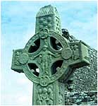 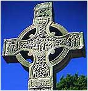  
Irlandia

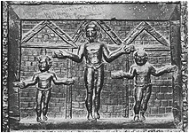  
Francja

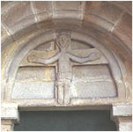  
Polska

Jedną z najbardziej zagadkowych postaci jest figura Chrystusa(?) na krzyżu celtyckim. Jak widać figura ma rozkrzyżowane ręce (na jednym nawet swobodnie stoi) i nie wygląda na dobrze nam znaną figurę Chrystusa ukrzyżowanego. Co ciekawsze taką pozę znajdujemy też we francuskiej Galii, a nawet w Polsce na portalu starej kolegiaty w Koninie. Inne podejście do męki Pańskiej czy też forma daleko starsza od rzymsko-chrześcijańskiej?

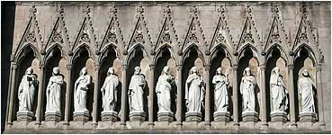

Inne pytanie dotyczy fasady wyspiarskiego kościoła. Wszyscy wiemy, że po zdradzie, Judasz został wykluczony z grona apostołów. Wiemy także, że potem liczbę apostołów uzupełniono do świętej liczby dwanaście. Na fasadzie kościoła widzimy tylko jedenastu apostołów. Czy wieść o dobraniu świętego człowieka do grona krzewicieli ewangelii nie dotarła do celtyckich chrześcijan czy też nie chciano niszczyć doskonale wykonanej kompozycji?

Wróćmy jeszcze na chwilę do patrona Irlandii św. Patryka. Oficjalna historia mówi, że św. Patryk urodził się około 390 n.e. w Szkocji. Będąc pacholęciem został porwany i sprzedany do niewoli w Irlandii. Uciekł z niej sześć lat później i znalazł schronienie w kontynentalnej Galii gdzie zapewne zetknął się z młodym chrześcijaństwem. Po kilkunastu latach życia w zakonie wrócił do Irlandii w 432 r. jako misjonarz.

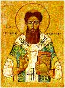

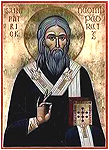

Ponoć znak krzyża i Trójcę świetą wytłumaczył tubylcom na zwyczajnej koniczynie i weszła ona do historii jako symbol Irlandii. Inna sprawa, że koniczyna była także świętą rośliną druidów, wię może tu chodzi o przejęcie symbolu, czynności bardzo powszechnej we wczesnym kościele chrześcijańskim. Za jego to sprawą Irlandia została pozbawiona węży (plemię węży w Irlandii?) ponieważ, jak mówi legenda, węże nie pełzają po koniczynie.

Najstarsze bodaj wyobrażenie św. Patryka bardzo przypomina bizantyjską ikonę. Skąd wpływy bizantyjskie w izolowanej Irlandii? Czy Patryk przebywając w Galii miał możliwość zetknięcia się ze sztuką bizantyjską? Dla porównania przedstawiłem ikonę św. Palamasa. Ikony w zasadniczych elementach nie różnią się, święta księga trzymana w ręku, szarfa z krzyżami, sposób podpisu ikony (oczywiście w różnych językach), a co najdziwniejsze obaj święci prawą dłoń mają ułożoną w identyczny sposób - na kształt hinduskiej mudry.

Świat wyspiarskich Celtów jest pełen zagadek i historycznych sprzeczności. Historycy twardo stoją na stanowisku, że w Irlandii nie stanęła stopa Rzymianina. Wprawdzie Agricola szykował desant na wyspę, ale z nieznanych powodów zrezygnował, co jak widzimy w żaden sposób nie przeszkodziło powstaniu na niej typowo rzymskich budowli. Jak zatem powstały "hadrianowe" mury, kto wybudował "rzymskie" mosty i co zrobić ze światynią pasującą jedynie do Rzymskiego lub greckiego kręgu?

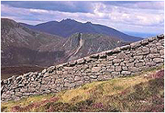

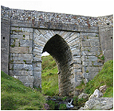

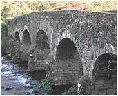

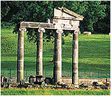

Jak pogodzić podobne obiekty w nie podbitej przez Rzymian Szkocji, co zrobić z akweduktem w celtyckiej Walii? Do jakiej kultury zaliczyć irlandzkie "Wielkie Zimbabwe"? Proszę osądzić samemu.

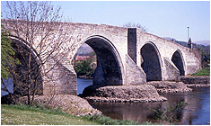

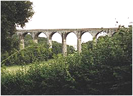

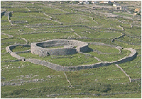

Z tego widać, że cywilizacja Celtów była o wiele potężniejszą niż się wydaje historykom. Była cywilizacją mającą swe korzenie w bardzo odległej historii i nie potrzebowała żadnej pomocy Rzymu. Gloryfikacja Rzymu jako motoru europejskiego postępu jest zwykłą manipulacją i upraszczaniem naszej historii. Cywilizacja Rzymu to tylko pierwszy znany ustrój totalitarny, którego jedynym celem było podbijanie i okradanie innych ludów. To były ludzkie wszy wypijające krew podbitych narodów niszcząc ich zorganizowane życie. Oni pierwsi zaczęli niszczyć skutecznie odradzające się cywilizacje po kataklizmie sprzed 12,5 tysiąca lat. Oni pierwsi przetrzebili Basków, Galów i Celtów. Tę sama metodę zastosowali skutecznie setki lat później portugalscy i hiszpańscy konkwistadorzy mordując cywilizacje obu Ameryk. Ich naśladowcami czasach współczesnych byli Mussolini, Hitler i Stalin i to jest prawdziwe pokłosie Wielkiego Rzymu.

Nie sposób opisać wszystkiego i wydaje się, że świadomie pominąłem warownie i zamczyska. Z pewnością nie. Postanowiłem opisać je w osobnym rozdziale. Zamki średniowiecza, w tym i celtyckie, są o tyle ciekawe, że łączą je, jak irlandzkie kościoły, dwie wspólne cechy. Są kamienne i prawie wszystkie uległy ruinie.

**Budowle średniowiecza?**

Na poczatek pytanie. Z czego najłatwiej jest wznieść zamek - z kamienia czy cegły? Odpowiedź jest oczywista - na pewno z cegły. Dlaczego więc najstarsze budowle średniowiecznej Europy wzniesiono z kamienia? Odpowiedź jest też oczywista - bo nie znano cegły. Co prawda wypalaną cegłę wynaleźli już Babilończycy i do tego powlekaną niebieską glazurą oraz Rzymianie w II wieku ne, ale na terenie Europy widać nie była popularnym materiałem budowlanym, oczywiście do czasu. Jest też charakterystyczną rzeczą, że z końcem średniowiecza, jak nożem uciął, kończy się budowa kamiennych zamków. Dlaczego? Kamień jest najtrudniejszym w obróbce surowcem ale i najtrwalszym, mogącym przetrwać wieki. Kamienne mury mogą z powodzeniem przetrwać największy pożar i w dalszym ciągu pozostać użyteczne. Kamienne mury może zalać woda i kamienne mury będą trwać i służyć dalej. Dlaczego tak lekkomyślnie zrezygnowano z ich budowy. Dlaczego mimo upływu setek lat nikt nie podjął się odbudowy, z małymi wyjątkami, tych przepięknych budowli? Jako anegdotę można przyjąć stwierdzenie historyków, że zaprzestano budowy murów, bo nie broniły przed ogniem armat. Panowie historycy, walory obronne murów są aktualne i dzisiaj. To dlatego Francuzi wydali fortunę na linię Maginota i dlatego Hitler odpowiedział linią Zygfryda. Ale to tak na marginesie. Odpowiedź na pytanie może być tylko jedna - nikt nie potrafił. Nikt nie potrafił, nigdzie nie było odpowiednich specjalistów, nikt nie miał odpowiednich narzędzi i odpowiedniej techniki, bo nikt ze średniowiecznych ludzi tych zamków nie zbudował.

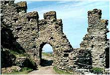  
Tintagel

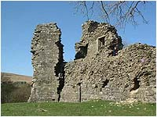  
Pendragon

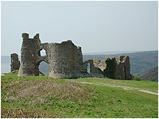  
Kornwalia

Zniszczone zamki wyspiarzy. Zamek Tintagel jest łączony z legendarnym królem Arturem i rycerzami okrągłego stołu. Ten celtycki władca został włączony do rycerzy chrześcijańskich z powodu Świętego Graala, do dziś szukanego przez entuzjastów. Jeśli Graal wogóle istnieje to sądzę, że należy go szukać w stolicy Celtów, za Słupami Heraklesa. Wielka Brytania jest wprost usiana zamkami. Historia uczy, że sam Wilhelm Zdobywca w ciągu wieku wybudował ich 900. Dziewięć potężnych zamków w ciagu roku? Kto mu pomagał - Bóg czy diabeł? Wyspiarskie zamki są zniszczone w ogromnej większości i nigdy nie zostały odbudowane. Takich spustoszeń mogło dokonać tylko trzęsienie ziemi, ale historycy wolą inne wytłumaczenie. Zamki na wschodzie Brytanii niszczyli... Wikingowie. A było to tak. Do brzegu dobijała flota kilku drakkarów, wytaczało się z nich kilkudziesięciu brodatych Wikingów i rozpoczynało oblężenie. Niemal natychmiast znajdowałuje się mnich-zdrajca albo chłopak pasący owce, który znał tajemne przejście. Wikingowie zdobywali zamek, gwałcili, mordowali i plądrowali, by w końcu go podpalić. Zamek płonął doszczętnie i musiał jeszcze ostygnąć zanim normańscy woje dokonali całkowitego zburzenia. Wtedy to przy pomocy mieczy, dzid i siekier kilkudziesięcu ludzi dosłownie roznosiło go w pył.

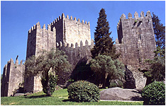

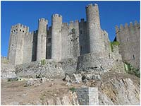

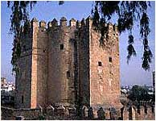

Kamienne twierdze Portugalii i Hiszpanii. Zamek Guimaraes (z lewej) jest zbudowany z kamiennych bloków przekraczających wagę człowieka. System "podaj cegłę" na pewno nie miał tu zastosowania. Bloki są perfekcyjnie obrobione z zachowaniem kątów prostych. Kto w średniowiecznej Portugalii był zdolny do wykonania tak ogromnej budowli? Zamek w portugalskim Obidos - kamienna twierdza o wysokości kilkudziesięciu metrów. I na koniec zamek Calachora, hiszpański średniowieczny "wieżowiec". Skąd na biednym półwyspie Iberyjskim tak zaawansowane technicznie budowle? Rzymianie? Maurowie? Iberyjscy wieśniacy?

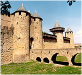

Carcassonne to już nie tylko zamek, a całe kamienne miasto leżące na południu Francji. Osobiście ciekawi mnie most prowadzący do bramy głównej. Czy jest to pełna jego wysokość, czy też część ukryta jest pod ziemią. Łuki są jakby zbyt blisko fosy. Może pod mury woda naniosła osady i tym samym podwyższyła poziom gruntu? Francuskie Arques, można by rzec - mały jednorodzinny domek o wspaniałych walorach obronnych. I włoska zagadka. Jaki średniowieczny lud był zdolny wybudować zamek w wodzie? Jakiego rodzaju zaprawy, zdolnej wiązać kamień pod wodą użyto?

Innym ciekawym szczegółem, na który nie zwraca się uwagi, są szczeliny w murach zamków. Ich szerokość waha się od kilku do kilkunastu centymetrów, długość od kilkudziesięciu centymetrów do kilku metrów. Znajdują się w różnych miejscach - od przyziemia po szczyty wież. Znajdują się na ścianach wież, na murach, a nawet w ich załomkach. Jakie było ich przeznaczenie? Obserwacja, wentylacja, oświetlenie, odprowadzanie wody czy wzmocnienie obrony? Jako otwory strzelnicze nie spełniały raczej swojego zadania z uwagi na minimalny kąt ostrzału i trafienie z nich wroga było raczej dziełem przypadku. Obserwacja też nie wchodziła w rachubę z tego samego względu co ostrzał.

  
Irlandia

  
Arques

  
Carcassonne

  
Apulia

  
Syria

  
Margat

  
Montsegur

Do czego służyły nie wiadomo, jednak musiały spełniać jakąś ważną rolę, gdyż niektóre z nich są specjalnie obudowane większymi, polerowanymi kamieniami. Musiał to być znaczący element architektoniczny, a być może i techniczny, gdyż szczeliny te występują w większości zamków średniowiecznej Europy, od Wysp Brytyjskich po Syrię i od Portugalii po Niemcy. Jeśli, jak twierdzą historycy, każde państwo rozwijało z osobna swoją kulturę, technikę i sztukę, to jak wytłumaczyć występowanie tego uniwersalnego elementu architektonicznego? Czy wnęka z zamku Montsegur rozwiązuje do końca tę zagadkę?

To tylko kilka przykładów techniki, organizacji pracy i ogromnych nakładów sił i środków. Twierdzę, że cała Europa stoi na fundanentach cywilizacji, która istniała na jej terenach i której ciągłość przerwał kataklizm sprzed 12,5 tysiąca lat. Rzeczą oczywistą jest, że ci którzy przeżyli zdążali do miejsc, które dobrze pamiętali - do miejsc kultowych i ośrodków władzy. Być może nie wszystko uległo zniszczniu w wielkim trzęsieniu ziemi i nie wszystko rozbiła ogromna tsunami. Jest też możliwe, że pozostało niewiele techniki, która pozwoliła odbudować choć część zniszczonej kaklizmem schedy. Było to jednak zależne od ilości ocalałych ludzi, od ocalałych specjalistów-kamieniarzy i od resztek zachowanych narzędzi. Rzecz jasna, że mam na myśli pierwszy okres po kataklizmie. W miarę upływu czasu technika rozsypała się w proch i społeczeństwa były zmuszone powrócić do warunków historycznej wspólnoty pierwotnej. Jedyne, co przetrwało to "dziwne opowieści" o dawnych, dobrych czasach dzisiaj wkładanych między bajki.

Proszę obejrzeć najdziwniejszy bodaj zamek średniowiecznej Europy. Kamienny zamek przypisywany Fryderykowi II Hohenstaufenowi. Bryła zamku nie przypomina żadnej ze znanych warowni. Są to czasy Świętego Cesarstwa Rzymskiego Narodu Niemieckiego (XIII w.). Zamek nazywany "zameczkiem myśliwskim" znajduje się w Apulii, na samym południu Włoch koło Bari. Był podobno jakiś czas w rekach Templariuszy. Zamek jest też kojarzony z tajnymi organizacjami niemieckimi Vril i Thule oraz z symbolem "czarnego Słońca", a stąd już blisko do Haunebu i tajnej Wunderwaffe Hitlera.

Na dziwny kształ zamku zwrócił uwagę Sławek Jabłoński z Kielc, który jako pierwszy skojarzył go z... generatorem energii Searla. Tak, zamek jest być może budowlą ściśle techniczną. Co więc mają wspólnego średniowieczni rycerze z techniką zaliczaną dziś do zaawansowanej? Kiedy i kto faktycznie zbudował ten zamek? I najważniejsze pytanie - skąd pomysł i kto był projektantem?

Z zamkami średniowiecznymi jest związanych kilka historycznych wydarzeń, które jak sądzę mają korzenie w wydarzeniach sprzed kataklizmu. Pierwsze to historia Katarów. Katarzy to ruch religijny działający w XI-XIII wieku szczególnie na południu Francji i w północnych Włoszech, a więc na terenach starożytnej Galii. Co jest tak ciekawego w tym ruchu? Otóż ciekawym jest fakt, że największe skupiska katarów znajdowały się w starożytnych miastach i zamczyskach między innymi w Carcassonne. Głoszona przez nich ideologia czystości ściągnęła na nich gniew Świętego Officjum i krwawe prześladowania. Pytanie skąd w "religii ludowej" jak nazywano kataryzm tyle poważnych i głębokich przemyśleń filozoficznych? Dlaczego działalność przywódców duchowych tzw. "doskonałych" przypomina działanie druidów? Czy to resztki nauk sprzed wielkiego kataklizmu? Jeśli tak, to musieli zginąć, bo zagrażali "nowemu" rzymskiemu chrzescijaństwu. Ostatni Katarowie zostali spaleni w zamku Monsegur (z prawej).

Nie sądzę, by zamki te zbudowali Katarowie. Byli przecież ludźmi z gminu. Jak sądzę też, do zdobycia zamku w Monsegur nie trzeba było organizować wyprawy krzyżowej. Zamek co prawda był położony na wzgórzu, ale zapewne był już od dawna w ruinie. Katarowie zaś, to całe rodziny z kobietami i dziećmi, a uzbrojenie mężczyzn też musiało ustępować rycerskiemu. Sadzę, że cały szum wokół nich był tylko zasłoną dymna dla ukrycia zwyczajnego ludobójstwa średniowiecznej, chrześcijańskiej Europy. Skąd jednak u Katarów krzyże mające rodowód celtycki, a przypominające także symbol innego bractwa - Kawalerów Maltańskich?

Zakon Maltański powstał jako nieformalny zakon przyszpitalny w wieku XI pod wodzą legendarnego brata Gerarda. Zakonowi temu przypisuje się budowę sieci zamków i warowni na terenie Palestyny, a szczególnie zamku-szpitala Margat (z lewej). Otrzymali też potężny zamek Krak de Chewaliers (trzy następne zdjęcia).

Dociekliwość każe mi zadać pytania - jak zakon liczący z górą kilkuset członków, mógł zbudować kamienny zamek w Margat? Jako okupanci nie mogli liczyć na pomoc miejscowych Arabów, chyba że zmusili ich do niewolniczej pracy. Który z zakonników sporządził plan budowy? Jak głęboko posadowiono fundamenty zamku? Skąd wzięto taką ilość kamiennego materiału w pustynnej Syrii? Ilu specjalistów zatrudniono przy obróbce kamienia a ilu przy transporcie i budowie? Jak wyglądał transport budulca na miejsce budowy? Jakie maszyny inżynieryjne zastosowano? Ile lat trwała budowa zamku? Zamku w Margat z pewnością nie zbudowali ani Maltańczycy ani tym bardziej Arabowie. Co więcej nie ma żadnej mowy o zbudowaniu sieci warownych zamków. To jest tylko myślenie życzeniowe współczesnych historyków z jednoczesną nadzieją, że nikt nie będzie zadawał głupich pytań.

Podobnie ma się sprawa z zamkiem Krak de Chewaliers. Nikt ze współczesnych nie był w stanie zbudować czegoś takiego. Wzgórze dokładnie splantowano (jeśli nie usypano). To co widzimy na powierzchni, to tylko prawdopodobnie 2/3 objętości zamku. Z jakich kamiennych elementów zbudowano ten zamek pokazują dwa następne zdjęcia. Jeśli ktoś wierzy historykom, niech przeprowadzi nawet orientacyjną kalkulację na podstawie wyżej zadanych pytań.

Historycy wyznaczyli obszar ekspansji cywilizacji rzymskiej na podstawie kamiennych mostów i jest to prosta zasada - jest most, to w tym miejscu musieli być i Rzymianie. Okazuje się, że podobna zasada obowiązuje także Templariuszy. Tym razem chodzi o krzyż równoramienny. I podobnie jak z Rzymian, tak i z Templariuszy zrobiono zakon Jasiów-wędrowniczków. Okazuje się, że przez ledwie wiek istnienia na kartach historii zdołali przemierzyć prawie pół świata. Od Szkocji po Etiopię i od Portugali po Armenię, a w każdym miejscu pobytu na wieczną pamiatkę wykuwali kamienny krzyż, nawet w formie kościoła jak w Etiopii. Czyż to nie ciekawe? Ponoć cały czas szukali Świętego Graala. Jak zatem wytłumaczyć fakt, że powstały w Jerozolimie zakon, mający strzec Ziemi Świętej tak chętnie odbiera nadania i buduje w tak odległych stronach jak Portugalia, Francja czy Anglia. Czyżby z takiej odległości łatwiej było bronić Grobu Pańskiego? Dlaczego wreszcie uśmierca go jego protektor - kościół?

Katarowie, rycerze maltańscy, Templariusze. Dlaczego musieli zginąć i przepaść w mrokach historii? Odpowiedź może być tylko jedna. Posiadali wiedzę, która była zbyt niebezpieczna dla nowego pana - rzymskiego chrześcijaństwa. Czy dziś ta wiedza znajduje się w innych rękach - w stowarzyszeniach zwanych lożami masońskimi? Czy część tej wiedzy jest bogactwem zagadkowej organizacji Opus Dei? Walka trwa nadal i choć nie widać krwi jest walką na śmierć i życie. Walka trwa nadal, bo stawka jest ogromna - panowanie nad światem.

**Polska Atlantyda**

Czy my Polacy, naród z peryferii Europy, mamy się czym pochwalić? Oczywiście, że mamy. Wystarczy rozejrzeć się dobrze dookoła i chcieć ujrzeć ślady jeszcze starszej historii, niż się nam na codzień serwuje. Nasi historycy, spętani obowiązująca hipotezą, nie zauważają lub nie chcą zauważyć takich śladów. Wolą rozkopywać najstarsze wiejskie cmentarzyska, grzebać w starożytnych śmietnikach, tworząc coraz to nowsze hipotezy, niż przyjrzeć się dokładnie temu co leży dosłownie na wierzchu. Polska tak jak dzisiaj tak i w przeszłości nie była samotną wyspą. Oddziaływały na nas kultury sąsiadów i my oddziaływaliśmy na nich. Najstarsze źródła nie wymieniają nas z imienia, dla nich byliśmy Hiperborejczykami, czyli mieszkającymi poza wiatrem północnym i jak sądzę odnosiło sie to do czasów sprzed kataklizmu, gdzie nasze tereny leżały w strefie klimatycznej podobnej do klimatu śródziemnomosrkiego, a wiec takiego gdzie nie docierał arktyczny Boreasz.

  
Fragment kręgu w Odrach

  
Słup milowy(?)

  
Niedźwiedź(?)

  
Kot, lew, pies...?

Wszyscy zapewne znają nasz najsłynniejszy krąg (a właściwie krążek) kamienny w Odrach na Pomorzu. Znane sa też zapewne kamienne rzeźby z okolic Ślęży, ponoć świętej góry śląskich pogan, na której szczycie odkryto pozostałości kamiennej budowli. Teren pokrywa się z historycznym zasięgiem kultury celtyckiej (tych Celtów pokonanych przez Rzymian, którzy skierowali się w stronę Śląska a potem na Bałkany). Krąg kamienny odkryto i koniec na tym. Ponoć zbierają się tam polscy druidzi szukający odnowy duchowej. Na Ślęży rozgrzebuje się coś archeologicznie, ale jak dotąd nie opublikowano żadnych badań. W okolicy góry znajduje się też kamienny kościół, ale też nie zwraca większej uwagi archeologów.

  
Ślęża

  
Kamienny kościół. Ślęża

  
Kamienne fundamenty na Wawelu

  
Kamienna rotunda

Jeden z najstarszych polskich ośrodków administracyjnych i kultowych - wawelskie wzgórze, kryje z pewnością więcej tajemnic niż o nich wiemy. Na środku wzgórza znaleziono kamienne fundamenty budowli, a wewnątrz budowli wawelskiej obmurowaną ceglanym murem kamienną rotundę śś. Feliksa i Adaukta. Mury rotundy przypominają sposób budowy celtyckich Irów (użycie płaskich kamieni, szlifowanych na licu). Dlaczego budowli nie rozebrano (chociażby dla uzyskania budulca) a po prostu obmurowano? Czy to nie relikt pierwszych "bizantyjskich" chrześcijan. Polska z pewnością znajdowała się w zasięgu ich ewangelizacji (Cyryl i Metody), ale ślady po nich zostały starannie zniszczone (np. pisma święte pisane głagolicą). Czy początki naszego państwa są takie jak mówi oficjalna historia? Dlaczego król czeski daje za żonę córkę Dobrawę pogańskiemu Mieszkowi. Taki gest to przecież policzek dla kościoła z nieobliczalnymi politycznymi konsekwencjami. Sądzę, że Mieszko I był chrześcijaninem, ale w obrządku wschodnim a sytuacja geopolityczna postawiła go na drodze chrześcijaństwa w obrządku rzymskim. Miał więc do wyboru - albo rzymski chrzest albo krwawe nawrócenie i koniec Polski. Stąd prawdopodobnie zniszczenie wszelkich dowodów łączności z Bizancjum i zamurowanie rotundy.

Wszyscy też zapewne słyszeli o odkryciach na Ostrowie Lednickim. Odkrytą tam kaplicę nazwano kaplicą Mieszka I. Jest też legenda, że na dnie jeziora Lednickiego spoczywa kamienny tron Bolesława Chrobrego (podarunek ponoć od Ottona III). Budowla w kształcie kamiennej rotundy, sposobem budowy przypomina azteckie Tenochtitlan. Czym spajano kamienie? Tego nie zbadano. Najstarsze oficjalne spoiwa, to włoska "pucolana", chiński cement z kleikiem ryżowym i krzyżacka zaprawa z jajami. Czym więc wiązali kamień najstarsi Polacy?

Na terenach Polski odnaleziono wiele kamiennych krzyży. Historycy nazwali je krzyżami pokutnymi, które jakoby grzesznicy osobiście wykuwali z kamienia celem odpuszczenia grzechów (przeważnie za morderstwa). Dziwi mnie jakość kary w stosunku do czynu i dziwi mnie przypadkowość wykonawcy. Jak sądzę, do wykucia kamiennego krzyża potrzeba wysokiej klasy kamieniarza-specjalisty i odpowiednich narzędzi, a nie przypadkowego osobnika, choćby nie wiem jakiego grzesznika. Spotykamy też krzyże z wyrytymi na nich napisami, które jakoby przesądzają o czasie ich wykonania. Czy tak się winno określać czas wykonania artefaktu? Przecież i dziś można wyryć na zabytkowym kamieniu dowolny napis. Czy ktoś porównał strukturę wierzchniej warstwy kamienia i na wyrytych napisach? Prawdopodobnie nie. Więć z skąd ta niezachwiana pewność? Czym był pierwotnie krzyż na ostatnim zdjęciu? W jakby kole sterowym ktoś wyskrobał nieporadnie kształt krzyża, a na nim (zapewne dużo później) napis w pięknym gotyku.

Przypatrzmy się nie mniej intrygującym, chociaż ponoć młodszym, kamiennym zamkom. Większość ruin, a szczególnie tzw. orle gniazda, przypisywana jest Kazimierzowi Wielkiemu na zasadzie ogólnego stwierdzenia - "zastał drewnianą, a zostawił murowaną". Nachodzą mnie watpliwości co do twórcy tychże. Budowa nawet jednego zamku, to nie zachcianka i przedsięwzięcie miejscowego sołtysa a działalność na szczeblu państwowym.

  
Bydlin

  
Czorsztyn

  
Morsko

Budowa sieci zamków wymaga strategicznego rozeznania terenu, projektowania, zebrania specjalistów, zgromadzenia materiałów i ich obróbki, nie wspominając o transporcie, wyżywieniu i zakwaterowaniu robotników. Do budowy musiano też zużyć ogromne ilości spoiwa. Jakiego? Krzyżackiego cementu na kurzych jajach? Dlaczego tak ogromne przedsięwzięcie państwowe nie ma żadnego odzwierciedlenia w królewskich dokumentach? Przecież w tym czasie Polacy (a przynajmniej królewscy urzędnicy) umieli już pisać.

  
Ogrodzieniec

  
Olsztyn (małopolski)

  
Rabsztyn

Dlaczego tak ważna inwestycja z punktu widzenia obronności państwa, popadła w ruinę w tak krótkim czasie? Dlaczego żaden zamek (no prawie żaden) nie został odbudowany?

  
Babice

  
Nidzica

   
Ujazd. Zamek Krzyżtopór

Przedstawione przeze mnie ruiny zamków (znikoma część polskich zamków) łączy wspólna cecha, podobnie jak zamki zachodniej Europy i wysp brytyjskich - są zbudowane z kamienia i są zniszczone. Gdyby ulegały zniszczeniu przez najeźców, winny być równane z ziemią tak, by nie nadawały się nawet do odbudowy, a przynajmniej zniszczonoby mury obronne i wieże. Tymczasem możemy obejrzeć skorodowane mury na skutek warunków atmosferycznych i upływu czasu. W bryle krzyżtoporskiego zamku w Ujeździe prześwitują co prawda cegły, ale proszę obejrzeć kamienne łuki i szerokie, kamienne stropy przyziemia przypominające te z Krak de Chewaliers.

Co sądzić o wieku kościoła w Koninie, a przynajmniej jego kamiennego portalu z ukrzyżowanym Chrystusem na "celtycki" sposób? Kto w Polsce w głębokim średniowieczu potrafił tak doskonale obrabiać kolorowe kamienie użyte potem do budowy rotundy w Strzelnie, w mieście, w którym stosunkowo niedawno odkryto rzeźbione kamienne kolumny, ukryte pod warstwą daleko późniejszego pacykarza? Polska ma dużo zabytków lecz ich badania prowadzone są w sposób powierzchowny. Nikt nie zastanawia się na jakich fundamentach stoją okazałe kościoły i zamki. A może ktoś zabrania?

Nasz kraj nie stoi na fundamentach o kilkusetletniej tradycji. Nasze fundamenty to odległe tysiąclecia sięgające tysiące lat w głąb historii, a kto wie czy nie czasów "wspólnoty Atlantów". Tego jednak nie dowiemy się nigdy, bo nie wolno zedrzeć pseudozabytkowego tynku, nie wolno "wychylić" się poza określone ramy czasowe i wreszcie nie wolno podważać oficjalnych hipotez współczesnych historyków, którzy we własne hipotezy wierzą bardziej niż w Boga.

Ostatnimi czasy w okolicach Gdańska badacze odkryli rzymską monetę z II wieku ne. na terenie, który według nich nie miał prawa być zasiedlonym w tych czasach, bowiem ludzie mieli prawo znaleźć się tam dopiero 1300 lat później. Wymyślono więc, że moneta mogła się tam dostać tylko w wyniku osuszania podmokłego Osieku przez Krzyżaków zwożących ziemię z pobliskiego Gdańska (dziwny sposób osuszania bagien). A może wszystko jest prawdziwe inaczej? Może to nie jest rzymska moneta, a dużo starszych Celtów? Może teren był jednak zamieszkały dopóki Bałtyk nie rozszerzył swoich granic? Kiedy to się mogło stać?

**Nieuchwytna granica**

Spróbujmy opuścić ziemię i pobujać trochę w obłokach i może nie nad całym światem, a tylko nad Europą. Przeprowadźmy umowną linię od zachodniej Finlandii, przez Estonię, Polskę, zahaczmy o Czechy, Austrię, Węgry. Przetnijmy Alpy, przelećmy nad Adriatykiem i skierujmy ją nad Atlantyk nad Słupami Heraklesa. Spróbujmy posłuchać dźwięku mowy po zachodniej stronie linii. Mowa jest twarda jak uderzanie kamienia o kamień. Po wschodniej stronie usłyszymy śpiewny język, mowę bardziej przypominającą głos samej przyrody. Czy to o czymś nie świadczy? Przypatrzmy się teraz literom odzwierciedlającym te mowę na papierze. Też różnice. Po zachodniej stronie alfabet, który nazywamy łacińskim z drobnymi wyjątkami w literach narodowych z kółeczkami, kropkami czy ogonkami. Zupełnie coś innego widzimy po drugiej stronie. Obce nam litery cyrylicy, hebrajski i arabski bardziej przypominający sanskryt czy alfabet grecki. Czy to też o czymś nie świadczy?

A co to takiego łacina? Oficjalnie był to język cywilizacji rzymskiej. Cywilizacji? Nie cywilizacji, to był język administracji rzymskiej, która mając swój (widać zbyt ubogi) zapożyczyła go od Etrusków lub Gallów. To właśnie dlatego Rzym schodząc ze sceny europejskiej zabrał go ze sobą, tak jak słynną pucolanę, do grobu. Po upadku Rzymu, Włosi prędko powrócili do swojego narodowego języka. Dziś łacina rozbrzmiewa jeszcze tylko za murami Watykanu, ale nie ma się czemu dziwić, bo organizacja państwowa i pierwsi zwierzchnicy kościoła rzymskiego wywodzili się w prostej linii od arystokracji rzymskiej. Jest wielce prawdopodobne, że i alfabet i język łaciński nie jest produktem Rzymu, a skradzionym pismem i mową Celtów. To nie Celtowie uczyli się od Rzymian, to Rzym uczył się od Celtów i Etrusków, a zapłatą jaką otrzymali nauczyciele była śmierć.

**Głagolica**  
Kolor pisma przywodzi na myśl aztecki przekaz:  
"Ci, którzy mają w swej władzy  
czarny i czerwony atrament"

Patrząc na Polskę możemy być troszkę zdziwieni, dlaczego Słowianie o śpiewnym języku piszą w alfabecie łacińskim? To była polityka. Zapewne u zarania dziejów pisaliśmy literami, które dziś nazywamy głagolicą i najprawdopodobniej nie byliśmy żadnymi poganami lecz chrześcijanami o obrządku bizantyjskim. Znaleźliśmy się jednak na drodze ekspansji wojującego chrześcijaństwa rzymskiego i chcąc uratować narodowość nie mieliśmy żadnego wyboru. Zmieniliśmy obrządek, przyjęliśmy narzucony alfabet, ale język pozostał. Drobnym przykładem tego przywiązania jest być może zamurowana (ale nie zniszczona) w podziemiach Wawelu rotunda śś. Feliksa i Adaukta. Być może narodowa relikwia cudownego obrazu też była pilnie skrywana przed przedstawicielami Rzymu, aż dorobienie legendy zdobyczy wojennej pozwoliło ją umieścić ponownie na "rzymskim" ołtarzu. Być może dwie namalowane blizny to nie wściekły atak szwedzkiego żołnierza, a ciosy rzymskiego miecza na bizantyjskiej twarzy. Głagolica została wytępiona, podobnie jak i inne skarby świadczące o naszej, innej przynależności. To z pewnością nie była wola narodu. To też była polityka.

To właśnie nad Polską i Czechami wyraźna linia zamienia się w kreskę naniesioną aerozolem. Mówimy językiem wschodu, a piszemy językiem zachodu. To właśnie dziś nazywamy historią. Historią pisaną nie na użytek narodów, a na użytek wąskiej grupy nazywanej politykami. Prawdziwa historia jest ukryta za murami Watykanu, ukrywana w tajnych archiwach państwowych i w zasadzie nie służy nikomu. Czas jednak nieubłaganie płynie naprzód i być może będzie nam dane przeżyć szok po otwarciu biblioteki watykańskiej, archiwum Rosji, Stanów Zjednoczonych czy Wielkiej Brytanii. Wtedy już naprawdę trzeba będzie zacząć pisać historię od nowa.

**Podsumujmy...**

     
Irlandia - Tiahuanaco - Zbrucz - Trogir  
Koincydencyjne ułożenie rąk?

Europa chce znać swoje korzenie. Europa szuka swoich korzeni, ale czy znajdzie? Z pewnością nie. Poszukiwania zleciła wybranej grupie zwanej historykami i archeologami, którzy jednak wolą poruszać się w świecie wymyślonym przez siebie i na własne potrzeby. Podstawowa zasada ewolucji życia i postępu ugruntowana myślą marksistowską (tak, tak, nawet w kapitalizmie) stworzyła ramy, których nie wolno przekroczyć. Według nich to nie ludzie tworzą historię, to historia tworzy ludzi. Badacze odnaleźli wrak Titanica i Bismarcka leżące na dużych głębokościach. Dlaczego więc, mając takie techniczne możliwości, nie szuka się zatopionej Atlantydy? Jaki wpływ na naszą historię może mieć przełamanie się tonącego Titanica? Jaki wpływ na naszą historię może mieć dyskusja czy Bismarcka zatopili Brytyjczycy czy też zatopiła go własna załoga. Zajmujemy się niepotrzebnymi drobiazgami tylko po to, by nie dotknąć tematów najbardziej interesującymi ludzkość.

Nasze wyobrażenie o historii kształtują także obrazy filmowe, w czym prym wiedzie amerykański Hollywood. Cóz z tego, skoro w tych filmach historyczna prawda jest odwrotnie proporcjonalna do efekciarstwa. Także niektóre filmy pokazywane w naukowym Discovery też nie zależą od prawdy a od inkasowanych wynagrodzeń. Historyczne bzdury wpajane nam od dziecka z upływem czasu stają się niepodważalną prawdą. W jaki sposób wieża oblężnicza, wysoka na kilkanaście metrów, zbudowana z dębowych bali i ważąca kilka, jeśli nie więcej ton, mogła się poruszać na czterech drewnianych kołach? Co można było zrobić kamiennym murom strzelając do nich rzymską katapultą? Prawdopodobnie tyle samo, co cegle strzelając do niej z procy a rzymskim taranem można było czasem wybić drewnianą bramę i powybijać szyby w oknach.

Historycy jako humaniści są dotknięci, za przeproszeniem, otępieniem technicznym. Myślą, że wystarczy narysować wieżę oblężniczą wysoką jak mury, dorysować cztery kółka i musi to pojechać. Nawet nieważne, że czasem pod górę. A przecież wystarczy obliczyć, czy drewno ma wystarczającą wytrzymałość na zgniatanie i już prawdopodobnie zamieniliby drewniane koła na toczenie po okrąglakach. Też można, tylko kto pod gradem strzał i kamieni będzie układał te okrąglaki przed wieżą? Szanowni panowie historycy i wy bracia w archeologii, zróbcie sobie drewniany blok, uplećcie konopną linę i wciągnijcie z ziemi wiadro kamieni na wysokość 20 metrów. Zróbcie sobie prostą dźwignię i podnieście nią 500 kg kamień chociaż na te marne 10 m. Weźcie do ręki kawałek żelaza i wycyzelujcie choć połowę celtyckiego krzyża. Sądzę, że po takim doświadczeniu przestaniecie opowiadać bzdurne bajki o wielkich budowlach średniowiecza.

Z tego co piszę wyłania się zupełnie inna Europa. Usiłuję przesunąć historię człowieka w czasy dużo głębsze niż pokazuje to obowiązująca historia i dopóki piszę dla wąskiego grona czytelników będę niegroźnym wariatem w rodzaju don Kichota, ale niech w tym co piszę będzie chociaż część prawdy, to już jest powód by naszą historię prześledzić od nowa. Czy starożytni Celtowie byli barbarzyńcami jak chcą tego historycy? Jeśli tak, to jak prymitywny barbarzyńca mógł wyrazić w prostym ornamencie na krzyżu bardzo głęboką myśl - troje w jedności będące zarazem jednością w trzech?

Kończąc cykl "Cywilizacji Bogów" pragnę zwrócić jeszcze uwagę na jeden znamienny i "dziwny" fakt. Cały świat jest pokryty ruinami poprzednich cywilizacji, które nie mieszczą się w schematach współczesnej historii. Proszę zatem spróbować odpowiedzieć sobie na jedno proste pytanie - dlaczego takich ruin nie znajdujemy w Kanadzie i w Australii?
