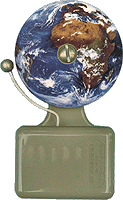
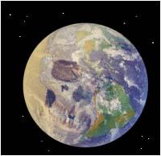

**Czy nasza cywilizacja przetrwa ?**  
Problemem jest dziś, jak przekonać ludzkość,  
aby zechciała przeżyć. \[ Bertrand Russel \]

**Jeśli masz słabe nerwy, nie czytaj**

Odpowiedź jest równie prosta co okrutna. Nie. Dlaczego? Dlatego, że od stuleci cała cywilizacja ludzi jest rządzona przez osobowości silne ale niekoniecznie mądre, a historię naszej cywilizacji stworzono ze wszystkiego z wyjątkiem prawdy. Decydenci od lat nie zauważają najważniejszego celu naszej cywilizacji jakim jest przetrwanie ludzkości. Dla nich najważniejszym celem jest bogactwo i zaspokojenie własnych ambicji. Do pomocy mają naukę, która zamiast określać strategiczne cele dla naszej cywilizacji i tworzyć technikę dla przeżycia, bawi się w naukę jak dziecko zapałkami.

**Nie pytaj komu  
dzwoni dzwonek,  
dzwoni on nam  
WSZYSTKIM !**

Wyśmianie i odrzucenie teorii o "wielkim uskoku skorupy ziemskiej" autorstwa Charles'a Hapgood'a zaowocowało wszechobecnym samouspokojeniem i niezłomną wiarą w to, że Ziemi nie może zagrozić żaden ogólnoświatowy kataklizm. Najważniejszy podmiot planety - zwykli ludzie - nie mają na to żadnego wpływu.

Zlekceważenie przekazów starożytnych, które zawierają ostrzeżenia z przeszłości dla przyszłości, już wkrótce może zaowocować katastrofą, jakiej współczesna cywilizacja jeszcze nie doznała. Wprowadzenie roboczej, całkowicie nie do udowodnienia teorii Darwina zaowocowało tym, że poczuliśmy się panami świata. Wbito nam w rozum przekonanie, że człowiek jest w stanie zmieniać świat, tak jak mu się tylko podoba. Cel zasadniczy - przetrwanie - został rozmieniony na drobne, doraźne, mało istotne cele i w zasadzie całkowicie wypadł z repertuaru teatru, zwanego współczesną cywilizacją.

Rozdzielenie kościoła od państwa zaowocowało nie tylko przejęciem władzy. Zaowocowało podziałem ludzi na tych stworzonych przez Boga i na tych pochodzących od małpy. Zaowocowało także odcięciem współczesnej nauki od jej starożytnych korzeni. Nie piszę tego dlatego, by gloryfikować kościół, jestem od tego daleki. Piszę o tym dlatego, że współczesna nauka nie doceniła starożytnej mądrości. To co było stworzone przez cywilizację Bogów zostało zniweczone przez tych, którym udało się zdobyć władzę. Co oznaczały i oznaczają słowa "królestwo niebieskie na Ziemi"? Oznaczają doskonale pojęte rządzenie, administrację i podział władzy tu, na Ziemi. Przekazy starożytne mówią wyraźnie kto był rządzącym, a kto rządzonym, ale wtedy władza spoczywała w rękach mądrych tego świata - cywilizacji Bogów. Później przekazano ją w ręce specjalnie wyuczonej przez Nich kaście królów i kapłanów i przez Nich kontrolowanej. Trudno to przełknąć, ale prawdą jest, że ludzie zostali stworzeni tylko do pracy. Dziś w najlepsze trwa ziemska arlekinada, głupcy w maskach mądrości idą przodem, a do władzy dorwali się ludzie bez pomysłu i co gorsza bez żadnej wizji.

Współczesna nauka zrobiła z rodu ludzkiego koronę ewolucji, wbiła ludzi w pychę i zarozumiałość, pozbawiając pokory przed siłami samej Ziemi i Kosmosu. Pozbawiła nas instynktu samozachowawczego, przesłoniła grożące nam niebezpieczeństwa, pozbawiła krytycznego podejścia do otaczającego świata. Czysto konsumpcyjne podejście do życia zniszczyło to, co w człowieku było najlepsze - jego rozwój duchowy. Pan wszystkiego - człowiek - z czysto egoistycznych pobudek zaczął na wielką skalę zmieniać oblicze Ziemi. Zniszczył już ekosystem jeziora Aralskiego i kończy niszczyć zielone płuca świata - dżunglę amazońską. Z beztroską dopuszcza do zagłady mniejszych, bezbronnych cywilizacji, roślin i zwierząt. Z jakąś niezrozumiałą, dziką radością podcina gałąź, na której sam siedzi.

Co robi nauka? Pozoruje działania i bawi się kosztem pozostałych ludzi. Usilnie szuka życia w kosmosie, zamiast poszukiwać zagrożeń dla tego, tu na Ziemi. Widzieliśmy w telewizji euforię uczonych na wiadomość, że na Marsie być może jest woda, podczas gdy miliony ludzi nie mają jej tu, na Ziemi. Prognozy niektórych uczonych też wyraźnie ostrzegają - kończą się zapasy słodkiej wody, podobnie jak paliw kopalnych, a ludziom pracującym nad źródłami energii alternatywnej nie udziela się znaczącej pomocy. Wydaje się za to miliardy dolarów na szukanie śladów życia poza Ziemią, ale obiekty, które mogły uderzyć w Ziemię i zniszczyć nasze życie, zauważa się dopiero jak już majestatycznie oddalają się w głębiny kosmosu.

Człowiek swoje zarozumialstwo i nonszalancję zaczął już pokazywać nawet poza Ziemią. Czego miało dowieść ostatnie doświadczenie z trafieniem w kometę Tempel-1? O możliwości obrony Ziemi przed nieproszonymi gośćmi? Bądźmy realistami - czy uderzenie muchy w Jumbo-Jeta jest w stanie zmienić jego kurs? Żartobliwa "zemsta" za dinozaury? Orbita komety ponoć nie zagrażała Ziemi, ale czy po trafieniu dalej mamy tę 100% pewność? Czy człowiek uderzeniem w Tempel-1 nie zapoczątkował łańcucha wydarzeń nie przypuszczając nawet co będzie jego ostatnim ogniwem? A jeśli to niewinne uderzenie doprowadzi kiedyś do uderzenia w Ziemię tej właśnie komety? Przecież zmieniły się warunki oddziaływania na nią mnóstwa innych ciał niebieskich, warunków o których nie mamy pojęcia? Takie uderzenie co prawda nie zniszczy już dinozaurów, a tylko jedną głupią cywilizację, ale jaka to pociecha dla zwykłych ludzi? Czy mamy dziś choć mgliste pojęcie o tym, jakie siły uwolniliśmy? Pokazaliśmy tylko, że potrafimy trafić do odległej tarczy za pierwszym strzałem i że ten strzał kosztował nas miliardy dolarów.

Nie trzeba być jasnowidzem, ani pytać duchów przodków o przyszłość rodzaju ludzkiego. Szkoda tylko, że wszelkie przestrogi pozostawione nam przez starożytnych zostały przez nas zniszczone, są ignorowane lub nie potrafimy ich odczytać. Istniejące, już współczesne przekazy pisane w rodzaju objawień czy przepowiedni nie zawierają nic, co mogło by okazać się pomocne. Przekazują coś, co może się wydarzyć i jest to nawet prawdopodobne, ale nie przekazują ani przyczyn ani nawet przybliżonych terminów, a otoczone przez nimb boskości i tajemniczości zostały bezwarunkowo odrzucone przez naukę jako wielce niewiarygodne, stworzone przez "nawiedzonych" czyli niespełna rozumu. Osobiście sądzę, że zagrożenie istnieje i jest tylko kwestią czasu, kiedy usłyszymy dzwon bijący na trwogę. Wymieniłbym trzy najbardziej realne rodzaje zagłady, które mogą dotknąć nas lub naszych potomnych:

•  Życie na Ziemi zakończy uderzenie dużego obiektu z kosmosu,  
•  Zagładę spowoduje "wielki uskok skorupy ziemskiej",  
•  Ludzkość unicestwi się sama w globalnej wojnie religijnej lub ideologicznej.

Pierwszy "predator" jest już prawdopodobnie w drodze, choć my jeszcze o tym nie wiemy. Nasze raczkujące badania astronomiczne skupiły się na poszukiwaniu życia w kosmosie zamiast poszukiwania czegoś, co w każdej chwili może przynieść nam śmierć.

Zaginiona, wysoka cywilizacja nieprzypadkowo pozostawiła Majom kalendarz, który ostrzega o śmierci z kosmosu co 52 lata. Uczeni wyrazili cielęcy zachwyt nad tym sposobem liczenia czasu, reszta przyjęła to jako ciekawostkę i przeszliśmy nad tym do porządku dziennego. Dotychczas obliczyliśmy około 0,5% orbit zagrażających nam kosmicznych obiektów o ile, w co bardzo wątpię, wszystkie zidentyfikowaliśmy. Prawdą jest także to, że nie potrafimy na czas wykryć zagrażającego nam obiektu. Od kilkunastu już lat dowiadujemy się, że coś dużego ominęło Ziemię. Projekty w rodzaju zepchnięcia "kosmicznego przybłędy" z orbity kolizyjnej bądź rozbicia go na mniejsze kawałki są obliczone na poklask ignorantów i pospolitej gawiedzi. Takie bzdury udają się tylko w hollywodzkich filmach i przynoszą namacalną korzyść tylko nielicznym. Gdy ujrzymy na niebie coś, co każdej nocy będzie coraz większe i jaśniejsze, pozostanie nam czas tylko na modlitwę i dopiero wtedy bardzo szybko zrozumiemy, co starożytni Majowie usiłowali nam przekazać w swoim kalendarzu. Drugi scenariusz, to szybka śmierć jednych i powolne konanie ocalonych. Mechanizm jest znany, choć całkowicie ignorowany. Także przed tym przestrzegają starożytni: "...podczas tego Słońca nastąpi wstrząs, będzie głód i tak zginiemy".

Czy można powziąć jakieś środki zaradcze? Można, o ile na poważnie zajmą się tym decydenci i nauka. Jeśli zrozumie się mechanizm "wielkiego uskoku..." być może będzie można choć w przybliżeniu określić jego możliwy termin lub przede wszystkim określić w miarę bezpieczne obszary, na których już trzeba zacząć gromadzić i zabezpieczać zapasy żywności, wody, lekarstw a także ziarno i nasiona do zasiewów. Trzeba także już myśleć o zabezpieczeniu przynajmniej część wiedzy i bazy technicznej dla tych, którym dane będzie ocaleć z kataklizmu. Matka-Ziemia owszem, daje życie, ale znacznie częściej je odbiera. Nasza cywilizacja przez niedowiarstwo nie zdołała poznać wiedzy starożytnych, przez tysiące lat doświadczenia poprzednich cywilizacji przepadały w mroku dziejów. Świat nowożytny uznał prastarą wiedzę za zbiór zabobonów, baśni i rzeczy niemożliwych. Od kilku tysięcy lat, a szczególnie od ostatnich kilkuset przekazując ludziom nieprawdziwą historię ludzkiego rodu spowodowano zanik instynktu samozachowawczego, uśpiono dawną czujność i dzisiaj człowiek nie chce i nie może uwierzyć do czego zdolna jest Matka-Ziemia. Tylko ktoś, kto będzie o tym wiedział, być może zachowa życie.

Ziemia zdolna jest do unicestwienia całego życia w ciągu krótkiego czasu. Dzisiaj nikt nie ma pojęcia, co oznacza termin "wielki uskok skorupy ziemskiej" i czym grozi, jeśli zaistnieje. To, że zaistnieje jest tylko kwestią czasu, podobnie jak uderzenie wielkiego meteorytu.

Charles Hapgood, jak pisałem na wstępie, twórca tej logicznej hipotezy został zakrzyczany, ośmieszony i "unicestwiony" przez innych uczonych, gdyż zagrażał ich pozycji. Nie pomogło nawet poparcie samego Alberta Einsteina. Jego hipoteza potwierdza teorię wielkich kataklizmów niszczących co jakiś czas wszystko na naszej planecie. Mało tego, pokazuje w jaki sposób życie na naszej planecie ulegało zniszczeniu. Za wyginięcie dinozaurów odpowiedzialnym czyni się uderzenie wielkiego meteorytu w rejonie półwyspu Jukatan. Czy na pewno? Kto oglądał rzeźbę terenu i dna w rejonie Zatoki Meksykańskiej musiał się zastanawiać dlaczego krater po uderzeniu meteorytu wygląda jak rogalik.

O co chodzi w tym "wielkim uskoku..."? Hipoteza Chapgooda dopuszcza "poślizg" twardej skorupy Ziemi po jej półpłynnym płaszczu, powodując zmianę jej położenia. Odpowiada za to sama Ziemia i jej ruch obrotowy usiłując ułożyć rozrzucone masy skorupy ziemskiej w położeniu stabilnym. Ruch obrotowy Ziemi dąży do ułożenia najcięższych mas na równiku, ale skorupa ziemska tworzy całość i nie jest możliwe przesunięcie pojedynczych kontynentów więc dochodzi do ruchu całej powierzchni Ziemi. Skutki już opisywałem lecz powtórzę, że najgorszym skutkiem niszczącym wszystko będzie ogólnoświatowe tsunami. Masy wody pchnięte siłą bezwładności w jednym kierunku będą musiały powrócić i powtórzy się to wielokrotnie. Ziemia zmieni całkowicie swoje oblicze. Jedne lądy znikną pod wodą na zawsze, inne wynurzą się. Wszystko co leży nad brzegami wód zostanie spłukane do mórz i oceanów. Tam gdzie fala nie spłucze wszystkiego, życie i dorobek zniknie pod warstwą ziemi i mułu. Uratują się być może mieszkańcy gór, niekoniecznie "kwiat" inteligencji, ale zdolni do przetrwania w ciężkich warunkach i być może utworzą zrąbek nowej cywilizacji. Czy zdołają przetrwać bez żadnej pomocy?

Zdaje się, że tego nie rozumiemy lub nie chcemy zrozumieć albo też dzisiejsza nauka z rozmysłem okłamuje nas wszystkich nie informując o takiej ewentualności. Jest w tym jakaś "czarna" kalkulacja licząca na to, że po takiej katastrofie nie będzie ani winnych ani nie będzie miał kto ich szukać. Jak postępuje człowiek? Większość budowli starożytnych, jeśli nie liczyć tych wyciętych w litej skale, nie jest zbyt wysoka. Dziś architekci sięgają nieba. Wyżej i wyżej. Jedno wielkie trzęsienie ziemi i w sekundach zostaniemy dosłownie sprowadzeni na ziemię. Jakimś owczym pędem coraz więcej budujemy nad brzegami mórz i oceanów, stawiamy całe osiedla w korytach dawnych rzek i na powodziowych rozlewiskach, osiedlamy się na górskich zboczach lub na szlakach lawin. Pogoń za łatwizną i taniochą czy niefrasobliwość i zwykła głupota wynikająca z niewiedzy? A może chęć zysku za wszelką cenę na nieświadomych niczego zwykłych ludziach? Czy Ziemia w grudniu 2004 r. nie pogroziła paluszkiem na Oceanie Indyjskim, dając przedsmak tego, co nas czeka? Czy trudno wyobrazić sobie tsunami o wysokości przewyższającej najwyższe wieżowce? Czy umiemy wyobrazić sobie jakąkolwiek pomoc, gdy kataklizm dotknie bez wyjątku wszystkich?

Wszyscy zapewne oglądaliśmy widoki z Nowego Orleanu po przejściu huraganu "Katarzyna" na przełomie sierpnia i września 2005 r. To był widok świata po kataklizmie pozbawionego pomocy z zewnątrz. Tu pokazano zachowanie się ludzi w obliczu wielkiej katastrofy i tu prawdopodobnie mamy odpowiedź na pytanie, co się stało z poprzednią cywilizacją, a właściwie z jej kwiatem inteligencji. Tak być może wyglądał świat po globalnym kataklizmie 12,5 tysiąca lat temu. Przetrwali silni, głupi i uzbrojeni. Poprzednia inteligencja jeśli nie zginęła od razu, to stała się ofiarą ludzi o najniższych instynktach. Po następnym światowym kataklizmie będzie jeszcze gorzej, aż do całkowitego upadku cywilizacji.

O ile na dwa pierwsze scenariusze mamy bardzo mały wpływ lub nie mamy go wcale, to trzeci leży wyłącznie w naszych rękach. Cóż z tego, skoro problemu nie zauważają ci, co mają najwięcej do powiedzenia - politycy i rządzący. Świat nie ma jednolitego planu, by zapobiec samozagładzie. Wielcy tego świata ingerują tylko tam, gdzie mają swój własny interes lub interes swojej społeczności. Niedostrzeganie potrzeb społeczeństw ubogich, brak światowego frontu do walki z nędzą może doprowadzić także do innej wojny - wojny o wodę. Woda, słodka woda, pomimo tego że jest jej coraz mniej, nie jest jeszcze postrzegana jako skarb ludzkości. Ten skarb jest marnotrawiony, a żaden inny surowiec go nie zastąpi. Będzie to być może drugi rodzaj wojny po wojnie religijnej jaka może nam zagrozić. Nie łudźmy się. Narodów biednych jest więcej niż państw o wysokiej technice, a wysokiej techniki może nie wystarczyć w konfrontacji z ilością. Nie można też wykluczyć, że wojna religijna będzie tylko przykrywką wielkiej bitwy o "słodką wodę". Głosy wołających o pokój są słyszalne, ale nie słuchane. Czy nasza cywilizacja przetrwa? Owszem, ale przetrwanie musi być jej CELEM i to celem pierwszorzędnym, a wszyscy bez wyjątku muszą zrozumieć kilka podstawowych prawd:

•  Zostaliśmy sami w tych okolicach wszechświata i wzajemne "wyżynanie się" nie służy zachowaniu gatunku ludzkiego.  
•  Ziemia jest naszym jedynym, jak na razie domem. Jest też swego rodzaju organizmem, o który należy dbać, a nie systematycznie go niszczyć i zatruwać. Jeśli umrze Ona, umrzemy i My, ale tylko Ona ma szanse zmartwychwstać.  
•  Należy rozwijać technologie przeżycia, a nie technologie śmierci i w temu kierunkowi podporządkować wszelkie nauki. Bogowie tworząc człowieka nie mieli zamiaru tworzyć sobie konkurencji. My, żeby przeżyć jako cywilizacja, musimy utworzyć własny "bank nasienia" i "bank wiedzy" tu na Ziemi lub w najbliższym kosmosie oraz móc i umieć z niego skorzystać.  
•  Musimy zacząć badać Ziemię i Kosmos pod kątem zagrożenia życia dla ludzkiego gatunku oraz rozpocząć badania naukowe nad formami obrony. Zacząć szukać na Ziemi i badać dokładnie najbliższą przestrzeń pomiędzy Ziemią i Księżycem. Bogowie być może przewidzieli rozwój "ludzkiej" nauki i być może zostawili gdzieś na Ziemi lub bliskiej orbicie swoisty "bonus" dla tych, co potrafią po niego sięgnąć.  
•  Jeszcze raz od nowa przeczytać i zrozumieć przekazy starożytnych poszukując w nich zagrożeń i ostrzeżeń dla nas - ludzi, a według ostrzeżeń z przeszłości groźba jest więcej niż realna, a my w dalszym ciągu "nie znamy dnia ni godziny".

Nie wiem czy pisanie o tym wszystkim ma jakiś sens? Może jest już za późno? Można by też uważać, że napisałem to wszystko by straszyć ludzi, by mieć swoje pięć minut jako nowy Nostradamus. Jestem daleki od tego. Chciałem tylko ostrzec, że przez niedowierzanie możemy utracić wszystko. Nasza cywilizacja może zginąć nie tylko przez jakieś działania, ale przede wszystkim przez zaniechanie działań. Zabraknie nam może także tych 150-200 lat, jakie rządzący tym światem strawili na swoje bzdurne pomysły. Zabraknie czasu, bo nikt nie uwierzył i dalej nie wierzy, że "wielki uskok..." może naprawdę zaistnieć. Za kilka lub kilkanaście lat numer telefoniczny "Ziemia" może już nie odpowiadać, a według "boskiego rozkładu jazdy" następne wizyty przewiduje się dopiero na lata 3440 i 7520. Teraz musimy zadbać o siebie sami. Czas najwyższy, by sobie uświadomić prawdę i przestać się łudzić

**KRÓLESTWO JUŻ PONOWNIE NIE ZEJDZIE Z NIEBA**

A jeśli zejdzie, to chyba tylko na obiecany SĄD OSTATECZNY. Ilu żywych stanie przed nim? Chyba nikt.

Kronika z Akakor zawiera tajemnice wybranych plemion \[...\] Opisuje rozwój i upadek wybranego przez Bogów ludu aż do końca świata, kiedy to Bogowie powrócą po trzeciej wielkiej katastrofie, która zniszczy ludzi \[...\] Tak jest napisane. Tak powiadają kapłani. Tak jest zapisane w dobrym języku, wyraźnym pismem.

Jest jednak iskierka nadziei, ale tylko iskierka. Ta sama Kronika z Akakor opisuje w jaki sposób uratowała się część ludności plemienia Ogha-Mongulala. Bogowie, by uchronić choć niewielu ludzi, wybudowali podziemne miasto pod twierdzą Akakor, w którym uratowała się część plemienia w kataklizmie 10,5 tysiąca lat pne. Podziemnych miast na świecie odkryto już kilka lub kilkanaście, ale historycy przypisali im zupełnie inne znaczenie. Od grobowców w Dolinie Królów po podziemne świątynie do uprawiania zakazanych praktyk. Sądzę, że jest to uproszczenie pozwalające na ukrycie jakiejś myślowej niemocy. Nikt nie dopuszcza myśli, że z upływem tysięcy lat pierwotne przeznaczenie "podziemnych miast" mogło być wielokrotnie zmieniane, bo przecież nikt nie może człowiekowi zabronić hodowania róży w nocniku, który z upływem lat utracił dla niego pierwotne przeznaczenie.

Jest być może i druga. Czy Ziemia da nam ostrzeżenie? Bardzo możliwe, choć nie wiadomo czy zdołamy je prawidłowo odczytać. Platon pisze, że "jeden dzień i jedną noc okropną" poprzedziły trzęsienia ziemi i powodzie. Ziemią cały czas targają wstrząsy, małe i duże, ale jak na razie dotykają prawie tych samych rejonów i nie są zjawiskiem powszechnym dla większości rejonów kuli ziemskiej. Jeśli by platońską wiadomość skonfrontować z fizyką, a konkretnie z dynamiką ruchu obrotowego, wnioski mogą być interesujące. Weźmy pod uwagę obracające się koło. Wyważone, będzie obracać się bez przeszkód i bez żadnych drgań. Jeśli nastąpi zachwianie równo rozłożonych mas (np. ubytek masy w jednym miejscu) zaczną się drgania przechodzące w stałe coraz większe wibracje, co w konsekwencji doprowadzić może do rozerwania koła. Jeśli by to zjawisko przenieść na obracającą się kulę ziemską, to być może początkowym sygnałem będzie stała wibracja skorupy ziemskiej w całym pasie około równikowym, początkowo niezauważalna dla ludzi, przechodząca stopniowo w ciągłe trzęsienia ziemi o coraz większej sile. Efekt końcowy już poznaliśmy. Czy wtedy będzie jeszcze czas na przygotowania? Sądzę, że już dziś powinniśmy zacząć się bać, ale zacząć się bać mądrze z korzyścią dla wszystkich.

**Ostatnią nadzieją jesteście Wy - czytający i myślący podobnie jak ja. Należy jednak dotrzeć do jak największej liczby ludzi, do ludzi myślących i ludzi zaniepokojonych stanem naszej cywilizacji. Moim celem nie było wzbudzenie strachu czy sensacji. Chciałem pokazać realne zagrożenie, które z upływem tysięcy lat usnęło gdzieś na dnie ludzkiej świadomości. Ludzi nie należy i nie wolno straszyć, ale trzeba uświadomić im zagrożenie i jednocześnie pokazać, że istnieją formy obrony, które już trzeba brać pod uwagę, planować i choćby częściowo wprowadzać. Należy wykorzystać wszelkie formy przekazu. Tu nie tylko można, tu koniecznie trzeba wykorzystać wszelkie znajomości. Na świecie powstało wiele organizacji mających na celu obronę kogoś lub czegoś. Tworzy się czerwone księgi zagrożonych gatunków i bierze się je pod ścisłą ochronę. Kto stworzy czerwoną księgę z napisem "człowiek"? Jeśli zlekceważymy ostrzeżenia z przeszłości, to staniemy się kolejną Atlantydą. Pytanie tylko - dla kogo?**
