**Owoce średniowiecza ???**  
Średniowiecze to okres upadku, w odróżnieniu od rozkwitu  
kultury starożytnej i późniejszego Odrodzenia. \[humaniści\]

**Na początek - współczesność**

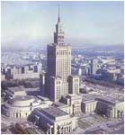

Zacznijmy od niedawnej współczesności. Wspomoże to być może trzeźwiejsze spojrzenie na problem budowy średniowiecznych zamków i warowni. Każdy z nas (mówię o Polakach) zna doskonale sylwetkę Pałacu Kultury i Nauki im. Józefa Stalina - dar Czerwonego Brata dla bratniego Narodu Polskiego. Wzniesiony z polskiej cegły i polskiego betonu oraz obłożony polskim kamieniem, wydobywanym z okolic Częstochowy (wapień), z okolic Szydłowca (piaskowiec) i z Sudetów (granit). Mierzy sobie 230,68 m wysokości (bez iglicy - 167,68 m) i zajmuje powierzchnię ponad 4 hektarów. To szkaradziejstwo bolszewickiego gigantyzmu powstało w zamyśle nie kogo innego, jak tylko "wschodzącego słońca komunizmu" tow. Stalina przy aplauzie polskiej bolszewii z tow. Bierutem na czele.

Mirosław Bańka nazwał to po prostu "snem szalonego cukiernika", a lud Warszawy - "wielkim słoniem w koronkowych gaciach". Legendą już jest, że główny architekt L. W. Rudniew (laureat Nagrody Stalinowskiej) zjeździł Polskę wzdłuż i wszerz, by w koncepcji znalazły się polskie akcenty, ale i tak powstał moskiewski bliźniak, tyle że z polskimi literami. Budowę naród radziecki okupił aż 16 ofiarami, co przy ilości użytych elementów stanowi znikomy procent i najmniej przejęli się tym Rosjanie, bo jak wiadomo "ludiej u nich mnogo". Pałac budowało 3500 Rosjan mieszkających w specjalnie wybudowanym dla nich osiedlu, które też nam przekazano w darze.

Jak już wspomniałem był to dar narodu radzieckiego, a że za dary się nie płaci więc musieliśmy rewanżować się w inny sposób. Jednym z takich sposobów była RWPG czyli Rada Wzajemnej Pomocy Gospodarczej, gdzie my Polacy słaliśmy Pomoc Gospodarczą na wschód w zamian za dobre Rady. Złośliwi nawet uknuli rozwinięcie skrótu jako "Rosji Wszystko Polsce Gówno", ale wiadomo - byli to malkontenci i wrogowie polskiego narodu. Sam naród cieszył się, bo wreszcie było gdzie popełniać samobójcze skoki, co było przyczyną zamknięcia w roku 1956 najpierw tarasu widokowego, a potem jego okratowanie.

Pałac wgryzł się w ojczystą ziemię do tego stopnia, że nawet upadek komunizmu nie spowodował jego upadku. Mało tego - pan prezydent stołecznego miasta Paweł P. (podaję inicjał już na wszelki wypadek) nakazał umieścić na nim zegar milenijny, by odmierzał dalej czas chwały dorobku poprzedników. Odsłonięto go w Sylwestra 2000 roku. Cztery tarcze o średnicy 6 metrów każda rozsiewają upływ czasu na cztery strony świata i są ponoć położone najwyżej na świecie, choć zdania na ten temat są podzielone. Zegar widać z odległych stron Warszawy, co jak twierdzą niektórzy, przyczyniło się do upadku paru sklepów z zegarkami i paru zegarmistrzów.

Pałac budowano troszkę więcej niż 3 lata z użyciem najnowocześniejszego na owe czasu sprzętu. Jak pisano - architekt Rudniew wraz ze swoim zespołem stworzył pięć projektów, Polacy (oczywiście jedynie słuszni) wybrali projekt 120-metrowego budynku, lecz radzieckie ambicje były znacznie większe, co pozwoliło na budowę znacznie większego budynku. Radziecka ambicja, jak łatwo wyliczyć, była większa od polskiej o ponad 110,5 metra. Podobnie było zapewne pod Krakowem, gdzie planowane kilka socjalistycznych dymarek rozrosło się do rozmiarów Nowej Huty. Gminna wieść niesie, że na potrzeby budowy Rosjanie wymyślili też nowoczesne dźwigi, które później przekazali nam w darze i które służyły odbudowie i rozbudowie socjalistycznej Ojczyzny. Pałac przetrwał burzę transformacji, dalej wisi na Warszawą i... nadal grozi. Jak żarówka firmy "OSRAM".

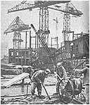

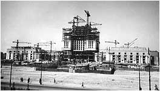

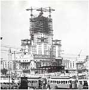

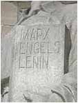

Na zdjęciach - historia współczesnego placu budowy. Ostatnie zdjęcie przedstawia ciekawostkę zgoła znamienną i chyba znaną doskonale historykom. Początkowo na okładce księgi były cztery nazwiska twórców komunizmu - Marksa, Engelsa, Lenina i Stalina. Po śmierci tego ostatniego i słynnym XX zjeździe KPZR nazwisko dyktatora usunięto. Czyż nie przypomina to hipotezy egiptologów o usuwaniu w niebyt niechcianych faraonów?

Podsumujmy. Budynek o wysokości ponad 230 metrów, zajmujący u podstawy prawie 4 hektary powierzchni, mający 3288 pomieszczeń, z cegły, betonu i kamienia

**przy użyciu nowoczesnej techniki budowało 3500 ludzi przez całe trzy lata bez chwili przerwy**.

Ilu pracowało w kamieniołomach, hutach, warsztatach i transporcie - historia milczy, a musiało być ich też niemało. Czyli jak nie patrzeć dar narodu radzieckiego ograniczył się tylko do pomysłu i częściowej robocizny, bo reszta była nasza. Po co to wszystko piszę? Po to, by uświadomić różnicę pomiędzy czasami współczesnymi a głębokim średniowieczem. Po to, by do historyków dotarło, że w średniowieczu nie było dźwigów, stalowych lin, betoniarek, pił do cięcia kamiennych bloków, transportu kolejowego i samochodowego. Tam od roboty był koń, wół i człowiek oraz namiastki narzędzi, a pomimo to zdołano wybudować zamki i warownie nie ustępujące, a niektóre wręcz przewyższajace rzeczony Pałac Kultury.

Piszę także po to, by uświadomić czytelnikom, że współcześni podejmując takie przedsięwzięcia starają się pozostawić dokumenty świadczące o projektancie, o budowniczym, o właścicielu, o kosztach i organizacji budowy. Tak jest wszędzie, gdzie tylko ludzie potrafią pisać, a jeśli buduje się w kraju analfabetów, rolę tą przejmuje zbiorowa pamięć ludzka.

**Klimaty tamtych lat**

Większość budowanych najstarszych kamiennych zamków historycy umieszczają w początkach średniowiecza. Nam, żyjącym współcześnie, średniowiecze kojarzy się z zacofaniem umysłowym i technicznym oraz z zabobonami i herezją. Jak wobec tego nacje żyjące w tym okresie wzniosły tyle zamków, gdzie budowa niektórych i dziś nastręczałaby wiele trudności natury technicznej? Proponuję małą powtórkę z oficjalnej historii, która średniowiecze zamyka pomiędzy V a XVI wiekiem naszej ery. Uprzedzam też, że nie sposób będzie prowadzić rozważań bez dotykania problemów wiary. Uważam, że wiara jako taka, winna stać ponad wszystkim, ale to człowiek bezustannie miesza ją do swoich działań, a przede wszystkim do polityki.

Wieki V-X ne. to upadek totalitarnego Imperium Rzymskiego. Goci atakują Italię, insygnia cesarskie zostają odesłane do Konstantynopola. Arystokracja rzymska, by ratować własną skórę i to, co jeszcze zostało z wielkiego Rzymu, ucieka "w chrześcijaństwo" i środkowymi Włochami zaczynają rządzić już nie cesarze a papieże. Rzymianie wschodni tworzą imperium w Bizancjum. Na arenę wkraczają nowe państwa (opuszczane kolejno przez okupanta rzymskiego) - Frankowie i Germanowie, budzi się Anglia i Skandynawia. Rozpoczyna się walka o panowanie nad nowym europejskim porządkiem - walka o ziemię i dusze, która rozgrywać się będzie pomiędzy dwoma ośrodkami jednego i tego samego chrześcijaństwa - Rzymem i Bizancjum. Gra, gdzie podówczas jedynym rozdającym karty był kościół.

Najbardziej znamienną datą w historii średniowiecznego świata był rok 1054. Rok, którego reperkusje widoczne są do dnia dzisiejszego. Wielka schizma, czyli rozłam w łonie chrześcijaństwa na bizantyjskie (wschodnie) i rzymskie (zachodnie). Poszło zaś o jedno słowo - "filoque" (i/od syna). Rzym uznał, że Duch Święty pochodzi od Ojca i Syna, Bizancjum, że tylko od Ojca. Wiara stała się polityką i polityka zaczęła narzucać wiarę. Rozpoczęła się też bezpardonowa walka na wyniszczenie, gdzie ofiara padło Bizancjum "ogłuszone" przez Rzym a dobite przez Islam. Prowadzone wyprawy krzyżowe celem oswobodzenia Grobu Pańskiego, w głębszym jak sądzę zamyśle Rzymu, miały głównie na celu osłabienie bądź zniszczenie samego Bizancjum i były zapalnikiem, który uruchomił islamską bombę.

Po zakończeniu krucjat i upadku Bizancjum, Rzym zaczyna "zjadać własne dzieci", dla których czysta wiara miała większe znaczenie niż polityka przemocy. Rok 1232 to powołanie Świętej Inkwizycji - papieskiej policji mającej tropić i eliminować przeciwników kościoła rzymskiego (działa do dziś pod nazwą Świętego Officjum). W roku 1244 zostają spaleni ostatni Katarowie, także w XIII wieku papież rozwiązuje zakon Joannitów (Kawalerów Matltańskich) zasłużonych w wyprawach krzyżowych, a w XIV wieku Rzym doprowadza do fizycznego zniszczenia Templariuszy w Europie kontynentalnej. Francuscy zostają fizycznie wytępieni przez Filipa Pięknego, niemieckich uratowało stawienie się przed oblicze władcy w pełnym rynsztunku bojowym, zbrojny opór stawili templariusze aragońscy i cypryjscy, a angielscy zdążyli zejść do podziemia, tworząc zalążki późniejszych pierwszych lóż masońskich.

Jak wyglądała technika w tych czasach? Jako takiej zapewne nie było. Wieś orała drewnianymi sochami, za siłę pociągową służyły woły, używano sierpów i cepów. Zawansowana technika rycerska to miecze, łuki, cepy bojowe, włócznie i topory. Używano też wozów na kołach. Drewno i konopne liny używane były w pracach budowniczych. Działały prymitywne kołowroty i być może drewniane bloki. Jakiej używano zaprawy murarskiej? Na dobrą sprawę historycy tego nie badają, a ponoć świetną rzymską "pucolanę" Rzymianie zabrali ze sobą do grobu. W takich to czasach powstają wszystkie kamienne zamki, z których lwią część przypisuje się rycerzom z wypraw krzyżowych.

**Zamki Bliskiego Wschodu**

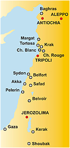

Bliski Wschód Europa zaczęła poznawać dopiero podczas wypraw krzyżowych, a więc od XI wieku. Przybyszy zapewne ogarniało zdumienie na widok zamków o wiele potężniejszych od europejskich i innych z wyglądu. Kto je zbudował? Przypisuje się je różnym nacjom. Od Bizantyjczyków, poprzez Turków po Arabów, a nawet niektóre europejskim zakonom rycerskim. Poniekąd jest to logiczne, bo skoro Nabatejczycy, koczowniczy naród palący ogniska z wysuszonych wielbłądzich gówien, potrafił w wolnych chwilach wykuć w skale całą Petrę już w pierwszych wiekach naszej ery, to dlaczego ich potomni nie mogli wznosić kamiennych zamków? Rzymian pominięto, bo zapewne nie pasował styl budowy. Ponieważ były i są cokolwiek dziwne, historycy wynaleźli określenie "zamku szpitalnego", co w rzeczywistości ma się tak jak wół do karety. Genesis tych budowli spowija mgła tajemnicy, a najczęściej spotykane określenia to podarowany, odbudowany i oczywiście zburzony przez najeźdzców. Historycy wszystkie zamki Bliskiego Wschodu łączą z prowadzeniem wypraw krzyżowych, co znalazło odbicie w ich dzisiejszych nazwach - zamków krzyżowców.

Ówczesna sytuacja polityczna wymuszała zasadniczo jeden szlak lądowy dla wypraw krzyżowych. Biegł on przez Konstantynopol (przeprawa przez Bosfor), dalej na południe omijając Sułtanat Seldżucki i dalej wzdłuż wybrzeża Morza Śródziemnego przez królestwo Armenii, Antiochię, księstwo Tripoli i dalej na Jerozolimę. Dlatego też zapewne Krzyżowcom przypisano zamki leżące tylko w strefie nadmorskiej, choć podobnych jest więcej w głębi lądu. Same wyprawy krzyżowe choć toczyły się pod hasłem "obrony Grobu Pańskiego", często wykraczały poza ten cel (bito się wszędzie i ze wszystkimi, nawet z Egipcjanami) i w rezultacie (po jedynym sukcesie pierwszej wyprawy rycerskiej) doprowadziły do utraty Królestwa Jerozolimy a przede wszystkim przyczyniły się do upadku Cesarstwa Bizantyjskiego, drugiego po Rzymie ośrodka chrześcijaństwa.

Po wyprawach krzyżowych pozostały kamienne zamki przypisywane "lekką ręką" historyków uczestnikom wypraw krzyżowych. A przecież budowa najmniejszego choćby zamku wymagała bezwzględnej znajomości zasad budowy a przygotowanie budulca biegłości w sztuce kamieniarskiej. Jak i skąd zatem przebiegał transport budulca w kraju objętym wojną? Ilu ludzi musiało własna piesią ochraniać plac budowy, zanim nie postawiono choćby prowizorycznych murów obronnych? Jeśli zaś zamek stanowił darowiznę, to kto go zbudował? Plemiona arabskich pasterzy? Gdzie znajdowały się kamieniołomy, które musiały dostarczyć przeogromnej ilości budulca? Przypatrzmy się uważniej niektórym twierdzom i zamkom.

**Margat (cytadela Qal'at Marqab)**

Sztandarowy zamek-szpital krzyżowców. W języku arabskim oznacza "punkt obserwacyjny". Według jednej wersji został nadany zakonowi szpitalników (Joannitom) w roku 1186, według innych Joannici sami go zbudowali jako zamek szpitalny i jak twierdza historycy, była to główna kwatera zakonu. Zamek wybudowany na 500-metrowym wzgórzu, na planie trójkąta, zajmuje 12 akrów powierzchni i posiada 14 wież. Twierdza mogła pomieścić tysiące obrońców, ale ponoć obliczona była na załogę składającą się z 1000 osób. Twierdza długo opierała się atakom muzułmańskim i dopiero w 1285 r. wojska sułtana Qalaun'a zdobyły ją po ciężkim oblężeniu. Załodze twierdzy pozwolono opuścić zamek w pełnym uzbrojeniu, co w średniowieczu oznaczało uznanie bohaterstwa obrońców, po czym Joannici udali się do Akki.

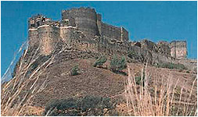

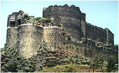

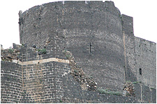

Z grubsza rzecz biorąc twierdza w posiadaniu Joannitów znajdowała się około 100 lat i musiała być gotowa na długo przed atakami muzułmanów. Znów pojawiają się wątpliwości. Ile lat więc zamek budowano? Ilu ludzi było zaangazowanych do budowy? Skąd wzięto specjalistów od obróbki kamienia? Skąd czerpano budulec? I wreszcie, z jakiego kamienia jest zbudowany cały zamek? Jak widać na zdjęciach barwa kamienia jest w przeważającej większości ciemna, by nie powiedzieć czarna. Czyżby to był bazalt spajany białą zaprawą? Ale skąd bazalt i do tego w tak ogromnych ilościach? Jeśli nie bazalt, to dlaczego jest taki czarny? Okopcenie po pożarze? Chyba nie, biorąc pod uwagę rozległość całej powierzchni. Jeśli zaś faktycznie twierdza została podarowana zakonowi, to kto jest faktycznym budowniczym zamku? Pewne światło może rzucić biały "szlaczek" w górnej części zamku, który jest pokryty kamiennymi reliefami w języku arabskim.

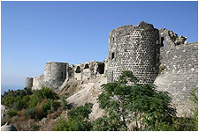

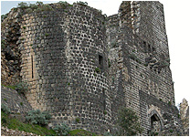

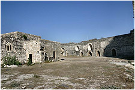

Trudno sobie wyobrazić by te reliefy zostały wykonane i umieszczone w murze po zbudowaniu zamku. Stanowią raczej kompozycję wykonaną równocześnie z budową i w tym czasie musiały zostać wmurowane. Jest też jeszcze inna inskrypcja arabska wykonana na cześć zwycięzców w z roku 1285, ale dla odmiany została wyryta u podnóża baszty, co jednoznacznie wskazuje na odległość w czasie i możliwości techniczne wykonującego. Inne pytanie dotyczy funkcji zamku. Po czym można odróżnić zamek szpitalny od zwykłego zamku? Jakoś nie mogę odnieść zasadniczego kryterium - szpitala, do jakiejkolwiek części budowy. Szkoda.

**Krak de Chevaliers**

Zwany "twierdzą rycerzy" a po arabsku "twierdzą Kurdów". Historia twierdzi, że wzniesiono ją w 1031 dla emira Aleppo. W 1099 została zdobyta podczas pierwszej krucjaty, jednak została opuszczona, gdy krzyżowcy pomaszerowali dalej na Jerozolimę. Ponownie zajęta w 1110 przez księcia Antiochii. Podarowana szpitalnikom w roku 1144, a już w 1271 po miesięcznym oblężeniu 200 rycerzy poddało się wojskom muzułmańskim. Tu i ówdzie błąka się nawet hipoteza, że zamek budować rozpoczęli Arabowie, ale ostateczny kształt nadali mu dopiero Templariusze.

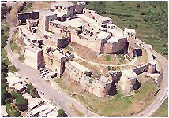

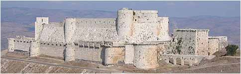

Jest to bodaj najlepiej zachowana warownia Bliskiego Wschodu. Bryła zamku zajmuje powierzchnię ponad 4 hektarów, a jego wysokość szacować można na 40-50 metrów od podstawy. Duże zdjęcie przedstawia południową i południowo-zachodnią część budowli, a z lotu ptaka oglądamy część wschodnią i północną. Budowla jest bardzo zwarta, a duże płaskie dachy wyłożone są kamiennymi płytami. Inna cecha, to brak jakichkolwiek większych okien wychodzących na otoczenie zamkowe. Główna część zamku otoczona jest murem obronnym, a jedyne wejście (nie wjazd, bo takowego nie ma) znajduje się na stronie wschodniej. Całość zbudowana z kamiennych bloków ściśle dopasowanych do siebie. Kto i ile lat budował taki obiekt, skoro był gotowy już w roku 1031? Skąd wydobywano surowiec w pustynnej przecież Syrii? Ilu ludzi zatrudniono przy transporcie surowca? Jakich środków transportu używano? Konie, wielbłądy? Ile budulca mógł jednorazowo przewieźć taki środek lokomocji? I najważniejsze. Ile to wszystko kosztowało? Kto w pustynnym kraju, kraju wędrownych pasterzy mógł sobie na to pozwolić? I wreszcie czemu służyła ta budowla. Życie towarzyskie w świetle słońca ograniczało się tylko do wewnętrznego podworca, a stanowi on małą część zamczyska. Co w takim razie działo się w większości pozbawionych światła pomieszczeniach? Czym oświetlano je w nocy?

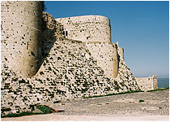

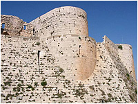

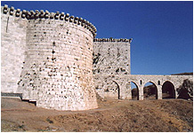

Przy budowie nie użyto ani jednego kawałka cegły. Wszystko, nawet skomplikowane detale wykonane są z kamienia. Zamek w zewnętrznej części posiada mały akwedukt. Tędy zapewne wody nie sprowadzano, bo nikt nie ryzykowałby otrucia załogi. Mógł zatem odprowadzać wodę deszczową z części pomiędzy murem a zamkiem właściwym. Skąd zatem załoga zamku czerpała pitną wodę? Jedynym wytłumaczeniem może być wewnętrzne ujęcie wody, którego jak dotąd nie odnaleziono. Dlaczego nie szuka się studni? Czy zbierano wody deszczowe do jakiejś cysterny? Jeśli tak, to z pewnością nie wykorzystywano jej jako wody pitnej. Czy dziś ktoś, jeśli nie musi, pije deszczówkę? Ile można wytrzymać na wodzie prawie destylowanej. Zamek musiał posiadać zródło pitnej wody.

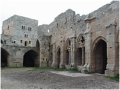

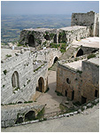

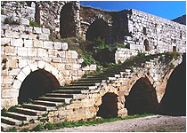

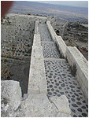

Wewnętrzny podworzec zamkowy, wokół którego skupiało się zapewne "życie towarzyskie". Tylko w tej części i wychodzące na wewnętrzny podworzec znajdują się duże okna i wejścia. Jest to bardzo mała część powierzchni zamku. Co ciekawe, nie widać tu żadnego przepychu tak charakterystycznego dla władców wschodu. Nie ma śladu, nawet w formie grafitti, pobytu europejskich rycerzy-krzyżowców (a ci podobno lubili ryć krzyże w murach), są natomiast głębokie reliefy w kamieniu znaków arabskich. Wniosek może być taki - zamek nie służył za rodzinne gniazdo władców, a miał zupełnie inne, nie znane nam przeznaczenie. Zapewne w naszych czasach zarówno Arabowie jak i krzyżowcy używali go na zasadzie "gniazda szerszeni", a mieszkano w nim zapewne tak, jak pokazano w naszym filmie "Pan Wołodyjowski", wojska koronne w zamku Ogrodzieniec.

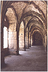

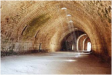

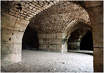

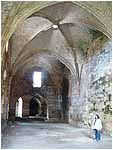

Wnętrza twierdzy są nader skromne, by nie powiedzieć surowe. Wszędzie widać surowy kamień, zarówno w ścianach, kolumnach czy sufitach. Sklepienia łukowate i zaraz nasuwa się pytanie, kto je tu pierwszy wprowadził - czy "oświeceni" Europejczycy czy "nieoświeceni" Arabowie. Jakoś trudno mi sobie wyobrazić, by Arabowie preferowali styl romański czy gotycki. Czy ściany były tynkowane? Jeśli tak, to gdzie się podział tynk? Odpadł? Wysprzątano? Odnoszę wrażenie, że ściany były gołe, bo jak to możliwe, by nie zachował się jakikolowiek jego skrawek. Jeśli tak faktycznie było, to utwierdzam się w przekonaniu, że zamek nie służył do celów stricte mieszkalnych, a do zupełnie innych. Jakich? Nie wiem i trudno nawet zgadywać jeśli się przyjmie datę budowy "wykoncypowaną" przez historyków. Co mieściło się w ogromnych podłużnych halach rozświetlanych tylko słonecznym światłem wpadającym przez sufitowe świetliki? Co rozświetlało je w nocy, skoro na ścianach brak okopceń? Czy ostatnie pomieszczenie to zamkowy kościół, czy tylko tak umownie nazwane pomieszczenie?

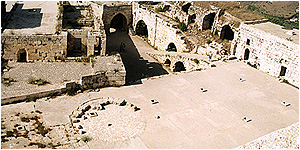

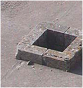

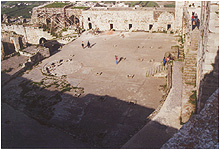

Płaskie dachy pokryte zostały kamiennymi płytami, a dachy baszt, przejścia i drogi wzdłuż szczytów murów wygładzonymi kamieniami spojonymi nieznaną zaprawa murarską. Każde obramowanie świetlika, a jest ich mnóstwo, zostało wykonane z dwóch elementów precyzyjnie wyciętych w kamieniu. Jak wyglądało zabezpieczenie przed opadami deszczu tego chyba nie wie nikt, choć szkło znali już ponoć starożytni Egipcjanie. Co znajdowało się na dachu w miejscu wyraźnie zaznaczonego okręgu? Czy było to coś przezroczytego, bowiem w środku okręgu znajduje się świetlik? W sumie budowla "dziwna". Jedyne wejście sugeruje, że do zamku można było wejść tylko pieszo (bowiem już w wejściu znajdują się schody prowadzące do góry) lub od biedy na koniu. Czy do takiej funkcji zamku jesteśmy przyzwyczajeni?

A może najwięcej prawdy tkwi w arabskiej nazwie "Twierdza Kurdów"? Dziś Kurdowie żyją w wielu krajach, ale jako społeczność zachowują jedność. Walczą o swoją ojczyznę, ale ich walka jest skazana na niepowodzenie w dzisiejszym podziale politycznym świata. Czy Kurdowie, podobnie jak Baskowie czy Celtowie, sięgają korzeniami czasów sprzed kataklizmu?

**Aleppo**

Tradycja żydowska i muzułmańska podają, że podczas wędrówki z Ur do Kanaanu na fortecznym wzgórzu odpoczywał biblijny patriarcha Abraham. Miał tu również wypasać swoje stada i doić krowy (Halab al-Szaaba, stąd arabska nazwa miasta). Pamiątką jego pobytu ma być "kamień Abrahama". Trochę to dziwne, bo gdzie Ur a gdzie Kanaan, ale być może w zamierzchłej przeszłości patriarchowie lubili nadkładać drogi. Jak niesie wieść za czasów Seleucydów powstały pierwsze budowle, które złożyły się potem na najsłynniejszy zabytek Aleppo - cytadelę Halab al-Qat, położoną na owalnym wzgórzu w centrum miasta, rozbudowywaną przez kolejnych władców. Samo wzgórze wygląda na usypane sztucznie o dość regularnym owalu z głęboką fosą. Budowę cytadeli zakończono w roku 944 pod władzą lokalnej dynastii Hamdanidów. Skąd zatem w samym środku cytadeli "rzymski" amfiteatr?

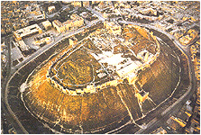

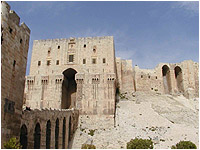

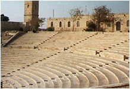

Sądząc po resztkach, prawdopodobnie całe wzgórze było umocnione kamiennymi płytami a i widać, że dojścia do samej fosy też bronił kamienny mur. Jeśli tak, to zużycie kamienia na całą budowlę przekracza wielokrotnie ilość kamienia zużytego na piramidy w Giza. Jaka zatem arabska dynastia była w stanie ponieść koszty takiej budowli? Ile zatem już nie lat a wieków trwała budowa? Czy przypisywanie budowy współczesnej cywilizacji, to kolejny, niewinny żart współczesnych historyków?

Samo miasto nigdy nie dostało się w ręce krzyżowców. Dlaczego więc je pokazuję? Dlatego, że istnieje wiele podobieństw do pozostałych zamków Bliskiego Wschodu. Przede wszystkim budulec i rozmach budowy. Cytadela jest zbudowana z dużych bloków kamiennych, a pochyłe wzgórze do linii murów wyłożono kamiennymi "cegłami". Do cytadeli prowadzi tylko jedno wejście przez kamienny most o wysokich łukach. Nad wejściem wgłębiony pas w murze pokryty arabskimi reliefami. Istnieje bardzo dużo zbieżności z zamkami przypisywanymi europejskim krzyżowcom.

**Belvoir**

Forteca wzniesiona przez króla Jerozolimy Fulka Andegaweńskiego w roku 1140, a inni zaś twierdzą, że zamek wybudowali bracia zakonni, którzy ukończyli go w roku 1168. Z francuskiego "belvoir" oznacza "piękny widok", co może oznaczać nie tyle piękny a raczej "praktyczny" gdyż z murów zamkowych widoczny jest każdy ruch w promieniu wielu kilometrów. Zbudowana na planie prostokąta jest oczywiście "zamkiem szpitalnym", gdzie jak twierdzą archeolodzy znakomicie architektonicznie rozdzielono funkcje szpitala od posługi zakonnej.

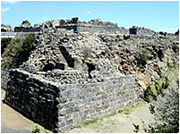

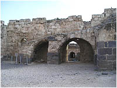

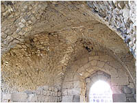

Pod koniec swojej kampanii w Syrii w 1188 zdobył go Saladyn, który w obliczu zbliżania się sił krucjaty cesarza Fryderyka Barbarossy zniszczył go. Później znów znalazł się w rękach Templariuszy, którzy utrzymali zamek do 1268 roku, kiedy to czując się niezdolnymi do jego obrony, uciekli przed Bajbarsem, uprzednio spaliwszy zamek. Jak widać wojska sułtana były zdolne do tego samego, co Rzymianie w Kartaginie. Mając do dyspozycji tylko sierpowate szable i dzidy roznieśli prawie w pył cały kamienny zamek. Zdolne bestie.

**Kerak**

Budowę zamku przypisuje się krzyżowcom, a konkretnie Baldwinowi I w roku 1132. Zamek ma stanowić część długiego ciągu fortyfikacji pomiędzy Akabą na południu a Turcją na północy. Ciekawostką jest to, że zamek leży po wschodniej stronie Morza Martwego, skąd raczej nie należało się spodziewać pielgrzymów do Świętego Grobu. Czyżby akcja obrony europejskich pielgrzymów miała tak szeroki zasięg?

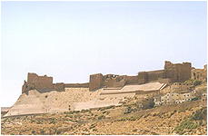

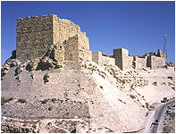

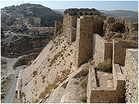

Zamek jest zbudowany na planie trójkąta, a część pochyłego wzgórza jest umocniona kamiennymi blokami ściśle do siebie przylegającymi (podobnie jak w cytadeli z Aleppo). Twierdza jest zbudowana w całości z kamienia. Ściany i sufit są surowe, bez oznak tynkowania. Czy tak wyobrażamy sobie obiekt mieszkalny? Jest to cokolwiek dziwne i koliduje z naszym wyobrażeniem piękna, nie wspominając już o przytulności pomieszczenia.

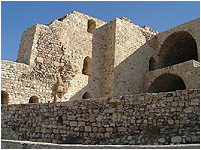

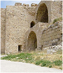

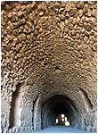

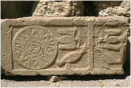

Ogromne sklepione pomieszczenie uznano oczywiście za kaplicę zamkową, co jak sądzę uczyniono na wyrost. Prawdziwego przeznaczenia pomieszczenia nie znamy i przy dzisiejszym założeniu historyków zapewne nie poznamy. Tak sie utarło, że wysokie, łukowato sklepione pomieszczenia i najlepiej mroczne uważa się za kościoły, kaplice lub pomieszczenia związane z obrządkiem religijnym. Na jakiej podstawie? Owszem prawdą jest, że nie spotykamy kościołów w zaadoptowanych nędznych wiejskich chatach. Prawdą jest, że kościół lokował swe obiekty na gruzach tzw. ośrodków pogańskich, ale i prawdą jest to, że nie mamy pojęcia czemu służyły te adoptowane pomieszczenia w czasach przedkościelnych. Na ostatnim zdjęciu relief do złudzenia przypominający starobabilońskie przedstawienie gwiazdy. Czy korzenie Kerak sięgają aż tak głęboko?

**Akka i Sydon**

Jak twierdzą historycy Akka została zdobyta przez krzyżowców w roku 1192, za pomocą katapult, załadowanych ulami z pszczołami. To właśnie tu w roku 1198 powstaje zakon naszych dobrych znajomych - Krzyżaków. W tych czasach zakon św. Łazarza rozbudowuje i fortyfikuje miasto. W roku 1285, po upadku Margat, Joannici w Akkce zakładają swoją stolicę, ale już w 1291 r. muzułmanie zdobywają miasto niszcząc w ten sposób ostatecznie Królestwo Jerozolimskie. To co widzimy na zdjęciach, to znów kamienne budowle. Zamek, z racji obmywania go przez morskie fale, dostąpił statusu "zamku morskiego", lecz historycy wolą milczeć na temat technicznych rozwiązań budowy. Zamek na lądzie to kamienna forteca z renesansowym wejściem wzmocnionym "rzymskim" łukiem.

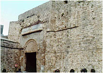

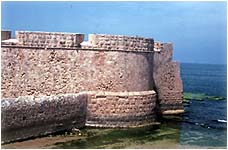

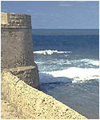

Zamek "morski" w Sydonie, wedle historyków został zbudowany na samotnej skale na morzu, a wznieśli go krzyżowcy frankijscy, angielscy i hiszpańscy w okresie od listopada 1227 r. do marca 1228 r, chociaż Rey przyznaje, że "nie zaobserwował żadnych pozostałości po dziele Krzyżowców". Składał się z wieży wielkiej i średniej, połączonych murem, a na całym obwodzie podmurowanej skarpy znajdował się pomost. Archeolog Rey przypuszcza, że na długości 42 metrów dzielących skałę od brzegu znajdowała się kładka, którą łatwo można było usunąć w razie ataku. Niewiarygodne - zamek, i do tego w morzu, zbudowano w ciągu zaledwie 5 miesięcy. Jak też rozumiem, nie było innej możliwości budowy, jak tylko ze statków. Jakiej zatem metody użyli bracia zakonni do budowy kamiennych fundamentów pod wodą? W czasach dzisiejszych do usypania podłoża z kamieni używa się wielkich barek z otwieranym dnem. To, co widzimy w Sydonie, to obłożone ściśle dopasowanymi kamiennymi płytami nadbrzeże. Jak zatem prowadzono prace pod wodą? A co z tzw. kładką? Nie potrafie sobię wyobrazić kładki o długości 42 metrów, nawet z cedrów libańskich.

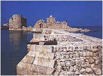

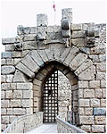

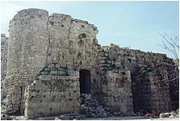

Sydon to nie tylko "morski zamek" ale także kamienny zamek na lądzie (zwany także zamkiem Św. Ludwika). Zamek zbudowano w całości z kamienia. Zastanawiać może pęknięcie przebiegające na całej wysokości zamku i do tego w dwóch prawie równoległych miejscach. Czy to efekt uderzenia muzułmańskiego tarana, czy raczej trzęsienia ziemi? O tak wielkim trzęsieniu ziemi historia w tym rejonie historia milczy i może to i dobrze.

• • • •

Oprócz wielkich kompleksów budowlanych zwanych powszechnie cytadelami, Bliski Wschód jest usiany setkami kamiennych zamków. Ile takich zamków lub ich ruin kryją jeszcze piski pustyń? Tego nie wiemy, bo badania tego terenu prowadzone są sporadycznie lub wcale z uwagi na wrogość świata arabskiego. Sami Arabowie się do tego nie kwapią, bo nie widzą celu, a jeśli już zaczynają coś odkopywać, to tylko po to by potwierdzać wersety Koranu. Hipotezy arabskich uczonych raczej nie przenikają do naszego świata, a jeśli nawet, to nie są w stanie zagrozić hipotezom "białych".

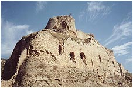  
Bagras

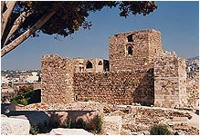  
Byblos

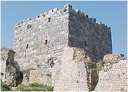  
Saona

Zamek w Bagras ponoć zajmowali i Rzymianie i Bizantyjczycy i Templariusze. Kto go wybudował? W zasadzie nie wiadomo, a historyczne stwierdzenia są wypełnione słowem "prawdopodobnie" i zależą od narodowości narratora. Wiekszość skłania się do tezy, że "większa część budowli jest dziełem Leona II, a templariusze zajęli się tylko jego zagospodarowaniem". Byblos przypisuje się Fenicjanom, a Saona Bizantyjczykom gdzieś w IV-V wieku ne. Kamienne mury o regularnych elementach świadcza o wysokiej znajomości sztuki obróbki kamienia. Jak w tamtych czasach wynoszono w górę elementy o tak znacznej wadze i precyzyjnie układano obok siebie?

  
Azrak

  
Safita

  
Zamek Saladyna (Saona)

Zastanówmy się też nad technicznym rozwiązaniem budowy łuków z potężnych kamiennych elementów w przyziemiach zamków Azrak, Safita czy zamku Saladyna. Jeśli używano drewnianych rusztowań, to proszę pamiętać, że nie tylko do budowy kamiennych łuków. Rusztowania musiały podpierac także całe kamienne stropy. Dlaczego ściany i sufity nie posiadają żadnych ozdób, a przynajmniej nie sa wygładzone tynkiem? Saladyn, potężny władca wschodu mieszkał w gołych murach? A gdzie ten przysłowiowy wschodni przepych? Rozkradziony? Przez kogo?

Charakterystyczną cechą największych warowni Bliskiego Wschodu jest pochyły mur, a niektórych nawet pochyłe, wyłożone kamieniami podejście pod mury główne, niespotykane w zamkach europejskich.

Czemu lub komu miały służyć takie giganty jak Bagras, Krak de Chevaliers, Kerak czy cytadela w Aleppo? Zamki królewskie, książęce, wojskowe warownie? Dlaczego są tak nieprzyjaźnie architektonicznie dla ludzi? Wyodrębniając z nich pomieszczenia, które mogłyby służyć za codzienne mieszkanie możemy stwierdzić, że stosunek powierzchni tych pomieszczeń jest bardzo mały do całości. Jeśli zaś przyjmiemy, że były to twierdze, których celem była ochrona załogi wojskowej, odpowiedzialnej za "porządek" w danym rejonie, to proszę znaleźć w nich pomieszczenia dla koni wraz z magazynami paszy. Proszę wyodrębnić zbrojownie mające pomieścić uzbrojenie dla kilku tysięcy ludzi. Z Sali Kongresowej Pałacu Kultury i Nauki w naszej Warszawie też można wynieść fotele i wprowadzić kilka tysięcy koni, ale czy dlatego nazywać ją będziemy stajnią? Po kilkuset latach z pewnością, gdy umrze pamięć o pierwotnej funkcji.

A jeśli te warownie nie pełniły roli zamków arystokracji, jeśli nie pełniły roli garnizonów wojskowych, to czym mogły być? Używając dzisiejszego podziału użytkowego pozostaje nam tylko funkcja "przemysłowa". Być może wskazówką są surowe mury i stropy, bez żadnych zdobień lub ze znikomą ich ilością. Co jednak w nich wytwarzano i jakie było ich pierwotne przeznaczenie nie dowiemy się nigdy, bo historycy nie dopuszczają takiej możliwości, umieszczając ich budowę w średniowieczu.

Oglądając Krak de Chewaliers trudno mi się zgodzić z twierdzeniem, że był warownią utrzymującą w środku kilka tysięcy ludzi i koni. Proszę zwrócić uwagę na to, że "zamek" posiada tylko jedyne, wąskie wejście do warowni na dodatek ze schodami. Proszę teraz wyobrazić sobie w jaki sposób opuszczano zamek w celu jakiejś nagłej ekspedycji. Fortecę musiano opuszczać w osobliwy sposób - pojedynczo na koniach lub małymi grupami piechoty! Aby więc wyprowadzić załogę należałoby najpierw uchwycić przyczółek poza murami, by zapewnić w miarę bezpieczne wychodzenie na zewnątrz. Bez takiej ochrony zdolni łucznicy przeciwnika w krótkim czasie "zatkaliby" wyjście trupami poległych już w bramie.

Inną, bodaj najbardziej istotną sprawą, jest sprawa wody pitnej. Ze strategicznego punktu widzenia, woda winna być wydobywana ze środka budowli, gdyż czerpanie jej spoza murów obronnych groziło zatruciem jej przez wrogów. Żródło wody było najpilniej strzeżone i otoczone najwyższą tajemnicą (zamki krzyżackie posiadały studnie w samym środku zamków). Przy badaniach archeologicznych ten szczegół jest zwykle pomijany. Szkoda, gdyż według mnie jest to podstawowy warunek "życia" każdego warownego zamku i jest prawdopodobnie pierwszą przyczyną ich opuszczania.

Na koniec jeszcze pytanie. Dlaczego z Arabów robi się dzicz umiejącą tylko napadać, wyrzynać i niszczyć? Jest to chyba krzywdzące. Wydaje się, że obarczanie ich winą za zniszczenie wielu budowli na terenach Bliskiego Wschodu jest nieuzasadnione. Jakie mamy dowody na to oprócz pomówień? Dlaczego w takim razie nie zniszczyli doszczętnie bazyliki Hagia Sohia? Ba..., pozostawili nawet bizantyjskie malowidła, niezgodne przecież z ich religią, robiąc to samo co Michał Anioł w kaplicy Sykstyńskiej. To nie jest naród głupców. Po co burzyć i budować od nowa, jak można wykorzystać istniejące, zmieniając tylko charakter. I tak zapewne robili. Na miejscach innego kultu wystawiali minarety, malowali kilka wersetów Koranu i tak powstawał meczet. To co im przypisujemy, to "wroga propaganda" ówczesnego kościoła i całej białej, europejskiej rasy.

**Zamki średniowiecznej Europy**

Udajmy się teraz na "nasze" tereny. Europa to tysiące, jeśli nie więcej dużych, średnich i małych zamków z kamienia. Od Portugalii po Rosję i od Szkocji po Maltę. Nazywane różnie - zamkami, warowniami, twierdzami czy cytadelami, są jednak tym samym - budowlami z kamienia, zbudowanymi według historyków w "ciemnym" średniowieczu, a nawet później. Nie sposób pokazać nawet małej ich części. Sądzę jednak, że wyszukanie takiego czy innego zamku nie stwarza żadnych problemów dla obeznanych z netsurfingiem. Pokażę za to nietypowe budowle oraz podzielę się swoimi wątpliwościami co do budowniczych i ich techniki. Oglądając niektóre można odnieść wrażenie jakby projekty wyszły spod ręki jednego architekta a inne mają podobny sposób budowania, choć dzielą je tysiące kilometrów. Wszystkie jednak łączy jedno - kamienny budulec.

Czy w średniowieczu nie było budynków z cegły? Były, są i jest ich dużo. Problemem jest tylko kto i kiedy budował z takiego rodzaju cegły. Proszę zwrócić uwagę na kształt cegły - jest długa i płaska, czym od razu wyróżnia się wśród cegieł - współczesnej czy średniowiecznej tzw. palcówki. Cegły tego rodzaju używano od Hiszpanii poprzez Rzym aż po Grecję i dzisiejszą Turcję. Ten sam rodzaj cegły został użyty także przy budowie Hagia Sophia w Konstantynopolu. W samym Rzymie budowle z tego materiału spotykamy na Palatynacie, z niego zbudowano termy, koloseum, pałace cezarów i wiele innych budowli. Poza Rzymem cegłę taką można spotkać też w Pompejach i Bari.

  
Conimbriga

  
Rzym

  
Pompeje

  
Tessaloniki

Jeśli za rozpowszechnienie tej cegły "winić" Imperium Rzymskie, to pojawia się pewien problem. Budowle z niej pojawiły się na długo przed wynalezieniem przez Rzymian... właśnie cegły. Historycy twierdzą stanowczo, że cegłę wynaleźli Rzymianie ale dopiero w II w. ne, gdzie zaczęto ją wytwarzać w małych, przydomowych warsztatach razem z dachówkami. Jakim tedy "prawem" używał tej cegły Krezus budując Sardes? Krezus to przecież historia na długo przed powstaniem imperium. Skąd taka cegła w Grecji, w Tessalonikach? Jaka to "cegielnia" wyprodukowała cegły na budowę chociażby koloseum (70-82 r. ne)? Dlaczego taka cegła wyziera z murów Alhambry, zbudowanej rzekomo przez Arabów dopiero w XIII w.? Pomimo usilnych poszukiwań nie udało mi się znaleźć zdjęć budowli z tego materiału we Francji, Niemczech, Irlandii, Brytanii, Skandynawii czy poza kręgiem tureckim. Pomijając łuk w Conimbriga (cegła podobna, ale styl budowy już nie, bo jakiś mało elegancki) "ceglany krąg" można zawęzić do części Hiszpanii, środkowych i południowych Włoch, Grecji i zachodniej Turcji (oczywiście dzisiejszych).

  
Hiszpania

  
Piza

  
Bizancjum

  
Sardes

Co zatem stało się z tym elementem budowlanym? Oczywiście można powtórzyć za historykami, że zszedł do grobu z Imperium Rzymskim i jego słynnym cementem, ale byłoby to zwykłe uproszczenie sprawy. Skoro z tego rodzaju cegły nie powstało nic w późniejszej współczesnej Europie, to wniosek może być tylko jeden - ten rodzaj cegły nie jest wynalazkiem żadnej współczesnej społeczności, a jeśli nie współczesnej, to jakiej?

Osobiście uważam te budowle za raczej ograniczone do pewnego terytorium i być może związane z postępem technicznym, stylem czy budowlaną "modą". Wszędzie przeważają budowle z kamienia i te znajdujemy na całym terytorium dzisiejszej Europy. Oglądając "średniowieczne" zamki bądź na fotografiach bądź w oryginale jesteśmy pod wrażeniem ich wielkości i nie zastanawiamy się nad rzeczą podstawową - jak je zbudowano. Rzadko lub wcale możemy obejrzeć podziemia - fundamenty na jakich je postawiono. Z reguły oglądamy to, co nam wolno, a więc fragmenty "odrestaurowane" i pokryte współczesnym tynkiem konserwatora. Czy zastanawialiśmy się dlaczego większość zamków budowano na podłożu skalnym? To jest wyrafinowana ekonomia ówczesnych budowniczych - skała tworzy naturalny, niesłychanie mocny fundament. Jeśli nie widzimy skalnego podłoża, to możemy założyć, że blisko 1/3 wysokości zamku stanowi jego sztucznie wybudowane podłoże, które jest zagłębione w ziemi.

  
Grecja

  
Portugalia

  
Turcja

  
Francja

Część podziemna, o ile nie została "upiększona" przez potomnych może powiedzieć wiele o ówczesnej technologii i zastosowanej technice. To właśnie tam znajdziemy największe elementy budowli i od tego należałoby by zacząć badanie całości. Należy bowiem przypuszczać, że ta część każdego zamku musi stanowić najstarszą jego część. Pragnę zwrócić uwagę na rzecz, która jest wręcz pomijana przy ocenie wieku tzw. "średniowiecznych" zamków. Jest to zasada budowy spotykana niemal we wszystkich tego typu obiektach. Grube mury zamkowe są zbudowane z nieociosanych kamieni lub otoczaków spajanych zaprawą, natomiast zewnętrzną warstwę stanowi kamienna okładzina, która byc może ma stwarzać wrażenie, że całość jest zbudowana z kamiennych ciosów. Poziome belki nad oknami, o ile nie zastosowano kamiennego łuku, są wykonane z jednego kamiennego bloku, natomiast ościeża okien (zachowane jeszcze gdzie niegdzie) są wykonane z kilku lub jednego, doskonale obrobionego kamiennego elementu.

  
Bliski Wschód

  
Anglia

  
Rzym

  
Ameryka Południowa

Taki rodzaj budowy jest spotykany prawie wszędzie i co dziwne jest też podstawową techniką budowy piramid i kamiennych budowli Ameryk prekolumbijskich. Czy to nie rodzi pytań o wiek budowli? Owszem, ale współczesna historia nie może wyjść poza przyjęte ramy czasowe. Drugie pytanie, na które historia nie odpowiedziała jednoznacznie - dlaczego prawie wszystkie "średniowieczne" budowle są dzisiaj w ruinie? Jedyna odpowiedzią jaką możemy usłyszeć, to zniszczenia wojenne lub upływu czasu. Na pierwsze pytanie można odpowiedzieć pytaniem - jak liczne nusiały być armie i jaką dysponowały techniką, by takich zniszczeń dokonać na tak rozległym obszarze? Co do upływu czasu też można spytać - dlaczego do tej pory stoją kamienne budowle Egiptu. Inne kamienie? Czy polskie zamki uległy zniszczeniu tylko dlatego, że są zbudowane z wapienia? To dlaczego twierdzi się, że przepiękne twory krasowe (też w skałach wapiennych) powstawały dziesiątki czy setki tysięcy lat, gdzie woda oddziaływała bez przerwy, a nie w postaci okresowych deszczów? Dopóki w założeniu nie uwzględnimy "wielkiego uskoku skorupy ziemskiej", nigdy nie rozwiążemy zagadki zniszczeń tylu budowli i na tak wielkim obszarze. Nigdy nie znajdziemy odpowiedzi na pytanie - jak zbudowano zamki stojące wprost na wodzie. Nigdy nie odpowiemy na pytanie kto i kiedy zdołał zasypać podziemia ruin aż po same stropy, a tego może dokonać tylko płynne błoto.

  
Węgry

  
Dania

  
Szwecja

  
Anglia

Dlaczego archeologowie i historycy, skądinąd narodek racjonalistów, zaprzęgają do historii legendy tam gdzie nie można znaleźć racjonalnego wytłumaczenia? Dlaczego przyjmuje się czasem niewiarygodne stwierdzenia w rodzaju - Za Wilhelma Zdobywcy w ciągu 100 lat zbudowano 900 zamków? Jaki naród był w stanie ponieść takie koszty budowy? Skąd wzięto taką ilość sił i środków, by w ciągu jednego roku wybudować 9 zamków? A jak budowano zamki w Brytanii? W średniowiecznej Anglii sprawę budowniczych załatwiano w prosty sposób. Pani na zamku obwieszczała rankiem, że miała widzenie iż aniołowie zbudowali kaplicę zamkową. Wszyscy szli do kaplicy i o dziwo faktycznie była zbudowana. Wieść szła do gminu i sprawa załatwiona. Nikt nie śmiał zaprzeczać, bo za negowanie boskich mocy można było dostać po karku... toporem. I to jest baza nowoczesnej historii.

Czy kształt zamku narzucały konkretne potrzeby czy ekstrawagancja władców i twórców?

Inną, nie mniej intrygujaca sprawą jest faktyczne przeznaczenie "średniowiecznych" zamków. Od młodości jesteśmy karmieni wiadomościami iż były to siedziby możnych i królów. Informuje się nas, że były schronieniem dla okolicznych mieszkańców w razie niebezpieczeństwa. Owszem, zgoda. Lecz jest to opis zachowań ludzi już nam współczesnych. Tych, którzy te zamki zamieszkiwali we współczesnych nam czasach. Jaką zatem funkcję mógł pełnić zamek stojący samotnie i nie okolony murami obronnymi? W jaki sposób za murami obronnymi gromadzono żywność na wypadek oblężenia? Jaka to była żywność i w jakiej ilości? Skoro miał to być zapas na wypadek wojny, to w jaki sposób dokonywano odświeżania zapasów? Jak organizowano żywienie, gdy przeciwnik napadał znienacka? I wreszcie podstawowy warunek przeżycia - świeża, pitna woda. Dla zachowania właściwej kondycji zdrowotnej pobór wody musiał wzrastać proporcjonalnie do ilości ludzi. W jaki sposób jedna czy dwie zamkowe studnie były w stanie obsłużyć potrzeby wszystkich ludzi i zwierząt szukających w nim schronienia? A słyszeliśmy zapewne o oblężeniach trwających miesiące a nawet lata. Bez dokładnego zbadania zagadnienia dystrybucji żywności i wody takie stwierdzenia czy wnioski uważam za zbyt daleko idące.

Czy zamki Czech, Polski czy Anglii mają ze sobą coś wspólnego?

Czyż nie dziwi fakt, że król Kazimierz Wielki przez okres swego panowania wzniósł kilkadziesiąt kamiennych zamków podczas gdy w sąsiednim państwie zakonnym Krzyżacy zamek w Malborku wznosili z cegły? Technika wznoszenia z cegły jest dużo bardziej ekonomiczna, nie wymagająca wymyślnej techniki, ani też nie sprawia trudności w transporcie na duże wysokości. Kilka cegieł na dużą wysokość może wnieść człowiek. A jak w Polsce transportowano na duża wysokość gotowe elementy kamienne ważące po kilkaset kilogramów czy ton? Jak to mogło być, że za panowania jednego króla, przez 37 lat zbudowano dziesiątki kamiennych zamków wymagających nie lada organizacji pracy i nakładu sił i środków, podczas gdy Krzyżacy, korzystając z łatwiejszego sposobu, zamek malborski budowali trochę ponad 100 lat (od rozpoczęcia budowy w roku 1272 do zakończenia budowy pałacu wielkiego mistrza w 1392)? Dlaczego w Polsce wybrano dużo droższą metodę budowy wymagającą na dodatek wysokiej klasy specjalistów-kamieniarzy? W Polsce budowali wolni ludzie, a zamek krzyżacki budowano wykorzystując niewolnicza pracę. Zapewne pod jarzmem krzyżackim najwięcej cierpiały kury, gdyż jak wieść niesie, Krzyżacy do zaprawy dodawali białko z jaj. No cóż, Rzymianie dodawali popiół Wezuwiusza do swojej "pucolany", Chińczycy budując Wielki Mur dodawali kleik ryżowy, czyli co kraj to... wyścig oryginałów. Dziwne jest tylko to, że tak doskonale trwałe zaprawy budowlane nie są stosowane dzisiaj.

Pora chyba wyciągnąć jakieś wnioski. Większość kamiennych zamków trudno uznać za twory typowo mieszkalne i służące zgromadzeniom towarzyskim. W większości trudno znaleźć elementy służące codziennemu życiu jak choćby ujęcia i doprowadzenia wody, systemy ogrzewania czy rozbudowane systemy kanalizacyjne. Część, którą możnaby uznać za mieszkalną stanowi zwykle mały procent ogólnej ich powierzchni. Zamki budowano na wzniesieniach, na podłożu skalnym lub potężnych fundamentach, a niekiedy na wzgórzach, które możemy uznać za usypane sztucznie. Dlaczego? Sądzę, że w ten sposób chciano je zabezpieczyć przed wpływem wody, a szczególnie powodzi. Widzimy w nich dobrze rozbudowane systemy odprowadzania wody. Budowanie ich na szczytach wzniesień zabezpieczało je także przed osuwającą się ziemią i osuwaniem się ich samych. Kamienny budulec miał zapewnić im trwałość oraz zabezpieczał przed włamywaniem się do nich. Sposób budowy może też wskazywać na ich specjalną odporność na ruchy sejsmiczne podłoża. Proste i duże pomieszczenia nierzadko bez okien, z małą ilością wejść i wyjść, bez skomplikowanych zakamarków nie wskazują na przystosowanie ich do zamieszkania. Grube mury zabezpieczały przed wilgocią i utrzymywały stałą, niską temperaturę. Ponadto zamki, czy to duże czy to małe posiadały z reguły tylko jedno wejście i to takie, że do środka nie można było wejść inaczej niż pieszo.

**W dzisiejszych czasach takim standardom odpowiadają magazyny, państwowe magazyny**.

Czy tak mogło być? Mogło i chyba tak było. Co przechowywano? Sadzę, że przede wszystkim zboża, nasiona, suchą paszę i inną nie psującą się szybko żywność np. oliwę. Załoga miała za zadanie utrzymanie porządku i dystrybucji, a ich pomocnikami były zapewne tak jak dzisiaj koty, łasice i być może i niejadowite węże, zjadające myszy i inne szkodniki. Zauważmy, że położenie tych budowli w terenie wskazuje na ich "rejonizację". Widzimy wielkie kompleksy magazynowo-mieszkalne, średnie, a pomiędzy nimi mniejsze służące jak gdyby dla mniejszych społeczności. Czy ówczesna społeczeństwo zdawało sobie sprawę z możliwości zaistnienia "wielkiego uskoku skorupy ziemskiej"? Prawdopodobnie tak i te budowle służyły gromadzeniu zapasów na "czarną godzinę" a kto wie czy nie odegrały pierwszoplanowej roli po zaistnieniu kataklizmu 12,5 tysiąca lat temu. Dziwi mnie zatem dzisiejszy projekt budowy przez Norwegów magazynu nasion na arktycznej wyspie Svalbard, gdzie będą przechowywane w temperaturze -18°C. Czy ta "Arktyczna Arka Noego" spełni swoje zadanie? Czy ktoś już spróbował wyhodować coś z "mrożonek"? Chyba że chodzi o ambitne zamrożenie 4 mln euro.

Następną grupa budowli jaka należałoby wyróżnić wśród kamiennych budowli są budowle sakralne. Zatrzymajmy się chwilę przy bodaj najpotężniejszej i najpiękniejszej.

**Klasztor św. Michała**

Opactwo klasztoru benedyktynów św. Michała Archanioła znajduje się na skalistym wzgórzu w Normandii u ujścia rzeki Couesnon. Historia miesza się tu z legendą, ale turysta będący pod wrażeniem ogromu budowli prawdopodobnie nie zwraca na to uwagi. Ponoć Celtowie chowali tu swoich zmarłych (w litej skale?), Druidzi czcili tu Słońce, Rzymianie Mitrę i nawet pochowano samego Cezara w złotej trumnie (też w skalnym grobie?). Według innych był to celtycki morski grobowiec, do którego trafiały dusze zmarłych. Za pogańskich czasów był tu ponoć tylko kurhan i centrum religijne. W świętojański wieczór na szczycie zapalano ognisko jako sygnał początku obrzędów dla okolicznych mieszkańców. Jeszcze w III w. kamienie namaszczano oliwą i dokonywano na nich libacji.

Legenda mówi, że Archanioł Michał nakazał w 708 roku Aubertowi, biskupowi Avranches, zbudowanie kaplicy na wyspie. Biskup był jakiś nierozgarnięty, skoro archanioł musiał mu się objawiać trzykrotnie. Oczywiście przy takim rozmachu budowy nie obeszło się bez cudów - zarys fundamentów wyznaczyła poranna rosa, odnaleziona skradziona krowa wakazała miejsce posadowienia pierwszego bloku granitu, a sam archanioł wskazał źródło wody pitnej. Po ukończeniu kaplicy zamieszkało w niej 12 mnichów (tylko?), a wyspę nazwano Górą Świętego Michała. Pierwszym pielgrzymem został mnich frankijski Barnard w IX wieku.

Historia twierdzi iż w roku 966 książę normandzki Ryszard I osadził tu pierwszych benedyktynów i już wtedy rozpoczęto prace rekonstrukcyjne i budowlane. Co dziwne, obiekt budowany z granitu i na litej skale zapada się od strony północnej w roku 1103. Dlatego też w latach 1203-1228 dokonuje się odbudowy i rozbudowy. W roku 1421 następuje inna katastrofa - zapada się chór romańskiego kościoła, co jest powodem jego przebudowy na styl gotycki. Twierdza skutecznie opierała się Anglikom podczas wojny stuletniej i dopiero Rewolucja Francuska (tryumf racjonalizmu) zamienia ją na więzienie i fabrykę, wypędzając przy okazji mnichów i rozwiązując klasztor w roku 1790. Mnisi wracają tu w wieku XIX (więzienie zlikwidowano w 1863), a opactwo przekazuje się im (oczywiście symbolicznie) dopiero w roku 1966.

W całej budowie zadziwia jedna rzecz. Nie widać ani jednej cegły. Budulec, to przeważnie granit i aż się ciśnie pytanie skąd go pozyskiwano. Ilu ludzi i jaki sprzęt zaprzęgnięto do jego transportu? Skąd w "ciemnym" okresie historii Europy wzięto tak wspaniałych fachowców od obróbki kamienia? Jakich narzędzi użyto do wykonania tak wspaniałych detali w kamieniu. O ile mogę zrozumieć (he, he, he...), że prostokątne bloki od biedy można było ciąć żelaznym mieczem, a końcem włóczni czy strzały cyzelować detale, to czym wykonano zaokrąglone elementy choćby tych 19 kolumn w najniższej kondygnacji, które w obwodzie mierzą około 5 metrów? Gmach jest jednolitą bryłą o trzech kondygnacjach, gdzie średnice podpór zmniejszają się w miarę wysokości. Czy to element znajomości sejsmiki ziemi? Jakich rusztowań używano przy budowie, wysokiej na 20 metrów, nawy głównej, pamiętając, że musiały wytrzymać napór budowanego sklepienia?

Dlaczego zachodnia strona posiada ogromny płaski dach? Jakoś takie zakończenie nie pasuje do średniowiecznych budowli sakralnych. Na jednej z części północnego płaskiego dachu znajduje się ogród otoczony granitową kolumnadą. Kto w średniowieczu i jakimi narzędziami toczył i polerował tak precyzyjne i jednakowe kolumienki, podobne do tych z arabskiej Alhambry?

Podobno dopiero wielki przypływ na przełomie V i VI wieku uczynił to miejsce wyspą na zawsze, co osobiście uważam za mało zgrabną ucieczkę od zagadnień geologicznych. Sama wyspa ma 78 m wysokości, a wraz klasztorem 155. Na szczycie iglicy umieszczono nie krzyż, a złoty posąg archanioła Michała. Rozpatrzmy część historyczną ale pod kątem technicznym budowy. Klasztor stoi na litej skale, więc odpada problem potężnych fundamentów. Stanowi jednolitą bryłę. To co widzimy poniżej, to zapewne część "logistyczna" związana z klasztorem, funkcjonująca obok niego lecz na jego potrzeby. Całość jest okolona potężnym murem obronnym i wszystko byłoby dobrze gdyby nie jedno "ale" i to wcale nie błahe. Jest to problem przypływów i odpływów w tej części Francji. Teren wokół klasztoru jest zalewany dwa razy w ciągu doby, gdzie woda z prędkością 62 m/min i na wysokość do 15 m nanosi każdego roku "przy okazji" piasek w ilości około 100 tysięcy ton, zabierając podczas odpływu tylko 3% tego co naniesie, tworząc co raz to nowe warstwy "ruchomych piasków".

Zalewając klasztor woda "odsuwa" stały brzeg na odległość około kilometra. Jak zatem rozwiązano problem samej budowy? Budowa klasztoru musiała odbywać się w stałym rytmie - przypływ (prace budowlane przy klasztorze na wzgórzu) i odpływ (dostarczanie materiałów budowlanych). Jak w średniowieczu rozwiązano problem dostarczania ciężkich materiałów przez grząski piasek, tego nie potrafię sobie wyobrazić, ponieważ stałą groblę o długości 1,8 km usypano dopiero w roku 1879 i to nie dla transportu, a dla wygody pielgrzymów. W jaki sposób budowano mury obronne u podnóża góry, skoro dwa razy na dobę były zalewane morską wodą? Jakiej używano zaprawy zdolnej wiązać kamień nawet pod wodą? Jaki sens miało wybudowanie murów obronnych tak nisko, by dwa razy na dobę morska woda wdzierała się do środka? Czy taka "zabawna" budowa trwała tylko 200 lat?

Sprawa może znaleźć rozwiązanie lecz tylko w przypadku przeniesienia budowy w czasy sprzed kataklizmu 12,5 tysiąca lat. Wtedy to istniały warunki zarówno geologiczne jak i zapewne techniczne. Wtedy to (czasy przed zagładą Atlantydy) tereny te znajdowały się wyżej i na suchym lądzie. Oczywiście takie założenie jest nie do przyjęcia przez ortodoksyjnych historyków, gdzie poza średniowieczem w głąb dziejów już tylko okrzyk "ciemność..., widzę ciemność...". Nie do pomyślenia, bo przecież Celtów zredukowano do roli pariasów, których dopiero wymyślona przez historyków "cywilizacja wielkiego Rzymu" zaczęła uczyć wszystkiego.

Czy kościół i klasztor św. Michała Archanioła był od początku budowlą sakralną? Pytam oczywiście nie o "nasze" początki. A może był tylko siedzibą miejscowych władców? Dlaczego, jako bodaj jedyny na świecie posiada zwieńczenie w postaci anioła? Mieści się to w kanonach wiary, ale nie jest zasadniczym symbolem wiary jakim jest krzyż. Podobne pytania można postawić do wielu średniowiecznych budowli sakralnych. Znamy przecież powszechne mniemanie, że kościoły budowano na fundamentach "pogańskich". Szkoda, że nie wiemy na co nakładał tynk Michał Anioł malując swoje freski w kaplicy sykstyńskiej? Szkoda, że nie pokazuje się podziemi katedry Notre Damme. Jeśli jej budowę rozpoczęto w roku 1163, to skąd się wzięły "zakopane" w jej fundamentach dużo starsze, celtyckie rzeźby, odkryte dopiero w XX w.? A jak było naprawdę z krzywą wieżą w Pizie? Czy to wina miekkiego podłoża? To dlaczego pozostałe, dużo cięższe budowle (też z kamienia) stoją prosto? A może to trzęsienie ziemi uszkodziło strop jakiegoś podziemnego pomieszczenia, o którym archeologowie nie mają pojęcia?

• • • •

Pamiętamy zapewne ostatnią sensację archeologiczną w Polsce. Daina Kolbuszewska opisywała w artykule "Odkryto najstarszy kościół w Polsce?" między innymi - "W Poznaniu zostały odkryte pozostałości kaplicy ufundowanej przez żonę Mieszka I - Dąbrówkę.

To najprawdopodobniej pierwszy chrześcijański kościół, jaki powstał na ziemiach polskich. \[...\] ...archeolodzy z Instytutu Prahistorii Uniwersytetu im. Adama Mickiewicza natrafili przy kościele Najświętszej Marii Panny na Ostrowie na pozostałości murów okazałego kamiennego palatium Mieszka (wczesnopiastowski pałac), w którym książę mieszkał wraz z Dąbrówką w momencie chrztu Polski. \[...\] Sprawa kształtu kaplicy nie jest jednak do końca przesądzona. Być może georadar pokazał pozostałości późniejszej romańskiej przebudowy, a pierwotna kaplica była rotundą. W przeszłości przebudowy dokonywano na fundamentach wcześniej istniejącej budowli. \[...\] Poznańska kuria nadal nie wydała zgody na wykonanie przez naukowców badań archeologicznych pod kościołem NMP.".

Na rysunku obok, autorstwa Instytutu Prahistorii UAM, przedstawiono wyniki badań. Odcienie brązu to obszar badania georadarem, w jego obrębie zarysy murów, a kolorem granatowym przedstawiono domniemany zarys kaplicy. Wszystko byłoby dobrze, gdyby nie jedno "ale". Wiadomo, że wykorzystywanie starych fundamentów jest stare jak świat, ale na tym szkicu jedna rzecz jest zastanawiająca. Dlaczego późniejsza budowla jest przesunięta pod kątem? Jaki to czynnik zmusił budowniczych do rezygnacji z gotowych już podwalin dla nowego kościoła? Jest taki czynnik, który istnieje od niepamiętnych czasów, powielany po dzień dzisiejszy. Jest to czynnik arcyważny, bo należący do kanonu budowli sakralnych - prezbiterium wraz z ołtarzem musi znajdować się na kierunku wschodu słońca w dniu równonocy i to z największą dokładnością! Co zatem mogło spowodować zmianę geograficznych kierunków stron świata? Sądzę, że może być tylko jedna przyczyna - "wielki uskok skorupy ziemskiej".

Kościół chrześcijański w... Delhi

Dlaczego nowe kościoły budowano na starych fundamentach? Sądzę, że jednym z głównych czynników był czynnik ekonomiczny (gotowe fundamenty lub mało zniszczony budynek). Drugim, chyba ważniejszym, było od wieków zakodowane w umysłach pokoleń miejsce odprawiania kultu oraz "magia miejsca" polegająca na niczym nie zakłócanym spokoju. Kamienny budynek, o dużych wymiarach, zorientowany według siatki magnetycznej ziemi doskonale izoluje od wszelkiego rodzaju promieniowania ziemi, kosmosu i hałasu z zewnątrz. Doskonale wiedzą o tym radiesteci, grupa obwiniana przez kościół katolicki o kumanie się z diabłem i wrzucona do jednego worka razem z satanistami, New Age i kościołem scientologicznym.

Jak sądzę mentalność społeczeństw nie zmieniła się z upływem tysiącleci. W pierwszym okresie po kataklizmie przystąpiono zapewne do odbudowy najważniejszych dla społeczeństw budowli - sacrum. Podobnie postąpiło dzisiaj społeczeństwo Gdańska po utracie swego najstarszego kościoła. W następnej kolejności odbudowano ośrodki władzy. Być może, że nie wszystko uległo kompletnej zagładzie. Zrujnowane doszczętnie budowle pozostawiono lub wykorzystano na budulec potrzebny gdzie indziej. Ten fakt jak sądzę tłumaczy tak wielką ilośc ruin, których zniszczenie historycy przypisują tylko i wyłącznie barbarzyńskim najeźdzcom.

Dzisiejsza historia przypomina historię starego płaszcza. Widząc starego człowieka w starym płaszczu zastanawiamy się skąd go może mieć. Mógł go otrzymać w darze od krewnych lub obcych, mógł go sobie uszyć lub kupić "na ciuchach", mógł znaleźć na śmietniku lub po prostu ukraść. Historię płaszcza możemy poznać z opowieści aktualnego właściciela, bo świadkowie nie żyją, a jedyną prawdę zna tylko płaszcz, ale nam jej nie powie. Możemy ją tylko przyjąć albo wymyśleć inną.

**Spójrzmy głębiej... spójrzmy niżej...**

Z punktu widzenia mojej hipotezy, kamiennych zamków średniowiecza nie zbudowało ówczesne pokolenie ludzi. Te zamki "odziedziczono" jako spadek po dawno zapomnianej cywilizacji. Większość do dzisiaj pozostała w ruinie. Bardzo możliwe, że pierwsze 100-200 lat po kataklizmie niektóre starano się przywrócić do dawnej świetności, o ile zachowano choć część dawnej techniki i myśli technicznej, jednak większość pozostała w ruinie z braku i techniki i siły roboczej. Należy przypuszczać, że w pierwszych latach po kataklizmie, najważniejszą sprawą było samo przeżycie ocalałych. Być może część ruin wykorzystano do budowy innych, nowych zamków, generalnie jednak zamieszkiwano w tym, co pozostało, nieznacznie je odbudowując, przerabiając czy dobudowując jakie pomieszczenia.

Patrząc na wspaniałe mury, zdobienia i elewacje starajmy się patrzeć "myślą". Wzrokiem nie przebijemy tynku z reguły nałożonego później przez kogoś innego czy poprawionego przez współczesnych konserwatorów, ale spróbujmy wyobrazić sobie co jest pod spodem. Wyobraźmy sobie na jakich fundamentach musiano posadowić budowlę, z jakich elementów je wykonano i najważniejsze - kto mógł tego dokonać i z pomocą jakiej techniki. Fundamenty, to najstarsza nasza historia ukryta zwykle przed okiem zwiedzających i skrzętnie pomijana w historycznych opracowaniach jako niewygodna i zwykle nie pasująca do przyjętych hipotez. Pod pozorem restauracji czy konserwacji ukrywa się kamienne bloki, doskonale obrobione i dopasowane nakładając na nie współczesny tynk. Czego nie widać nie kłuje w oczy i można to z powodzeniem pominąć.

Żadne wycieczki nie są oprowadzane po podziemiach (bezpieczeństwo, prace konserwacyjne, zasypane) tylko dlatego, by normalnemu śmiertelnikowi nie zaświtała w głowie jakaś rewolucyjna myśl i zadał głupiego pytania. Zastanówmy się jaką prawdę głosi przewodnik, zadajmy mu kilka pytań o sposób budowy, o materiał z jakich zbudowano fundamenty, czy są podziemne pomieszczenia... Wtedy można się zorientować ile w tym może być prawdy, a ile legend i życzeniowego myślenia.

Zadajmy sobie kilka pytań

\- na jakiej podstawie określono wiek budowli i jej budowniczych. Zwykle będzie to wiek odnalezionych szkieletów ludzi lub skorupy potłuczonych naczyń. Czy to jest wiarygodne?  
\- co kryją pod sobą freski Michała Anioła w kaplicy sykstyńskiej. Na czyje dzieła mistrz nakładał warstwę tynku i malował na nim swoje arcydzieła?  
\- z jakich elementów są zbudowane podziemia watykańskie? "Rzymska" cegła czy kamienne bloki?  
\- kto, kiedy i w jakim celu umieścił w katedrze Notre Damme kamienne kolumny z kapitelami w stylu korynckim?  
\- dlaczego zamki miały tak potężne mury, skoro w średniowieczu nie było broni zdolnej do ich rozbicia?  
\- Jakie to drewniane rusztowania były zdolne wytrzymywać ciężar kamiennych łuków i stropów na wysokości kilkunastu czy kilkudziesięciu metrów?  
\- do czego służyły wąskie szczeliny w murach, skoro sam otwór i bardzo wąskie pole widzenia uniemożliwiały skuteczne użycie łuku lub kuszy? Owszem taka szczelina spełnia wymagania, gdy od wycelowania do rażenia celu mija bardzo krótki czas, a takie wymogi spełnia tylko broń palna.  

To tylko kilka pytań, na które nie ma jednoznacznej odpowiedzi.

Co było zatem powodem, że nagle zrezygnowano z budowy kamiennych zamków? Czy średniowieczny pogląd iż "drewniane wały znacznie lepiej znoszą ogień "puszek" niż ceglane lub kamienne"? Przecież armatni ogień jeszcze lepiej wytrzymują budowle z ziemi, no ale jak tu mieszkać w ziemiankach? Przyjęto jednak średniowieczny pogląd, który w historii pokutuje do dzisiaj. Jednak prawda może być zupełnie inna. Kamiennych zamków nie zbudowało historycznie nasze pokolenie. Te zamki to pozostałośc poprzedniej cywilizacji, Tej, którą unicestwił kataklizm sprzed 12,5 tysiaca lat. To dlatego przeważająca większość leży w ruinie, bo nie miał kto i nikt nie umiał odtworzyć ich w oryginalnym kamieniu. Na przestrzeni starożytności, średniowiecza czy odrodzenia nie było fachowców od takiej obróbki kamienia, ani nie było technicznych możliwości.

Dlaczego dzisiaj, przy tak rozwiniętej technice nikt nie buduje takich obiektów? Rzecz jest bardzo prosta - taka budowa to niebotyczne koszty i nikt nie wyda pieniędzy na taką zachciankę. Jakże zatem musiało być bogate wczesne średniowiecze, które pozostawiło nam tysiące kamiennych zamków? Co stało się z tak zaawansowaną myślą techniczną? W którym wieku rozwiązano centra szkolenia mistrzów kamieniarskich? Gdzie można znaleźć choć jeden marny fresk czy rysunek przedstawiający budowę takiego zamku? Przecież podniesienie "marnego" egipskiego obelisku na placu św. Piotra doczekało się i rysunków i opisów. Gdzie są imiona tych mistrzów, którzy budowali tak wspaniałe dzieła? Dlaczego zaginęły nawet w pamięci zbiorowej ludzi? Kto ludziom zabrał ich historię?

W jaki sposób przekonać historyków, że umiejscowienie budowy kamiennych obiektów w średniowieczu jest błędem? Jest tylko jeden sposób. W Syrii w Rasafa znajdują się ruiny "kościoła" św. Sergiusza (i Bachusa). Należałoby zebrać grupę zwolenników średniowiecznej genezy, dać im do pomocy 1000 osobników o sile powyżej "średniej ludzkiej", materiał w postaci lin konopnych, rzemieni ze skór zwierząt, dużo drewna, wołów i koni, żelazne miecze i sierpy, a więc zestaw narzędzi stosowanych w tych czasach. Poprosić władze, by pozwoliły tylko na rozebranie i ponowne złożenie tego "drobiazgu" jakim jest "ołtarz" rzeczonego "kościoła" (zdjęcie obok). Jest przy tym mało ważne czy budowali go Rzymianie, Bizantyjczycy czy Arabowie. Tak samo mało ważne jest kto go zniszczył. Ważne jest, czy średniowieczną (a nawet starożytną) techniką uda się wykonać zadane czynności. Ciekaw jestem, za pomocą jakiej techniki ułożono by strop, czy chociażby kawałek łuku. Zaręczam, że pierwsze lata upłynęłyby tylko na ożywionej dyskusji i ciekawe z jaką ostateczną konkluzją.

Wielka szkoda, że średniowieczne zamki wzbudzają tylko podziw.

**Post scriptum - oszustwo średniowiecznego kościoła?**  
(źródło: Obywatel X - FPP Kod Czasu)

Być może choć części wyjaśnień należy szukać gdzie indziej...

Autorem sensacji jest niemiecki uczony, germanista Herbert Illig, według którego mamy dopiero rok 1703. Uważa on, że 297 lat (od września 614 do sierpnia 911 r.) w ogóle nigdy nie było. Hipotezę ujał w książce "Wer hat an der Uhr gedreht?" (Kto popchnął zegar?). Jego zdaniem autorem manipulacji jest Otton III zwany "cesarzem tysiąclecia", który dokonał tego w zmowie z papieżem Sylwestrem II i cesarzem Konstantynem VII Porfirogenetą. Według Illiga wymysłem tegoż tercetu oszustów ma być Karol Wielki, który nigdy nie istniał. Dowodami mają być architektura oraz liczne dokumenty, które miano celowo sfałszować. Illigs twierdzi że owe 297 lat istniejące na pergaminie nie mają miejsca lub potwierdzenia w znaleziskach archeologicznych, i odwrotnie - nie ma dowodów na to, że lata od 614 do 911 rzeczywiście "istniały".

Konstantyn VII - Otton III - Sylwester II  
Trzech takich, co ukradło 300 lat...

Najwięcej korzyści z tego oszustwa zyskać miałby Kościół Rzymski i to on w głównej mierze odpowiedzialny miałby być za fałszowanie dokumentów, na mocy których miał stać się właścicielem olbrzymich terenów ziemskich. Zagadkowości dodaje fakt, że dokumenty z tego okresu, będącymi aktami prawnymi datowane węglem C14 wykazują inną datę powstania niż data widniejąca na aktach. Zapewne każdy z "trójcy" musiał coś zyskać a pamiętajmy, że Cesarz według ówczesnego prawa był również namiestnikiem i pomazańcem Boga.

H. Illigs jako jeden z dowodów na swoją hipotezę podaje stosowanie w dokumentach wyrażenia "Anno Domini" czyli "Roku Pańskiego" inaczej mówiąc "od chwili narodzin Jezusa", a stało się to powszechne dopiero od XIV wieku, kiedy to po raz pierwszy Papież użył owego sformułowania w oficjalnym piśmie. Ponadto według autora dokument noszący datę np. 789 r. Anno Domini, musi być fałszywy z tej prostej przyczyny, że nie używano jeszcze wówczas naszego kalendarza.

Autor opiera swoje twierdzenie na podstawie wyników badań, które podjął nad dokonanymi w roku 1582 zmianami w kalendarzu - gregoriańską reformą kalendarzową, mającą na celu jego skorygowanie od czasów Cezara. I tu Illigs doszukał się manipulacji. Znane są przypadki wycinania dni z kalendarza - w październiku - data z 5-go przeskakuje na 15-ty - czemu dokonano tego manewru w XVI wieku trudno ustalić. Przesunięcie pierwszego dnia wiosny z 25 na 21 marca ma być może związek z dodaniem do lipca jednego dnia, a zabraniu owego z lutego na część Juliusza Cezara, podobnie jak z sierpniem na cześć Augusta wydłużono go o jeden dzień i nazwano jego imieniem (ale to dopiero 2 dni, reszta być może jest wynikiem nie znanych nam jeszcze manipulacji). Trzeba zaznaczyć, że Koran również podaje informacje o brakujących 300 latach.

I być może tutaj kryją się początki rzekomych budowniczych kamiennych zamków. Ciekawe jest także, jaki zasięg terytorialny objęło to bezprecedensowe oszustwo. Wiek X to przecież oficjalny początek historii Polski, którą napisali nie Polacy a zachodni kronikarze. Co się stało z wcześniejszymi dokumentami Polan, Wiślan czy Ślężan? Czy w ten sposób zatarto naszą wcześniejszą historię? Czy Polska w ten sposób została ukarana za poprzednią przynależność do chrześcijaństwa bizantyjskiego? Czy nasze "kreseczki" i "ogonki" to wszystko co zdołaliśmy uratować z poprzedniego języka?

Otton III panował jako cesarz w latach 966-1002 a Konstantyn VIII w latach 913-959. Bliskim współpracownikiem Ottona III był Gerbert z Aurilac i być może za udział w tym spisku został w roku 999 wyniesiony przez Ottona III do godności papieża, znanego pod imieniem Sylwestra II. Jeśli dokonano fałszerstwa dokumentów, to zapewne na początek dokonano tego tylko w dostępnych dokumentach - w Rzymie, Niemczech i w Bizancjum. Jak zatem egzekwowano je gdzie indziej? Jaki był prawdziwy cel wizyty Ottona III w Polsce w roku 1000? Czy przyczyną całkowitego wytępienia Katarów była tylko herezja, czy też ich prawo własności do zamków i miast? Czy to przypadek, że także o herezję oskarżono i stracono francuskich Templariuszy, zakon zasłużony w wojnach krzyżowych (też właścicieli zamków i ziem)? Dlaczego rozwiązano doskonale funkcjonujący zakon Kawalerów Maltańskich (także właścicieli wielkich posiadłości ziemskich)? W jakim faktycznie celu powołano Świętą Inkwizycję? Czy w czasie hiszpańskiej rekonkwisty "zaginęła" prawdziwa historia arabskiego panowania w Hiszpanii? Dlaczego pierwszą czynnością "nawracania na wiarę" było spalanie wszystkich dokumentów? Kto wie, czy to nie jest prawdziwe pokłosie wspomnianego oszustwa...

Proszę obejrzeć inne kamienne zamki na doskonałych stronach [**Szlak Templariuszy**](http://www.templariusze.org/galeria.php?tytul=Galerie%20Szlaku%20Templariuszy) oraz polskie [**Zamki znane i nieznane**](http://www.zamkipolskie.hg.pl/index.html)
