**Dziwne, ciekawe, zagadkowe**  
Są na świecie rzeczy, o których nie śniło się nawet filozofom. W. Shakespeare.

**Koincydencja ???**

Koincydencja (z łaciny) to jednoczesne wystąpienie kilku zjawisk lub zdarzeń. Zbieżność, zbieg okoliczności. Kolejne słowo, które oprócz serdabu i cenotafu zrobiło zawrotną karierę w opracowaniach historycznych. Tłumacząc to na bliższy nam język oznacza, że pomimo różnic we wzroście, kolorze skóry czy religii wszyscy posiadamy ten sam mózg i pozwala to na wymyślenie lub wytworzenie takich samych rzeczy we wszystkich zakątkach Ziemi, nawet tych całkowicie odizolowanych od reszty. Czy słowo to ma tłumaczyć brak bardziej pomysłowych hipotez naszych specjalistów od starożytności?

**Dziwne ślady na kamieniach**

  
  

Chodzi tu tylko o ślady na obrzeżu bloków kamiennych wyglądające jak odciski opuszków palców giganta albo szczęk jakiejś maszyny. Po lewej ślady w kamieniu Sacsayhuaman, po prawej ślady na kamieniu z Chińskiego Muru (Bejing) oraz murów japońskiej Osaki i Nagoi, po drugiej stronie kuli ziemskiej. Co ciekawsze układ śladów jest prawie identyczny. Jaka zaszła tu koincydencja? Czy to koincydencja myśli czy techniki, a może jedno i drugie naraz? Archeolodzy nie zajęli stanowiska, bo albo tego nie zauważyli albo udają, że nie wiedzą o co chodzi.

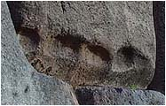  
Sacsayhuaman

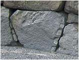  
Bejing

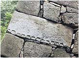  
Nagoja

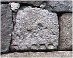  
Osaka

Połączenie tych dwóch śladów przeczyłoby teorii o budowie chińskiego muru przez współczesnych Chińczyków. Czy budowle - Sacsayhuaman, część chińskiego muru i mury obronne Nagoi i Osaki mogły powstać w mniej więcej tym samym okresie?

**Skuwane czy odlewane ?**

  
  

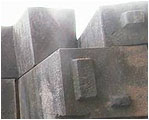  
Cusco

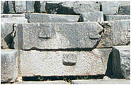  
Delfy

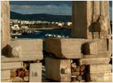  
Naxos

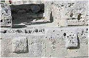  
Segesta

Problem błahy ale tylko z pozoru. Na przykładzie z Naxos spróbujmy wyobrazić sobie jaki duży musiał być element przed obróbką. Czy występy te, a raczej czopy wykonywano faktycznie metodą skuwania? Do czego były potrzebne, bo na ozdobę raczej nie wyglądają? Jakich narzędzi użył tu człowiek z epoki kamiennej? Czy naprawdę można sądzić, że elementy te wykonał współczesny tym czasom człowiek? Sądzę, że to nie współcześni Grecy zbudowali Delfy, Naxos czy Segestę. Te ruiny są dużo starsze niż sądzi dzisiejsza historia.

**Czym wywiercono ?**

  
  

Następna jednomyślność dotyczy wykonywania na całym świecie dziur w kamieniu. Oczywiście wymyślenie samej dziury może nastąpić w każdym miejscu na świecie, gorzej z jej wykonaniem.

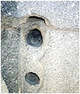  
Abusir

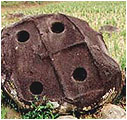  
Sumatra

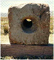  
Tiahuanaco

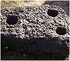  
Ugarit

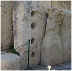  
Malta

Jak widać ze zdjęć dziury wiercono we wszystkich zakątkach świata i wszędzie wybierano najtrudniejszy surowiec - kamień. Problem polega jednak na tym, czym je wywiercono, gdyż jak wiadomo wiertło typu "Widia" wymyślili Niemcy i to dopiero w XX wieku. Ponadto pokazane dziury nie są bynajmniej małej średnicy, tak więc problem jest bardziej skomplikowany niż się wydaje. Eksponat, który widać na zdjęciu z Ugarit nauka nazwała kotwicą. Po co kotwicy trzy dziury, skoro jedna spełnia doskonale swoje zadanie? Natomiast w jednych z najstarszych kamiennych budowli na świecie w Gozo na Malcie w otworach można zmieścić ludzką dłoń.

**Zdobnictwo czy znacząca symbolika?**

  
  

Przedstawiam dwa rysunki z dwóch ośrodków cywilizacyjnych oddalonych od siebie tysiącami kilometrów i głębią oceanu Atlantyckiego. Rysunki są tak podobne do siebie, że aż jednakowe. Różnica to dwa rodzaje zwierząt - lew i puma oraz w rysunku egipskim krzyż ankh. W środku między zwierzętami widzimy prawdopodobnie słoneczny dysk wschodzący między wzgórzami. Lew to zwierzę Egiptu, natomiast puma to "lew" Ameryki Środkowej, zwany inaczej lwem górskim.

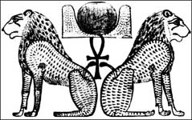  
Szu i Tefnut. Egipt

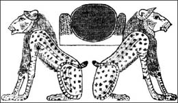  
Pumy z Uxmal

Ponieważ wschód słońca odgrywał i odgrywa w astronomii i religiach większą rolę niż jego zachód, sądzę, że chodzi tu o wschodzące słońce. Zatem coś ważnego musiało stać się ze wschodem słońca. Co spowodowało, że rysunek stał się tak ważnym dla obu cywilizacji? Moja hipoteza jest nierozerwalnie z "wielkim uskokiem skorupy ziemskiej", przyczyną kataklizmu ok. 12,5 tysięcy lat temu. Według mojej koncepcji przedstawiono tu zjawisko wschodu słońca w czasie równonocy wiosennej w "domu lwa" i to raz za razem. Znanym jest zjawisko precesji, które powoduje, że wschód słońca w dniu równonocy wiosennej zmienia się co około 2160 lat i występuje na tle coraz to innego gwiazdozbioru zodiaku. Stąd nasz podział na ery - erę ryb, erę wodnika itd.

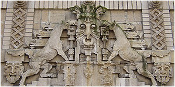

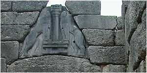

Wielki uskok skorupy ziemskiej, jeśli miał miejsce, spowodował obrót "egipskiego" obserwatora przesuwając jego "celownik" o około 30-40° w lewo, co skutkowało następną erą lwa po erze lwa i dwukrotnie dłuższym przebywaniem słońca w "domu lwa". Stąd być może rysunek podwójnego lwa na tle wschodu słońca upamiętnia to wydarzenie. Wiadomo też, że nasz zodiak różni się od egipskiego o jeden "dom słońca". Egipska era lwa występowała wcześniej (o jeden znak zodiaku) od babilońskiej. My poprzez Greków przyjęliśmy babiloński podział nieba.

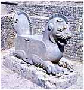

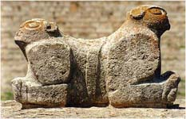

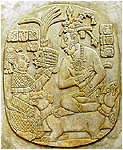

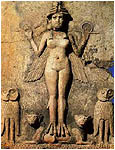

Czy potwierdzeniem tej tezy mogą być "dziwne" rzeźby podwójnych azteckich kojotów (?) i dwóch lwów z mykeńskiej bramy? Czy dwa lwy z Persepolis, złączone jaguary z Uxmal i wódz Majów siedzący na tronie przedstawiającym podwójną pumę nie mają tego samego przesłania? Co sądzić o płaskorzeźbie, na której bogini Inanna swoje ptasie stopy opiera na postaci podwójnego lwa? Czy nie jest dziwne, że takie same symbole występują w cywilizacjach oddalonych od siebie, jak twierdzą historycy, czasem i przestrzenią? Sądzę, że starożytni przywiązywali ogromną wagę do symboliki związanej z czasem. Z symbolami, których nie zniszczą ani ludzie ani ziemskie kataklizmy, bo symbolami zapisanymi na niebie po kres istnienia czasu - znakami Zodiaku.

**Sarkofagi**

  
  

Następna, dotąd jednoznacznie nie rozstrzygnięta sprawa, to sarkofagi czyli kamienne trumny dla co znamienitszych nieboszczyków. Problem jest w tym, że w ogromnej większości nie zawierały szczątków głównego bohatera. Już samo to winno postawić pytanie, czy na pewno były to "naczynia" na szczątki ludzkie. Archeologia ma na to tylko jedną odpowiedź - starożytni złodzieje. Trochę to niepokojące słyszeć ciągle, że jest się potomkiem ludzi o najniższych instynktach, ale być może jest to prawda.

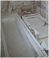  
Aksum

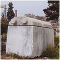  
Byblos

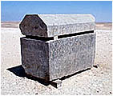  
Meidum

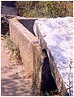  
Olbia

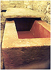  
Palenque

Dlaczego jedne sarkofagi kipią wprost od ozdób, zapisano na nich imię nieboszczyka, dodano do nich złoto i srebro, a inne (pokazane na zdjęciach) są anonimowe? Dlaczego niektóre wielkością przewyższają wielkość trupa, dlaczego są tak masywnie wykonane i po co im tak ciężkie wieka? Oczywiście oficjalna wersja natychmiast umieszcza przy nich złodziei. Druga sprawa, to sposób ich wykonania. Czy były mozolnie wykuwane? Czym je szlifowane i jak wykuto wewnętrzną część? Jakich do tego używano narzędzi? Kamiennych czy brązowych dłutek? Dlaczego wszystkie wykonano z jednego bloku kamienia? Czy podstawowym kryterium miała być ich szczelność, tak by nic nie wyciekało? Jak uzyskano tak gładką powierzchnię? Powierzchnie wykuwane czy skuwane nigdy nie będą tak idealnie gładkie na całej powierzchni. O mozolnym wykuwaniu mówią tylko ci, co dłuto widzieli tylko na wystawie. Sam Flienders Petrie po zbadaniu sarkofagu w wielkiej piramidzie mówił już o użyciu diamentowych wierteł o wielkiej szybkości skrawania.

**Dziwne węże**

  
  

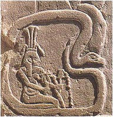  
Egipt

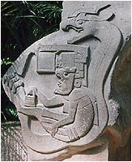  
Ameryka Środkowa

Dziwna zbieżność, która łączy dwie wielkie cywilizacje - Ameryki Środkowej i Egiptu. Oba reliefy są jakoś nie zauważane przez naukę, która z resztą nie wie co z nimi począć. Co dziwniejsze, według oficjalnej nauki obie cywilizacje dzielą tysiące lat. Skąd więc dwa, prawie identyczne reliefy? Na obu widzimy postacie ludzkie oplecione przez węża, obie postacie są otoczone przez dziwne przyrządy, obie wydają się być pilotami podróżującymi w środku węża. Latające węże są znane tylko z najstarszych przekazów i były pojazdami Bogów. Wynikało by z tego, że te cywilizacje żyły równolegle, utrzymywały ze sobą kontakty i bynajmniej nie w czasach współczesnych.

Egipska płaskorzeźba przedstawia boga imieniem Hapy, który był odpowiedzialny za "wylewy Nilu". Siedziby tego boga znajdowały się w Assuanie i na wyspie Roda u wierzchołka delty Nilu. Odległość między nimi uzasadniała by używanie latającego pojazdu. O olmeckim pilocie nie można nic powiedzieć. Nauka nawet go nie nazwała nie mówiąc już o przydzieleniu mu jakiejś funkcji. Według mnie obie płaskorzeźby należy umieścić w czasach pomiędzy 37 a 12,5 tysiąca lat temu. W czasach, gdy na Ziemi przebywali Bogowie.

**Długousi**

  
  

Tu koincydencja na nic się nie przyda. Ci co wykonywali te eksponaty musieli widzieć wzory na własne oczy. Takich osobników nie można już spotkać na Ziemi. Ponoć ostatnich widziano w Ameryce Południowej w XVIII wieku.

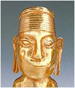

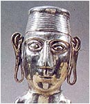

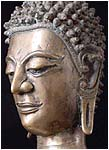

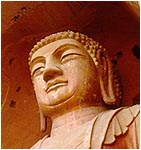

Wyroby Inków

Indie

Chiny

Przedstawiciele tej cywilizacji panowali w obszarze Oceanu Spokojnego i Indyjskiego. Kiedy? Na pewno przed "wielkim uskokiem...", gdyż nawet współczesna cywilizacja Chin o nich nie wspomina. Pozostawili po sobie mnóstwo rzeźb istot z takimi długimi uszami. Całe Angkor jest usiane płaskorzeźbami "długouchych", wszystkie starożytne rzeźby Bogów Indii, Chin, Japonii czy wysp u wybrzeży południowo-wschodniej Azji posiadają takie długie uszy. Naukowcy, nie wiedząc zapewne co z tym zrobić, najchętniej nie zauważają tego szczegółu i nie dotykają problemu. Typowe, gdyż umiejscowienie tej cywilizacji w naszych, współczesnych czasach jest według mnie niemożliwe.

**Rzymskie łuki ?**

  
  

Od pierwszych lekcji historii starożytnej wszyscy Europejczycy (ale chyba nie tylko) uczą się, że łuk architektoniczny wynaleźli Rzymianie. Zdjęcia poniżej albo przeczą temu absolutnie albo wręcz potwierdzają, że Rzymianie dotarli we wszystkie zakątki świata. Rzymianie więc czy koincydencja? Rzymian jak wiemy nie było nie było w Ameryce Środkowej czy w Chinach. Czy to Rzymianie budowali Grekom Olimpię? Czy to Rzymianie budowali na wyspie Philae w okolicach Assuanu? Kiedy? Dlaczego więc wszystkie posiadają w nazwie "romański"? Czy łuk "rzymski" to umowny wzorzec dla pozostałych budowanych na całym świecie? Dlaczego więc niektóre cywilizacje "śmiały" wyprzedzić twórców?

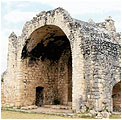  
Dżibilchaltun

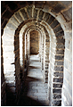  
Bejing

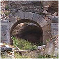  
Efez

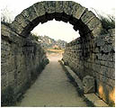  
Olimpia

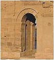  
Philae

Łuki spotykamy w każdym prawie zakątku świata. Od Ameryki Środkowej przez Europę po Chiny. To, że Rzymianie są twórcami tego detalu budowniczego jest dla mnie nieporozumieniem, podobnie jak słynny "rzymski" cement - pucolana. Cegłę w Rzymie zaczęto wytwarzać w przydomowych warsztatach dopiero w II wieku naszej ery. Jak się to ma chińskiego muru, spajanego (jak ostatnio donoszą Chińczycy kleikiem ryżowym) Grecji czy Egiptu?

**Rzymskie mosty ?**

  
  

Czy to następna koincydencja? Czy wszystkie te mosty zbudowali Rzymianie? Czy most w Bejing także? Tu jak sądzę nie pozwolili by na to Chińczycy. Oni też mają własnych "Rzymian" w postaci dynastii Qin, która rzekomo zbudowała Wielki Mur. A może Chińczycy podpatrzyli u Rzymian jak się buduje łuki? Chyba raczej niemożliwe. Sądzę, że zarówno Rzymianie jak i Chińczycy wszystkie wielkie kamienne budowle odziedziczyli przez "zasiedzenie", a dopomogło podstawowe założenie współczesnych archeologów i historyków, że to musieli zbudować współcześni ludzie i to kilkaset lat przed naszą erą.

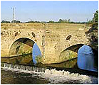  
Brytania

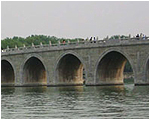  
Chiny

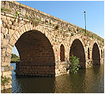  
Hiszpania

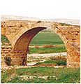  
Syria

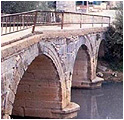  
Turcja

Jakimi narzędziami i jaką techniką dysponowano ponad dwa tysiące lat temu? W jaki sposób ustawiano filary w środku rzeki? W jaki sposób wykonywano prace budowlane pod wodą i to z użyciem "cementu"? Czy wtedy znano już kesony? Czym dostarczano budulec na środek rzeki? W jaki sposób ustawiano w głębokim nurcie rusztowania, by zbudować łuki z ciężkich kamiennych bloków? Dlaczego na całym świecie obowiązywał jeden i ten sam styl budowy? Na te pytania nie ma odpowiedzi. Podobnie jak nie ma nawet pisanych wzmianek o takich budowach, a jeśli już są, to słowo "odbudował" współcześni zapewne odczytali jako "zbudował", by nie komplikować i tak już skomplikowanej historii. Historycy mają zawsze jedną teorię: tysiące ludzi i niewolnicza praca przez dziesiątki, a nawet setki lat.

**Naczynia Bogów?**

  
  

Gigantyczne naczynia spotykamy prawie na całym świecie. Komu i do czego służyły? Dlaczego wykonano je z tak trwałego materiału jakim jest kamień? Czy przechowywano w nich substancje, które z innymi materiałami wchodziły w niebezpieczne reakcje? Z jakiego materiału wykonano naczynia z Knossos, które wytrzymały trzęsienie ziemi, podczas gdy pałac rozsypał się jak domek z kart? Uczeni twierdzą, że to glina, choć nikt nie przeprowadził ekspertyzy fizyko-chemicznej a tylko organoleptyczną z uwagi na możliwość uszkodzenia zabytku.

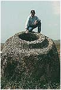  
Laos

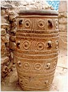  
Knossos

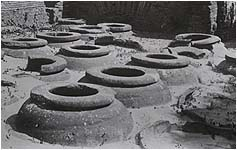  
Ostia

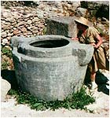  
Ugarit

Niektórzy twierdzą, że przechowywano w nich oliwę albo zboże. Ci, którzy tak twierdzą niech sięgną do dna po ostatnią garstkę zboża, lub resztki oliwy. Kto z ludzi był w stanie przechylać te naczynia i kto ustawiał je z powrotem pionowo bez użycia dźwigu? Wszystkie te głupawe hipotezy zaczynają się chwiać, gdy tylko do głosu dochodzą ludzie z technicznym wykształceniem i zaczynają zadawać "dziwne" pytania.

**Agrokultura na terasach**

  
  

Terasy według nauki były polami uprawnymi. Tak przyjęto i tak obowiązuje to do dziś. Ja natomiast sądzę, że zasadniczą rolą teras było umocnienie stoków gór czy wzgórz przed obsunięciem się podczas trzęsień ziemi lub bardzo intensywnych opadów deszczu. W niektórych terasach spotyka się rozbudowany system melioracyjny, który nie tylko nie miał zadania nawadniania poletek, ale wręcz przeciwnie, jego zadaniem było natychmiastowe odprowadzanie wody z teras podczas opadów do podnóża góry, by zapobiec rozmiękczaniu i w konsekwencji osuwaniu się gruntu. Funkcje teras jako pól uprawnych nadali dopiero dzisiejsi naukowcy, którzy już w naszych czasach ujrzeli paru Indian uprawiających na nich swoje poletka. System odwadniający stał się według naukowców systemem nawadniającym poletka na skutek błędnego założenia, że terasy były przede wszystkim polami uprawnymi.

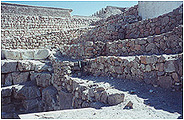  
Egipt

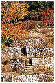  
Liban

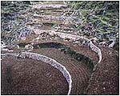  
Chiny

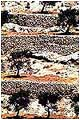  
Izrael

  
Jemen

Jako pola uprawne terasy musiały sprawiać nie lada trudność rolnikom biorąc pod uwagę, że wysokość pojedynczej terasy najczęściej przekraczała dość znacznie wysokość człowieka, a więc dostanie się na wyższe piętro zmuszało rolnika do każdorazowego korzystania ze schodów. Tych zaś nie było zbyt wiele i znajdowały się przeważnie w znacznej od siebie odległości. Musiała to być też uprawa ręczna, gdyż przemieszczanie zwierząt pociągowych po piętrach teras było uciążliwe lub wręcz niemożliwe (spróbujmy zmusić konia do wejścia na drabinę). Co uprawiano na terasach? Nauka daje odpowiedzi zdawkowe, niejasne lub wymijające. Bo jakie to mogły być rośliny, które rosły i dawały plony przy rozpiętości wysokości sięgającej kilkuset, a nawet 2000 metrów? Terasy to nie tylko specjalność Ameryki Południowej. Spotykamy je także w Europie, Afryce czy Azji, choć nie słyszałem, by w Egipcie zostały uznane za pola uprawne. Jak widać technika "umacniania zboczy" była rozpowszechniona na całym świecie.

**Mury antywstrząsowe**

  
  

Tu można zastosować koincydencję, bo Ziemia trzęsła się i trzęsie w każdym prawie miejscu. Jak widać w każdym z zakątków obowiązywała ta sama zasada. Różnicę widać tylko w sposobie wykończenia murów. Jak je budowano? Nikt nie przedstawił jeszcze zadowalającej teorii. Być może dlatego, że próbuje się dopasować technologie dziś istniejące do epoki kamienia. Z dzisiejszego młotka i dłuta można zrobić pięściaki czy inne siekierki kamienne, ale to nic nie daje. Śmiem twierdzić, że nawet dziś nie jesteśmy w stanie zbudować czegoś takiego. I nie chodzi mi nawet o przycięcie kamieni, ale o manipulowanie kamieniami wielkości małego samochodu. Technologia ta używała prawdopodobnie innego rodzaju energii do cięcia i ustawiania.

  
Bejing

  
W. Wielkanocna

  
Sacsayhuaman

  
Cusco

  
Giza

Osaka

Ollantaytambo

Greckie Delfy

okolice j. Titicaca

To co widzimy na zewnątrz już wzbudza nasz podziw, ale czy przypadkiem te kamienie nie są cięte także w trzecim wymiarze? Tego nie wiemy, bo nikt nie podjął się jeszcze rozebrania takiego kolosalnego muru. Sądzę także, że twórcy tych murów używali takiej energii, która pozwalała ciąć kamienie jak masło, względnie doprowadzała je do stanu dzisiejszej plasteliny. Tylko wtedy jest możliwe tak ścisłe dopasowanie do siebie wielokątnych bloków kamiennych.

**Charakterystyczne i dziwne "wypustki"**

  
  

Te zdjęcia zadają kłam twierdzeniom, że w bardzo dawnych czasach nie było bezpośrednich kontaktów między kontynentami, a przynajmniej wspólnej technologii. Poniżej - Delfy, Cusco oraz Ollantaytambo. Zwróćmy uwagę na dziwne wypustki na kamiennych blokach. Mnie kojarzą się z niewykończonymi plastikowymi elementami wykonywanymi za pomocą wtryskarek. Zawsze zostawał taki "cypelek", o czym najlepiej wiedzą modelarze klejący plastikowe samoloty. Bardzo możliwe, że ówczesna technika "Bogów" pozwalała na tworzenie bloków kamiennych metodą wtrysku półpłynnego kamienia.

Zdjęcia poniżej przedstawiają małą piramidę w Giza (zwaną wciąż jeszcze piramidą Menkaure, co jest dowodem na to, że oszustwa w archeologii trzymają się bardzo mocno). Na dole piramidy widoczne są resztki okładziny, a obok jej powiększenia. Czy bloki kamienia nie wyglądają identycznie (no prawie) jak te z Cusco czy Sacsayhuaman? Czy to przypadek czy też osławiona koincydencja?

Udajmy się na południe Egiptu i podobne kamienie zobaczymy także w Abydos, gdzie stanowią ściany obramowujące Ozyrejon. Czy nie są podobne do tych Ameryki Południowej? Czy archeologia jest tak ślepa, czy mamy do czynienia z pomijaniem niewygodnych dowodów?

I co wy na to szanowni archeolodzy? Nawet zewnętrzna faktura kamienia jest prawie identyczna, cięcia pod kątem, precyzyjne dopasowanie... Szanowni uczeni, wyplujcie wreszcie tę wodę z ust i zacznijcie mówić. Możecie nawet powiedzieć - nie wiemy jak to wytłumaczyć. To też jest odpowiedź.

**Tarcza Horusa i korony Bogów**

  
  

W jaki sposób dokonać interpretacji tej koincydencji? Obydwa reliefy dzielą nie tylko tysiące kilometrów ale też tysiące lat. Pierwszy relief pokazuje Boga Ashura w latającej tarczy, ale nie nim będziemy się zajmować, a mniej widocznym reliefem leżącym poniżej. Jest to widok latającej tarczy oplecionej przez węża do złudzenia przypominającą latającą tarczę Horusa umieszczaną nad wejściami do świątyń Egiptu.

Mit o uskrzydlonym dysku słonecznym mówi o walkach w Nubii i Egipcie "w roku 363 panowania Króla Górnego i Dolnego Egiptu Re-Hor-Achte", gdzie król nakazuje swojemu synowi Horusowi rozpocząć walkę z nieprzyjaciółmi - "Horus przybiera postać uskrzydlonego dysku słonecznego i wznosi się do nieba \[...\] spada na nich tak gwałtownie, że wielu zostaje zabitych \[...\] Po zwycięstwach \[...\] Re-Hor-Achte \[...\] wydaje rozkaz, aby uskrzydlony dysk słoneczny umieszczać na wszystkich światyniach i kaplicach każdego bóstwa w Górnym i Dolnym Egipcie, jako ochronę przed nieprzyjaciółmi."

Skąd zatem "uskrzydlony dysk słoneczny" w tak oddalonym miejscu? Niewątpliwe, że chodzi o ten sam symbol. Oba posiadają skrzydła, tarczę i w obu wersjach występuje wąż. To chyba nie przypadek. Czy zatem chodzi o dwie różne cywilizacje używające tych samych symboli, czy też chodzi o jedną i tą samą cywilizację i do tego istniejącą w tym samym czasie? Może pomocne okażą się dwa następne zdjęcia ukazujące prawie identyczne korony.

Oba reliefy pochodzą z tych samych kręgów cywilizacyjnych, co opisane wyżej. Na pierwszym postać, którą nauka określa "uskrzydlonym geniuszem" i są to z reguły postacie zbliżone do kręgów boskich. Na drugim reliefie widzimy postać z Egiptu, która prawdopodobnie jest Bogiem, gdyż w lewej dłoni (niewidoczna na zdjęciu) trzyma atrybut przynależny tylko Bogom - ankh, krzyż życia i symbol nieśmiertelności.

Co łączy te dwie płaskorzeźby? Łączą prawie identyczne korony. Każda składająca sie z trzech "słupków" zakończonych kulami, gdzie po bokach występują kobry, a całość spoczywa na "rogach" interpretowanych jako baranie (atrybut Boga imieniem Chnum).

Jak zatem pogodzić identyczność symboli w cywilizacjach oddalonych od siebie przestrzenią i czasem? Czy mamy do czynienia z jedną cywilizacją, ale z dwoma jej składnikami różniącymi się kulturowo? Czy elementów korony nie należy interpretować jako cech czy też specjalizacji? Odnoszę wrażenie, że i nazwy Bogów winny przekazywać nie imiona, a raczej ich wąską specjalizację. W Egipcie spotykamy wielu Bogów noszących te same atrybuty. To nie Izyda występuje pod postacią Hator - Izyda jest Izydą, ale być może posiada tę samą specjalność.

**Dlaczego siedem poziomów?**

  
  

  
El Tajin - Ameryka Środkowa

  
Prasat Thom - Kambodża

**Ciekawe i niewyjaśnione**

Na naszej planecie spotykamy inne, bardzo ciekawe budowle czy ślady po "czymś", czego nie można dziś racjonalnie wytłumaczyć. Są one najczęściej ignorowane i pomijane w oficjalnych opracowaniach, bo albo nie można udzielić sensownego wytłumaczenia albo wytłumaczenie może stanowić zagrożenie dla archeologii, a jeśli już powstanie jakaś hipoteza, to z reguły nie wykracza poza fantastyczne bajanie. Z tym musimy się chyba pogodzić, dopóki hipotezy będzie tworzyć "firma" zużywająca najwięcej dziecięcych łopatek, grabek, sitek, miotełek, pędzelków i gruszek do lewatywy. Niektórzy archeolodzy, jako typowi humaniści, mają mgliste albo w ogóle nie mają pojęcia o technice, a jeśli już to wykorzystują je do sklejania rozbitych naczyń, bo sklejanie sensownych hipotez jakoś nie im wychodzi. Wielkim hamulcowym jest też opinia naukowej "rady starszych", nie uznających żadnej krytyki autorytetów archeologii. Kiedy ich miejsce zajmą ludzie z szerokimi, niezależnymi horyzontami myślowymi, którzy nie będą się wstydzić konfrontacji swych idei z innymi dyscyplinami naukowymi?

**Kosmodrom Giza ?**

  
  

Pozostańmy jeszcze w Egipcie. Ten ślad wskazał Michał Jaworski (skądinąd doskonały młody muzyk) przesyłając ciekawe satelitarne zdjęcie z okolic Giza. Widać tu tereny na zachód od kompleksu piramid, w szczerej pustyni. To co wyziera spod piasków pustyni po prostu zapiera dech w piersiach. Nie wiadomo czym są zarysy struktur, bo jeszcze nikt ich nie zbadał. Jak są duże możemy ocenić na podstawie samych piramid. Trzy piramidy (pomarańczowa strzałka), od wielkiej do małej, zajmują odcinek około jednego kilometra. Po prawej stronie od piramid rozciąga się dzisiejszy Kair, po lewej pustynia, na której późniejsza zapewne działalność ludzi zniszczyła bezpowrotnie część zagadkowych struktur.

Wygląda więc na to, że te tajemnicze struktury ciągną się na przestrzeni od kilku do kilkunastu i więcej kilometrów, a słynne rysunki z pustyni Nazca wyglądają przy nich jak dziecinne zabawy. Kto pozostawił te ślady? Tego nie określą na pewno dzisiejsi specjaliści od przesiewania i zamiatania Sahary, chyba że oczekujemy jakiejś teorii o wojskach faraona, które ćwicząc marsze, zwroty i zakręty wydeptały te dziwne linie. Czy to wykonali ludzie? Może..., tylko jacy ludzie? Przecież zgodnie z obowiązującą doktryną egiptologii, prawie cała ludność Egiptu nie robiła nic innego tylko budowała przez setki lat piramidy dla faraonów. Kto więc odpowiada za te dziwne ślady? Struktura na dole przypomina ogromne lotnisko. Dwa szerokie, przecinające się długie "pasy startowe" i "ścieżki do kołowania". Najszersze "pasy" mają słabo widoczne przedłużenia w kierunku struktur na północy i północnym zachodzie. Czy pas biegnący w kierunku północno-zachodnim nie jest przypadkiem równoległy do przekątnych piramid? Czy przypadkiem nie wskazuje kierunku na Delfy i duński Traeleborg (przedłużenie prostej łączącej Delfy z duńskim Traeleborgiem według Daenikena przechodzić ma na zachód od piramid w Giza)?

Czym mogły być te struktury? Tego nie prędko się dowiemy, bo nie prowadzi się takich badań, a współcześni egiptolodzy wolą omijać ten temat z daleka, by nie sprawiać sobie kłopotów narażając się na trudne pytania. Jak bowiem wytłumaczyć wytyczenie prostej linii o długości ponad 20 km w piaskach pustyni, a do tego uczynić je widocznymi z góry? Czym były struktury leżące powyżej "lotniska"? Czy to pozostałości po "ulicach" jakiegoś miejskiego kompleksu, czy też infrastruktury "lotniska"? Te dziwne rysunki ciągną się jeszcze dalej za zachód. Czy to z tego miejsca egipscy Bogowie i ich synowie wznosili się do nieba? Kiedy powstały te struktury, skoro w naszych historycznych czasach na zachód od Giza leżało jezioro Mojrisa?

Może to tajne współczesne lotnisko wojskowe (taka egipska strefa 51) lub pozostałości po lotnisku z II wojny światowej? Mam wątpliwości. Lotniska dzisiejszego Egiptu, zarówno cywilne i wojskowe znajdują się na obrzeżach Kairu, a w II wojnie światowej nikt nie budował pasów startowych dłuższych niż 3 km i do tego szerokich na pół kilometra, bo nie było takiej potrzeby. Dziwi mnie także, dlaczego sam Daeniken i jego "kontynuatorzy" nie wspominają nic na ten temat. Nie wierzę, by nic o tym nie wiedzieli. Może koncepcja prehistorycznego "kosmodromu" jest także dla nich zbyt fantastyczna?

**Dziwne ślady na Malcie i nie tylko**

  
  
  

Przykładem tego są dziwne "koleiny" wyżłobione w skale wapiennej, spotykane na Malcie, Ghawdex, koło Lixus, w Hiszpanii czy Irlandii. Biegną zwykle parami, choć nie są do siebie idealnie równoległe, krzyżują się pod różnymi kątami, a czasem giną w morzu. Miejscowa ludność nazywa je "śladami furmanki". A co głosi oficjalna archeologia?

Azerbajdżan

"Ślady furmanki" na Malcie

Według niej mogą to być - tory kultowe, kalendarz, rodzaj wodociągu (nawet pod górkę?) czy nawet rodzaj pisma i wszystko to powstało w epoce brązu. Z reguły są to rowki o głębokości 15 cm, szerokości około 20 cm i biegnące obok siebie w odległości około 1,6 m. Nie zrobiły tego pojazdy, gdyż ślady nie są wszędzie jednakowo równoległe, nie zrobiły tego też sanie, gdyż zakręty wyglądały by inaczej, nie wyżłobiły tego ciągnione konary, gdyż ślady musiały by być wyryte pod kątem. Ślady te zakręcają, krzyżują się pod różnymi kątami, a ponadto poprowadzone są bez względu na rzeźbę terenu. Jeśli są to ślady po zwózce materiałów, to dlaczego nie prowadzą do żadnej budowli?

W terenie "koleiny" przechodzą obok megalitycznych budowli i czasem prowadzą wprost do morza. Musiały zatem zostać wykonane przed globalnym ociepleniem, które nauka umiejscawia na 10,7 tysiąca lat pne., a nie w epoce brązu 2000 lat pne., jak twierdzą archeolodzy. Co to mogło być? Sądzę, że nie są to "koleiny", a pozostałości po kanalikach wyciętych w skale wapiennej o czym może świadczyć trzecia fotografia. Warunki klimatyczne przez tysiące lat mogły spowodować zmycie wierzchniej, wapiennej warstwy i utworzenie się "kolein". To zaś, że przebiegały obok megalitycznych budowli czy "świątyń" może świadczyć o tym, że poprowadzono w nich być może przewody paliwowe, wodne albo energetyczne.

**Kłopot z ilością palców**

  
  

W Egipcie odnaleziono ciekawą płaskorzeźbę. Przedstawia zapewne kogoś znacznego, bo pospólstwo bardzo rzadko umieszczano na ścianach budowli. Być może jest postać kapłana lub któregoś z faraonów. W ręku trzyma coś, czego nie potrafię nawet skojarzyć (Bep-Koroti chodził z "kijem" zwanym kop, który miał własności obezwładniające). Uczeni dopatrzyliby się tu zapewne jakiegoś atrybutu władzy. Ja widzę tylko jakiś patyk, ale mniejsza z tym. Przyjrzyjmy się dłoni.

Co widać? Ta dłoń ma sześć palców! Czy to żart rzeźbiarza? Chyba nie. Na "urzędowych" płaskorzeźbach nie uprawiano raczej satyry. Czy to jest wybryk natury, czy kiedyś naprawdę istniała rasa o takiej liczbie palców? W dorzeczu Amazonki, żyje indiańskie plemię Ogha-Mongulala. Tam w Manaus, Karl Brugger dziennikarz, historyk i socjolog w jednej osobie spisał w roku 1972 opowieść usłyszaną od wodza plemienia Tatunca Nara o historii tego plemienia. Dzieje są spisane w "Kronice z Akakor" w skład której wchodzą "Księga Jaguara" i "Księga Orła". Fragment "Kroniki z Akakor" przytaczam poniżej.

Pośrodku pomieszczenia, z którego ścian spływało tajemnicze światło, stały cztery bloki z przezroczystego kamienia. Kiedy z wielkim szacunkiem się do nich zbliżyłem, dostrzegłem w nich cztery tajemnicze istoty. Cztery żywe trupy. Czworo śpiących ludzi. Było tam trzech mężczyzn i jedna kobieta. Leżeli w płynie, który zakrywał ich aż po piersi. We wszystkim przypominali ludzi. Tyle że mieli po sześć palców u nóg i rąk.

Chciałem już uznać sprawę za załatwioną jako ciekawostkę, ale odnalazłem jeszcze dwa ślady mówiące o istotach z czterema palcami. Arnold Mostowicz opisuje legendę, według której, w czasach gdy nie było jeszcze ludzi, nad jeziorem Titicaca pojawił się wielki, błyszczący statek kosmiczny, który wylądował na wyspie na środku jeziora. Z pojazdu wysiadła kobieta o ludzkim wyglądzie, o bardzo wydłużonej głowie, długich uszach i czterech palcach połączonych błoną. Nazwano ją Orejona (długoucha).

Eksponat (po prawej) pochodzi z kolekcji ojca Carlo Crespi, misjonarza katolickiego w Ameryce Południowej. Jest to tzw. Bóstwo z gwiazd.

Zauważmy, że bóstwo dla odmiany ma po cztery palce u rąk i nóg. Uczeni interpretują to jako liczydło. Obok rysunek centralnego fryzu "Bramy Słońca" w Tiahuanaco, a więc miejsca tuż obok jeziora Titicaca. Na nim wyraźnie widać, że centralna postać człekopodobna ma po cztery palce u dłoni. Na ostatnim zdjęciu rzeźba z Ameryki Środkowej. Ręce mają widoczne po cztery palce, ale to żaden dowód gdyż ułożenie rąk może sugerować, że kciuki są niewidoczne. Co do stóp nie może być wątpliwości - mają po cztery palce.

Okazuje się, że różna ilość palców, to nie tylko kłopoty człowiekopodobnych ale też zwierzaków. Tu powinni wypowiedzieć się darwiniści - jakaż to odmiana małp w przeszłości miała tak różną ilość palców. Wizerunek takiej "małpy" znajduje się na pustyni Nazca. U nóg po trzy palce, u rąk cztery i pięć. Ja rozumiem, że oficjalna nauka nie zwraca na to uwagi, bo usłyszymy zapewne o głupich przodkach, którzy nie umieli liczyć do pięciu, albo że małpa wpadła do tartaku i w panice przebiegła pod trakiem. Trak odpada, bo mówimy o epoce kamienia nawet nie łupanego a zbieranego, a co do inteligencji naszych przodków mam zdanie zupełnie odmienne w odróżnieniu do dzisiejszych naukowców. Nasi przodkowie zmysł obserwacji i pamięć mieli dużo lepiej rozwiniętą i co najważniejsze prawdziwość przekazu u nich była rzeczą najwyższej rangi, rzecz nie do pomyślenia u dzisiejszych zdziwaczałych archeologów.

**Palce Moai z Wyspy Wielkanocnej**

  
  

Każdy z nas oglądał już tajemnicze posągi z Wyspy Wielkanocnej. Ale czy oglądał dokładnie? Czy nic nie uszło naszej uwadze? Czy każdy oglądał ich palce? Na ręce Moai zwrócił uwagę, nieżyjący już dziś, chilijski artysta-plastyk Lorenzo Dominguez (rysunki palców są jego autorstwa). Czy rasa zamieszkująca onegdaj Wyspę Wielkanocną była inna niż nasza?

Zapewne tak. Nie tylko dłonie miała inne, lecz także wyróżniała się długimi uszami. Zwróćmy też uwagę na dziwne zakończenie "pępka" i na dziwną jego "ozdobę". Zbadać genetycznie potomków tej rasy już nie można, gdyż w połowie XIX wieku Peruwiańczycy wywieźli prawie wszystkich mieszkańców wyspy do wydobywania "guano", a i nie ma także pewności czy byli oni w tej grupie. Istnieją także przekazy, że ostatni "długousi" wyginęli w wojnie z tubylcami na długo przed przybyciem Europejczyków.

Podobnie długie palce posiadał też Budda i inni hinduscy Bogowie. Czy smukłość dłoni była przypisana rasie długouchych? Końce palców są łagodnie wygięte do góry, co u nas jest raczej mało spotykaną cechą. Reliefy i rysunki z Egiptu też ukazują Egipcjan z długimi smukłymi palcami. Zwróćmy przy tym uwagę na sposób trzymania sznura w dłoni. Spróbujmy tak uchwycić sznur, by paznokcie dotykały prawie nadgarstka, a kciuk wystawał poza zgięte palce. Wydaje się, że nasze palce są po prostu za krótkie. Oczywiście, że i my możemy tak ułożyć dłoń, ale jak sądzę jest to chwyt bardzo niewygodny i męczący.

**Czy dinozaury widziały człowieka ?**

  
  

Czy amerykański reżyser wykorzystał rysunki z kamieni do stworzenia scenariusza do filmu "Rodzina jaskiniowców"? Czy może Fred Flinston istniał naprawdę? Czy to, co widać na zdjęciach obok, to czołgi i samoloty prehistorycznej armii? Czy nie świadczy to wreszcie o wielkich osiągnięciach w dziedzinie oswajania zwierząt czy może zdolności porozumiewania się z nimi? Na rysunkach z Ica wyraźnie widać istotę człekopodobną jadącą na... triceratopsie i lecącą na jakimś ptaku o wielkości małego samolotu. Ale przecież, zgodnie z nauką, dinozaury zaczęły wymierać 65 milionów lat temu i trwało to "tylko" przez okres 2 milionów lat!

Według encyklopedii Triceratops, to gad kopalny, dinozaur o długości ciała ok. 6 m i wysokości ok. 2,6 m. (wymiary większego konia), który żył w górnej kredzie (kreda: 135-70 mln lat temu) w Ameryce Północnej. Ptaka nie udało mi się zidentyfikować. Zwierzaki wydają się być oswojone. Jeździec ma pod sobą siodło, pilot też. W rękach trzymają coś w rodzaju przyrządu do "ręcznej zmiany biegów". Z ust jeźdźca wydobywa się "dymek", co może oznaczać, że oddycha lub wydaje komendy dla "pojazdu". Zwróćmy także uwagę na jakość rytów. Linie owalne, faliste czy półokręgi są wykonane jakby jednym "pociągnięciem" dłuta. Jakich użyto tu narzędzi? Czy naprawdę były to kamienne narzędzia czy też używano czegoś twardszego od kamienia?

Ica to wioska leżąca na południu Peru. Tylko w tym rejonie znaleziono kamienie z dziwnymi rytami. Dziwnymi dlatego, że przedstawiają oglądanie komet przez teleskop, transplantację serca, dziwne kształty interpretowane jako stare kontynenty i oczywiście zwierzęta, które dawno należą do przeszłości. Do przeszłości, która liczy dziesiątki milionów lat. Kolekcję posiada dr. Cabrera i liczy ona ponad 20 tysięcy kamieni, a jego sąsiad posiada ponoć kolekcję 11 tysięcy. Większość tych kamieni eksperci uznali za prawdziwe, gdyż warstwa tlenków pokrywająca kamień, pokrywa także i ryty. Ponadto ciężar właściwy kamieni jest większy (na skutek procesów chemicznych jakie w nich zaszły) niż znajdowanych współcześnie. Jaki jest wiek tych kamieni nauka nie potrafi określić. Jedyną, uzasadnioną naukowo datą jaką podano jest ta - są bardzo stare.

I jeszcze fotografia z azjatyckiej miejscowości Sigiriya (Sri Lanka) przedstawiająca wejście do skalnej świątyni. Po obu stronach wejścia wykuto (a może raczej wycięto) w litej skale dwie stopy jakiegoś zwierzęcia. Jakie zwierzę miało skierowane do przodu trzy pazury? Czy to są nogi ptaka, smoka czy może... dinozaura?

**Jak to jest z tym neandertalczykiem ?**

  
  

W szkole uczono i uczy się nadal, że neandertalczyk stanowił formę przejściową w ewolucji człowieka. Wyparł go dopiero tzw. człowiek z Cro-Manogne i dopiero my jesteśmy w pełni rozwiniętą formą człowieka myślącego. Spotyka się w tej chwili teorie, że neandertalczyk żył równolegle z człowiekiem kromaniońskim, a nawet, że miał bliżej do nas niż do małpy. Podobno nieobce mu były uczucia i chowanie zmarłych. Umiał też podobno mówić (odnaleziono w jego szkielecie kość gnykową). Tymczasem w księdze Henocha czytamy zupełnie coś innego - człowiek od samego początku umiał mówić:

Przemówiłem tchnieniem ust moich i językiem cielesnym, który Bóg dał ludziom zrodzonym z ciała, aby mogli się nim posługiwać. Dał im tchnienie, język i usta, aby mogli się porozumiewać.

Rzeźby zaginionych cywilizacji mówią jednak coś innego. Oto rzeźba olmecka przedstawiająca kogoś, kto nie przypomina człowieka współczesnego, ale właśnie neandertalczyka. Rzeźby z Copan (Majowie) stawiają poprzeczkę wyżej. Twarz, owszem, neandertalczyka, ale czwarty rysunek przedstawia ni mniej ni więcej tylko neandertalczyka wykonującego czynność w zasadzie zarezerwowaną dla ludzi.

Nie jest to poza małpoluda, a raczej człowieka służącemu komuś, poza przypominająca raczej składanie przysięgi na jakąś ważną rzecz albo pokazywanie trofeum wojennego, bądź znaku rodowego. Czaszka wykuta w kamieniu na innej budowli Majów pokazuje uzębienie przypominające uzębienie postaci ze zdjęcia obok. Czy to przypadek, fantazja artysty czy ówczesna rzeczywistość?

Uwiecznienie wizerunku neandertalczyka w rzeźbie i na dość eksponowanym miejscu świadczy nie tylko o ważności tej rasy, ale także o tym, że człowiek neandertalski żył równolegle z ówczesnymi twórcami rzeźb. O tym powinien mówić napis poniżej rzeźby, ale nie spotkałem przetłumaczenia tego napisu na język zrozumiały dla ludzi. Jak wytłumaczyć "neandertalski" wygląd hinduskiego boga Hanumana, zwanego zresztą królem małp? Co ciekawsze Hanuman, według starożytnych przekazów był także świetnym pilotem.

Najnowsze badania już mówią o tym, że obie rasy - neandertalczyk i człowiek Cro-Magnon - żyły obok siebie przez co najmniej ostatnie 80 tys. lat. Mówi się także o tym, że neandertalczyk wyginął 35 tys. lat temu. To skąd wzięto wzór? Czy człowiek kamienia łupanego potrafił odtwarzać wygląd na podstawie czaszki? A może budowniczowie Copan żyli w czasach, gdy obie rasy żyły obok siebie?

**Zagadka "inkaskich" nisz**

  
  

Do dziś historycy nie dali konkretnej odpowiedzi do czego miały służyć trapezoidalne nisze. Według ich hipotezy były to miejsca na ustawienie figurek Bogów. Ale czy to jest prawda? Jest ich tak dużo, że dzisiejszy inkaski panteon należałoby powiększyć co najmniej kilka razy. Ponadto nie pokuszono się o sprawdzenie, czy przypadkiem nie posiadają jednakowych wymiarów, co mogłoby oznaczać, że stworzono je dla przechowywania czegoś, co nazwalibyśmy dzisiaj rzeczą standardową.

Zdjęcia dają jednak do myślenia. Widać wyraźnie, że z nisz "coś" wyciekło i to "coś" wyraźnie odbarwiło kamień. Początkowa barwa kamienia została zmieniona i wyraźnie różni się od otoczenia. Co to był za płyn? Wino mszalne czy płynny Bóg? Próżno jednak szukać prób ustalenia składu tego płynu czy chociażby ustalenia co mogło zostawić na ścianach te smugi. Można odnieść wrażenie, że do wycieku musiało dojść jednocześnie i w całym Machu Picchu. Czy te smugi spowodowały wieloletnie opady deszczu? Jeśli by tak było, to dlaczego nie zmyły jednolicie całych ścian? Czy w niszach przechowywano naczynia z "czymś" w postaci płynnej czy półpłynnej? Na te pytania jeszcze nikt nie próbował odpowiedzieć.

**Pierzast wąż czy wąż-ptak?**

  
  

Przypatrzmy się uważniej najbardziej znanemu wężowi na świecie, który jako jeden z nielicznych awansował na pierwszego Boga narodów Ameryki Środkowej.

Zacznijmy jednak od przedstawienia podstawowego elementu rzeczonego Boga jakim jest pióro. Pióro jakie jest każdy widzi. Proszę się obrażać. Widok pióra przedstawiam dla tych, którzy być może nie widzieli go na własne oczy i dlatego imię Quetzalcoatla przetłumaczyli jako węża okrytego piórami ptaka Quetzala. Rzeczone pióro jako część centralną i rzekłbym nośną posiada tzw. stosinę, do której przymocowane są tzw promienie (z haczykami lub bez).

Jako ludzie, rysowanie lub rzeźbienie pióra rozpoczęlibyśmy od stosiny. Jest to główna część, od której zależy kształt i wielkość pióra. I tak zapewne postąpiłby też człowiek w dawnych czasach. Miał, być może, mały zasób wiedzy, ale z powodzeniem nadrabiał to zmysłem obserwacji.

A jak wygląda pióro naszego węża? Spójrzmy na zdjęcie po prawej. Czy to jest pióro? Tak nie wygląda nawet liść palmowy do pokrycia dachu. Czy starożytny rzeźbiarz nie był bystrym obserwatorem, czy też do ujrzenia tu piór należy posiadać dyplom archeologa z piętnastoletnim stażem? W nazwie brzmi też nazwa pięknego ptaka Quetzala. Ptaszek ten, niezbyt duży, był i jest ceniony przez Indian dla swego upierzenia w kolorach zielonym, czerwonym i białym.

Quetzalcoatl jest aztecką nazwą Boga, który występuje jeszcze pod imionami Kukulcan (Majowie) czy Gucumatz (Quiche). Trudno mi wypowiadać się na temat samego przetłumaczenia imienia Boga, ale sądzę, że można je tłumaczyć zarówno jako "pierzasty wąż" lub też "wąż-ptak". Chyba jednak najbardziej odpowiednią nazwą była by - "latający wąż". Poniżej piękny komplet wizerunków pierzastego węża.

Rzeźby te, według nauki, powstały stosunkowo niedawno. Jeśli wykonali je Aztecy otrzymujemy rok 1250 ne, a jeśli Majowie możemy cofnąć datę do roku 1500 pne. Jaką datę jednak byśmy nie przyjęli, pozostaje problem narzędzi. Czy te rzeźby wykonano z pomocą kamiennego dłutka? Czym cyzelowano drobne szczegóły? Jakim sposobem nadano kamieniowi taką gładkość i połysk? Zwróćmy uwagę na środkową postać, przedstawiającą Quetzalcoatla jako Boga Słońca. Czy na reliefie nie wygląda jak Bóg zlatujący z nieba otoczony płomieniami? Czy przedmiot poniżej należy interpretować jako Słońce? Być może, choć ja zinterpetowałbym to jako gwiazdę. Bóg Słońca czy bóstwo z gwiazd? Słońce też jest gwiazdą i starożytni chyba o tym wiedzieli.

Inne postacie pierzastego węża przedstawione w Teotihuacan, Uxmal i Xochicalco. Tutaj też z trudnością można ujrzeć pióra okrywajace ciało węża, a ponadto ten z Xochicalco składa się z segmentów mogących zginać się nawet pod kątem prostym. Podsumujmy cechy tego ciekawego bóstwa.

• okrywające go pióra wcale nie przypominają piór,  
• wąż może oplatać postać lub też postać może przebywać w jego wnętrzu,  
• wąż posiada dużo więcej zębów niż jego naturalny odpowiednik i bardziej tym przypomina chińskiego smoka niż przedstawianego grzechotnika,  
• w stosunku do postaci wąż wykazuje uległość, co pokazują złożone "zęby jadowe",  
• wąż z Teotihuacan posiada wokół głowy dwie aureole, ale czy to są pióra?  
• wąż z Uxmal posiada "hak holowniczy" na środku pyska, a wąż z Teotihuacan zakręcone rogi po obu stronach pyska,  
• język węża w niektórych przypadkach wygląda co najmniej dziwnie (obok).

Czy ten język nie przypomina jakiegoś zestawu technicznego? Relief na pierwszym "języku" jest identyczny z reliefem na języku rzeźby Słońca na słynnym kamiennym kalendarzu Azteków. Drugi zaś w ogóle nie przypomina rozdwojonego języka węża, za to pełno w nim jakichś pasów, taśm, drążków i przycisków. Czy tak nie wyglądał odpięty pas ówczesnego pilota? Czy to jest przedstawienie techniki znajdującej się w środku węża? To właśnie miał chyba na myśli twórca rzeźby. Czy coś jeszcze można powiedzieć o starożytnych wężach i samym Quetzalcoatlu? Można.

• Majowie twierdzą, że trzej prabogowie, których zwano piorunem, błyskawicą i prędkością, zstąpili z nieba razem z Bogiem o dwoistej postaci Tepeu Gucumatzem. Naukowcy oczywiście twierdzą, że chodzi tu o personifikację sił natury. Stara śpiewka, stosowana zawsze gdy nie wiadomo co powiedzieć lub nie staje wyobraźni. Tak samo można opisać samolot czy rakietę (było szybko, głośno i jasno, a na dodatek z jednego Boga wyszedł drugi),  
• Kukulcan był "niebiańskim wężem" i "niebiańskim potworem", który co pewien czas przybywał na ziemię. Jaki wąż potrafi odbywać kosmiczne podróże?  
• Quetzalcoatl według wyobrażeń Indian miał twarz jak ciężki kloc, a nie jak człowiek, a jego broda była bardzo długa i wielka. Swoją twarz starał się zachować w ukryciu. Człowiek czy maszyna?

"Jego broda była bardzo długa i wielka". Nie wiem czy porównanie latajacego węża do współczesnego samolotu jest trafne, ale analogia jest uderzająca. Można się dopatrzeć otwartej paszczy i długiej brody. Czy rzeźbiona paszcza węża nie jest zaopatrzona w zawias? Oko węża może symbolizoważ patrzenie przez przezroczystą kabinę (swoją twarz starał się zachować w ukryciu), a z otwartej paszczy Boga wychodził przecież drugi Bóg. Spytać można zapewne, a gdzie oni lądowali? Uczeni do dziś nie wiedzą co począć z kilkuset kilometrową siecią prostych, szerokich i wypoziomowanych dróg na całym Jukatanie, choć Indianie mówią wprost - to były drogi dla Bogów.

Z tego wszystkiego można wyciągnąć wniosek, że węża należy potraktować jako urządzenie stricte techniczne. Węże potrafią latać. Potrafią przenosić w sobie Bogów. Z tego też powodu, jak sądzę, węża nie otaczały pióra. Węża otaczały płomienie i być może mieniły się czerwono, błękitnie i zielonkawo jednocześnie, w kolorach piór ptaka Quetzala. Z przedstawionych artefaktów wyciągnąć można jeszcze jeden wniosek. W sztuce Ameryki Środkowej spotykamy dwa rodzaje węży. Same oraz z postacią w środku. Sądzę, że węże z postacią w swoim wnętrzu obrazują niebezpieczny pojazd, którym poruszali się Bogowie. Same zaś węże pełniły funkcję znaku ostrzegawczego przed niebezpieczeństwem. Stąd takie wizerunki na piramidach, przed nimi lub w ich pobliżu, które pełniły taką sama rolę jak egipskie kobry na niektórych budynkach Egiptu. Mówiły zwykłym ludziom - nie zbliżaj się, tu czeka cię tylko śmierć.

**Brody - zarost czy element techniki?**

  
  

Przypatrzmy się brodom Bogów i faraonów. Czy na pewno jest to broda w pełnym tego słowa znaczeniu? "Włosy" wyrastają tylko z określonego miejsca na czubku brody, a reszta twarzy jest gładka. O ile w takiej brodzie występują wszyscy faraonowie, o tyle brodę taką noszą tylko niektórzy Bogowie i pomniejsze bóstwa. Brodę widzimy u Ozyrysa, Atona, Ptaha oraz u nilowego bóstwa Hapy. Oglądając wizerunki Bogów, widać że broda u nich jest jakby elementem naturalnym, ale wizerunki niektórych faraonów wskazują na to, że broda jest sztuczna i doczepiana do twarzy. Mamy także dwa rodzaje "bródek". Jedne w postaci poprzecznie prążkowanej, drugie (np. w masce pogrzebowej Tutankhamona) w postaci splecionej w warkocz.

Czy jest to "małpowanie" boskiego elementu przez faraonów? Czy może był to jakiś element techniczny współdziałający z koroną? Na rysunku i reliefach widać, że broda jest utrzymywana czymś w rodzaju "taśmy" i połączona z nakryciem głowy, a sądząc z kształtu może być elementem sztywnym. Nie sądzę również, aby w ten sposób starano się podkreślić kształt dolnej szczęki faraona. Na to, że broda była elementem sztucznym i "doczepianym" a także niezwykle ważnym, wskazuje treść Tekstów Piramid, gdzie jest mowa o jakimś buncie, podczas którego skradziono brodę Atuma. A co sądzić o ostatnim zdjęciu? Postacie ludzkie z przyczepionymi brodami, ale w kształcie rozwidlonego języka węża(?). Widać wyraźnie, że języki nie wychodzą z ust postaci, ale w jakiś sposób są przyczepione do brody. Tę analogię do brody Bogów i faraonów odnalazłem po drugiej stronie Atlantyku w El Baul w Ameryce Środkowej. Egipt z Ameryką Środkową ma podejrzanie dużą ilość podobieństw i analogii?

**Skorpion - cecha czy znak zodiaku?**

  
  

Nie mniej intrygującym elementem starożytnych reliefów jest mnogość symboli zwierzęcych. Zwykle tłumaczy się to tym, że Bogowie mogli występować pod postaciami zwierząt. Możliwe, ale dlaczego większość z tych postaci zwierzęcych, przynajmniej w Egipcie, ma swoje odbicie w znakach Zodiaku? Kot, krokodyl, ibis, małpa, krogulec, byk, baran, lew, osioł, skarabeusz, wąż, pies - prawie wszystkie znaki egipskiego Zodiaku można odnaleźć w personifikacjach Bogów.

Czy postać lub znak sytuowany w pobliżu Boga czy faraona miał symbolizować jego cechę czy raczej był związany ze znakiem Zodiaku? Czy znak skorpiona miał symbolizować "podstępną śmierć" czy raczej wydarzenia z czasu ery skorpiona? Zdaję sobie sprawę, że interpretacja nie może zostać przyjęta z uwagi na odległość w czasie (ostatnia era skorpiona to lata 17594-15866 pne.) ale czy jest niemożliwa?

Kamień ze znakami Zodiaku z Indii już opisywałem, gdzie zadziwiającym przekazem zdają się być stopy nakazujace patrzeć w stronę zodiakalnego Skorpiona. Na drugim zdjęciu pokazuję fragment reliefu na naczyniu z Egiptu, gdzie obok faraona występuje skorpion. Postać jest interpretowana jako egipski władca predynastyczny, a więc żyjący przed faraonem Menesem. Czy "kwiatek" nad skorpionem nie nakazuje szukać skorpiona na niebie, w gwiazdach? Wydaje się, że tak.

**Stopione kamienie Sacsayhuaman**

  
  

Do ciekawych i niewyjaśnionych rzeczy w "Jastrzębich skałach" należą także "zeszklone kamienie", w których Erich von Daeniken dopatruje się użycia broni jądrowej. Gdyby tak było, to w zasadzie "zeszklenie" winno występować na całej powierzchni kamiennego muru i tylko na ścianach zwróconych w jednym i tym samym kierunku, w kierunku eksplozji. Tak jednak nie jest.

Na zdjęciu widoczny jest narożnik, w którym jeden z kamieni nie został "zeszklony", a posiada tylko nacieki, które prawdopodobnie spłynęły z kamienia leżącego nad nim. Dlaczego "zeszklenie" występuje na wszystkich kamieniach obok, a na tym jednym nie? Dlaczego nie ma go na kamieniach u góry? Górne być może zostały dobudowane później, ale kamień z naciekami na samym spodzie musiał być tam od samego początku. Najprawdopodobniej działała tu wysoka temperatura, ale czy była wynikiem użycia broni jądrowej?

Czy mamy tu do czynienia z tworzeniem warstwy ochronnej na powierzchni kamienia przy pomocy wysokiej temperatury, czy też z rozgrzewaniem kamiennych bloków, tak by po uzyskaniu plastyczności, kamień sam "dopasował" się do pozostałych wypełniając istniejące luki między nimi? Ten jeden nie "zeszklony" kamień nie daje mi jednak spokoju. Czy o nim akurat zapomniano, czy też mamy do czynienia z przejawem "boskiego" brakoróbstwa?

**Dziwne formacje z Sudanu**

  
  

Na ślad naprowadził mnie Olek z Bielska Białej prosząc o pomoc w zidentyfikowaniu "dziwnych" kwadratów, które znalazł przeglądając rejon Sudanu na mapach satelitarnych Google. Nie mam doświadczenia w interpretacji zdjęć lotniczych, a tym bardziej satelitarnych, ale już na pierwszy rzut oka widać, że raczej nie są to twory naturalne. Zagadkowa formacja znajduje się w Sudanie na pograniczu z Czadem i Republiką Środkowo-Afrykańską w odległości około 100 kilometrów na wschód od tej ostatniej, zaś na wschód od formacji i lekko na południe około 100 km leży wioska Rahad al-Bardi. Całość tej zagadkowej formacji tworzą trzy kwadraty. Dwa są prawie identyczne z wyglądu o ciemnym obramowaniu, podobnej wielkości i jednakowym ukierunkowaniu, trzeci zaś przekrzywiony ma w środku regularnie rozłożone białe "plamki". Wytyczenie i wykonanie tak długich prostych elementów nie jest też chyba dziełem dzisiejszych mieszkańców Sudanu.

Na środkowym zdjęciu widać trzy kwadraty, dwa prawe o bokach około 10 kilometrów, a lewy (mniejszy i lekko przekrzywiony) o bokach około 7 kilometrów. Ponadto lewy kwadrat jest jakby usiany regularnymi, białymi plamkami. Prawe kwadraty dzieli odległość ponad 20 kilometrów. Jakie współczesne tubylcze plemię było w stanie wytyczyć w terenie tak długie proste kierunki? Wygląd trzeciego kwadratu odbiega od dwóch pozostałych. Trudno wyrokować czym są te białe twory. Jak na formacje skalne posiadają zbyt regularne kształty. Czy to są jakieś poletka uprawne czy pozostałości jakiś budowli, nie wiem. W zbliżeniu pokazane są części centralne dwóch górnych kwadratów, gdzie w ich środku widać jakąś formację znajdującą się dokładnie na przecięciu dwóch prostych "dróg", które dzielą kwadraty na cztery jednakowe części. Linie wytyczone przez "drogi" dwóch górnych kwadratów zbiegają się w górach na północ od kwadratów, na czymś w rodzaju płaskowyżu(?). Centrum trzeciego kwadratu uległo prawdopodobnie największemu zatarciu, choć i tam można dopatrzyć się pozostałości prostych "dróg". Podobny schemat można zaobserwować w budowie kompleksu "swiątynnego" Angkor w Kambodży. Jeśli ktoś wie, co to może być, proszę o kontakt ([link do zdjęcia](http://maps.google.com/maps?q=kansas+city&ll=10.788792,24.643707&spn=0.912465,1.527718&t=k&hl=en.)). Dziękuję ci Olek.

**Katakumby**

  
  

Na dżwięk słowa katakumby wszystkim bez wyjątku nasuwa się skojarzenie z prześladowaniem chrześcijan w starożytnym Rzymie. Jednak samo słowo łacińskie oznacza podziemny cmentarz. Jedną z "ciekawszych" hipotez na temat ich powstania jest brak miejsca na groby na powierzchni ziemi, bo ziemia w Rzymie była bardzo droga. Katakunby są spotykane nie tylko w Rzymie. Sa także na Sycylii, na Malcie, a także w Izraelu ale jakoś się je pomija w martyrologii chrześcijan. Być może dlatego, że nie pasują do hipotez dzisiejszych historyków.

  
Rzym

  
Sycylia

Kto je zbudował? Oficjalnie chrześcijanie w I w. ne., by tam się ukrywać a także chować zmarłych. Jest to co najmniej dziwne stwierdzenie. W jaki sposób organizacja działająca w wielkiej tajemnicy i tępiona zajadle, zdołała wykuć w skale taki obiekt? Było to ogromne przedsięwzięcie inżynieryjne, które zapewne nie było dziełem jednego roku. Kto był projektantem? Pomimo, że już używano słowa pisanego, jakoś nie zachował się żaden zapisek z nazwiskiem "naczelnego inzyniera". Jakich narzędzi używano podczas prac? Jak utrzymano w tajemnicy tak ogromne przedsięwzięcie budowlane? Co się działo z tysiącami ton urobku, który musiał być usuwany w miarę postępu prac? Czy faktycznie "mądrzy" Rzymianie byli aż tak głupi? Prawdopodobnie nie. Podziemne struktury musiały istnieć na długo przed Imperium Rzymskim i Rzymianie nie mieli o nich pojęcia, co skwapliwie wykorzystali chrześcijanie, odkrywszy je przypadkowo.

Podziemne struktury istnieją na całym świecie, choć odkryto zaledwie ułamek ich procenta. Nie mając żadnego pomysłu lokuje się w nich cmentarze, czego dowodem mają być szkielety ludzkie, a ponieważ szkielety są stosunkowo młode, taką datę powstania otrzymują też podziemne budowle. Taki jest współczesny system datowania i nic na to nie poradzimy. Logika w archeologii nie miała i nie ma zastosowania. Nikt nie dopuszcza nawet możliwości, że te budowle zostały "zaśmiecone" przez ludzi stosunkowo niedawno, a ponieważ oficjalną doktryną jest hipoteza "gadających małp" nie wolno wyciągnąć innych wniosków.

  
Malta

  
Izrael

Inną sprawą jest materiał skalny w jakim wykuto podziemia. Skoro skała wapienne jest stosunkowo miękka, to według historyków można było kuć nawet krzemieniem. Jak zatem pogodzić człowieka z epoki kamiennej z projektowaniem i organizacją prac? Co zatem zrobić z "katakumbami" egipskimi, izraelskimi czy tureckimi? Nic, po prostu się taki aspekt pomija. Jaki cel mieli Żydzi by wykuwać swoje katakumby, bo nie słyszałem o ich prześladowaniu na miarę chrześcijan? Po co wykuwano podziemne miasta w Turcji? Czy pierwsi chrześcijanie działali też na Malcie i na Sycylii? Dwie rzeczy sa nieskończenie wielkie - wszechświat i ludzka głupota. To powiedziała Einstein i miał całkowitą rację. Na ziemi istniał wielki podziemny świat, ale ponieważ go nie widać, to nie ma prawa istnieć.

**Kamienny seksizm?**

  
  

Mowa będzie o tajemniczym lingamie, o którym Tadeusz Kotarbiński pisze - "linga(m) stylizowany symbol falliczny (przedstawiony często wraz z joni, symbolem genitaliów kobiety i emblematem bogini Szakti) reprezentujący męskość, żywotność, siłę twórczą, będący emblematem hinduskiego boga Siwy.". Większość internetowych tekstów także jest w tym samym stylu. "Rytualne spółkowanie na ziemi jako sposób zapewnienia jej żyzności czy kult fallusa (lingam), z jego fallicznymi koboldami, gandharwami, są w Indiach równie prastare jak gdzie indziej. \[[1](http://www.awyd.com.pl/awyd/ksiazki/aa003.html)\], lub "Już tam napotykamy święty symbol tantryzmu: penis stojący prosto w pochwie, lingam w yoni. \[[2](http://www.obiezyswiat.com/w_indiach/fragmenty.htm)\], albo "Symbolizuje go (Sziwę) lingam (męski organ płciowy w stanie erekcji), wyrastający lub wchodzący w joni (organ żeński)." \[[3](http://dharma.w.interia.pl/religia/siwa.htm)\].  
Proszę obejrzeć kilka fotografii obrazujących te starożytne (a może tylko dzisiejsze) wyobrażenie "wiecznie trwającego stosunku".

"Świat się kręci wokół seksu" - powiedział kiedyś znany psycholog i w zasadzie możnaby uznać to za odwieczną prawdę, gdyby nie to, że w znanych, kamiennych przedstawieniach lingamu można ujrzeć zupełnie coś innego. W tamtych czasach, gdy uczeni nadawali nazwy przedmiotom nie była rozbudowana sieć poradni psychiatrycznych, bo być może konsultacje doprowadziłyby do innych skojarzeń, ale ostatecznie każdy w oglądanym przedmiocie widzi to, co chce ujrzeć. Tak, jak emerytowany angielski ginekolog ujrzał w kręgu Stonehenge gigantyczną "vaginę" (nie mylić z boginią).

Przyznam, że jestem pod wrażeniem naukowców i zastanawiam się ile czasu należy wpatrywać się w przedmiot, by na wierzch wyszła podświadomość. Podstawowym znaczeniem lingamu jest słup ognia, który nijak ma się do naukowego prącia. Lingamy spotykamy tylko w dalekiej Azji, szczególnie w Indiach (ten o podstawie kwadratu znajduje się w Kambodży). Do czego miał służyć odpływ? Czyżby tam odpływać miały "owoce" niebiańskiego orgazmu? Jeśli lingam miał być symbolem, to dlaczego w niektórych miejscach jest ich po kilka na raz ustawionych w "linię produkcyjną"? Jacy to starożytni rzemieślnicy byli tak biegli w obróbce kamienia, że wyglądają jakby wyszły spod jednej "sztancy"? Jakimi narzędziami doprowadzono kamień do kształtu tak doskonałego walca? Jakich materiałów używano do polerowania kamienia?

Inna sprawa, to ich wielkość. Żaden nie pasuje do rąk człowieka. Wizerunek słonia przy lingamie daje pojęcie o jego wielkości i być może wskazuje na jego zastosowanie.

Widać, że słoń trąbą zgniata na wierzchołku jakiś owoc. Czy to jest właściwe przeznaczenie lingamu? Możliwe że tak. Sam lingam wygląda jak tłocznia, na której kolumnę nakładano być może jeszcze jakąś część. Okrągły kształt każe przypuszczać, że część ta mogła być obracana, a kanał odpływowy służył do odprowadzenia czegoś płynnego (oleju?... soku?). Takie zastosowanie lingamu tłumaczyłoby ich większą ilość w "świątyniach", które tak naprawdę nie wiemy czy były świątyniami. Jak sądzę przeznaczenie lingamu było bardziej prozaiczne - służyły do produkcji soku lub oleju. Czy dalekim krewnym lingamu nie jest współczesny wyciskacz do cytryn?

Co więc wyciskano przy pomocy lingamu? Czy nie chodzi tu o somę - eliksir życia. Wikipedia pisze - Soma jest uważana za króla roślin, a jej sok symbolizuje czystą świadomość stanu oświecenia, a zarazem nieśmiertelność. Jest ulubionym napojem bogów wedyjskich. Według medycyny ajurwedy jest ona również subtelną substancją chemiczną naturalnie wytwarzającą się w organizmie człowieka będącego w głębokiej medytacji. Soma w formie rośliny ponoć jest niedostępna w naszym wieku niewiedzy (kali juga).

**Wielka płyta z epoki neolitu**

  
  

Ten "grób megalityczny" znajduje się w [Knowth](http://www.knowth.com/) w Irlandii, znanej także z wielu innych, a w tym New Grande. Czemu otrzymało godność grobu - nie wiadomo, bo jak zwykle żadnego nieboszczyka w nim nie znaleziono. Sam kształt widziany z góry przywodzi na myśl nasz układ słoneczny, choć główny obiekt nie jest doskonałym okręgiem, a mniejszych kopulastych obiektów naliczyc można 11 plus co najmniej 4 jakby rozkopane.

Największą zagadką jest jednak nie sam obiekt, a równa płyta przykrywająca ułożone wokół niego kamienie z tajemniczymi rytami. Proszę zwrócić uwagę na grubość tej płyty, dokładność jej ułożenia, a także "wyfrezowany" rowek na jej obrzeżu.

Wokół największego obiektu, w jego wnętrzu znajduje się tunel, w którym możemy obejrzeć tę płytę od spodu. Pytanie jak zwykle pozostaje bez odpowiedzi. Kto w epoce neolitu i przy pomocy jakich narzędzi zdołał wykonać tę płytę? W jaki sposób została tak równo ułożona i spoziomowana? Kto i w jakim celu to zbudował nie dowiemy się zapewne nigdy.

**Zagadka z Tiahuanaco**

  
  

Olek z Bielska-Białej zaczyna zasługiwać na miano tropiciela zagadek z przestrzeni kosmicznej. Tym razem jest to zagadkowy "twór" leżący na północ od najbardziej znanej budowli Kalasasaya w Tiahuanaco. Kalasasaya to prostokąt o bokach liczacych powyżej 100 m, zatem obiekt znajdujący się na północy jest czterokrotnie (conajmniej) od niej większy.

Czy to rodzaj archaicznej kultury rolniczej? Chyba nie, bo tam nic nie można uprawiać, zresztą jaki rolnik na świecie zdołałby utrzymać pług w idealnym kierunku na takiej odległości i w dodatku utrzymać taki wzór pola? W powiększeniu widać, że poszczególne "pasy" są ze sobą łączone "czymś" co kilkanaście metrów. Co to było - nie wiadomo i prawdopodobnie się nie dowiemy. Nikt tego nawet nie raczył zauważyć (oprócz Olka). Możnaby zapytać (he, he, he) archeologów, tylko których? Dzięki Olek.
