**Naukowe żarty czy uczona błazenada?**  
Dwie rzeczy są nieskończenie wielkie - wszechświat i ludzka głupota.  
Albert Einstein

Nauka w swej śmiertelnej powadze tryska czasami gejzerami humoru, które są zdolne wywołać uśmiech u największych pesymistów. Czy to są zamierzone naukowe żarty czy też niezamierzony pokaz potęgi umysłu trudno jest jednoznacznie określić z uwagi na brak odpowiednich adnotacji. Poszukuję tych "szlachetnych kamyczków", by pokazać czym trudzą się niektórzy niosący kaganek oświaty. Staram się przy tym nie ujawniać tożsamości osobnika, gdyż nie chodzi mi o budowę nowego panteonu lecz o pokazanie "naukowego" podejścia do problemów współczesnej wiedzy. Niektóre stwierdzenia są wesołe, inne "tylko" śmieszne, a niektóre wzbudzają wręcz uśmiech politowania. Czy to jest plon naukowej bezgranicznej nudy czy też próba translacji skomplikowanej rzeczywistości na język przyjazny zwykłemu człowiekowi pozostawiam ocenie subiektywnej.

**Jak unoszono kamienne bloki?**

 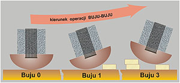 Erich von Daeniken opisuje w swojej książce "Oczy Sfinksa. Tajemnice piramid" jak austriacki egiptolog, szanowny pan profesor doktor Dieter A. wymyślił sposób na budowę piramidy, a konkretnie rozwiązał problem unoszenia bloków kamiennych na coraz to wyższe poziomy. Według niego sprawa była dziecinnie prosta. Zbudowano z drewna kołyskę. Najpierw zapewne sklecono drewniane koło, które potem przecięto na pół i wykonano bujankę. Na górną, płaską część kładziono monolit o średniej wadze 4 ton, przetaczano to jakoś na miejsce bujania i zaczynano kołysać całość. Dalej już szło jak po maśle. Kołyska "buju" w przód, a z tyłu natychmiast starożytni robotnicy podkładali belkę, teraz kołyska "buju" w tył i taka sama akcja z przodu. Blok powoli unosił się na deskach. Po osiągnięciu zadanej wysokości robiono "buju" w kierunku piramidy, ale już bez deski i kamień wskakiwał dokładnie na wyznaczone miejsce.

Hipoteza wygląda na więcej niż bardzo roboczą, bowiem pan profesor nie wspomina - W jaki sposób dźwigano i układano blok na kołysce? Jaki to gatunek drewna nie zgniatał się pod takim ciężarem? Ile desek należało podłożyć by unieść blok na wysokość jednego metra? W jaki sposób mocowano podkładane deski, by nie rozsuwały się pod ciężarem kołyski? Ile razy można było użyć jedną i tą samą belkę? Ilu ludzi jednocześnie brało udział w ułożeniu jednego tylko bloku? Ile czasu trwała taka pojedyncza operacja, skoro ponoć układano jeden blok co dwie minuty? Ile takich "operacji" można było prowadzić jednocześnie? Czy układanie odbywało się ze słynnej piaskowej rampy czy też tworzono pojedyncze, ruchome stanowiska pracy? Jak duże kołyski musiały "bujać" bloki z wielkiej galerii? Jak sobie radzono u szczytu piramidy? Starczy uwiąd czy tylko słynne "austriackie gadanie"?

**Transport wodny do Gizy**

 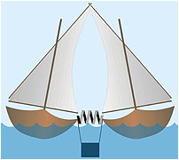 Także z Daenikena, też o dziwo z Wiednia i też kolejny austriacki profesor Oskar R. Uzupełnił wywód poprzednika i podał sposób na transport bloków kamiennych tak prosty, że aż oczywisty. Do ciężkiej pracy zaprzągł wodę. W swym prostym założeniu wykorzystał odkrycie Archimedesa "o wypieraniu" i stworzył teorię o transporcie kamiennych bloków pomiędzy dwoma fellukami. Bloki były zanurzone w wodzie bo wiadomo, że ciało zanurzone traci, a szczególnie w Nilu. Po pokonaniu prądów, wirów, zakrętów, mielizn i płycizn oba stateczki równocześnie zawijały do portu pod piramidami, po czym je przytapiano.

Teraz do pracy przystępowała grupa specjalistów od pracy w zamulonej wodzie, układając blok na wodno-ziemnych saniach, po czym następna ekipa ciągnęła go na plac budowy pod piramidą. Tutaj ciężar przejmowały drewniane dźwigi unoszące te drobne kilkanaście ton na swoje miejsce. Proste jak... chciało by się rzec, gdyby nie parę niedomówień. Jaką wyporność musiały mieć te łodzie? Kto i z czego w Egipcie wytwarzał tak doskonałe i wytrzymałe liny? Jakiej firmy były te genialne konstrukcje dźwigów? Ile łodzi liczyła ta flota cargo i z jaką prędkością musiała pływać (szczególnie pod prąd), by dostarczyć jeden blok co 2 minuty z Assuanu do Gizy? Czy Nil nie był zbyt wąski? Ile ramp wyładunkowych miał port pod piramidami? Gdyby w tych czasach ktoś mógł oglądać Nil z lotu ptaka z pewnością natychmiast wynalazłby piłę łańcuchową.

**Rzeźbienie kamiennych głów**

 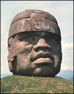 Swego czasu oglądałem (na zasłużonym dla ortodoksyjnej nauki) kanale Discovery program o cywilizacji Olmeków. Prócz paru bardzo ciekawych obrazów i "uczonej" paplaniny nie było by kompletnie nic, gdyby w pewnym momencie nie pokazano eksperymentu naukowego (tak się teraz nazywa sprawdzanie głupich teorii, by uzasadnić nieuzasadnione wydatki). Jakiemuś rzeźbiarzowi, chyba tubylcowi, kazano wyrzeźbić podobną do olmeckiej głowę. Wzorzec przedstawiam na zdjęciu obok. Rzeźba wykonana w andezycie uważanym za najtwardszą skałę świata, na której nawet żelaznym nożem trudno jest zrobić choćby rysę. Przedstawia ona głowę człowieka (chyba ówczesnego autochtona) rasy, którą teraz możemy podziwiać tylko na czarnym lądzie. Nauka sytuuje Olmeków w Ameryce Środkowej w okolicach La Venta w Meksyku. Rzeźba ma około dwóch metrów w obwodzie, co daje masę co najmniej kilku ton "żywego" kamienia.

Rzeczonemu artyście, oczywiście za odpowiednią zapłatą, polecono wykonać duplikat, aby udowodnić niedowiarkom, że taka rzecz to dziecinna igraszka. Umiał olmecki murzyn, to potrafi i dzisiejszy biały. Jednego warunku należało dotrzymać. Ponieważ, według naukowego kanonu, rzeźba powstała w okresie jakiegoś bliżej nie określonego "kamienia", nie wolno było używać młota pneumatycznego ani innego żelastwa. Do dyspozycji artysty oddano zestaw pięściaków i dłut kamiennych oraz trochę sznurka i rękawice ochronne (wymogi BHP). Termin - kilka dni. Artysta z uśmiechem zabrał się do pracy. W pierwszym dniu zużył cały zestaw narzędziowy nie wykonawszy nawet zadrapania. W drugim dniu, już bez uśmiechu ale też bez zarysowania kamienia, praca trwała nadal. W trzecim dniu osiągnięto już drobne zadrapania (rzeźbiarza) ale wraz z buntem artysty, który rzuciwszy to wszystko odszedł mamrocąc coś pod nosem "nie filmowym" językiem. Nauka stwierdziła - jest to do wykonania, ale w trochę dłuższym czasie.

**Jak się tnie kamień przy pomocy Słońca?**

 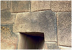 Tytuł powinien brzmieć - jak się tnie głupa, ale ze względu na powagę nauki pozostawiłem go bez zmian. Następny przykład, jak myśl nasza wznosi się ponad poziomy zwykłych tego świata, pochodzi z eksperymentu w Ameryce Południowej. Pewien Amerykanin (z tej Ameryki o wysokim standardzie) zachwycony jakością murów preinkaskich (na zdjęciu) postanowił udowodnić światu, że jest możliwe i w dzisiejszych czasach wykonanie podobnego. Do celu eksperymentu zwerbował kilku Indian, ponoć bardzo dalekich potomków budowniczych tych murów. Pomny tego jak Archimedes spalił rzymską flotę na odległość, użył także zwierciadeł wklęsłych. Wyszedł bowiem z założenia, że Słońce energicznym jest i jako takie po odpowiednim skupieniu jego promieni musi przeciąć skałę.

Na miejsce doświadczenia wybrał cichą wioskę peruwiańską z takowym murem, by mieć od razu porównanie. Wręczył dwóm tubylcom po zwierciadełku, wskazał cel i dał rozkaz do słonecznego ataku. I co?... I nic. Po paru minutach Indianom zaczęły trząść się ręce co rozproszyło energię tak wielce, że eksperyment się nie udał. Odrzuciwszy pomoc eksperymentator sam poustawiał lusterka i przyłożył swoje. I co?... I też nic. Wystąpiły natomiast skutki uboczne wśród Indian, co zajestrowały "wśibskie" kamery - jeden śmiał się do rozpuku, drugi pukał się znacząco w czoło, a trzeci chyba zwariował, bo walił głową w mur. Z tego doświadczenia wyciągnięto jednak poważny naukowy wniosek - albo energia Słońca jest do d.... albo oni musieli to robić inaczej. Ale jak? Trzymam rękę na pulsie i czekam na dalsze doświadczenia światłych i wykształconych.

**Kto wynalazł sztukę?**

  Tą genialną w swojej prostocie hipotezę zasłyszałem w polskim radio (nie pamiętam na jakiej częstotliwości ze względu na kryptoreklamę). Pewna starsza pani, oczywiście profesor pochodząca bodajże z Francji orzekła - człowiek w bardzo dawnych czasach był niezmiernie zajęty, albowiem dzień upływał mu na zbieraniu runa leśnego lub polowaniu na zwierza. O ile z runem było pół biedy, o tyle za zwierzyną musiał ganiać i to niekiedy po kilka, kilkanaście kilometrów. Dróg wtedy nie było, co stanowiło utrudnienie. Pierwotny nie miał czasu na nic, bo jak nie upolował, to z głodu się nie rozmnażał.

Z upływem lat, a wedle nauki było ich tysiące, człowiek wynalazł radło i to co zebrał to nie zjadał wszystkiego na raz, tylko wrzucał odpadki w tę zaradloną ziemię obok jaskini i czekał co wyrośnie. Były to początki rolnictwa i trybu osiadłego. Po wynalezieniu rolnictwa siłą rzeczy nastał czas udomowienia zwierzyny. To wszystko z kolei skutkowało akumulacją płodów oraz łatwym dojściem do białka, które hodowało się obok za pierwotnym ogrodzeniem. Człowiek, nie musząc już ganiać po lasach i łąkach zaczął mieć wolny czas. A wiadomo, jak się ma za dużo wolnego czasu to po głowie zaczynają chodzić najróżniejsze myśli. To właśnie ten wolny czas, według pani profesor, był bezsporną przyczyną tego, że człowiek musiał wymyśleć sztukę. Teraz wiadomo, dlaczego w naszych czasach sztuka chyli się ku upadkowi. Praca i praca, a po pracy jeszcze praca, trochę snu i znów do pracy...

**Indianie a sprawa wielkich mas**

Następny "kwiat" myśli technicznej homo sapiens sapiens. Pewien pan, Vincent L. (nazwiska nie podam ze względu na dobro "tfurcy") doszedł do wniosku, iż sprawa ustawiania olbrzymich bloków kamienia jest niezwykle prosta. Wystarczą do tego specjalne wypusty na kamieniach, dobre jakościowo drewno oraz niewykwalifikowana, aczkolwiek bardzo silna siła robocza.

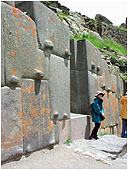

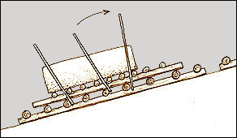

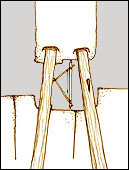

Na zdjęciu pierwszym obiekty, z którymi będziemy mieli do czynienia, zaś rysunki to ilustracja pomysłu pana Vincenta do prostego wykonania banalnej czynności ustawienia ich na swoim miejscu. Bloki, które widzimy na zdjęciu w Ollantaytambo mają wagę kilku, jeśli nie kilkunastu ton. Pierwsza czynność, to wtaskanie ich na górę, bagatelka, kilkadziesiąt metrów w linii pionowej. Widoczna rampa miała spełnić to zadanie. Na dobrą sprawę, ćwiczono to już pod piramidami, do tego poziomo i jak wiemy z marnym skutkiem. Następną czynnością jest ustawienie bloku dokładnie nad miejscem posadowienia, zabezpieczenie go drewnianymi balami i stopniowe opuszczenie na miejsce. Prawda, że proste?

Nie podam tu obliczeń wytrzymałościowych, żeby nie denerwować autora, ale chciałbym się tylko dowiedzieć, w jaki sposób Indianie ustawiali taki blok kamienia na drewnianych podpórkach?

**Ziemia zawdzięcza wodę ... kometom**

Uczeni amerykańscy forsują hipotezę, że Ziemia zawdzięcza wodę niezliczonej ilości komet, które przez miliardy lat uderzając w Ziemię, naniosły jej tyle, że dziś 2/3 powierzchni naszej planety faluje niebieskawą powierzchnią.

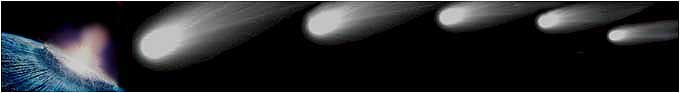

Jak ta teoria winna przebiegać w praktyce podpowiada najprostsza matematyka. Dla uproszczenia przyjąłem, że jedna kometa zawiera 1/3 wody, co przy średnicy komety 3 km daje około 15 km sześciennych wody. Wody na Ziemi (przy założeniu średniej 3 kilometrowej głębokości oceanów) mamy około 1,08 mld km sześciennych w samych tylko oceanach, więc taką ilość musiało przynieść około 72 mln komet (każda o średnicy 3 kilometrów) na przestrzeni 4,5 mld lat istnienia Układu, trafiających bezpośrednio w Ziemię co 62,5 roku albo około 16 bilionów komet o średnicy około 155 m trafiających Ziemię codziennie do wczoraj (meteoryt tunguski miał "tylko" 60 m średnicy). Jeśli jednak komety zawierają mniejszą ilość wody, co jest możliwe, wówczas ich ilość i częstotliwość uderzeń niepomiernie się powiększy. Jak zatem przebiegała "ewolucja" na Ziemi przy takiej częstotliwości uderzeń? Jak takie bombardowanie przeżywał nasz przodek? Dlaczego źródła pisane z przeszłości nie roją się od opowieści o wielkiej liczbie katastrof przybyłych z nieba?

Albo hipoteza jest lekko niedorzeczna albo matematyki nie wolno stosować w astronomii, jednak najbardziej prawdopodobne jest pomieszanie skutku z przyczyną.

**Pijmy kakao**

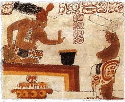

Kakao? Dziękuję. Dziś prowadzę.

Perełka. Świat winien pochylić głowę przed niepozornym ziarenkiem, a także przed "geniuszem" amerykańskiej archeologii. Oto, co donosi oficjalna nauka:

Amerykański archeolog Eric T. twierdzi, że używanie kakao nie tylko przyczyniło się do rozkwitu handlu w Mezoameryce, ale także do rozwoju arytmetyki i astronomii - dwóch dziedzin wyróżniających Majów wśród innych kultur. **Zwyczaj operowania wielkimi liczbami przez mnożenie w nieskończoność ziaren kakao mógł znaleźć zastosowanie w obliczeniach astronomicznych i mierzeniu czasu**. Nieprzypadkowo najstarsze inskrypcje kalendarzowe 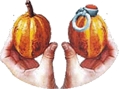 odkryto w regionach upraw kakao.

Wreszcie wiemy dlaczego inne kraje były tak zacofane w rozwoju. Autor zapomniał jednak dodać, że Majowie używali ziarenek kakao tylko w oryginalnej wersji matematyczno-astronomicznej, natomiast wersja eksportowa była lekko zmodyfikowana genetycznie (po prawej), co prawdopodobnie sprawiało, że sąsiednie ludy próbujące używać tego królewskiego napoju były w sposób permanentny modyfikowane ilościowo lecz nie jest to jeszcze jednoznacznie uzasadnione. W dalszym ciągu trwają poszukiwania archeologiczne mające na celu odnalezienie jeśli nie nasion tej wersji, to jakiejkolwiek faktury nawet w formie fresku.  
I pomyśleć, że my mając tyle maku, mieliśmy tylko Kopernika.

**Tajemne znaki pustyni Nazca**

 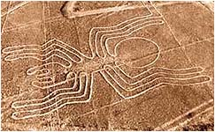 Poszukiwacz "zagwozdek" nie mieszczących się w oficjalnej nauce, a także tropiciel najzwyklejszej naukowej głupoty, Erich von Daeniken, zamieścił w swej książce "Czy się myliłem? Nowe wspomnienia z przyszłości" rewelacyjne hipotezy na temat genezy powstania gigantycznych znaków na pustyni Nazca.

**Indiański środek antykoncepcyjny** - nazwany przez autora, antropologa prof. Williama H. I. z Nowego Yorku, terapią zajęciową. Jak wiadomo, Indianie nie posiadali magazynów do składowania zboża, dlatego w latach "tłustych" nadmiernie zajmowali się prokreacją, co w latach "chudych" skutkowało klęską głodu. Aby ograniczyć nadmierny wzrost populacji, wódz wprowadził rytualne, a więc obowiązkowe zajęcia, których celem było pochłonięcie znacznej energii u płci męskiej. Wyganiał męską brać na pustynię i kazał tworzyć znaki. Uczony nie podaje, czy wybór znaku odbywał się przez losowanie, czy też był narzucany odgórnie.

**Gigantyczne motki do wełny** - W okolicach pustyni, w grobach tubylców odnaleziono tkaniny, które nie posiadały obrąbień, bo były wykonane z jednej, wielokilometrowej długiej nici. Szwajcar Henri S., znając nieznajomość u Indian koła, motowidła czy zwykłej osi, doszedł do wniosku, że wzdłuż figur na pustyni układano wełniane nici, by nie uległy poplątaniu. Indiańska tkaczka, oprócz utkania szalika zaliczała przy okazji chód na 50 km.

Przypomina to hipotezy radzieckich uczonych. Niemieccy archeolodzy w XV wiecznej warstwie geologicznej natknęli się na kłębek miedzianego drutu, co uznali za dowód, że już w XV wieku Niemcy posługiwali sie telegrafem. Rosjanie w odpowiedzi rozkopali pół Moskwy i nie znaleźli nic, co według nich dowodziło, że już w XV wieku Rosjanie używali telegrafu bez drutu. I tak, dzięki geniuszom z dyplomami naukowymi, rozwikłamy wszystkie zagadki świata.

**Płyta z Palenque**

Lektura niektórych "dzieł naukowych" przypomina czasami studiowanie zbiorów najlepszych światowych dowcipów lub w najlepszym przypadku zbiór opowiadań noszących znamiona pisania w stanie "pomroczności jasnej". Jak skomplikowanymi meandrami płynie informacja wzrokowa przetwarzana następnie na język pisany można przeczytać w opisach płaskorzeźby "płyty nagrobnej" z Palenque? 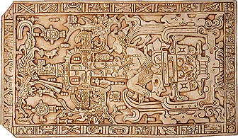

**Marcel B.**: "W centrum płyty wyrzeźbiono postać człowieka, być może jest to portret zmarłego. Postać, przystrojona ozdobami i mocno odchylona do tyłu, spoczywa na wielkiej masce, przedstawiającej boga ziemi, śmierć."  
**Pierre I.**: "Widzę symboliczne znaczenie tego dziwnego wizerunku... stawia kilka zagadek. Bóg śmierci jest według wierzeń Majów dzięki swoim związkom z królestwem podziemi, również bogiem płodnej ziemi. Mężczyzna nad nim wyobraża swoją sprężystą postawą powstawanie życia. Jego twarz przypomina twarz boga kukurydzy, mógłby więc być inkarnacją przyrody budzącej się do życia. Autorytet i władzę uprzedmiotawia obrzędowa buława wszechświata podzielonego na czworo, krzyż, który jest zarazem odbiciem świata, czasu i zmiany władzy. Ptak moan wreszcie symbolizuje śmierć."  
**Miloslav S.**: "...rozpoznaję postać młodego mężczyzny; prawdopodobnie nie jest to portret jakiejś konkretnej osoby, ale symbol człowieka - rodzaju ludzkiego. Z jego ciała wyrasta krzyż, który \[...\] był symbolem życiodajnej kukurydzy. Z liści kukurydzy po obu stronach wyłaniają się dwugłowe żmije. \[...\] Z ciała młodzieńca wyrasta życie, on sam jednak spoczywa na twarzy śmierci: na potwornej głowie fantastycznego zwierzęcia, z którego paszczy wyrastają ostre kły."  
**Dr Alberto Ruz L.**: "Widzę \[...\] młodego mężczyznę, opierającego się o wielką maskę potwora ziemi... nad nim stoi krzyż, identyczny ze słynnym krzyżem innej świątyni w Palenque. Z dwugłowego węża wypadają niewielkie mitologiczne postacie, a wśród nich ptak quetzal z maską boga deszczu. Możemy przyjąć, że scena oddaje podstawowe założenia religii Majów..."

Takich monologów nie wymyśliłby nawet sam profesor polskiej satyry Stanisław Tym.

**Opalajmy się! Złapiemy rybę bez wędki**

  "New Scientist" podał informację, że zespół uczonych kanadyjskich doszedł do genialnego wniosku, że nasz prapraprzodek wyszedł na ląd tylko po to, by być lepszym myśliwym w wodzie. Dosłownie - Rozgrzany na słońcu, po powrocie do wody z większą werwą ścigał swoje ofiary.

Naukowcy tej zachodniej półkuli stwierdzili, że nagrzanie się w słońcu dawało przodkom "energetycznego kopa", i dzięki temu w wodzie byli bardziej silni, zwarci i gotowi, co owocowało większymi sukcesami w zdobywaniu życiodajnego białka. Robert C. z McGill University w Montrealu, ekspert od opalania praprzodków, wskazuje na strategię krokodyli, ponoć naszych, aczkolwiek bardzo dalekich antenatów. Rzeczony najpierw zażywa kąpieli słonecznej, potem gwałtownie zmienia środowisko i po krótkiej pogoni mięsko samo wchodzi między zęby.

Rybacy i wędkarze miejcie się na baczności. Niedługo zabraknie ryb. Już widzę te wygrzewające się tłumy nad wodami. Widzę, jak co jakiś czas, grupa "nagrzanych" zsuwa się do wody metodą "na krokodyla" i wynurza się z rybami w zębach. Tą śmiałą hipotezą i jej skutkami dla budżetu państwa należało by zainteresować polskie Ministerstwo Finansów, co niniejszym czynię.

Złoty medal "Profesora Baltazara Gąbki" za naukowe zmuszenie szarych komórek do (stuk, puk) osiągnięcia wysokiego stanu otępienia umysłowego. Jak tu nie kochać Darwina?

**Po co budowano olbrzymie budowle ?**

 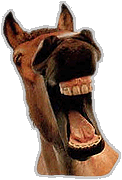 Peter J. i Nick T. dwóch współczesnych spośród setek skrybów, mozolnie przepisujących jeden od drugiego książki o tematyce "niewyjaśnione", zmieniając kolejność rozdziałów i czasem dorzucając swoje "złote myśli", popełniło dzieło "Niewyjaśnione tajemnice przeszłości ... jak było naprawdę?". Mentorskim tonem nauczają resztę, rzekomo o mniejszej wydajności szarych komórek, o tym jak było i jak być powinno przy okazji ośmieszając tych co nie myślą tak jak oni. Niżej cytuję fragment tego pouczającego dzieła:

Dlaczego w dawnych czasach wznoszono aż tyle i aż tak ogromnych budowli kamiennych? W dużej mierze elity rządzące budowały je, by **wywołać postrach u podporządkowanych ludów, a nawet otumanić ich**. Jednym z najlepszych przykładów są prehistoryczne świątynie na śródziemnomorskiej wyspie Malta, powstałe w okresie 3600-2500 pne. Te budowle z miejscowego wapienia ciągle wywierają duże wrażenie.

Święta prawda. Trzeba jeszcze dodać, ze ówczesne społeczeństwo z Malty dla podkreślania swojej uczciwości, stawiało tylko budowle owalne czyli bez żadnych kantów. Oglądając pojedynczy dolmen, jako najmniejszą komórkę gigantomanii, można sobie wyobrazić jak tysiące lat temu połowica budowniczego, otumaniona, z obowiązkowym strachem w oczach co wieczór musiała się bezwarunkowo mu podporządkować. Dalej szło już normalnie. Świat zaludniali nowi otumanieni, których potomkowie opisują dziś, jak to dawniej być musiało.

**Stonehenge - cipką ???**

Proszę wytężyć wzrok, intelekt i pozostałe zmysły z intuicją włącznie. Spójrzmy na fotografię... i uwaga - to na co patrzymy nie jest tym co widzimy. Profesor P. z Uniwersytetu w Kolumbii Brytyjskiej, ginekolog z wykształcenia i praktyki, po długoletnim wpatrywaniu się w "miejsce pracy" dojrzał w kromlechu Stonehenge... cytuję:

 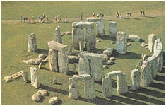 "Okazuje się, że to subtelny, acz bardzo powiększony model kobiecych części rodnych wraz z kilkoma aluzjami do spraw seksualnych. Profesor P. twierdzi, że wewnętrzny krąg kamieni symbolizuje wargi mniejsze, a zewnętrzny wargi większe (nie mylić z ustami - przyp. aut.), centralnie ulokowany kamień uważany przez poprzedników za ołtarz jest po prostu monstrualnym clitoris.

Oś centralna jest oczywiście kanałem rodnym. Dwa olbrzymie kamienie połączone trzecim, jeden o gładkiej powierzchni, drugi o surowej, symbolizują kobietę o gładkiej skórze i mężczyznę o szorstkiej, połączonych mistyczną więzią kamienną na głowach. Tak więc całość reprezentuje otwór, poprzez który Matka Ziemia wydawała na świat wszystkie zwierzęta i rośliny, tak ważne dla ludzi owych czasów, to znaczy około 5000-4000 lat temu."

Czy zboczenie zawodowe nie jest przesłanką do skierowania na przymusowe badania u lekarzy specjalnej troski? Czy ten angielski ginekolog wpatrując się w kamienne ruiny nie doznał przypadkiem olśniewającego orgazmu, który to (jak twierdzą praktykujący seksuolodzy) ma ogromny wpływ na przejściowe zmętnienie soczewki oka? Czy teraz już wiadomo co oznacza polskie "ocipiał"?

**Galopująca darwiniada czyli myślenie organem**

Denis B. z University of Utah i Daniel L. z Harvard University ogłosili wiekopomną notkę w "Nature", że ewolucja faworyzowała tylko biegających i tylko ci przenieśli płomień ewolucji w dzisiejsze czasy. Pierwotny biegał zaś tylko po to, by umykać drapieżnikom i pierwszym dopadać padliny. Oddajmy głos uczonemu Danielowi L.: 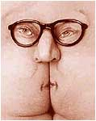

"Wiemy z materiałów kopalnych, że nasi przodkowie dzień w dzień uprawiali biegi maratońskie, a nawet pokonywali dłuższe dystanse. Stosowali też metodę polowania polegającą na uporczywym bieganiu. W praktyce oznaczało to zaganianie ofiary na śmierć. Człowiek mógł złapać nawet rączą antylopę, ponieważ, jako jedyny ssak, potrafi pokonać bez ustanku bardzo duże odległości. \[...\] Jeśli wciąż będziemy je gonić, zwierzę nie odbuduje rezerw energetycznych i padnie z wyczerpania. \[...\]

Ewolucyjnym zyskiem jest więc znaczna utrata owłosienia, dzięki czemu szybciej się ochładzamy. Dzięki bieganiu mamy bardziej płaską twarz i mniejsze zęby niż australopiteki i w odróżnieniu od nich potrafimy ruszać głową i szyją niezależnie od ramion. \[...\] Zamiłowanie do maratonów zaowocowało także stworzeniem lepszych metod tłumienia wstrząsów - ludzie mają wyjątkowo duże pięty oraz paluchy u stóp. \[...\] Jednym z najwdzięczniejszych przystosowań do biegu są jednak ludzkie pośladki.

Dwa miliony lat biegania homo sapiens wpłynęło na ewolucję jego pośladków czyli potocznie mówiąc - dupy - i to chyba ten organ spełnił zasadniczą rolę u tak znamienitych uczonych w stworzeniu tej (r)ewolucyjnej teorii.

**Diabełek z pudełka ewolucji**

  Tym razem dał znać sobie rodzimy fan-club Karola Darwina. W artykule "Ziemska przyroda raz na jakiś czas popełnia harakiri" naukowcy z Polski rodem doszli do genialnego wniosku, że ziemska fauna co jakiś czas wykańcza się sama. Już nie trzeba kosmicznych katastrof czy typowo ziemskich kataklizmów. Ziemska przyroda inteligentną jest i unicestwia się sama. Do tego celu ma służyć wykluwający się co jakiś czas superdrapieżnik, który zżera wszystko co się dookoła rusza. Gdy zabraknie pożywienia zżera swój gatunek, a na koniec ostatni egzemplarz ginie z prozaicznego głodu i Matka-Ziemia ma czas na odnowę biologiczną. Tą genialną myśl nasi uczeni poparli statystyczną symulacją komputerową, która z bezwzględną dokładnością wykazała, że co jakiś czas życie na Ziemi upada. Podstawą jednak jest teoria ewolucji, bez której powstanie "predatora" byłoby niemożliwe.

W jakim zwierzu tkwi ten morderczy gen ani co daje sygnał do jego uaktywnienia uczeni nie podali, bo komputer jeszcze nie myśli, a twórcy hipotezy nie mają funduszy na jego odkrycie. Brak też wyjaśnienia jak to jest ze zwykłą "zieleniną". Któraż to roślina odpowiadała za pożarcie innych? Co, na koniec z "koroną" ewolucji? Jak to robi perła inteligencji - "homo sapiens"? W jakiż to sposób cyklicznie się unicestwia? Może takim tworem jest polski "homo politicus" - rodzimy mutant od lat bezwzględnie niszczący pozostałych współziomków? Ot, rzucona od niechcenia hipoteza typu "teraz Polska", która ma rozwikłać jedną z zagadek wszechczasów i rozsławić upadającą polską naukę.

**Chińska słoń - mądra słoń.**

  W Chińskiej Republice Ludowej, jak w każdym komunistycznym raju, teoria Darwina jest obowiązująca religią i żadne wydarzenie dotyczące biologicznego życia nie może być swobodnie interpretowane. Ostatnio prasa zamieściła sensacyjną wiadomość z tamtego terenu na temat ewolucji chińskich słoni.

Ekipa pod kierunkiem zoologa Zang Li pracująca w rezerwacie słoni w Xihuangbanna, przy granicy z Laosem, odkryła, że ostatnio rodzi się coraz więcej samców bez kłów. Za normalne zjawisko przyjęto, że 2-5% samców słonia nie ma kłów. Tymczasem w ciągu ostatnich kilkunastu lat ten odsetek wzrósł do dziesięciu procent. Badania przeprowadzone przez chińskich uczonych nad słoniami azjatyckimi wykazały, że te mądre zwierzęta szybko przystosowują się genetycznie do sytuacji, w której ich życiu zagrażają kłusownicy zabijający je dla cennych kłów. Prof. Zang Li sformułował tezę, że słonie azjatyckie szybko przystosowują się do sytuacji, gdy wskutek wielkiego nasilenia polowań kłusowników grozi im eksterminacja.

Jak widać ewolucja zaczęła już przebiegać nawet na naszych oczach. Kilkadziesiąt lat kłusownictwa zmusiło matkę-naturę do remanentu w uzębieniu tego przemiłego azjatyckiego czołgu. Kto pierwszy powiązał kłusownictwo z kłami (słoń-ona czy słoń-on) jest ściśle tajne. Teraz musimy poczekać na reakcję ewolucji po tym, jak chińskie władze ogłoszą wielkie zwycięstwo komunizmu nad kłusownictwem.

**Cywilizacja głupków**

 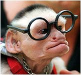 W najnowszym wydaniu tygodnika "Nature" dowiadujemy się o wynikach badań psychiatrów i neurobiologów z University of California (USA). Doszli do genialnego wniosku iż:

W naszym mózgu istnieją dwa rodzaje pamięci - nowoczesny i prymitywny. Ten drugi jest pamiątką po wcześniejszych etapach ewolucji. W razie awarii pierwszego systemu można wesprzeć się starym. Człowiek poznaje świat w sposób świadomy - zauważa nowe zjawiska, zastanawia się nad nimi i wiąże je z tymi, które już ma w pamięci. Co innego zwierzęta - te powoli wyrabiają sobie umiejętności i nawyki, najczęściej bez udziału świadomości. Zazwyczaj odbywa się to metodą prób i błędów. Okazuje się jednak, że ludzie z uszkodzeniami mózgu, u których nie działa świadome zapamiętywanie, nadal mogą nauczyć się czegoś nowego. Działa wówczas właśnie ten prymitywny, "zwierzęcy" system uczenia się.

Pomału stajemy się cywilizacją głupków. Globalny wzrost gazów cieplarnianych permanentnie niszczy nam "nowoczesny rodzaj pamięci". Coraz więcej uczonych myśli już tylko "pamiątką po wcześniejszych etapach ewolucji", a to niedługo może wpłynąć także na nasz wygląd.

**Buldożer epoki lodowcowej**

 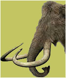 "Głos Wielkopolski" pisze - Pan Marcin G. z miejscowości koło Środy Wielkopolskiej kopiąc staw na ryby wykopał duże kości i jako wzór-obywatel powiadomił o znalezisku Muzeum Archeologiczne w Poznaniu, które uznało znalezisko za kości mamuta. Mamut w Polsce nie dziwota, ale ciekawe jest tłumaczenie znaleziska.

"Mamuty wyginęły dziesięć tysięcy lat przed naszą erą. Prawdopodobnie ten, którego znaleziono koło Środy został tu przywleczony przez lodowiec z północy Europy, ale na to odpowiedzą specjalistyczne badania. \[...\] Dorosłe osobniki osiągały wysokość 4 m i wagę do 5 ton. Pokryte były rudawobrunatnym długowłosym futrem. Do obrony i wyszukiwania jedzenia pod śniegiem i lodem służyły im ponad 3,5-metrowe kły."

Wiadomo, że przesuwający się lodowiec kruszy na drobny piasek nawet skałę. Czy znaleziony u nas osobnik nie jest tym jedynym egzemplarzem, którego Szwedzi na swojej północy poszukują od dziesiątków lat? W jaki sposób tak zakręconymi kłami rył w śniegu i lodzie poszukując czegoś, co "rosło" pod lodem? Czy takimi zakrzywionymi kłami mamut był zdolny kruszyć pokrywę lodową? Dlaczego my do rozbijania lodu używamy metalowych narzędzi mając tak dobry i tani surowiec marnujący się w rzeźniach?

**Nie noś ciasnej czapki**

 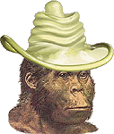 Czego ta ewolucja z nami nie wyrabia. Oto amerykańska [hipoteza](http://wiadomosci.wp.pl/kat,1342,wid,7916761,wiadomosc.html) z polskim przytupem.

Amerykański uczony, profesor Erik T. z Uniwersytetu Waszyngtońskiego twierdzi, że człowiek nosi buty już 40 tysięcy lat i dlatego nasze stopy zawdzięczają swój obecny kształt właśnie wynalazkowi sprzed 40 tysięcy lat, czyli butom na twardej podeszwie. Potwierdza to w całej rozciągłości nasza archeolog z Uniwersytetu Warszawskiego, Elżbieta J. dopatrując się genezy zmiany kształtu małego palca w stopie praczłowieka. Mówi, że "mały palec u stopy przestał odgrywać jakąkolwiek rolę przy poruszaniu się i uległ zdecydowanemu zmniejszeniu".

Polska naukowiec poszła jeszcze dalej doprawiając ewolucję wódką. Twierdzi, że tak zwana rasa żółta jest zdecydowanie mniej odporna na wpłw alkoholu niż rasa biała, na co ewidentnie ma wpływ ewolucja. Naukowcy podejrzewają, że alkohol zanim pojawił się w obecnej postaci, znany był kilka tysięcy lat wcześniej w słabszej wersji (słynna firma "Lech&Rus Bimber SA" jeszcze wtedy nie istniała - prz. aut.).

Denaturat, jak sama nazwa wskazuje sprzyja ewolucyjnej denaturalizacji, co więcej mężczyźni muszą bardziej uważać na rozmiar zakładanych prezerwatyw, by nie spowodować ewolucyjnych zmian najważniejszego z narządów.

**Chińscy komuniści rzucają palenie**

 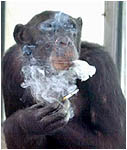 Ciekawostka z dziedziny wschodniej ewolucji. Jednak mamy coś wspólnego z naszym dalekim przodkiem. Małpy też potrafią palić i wpadają w nałóg w czasie stresu. Chińska Agencja donosi:

27-letnia szympansica Ai Ai, mieszkająca w zoo w chińskiej prowincji Shaanxi, po 16 latach skończyła z nałogiem palenia. Małpa zaczęła popalać w 1989 r., po śmierci partnera. Nałogowcem stała się w 1997 roku, kiedy zmarł jej drugi partner, a córkę przeniesiono do innego ogrodu zoologicznego. Agencja Xinhua nie informuje, kto nauczył szympansicę palić i kto zaopatrywał ją regularnie w papierosy. Personel zoo włożył wiele wysiłku, żeby pomóc małpie w zerwaniu z nałogiem. Ai Ai wyprowadzano na dodatkowe spacery, pozwalano jej słuchać muzyki przez słuchawki i ćwiczyć na sali gimnastycznej. Dietę szympansicy wzbogacano o najróżniejsze rarytasy, żeby tylko zwierzę nie myślało o papierosie. Początki kuracji odwykowej były dość trudne. Małpa często i głośno domagała się papierosa. Ostatecznie wyzwoliła się jednak z nałogu, a zoo szuka dla niej nowego partnera.

Jak przystało na kraj, gdzie państwową religią jest tajemnica, nie ujawniono "wrogów komunizmu" winnych małpiego nałogu. Nie wiadomo też, czy małpa domagając się papierosa używała prozaicznego "kopsnij szluga" czy też pisała konspiracyjne grypsy. Nie wiadomo też, czy rzucenie palenia to zwycięstwo chińskiego komunizmu odwykowego czy też zwyczajnej, ewolucyjnej silnej woli.

**Ewolucyjne bąki samozagłady**

Nieoceniona wręcz strona R. Antoszewskiego z Nowej Zelandii ["Jedno zdumienie dziennie"](http://www.antoranz.net/CURIOSA/ZBIOR2/C0303/07-QZC04073_bebnica.HTM) opisała kolejny milowy kamień w zrozumieniu złożoności życia na Ziemi. Tym razem chodzi o nowatorskie podejście do zagadki zagłady naszych dalekich przodków.

Kilka lat temu francuski geochemik Simon B. połączył dietę i sprawy żołądkowe dinozaurów ze sprawami biosfery i dziury ozonowej. 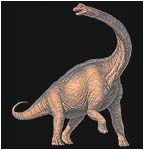 Doszedł do wniosku, że winę za wyginięcie ponoszą same dinozaury, a to przez samobójcze "puszczanie wiatrów", czyli mówiąc krótko cierpiąły na bębnicę. Jak wszystkie zwierzęta wyższe, nie dysponowały systemem trawiennym rozkładającym celulozę. Robiły to za nich beztlenowe bakterie i orzęski zamieszkujące ich przewód pokarmowy, a to zawsze związane jest z wydzielaniem znacznej ilości metanu. A wiadomo z kolei, że metan jest zasadniczym wrogiem ozonu. Uczony twierdził, że puszczały tyle wiatrów, że wybiły nimi dziurę ozonową. W wyniku tego nastąpić miała radykalna zmiana spektrum światła dochodzącego do powierzchni ziemi i szybki spadek produkcji masy roślinnej. Zabrakło wtedy pokarmu dla olbrzymów i miejsce ich zajęły skromniejsze pod względem puszczania wiatrów, ssaki. \[...\]

Aż kusi, by postawić hipotezę, że "tołambasowe dźwięki" (staropolska nazwa puszczania bąków) były sposobem porozumiewania się dinozaurów, a przynajmniej sposobem informowania o "zajętości" terenu wypasu. Jeśli założenie takie okazałoby się prawdziwe, byłby to jedyny chyba przykład porozumiewania się "odwrotną stroną medalu". Przypuszcza się, że "normalne" umiejętności wokalne dinozaurów były bardzo ograniczone, wbrew temu, co czasem widać i słychać w programach telewizyjnych i filmach typu fantazy. Zauważmy też, że tak zwany **drugi mózg gadów, większy od tego w głowie, mieścił się bliżej odbytu niż gadzieli**.

O ile pierwsza hipoteza jest jakby uzasadniona, to druga jej część jest wprost rewolucyjna. Dlaczego jednak ewolucja zrezygnowała z tego swoistego regulatora efektu cieplarnianego? A może ten drugi mózg nadal istnieje, ale wpływa już tylko na epokowe odkrycia współczesnej nauki?

**Kobiety są cudem ewolucji**

Angielski zoolog Desmond M. w zasadzie specjalista od zwierząt, z powodu ogólnoświatowego kurczenia się ilości obiektów do badania, zwrócił swe naukowe oczy na koronę ewolucji, a w zasadzie na diament w koronie - kobietę. Wnioski jakie wyciągnął są już chyba szczytem ewolucji małpiego rozumu. 

Kobieta jest bardziej neoteniczną od mężczyzny, czyli zachowuje pewne cechy właściwe dla okresu dziecięcego. Posiada ogromny potencjał zmysłowy i wielkie zdolności percepcyjne. Świat zmysłów kobiety jest o wiele bogatszy od świata mężczyzny. One lepiej dostrzegają kolory, lepiej słyszą, są wrażliwsze na zapachy i smaki, bo zajmowały się zbieraniem owoców, podczas gdy my wychodziliśmy na polowania. My za to potrafimy szybciej biegać (niektórym to żadna baba nie umknie). Ich zmysłowość - erotyzm przestał być jedynie cechą służącą prokreacji. To raczej dowód ich wyżej rozwiniętej inteligencji emocjonalnej. U ludzi to właśnie kobieta przeszła od kopulacji do erotyki. Uczony żyje od dawna z jedną żoną, ponieważ ma ona poczucie humoru. Reasumując: kobiety znacznie silniej reagują na wszelkie bodźce, mają wrażliwsze zmysły i są bardziej uczuciowe. Żyją dłużej. Tak więc naśladowanie nas, samców, jak to proponują niektóre feministki, jest w ich przypadku cofaniem się.

Cały świat z uwagą i niecierpliwością śledził poszukiwania odpowiedzi na fundamentalne pytanie - skąd się wzięła kobieta, ale epokowe odkrycia jak zwykle rodzą nowe pytania. A co jak zwykle z brakującym ogniwem? Skąd ewolucji przyszło do głowy, że chłopu przydałby się futerał na drążek rozrodczy? Na jakim jej etapie, kiedy i który chłop jako pierwszy postanowił zostać kobietą? A może cud zdarzył się przy prehistorycznym nietypowym porodzie, gdy chłopcu urwało pisiaczka? Angielski geniusz ma jeszcze wiele do zrobienia.

**Konopnicka miała rację**

Odkryte w 2003 r. (lub w 2004 jak chcą inni) na indonezyjskiej wyspie Flores szczątki liliputa Homo floresiensis, którego ochrzczono hobbitem (w tłumaczeniu na język polski - Koszałek-Opałek), przez ekipę Michaela M. z australijskiego Uniwersytetu Nowej Anglii w Armidale, wywołały prawdziwą burzę w środowisku antropologów i zapoczątkowały namiętną dyskusję, która trwa do dziś. Zgodnie z nauczaniem Karola Wielkiego, gdy pierwsze hominidy zeszły na groźną sawannę, od razu gwałtownie zwiększyły swe rozmiary oraz natychmiast zwiększyły też swe mózgi, bo inteligencja jest równie dobrym jak wzrost czy siła zabezpieczeniem przed drapieżnikami.  Skąd więc krasnoludek o mózgu grejfruta, szympansa cy surykatki? Naukowcy o mózgach porównywalnych z mózgiem współczesnego człowieka orzekli, że:

• niewielkie rozmiary czaszki i mózgu są wynikiem jakiejś choroby, a nie cechą całego gatunku;  
• hobbit był przypadkiem patologicznym z niedorozwojem mózgu (mikrocefalia);  
• karlenie w takich warunkach, zwłaszcza na wyspach, to przypadek znany z dotychczasowych obserwacji zwierząt;  
• przypuszcza się, że ma to związek z brakiem drapieżników. Gigantyzm jest zazwyczaj odpowiedzią na zagrożenie z ich strony (na marginesie - wraz z hobbitem odkryto szczątki słoni-krasnoludków i szczurów-gigantów oraz mininarzędzia do wstępnej obróbki mięsa);  
• mógł być po prostu chorym przodkiem współczesnego człowieka.

Choroba? Ależ to nieprawda! Jak donosi ostatnie "Nature", na Flores natknięto się na kolejne kości, które, w sumie należały do dziewięciu różnych hobbitów. To kolejny dowód potwierdzający teorię, że Homo floresiensis był z natury swej bardzo niski. Nie ma to więc nic wspólnego z chorobą, która miałaby zniekształcać ich mózg i czaszki. Odkrywca hobbitów Bert R. z Uniwersytetu Wollongong w Australii uważa, że Flores była przez 800 tys. lat odcięta od świata. Izolacja trwała więc wystarczająco długo, by mogło dojść do powstania innej formy człowieka.

Czyli jak rozumiem, w tym przypadku ewolucja wstrzymała oddech na prawie milion lat. Z tego też widać, że powieść "O siedmiu krasnoludkach i sierotce Marysi" nie jest bajką dla dzieci, ale niedocenionym przez naukę dziełem naszego, rodzimego antropologa.

**Qvo vadis współczesna nauko...**

Pamiętam, że babcia często powtarzała, że jak człowiek nie ma co robić, to głupieje. W wojsku natomiast powiadali, że żołnierzowi z braku zajęć chodzą po głowie głupie myśli. Coś chyba jest w tych mądrościach narodu.

Grupa singapurskich studentów wyhodowała roślinę, która potrafi komunikować się z ludźmi wtedy, kiedy potrzebuje wody. Zaczyna wtedy świecić na zielono. \[...\] Może to przyczynić się do opracowania lepszych sposobów nawadniania upraw. Chyba pomylili probówki. Zielony to przecież kolor szczęścia i zadowolenia z hodowcy, a jak chce pić powinna świecić na czerwono. Następny krok to rewolucja w administracji uczelnianej. Student zaszczepia się trójkolorowym kompotem i... wchodzi na egzamin świecąc na czerwono. Profesor wie - student po naukowej nocy, mało komunikatywny. Bez słowa bierze indeks, wpisuje ocenę współczującą i po egzaminie. Sytuacja druga - student radosny, świeci zielona poświatą. Profesor bez słowa wpisuje ocenę pozytywną w zależności od intensywności świecenia. Sytuacja trzecia - student świecący na zielono po przeczytaniu zestawu pytań zmienia kolor na żółty. Egzaminator w lot odczytuje intencje - student jest nauczony, ale prosi o drugi zestaw pytań. Jaka oszczędność czasu i nerwów.

Na drugim końcu świata amerykański zespół z Cornell University mając problemy ze zrozumieniem mechanizmu bicia serca u polnej myszy, zmodyfikowali jej narząd kawałkiem meduzy i teraz przy skurczu serce zaczyna świecić. Teraz kombinują zapewne, co by tu jeszcze u myszy oświecić. Panowie naukowcy trzeba iść jeszcze dalej. Należy przerobić męskie prącie na świecący organ. Delikwent wracający w nocy do domu po przewlekłej naradzie marketingowej zamiast chwiać się przed drzwiami, wywala na wierzch świecący instrument i już bez trudu trafia w dziurę... kluczem. Tuż za miedzą, kanadyjscy naukowcy ładują niemałe fundusze w program naukowy "Skąd się wzięły blondynki?". Bardzo potrzebne badania. Dziś facet patrzący na blondynkę przeżywa burzę niepewności. Po zakończeniu programu nie będzie problemów. Chłop zoczywszy blondynę od razu spojrzy na nią pożądliwie, wiedząc doskonale skąd się to wzięło i do czego służy.

Co tam jeszcze? Ano same drobiazgi. Szkocki paleontolog Neil C. po dwóch latach badań jest przekonany, że słynny potwór z Loch Ness, był w rzeczywistości słoniem z jednego z cyrków, jakie stacjonowały nad brzegiem jeziora. Uczony jeszcze ustala czy był to słoń z celtyckiego czy rzymskiego cyrku.  No i proszę, nawet przedśmiertne wyznanie fotografa i przyznanie się do żartu nic tu nie zmieniło. Ludzie nie uwierzyli prawdzie nawet na łożu śmierci. Zemsta za głupi żart?

Na koniec czterolistna koniczynka z polskiej łąki. Paleontolog dr Gerard G. z Państwowego Instytutu Geologicznego podjął się zbadania magicznych rytów skalnych, będących ponoć tropami dinozaurów, które według niego wpłynęły na miejscowy folklor każąc w nich widzieć tropy diabłów i demonów. Panie doktorze, a co z fachową literaturą ludową, która wyraźnie mówi że diabły miały kopyta? Ze śladów dinozaurów świętokrzyski lud mógł jedynie wywnioskować, że kiedyś na tych terenach żyły koguty-giganty. Powiązać to z panem Twardowskim i już wiemy, że pierwszy historyczny meldunek z Księżyca dotarł nie do Houston a do Krakowa i nie brzmiał "Eagle has landed" a "Kogut wylądował".

**Wyścigi naukowej głupoty trwają nadal**

Interia.pl doniosły: "Nowotestamentowa relacja opisująca Jezusa stąpającego po wodzie znajduje naukowe wyjaśnienie - powiedział oceanograf z Uniwersytetu Stanu Floryda w Miami, prof. Doron Nof. Na podstawie statystyk temperatur powierzchni jeziora Genezaret oraz modeli teoretycznych amerykański uczony wyciągnął wniosek, że w okresie między 2,6 i 1,5 tys. lat temu powierzchnia jeziora była chłodniejsza niż dziś. Przy spadku temperatury poniżej zera wody przy zachodnim brzegu jeziora mogły zamarzać formując zdolną unieść człowieka taflę lodu, która była niewidoczna dla oddalonych obserwatorów. Nie wierzę, żeby człowiek mógł chodzić po wodzie. Myślę, że zjawisko ma naturalne wyjaśnienie. W związku z nową hipotezą prof. Nof już otrzymał wiele listów. - Ludzie pytają, czy teraz wyjaśnię zagadkę zmartwychwstania - mówi naukowiec."  
Czy to jeszcze uczona głupota, czy już naukowa pycha i arogancja w czystej formie? Czy ten "amerykancki" profesor choć raz przeczytał wersety Testamentu? Jak apostołowie wypłynęli po lodzie na pełne wody? Jakiż to obserwator mógł widzieć Jezusa z daleka, skoro była godzina "czwartej straży nocnej"? Czy łódź też była skuta lodem gdy Piotr udawał się ku Niemu po wodzie? A nie lepiej panie profesorze ogłosić hipotezę, że po prostu chodzili po palach?

**Popieprzona ewolucja?**

 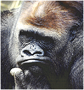 Doświadczenia na zwierzętach pokazują, że planowanie i myślenie o przyszłości nie jest im obce. Żeby to sprawdzić, Nicholas Mulcahy i Josep Call z Instytutu Antropologii Ewolucyjnej Maksa Plancka w Lipsku zaprojektowali "test łyżki" dla pięciu szympansów bonobo i pięciu orangutanów. W pomieszczeniu przeznaczonym do eksperymentu rozłożono smakołyki w ten sposób, by nie można było do nich sięgnąć bez użycia określonego narzędzia, które porozrzucano po pomieszczeniu. Jak pojadły, "wyproszono" je do sąsiedniego pomieszczenia. Część z nich, jak się okazało, zabrała narzędzia ze sobą. Po godzinie małpy znów wpuszczano do pomieszczenia, z którego przebiegli naukowcy usunęli wszelkie "narzędzia". Od czego jednak spryt i przezorność! Zwierzęta przyniosły ze sobą te narzędzia, które zabrały wychodząc, i z ich pomocą dobrały się do jedzenia. **Małpy zabierały właściwe narzędzia nie dlatego, że potrzebowały ich w danym momencie, lecz ponieważ spodziewały się, że sprzęt przyda się w przyszłości - uznali naukowcy. Według Mulcahy'ego i Calla eksperyment dowodzi zdolności małp do przewidywania i planowania**.  
No i proszę, małpy prą do przodu, a człowiek się cofa w ewolucji. Jak jeden gość zabrał łyżkę z baru, to go złapała policja i oskarżyła o kradzież. Uczmy się od małp, bo zginiemy jako gatunek.

**Kombinują..., ech kombinują...**

Cały czas jestem pod wrażeniem nieustępliwości badaczy szukających owych 5 minut, w których małpa stała się człowiekiem. Dowiedziałem się ostatnio, że nasza ewolucja ruszyła do przodu dzięki bakteriom "pędzącym" ocet oraz tego, że nasz niesforny pradziadek jeszcze 7 mln lat temu zdradzał swoją prawowitą z przygodną małpą. Czy brał ją "na banana" czy też skakał za nią po drzewach tego jeszcze nie ustalono. Nieustępliwość godna wyższej sprawy każe uczonym wciąż wyłuskiwać te drobne ziarna prawdy. Renomowane uczelnie amerykańskie (przejęły pałeczkę po radzieckich) po przebadaniu ogromnych ilości próbek doszły do wniosku, że człowiek to... krzyżówka. Tak, tak... Dzisiejszy człowiek to efekt ciężkiej "pracy" naszego pradziadka z szympansicą. Różnice są tak niewielkie, że możemy się uznawać za trzeci gatunek szympansa obok pospolitego i bonobo. Dowody są niezbite i zacytuję za Markiem Karolkiewiczem:

"Praszympansy" i "Praludzie" żyli w Afryce w podobnych środowiskach. Spotykali się zapewne na pograniczu lasu i sawanny. Być może oba gatunki rywalizowały o przestrzeń życiową i żywność, ale także uprawiały ze sobą seks przez setki tysięcy lat, może nawet 1,2 mln. \[...\] Należy jednak zauważyć, że ludzie i szympansy są nie tylko genetycznymi bliskimi krewniakami, ale także zachowują się w zbliżony sposób. Zwłaszcza szympansy bonobo. Podczas kopulacji, podobnie jak ludzie, przyjmują wiele różnych pozycji, z "twarzą do twarzy" włącznie. \[...\] Oba gatunki szympansa odczuwają smutek po swych zmarłych, dzielą się pożywieniem, nawiązują stałe związki, potrafią odróżnić przeszłość i przyszłość, umieją nauczyć się posługiwania narzędziami, snuć plany na przyszłość. \[...\] Szkoccy naukowcy, dr Victoria Horder i prof. Andrew Whiten twierdzą, że młode małpy tego gatunku są mądrzejsze od ludzkich rówieśników. 

I nie trzeba było długo czekać: Socjalistyczny rząd Hiszpanii zamierza przyznać małpom człekokształtnym, szympansom, orangutanom i gorylom pewne "podstawowe prawa", jako najbliższym "genetycznym towarzyszom" człowieka. Władze wystąpiły z odpowiednią inicjatywą w parlamencie. Małpy mają otrzymać prawo do życia, prawo do wolności, jak również prawo do cielesnej nietykalności. Podobne prawa przyznał małpom człekokształtnym tylko rząd Nowej Zelandii.

Tak postępowa inicjatywa spotkała się jednak z drwinami: Dziennik "El Pais" napisał: "Powinniśmy przyznać każdej małpie także prawo do emerytury oraz do życia na drzewie o powierzchni 30 m kw.", a gazeta "El Mondo" doszła do wniosku, iż Hiszpanie powinni się zająć raczej cierpieniami byków, masakrowanych ku uciesze gawiedzi na arenach.

A nauka radziecka wiedziała o tym od dawna. W połowie lat 20-tych Józef Stalin zwrócił się do wybitnego biologa i twórcy metody sztucznego zapładniania koni, Ilii Iwanowa, z rozkazem stworzenia superwojownika. "Chcę mieć nową, niezwyciężoną istotę ludzką, twardą, niewrażliwą na ból, niewybredną, jeśli chodzi o pożywienie" - rozkazał dyktator. W 1926 r. Biuro Polityczne poleciło Radzieckiej Akademii Nauk stworzenie "żywej maszyny wojennej". Ilja Iwanow otrzymał 200 tys. dol. i udał się do Afryki Zachodniej z zadaniem zapładniania szympansic ludzkim nasieniem. W tym czasie w Gruzji utworzono ośrodek, w którym oddane sprawie ochotniczki komsomołki były zapładniane małpią spermą. Różnice genetyczne były już jednak zbyt duże i te upiorne eksperymenty nie doprowadziły do niczego. Nieszczęsny naukowiec popadł w niełaskę i został zesłany do Kazachstanu, gdzie zmarł w 1932 r.

**Motory naszej cywilizacji**

 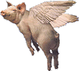 Nie od dziś panuje przekonanie, że nauka jest motorem postępu, a więc całej naszej cywilizacji. Motorem czegoś, co coraz bardziej wyróżnia nas od małpiego przodka. Żmudne badania pochłaniają coraz więcej czasu i oczywiście pieniędzy, a jedyną pociechą jest to, że dzięki naukowcom nasze życie ma być łatwiejsze, piękniejsze i pełne nicnierobienia. Dzięki nauce w przyszłości mamy tylko jeść i wydalać a w międzyczasie płodzić nowe i sprytniejsze motorki postępu. To wszystko dzięki niezwykle przydatnym pracom naukowym *(z artykułu Waldemara Stelmacha "Jak wlec owcę po betonie")*:

**•** "Dlaczego zasłony prysznicowe odchylają się do środka",  
**•** "Analiza sił potrzebnych do wleczenia owcy po różnych podłożach",  
**•** "Homoseksualna nekrofilia u kaczki krzyżówki",  
**•** "Dlaczego surowi rodzice mają otyłe dzieci",  
**•** "Kampania skierowana pośmiertnie przeciwko inercji biurokracji i chciwości krewnych oraz założenie "Stowarzyszenia Umarłych",  
**•** "Spadek pogłowia strusi na brytyjskich farmach w latach 90-tych jako skutek zalecania się do hodowców zamiast do siebie nawzajem",  
**•** "Zbieranie się w pępku czarno-niebieskich kłaczków z ubrania, nawet jeżeli nie nosi się ubrania tych barw",  
**•** "Oszacowanie całkowitej powierzchni skóry wszystkich słoni w Indiach",  
**•** "Propagowanie pokoju i współżycia w harmonii między gatunkami",  
**•** "Skonstruowanie komputerowego tłumacza z mowy psiej na ludzką i odwrotnie",  
**•** "Pralka do prania kotów i psów",  
**•** "Asymetria moszny mężczyzn w rzeźbie antycznej",  
**•** "Hermetyczna bielizna z wymiennym filtrem z węgla drzewnego, usuwająca nieprzyjemnie pachnące gazy, zanim przedostaną się do środowiska",  
**•** "Program komputerowy reagujący na obecność kota i wydający sygnał ostrzegawczy, kiedy zwierzę chodzi po klawiaturze",

Tak jak w polskiej polityce tak i w światku naukowym wykluła się klasa próżniaków, którzy myślą że każde ich pierdnięcie jest zdolne uszczęśliwić ludzkość. Tyle, że za każdego bąka płacimy my i to duże pieniądze.

**ciąg dalszy niebawem nastąpi ...**

"Człowiek - to brzmi durnie"
