**Piramida w Visoko**  
Naukowiec musi kochać prawdę bardziej niż siebie samego.  
Alan Leshner

Jeśli wszystko pójdzie dobrze, Europa też będzie miała swoje piramidy. Dotychczasowe prace wykopaliskowe w miejscowości Visoko w Bośni i Hercegowinie są nader zachęcającym początkiem. Międzynarodowa grupa archeologów rozpoczęła badania mające potwierdzić, czy naprawdę trzy góry w pobliżu bośniackiego miasteczka Visoko kryją w swoim wnętrzu piramidy. Senad Hodowic, dyrektor muzeum historycznego w Visoko, podejrzewa, że góra Visocica, zwana przez miejscowych "piramidą", jest nią być może istotnie. Wskazywałby na to kształt góry, a właściwie jej zbocza o zbyt wygładzonych i geometrycznych kształtach jak na naturalne pochodzenie. Swoimi spostrzeżeniami zainteresował Semira Osmanagicia, teksańskiego przedsiębiorcę bośniackiego pochodzenia, który przez 15 lat badał już piramidy w Ameryce Łacińskiej.

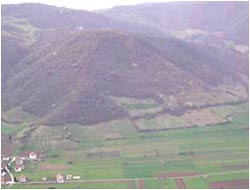

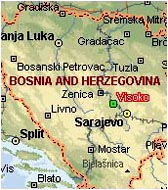

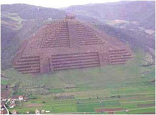

Semir Osmanagić przyjechał do Visoko pod koniec 2005 r. w celu przeprowadzenia wstępnych badań i zauważył, że wzgórze rzeczywiście bardzo przypomina piramidę a ponadto posiada boki usytuowane zgodnie z kierunkami świata. Jedną ze wskazówek była też analiza zdjęć satelitarnych, które wskazywały na szybsze wychładzanie się niektórych wzgórz, co sugerowało puste przestrzenie w ich środku. Odnalezione przez niego kamienne płyty mogły pokrywać budowlę. Odnalazł też wybrukowany plac u podnóża góry Visocicy i wejście do tajemniczego tunelu. Jak się okazało, także dwa wzgórza w okolicy mają kształty podobne do piramid. Visocica mierzy od podstawy około 200 m wysokości i jeśli zawiera w środku piramidę, bedzie ona wyższa od Wielkiej Piramidy w Giza.

Jego zdaniem "tajemniczy budowniczowie odpowiednio ukształtowali istniejące już góry i pokryli je płytami oraz prymitywną namiastką betonu" (z czym osobiście raczej się nie zgadzam). Wieku piramid Osmanagić nie określa, ale nie wyklucza iż mogą liczyc około 12 tysięcy lat. Specjaliści podchodzą do takiej daty nad wyraz sceptycznie. Całość prac finansuje Osmanagić, który planuje prowadzenie prac przez ponad pół roku mające się zamknąć budżetem około 125 tysięcy Euro. W pierwszym dniu badań ekipa ratowników górniczych, geologów i archeologów badała tunel o przypuszczalnej długości około 4 km i odkryła w nim dwa rozwidlenia oraz 7-tonowy, kamienny blok.

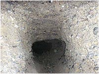

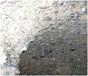

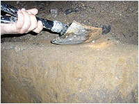

Eksperci z Bośni uważają, że kształt wzgórzu nadali Ilirowie, lud który w starożytności zamieszkiwał Półwysep Bałkański. Państwo Iliria powstało w 380 r. pne., a w 168 pne. zostało podbite przez Rzym. Niewiele wiadomo o starożytnych Ilirach, jednak Osmanagić uważa, że społeczność ta była bardziej rozwinięta, niż dotychczas zakładano. Historia tego regionu liczy już ponad 7 tysięcy lat, a naukowcy trafili w dolinie Visoko na ślady osad z epoki neolitycznej. Zdjęcie poniżej przedstawia wzgórze, które kryje piramidę. Od razu widać jaki ogrom prac ziemnych czeka ludzi ją odkopujących. Pierwsze wyniki są zachęcające. Płyty kamienne są najwyraźniej sztucznego pochodzenia i zostały strzaskane prawdopodobnie przez jakiś naturalny kataklizm.

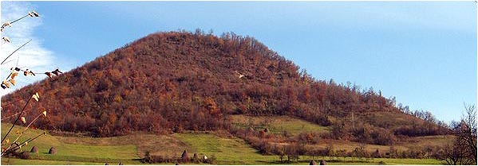

Ile to potrwa? Nie wiadomo. Zawód archeologa zaliczany przeze mnie do "aptekarskich" wskazuje na conajmniej kilkunastoletnie prace, o ile nie dojdzie do zamierzonego opóźniania prac. Być może Osmanagowiciowi zabraknie pieniędzy, nie otrzyma pozwolenia na dalsze prace albo znajdzie się zapomniane pole minowe z wojny domowej, które zagrozi życiu archeologów. Nie wiadomo też ile czasu zajmie też naukowe opracowanie znalezisk, a właściwie dyskusje na temat czasu powstania i przeznaczenia obiektów. Zdjęć z prac wykopaliskowych jest na razie mniej niż skromnie, ale bądźmy cierpliwi, bo to dopiero początek.

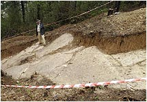

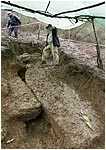

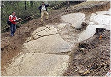

Poniżej przedstawiona jest mapa plastyczna okolicy góry Visocica, gdzie widać jest stoki góry w formie prawie doskonałych płaszczyzn. Dokładne pomiary geodezyjno-satelitarne wykazały, że piramidzie brak jednego boku, co być może jest wynikiem jakiegoś naturalnego osunięcia. Osmanagić uważa, że piramida jest piramidą schodkową, charakterystyczną dla piramid amerykańskich (ze ściętym wierzchołkiem). Zgodnie z tradycją współczesnej historii już zakwalifikowano je do piramid obrzędowych i nadano stosowne nazwy - Słońca, Księżyca i Smoka. Czekam z niecierpliwością na hipotezę, że Ilirowie widząc widmo nieuchronnej klęski, podobnie jak lud Teotihuacan, zasypali piramidy by nie dostały się w ręce Rzymian.

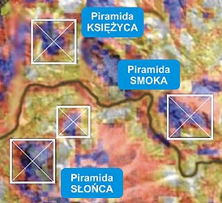

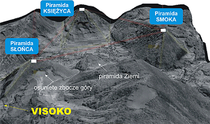

Satelitarne zdjęcie pokazujące miejsca wychładzające się szybciej niż otoczenie (kolor niebieski) oraz zdjęcie rzeźby terenu z domniemanymi piramidami. Widać osunięcie zbocza, które mogło zniszczyć dwa boki piramidy Słońca. Osmanagić sądzi, że jest jeszcze czwarta, mała piramida nazwana piramidą Ziemi.

**Kim byli Ilirowie? Co mówi na ten temat nauka?**  
Ilirów historycy wywodzą od indoeuropejczyków, zaś indoeuropejczyków w prostej linii od tzw. praindoeuropejczyków identyfikowanych jako "kultura grobów kurhanowych", którzy zamieszkiwali tereny na północ od Morza Czarnego (od Kaukazu po Karpaty). W III tysiącleciu pne. przemieścili się do Europy, gdzie zaczęli się "wydzielać" i z tego to podziału w drugiej kolejności "wydzielili się" między innymi Ilirowie. Na czele poszczególnych plemion stali książęta. Oprócz rolnictwa i hodowli niektóre plemiona Ilirów zajmowały się wydobywaniem rud metali (żelazo, miedź, srebro złoto), zaś mieszkający na wybrzeżach Adriatyku - rybołówstwem i piractwem. Grecy i Rzymianie uważali Ilirów za pijaków, natomiast Dardanów za brudasów. Ilirowie stale atakowali miasta greckie i macedońskie. W III wieku pne. część z Ilirów zmieszała się z plemionami celtyckimi, najeżdżającymi w tym czasie Bałkany. Po dwóch wojnach Rzymianie ujarzmili Ilirów i w roku 167 pne. zlikwidowali ostatecznie ich państwo. We współczesnej Europie potomkami Ilirów są najprawdopodobniej Albańczycy.

Jak zatem naród pijaków, brudasów i piratów, nie mający pojęcia o obróbce kamienia, a tym bardziej o wymieszaniu jakiejś "prymitywnej namiastki betonu" zdołał wybudować tak wielkie obiekty? Czy budowa piramid była przedsięwzięciem państwowym, czy też tylko plemiennym? Czy były to grobowce królów Ilirii czy też pomniejszych rodowych kacyków? Kiedy zatem zbudowano te piramidy? Skoro nie mieli o nich pojęcia ani Grecy ani Rzymianie, to budowę musimy umieścić między III tysiącleciem pne. a III wiekiem pne. Wtedy jednak Ilirowie zajmowali się klepaniem metali, rolnictwem, hodowlą, rybołówstwem i nie myjąc się folgowali pijaństwu. Przesunięcie zaś budowy w głąb dziejów nie wchodzi w grę, gdyż postawi historyków przed murem nie do przebicia, bo głębiej to już tylko prymitywizm, ciemnota i zabobon. Obowiązująca teoria Darwina i postępu technicznego nie może przecież zostać podważona.

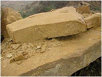

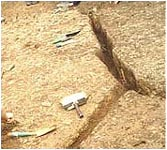

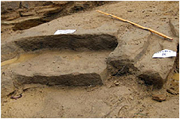

Moje zdanie jest inne i znających moje teorie nie powinno zdziwić. Jeśli to, co kryją wzgórza okaże się prawdą, to należy przypuszczać, że pod warstwą ziemi nie znajdują się tylko trzy piramidy lecz cały kompleks zbudowany z kamienia. Przypuszczam także, że nie mają nic wspólnego z wierzeniami, a z zupełnie inną formą działalności i być może było to jakieś centrum przemysłowo-energetyczne w tej części świata. To napewno nie będą wygładzone zbocza gór obłożone kamiennymi płytami. Odnalezione podziemne tunele być może wskazują na istnienie całego podziemnego labiryntu korytarzy i zagadkowych komór, w których prawdopodobnie odnajdzie się kamienne "sarkofagi" (oczywiście bez zwłok władców, co zgoni się na złodziei). Widoczny na zdjęciu tunel nie wygląda na wykonany dla poruszania się w nim ludzi. Do czego służyły? Nie dowiemy się, dopóki nie ustalimy przeznaczenia piramidy. Historycy już jednak wiedzą, że był to grobowiec i kilka lat spędzą na dysputach w jaki sposób dokonano rzekomego pogrzebu władcy. Bardzo możliwe, że podobnie jak w innych piramidach, zabezpieczonych przed ciekawskimi ludźmi, wejście do ich środka będzie trzeba dokonać subtelną metodą "na sapera".

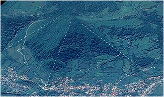

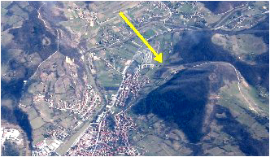

Piramida Słońca. Jej współrzędne - szerokość: 43,9800731058 Pn., długość: 18,1793241944 Wsch.

Strzaskane kamienne płyty i obsunięty bok piramidy mogą świadczyć o zniszczeniach spowodowanych kataklizmem sprzed 12,5 tysiąca lat. Warstwa ziemi, która pokrywa całą okolicę została prawdopodobnie naniesiona przez tsunami jakie uderzyło z Adriatyku. Jeśli tak, to ma rację Osmanagić mówiąć o 12 tysiącach lat. Piramidy, jak sądzę, zbudowała ta sama cywilizacja co Sarmisegetuzę, gdzie znaleziono spękane koło wykonane z najtwardszego andezytu. Cywilizacja, która kamienne bloki obrabiała z taką łatwością jak my dzisiaj plastelinę. Uważamy naszych przodków za niespełna rozumu opętańców, którzy za nic mieli ekonomię przedsięwzięć. Na siłę wciskamy pogląd o władcach-tyranach, których jedynym celem na ziemi było zbudowanie własnych grobowców za wszelką cenę. Naprawdę coś jest nie tak, coś co kłóci się z moim wyobrażeniem o inteligencji człowieka.

Postaram się na bieżąco śledzić przebieg wykopalisk i opisywać efekty prac oraz swoje spostrzeżenia. Znając jednak ślimacze tempo prac archeologów obawiam się, że nie doczekam szczęśliwego końca.

[**Fundacja Nautilus**](http://www.nautilus.org.pl/article.php?articlesid=669). Mieszkańcy doliny opowiadają o tunelach wiodących w głąb Piramidy Słońca, do których wejścia zostały zapieczętowane na początku lat 60-tych. Istnieją dowody, że tunele łączą wszystkie piramidy, podobnie jak to ma miejsce w Egipcie czy Meksyku. Jeden ze starszych mieszkańców Visocicy opowiedział badaczom, że w czasie II Wojny Światowej był świadkiem dziwnego fenomenu związanego z Piramidą. Kiedy w pobliżu wzniesienia spadły bomby lotnicze, odgłos eksplozji był słyszany jakby z wnętrza ziemi. "Miało się wrażenie, że huk wędrował poprzez górę, poprzez mieszczące się tam tunele" dodał świadek.

Z Górą Visocica związana jest też pewna legenda, której zapis znajduje się we wspomnianym muzeum w Visoko. Mówi ona o czasach, kiedy w XIV wieku Bośnię najechali Turcy. Najeźdźcy u podnóża góry ponoć spotkali starą kobietę, która opowiedziała im o starej przepowiedni. Mówiła ona, iż nikomu nie wolno zamieszkać w starożytnym mieście położonym na wzgórzu, dopóki nie będzie przygotowany, aby strzec jego tajemnicy, ukrytej pod miastem. \[...\] Stara kobieta powiedziała, że miasto skrywa tajemnicę, która ma dwie warstwy. Pierwsza warstwa została naniesiona i jest powoli zmywana przez deszcz (warstwa ziemna), druga warstwa to "skorupa jajka", która jest cienka i delikatna. Jeżeli ta skorupa zostanie zniszczona, a jej zawartość zostanie wypłukana przez wodę (powódź), to wówczas nastaną dla mieszkańców doliny złe czasy.

---

Bardzo ciekawe sywierdzenie - "Pierwsza warstwa została naniesiona i jest powoli zmywana przez deszcz...". Kto lub co mogło "nanieść" warstwę? Powodzie raczej nie zalewają gór, a przeciskają się pomiędzy. Czy warstwę mogło nanieść tsunami? Czy pamięć pokoleń może być tak trwała? A co takiego znajduje się we wnętrzu piramidy, że "Jeżeli \[...\] jej zawartość zostanie wypłukana przez wodę, to wówczas nastaną dla mieszkańców doliny złe czasy."?

**[Piramidioci w natarciu](http://www.radio.com.pl/nauka/naukowe.asp?id=141)**. Gdy 20 kwietnia archeolodzy badający wzgórze w pobliżu wsi Visoko w Bośni-Hercegowinie dokopali się do dużych kamiennych bloków, ich zdaniem potwierdzających, że we wnętrzu góry kryje się olbrzymia piramida, media rozpętały burzę. Byłaby to pierwsza prawdziwa piramida, wzniesiona w starożytności w Europie i to już 12 000 lat p.n.e.! Sensacyjną informację powtarzały nawet gazety w Indiach i Australii. Rozpoczętymi w połowie kwietnia wykopaliskami w Visoko, 30 km na północ od Sarajewa, kieruje podający się za archeologa Semir Osmanagić, mieszkający w Houston Amerykanin bośniackiego pochodzenia. Już w ubiegłym roku ogłosił on hipotezę, że wzgórze o wysokości 650 m skrywa piramidę schodkową. W trakcie wykopalisk na zboczach góry pod warstwą humusu dość szybko natrafiono na skupiska dużych kamiennych bloków oraz wejścia do tuneli, prowadzących do wnętrza wzgórza. Z doniesień prasowych wynika, że zespół fachowców z pobliskiej kopalni potwierdził przypuszczenia, że tunele zostały wykonane ludzką ręką.

Według Osmanagića odkopane kamienne bloki to zewnętrzne ściany konstrukcji. Jego zdaniem idealnie płaska powierzchnia głazów potwierdza hipotezę, że wnętrze góry kryje piramidę. Osmanagić ponoć wie co mówi, bo przez 15 lat prowadził badania piramid w Ameryce Łacińskiej. Twierdzi, że ukryta we wnętrzu wzgórza w Visoko budowla ma 220 metrów wysokości - o ponad 70 m więcej niż piramida Cheopsa w Gizie. Wywnioskował to z pomiarów geodezyjnych pokazujących, że wzgórze zwane "Visocica" ma dość regularny kształt ostrosłupa o podstawie kwadratu, o bokach nachylonych pod kątem 45 stopni i płaskim wierzchołku. Osmanagić poinformował także jakoby na podstawie zdjęć satelitarnych ustalono, że w najbliższej okolicy znajdują się jeszcze przynajmniej dwa podobne, ale nieco mniejsze wzgórza, które jego zdaniem także mogą kryć piramidy.

Gdybyż to wszystko mogła być prawda! Niestety, to tylko wyssane z palca bzdury. Jak zdołał ustalić Mark Rose, szef i wydawca amerykańskiego serwisu internetowego ARCHAEOLOGY, Semir Osmanagić tylko podaje się za archeologa. Owszem przez 15 lat zajmował się badaniem piramid Ameryki Łacińskiej, ale z opublikowanej przez niego książki The World of the Maya (Gorgias Press, Euphrates imprint, 2005) wynika, że Majowie, Baskowie i Berberowie są potomkami Atlantydów, którzy z kolei przybyli z Plejad, czyli z kosmosu. Jego idea, że w Bośni 12 000 lat p.n.e. wzniesiono piramidę większą od egipskich jest całkowicie fantastyczna i nie ma absolutnie nic wspólnego z nauką. Według Curtisa Runnels'a, specjalisty od prehistorii Grecji i Bałkanów z Boston University, w okresie od 27 000 do 12 000 lat temu na Bałkanach panowało ostatnie zlodowacenie, a większość gór pokrywały lodowce. Jedynymi mieszkańcami tych okolic byli paleolityczni myśliwi, po których pozostały jedynie krzemienne narzędzia, paleniska i szczątki zwierząt.

W całej sprawie z lipną piramidą, pomijając kompletną niefrasobliwość i łatwowierność mediów, smutny jest fakt, że podczas pseudonaukowych wykopalisk Osmanagić'a na wzgórzu w Visoko zniszczeniu mogą ulec prawdziwe stanowiska archeologiczne. Średniowieczne, rzymskie bądź iliryjskie. Władze wolą się jednak cieszyć z pięciu minut rozgłosu, jaki przypadł w udziale Bośni.

---

Ring wolny i 5 minut Karoliny Rysiowej. Pierwsze starcie i pierwsze uderzenie po "winogronach". Jakoś nie wyczytałem, by Semir Osmanagić podawał się za archeologa z wykształcenia. Bogiem a prawdą, to amatorzy odkryli więcej niż cała reszta "licencjonowanych" robotników ziemnych (przypomnijmy sobie choćby kupca Schliemanna) . Zapowiada się ciekawa walka, bo jeszcze nic nie odkopano, a już mówi się o ssaniu ze wszystkich palców. Na razie w roli harcownika - wygadana darwinistka, no... ale gdzie diabeł nie może... A jakież biadolenie, że przy okazji zniszczą wszystkie rzymskie ekskrementa. To dlaczego "jedynie słuszni historycy" nie wzięli się za kopanie? Czy dlatego, że na samych kamieniach trudno zdobyć sławę, czy też nie chce się ciężko popracować? Aaaa... rozumiem - teren zaminowany, wokół wilki i muzułmanie oraz brak zimnej Coca-Coli...

**[Bałkański Indiana Jones](http://wiadomosci.onet.pl/1335603,242,kioskart.html)**. Pewien bośniacki uczony chce udowodnić, że w jego ojczyźnie przed tysiącami lat wznoszono pokaźniejsze budowle niż piramidy egipskie. Choć historycy przeczą tym teoriom, prace archeologiczne już się rozpoczęły. A mieszkający w okolicy Bośniacy z wdzięcznością odnoszą się do badacza, który przyniósł sławę ich krainie. Wzgórze Visocica wznoszące się nad małą miejscowością Visoko, 28 kilometrów na północny zachód od Sarajewa, ma kształt piramidy. Po piętnastu latach badań nad najstarszymi budowlami Ameryki, Afryki i Azji 45-letni Semir Osmanagić, rodowity Bośniak, powrócił na to wzniesienie i ochrzcił je "Piramidą Słońca". Naukowiec uważa bowiem, że wzgórze skrywa "pierwszą, największą na świecie, europejską piramidę". Po drugiej stronie doliny wytyczył miejsca, gdzie mają znajdować się "Piramida Księżyca" i "Piramida Smoka". A Bośnia bardzo chciałaby mu wierzyć.

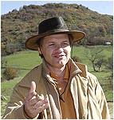

Choć nie zgadza się z nim większość specjalistów, Semir Osmanagić postanowił dowieść słuszności swej wizji. Prace w Visoko ruszyły w połowie kwietnia. Początkowo bośniacki uczony finansował wykopaliska z własnych funduszy, później znalazł kilkunastu sponsorów. Tymczasem miejscowość Visoko przyciąga dziesiątki tysięcy ciekawskich. Interesy idą tu wspaniale. Okoliczni mieszkańcy są zgodni: "Piramida to najlepsza rzecz jaka nam się przytrafiła od zakończenia wojny" - mówią. Z powodu kapelusza, jaki nosi na głowie, Osmanagić zdobył sobie przydomek Indiany Jones'a. "Tu na nowo spiszemy historię naszej cywilizacji" - mówi przemierzając wielkimi krokami rejon dostępu na zachodnie zbocze "jego" piramidy. Uważa, że ona i jej podobne budowle liczą 12 tysiące lat i są dziełem "tajemniczej cywilizacji". Z ust jego współpracowników padły nawet słowa "Atlantyda" i "Marsjanie". W Sarajewie krąży dowcip, jakoby bośniacki badacz przed milionem lat przybył z Marsa, by samodzielnie zbudować tę piramidę.

"Megality" częściowo odkopane przez wolontariuszy (i paru płatnych robotników) "ważą od 20 do 45 ton" - wyjaśnia Semir Osmanagić. Niektórzy krytykują go i oskarżają o szarlatanerię. Ich komentarze zbywa stwierdzeniem: "To banda historyków i archeologów tkwiących jeszcze w XIX stuleciu". Czy ma niezbite dowody? Bośniak odpowiada zaczepnie: "Wiecie chyba, że przyjechała tu wczoraj ekipa CNN, prawda?". Przeciwnicy Osmanagicia to między innymi historyk Ivan Lovrenović i archeolog Svetozar Pudarić. Do znudzenia powtarzają oni, że zbudowanie tak wielkich piramid wymagałoby cywilizacji dysponującej znaczną siłą roboczą oraz zaawansowaną wiedzą technologiczną. Tymczasem niczego takiego nie mogło być w Bośni przed tysiącami lat. "Jedyne dopuszczalne wyjaśnienie to interwencja pozaziemska" - twierdzi ironicznie Svetozar Pudarić.

Nie szkodzi. "Piramida Słońca" i jej "faraon" Semir Osmanagić zdobyli serca Bośniaków. "To promyk światła i optymizmu pomagający nam żyć" - wyjaśniają dwaj śmieciarze zbierający odpadki ze wzgórza. (...) Poza tym wykopaliska przyniosły już wymierne skutki ekonomiczne. Wystarczy odwiedzić Visoko, aby się o tym przekonać. Oprocz płatnych dziś parkingów na przyjezdnych czekają trójkątne pizze i butelki śliwowicy w kształcie piramidy. W pobliżu stanowisk "archeologicznych" ceny ziemi wzrosły też piramidalnie. Najmniejsza rudera w lesie ma szanse szybko przemienić się w prosperującą restaurację.

Nie obyło się co prawda bez incydentów. Niejaki Ihtijarević kilka miesięcy temu kupił za parę tysięcy euro parcelę w miejscu, skąd łatwo dostać się do piramidy. "A teraz chce odsprzedać swój teren za wiele milionów euro i drewnianą furtą zamknął dostęp do wykopalisk" - opowiada Sead, szef kawiarni. W odpowiedzi na to grupka około trzydziestu mieszkańców w nocy wyrwała ogrodzenie i tablice, a następnie je spaliła. Ihtijarevic schronił się w Słowenii. Bośniacy obronili "swoją" piramidę. Wykopaliska trwają. Niedługo ma tu przybyć archeolog z Egiptu. "Semir Osmanagić obudził uśpiony kraj" - cieszy się pracownik zakładu pogrzebowego w Visoko. A emerytowany górnik przybyły z Kakanj komentuje: "Bez względu na to, czy te piramidy istnieją, czy też nie, warto dowiedzieć się czegoś o naszej przeszłości". Dla Seada natomiast sprawa jest prosta: "Już dawno trzeba było wymyślić te piramidy".

---

Następny artykulik mający ośmieszyć sprawę, ale to jeszcze początki. Już na wagę rzuca się miejscowe autorytety, wedle których piramidy w Bośni nie miał kto zbudować albowiem wtedy panowały tu glony i sinice. Widać też elementy dzikiego zachodu i wolnej amerykanki. Na zwycięzcę - historyczny beton czy rozsądek - musimy jeszcze poczekać. W miare postępu prac jedna ze stron zacznie ściszać głośniki i po tym poznamy na którą stronę przechyla się szala.

**[Prawdziwe piramidy w Bośni](http://hotnews.pl/artnauka-401.html)**.

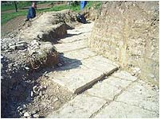

Geologowie z Egiptu potwierdzili, że struktura piramidalna odkryta niedaleko miasta Visocica w Bośni jest niezapreczalnie piramidą. Dr Aly Abd Barakat (ekspert od egipskich piramid) sprawdził dwa wykopaliska - jedno na północy, drugie na południu tajemniczego wzgórza, znanego dziś pod nazwą piramidy Słońca. Barakat podaje, że piramida w Bośni składa się z bloków o wielkości 4m x 1,5m, które zostały przywiezione z zupełnie innego miejsca.

Po przestudiowaniu północnej strony piramidy, Barakat stwierdził, że bloki skalne zostały wykonane przez człowieka i zawierają antyczny rodzaj betonu. Na połączeniach bloków widać bowiem białą, półcentymetrową linię połączenia, która wygląda na substancje podobną do cementu. Podobne połączenia są obserwowane w egipskich piramidach.

---

Jak widać podejście problemu zależy od znajomości rzeczy i otwartości na logiczne myślenie. Trzymam kciuki za powodzenie wykopalisk. Sądzę, że będzie to kubeł zimnej wody dla niektórych historyków, którzy już napisali ostatni rozdział naszej historii.

**[Kto wybudował piramidy w Bośni?](http://hotnews.pl/artnauka-395.html)**. Brytyjscy archeologowie odrzucili przypuszczenia, że wzgórze Sunca w centralnej Bośni jest strukturą stworzoną przez człowieka i można ją nazywać piramidą. Profesor Anthony Harding, który przewodniczy organizacji European Association of Archaeologists po odwiedzeniu tajemniczego miejsca stwierdził, że wzgórze powstało naturalnie. "Nie został odnaleziony żaden dowód" - twierdzi reprezentowane przez niego stowarzyszenie. Żadna piramida nigdy nie została odkryta w Europie i nie ma żadnych historycznych podstaw, aby twierdzić, że jakiekolwiek mogły powstać - dodaje. Profesor sądzii, że jest to nietypowa formacja natury.

Tymczaem Semir Omanagic, archeolog amator z Bośni, który zajmuje się od 15 lat badaniem piramid występujących w Ameryce Latynowskiej, zorganizował specjalną wyprawę zespołu badawczego składającego się głównie z wolontariuszy do miasta Visocica. W wyniku przeprowadzonych analiz wraz z zespołem odkrył, że piramida wysokości 2120 stóp ma nachylenie dokładnie 45-stopni, składa się z płaskich ścian, natomiat u jej podnóży znajduje się wiele wejść do tuneli, które po części są zablokowane specjalnymi kamiennymi blokami. Egipski geolog Aly Abd Alla Barakat, który przyjechał zbadać piramidę w maju tego roku stwierdził, że konstrukcja ta została stworzona przez człowieka i należy ją dokładnie przebadać (o czym pisaliśmy). "Moja opinia jest taka że jest to pewien typ piramidy, najprawdopobniej prymitywnej piramidy" - mówi Barakat, geolog z Egyptian Mineral Resource Authority.

Tymczasem Harding twierdzi coś zupełnie innego. "Widziałem piramidę, wg mnie jest naturalna" - powiedział reporterom w Sarajevie. Harding nie widział jednak zaawansowanych odkrywek, w tym tunelu stworzonego z regularnych, pasujących do siebie kamiennych bloków. W tym miesiącu analizę piramid ma przeprowadzić potężna grupa ekspercka z Egiptu składająca się ze znanych na świecie archeologów.

---

Dowód angielskiego profesora jest z gatunku "twardych" i jego obalenie jest możliwe tylko po zejściu z tego świata całej linii jajogłowych na'uczonych. "Piramida jest tworem naturalnym" podobnie jak angielska flegma i jak naturalne jest stopniowe zanikanie nieużywanego organu u niektórych osobników. Nie ma się jednak co dziwić, bo inteligencję Brytyjczykom zaszczepił dopiero rzymski okupant.

**[Zahi Hawass: W Bośni nie ma piramid](http://archeowiesci.blox.pl/html)**. Teorie pana Osmanagicia są czystymi halucynacjami, nie mającymi żadnego naukowego oparcia - napisał w liście do Marka Rose'a, redaktora amerykańskiego magazynu "Archaeology", dr. Zahi Hawass, szef egipskiej Najwyższej Rady Starożytności, opiekującej się wszystkimi zabytkami w Egipcie. Zdaniem Hawassa wzgórze w bośniackim Visoko nazwane przez archeologa-amatora Semira Osmanagicia piramidą Słońca to naturalna formacja geologiczna. Hawass napisał też o egipskim geologu, domniemanym ekspercie od egipskich piramid, który potwierdził istnienie piramid w Bośni: "Pan Barakat nic nie wie o egipskich piramidach. Nie został wysłany przez Najwyższą Radę Starożytności, nie wspieramy, ani nie zgadzamy się z jego stwierdzeniami".

Według niektórych doniesień prasowych Aly Abd Alla Barakat został polecony Osmanagiciowi przez Hawassa i miał wysłać szefowi Najwyższej Rady Starożytności raport ze swoich badań w Visoko. List Hawassa jest odpowiedzią na pytania wysłane przez Marka Rose'a, który próbował potwierdzić prasowe informacje o Barakacie. Do redakcji "Archaeology" napisał też kanadyjski archeolog Chris Mudigler, który był wymieniany jako członek międzynarodowej ekipy archeologów, mających pracować przy piramidzie. Mudigler zaprzeczył, by zgodził się brać udział w wykopaliskach. Wcześniej informacjom o uczestniczeniu w badaniach zaprzeczyło dwoje archeologów (z Irlandii i Australii). [Wojciech Pastuszka - Archeowieści](http://archeowiesci.blox.pl/html)

---

Nie ma co komentować tego pyszałkowatego przedstawiciela narodu, który od setek lat okrada pozostałości cywilizacji egipskiej tylko dlatego, że nie są to pozostałości cywilizacji Arabów. Koran zezwala bezcześcić groby niewiernych i niszczyć nie swoje świątynie.

**[Piramidy w Bośni - raport](http://archeowiesci.blox.pl/2006/06/Piramidy-w-Bosni-raport.html)**. Historia bośniackich piramid zaczęła się w 2005 r., gdy Semir Osmanagić, żyjący w Teksasie Bośniak, dowiedział się o przypominającym piramidę wzgórzu Visocica niedaleko miasteczka Visoko w Bośni. Osmanagić, archeolog-amator, który (wedle własnych słów) przez 15 lat badał amerykańskie piramidy, a także napisał książkę o Majach, zainteresował się wzgórzem. Po oględzinach w 2005 r. uznał, że może ono kryć w sobie piramidę.

Ustalił, że boki góry są zorientowane zgodnie ze stronami świata i opadają pod kątem 45°. Znalazł też wejście do tajemniczego tunelu oraz kamienne płyty, które jego zdaniem pokrywały piramidę. Badania geofizyczne wykazały we wzgórzu anomalie sugerujące, że pod warstwą ziemi są jakieś konstrukcje. O istnieniu piramidy miały też świadczyć anomalie termiczne oraz opowieści mieszkańców o dziwnie odbijających się od wzgórza dźwiękach. W dodatku Osmanagić znalazł w okolicy jeszcze dwa mniejsze wzgórza, które uznał za piramidy. Wzorując się na nazwach meksykańskich piramid ochrzcił Visocicę Piramidą Słońca, a pozostałe dwie Piramidami Księżyca i Smoka. Jego zdaniem tajemniczy budowniczowie odpowiednio ukształtowali i obłożyli kamiennymi płytami istniejące wzgórza.

Pierwsze informacje o bośniackich piramidach przeniknęły do mediów jesienią 2005 r. W ubogiej i nękanej gigantycznym bezrobociem Bośni wieść o piramidach wywołała wielkie nadzieje na ożywienie turystyki. W Visoko zaczął się piramidowy szał - miejscowy hotel zmienił nazwę na Piramida Słońca, handlarze wyspecjalizowali się w pamiątkach z piramidami, a pizzernia zaoferowała trójkątną pizzę. Osmanagić dostał pozwolenie na szeroko zakrojone (jego zdaniem największe w Europie) badania archeologiczne.

**Wykopaliska zaczęły się w kwietniu 2006 r. Oto co od tego czasu znaleziono**:

**•** W kilku miejscach pod warstwą ziemi ukazały się kamienne płyty pokrywające Visocicę (Piramidę Słońca) i Plesjevicę (Piramidę Księżyca). Zdaniem Osmanagicia oraz egipskiego geologa Aly Abd Alla Barakata są one dziełem człowieka. Rzeczywiście, na niektórych zdjęciach wyglądają jak regularne płyty (zdjęcie kamieni z Plesjevicy). Według Barakata kamienie były łączone prymitywną zaprawą podobną do tej stosowanej przy budowie egipskich piramid.

**•** Współpracownicy Osmanagicia, w tym miejscowi geolodzy, weszli do tunelu. Po 185 metrach okazało się, że jest zatarasowany ogromnym kamieniem. Zdaniem Osmanagicia tunele są dziełem człowieka i występują w nich równomiernie rozłożone kanały wentylacyjne. Podziemne korytarze mają się ciągnąć kilometrami i łączyć ze sobą piramidy. W czerwcu odkryto drugie wejście do tunelu (jeszcze niezbadane).

**•** Na tarasującym tunel kamieniu znaleziono rysy, które uznano za niezidentyfikowaną krótką inskrypcję.

**•** Osmanagić chętnie informował też o licznych kamiennych kulach (często ponadmetrowej średnicy) znajdowanych od dawna w okolicy przez miejscową ludność. Mają być kolejnym dowodem na istnienie zaawansowanej cywilizacji. Zidentyfikował też kolejne dwie piramidy.

**Po rozpoczęciu badań na Visoko zwaliły się rzesze dziennikarzy z całego świata. Niektórych argumenty Osmanagicia przekonały na tyle, że informowali nawet o odkryciu pierwszych w Europie piramid. Inni zachowywali się ostrożniej. W zasadzie nikt z mediów nie próbował rozmawiać ze specjalistami, więc kontrowersyjne hipotezy Osmanagicia pozostawały często bez krytyki. A wątpliwości jest wiele**:

**•** Zdaniem Osmanagicia piramidy powstały ponad 12 tys. lat temu (dla porównania pierwsza egipska piramida ma ok. 4600 lat). W Bośni żyli wówczas tylko łowcy-zbieracze i nie ma żadnych dowodów, by potrafili budować coś więcej niż szałas. Podawanie tak wczesnej daty bez jakichkolwiek konkretnych dowodów ma niewiele wspólnego z profesjonalizmem. W dodatku Osmanagić często wspominał, że piramidy zbudowali Ilirowie. Problem w tym, że w Bośni pojawili się oni dopiero trochę ponad 3000 lat temu. Niestety żaden dziennikarz rozmawiający z samozwańczym archeologiem nie spytał go o tę niekonsekwencję. Warto dodać, że 12 tys. lat temu ludzie nie opanowali jeszcze nawet rolnictwa, a łowcy-zbieracze nie są w stanie zgromadzić zapasów wystarczających do wyżywienia rzesz robotników.

**•** Osmanagić podawał dziennikarzom różne wysokości największej z piramid. Najczęściej mówił, że ma 220 metrów. Piramida Cheopsa ma prawie 147 m. Amerykańskie są dużo mniejsze. Największa z nich - Piramida Słońca z Teotihuacan - ma tylko 63 m.

**•** Wszystkie znaleziska przypisywał domniemanym twórcom piramid nie biorąc pod uwagę innych możliwości. Tymczasem na Visocicy była osada Ilirów. Potem na jej miejscu stał rzymski punkt obserwacyjny, a w średniowieczu zamek królów Bośni. Tunel może być więc np. dziełem Rzymian albo Słowian i mieć dużo mniej niż 12 tys. lat. Krótką niewyraźną inskrypcję mógł wyryć np. legionista. Warto dodać, że część bośniackich archeologów uznała wykopane kamienne płyty za pozostałości średniowiecznego cmentarza.

**•** Wykopaliska prowadzą głównie niedoświadczeni ochotnicy. W pracach nie uczestniczy żaden archeolog o namacalnym dorobku. Co najmniej dwoje zagranicznych archeologów (z Irlandii i Australii), zaliczonych przez Osmanagicia do jego "międzynarodowej ekipy", dopiero od dzwoniących do nich dziennikarzy dowiedziało się, że ponoć biorą udział w badaniach w Bośni!

**•** Osmanagić wiele razy powtarzał, że to pierwsze i jedyne antyczne piramidy w Europie. To kolejna kompromitacja, gdyż nie trzeba być ekspertem, by wiedzieć o grobowcu Cestiusza, który stoi w Rzymie od około 2000 lat i jest cały czas doskonale widoczny. Po pewnym wysiłku można też dotrzeć do wzbudzających kontrowersje informacji o greckich piramidach. Według niektórych w antycznej Grecji istniało co najmniej 16 małych kamiennych piramid, po których zostały bardzo skromne ruiny. W górach na Peloponezie znajduje się niewielka piramida, ale nie została nigdy przebadana i nie wiadomo nawet, czy jest dziełem człowieka.

**•** Egipski geolog, domniemany ekspert od egipskich piramid dr Aly Abd Alla Barakat nie jest całkiem tym za kogo się podaje. Nie jest znany jego dorobek naukowy.

**•** Natomiast dorobek naukowy Osmanagicia, czyli książka "The World of the Maya" ("Świat Majów") zawiera m.in. takie "naukowe" informacje: Majowie i inne cywilizacje to potomkowie Atlantydów, którzy budowali świątynie w miejscach koncentracji energii; służyły one do łączenia się z innymi światami i wymiarami; misją Majów było dostrojenie częstotliwości Ziemi do wibracji Słońca. Prawda, że śliczne? Do tego dorzucę, że dziennikarce agencji Reuters Osmanagić oświadczył, że bośniacka piramida została zbudowana w punkcie kumulującym energię, podobnie jak piramidy w Gizie, i że to wyjaśnia dlaczego nikt nie zginął w okolicach piramidy podczas wojny w Bośni w latach 1992-1995. - Ocaliła ich piramida - mówił. Oprócz tego zadeklarował, że podręczniki historii będą musiały być napisane od nowa, a Bośnia stanie się gigantem na archeologicznej mapie świata. Kiedy indziej wspominał o Bośni jako centrum cywilizacji.

**•** Archeolodzy już wcześniej prowadzili wykopaliska w okolicy Visoko. Niemccy naukowcy znaleźli tam ostatnimi czasy 24 tys. neolitycznych artefaktów. Jednak nikt nie natrafił na ślady ludzi starsze niż 7000 lat, ani na ślady jakiejś wielkiej cywilizacji.

Po początkowym milczeniu archeolodzy zaczęli atakować Osmanagicia. Bośniaccy eksperci twierdzą, że jego wykopaliska są zagrożeniem dla starożytnych i średniowiecznych śladów na Visocicy i ślą protesty do władz. Mocnym ciosem dla Osmanagicia był raport bośniackich geologów, m.in. z uniwersytetu w Tuzli, których sam zaprosił. Orzekli oni, że domniemane piramidy są pochodzenia naturalnego. Niestety podana na początku maja przez bośniacką agencję FENA informacja o ich raporcie nie przebiła się do światowych agencji w odróżnieniu od późniejszych, korzystnych dla Osmanagicia, opinii tajemniczego Barakata.

W czerwcu istnieniu piramid zaprzeczył Brytyjczyk Anthony Harding, szef Europejskiego Stowarzyszenia Archeologów i profesor Uniwersytetu w Exeter, który odwiedził na krótko (zdaniem Osmanagicia tylko na 15 min.) Visocicę i obejrzał jedno z miejsc, w którym odsłonięto kamienne płyty. Jego zdaniem nie są one dziełem człowieka, a tworem natury. - Bylibyście zdziwieni ile naturalnych formacji skalnych może wyglądać jakby były dziełem człowieka - powiedział dziennikarzom. Harding jednak już wcześniej ostro atakował Osmanagicia, więc trudno uznać go za neutralnego eksperta. Wkrótce do Visoko mają przybyć archeolodzy pracujący dla UNESCO. Ich opinia będzie miała kluczowe znaczenie. [Wojciech Pastuszka - Archeowieści](http://archeowiesci.blox.pl/2006/06/Piramidy-w-Bosni-raport.html)

---

Poczatek zabijania prawdy? Chyba tak. Jeszcze nic nie odkopano, a już wiadomo, że to bzdura. Panie Osmanagić, to nie Ameryka. W naszej Europie istnieje mur, którego Pan niczym nie przebije, bo jest to mur europejskiego naukowego intelektu. Zbudowali go potomkowie szympansa bonobo nazywający się dziś naukowymi racjonalistami. Jeśli oni mówią, że piramidy w Europie to rzecz niemożliwa, to musi Pan im uwierzyć że to prawda. Nawet jeśli Pan odkopie piramidę, to nie będzie piramida, bo takich w Europie nie ma i być nie może. Musi się Pan nawet pogodzić z twierdzeniem, że w Europie przed wiekami każdy umiał pisać, nawet rzymski legionista, a wyrycie końcem dzidy napisu na kamieniu było dla niego fraszką i czynili to wszędzie, nawet tam gdzie nie doszli. Zmarnuje Pan tylko pieniądze, bo w Europie takie płyty "betonowe" i piramidy wyrabia sama przyroda. Pańscy Ilirowie, to przecież potomkowie przybyłych ze stepów Azji, a czy widział Pan piramidę w Azji? Nie mogli nic takiego zbudować, bo nie mieli wzorca. Niedługo zabronią Panu kopać, bo może zniszczyć Pan niezwykle cenne dla nauki rzymskie odchody, które dla nauki znaczą więcej niż Pańskie piramidy. Musi Pan wreszcie zrozumieć, że logika działa być może w Ameryce, ale w Europie nie ma prawa. Szkoda Pańskich pieniędzy, Pańskiego czasu i rozbudzonych nadziei Pańskich rodaków.

**c. d. n.**
