**Uczone błądzenie**  
Największą tragedią Egiptu jest to,  
że jego historii nie napisali Egipcjanie.

**Egipt powstał po potopie po raz wtóry**

Egipt - według nauki - cywilizacja niewiadomego pochodzenia, cywilizacja która "wybuchła" w dolinie Nilu, cywilizacja bez miejscowych korzeni. Słowem nie wiadomo dlaczego, skąd i kiedy. Takich "wybuchowych" cywilizacji jest więcej, że wspomnieć Basków, Etrusków, Sumerów, Guanczów czy cywilizacje Indusu. Nauka nie potrafi wytłumaczyć tego fenomenu zasłaniając się znikomą ilością "corpus delicti". Moja hipoteza dwóch cywilizacji potrafi odpowiedzieć na to pytanie. Egipt został zasiedlony przez i z pomocą cywilizacji Bogów po wielkim potopie, o którym piszą Sumerowie i wspomina nasza Biblia. Najstarsze egipskie przekazy mówią:

Kiedy Egipt został zalany wodą pojawił się bardzo wielki Bóg, który już od dawna żył na Ziemi i wydobył kraj z wody i błota, budując groble i tamy na Nilu. Z tego też powodu Egipt nosił nazwę "kraju wydobytego". Bogiem tym był Ptah.

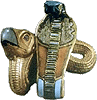

Historia Egiptu według oficjalnej nauki liczy sobie około pięciu tysięcy lat. Starożytne przekazy egipskie czy greckie mówią o dwudziestu i więcej tysiącach, a niektóre przesuwają ją jeszcze głębiej. Egiptologia mozolnie sylabizuje hieroglify, interpretuje reliefy oraz rysunki i wychodzi z tego niezły galimatias. Brak instrumentów do prawdziwego ustalenia wieku znaleziska wręcz przeszkadza w ustaleniu chronologii, a co za tym idzie do wyciągania nieprawdziwych wniosków. Nadto zbyt wyraźnie widoczna, w przypadku Egiptu, degradacja postępu technicznego w miarę upływu wieków wprawia historyków w niemałe zakłopotanie. Nagminny brak stosowania logiki doprowadził do puszczenia w obieg takich bajek, że nawet słynne "Baśnie z tysiąca i jednej nocy" wydają się rzeczywistością.

Czy astronomia Egiptu jest powiązana z Bogami? Jeżeli jest, to w sposób bardziej zakamuflowany niż gdzie indziej. Zastanawia mnie fakt, że w Egipcie Bogowie nie są utożsamiani z planetami, jak przykładowo w Sumerze czy Grecji, natomiast niektórzy egipscy Bogowie pod postacią zwierząt mają swoje odpowiedniki w znakach egipskiego Zodiaku. Czy jest to powiązane z czasem ich panowania pod odpowiednim znakiem? Niepewne to sformułowanie ale czy nieprawdziwe? Tego nie wiem. Współcześnie używamy podziału nieba ustalonego w starożytnym Babilonie i przejętego przez Greków. Co ciekawe różni się on od egipskiego.

| 🟦 **Egipt** | 🟦 **Babilon** | 🟦 **Lata pne** |
| --- | --- | --- |
| Pies Wąż Skarabeusz Osioł Lew Baran Byk Krogulec Małpa Ibis Krokodyl Kot | Byk Bliźnięta Rak Lew Panna Waga Skorpion Strzelec Koziorożec Wodnik Ryby Baran | 4490-2330 6650-4490 8810-6650 10970-8810 13130-10970 15290-13130 17450-15290 19610-17450 21770-19610 23390-21770 26090-23390 28250-26090 |

Pierwsza różnica to inne nazwy gwiazdozbiorów. Druga, znacznie według mnie ważniejsza, to przesunięcie znaków egipskiego zodiaku o jeden znak do tyłu w stosunku do współczesnego. Skoro w uproszczeniu jeden znak Zodiaku zajmuje na nieboskłonie przestrzeń 30°, czy to przesunięcie może być związane z hipotetycznym uskokiem skorupy ziemskiej około 10500 lat pne? Współczesna nauka stanowczo odrzuca hipotezę "wielkiego uskoku...", co wcale nie znaczy, że go nie było, bo dowodów można zebrać sporo.

Obok przedstawiłem znaki Zodiaku "obowiązujące" w Egipcie i Babilonie oraz przybliżone lata wschodu Słońca w tych znakach w dniu równonocy wiosennej. Może okażą się pomocne.

Jakich Bogów Egiptu pod postaciami zwierząt można odnaleźć? Ibis (Thot, Benu), Krokodyl (Sobek), Kot (Bastet), Pies (Anubis), Skarabeusz, Lew (Szu, Tefnut, Sechmet), Baran (Chnum), Byk, Krogulec lub sokół albo kania (Ra, Izyda, Horus). Brakuje mi osła, węża i małpy, choć znany jest wąż Apop czy czczony pawian lecz nie w roli Bogów. Można więc znaleźć bez mała wszystkich. Co dziwniejsze egiptologia uznaje, że jeden Bóg może występować pod wieloma postaciami w zależności od wzroku i wyobraźni egiptologa. Co chcę przez to powiedzieć? To, że interpretacja współczesnych egiptologów nie musi być absolutnie prawdziwa. Czy jest aż tak niemożliwe, że głowa Boga wskazuje na czas panowania? Cyfry lat w tabelce przyprawiają egiptologów o drgawki, ale czy słusznie? Czy sfinks o ciele lwa i głowie barana nie może wskazywać na przełom er lwa i barana? Czy istnieje jeszcze inna możliwość - zwierzęta jako symbol egipskich nomów? Historycy twierdzą, że było ich 42.

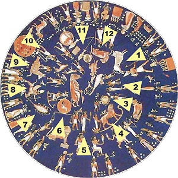

Przy dokładniejszym przyjrzeniu się Zodiakowi egipskiemu sprawa zaczyna się gmatwać. Nie wiem skąd prof. Zajdler czerpał wiadomości o znakach egipskiego Zodiaku, bo na rysunku z Dendery nie mogę doszukać się wielu zwierząt. Za to wszystkie pasują do Zodiaku babilońskiego. Sprawdź sam: 1-Byk, 2-Bliźnięta, 3-Rak (wygląda na kraba), 4-Lew, 5-Panna, 6-Waga, 7-Skorpion, 8-Strzelec, 9-Koziorożec, 10-Wodnik, 11-Ryby i 12-Baran. Jest jeszcze jeden lew siedzący, ale ten nie pasuje do kolejności na niebie, są też i inne zwierzęta występują w jakiś zagadkowych kontekstach. Na obrzeżu wymalowano jakąś nierozszyfrowaną historię. Kto dla kogo był tu wzorcem? Historycy twierdzą, że my znaki Zodiaku przejęliśmy od Greków, Grecy od Babilończyków, a ci od Egipcjan, ale nauka umieszcza Babilon w III w. pne, a Denderę na I w. pne. Gdzie tu logika?

Wynika z tego także, że wiedza astronomiczna przekazana Egipcjanom i Sumerom (przejęta później przez Babilończyków) miała to samo źródło. Niektórzy uczeni oceniają, że fresk z Dendery został namalowany około 3750 r. pne. Data dziwnie zbieżna z początkiem kalendarza Nippuryjskiego z 3760 r. pne (Sitchin twierdzi, że w tym właśnie roku Sumer wizytował Bóg Anu). Ponadto, jak sądzę, tzw. "Zodiak z Dendery" nie miał na celu dokładnego zobrazowania nieba. Stanowi on jakiś, do tej pory nie odczytany przekaz z przeszłości dla przyszłych pokoleń i jak widać dla bardziej inteligentnego niż nasze.

Do czego zmierzam? Chcę pokazać, że historia starożytnego Egiptu tylko z daleka wygląda na solidną. Przy wejściu w szczegóły zaczynają razić nieścisłości, klecone "na siłę" niespójne teorie, interpretacje wyciągnięte z kapelusza, a przede wszystkim kompletny brak logiki i rzetelnej naukowej oceny.

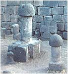

Kłania się też odrzucenie starożytnych przekazów, a także tłumaczenie tekstów na zasadzie im bardziej zawiły tym bardziej egiptologiczny czyli "naukowy".

Podobnie wydaje się nieuporządkowaną sprawa symboli Egiptu. Kto i jakie nosił korony, co przedstawiały "laski" Bogów, jakie insygnia mógł mieć faraon lub co wreszcie oznaczały symbole umieszczane nad lub na głowach Bogów? Nie spodziewaj się ode mnie dysertacji naukowej. Chcę tylko pokazać swój punkt widzenia. Uważam, że starożytny Egipt stanowił wielce uporządkowany organizm, gdzie nawet rysunki czy reliefy były mu podporządkowane. Każdy znak czy symbol miał zapewne jednoznaczne znaczenie.

Wpółcześni egiptolodzy wmawiają nam, że starożytny Egipt był tłumem głupków otumanianych przez chciwych władzy kapłanów i rządzonych przez faraonów-tyranów, którzy dla zaspokojenia własnej chuci kazali im bez przerwy budować piramidy. Dzisiejsi naukowcy nie mogąc dojść prawdy karmią nas bajeczkami, wymyślanymi pomiędzy drinkami. Dla nich wszystko co długie i sterczące pionowo stanowi widoczny kult fallusa. Nawet w Ameryce Południowej ze zwykłych kamiennych nitów czy śrub (obok) zrobili cmentarz męskich drążków rozrodczych. Stąd zamiast poważnej i rzetelnej informacji mamy tylko wielkie jaja.

**Korony Bogów i królów**

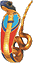

Najstarszą koroną Egiptu, koroną Bogów, była korona zwana "atef". Wydłużona "czapa" zakończona czymś w rodzaju kuli. Po obu stronach przymocowane były "wachlarze", które naukowcy określają jako pióra, wsparte na dole o coś w rodzaju skręconych, baranich rogów, na których widoczne były kobry z dyskami na głowach. Nad czołem, pośrodku widniała jeszcze jedna kobra, lecz już bez dysku na głowie. Która z nich nosiła miano ureusza? Sądzę, że ta ze złotym dyskiem na głowie symbolizującym tajemniczą, wielką energię. Kobra bez dysku mogła być "herbem" nomu, a później dolnego Egiptu.

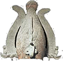

Stare przekazy egipskie mówią, że ureusz był strasznie niebezpiecznym talizmanem. Był ponoć własnością boga Ra, boskiego króla Egiptu, przechowywanym w złotej skrzyni, w której oprócz niego znajdować się miały rózga (lub pałeczka) i pukiel włosów. Po ustąpieniu Ra z tronu na rzecz Szu, złota skrzynia wraz z zawartością była przechowywana gdzieś w twierdzy na wschodzie Egiptu. Po Szu na tronie zasiadł Geb, trzeci z linii boskich faraonów. Kiedy Geb przejął władzę, rozkazał przynieść złotą skrzynię i otworzyć w jego obecności. W chwili otwarcia skrzyni wystrzeliła z niej ognista błyskawica - "oddech boskiego węża", poraziła śmiertelnie wszystkich towarzyszy Geba i mocno poparzyła samego króla-boga. Czy mamy tutaj z egipską odmianą Arki Przymierza?

Na rysunkach i reliefach spotyka się także koronę atef bez "kobr z dyskami" i "baranich rogów" z czego wysnuwam wniosek, że dodatki te musiały symbolizować jakieś dodatkowe atrybuty. Czym były te zagadkowe "pióra"? Na ten temat możemy tylko pospekulować. Jeśli korona była tylko ozdobą, to możemy przyjąć wersję "piór", ale jeśli stanowiła połączenie ozdoby z elementami technicznymi, to co wtedy? Ciekawostką jest być może to, że jeden z najstarszych Bogów Egiptu - Ptah, nie nosił żadnej korony. Nakrycie jego głowy podobne było do współczesnego czepka kąpielowego.

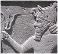

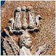

Koronę podobną do atef można także znaleźć na terenie Mezopotamii. Na zdjęciu król lub Bóg nosi koronę w kształcie stożka zakończonego owalem, a wzdłuż korony coś na podobieństwo "piór" z atef będące chyba jednak wężami. Wąż zwisający nad czołem władcy ma na głowie coś w rodzaju dysku. Jak na jedną koronę dość dużo analogii. Jak zinterpretować przedmiot trzymany w ręku? Czy to jest rozwidlający się "piorun" czy też pogięte zęby "trójzęba" Neptuna? W każdym bądź razie nie przypomina rośliny. Jak wytłumaczyć tę analogię na obszarach teoretycznie będących w stanie permanentnej wojny? Może płaskorzeźba nie pochodzi z okresu przyjętego przez historyków, ale jest znacznie starsza? A co sądzić o koronie z płaskorzeźby znalezionej w Iranie? Tu korona jest wręcz identyczna z koroną noszoną przez faraonów.

Najczęściej królów Egiptu, faraonów, przedstawia się w nakryciach głowy przedstawionych poniżej. Jak widać są dwie podstawowe "korony" i ich kombinacje. Pierwsza wydaje się być wzorowana na koronie atef lecz bez charakterystycznych "piór" przynależnym widać tylko Bogom. Zastanawiający jest zawinięty na końcu "pręcik". Do czego mógł służyć? Ozdoba czy jakaś techniczna część np. antenka?

Według egiptologii korona pierwsza z lewej była koroną górnego, natomiast trzecia dolnego Egiptu. Połączone razem reprezentowały zjednocznony Egipt. Korony nie są kolorowane. Uważam, że wystarczy sam zarys. Prawdziwych kolorów nie da się odtworzyć, choćby z tego względu, że w ciągu tysiącleci sam kolor zapewne ewoluował i był zależny od artysty oraz ówczesnej technologii. Wraz z upływem wieków korony zaczynają przyjmować coraz wymyślniejsze kształty. Myślę, że jest to efektem opuszczenia ludzi przez Bogów, gdyż boskie atrybuty zaczynają się pokazywać na głowach faraonów. W obecności Bogów zapewne do tego nie mogło by dojść. Przykładem takiego przepychu jest korona Tutankhamona ukazana na jego tronie odnalezionym w grobowcu w Dolinie Królów.

Sądzę także, że dodatki do koron też posiadały jakieś znaczenie informacyjne. Co oznaczały te tzw. "pióra" po jej bokach? Jakie znaczenie można przypisać "baranim", skręconym rogom? Czy w ogóle były to baranie rogi? U baraniego Boga - Chnuma możemy zaobserwować czasem aż trzy ich pary. Jedne przynależne baranowi, drugie długie i skręcone, a między trzecimi umieszczano dysk. Czy dodanie do korony kobr z dyskami na głowach ostrzegało, że posiadacz korony dysponuje jakąś groźną bronią?

To co pokazałem, to zaledwie cząstka tego, co można znaleźć na głowach Bogów i królów Egiptu, ale można wyciągnąć wniosek - jest w tym logika i organizacja, choć nie wiadomo czy wersje podawane przez egiptologów odpowiadają prawdzie. Zauważyłeś też zapewne, że na każdym reliefie czy rysunku wszystkie postacie, czy to Bogów czy królów, ukazane są z profilu. Dlaczego? Być może wytłumaczenie można znaleźć w żydowskiej Kabale, która mówi, że postacie Bogów należy ukazywać tylko z profilu.

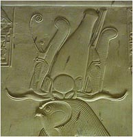

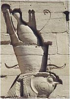

Przypatrzmy się koronie Horusa. Atrybut "skręconych" rogów wygląda tu zupełnie inaczej niż na innych reliefach. Zaczynam wątpić, czy to w ogóle są rogi. Wyglądają jak skręcone "półrurki" wyrastające z jednego pnia. To nie są skręcone, pełne czy puste w środku stożki. Jakie zwierzę posiada takie rogi? Wyrastające szeroko na boki świadczyłoby o zwierzęciu typowo stepowym, gdyż z takimi rogami ucieczka w terenie porośniętym drzewami, czy krzakami byłaby bardzo utrudniona lub wręcz niemożliwa. Przyznam się, nie znam takiego zwierzęcia. Sama korona jest kombinacją dwóch. Z przodu widzimy tę określaną jako koronę Egiptu Górnego, za nią zaś korona Dolnego.

Dlaczego tutaj dołączono "pióra" z korony Atef, należne Ozyrysowi? Przed koronami atrybut "tarczy pomiędzy rogami", a na dodatek aż cztery kobry. Dwie w koronach Dolnego i Górnego Egiptu oraz dwie mniejsze. Dlaczego w końcu nie ma symbolu Górnego Egiptu, którym jest sęp? Jak to wszystko interpretować? Na drugiej fotografii widać, że "skręcone rogi" nie są elementem samej korony, są umieszczone z tyłu i stanowią symbol czegoś, czego ja niestety, nie potrafię wyjaśnić. Za koroną wystają dwa "pióra". Czy to są te "pióra", które na koronie nosi Amon? Zwróć też uwagę na "antenkę", która nie ma zakręconego zakończenia, jak przedstawiono na sąsiedniej fotografii. Tu, pod jej zakończeniem, widać wyraźnie oko. Tak samo jak przy poprzedniej też brakuje sępa. Jeżeli w tych czasach kobra i sęp nie były jeszcze emblematami krain, to co w takim razie reprezentuje sama kobra?

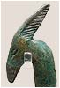

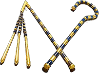

Co noszono lub trzymano w rękach? Nieodłącznym elementem Boga była jego laska, niewiele mniejsza od niego. Nie był to kostur pasterski, a prosty pręt o różnych zakończeniach. Dół laski był zakończony czymś w rodzaju widełek, być może do obezwładniania węży. U bogiń spotykamy na ogół laski z prostym zakończeniem. Górę laski stanowiło wyobrażenie jakiegoś zwierzęcia (szakala?) lub kwiat lotosu(?). Niektóre laski miały dodawane symbole ankh i dżed. Czym były tak naprawdę nie wiadomo. Nie sądzę, by Bogowie trudzili się noszeniem zwykłego kija.

Odznaką władzy faraona była natomiast krótka laska zakończona trzema czwartymi okręgu i coś w rodzaju krótkiego bicza. Co to było naprawdę nie wiem. Znalezione atrybuty są już tylko artefaktami w rękach nieboszczyków lub utrwalone w rzeźbach i rysunkach. Jest jeszcze jedna zagadka. Najstarsze rzeźby, te precyzyjnie wycięte w najtwardszych materiałach, pokazują, że faraonowie trzymali coś w garściach, coś w rodzaju kołeczków, być może pieczęci. Dotyczy to przede wszystkim postaci stojących lub idących królów.

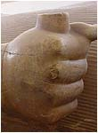

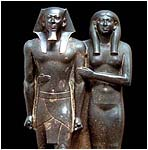

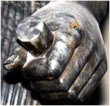

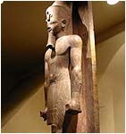

Czy nie intrygowały cię brody faraonów i niektórych Bogów? W zbliżeniu niektóre wyglądają jak spleciony warkocz. Czy to na pewno jest broda w pełnym tego słowa znaczeniu? "Włosy" wyrastają tylko z określonego miejsca na czubku brody, a reszta twarzy jest gładka. O ile w takiej brodzie występują wszyscy faraonowie, o tyle brodę taką noszą tylko niektórzy Bogowie i pomniejsze bóstwa. Brodę widzimy u Ozyrysa, Atona, Ptaha oraz u nilowego bóstwa Hapy. Oglądając wizerunki Bogów, widać że broda u nich jest jakby elementem naturalnym, ale wizerunki niektórych faraonów wskazują na to, że broda jest sztuczna i doczepiana do twarzy. Mamy także dwa rodzaje "bródek". Pierwsze w postaci poprzecznie prążkowanej, natomiast w maskach pogrzebowych faraonów w postaci splecionej w warkocz.

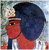

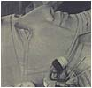

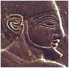

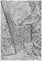

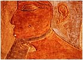

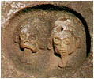

Czy jest to "małpowanie" boskiego elementu przez faraonów? Czy może był to jakiś element techniczny współdziałający z koroną atef? Na rysunku i reliefach widać, że broda jest podtrzymywana przez coś w rodzaju "taśmy" i sądząc z kształtu może być elementem sztywnym. Nie sądzę również, aby w ten sposób starano się podkreślić kształt dolnej szczęki faraona. Na to, że broda była elementem sztucznym i "doczepianym" wskazuje także treść Tekstów Piramid, gdzie jest mowa o jakimś buncie, podczas którego skradziono brodę Atuma.

A co sądzisz o ostatnim zdjęciu? Postacie ludzkie z przyczepionymi brodami, ale w kształcie rozwidlonego języka węża(?). Widać wyraźnie, że języki nie wychodzą z ust postaci, ale w jakiś sposób są przyczepione do brody. Tę analogię do brody Bogów i faraonów odnalazłem po drugiej stronie Atlantyku w El Baul w Ameryce Środkowej. Czy nie sądzisz, że Egipt z Ameryką Środkową ma podejrzanie dużą ilość podobieństw i analogii?

**Atrybuty Bogów - wąska specjalizacja?**

Nie mniej ciekawe są oznaczenia graficzne występujące często na głowach Bogów lub tuż nad nimi. Niekiedy powtarzają się przy różnych Bogach, a także mogą występować po kilka przy jednym. Sądzę, że tak starożytni oznaczali "specjalności" poszczególnych Bóstw. Nie wiem czemu, ale kojarzy mi się to ze specjalnościami wojskowymi lub z przynależnością do danego korpusu specjalistów. Najczęściej spotykanym znakiem jest krzyż życia - Ankh oznaczający chyba, że Bóg żyje wiecznie. Był z pewnością zarezerwowany tylko dla Bogów, a spotkanie go w ręku faraona jest zapewne świętokradztwem i chyba stosowane było już w czasach współczesnych w celu dodania splendoru królowi.

|  |  |  |  |  |  |  |
| --- | --- | --- | --- | --- | --- | --- |
| Hathor | Honsu | Neftyda | Izyda | Seshat | Maat | Ra |
|  |  |  |  |  |  |  |
| Neith | Thot | Meret | Nut | Anat | Hathor | Sopdet |

U góry pokazałem kilkanaście takich oznaczeń z imieniem Boga, który takiego atrybutu używał. Muszę przyznać, że spotkałem się z przypadkiem używania niektórych "odznak" przez kilku Bogów jednocześnie. Niektóre wizerunki kojarzą mi się z techniką, niektóre z rolnictwem.

Okrągłe tarcze egiptolodzy tłumaczą jako tarcze słoneczne. Sądzę, że trudno utrzymać taką interpretację jako że tarczę widzimy i między "rogami" i nad półksiężycem i otoczoną przez kobrę. Spotyka się też tarczę nad kobrą (ureusz), a także występującą samą. Sam wizerunek Słońca przedstawiany przez Egipcjan ma formę dysku z odchodzącymi od niego promieniami. Wydaje się, że rozróżniali przy tym przynajmniej dwa rodzaje promieniowania. Zobacz niżej.

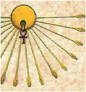

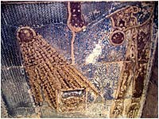

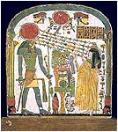

Pierwszy obraz przedstawia tarczę słoneczną z atrybutem życia, wysyłające promienie zakończone dłoniami (dają, głaszczą?). Drugi odnaleziony w Denderze przedstawia (według egiptologów) Boginię Nut połykającą słońce nocne(?) i rodzącą słońce dzienne, które oświetla postać Hator symbolizującą Denderę. Tu promienie przypominają coś dawanego w porcjach (kwanty energii?), coś co jakby pulsuje. Na trzecim widzimy Re(?), Boga-króla (atrybuty w rękach - laska, insygnia króla, krzyż ankh), który z dysku "słonecznego" na głowie, otoczonego przez kobrę, wysyła w kierunku człowieka jakieś pulsujące promieniowanie. Impulsy są w kolorach białym, żółtym, zielonym i czerwonym. Czy to ma jakieś znaczenie? Może... Egipcjanie uważali promieniowanie zielone za leczące.

Jest jeszcze wyobrażenie Słońca w postaci skarabeusza (Chepri), które jak twierdzą uczeni, powstało u Egipcjan z obserwacji skarabeusza toczącego kulkę nawozu oraz przeświadczenia, że skarabeusze rodzą się z samego siebie w tymże nawozie. Ile trzeba silnej woli by, za przeproszeniem, w kulce gówna dojrzeć Słońce?

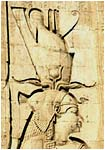

Czy można coś wywnioskować z opisu Bogów? Spróbujmy na podstawie Izydy. Opis zaczerpnąłem z Mitologii starożytnego Egiptu autorstwa Lipińskiej i Marciniaka.

Bogini o nieznanym pochodzeniu. Siostra i żona Ozyrysa, matka Horusa uosabiająca cechy opiekuńcze i macierzyńskie. Razem z siostrą Neftydą, pod postaciami sokoła i kani, opłakiwały zmarłego Ozyrysa, stąd płaczki pogrzebowe na sarkofagach. Astralnie - Syriusz. Nie posiada symbolu zwierzęcego.

Opis typowo egiptologiczny, zwięzły i kompletnie nic nie mówiący. Jako kania potrafi płakać, ale nie posiada symbolu zwierzęcego. Typowa kobieta i matka. Można jeszcze wyczytać, iż w Egipcie była opiekunką magii. Potrafiła dokonywać cudów poprzez bezbłędnie wypowiadane zaklęcia. Umiała uzdrawiać i zachodzić w ciążę kładąc się obok nieboszczyka. Potrafiła przyjmować postacie różnych zwierząt. Na potrzeby egiptologów podszywa sie pod inne bóstwa i zmienia imiona. Często spotyka się obraz Izydy klęczącej na znaku złota (egipski Balcerowicz?). Cóż więc mają określać atrybuty przedstawione na reliefie? Jest ich niemało.

Występuje w koronie zjednoczonego Egiptu z długimi skręconymi rogami, pomiędzy którymi wyrasta następna para "rogów" z tarczą "słoneczną". Pod koroną sęp z rozwiniętymi, opuszczonymi skrzydłami. Za koroną dwa tajemnicze słupki albo dwie wysokie wieże. Brak natomiast charakterystycznego schodkowatego słupka - jej głównego atrybutu. Razem pięć charakterystycznych cech, o których ani słowa w opisie. Z korony wynika, że Egipt był zjednoczony już w epoce Bogów. Ktoś wystawia nas do wiatru i na pewno nie ten, kto wyrzeźbił relief.

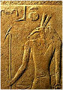

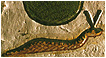

A co sądzić o Secie? Jakaś odmiana złego Boga, kojarzonego przez chrześcijan z szatanem? Opis zaczerpnąłem z tego samego źródła.

Bóg pustyń i oaz, wystepujący w postaci niezidentyfikowanego (antylopa, ziemne prosię, skoczek pustynny, okapi). Przypuszcza się, że było to zwierzę nie znane Egipcjanom. W mitologii nierozerwalnie związany z Ozyrysem i Horusem. Potężny Bóg-wojownik wspomagający Re. Czasem występuje pod postacią sokoła. Grecy identyfikowali go z Tyfonem.

Faktycznie nie można rozpoznać żadnego znanego zwierzęcia. Mnie kojarzy się z mrówkojadem, ale mrówkojad nie ma takich wielkich i ściętych uszu (porównaj z wężem poniżej). Chyba, że narządy zostały pomylone z przyrządami. Naprawdę konia z rzędem temu, kto potrafi odpowiedzieć na pytanie jakie to zwierzę. Że był Bogiem, nie ulega wątpliwości. Przedstawiany zawsze z laską i krzyżem ankh. Był synem Geba i Nut, bratem Ozyrysa. Jego życiorys nie przysparza mu chwały. Jest mordercą i pieniaczem. zabił brata - Ozyrysa, a z jego synem Horusem procesował się przez 80 lat, nie unikając przy tym rozwiązań siłowych, a cechowała go wielka siła fizyczna. Pomimo tego był ulubieńcem Re. Nie miał atrybutu, choć przy nim na reliefie widać tarczę, pół tarczy, pół nogi i znak złota, a w ręku trzyma jakąś broń (coś w rodzaju noża na długim trzonku).

Cały panteon Bogów egipskich ulega bez przerwy zmianom, w zależności (jak tłumaczą egiptolodzy) od miejsca uprawiania kultu. Być może mamy tu do czynienia z ewolucją wierzeń i tekstów w ciągu tysiącleci spowodowaną wymieraniem znawców świętych znaków, zapominaniem nazw pierwowzorów czy wręcz ze złym tłumaczeniem tekstów zarówno przez starożytnych jak i dzisiejszych tłumaczy. Opisy techniczne tłumaczone przez ludzi z ubogim słownictwem straciły swój pierwotny sens i do dziś powtarzane są jako nonsensowne nazwy i pojęcia.

Dlaczego Bóg Ptah został zdegradowany do prowincjonalnego bóstwa? Przecież to właśnie on w najbardziej zamierzchłych czasach podnosił Egipt z ruiny po potopie. Pisze się nawet, że był Bogiem, który od dawna zamieszkiwał Ziemię. Egipt jest krajem położonym blisko Sumeru, w którym odnaleziono najstarszy opis potopu.

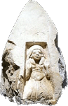

Ra has landed?

Chodzi więc zapewne o potop wspominany w Biblii, a ten, jak obliczył Zecharia Sitchin miał miejsce około 25 tysięcy lat temu. Czy z areny schodzi po "wojnie na górze", w wyniku której jego miejsce zajmuje Ra?

Ra bądź Re, jest królem Bogów utożsamianym z Atumem, tym samym który masturbacyjno-kanibalistycznie "spłodził" pierwszą parę Bogów - Szu i Tefnut. Para ta zrodziła sześciu Bogów Egiptu - Geba, Nut, Ozyrysa, Seta, Izydę i Neftydę, razem nazywanych dziewiątką heliopolitańską. Jako ostatnich Bogów, królów Egiptu, wymienia się Horusa i Totha. Wszyscy razem z Ptahem tworzą dwunastkę Bogów i jak się wydaje (przynajmniej mnie) oni są budowniczymi jeziora Mojrisa, labiryntu, piramid i reszty monumentalnych budowli najstarszego Egiptu. Przypisywanie budowli faraonom jest wynikiem darwinistycznego pominięcia roli cywilizacji Bogów. Faraon był tylko i wyłącznie przedstawicielem Boga na Ziemi. On i kasta kapłanów, potomkowie Bogów i śmiertelnych kobiet, reprezentowali tylko interesy Bogów na ziemi egipskiej.

Według Manetona Bogowie w Egipcie panowali 13900 lat, po nich półbogowie tzw. Szemsu-Hor (towarzysze Horusa) przez okres 1255 lat. Rządy śmiertelnych królów trwały 7943 lata do czasów Manetona. Jeśli wierzyć Manetonowi, to pierwszy Bóg w Egipcie zjawił się około 25 tysięcy lat temu, ale już Papirus Turyński przesuwa ten czas na około 47 tysięcy lat w głąb wieków, a to w ogóle nie mieści się w głowach egiptologów.

Zostańmy jeszcze chwilę przy Bogach. Część z nich występuje całkowicie w "ludzkiej" postaci, inni natomiast posiadają postać ludzką z twarzą zwierzęcia. Nauka nazywa to personifikacją czyli uczłowieczeniem postaci.

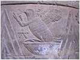

Horus, Anubis, Set, Chnum, Chepri, Sachmet, Sobek, Tefnut czy Tot nie posiadają twarzy, ale Horus lata i potrafi zabijać z powietrza, Anubis jest specjalistą od mumifikacji, Set stoi zawsze na dziobie barki Ra, gdzie wypatruje jego wrogów, Chnum odpowiada za stworzenie ludzi, a przecież nawet Biblia nie twierdzi, że Bóg stworzył człowieka przez pstryknięcie dwoma palcami, Chepri to kosmiczny wędrowiec, Sachmet na rozkaz Ra masowo zabija ludzi, Sobek jest "panem" płytkich wód, Tefnut jako lwica ma coś wspólnego z wilgocią, a Tot to wszechstronna baza danych jak dzisiejszy komputer.

Starożytni mimo braku technicznego języka byli doskonałymi obserwatorami, a przecież maszyny i budowle twarzy nie mają. Relief obok odnaleziono na cokole kolumny w Esna, jednym z najstarszych ośrodków starożytnego Egiptu, leżącym pomiędzy Tebami i Edfu. Ptak ze szponami i ludzkimi rękami siedzi na odwróconej półkuli, obok symbol gwiazdy. To zwierzę potrafi latać w kosmosie, jest uzbrojone, a ręce wskazują na to, że oprócz latania potrafi i może "coś" robić. Czy to jest pierwowzór Horusa?

**Jak z podestu zrobić koło garncarskie?**

W egiptologii jest to bardzo proste. Według wierzeń egipskich, Bóg o głowie barana - Chnum, stworzył człowieka z gliny. Glina kojarzy się przede wszystkim z garncarstwem, a jeśli garncarstwo, to musi być i koło garncarskie. Typowa logika egiptologiczna.

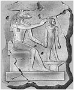

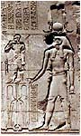

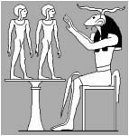

To, że na kole garncarskim można wytoczyć i to z trudem tylko pewną, aczkolwiek jedną z najważniejszych życiowo części człowieka, nie odgrywa dla egiptologów istotnej roli. Z przedstawionych reliefów i rysunków jakoś nie wynika, że człowiek stoi akurat na kole garncarskim. Mały podest, filigranowy stolik czy stół o jednej nodze urosły do roli koła garncarskiego. A gdzie to koło garncarskie ma dolne koło do nadania ruchu obrotowego? Samo ułożenie nóg Boga nie wskazuje na to, by był specjalistą w tej dziedzinie. Tego typu "koła garncarskie" można spotkać na wielu innych reliefach i w obecności innych Bogów.

Na rycinach można też zauważyć, że Chnum posiada dwie pary rogów. Jedne przylegające do głowy (typowo baranie) i drugie nad głową (duże i długie, spotykane w połączeniu z koroną). Te drugie są, według mnie, oznaczeniem bądź atrybutu Boga, bądź wskazówką co do czasu zaistnienia aktu stworzenia, ale nie jestem tego absolutnie pewny.

Jeszcze ciekawsza jest interpretacja "uskrzydlonego dysku słonecznego" (na rysunku oboku). Podaję ją za "Mitologią starożytnego Egiptu, Lipińskiej i Marciniaka". Tu można zauważyć jak doskonale wymieszano epoki, Bogów i ludzi. Pokrótce (wersja heliopolitańska): "Re - król Bogów i władca ludzi, panuje w Egipcie, wstrząsanym raz po raz buntami zarówno Bogów jak i ludzi (ciekawe jacy to ludzie mieli odwagę buntować się przeciw Bogom?). Jeden z takich buntów opisano w micie o uskrzydlonym dysku słonecznym, odnalezionym w świątyni Edfu. W roku 363 panowania Re-Horachte (tłumaczony jako dwóbóg Re-Horus na horyzoncie), Bóg ów przebywał na wyprawie wojennej w Nubii. W tym czasie w Egipcie wybucha bunt pod przywództwem Seta, i Re wraca Nilem do kraju zatrzymując się w Edfu.

Teraz zaczyna się najciekawsze. Nakazuje swemu synowi Horusowi, który przybiera postać uskrzydlonego dysku słonecznego i wznosi się do nieba. Spada z góry na wrogów, oczywiście pokonuje ich i wraca na barkę swego ojca, gdzie na wniosek Totha, rada Bogów przyznaje mu imię Horus-Behedeta. Horus ponownie przybiera postać skrzydlatego dysku i umieszczony zostaje na dziobie statku. Dwie kobry obok niego to Boginie Nechbet i Wadżet. W tym fragmencie wojny pojawia się także drugi Horus, syn Ozyrysa i Izydy. Re-Horachte walczy i zwycięża w Tebach, Denderze, Heben i Meret, następnie znów zwycięska walka w Nubii i po zakończeniu wojen Re-Horachte nakazuje by uskrzydlony słoneczny dysk umieścić w każdej świątyni Górnego i Dolnego Egiptu jako ochronę przed nieprzyjaciółmi.

O, ty dziecię Słońca, o ty dostojny, któryś spłodzony przeze mnie, pobij wroga, w jak najkrótszym czasie, który przed tobą. Potem wzleciał Hor-Hut ku Słońcu w postaci wielkiej tarczy słonecznej ze skrzydłami \[...\] Kiedy na wysokości niebios ujrzał wrogów natarł na nich z taką gwałtownością, że ani widzieć nie widzieli oczami, ani słyszeć nie słyszeli uszami. W krótkim czasie nie został nikt żywy. Hor-Hut błyszcząc wielobarwnie, powrócił w swoim kształcie, jako wielka skrzydlata tarcza słoneczna na statek Ra-Harmachis.

---

Podążał Harmachis swoim statkiem i wylądował pod miastem Horus-tron. I przemówił Tot: "Miotacz promieni, który wytworzył Ra, pobił wrogów. Od tego dnia niechaj będzie zwany miotacz promieni, który wytworzony jest ze Świetlistej Góry". I rzekł Harmachis do Tota: "Umieść tę słoneczną tarczę na wszystkich świątyniach boskich w Egipcie Dolnym, na wszystkich świątyniach boskich w Egipcie Górnym i na wszystkich innych świątyniach".

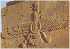

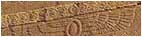

Albo totalny bałagan, albo musimy przyjąć, że wszyscy Bogowie żyli w tym samym czasie. Obok siebie występuje pierwszy boski król Egiptu - Ra, jeden z ostatnich - Horus (syn Ozyrysa i Izydy) oraz ostatni z boskich królów - Toth, przy czym Horusów jest dwóch. Jest także Set, syn Geba i Nut, brat Ozyrysa, odwieczny wróg jego i jego syna Horusa. Drugi Horus, syn Ra potrafi przeobrażać się z Boga w "coś" technicznego i niebezpiecznego. Jego latający dysk to bardzo niebezpieczna broń, a nie Słońce jak chcą niektórzy. Jego ojciec Ra pływa statkiem po Nilu, syn już lata i atakuje wrogów z powietrza.

Egipt nie posiadał jako jedyny patentu na latające dyski. Znajdujemy je także na terenie Mezopotamii. Na reliefie obok, Bóg w latającym dysku. Zaręczam ci, że nie jest to jedyny obraz latającego dysku. Jest ich więcej, a niektóre także z dwoma wężami. Pod płaskorzeźbą Boga, na gzymsie świątyni znajduje się także inny relief (w powiększeniu) już bardziej podobny do egipskich. Prawie taka sama tarcza ze skrzydłami, jak na świątyniach w Egipcie i także umieszczona nad wejściem do świątyni. Ówczesny plagiat? Wspólnota? Przypadek?

**Faraonowie i ich "zabójcza" broń**

Jaką bronią dysponowali faraonowie? Najbardzie prostą i nie mającą żadnych cech broni masowego rażenia. Zgodnie z moją hipotezą "dwóch cywilizacji" Bogowie zazdrośnie strzegli swojej wysokiej technologii, a być może mieli wręcz nakaz, by jej nie przekazywać.

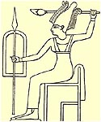

Półbogowie (królowie) i zwykli ludzie mieli do dyspozycji najzwyklejszą, prostą broń, która służyła przede wszystkim do obrony własnej.

Zgodnie z panującą wśród historyków modą, że każda religia politeistyczna musiała mieć Boga-opiekuna od wszystkich czynności, tak i w Egipcie znalazł się Bóg wojny zwany Anat. Jego wizerunek przedstawiam na rysunku obok. Czy to jest Bóg mam pewne wątpliwości. Poza koroną, którą możemy zobaczyć u Ozyrysa nic nie wskazuje na jego "boskość". Brak nawet najbardziej niezbędnego atrybutu Boga jakim jest krzyż życia - Ankh. Z innych rysunków wynika, że Bogowie trzymali go zawsze w ręku bez względu na ilość trzymanych przedmiotów.

Bóg ów jest uzbrojony we włócznię, tarczę i coś w rodzaju pałki z zamocowanym w niej ostrzem. Uzbrojenie w zasadzie nie odbiega od tego jakiego używali ludzie. Ponadto moje wątpliwości wzbudza sam rysunek, który jak sądzę jest swobodną interpretacją jakiegoś egiptologa wykonaną dla potrzeb, nazwijmy to edukacyjnych.

Osobiście uważam, że najbardziej wiarygodnymi dowodami są reliefy wykonane na ścianach świątyń i uważam je za najstarsze z tych co pozostały ze starożytnego Egiptu.

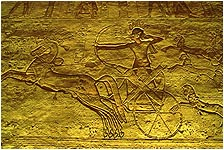

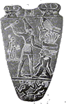

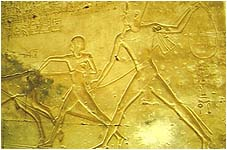

Po lewej stronie widać najgroźniejszą broń, jaką posiadał Egipt - rydwan wraz z faraonem strzelającym z łuku. To był jedyny element uzbrojenia pozwalający faraonowi stosować taktykę starożytnego "blietzkrieg'u" oraz walki na odległość. Pałka stosowana była zapewne w końcowych etapach walki, gdzie wziętych do niewoli po prostu zatłukiwano na śmierć. Lasso (na reliefie stosowane przy łapaniu zwierząt) być może nie było stosowane w walce lecz nie można tego wykluczyć mając na uwadze przykład jego stosowania przez Azjatów w średniowieczu.

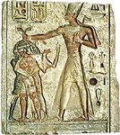

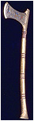

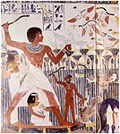

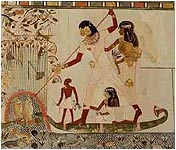

Na następnym reliefie widzimy faraona trzymającego za włosy trzech jeńców. Czy ma zamiar skorzystać z siekiery trzymanej na ramieniu? Rysunki z papirusów pokazują pokojowe wykorzystanie narzędzi do zabijania. Widać włócznię tu służącą do połowu ryb oraz coś w rodzaju "bumerangu" jednorazowego użytku do polowania na kaczki. Rzucano tym po prostu w stado kaczek z nadzieją, że któraś zostanie trafiona (widać dwa lecące w stadzie kaczek). W łodzi widać także człowieka podającego następny.

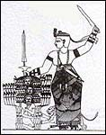

Ostatnim narzędziem jakiego rysunek udało mi się odnaleźć, to miecz. Używano zapewne brązowych mieczy, gdyż jak twierdzą uczeni, żelaznych przedmiotów w Egipcie było jak na lekarstwo i były cenione wyżej od złota. Osoba na rysunku uzbrojona w dwa miecze zdaje się przygotowywać do egzekucji jeńców wojennych. U jej boku widoczna jest zwisająca pochwa. Dlaczego dwa miecze? Sadzę, że nie była to trwała broń. Być może pękała, wyginała się i dlatego noszono jeden na zapas. Mogę przypuszczać iż stosowano także noże podobne do tych jakie trzyma małpa na reliefie z Dendery

W zasadzie to koniec przeglądu uzbrojenia. Być może używano jeszcze procy, tak popularnej broni w czasach patrirchów biblijnych. Może do taktyki należało też obrzucanie wroga kamieniami. Nie wspominam też o zasadach walki, którą posiadała każda armia, ani też o wykorzystaniu właściwości terenu. Wniosek jaki wypływa z tej krótkiej analizy potwierdza moja koncepcję. Broń była prosta i zabijała tylko w bezpośrednim użyciu. Widać też, że zasadniczym celem istnienia cywilizacji ludzi nie było prowadzenie wojen.

Na zakończenie relief, który przyprawia o szybsze bicie serca zwolenników wizyt z kosmosu. Relief, który ma przedstawiać pojazdy Bogów: śmigłowiec, łódź podwodną, latający spodek i samolot. Oglądając to dzieło można ujrzeć znajome kształty i stwierdzić, że na pewno nie są to starożytne hieroglify, lecz nie ma podstaw na wyciąganie daleko idących wniosków.

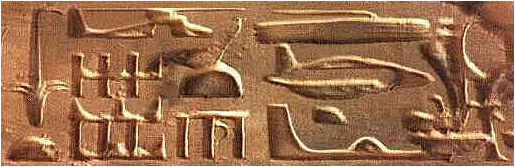

Można by rzec, że jeśli nie jest to prawdą, to zostało bardzo dobrze wymyślone. Podważa to jednak powszechne mniemanie, że nasi praprzodkowie byli, delikatnie mówiąc, mało rozgarnięci.

**Ludzie i tak to kupią ...**

Historia starożytnego Egiptu czyli tzw. mitologia, spreparowana w dzisiejszych czasach jest historią daleko odbiegającą od prawdy. Jest próbą sklecenia pewnej całości ze wszystkiego co wymyślono, znaleziono i odczytano w całym Egipcie. Wymieszano dokładnie wszystkie epoki, nie bacząc na najzwyklejszą logikę. Ludziom przypisano budowle, których nie byli w stanie ani wznieść ani rozbudować ani tym bardziej odbudować.

To dlatego wszystkie starożytne budowle leżą w ruinie i nie zostały odrestaurowane. To dlatego ruiny zachowały się do naszych czasów, bo nikt nie był w stanie ich ruszyć, rozbić i rozkraść. To dlatego historyjki o wielkich budowach starożytnego Egiptu w ciągu ostatnich pięciu tysięcy lat można włożyć między egiptologiczne bajki. Bez oddzielenia historii cywilizacji Bogów od historii ludzi nie jest możliwe ustalenie prawdy. Ja widzę to inaczej:

• Cywilizacja Bogów buduje olbrzymie kompleksy pałacowo-świątynne, ozdabiając je wielkimi posągami i reliefami obrazującymi życie Bogów, faraonów-królów, a czasem i zwykłych ludzi. To, według mnie, najstarsza historia Egiptu wyryta w kamieniu.  
• Egipt nawiedza ogromny kataklizm, być może ten kończący epokę lodowcową 12 tys. lat temu, z którego już się nie podnosi w pierwotnym kształcie. Bogów już nie ma. Nie ma kto przystąpić do odbudowy świątyń i pałaców, które w takim stanie przetrwały do dzisiejszych czasów.  
• Pierwszorzędnym zadaniem ocalałych jest przetrwanie i ponowna organizacja społeczności. Być może w tym pomagają nieliczni, ocaleni królowie i kapłani z kasty półbogów. Historia zostaje ponownie spisana, lecz już na papirusie. Upływ tysięcy lat, brak istnienia jednolitego państwa powoduje powstanie kilku ośrodków religijno-kulturowych, a co za tym idzie kilku wersji najstarszej historii.  
• W roku ....? pne Egipt zostaje zjednoczony lecz pozostają stare ośrodki kapłańskie dysponujące różnymi wersjami historii. Walka ośrodków religijnych o dominację nie sprzyja ujednoliceniu ani religii ani historii. I przy okazji pytanie: Skoro Menes jednoczy Egipt, to kto i kiedy dokonał jego podziału, skoro kamienne wizerunki Bogów i królów znajdujemy w koronach zjednoczonego Egiptu?  
• Od VII w. pne cywilizacja Egiptu stopniowo ulega rozmyciu pod okupacją Hyksosów, Greków, Rzymian i Bizancjum, by w VIII w. ne dostać się pod okupację arabską, która wymazuje ją doszczętnie i bezpowrotnie.

Należy odkryć także swoisty szyfr, jakim zapisano w kamieniu najstarszą historię. Zauważyłem, że atrybutem wyróżniającym Boga jest krzyż życia - ankh oraz laska, a czasem symbol wieczności - dżed. Atrybutem króla jest krótka, półokrągło zakrzywiona laska oraz coś w rodzaju bicza. Należało by też odkryć znaczenie atrubutów występujących nad głowami Bogów. Czy wszystko co ma kształt okrągłej tarczy musi być Słońcem? Dlaczego to "słońce" raz jest samo, raz jest otoczone kobrą, raz między "rogami", a niekiedy wysyła promieniowanie i to w dwóch rodzajach? Dlaczego kobra raz występuje sama, a raz z dyskiem na głowie? Czy zauważyłeś, że tam gdzie trzeba coś chronić umieszcza się jedną lub kilka kobr z dyskiem na głowie?

Należałoby poddać wszystko powtórnej analizie. Dlaczego Ptah, najstarszy Bóg Egiptu i dobroczyńca Egiptu spadł do roli podrzędnego bóstwa? Dlaczego Chnum, któremu przypisuje się stworzenie pierwszych ludzi, nie zajmuje miejsca w czołowym panteonie? Dlaczego Chepri występujący w kamieniu tylko jako skarabeusz awansuje na papirusach do roli Boga utożsamianego ze Słońcem i nadaje mu się postać człowieka? Dlaczego istnieją Bogowie, którzy pomimo rozdrobnienia na tzw. ośrodki religijne, zachowali wpływ w całym Egipcie? Hapy (bóstwo Nilu, rządzące jego wylewami) ma świątynie w Assuanie i setki kilometrów dalej na północ na wyspie Rode w okolicach Memfis. Czy tylko dlatego, że Nil jest długi?

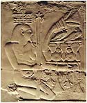

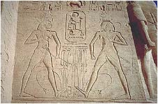

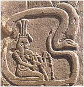

Hapy jest także bardzo ciekawym Bogiem. Na reliefach wygląda jak mężczyzna z kobiecą piersią wyrastającą mu spod pachy. Uczeni odczytali tę część ciała, jako obwisłą pierś mamki. Czy na środkowym reliefie widzimy go ze swoim bliźniakiem? Ponadto podróżuje(?) we wnętrzu węża. Podobny relief (postać otoczoną przez węża) spotykamy po drugiej stronie Atlantyku w Ameryce Środkowej. Tu, panowie naukowcy, nie da się wcisnąć, że wąż to alegoria Nilu. Nil nie zawraca do źródeł i nie otacza w około całego Egiptu.

Przypatrzmy się teraz Horusowi. Najbardziej znany to syn Izydy i Ozyrysa, którego wujem był Set, brat Izydy i brat Ozyrysa. Horus występuje jako mściciel swojego ojca, walcząc o władzę z Setem przez bez mała 80 lat. Według nauki jest to alegoria odwiecznej walki dobrego ze złem.

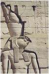

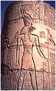

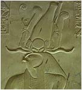

Bóg występujący zawsze z twarzą sokoła lub jako sam sokół i prawdę mówiąc nie zauważyłem innego wizerunku. Okazuje się, że jest jeszcze drugi Horus i to dużo starszy - syn Ra. Ten na rozkaz ojca potrafi zmieniać się w latający dysk rażący nieprzyjaciół z powietrza. Może być umieszczany na dziobie barki jak zwykły przedmiot. Ponadto można także znaleźć Horusa w częściach, a najsławniejsze jest chyba jego oko, które potrafiło zmieniać kolor podczas unoszenia faraona do nieba. Mówi o tym fragment "Tekstów Piramid":

Król znajduje się oto w oku Horusa gdzie dochodzi rozkaz Bogów. Czerwone oko Horusa jest rozgniewane, jego mocy nic się nie oprze... Niebo przemówiło. Ziemia drży. Ziemia huczy. \[...\] Ziemia pęka gdy król wstępuje do Nieba. \[...\] Grzmot burzy pcha go jak Seta. Strażnicy Nieba otwierają mu wrota... Widzę, jak król niby sokół, niby Bóg wznosi się...

Dziwne to oko, prawda? Raz przypomina kabinę, drugi raz działającą dyszę rakiety. To nie wszystko. Można odnaleźć jeszcze kilku Horusów, jak ten z Behedet, Nechem czy Buto. Znany jest też wizerunek "Niebiańskiego Sokoła" wysyłającego jakieś promieniowanie na mumię Ozyrysa. Bóg, czy wysoka technika?

Czy to zbudował fellach 5000 lat temu?

Historię Egiptu z ostatnich pięciu tysięcy lat usiłuje się rozciągnąć na cały okres przypisując przy okazji ludziom to, czego nie dokonali. Króla Ramzesa, który wznosił ogromne budowle i pomniki, wycinał w litej skale świątynie szuka się w ostatnim okresie czterech tysięcy lat, gdzie hitem technicznym był krzemienny sierp, wóz i dobry wół. Ten Ramzes, którego mumię znaleziono, nie musi być tamtym Ramzesem, a co bardziej prawdopodobne przyjął tylko imię wielkiego przodka z wielką dla siebie korzyścią, gdyż nie musiał nigdzie wydrapywać swojego imienia.

Brak logiki okraszonej nonszalancją spowodował wrzucenie wszystkiego do jednego worka i serwowanie nam potrawy o trudnej do zidentyfikowania zawartości i nieokreślonym smaku. Ludzie to kupują, bo nie mają innego wyjścia. Przecież nie każdy zna hieroglify i z tego powodu nie jest w stanie sprawdzić czy egiptolodzy mówią prawdę.

Czas wreszcie uprzytomnić sobie, że w Egipcie istniały dwie cywilizacje. Czy tę pierwszą nazwiemy cywilizacją Bogów, Wielką, Wyższą czy Kosmiczną nie ma absolutnie znaczenia. Faktem jest, że istniała. Faktem jest też, że cywilizacja ludzi była jej podporządkowana. Ludzie mieli służyć Bogom w pełnym tego słowa znaczeniu. To ludzie byli łowczymi, rzemieślnikami, rolnikami czy wreszcie "mięsem armatnim". Wszelka ich praca była podporządkowana boskim rozkazom, a w zamian otrzymywali tylko opiekę. Po zniknięciu Bogów, kasty królów i kapłanów, całą tę schedę przejęli najzwyklejsi ludzie. Nastała epoka współczesnych władców otoczonych splendorem dawnych lat lecz z wiechciami współczesnej słomy wystającej z królewskich butów.

Przy zmianie podstawowego założenia, uwzględnieniu istnienia dwóch cywilizacji, historia Egiptu będzie wyglądała zupełnie inaczej. Jednak nie zmieni jej Hawass i jemu podobni, a dopiero przyszłe pokolenie egiptologów myślących otwarcie, logicznie i niezależnie, lecz pod warunkiem, że nauczycielem nie będzie doktryner "starej daty" biorący pieniądze za gadanie zwykłych bzdur.
