**Machu Picchu - średniowiecze ?**

**Bardzo krótki przewodnik**

Dlaczego wybrałem to miejsce? Ponieważ jest mniej znane niż piramidy, lecz zbudowane z nie mniejszym rozmachem. Ponieważ użyta tu technika w niczym nie ustępuje tej spod piramid. Ponieważ jest tu tyle samo zagadek co w piramidach. I wreszcie mamy tu do czynienia nie z trzema obiektami, ale z wieloma i na dużym obszarze. Miasto należy do obszaru, który ja określam mianem "Inkaskiego kręgu". Miasto o typie budowy zbliżonym do wszystkich miejsc tego obszaru, którego centrum wydaje się być Cusco. "Krąg inkaski" zajmuje prostokąt o wymiarach ok. 200 na 80 km. Przedstawiam go na załączonej mapce. Wszystkie budowle spotkane na tym obszarze charakteryzuje jeden styl. Jeden sposób łączenia bloków kamiennych i jak się wydaje także obróbki.

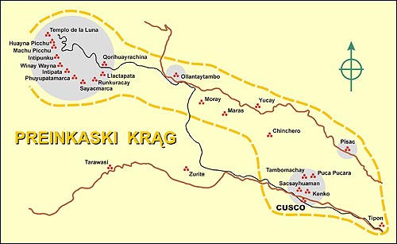

Machu Picchu, miasto zawieszone pomiędzy ziemią i niebem, wzniesione na szczycie łańcucha górskiego, otoczone głębokimi dolinami, wśród których wije się rzeka Urubamba. Miasto, do którego kiedyś wiodła tylko jedna droga zbudowana na grani. Obok niego, jak strażnik, góruje szczyt nazywany Huayna Picchu, na którym też znajdują się zabudowania. Jaka siła wniosła na ten szczyt potężne bloki kamienne? Na to pytanie istnieją tylko głupie odpowiedzi.

Oficjalna historia głosi, że miasto zbudowała miejscowa ludność gdzieś w roku 1500 naszej ery. Oglądając dzisiejszą dwudziestowieczną technikę okolicznych mieszkańców mimowoli ciśnie się pytanie: czy ten co to głosi wie co mówi, czy tylko mówi co wie? Odkrycia miasta dokonał Hiram Bingham w roku 1911 i właściwie niejako przypadkiem. Szukał czego innego. Szukał legendarnej, ostatniej stolicy Inków - Wilcabamby. To miejscowi powiedzieli mu o tajemniczym mieście z kamieni i oni zaprowadzili go na miejsce odkrycia jego życia. Ale nie była to Wilcabamba. Odkrył dla świata Machu Pichu.

Zapraszam do zwiedzenia tego miejsca. Nie bedzie to typowa wycieczka. Będę starał się pokazać takie miejsca, które będą świadczyć o wielkim kunszcie, a przede wszystkim o niespotykanej technice jego twórcy.

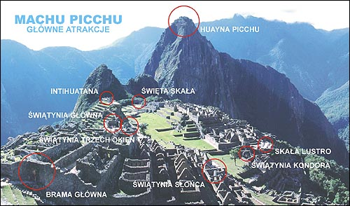

Nazwy także nie odzwierciedlają przeznaczenia obiektów. Są wymysłem dzisiejszych archeologów i raczej nadane dla łatwiejszego ich odróżniania. Przykładem tego może być świątynia główna. W wyobraźni widzisz potężną budowlę, a w rzeczywistości przed tobą ukazuje się coś w rodzaju bardzo solidnego... przystanku autobusowego.  
Czy Machu Picchu można nazwać miastem? Jest to obszar o wymiarach 300 na 250 m, według mnie za mały na miasto, za mały nawet na osiedle. Całość otoczona terasami, których zasadniczym zadaniem było i jest chronienie stoków górskich przed osunięciem się podczas trzęsienia ziemi i zapewne nigdy nie służyły za pola uprawne. Brak jakichkolwiek murów spełniających zadania obronne świadczy o tym, że nie były potrzebne. Ochronę stanowiły wysokie, pionowe terasy i gdzieniegdzie mury. Kompleks można podzielić na trzy oddzielne miejsca.

• kompleks wschodni składający się z największej ilości zabudowań,  
• kompleks południowy stanowiący jakby zespół, gdzie przyjmowano przybyszy, oraz  
• dwa oddzielne obiekty, położone jakby na uboczu - "świątynia" główna i Intihuatana położona na najwyższym, sztucznym wzgórzu.

Kompleksy "wschodni" i "zachodni" były oddzielone od siebie szerokim, płaskim placem, na którym nie było żadnych zabudowań. Do kompleksu zachodniego można było dostać się tylko przez bramę główną lub przez dwa ciągi schodów i nie sposób było do nich dojść niepostrzeżenie. W miejscu oznaczonym nr 7 (święta skała) stały dwa pomieszczenia chroniące jakby ścieżkę prowadzącą do zabudowań na szczycie Huayna Picchu. Całość nie stawarza wrażenia ani ośrodka kultowego ani kompleksu mieszkalnego.

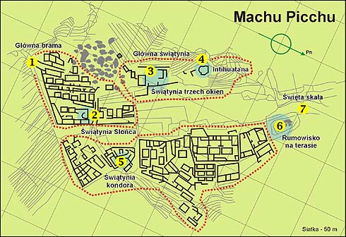

Utrzymywanie, że miasto zostało opuszczone z powodów religijnych czy gospodarczych uważam za ewidentne brednie. Jeśli mieszkali tu ludzie z XVI wieku to proszę pokazać ich cmentarzyska, proszę powiedzieć dlaczego nie ma kanalizacji, proszę pokazać choć jeden mały "wychodek". Nic takiego tu nie ma.

Sądzę, że opuszczenie miasta należy wiązać z wielkim trzęsieniem ziemi 12,5 tys. lat temu. Skutki tego widać na każdym kroku. Nie znaleziono żadnej ludzkiej kosteczki, żadnego dzieła sztuki. Być może jest coś ukryte pod ziemią, ale nikt takich badań tu nie prowadzi. Jest jednak coś, co wskazuje na istnienie podziemnych pomieszczeń. Pokażę je później.

Do Machu Picchu prowadziła jedna droga. Tuż przed miastem (zostańmy przy tym określeniu) znajdowało się coś w rodzaju punktu kontroli - Intipunku. Mały kamienny kompleks tuż przy drodze. Na końcu tej drogi znajdowała się jedyna brama prowadząca do wnętrza kompleksu zachodniego i schody prowadzące w dół wzdłuż murów do kompleksu południowego.

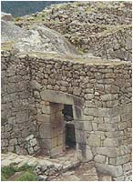

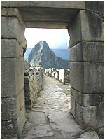

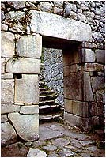

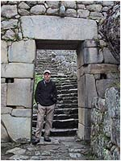

Sama brama jest łudząco podobna do Lwiej Bramy z Myken, choć niewątpliwie ta ostatnia jest o wiele potężniejsza. Usytuowana podobnie w załomku muru, zbudowana z potężnych bloków kamienia. Różni ją także to, co oglądamy z drugiej strony. Nad bramą kamienny pierścień, a w połowie bramy po bokach prostokątne otwory z uchwytem w środku, jakby do przywiązywania koni.

Sam wygląd miasta sprawia wrażenie jakby było budowane w kilku (technologicznych) etapach, lub odbudowywane ze zniszczeń przez kogoś, kto nie miał już takich technicznych możliwości jak pierwsi budowniczy. Są rejony, gdzie widać rękę mistrza, inny rodzaj kamienia, dokładność budowy. Sa i takie, które sprawiają dużo mniej korzystne wrażenie.

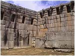

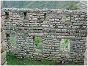

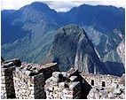

Pozwolisz zatem, że teraz obejrzymy wspólnie miejsca, które są najciekawsze.

**Świątynia główna**

  
  

Usytuowana jest na sztucznym wzgórzu, wzmocnionym terasami. Wraz ze świątynią trzech okien zbudowana jest bodaj z największych bloków spotykanych w Machu Picchu.

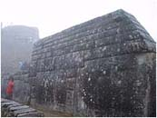

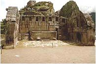

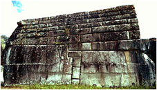

Pokazuję ją z trzech stron, byś miał wyobrażenie o wielkości stosowanych kamiennych bloków. Największy jest wzrostu dorosłego człowieka. Zwróć swą uwagę na jej wygląd. Czy twoje wyobrażenie o światyni pasuje do czegoś takiego? Czy faktycznie nie przypomina ona solidnego przystanku autobusowego? Gdzie tu ołtarze, gdzie miejsce dla odprawiania obrządku, gdzie wreszcie miejsce dla "wiernych"? Coś tu jest nie tak. Czy to był warsztat, stacja obsługi, czy jeszcze coś innego, o czym my dzisiejsi ludzie nie mamy pojęcia?

Jaki dach zabezpieczał ten budynek? Na ścianach widać tylko grube wypusty. Czy służyły do podtrzymania czegoś, co mogło być dachem? Chyba nie, bo znajdują się tylko na jednej wewnętrznej ścianie. Zdjęcie poniżej ukazuje powiększenie wewnętrznej ściany świątyni, tej z niszami. Górne bloki kamienia są w kształcie litery "L" i te krótsze ramiona tworzą coś w rodzaju wypustów. Jaką miały pełnić rolę. Nie wiadomo. Jest to budowla, jedna z kilku, zbudowana z jednolitych bloków kamiennych, z których niektóre elementy wydają się być jednakowej wielkości. Wydaje się też, że zachowano w niej elementy symetrii.

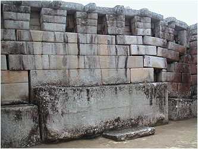

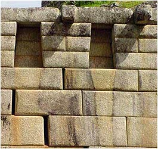

W samej budowli archeolodzy prawdopodobnie nie wykonali żadnych pomiarów i chyba tylko dlatego, by nie powiekszać ilości i tak już dużej ilości pytań. Na pierwszy rzut oka widać jednak, że elementy wykonano nie przypadkowo, a symetria wprost rzuca się w oczy. Do dziś uczeni nie dali także konkretnej odpowiedzi do czego miały służyć trapezoidalne nisze. Według ich hipotezy były to miejsca na ustawienie figurek Bogów. Ale czy to jest prawda? Jest ich tak dużo, że dzisiejszy (teoretyczny) panteon należałoby powiększyć co najmniej kilka razy. Ponadto nie pokuszono się o sprawdzenie czy przypadkiem nie posiadają jednakowych wymiarów, co mogłoby oznaczać, że stworzono je dla przechowywania czegoś, co nazwalibyśmy dzisiaj rzeczą standardową.

Powiększone zdjęcie po prawej daje jednak dużo do myślenia. Widać wyraźnie, że z nisz "coś" wyciekło i to "coś" wyraźnie odbarwiło kamień. Początkowa, szara barwa kamienia z czarnymi smugami została zmieniona na żółtawą, która wyraźnie różni się od otoczenia. Co to był za płyn? Na pewno nie wino mszalne i na pewno nie Bóg w płynie. Próżno jednak szukać prób ustalenia składu tego płynu czy chociażby ustalenia co mogło zostawić na ścianach te czarne smugi. Czy te żółtawe smugi spowodowały opady deszczu? Jeśli by tak było, to dlaczego nie zmyły całych ścian? Czy w niszach przechowywano naczynia z "czymś" w postaci płynnej czy półpłynnej? Na te pytania jeszcze nikt nie próbował odpowiedzieć.

**Świątynia trzech okien**

  
  

Położona tuż obok świątyni głównej. Nazwę zawdzięcza trzem trapezoidalnym otworom wyciętym w blokach skalnych, z których ją zbudowano. Dodam w tym miejscu, że taki rodzaj okien, drzwi i nisz spotkać można tylko w rejonach, gdzie działali poprzednicy Inków.

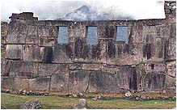

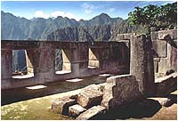

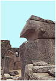

Na środku stoi kamienny słup, jakby podpora do nieistniejącej poziomej belki mocowanej w ścianach bocznych w specjalnych wycięciach kamiennych bloków. Samo wykonanie okien stwarza wrażenie jakby zostały wycięte w litej skale po wybudowaniu muru. Jakiego sposobu użyto? Czy było to mozolne wykuwanie?

**Intihuatana - kamień słońca?**

  
  

Jeden z najciekawszych bloków kamiennych. Ochrzczony mianem iglicy słońca - Intihuatana, według biegłych, jest swego rodzaju gnomonem, który ludziom epoki średniowiecza miał przypominać o sianiu, zbieraniu i śniadaniu. Ciemnym ludziom oznajmiał nadejście wiosny, i kazał zbierać chrust na zimę?

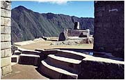

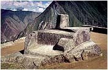

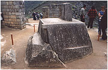

Czy faktycznie był to słoneczny zegar? Nie jest skierowany w kardynalnych geograficznych kierunkach świata. W przybliżeniu pionowy wypust wskazuje kierunek północno-zachodni. Po za tym liczne wycięcia, nacięcia, żłobienia, płaszczyzny we wszystkich kierunkach nie wiadomo czemu miały służyć. Pęknięcie u podstawy świadczyć może o tym, iż doznał on potężnego wstrząsu. Gdyby się jednak okazało, że iglica wskazuje kierunek około 2º na wschód od północy? Jeśli przeczytałeś już fragment o "siedemnastu stopniach Daenikena", to już powinieneś się domyślać...

**Świątynia Słońca**

  
  

 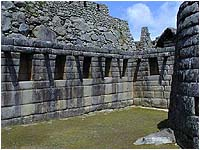 Najwspanialszy bodaj, pod względem wykonania, budynek. Jest w zasadzie kompleksem tajemnic. Mur posadowiony na przyciętej specjalnie skale. Doskonale dopasowane i obrobione kamienie, przypominające taśmowy wyrób. W tym stylu zbudowany jest w zasadzie cały zespół i jedna budowla na północ od niego. Obok otworu okiennego "świątyni Słońca", po stronie zewnetrznej, umieszczono kamienne wypusty. Czy przytrzymywały średniowieczną szybę, czy służyły innemu celowi. Ja nie mam żadnego pomysłu.

 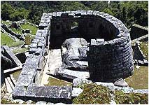 Jeszcze dziwniejszy jest obiekt który osłaniają. Stanowi on szczyt skały macierzystej tu i ówdzie ponacinany i przyszlifowany. Tyle zachodu dla jednego kamienia? Musiało to coś znaczyć, tym bardziej, że prawie identycznę budowlę spotykamy w Pisaq na północ od Cusco.

Czy ma to związek ze wspominanym w mitach greckich promieniowaniem tellurycznym (ziemskim), przez radiestetów nazywanym czarnym? Być może. Energię z ziemi czerpał, według mitów, Anteusz (gigant - syn Posejdona i Gai), zabity przez Heraklesa dopiero wtedy, gdy ten uniósł go do góry odrywając go od ziemi, źródła jego mocy.

Czy to przypadek, że w "świątyni" Słońca pod trapezoidalnymi niszami spotykamy podobne "nacieki" jak w "świątyni" głównej? Spójrz na zdjęcie po prawej. Mury czarno-szare i podobne jasne smugi ciągnące się od podstaw nisz ku dołowi. Co ciekawe budowla ta jest też zbudowana z jednolitych "kamiennych" cegieł, podobnie jak i "świątynia" główna i tylko w tych dwóch miejscach zauważyłem takie ślady.

**Świątynia kondora**

 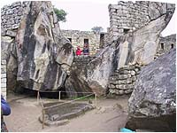 Kompleks ten znajduje się w południowo-wschodniej części całego kompleksu, poniżej dużego, zeszlifowanego kawałka skały, nazwanego przeze mnie skałą-lustrem.

Nazwę przyjęto zapewne z powodu jednej rzeźby w kamieniu przypominającej pazur. Czy to jest pazur kondora trudno ocenić. Dla mnie podobniejszy jest do dzioba. Tworzyłby pewną całość, jeśli skały za nim przyjąć za rozpostarte skrzydła. Dość ciekawie wyglądają mury wkomponowane bezpośrednio w skały. Poza tym nie ma tu nic co by przypominało świątynię.

Jest to chyba najbardziej "zagmatwane" miejsce w całym kompleksie. Pełno tu krzywizn i poskręcanych scieżek, mnóstwo kamiennych "cegieł" ustawianych wprost na litej skale, a także wnęk prowadzących do nikąd.

**Skała - lustro**

  
  

Następna ciekawostka. Fragment skały zeszlifowany na płasko. Chyba po to, by odbijać promienie popołudniowego słońca. Czy faktycznie służył do tego, by być widocznym z daleka?

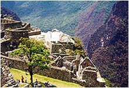

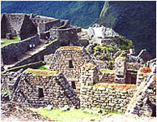

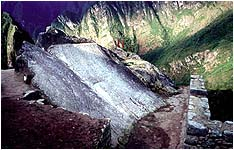

Czy zadaniem tej skały było być widoczną z powietrza? Nie znając techniki i technologii budowniczych nie sposób wyciągnąć jakichkolwiek racjonalnych wniosków. Na dobrą sprawę mogła to być też "ozdóbka" dająca tylko efekt przyjemności samego oglądania.

**Rumowisko skalne na terasie**

  
  

 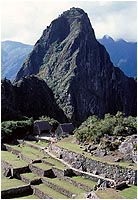 Rzeczone rumowisko znajdziesz po prawej stronie zdjęcia u dołu. Na lewo od niego wznosi się Huayna Picchu, niżej dwa, słabo widoczne domki pokryte współczesną strzechą, pomiędzy którymi niewidoczna, znajduje się święta skała.

Dlaczego stało się ono obiektem mojego zainteresowania? Otóż nie tyle rumowisko, co miejsce, na którym się ono znajduje. W Machu Picchu spotykamy trzy skupiska rumowisk skalnych, ale żadne z nich nie zajmuje tak eksponowanego miejsca. To natomiast, obramowane potężnymi murami teras może świadczyć, że kiedyś to rumowisko było albo budowlą, albo czymś podobnym do zdobnej jaskinii. Może też stanowiło wejście do podziemnych pomieszczeń. Nie wiem.

Co to było naprawdę, dowiemy się nie prędko. Nie ma na razie takiej siły, która mogłaby unieść skały i dopasować je jakoś do siebie.

Samo umiejscowienie rumowiska w obrębie terasy daje wiele do myślenia. Skoro, jak wspominałem, terasy służyły przede wszystkim jako zabezpieczenie przed osuwaniem się ziemi podczas trzęsienia ziemi, to dochodzę do wniosku, że musiały chronić coś naprawdę ważnego.

**Huayna Picchu**

  
  

Góra będąca dla Machu Picchu jego symbolem. Każde zdjęcie, każda pocztówka zawiera ten widok. Jest tym samym, co dla Rio de Janeiro słynna "Głowa cukru". Także na niej budowniczy zostawili swój ślad. Tajemnicą zostanie to jak oni wynieśli tak wysoko bloki skalne, z których zbudowano terasy i budynki.

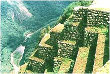

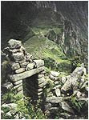

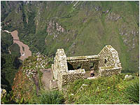

Dojście na szczyt, to wąska ścieżka wyłożona kamiennymi płytami. Wznosi się czasem pod kątem większym od 45º. Dwoje ludzi aby się minąć muszą się otrzeć o siebie. Jak wobec tego wniesiono tam bloki skalne ważące po kilka, kilkanaście ton? W jakim celu na szczycie góry umieszczano zabudowania? Czy to były świątynie? Jeśli tak, to tylko dla najbardziej sprawnych fizycznie. Czy ich Bóg nie kochał starych i ułomnych?

**Święta skała**

  
  

Ten kawał skały na pewno miał jakieś znaczenie. Postawiono go pionowo, wokół ułożono obramowanie z dokładnie uformowanych, ściśle do siebie przylegających kamieni.

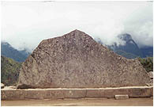

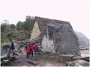

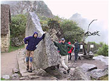

Tak się nie postępuje z przedmiotem bez znaczenia. Jaki jest duży wnioskujesz po sylwetkach ludzi, a i waga na pewno duża. Niektórzy sądzą, że przedstawia zarys góry leżącej za nim (na zdjęciu w chmurach). Musisz uwierzyć mi na słowo. Przypomina. Nie wiem jednak dlaczego skała jest obrócona o 180º w stosunku do oryginału.

**Ciekawostki**

**Ślady wielkiego wstrząsu**

  
  

Szczerze mówiąc znalazłem ich niewiele i to na najbardziej solidnych budowlach. Możliwe, że mniejsze po prostu się rozsypały. Te, które przetrwały oddają chwałę ich budowniczym.

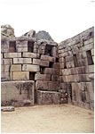

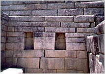

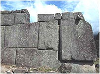

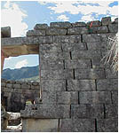

Czy pamiętasz, o czym wspominałem na początku? O podziemiach. Na pierwszym zdjęciu widać narożnik świątyni głównej. Zapadł się tylko on i wygląda jakby zarwał strop znajdujący się pod nim. Reszta świątyni jest prawie nienaruszona. Drugie zdjęcie pokazuje pomieszczenie przylegające do świątyni głównej od strony Intihuatany. Tutaj możesz dostrzec jak wstrząs spowodował rozsunięcie się "cegieł" oraz zdeformował prawe okno. Trzecia fotka, to bok świątyni trzech okien. Wyraźnie widać jak olbrzymi blok został przesunięty. Na ostatniej zaś widać tylko większe przerwy pomiędzy blokami ściany świątyni słońca.

O czym to świadczy? Sądzę, że o wielkiej znajomości istoty trzęsień ziemi i sposobie budowania mającym zmniejszyć jego skutki. Nie mniejszą zasługę mają tu solidne terasy, które utrzymały całą górę i nie pozwoliły na obsunięcia. Obserwując całość kompleksu, wyciągam jeszcze jeden wniosek. Nie ma tu wysokich budynków. Najwyższe to te parterowe z wysokimi ścianami bocznymi, które być może stanowiły oparcie dla dachów.

**Kamień czy plastelina?**

  
  

To co przedstawiam, świadczy o jednym. Dla budowniczych Machu Picchu obróbka kamieni była tym, czym dla nas obróbka plasteliny.

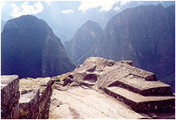

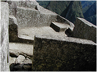

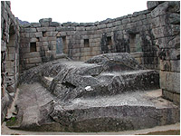

Takie formowanie kamienia wymagało na pewno specjalnej techniki. Tego nie da się wykonać zwykłym młotkiem i dłutkiem. Moja wyobraźnia podsuwa dwie techniki. Używano czegoś, co pozwalało ciąć kamień jak masło, albo znano technikę doprowadzania kamienia do konsystencji naszej plasteliny. Mozolne skuwanie kamienia byłoby widoczne aż nadto w postaci chropowatej powierzchni. Ponadto ile trzeba by poświęcić czasu na jej polerowanie i czy była by tak równa i gładka?

**Dziury i czopy**

  
  

Następna zagadka techniczna. Efekt widoczny, sposób wykonania nieznany. Wiercenie w betonie opanowaliśmy stosunkowo niedawno, gdy Niemcy wprowadzili wiertło zwane widią (**wi**e **dia**mant - jak diament).

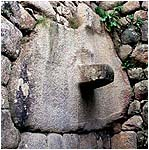

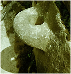

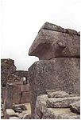

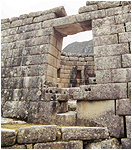

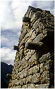

Czy otwory wiercono średniowieczną metodą niewiele różniącą się od rozpalania drewna kręcąc patykiem? Z czego wykonane były te średniowieczne wiertła by tak doskonale radzić sobie z kamieniem? Czy czopy z fotografii wyglądają na wykuwane? Zauważ, że stanowią integralną część z wpasowanym w mur kamiennym blokiem. Ile materiału należałoby przeznaczyć na straty? Jakiej metody należałoby użyć, by uzyskać jednakową wielkość? Teraz można, a nawet trzeba uwolnić swoją fantazję.

**Wpasowane w skałę**

  
  

Do tej pory można sobie było wyobrazić jak to robili. Teraz rzecz niewiarygodna. "Szpachlowanie" skały skałą.

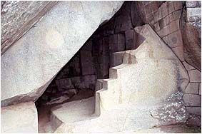

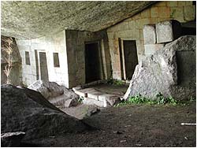

Kto projektował te "cegiełki" by tak idealnie pasowały do krzywizn? Czy to też był człowiek ze średniowiecza? Czy do projektowania elementów tak ściśle dopasowanych służyły specjalnie wyryte siatki?

**Tajemnicze siatki**

  
  

 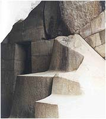 Czy przedstawione zdjęcia mogą stanowić rozwiązanie problemu dokładności w dopasowaniu kamiennych elementów?

 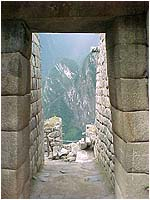 Bardzo możliwe. Wydaje się, że dawni budowniczowie korzystali jednak ze wspomagania w konstruowaniu skomplikowanych budowli czy kształtów. Ale jak to zwykle bywa rodzą się następne pytania.

Kto lub co ryło w skale tak proste linie, przecinające się pod kątem prostym i nie koniecznie równoległe do poziomu? Jaki sposób odwzorowania przyjęto, by "cegiełki" tak ściśle pasowały zarówno do siebie jak i do skalnych ścian, skoro siatka jest przekrzywiona i dlaczego wyryta siatka jest przekrzywiona? Jaki jest kąt pomiędzy liniami a poziomem? Czy to był "poziom" dla tego miejsca przed "wielkim uskokiem..."?

Czy bok kwadratu stanowi jednostkę używaną przez budowniczych? Czy wreszcie, nie świadczy to o używaniu bardziej skomplikowanych narzędzi i przyrządów niż pospolity pion, linijka i dłuto? Jak widzisz więcej pytań niż odpowiedzi. Mur jednak stoi, siatka jest wyryta. Wniosków jednak nie można wyciągnąć. Czy faktycznie mówimy o średniowiecznych muratorach, czy też o nieznanej cywilizacji i jej nieznanej technice?

**Jak wyglądały dachy ?**

  
  

Ciekawe pytanie, na które niełatwo dać odpowiedź. Te, które są teraz na niektórych budynkach są wzorowane na siermiężnych strzechach budynków miejscowych Indian. Są wykonane z trawy albo słomy, dokładnie z czego nie wiem. Czy można sądzić, że kiedyś było inaczej?

Prawdopodobnie tak. W Machu Picchu spotkać można w zasadzie trzy rodzaje budynków. Całkiem płaskie, parterowe. Średniej wysokości z bocznymi ścianami w kształcie trapezu i najwyższe, choć też parterowe, z bocznymi wysokimi ścianami z trójkątnym spadkiem. Sądzę, że budowniczy znając sejsmiczność terenu używali na pokrycie budynków materiałów lekkich, nie wyrządzających szkody przy upadku.

Jaki to był materiał? Też chciałbym wiedzieć, ale z pozostałości obręczy czy wypustów prawdopodobnie do mocowania przykryć dachu było to coś w rodzaju plandek. Zauważ na pierwszych dwóch fotografiach coś w rodzaju okrągłych uchwytów na grzbiecie ściany oraz boczne wypusty naprzeciw tych uchwytów. podobne boczne wypusty (po cztery z każdej strony) mają budynki o ścianach trapezoidalnych. Najniższe nie mają nic oprócz wypustów skierowanych do środka pomieszczenia. Co to był za materiał i jak był mocowany nie podejmuję się wyjaśnienia.

**Ujęcia wodne**

  
  

Urokliwe studzienki wody pitnej, czy znowu ołtarze boga wody? A może, jak chcą uczeni, rytualne baseny do nie mniej rytualnych ablucji? Cały urok tych "wodnych ujęć" polega na doskonale dopracowanych szczegółach wyciętych w kamieniu. Doprowadzające rowki, otwory w skale czy wydrążone kanaliki stawiają pytanie. Czy było konieczne, w znaczeniu technicznym, takie komplikowanie odpływu czy dopływu wody, czy miało to znaczenie estetyczne, czy wreszcie miało to znaczenie, ale tylko wiadome budowniczym.

Obieg wody w Machu Picchu nie jest w ogóle zbadany. Widziałem pewne próby opisania wodnych połączeń, które nie tłumaczą niczego. Nikt na prawdę nie wie, gdzie są kanały prowadzone pod ziemią, a już nikt nie ma pojęcia gdzie jest główne źródło wody. Niektóre ciągi wodne zostały uszkodzone w "wielkim uskoku..." jak ten obok Intihuatany, ale reszta działa nadal. Znowu kłaniają się Bogowie wody.

**Doskonałe szczegóły**

  
  

W całym Machu Picchu jest ich znacznie więcej. Przedstawiam tylko coś, co przypomina "klemy akumulatora" wykonane oczywiście w kamieniu oraz "pazur kondora". "Klemy" sprawiają wrażenie jakby były wykonane z dwóch rodzajów kamienia. Nie mam bardziej szczegółowych zdjęć by to pokazać. Ale na niektórych widać, że takie wrażenie sprawiają resztki wody deszczowej pozostałe w środku. Wybitni "znawcy" dopatrują się w tym albo sejsmografu(?) albo miejsca, gdzie dokonywano wróżb przed wyruszeniem na wojnę.

"Pazur" jest otoczony specjalną kamienną ramką z kamienia, co według mnie świadczy o tym, że jego wykonanie nie było przypadkowe. Tutaj także tłumaczenia znawców sięgają szczytów intelektu. Raz mamy do czynienia z dziobem kondora, gdzie resztę stanowią skały za nim mające imitować skrzydła, w drugim wypadku jest to pazur tego ptaszydła. Tajemnicą pozostaje dlaczego tylko pazur i dlaczego obwiedziono go półkolem z kamienia. Nieznajomość przeznaczenia zawsze owocowała fantazyjnymi tłumaczeniami ocierającymi się o zwykłą głupotę.

**Współczesna renowacja**

Znalazłem zdjęcie, które może rzucić trochę światła na budowę murów w Machu Picchu. Przyznam, rozczarowało mnie trochę. Brak wyrafinowanych wcięć, czy zakładek. Z drugiej jednak strony mamy tu do czynienia z jednym tylko rodzajem muru oraz z murem, który ze względu na mały ciężar bloków, jest w stanie wyremontować człowiek.

Jak widać lico kamienia ma kształt prostokątny, trapezoidalny lub zbliżony do nich, natomiast sam kamień z grubsza przypomina kineskop. Przestrzeń pomiędzy wypełniana jest ziemią (oczywiście teraz). Część mitu pryska, ale tylko część. W dalszym ciągu nie wiadomo, jak wyglądają największe bloki, oczywiście w części niewidocznej dla obserwatora oraz jak to zostało "przycięte" i ustawione.

Machu Picchu nie jest na pewno dziełem średniowiecznych Indian. Sądzę, że należy go wiązać z wiekiem, gdy Bogowie stąpali na ziemi. Zastanawiający jest brak jakichkolwiek ozdób, rzeźb czy choćby najprostszych rytów. Dla mnie wniosek jest prosty. Machu Picchu nie miało nic wspólnego z "sacrum". Od początku służyło do czegoś zupełnie innego i być może związane było z ówczesną techniką. Twierdzę także, że w żadnym wypadku "miasta" nie zbudowano w epoce średniowiecza, a tym bardziej w epoce kamiennej. Charakter jego być może poznamy po rozpoczęciu prac podziemnych, o ile do takich w ogóle dojdzie.
