**Historia czy dzieje folkloru ?**

**Tereny Nowego Świata**

Przyznam szczerze, że do tematu podchodziłem jak pies do jeża. Podejście, ukłucie, odejście. Być może powodem była duża ilość jednostkowych "cywilizacji", które zamieszkiwały dzisiejszy Meksyk i Jukatan. Poniżej przedstawiam mapkę z ważniejszymi stanowiskami archeologicznymi Ameryki Środkowej, bo ponoć termin Mezoameryka jest już terminem przestarzałym i niefortunnym, gdyż nie obejmuje Meksyku.

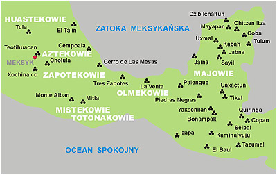

Historia odkryć na terenie Ameryki Środkowej rozpoczęła się wraz z podbojem Hiszpanów już w XVI wieku naszej ery, ale powodem nie była chęć poznania historii nowego świata, ale odnalezienie i kradzież jak największej ilości złota, które po przetopieniu wysyłano Jego Majestatowi, królowi Hiszpanii. Ponowne odkrycie nastąpiło dopiero w XIX wieku.

Rysunki jakie wtedy obejrzała ówczesna Europa uświadomiły niektórym, że uśmiercono cywilizację, która być może przewyższała nawet europejską. Zaczęła się moda na Amerykę Środkową, która pozwoliła tylko częściowo odsłonić zabytki architektoniczne. Historię zaczęli pisać ci, którzy podobnie jak w Egipcie, z nią samą nie mieli nic wspólnego.

Z zebranych mozolnie i segregowanych na zasadzie podobieństwa skorup, zaczęto tworzyć ośrodki cywilizacyjne przypisując im od razu wszystko co tylko znaleziono na powierzchni od wielkich budowli począwszy. Zaczęto rozpaczliwie poszukiwać wszelkich ocalałych jeszcze źródeł pisanych, ale odnaleziono nieliczne. Znaleziono za to mnóstwo opisów pozostawionych przez hiszpańskich mnichów i nawróconych na katolicyzm co bardziej inteligentnych Indian. Na podstawie tego całego folkloru postanowiono napisać historię unicestwionej cywilizacji.

**Starożytne dzieje i współczesne bajania**

Dzieje ludów Ameryki Środkowej na obecną chwilę nie mają spisanej obiektywnej historii. To co w tej chwili serwuje nam tzw. nauka, to dzieje folkloru indiańskiego spisane przez hiszpańskich kolonizatorów w późniejszych czasach, gdy do Nowej Hiszpanii zaczęli napływać ludzie umiejący czytać i pisać. W pierwszym okresie mordowania cywilizacji Indian przybyli tu "specjaliści" znający się tylko na masowej eksterminacji ludzi oraz odróżniający złoto i kamienie szlachetne od innych świecidełek. Takie były potrzeby europejskiej cywilizacji, którą na tym kontynencie zareprezentowała ówczesna Hiszpania.

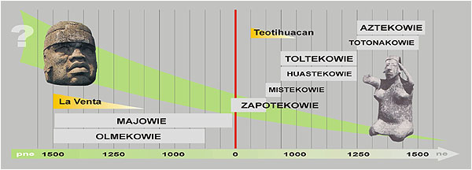

Jak widać udało się stworzyć kilka ośrodków plemiennych, których przodkowie mieli tworzyć dzieła przewyższajace europejskie i nie ustępujące egipskim. Co ciekawe, słynna hipoteza liniowego rozwoju cywilizacji bierze w łeb podobnie jak w Egipcie. W początkowym okresie wznosi się kolosalne budowle i rzeźbi w kamieniu ogromne głowy, by stopniowo przejść do glinianych figurek, ptaszków i gwizdawek przypominających nasze sprzedawane na odpustach. Osobiście mnie to nie dziwi, bo wzorem dla archeologów amerykańskich byli egiptolodzy.

Już na samym wstępie historii obu Ameryk znajduje się przeszkoda, jak na razie nie do pokonania. Chodzi o zaludnienie kontynentu. Czy z północy, czy z południa. Takie amerykańskie "czy golona, czy strzyżona", jak pamiętasz z bajki o pewnej upartej babie. Znaleziska wskazują na kierunek południowy, ale pewna grupa "jajogłowych" uważa, że Indianie przyszli z północy przez zamarzniętą cieśninę Beringa. Tysiące kilometrów w lodzie i mrozie. Co jedli, kto ich zaopatrywał? I najważniejsze, dlaczego Indianie nie są podobni do Mongołów? Czy to siarczysty mróz wyprostował im oczy, przyczerwienił cerę i pozakrzywiał nosy? Cóż, logika nie jest mocną stroną historyków. Idźmy zatem dalej i zobaczmy skąd wzięli się Aztekowie?

Oto jest opowieść, jaką zwykli powtarzać starcy: "W pewnym czasie, którego już nikt nie potrafi ustalić, którego nikt już teraz nie może sobie przypomnieć... przybyli tu zasiać ziarno ci, którzy byli naszymi przodkami. O nich się mówi, że przybyli, zjawili się \[...\] Przybyli tu wodą na swych łodziach licznymi gromadami i dobili do brzegu wody, do brzegu północnego. A miejsce, gdzie pozostawili swe łodzie, nazywa się Panutla.

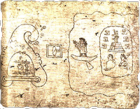

Przed przybyciem do Panutli Aztekowie zamieszkiwali swą ojczystą ziemię, którą nazywali Aztlan. Po wylądowaniu w Panutli, pod wodzą swego Boga Huitzilopochtli, ruszyli brzegiem wody do Quauhtemalla, następnie do Tamoanchan, potem do Xomiltepec, by wreszcie osiedlić się w Teotihuacan. Uczeni doszli do wniosku, że Panutla to dzisiejsze Panuco, a Quauhtemalla to Gwatemala i zaczęło się ustalanie trasy, nie przymierzając jak naszego greckiego Odysa. Jeśli wierzyć nauce, to po wylądowaniu w Panuco przeszli po plaży na piechotę aż do Gwatemali, by ponownie zawrócić i osiedlić się w pobliżu dzisiejszej stolicy Meksyku. Czyżby prowadzący Bóg zagubił GPS?

Mało tego. Współczesni historycy z panem prof. Kirchoffem na czele, tajemniczy Aztlan umieszczają na północnym zachodzie dzisiejszego Meksyku i stamtąd każą wędrować Aztekom do Teotihuacan. Łodziami po piachu i skałach? Rysunek z indiańskiego kodeksu pokazuje wyraźnie, że do nowej ojczyzny Aztekowie dopłynęli na łodziach. Nie te oczy, źle dobrane okulary czy dyplomowana paranoja? Podobny rodowód, także zza morza posiadają Quiche (według uczonych odłam Majów) z Gwatemali. Pierwsza ich ojczyzna leżała za morzem i nazywała się Tulan-Zuiwa. Swoją migrację do nowej, dzisiejszej ojczyzny opisują w swych księgach zwanych Popol Vuh.

Nie wiadomo zresztą w jaki sposób przebyli oni to morze. Przebyli oni drogę tak, jak gdyby morza w ogóle nie było. Przeszli przez masę kamieni, które wiły się rzędami ponad piaskami wybrzeża. Woda jak gdyby rozstąpiła się przed nimi w czasie przejścia.

Historia ojczyzn pozostałych plemion jest mniej znana, ze względu na skąpe materiały pisane, a przede wszystkim na brak znajomości starożytnego pisma przez dzisiejszych uczonych. Wobec tego uważa się ich za autochtonów, którzy z dzikich plemion zbieracko-koczowniczych rozwinęły na miejscu swą kulturę, która zaowocowała gigantycznymi budowlami.

Przekazy starożytnych opisują zwykłą migrację do nowego kraju i do tego przez morze. Czy dawni Indianie sami wpadli na taki pomysł? Jakie posiadali środki do podróży przez morze? Żadne, tak jak i dzisiejsi. Jaki mieli powód, by opuszczać zagospodarowaną ojczyznę na rzecz nowej i nieznanej? Żaden. Zmuszeni przez kataklizm? Nie. Kataklizmy w opowieściach nie występują w kontekscie ich migracji. Jedyna odpowiedzią może być ta, że migracji dokonali Bogowie. Oni zorganizowali i przeprowadzili planową kolonizację nowych terytoriów. Skąd? Jak powiem, że z Atlantydy to i tak nie uwierzysz. Bogowie występowali też w roli pierwszych przewodników po nowym świecie. To oni także przygotowali tereny do upraw i hodowli. Oni zbudowali sieć dróg i sieć kanałów nawadniających. Osiedlani na nowych terenach otrzymali gotową bazę do podjęcia produkcji rolnej.

**Dzieła małorolnych chłopów**

Przejdźmy zatem do zdobyczy materialnych ludzi, których dzisiejsi spadkobiercy mieszkają w nędznych chatach krytych listowiem, z trudem uprawiają ziemię prymitywnymi narzędziami i nie mają zielonego pojęcia, kto wzniósł te wspaniałe budowle. Zacznę od piramid. Nie zżymaj się proszę na tak małą ich ilość. Każde "miasto" posiadało co najmniej jedną piramidę (zupełnie podobnie jak w Mezopotamii) i nie sposób umieścić tu wszystkie. Postarałem się jednak umieścić te najbardzie znane lub charakterystyczne.

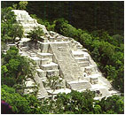  
Calakmul

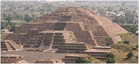  
Teotihuacan. Piramida Księżyca

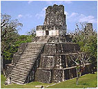  
Tikal

Kształt piramid jest chyba jednakowy dla całego świata. Różnią się jedynie wielkością i kształtem boków. W Ameryce Środkowej nie spotkamy piramidy takiej, jak wielka piramida w Giza. Są przeważnie schodkowe, a niektóre posiadają na szczycie budynek, zwany z urzędu świątynią, choć tak naprawdę nikt nie zna ich przeznaczenia. Są także jedyne w swoim rodzaju piramidy "piętrowe", które można znaleźć między innymi w Teotihuacan.

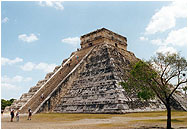  
Chichen Itza

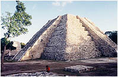  
Mayapan

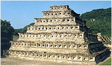  
El Tajin

Zdarzają się prawie jednakowe piramidy jak w Chitzen Itza i Mayapan, co nie musi dziwić, gdyż stoją prawie po sąsiedzku. Piramida w El Tajin jest chyba najdziwniejszą na kontynencie. Wszystkie piętra posiadają nisze i jak twierdzą biegli w matematyce jest ich 365. Przypomina to liczbę dni w roku, ale przynajmniej ja nie mam 100% pewności, że chodzi właśnie o rok. Uczeni nie wiedzą jak lub czym sygnalizowano rok przestępny. Co początkowo zawierały te nisze nie wiadomo. To, że my współcześni wstawilibyśmy do nich jakieś rzeźby, wcale nie znaczy, że takie było ich przeznaczenie.

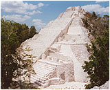  
Becan

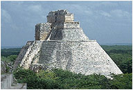  
Uxmal

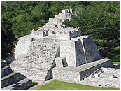  
Edzna

Jakie było początkowe przeznaczenie piramid nie wie nikt i chyba się nawet nie domyśla. To co serwują nam archeolodzy jest myśleniem życzeniowym. Z wysokiej katedry puszczono w obieg teorię, a ponieważ nikt nie śmiał mieć innego pomysłu, teoria stała się niepodważalną prawdą. Nikt, przynajmniej na razie, nie planuje zbadać, co mieści się w ich środku. Twierdzenia o niszczeniu zabytków jest najlepszą wymówką, chociaż nikt nie każe wysadzać ich w powietrze. Czy i tutaj ma zastosowanie hawass'iana teoria "o tęsknocie do nieśmiertelności"?

Następne zdjęcia zadają kłam twierdzeniu, że łuk budowlany wynaleźli "cywilizowani" Europejczycy. Budowniczy w tej części świata potrafili wybudować wszystkie rodzaje łuków. Od trójkątnego, chyba najbardziej powszechnego, po okrągłe i półokrągłe.

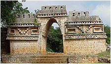  
Labna

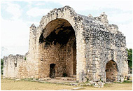  
Dżibilchaltun

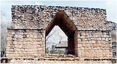  
Ek Balam

Nie bali się przy tym rozpiętości jak widać to w Dżibilchaltun. Czy faktycznie to wszystko jest dziełem koczowników czy małorolnych indiańskich chłopów? Dziś w ruinach starożytnych budowli wypasa się bydło. Sic transit gloria mundi. Tak przemija chwała świata.

Budowle to jednak nie wszystko. Są jeszcze "drobniejsze" dzieła sztuki, do wykonania których potrzeba nie tylko talentu artysty, ale przede wszystkim specjalistycznych narzędzi. Dzieła sztuki od ważących po kilkaset ton jak Tlaloc, kilka ton jak Coatlicue, po filigranową rzeźbę Xolotla wykonaną w jadeicie czy słynne czaszki wykonane z jednego kawałka kwarcu.

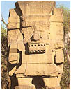

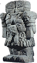

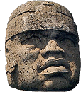

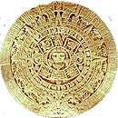

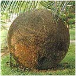

Nie zważaj na wielkość pokazanych obrazków. Starałem się ułożyć je według "tonażu". Najważniejsze w nich to precyzja wykonania. Jakich narzędzi tu użyto? Do obróbki hematytu, jadeitu czy kwarcu nie wystarczy zapewne kamienne dłutko, żeby nie wiem jak małe. Czy to są dzieła tych, po których dzisiaj odnajduje się gliniane skorupy i klepane ozdóbki ze złota? W jaki sposób transportowano 168 tonowy posąg Tlaloca, skoro ostatnią swą drogę do muzeum odbył na specjalnym pojeździe wypożyczonym z USA? Jakie trzeba mieć oczy, a przede wszystkim to "coś" za oczami, by w posągu z samych węży dojrzeć kobietę? Personifikacja? Chyba narząd do myślenia u niektórych naukowców jest też personifikacją.

Olmecka głowa o wysokości ponad dwóch metrów wyrzeźbiona z jednego kawałka kamienia. Czy szuka się pozostałości? Nie, ważniejsza jest ropa naftowa, której poszukiwania niszczą to co jeszcze pod ziemią zostało. Obok tzw. kalendarz aztecki, a w zasadzie sama jego tarcza. Czy to jest kalendarz? Czy wiadomo po co włożono tyle trudu, by go wykonać? Odpowiedziami są tylko tzw. interpretacje, które nie wyjaśniając niczego tylko gmatwają sprawę. Kto wykonał kamienną kulę o wadze ponad 16 ton, a przede wszystkim po co? Prawie wszystkie znajdują się w Kostaryce i w najbardziej niespodziewanych miejscach, w korytach rzek, a nawet wysoko w górach. Kto i w jakim celu je tam umieścił? A może lepiej spytać, jaka siła je tam poprzenosiła?

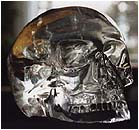

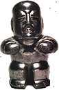

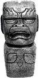

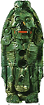

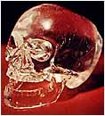

Uczeni bardzo "życzliwie" przyjęli rzeźby uważane za olmeckie. Charakterystycznie wykrzywione usta tych rzeźb uważają za pysk jaguara, a każdy posążek, z uwagi na okrągłą głowę, uznano za tłuczek do moździerza. Ostatnia hipoteza nie jest jeszcze definitywną, bowiem nie odnaleziono jeszcze drugiej części rzeczonego artykułu gospodarstwa domowego. Za to specjaliści od obróbki kamieni szlachetnych nie mogą wyjść z podziwu, jak Majowie zdołali wyrzeźbić z jednego kawałka kryształu górskiego tak doskonałe czaszki (niektóre z ruchomą szczęką). Nie znaleziono na nich nawet malutkiej rysy. Ale od czego mamy archeologów - "tylko dłuższe gładzenie czaszek gołymi rękoma nadało im tak doskonałą gładkość". Przeczytałem, zrozumiałem, oniemiałem.

**Woda, woda i jeszcze raz woda**

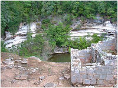

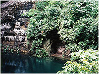

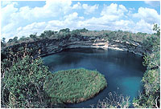

Podstawą do przeżycia jest spożywanie i posiadanie źródeł wody. O tym doskonale wiedzą wszyscy i wszędzie. Nie dotyczy to jednak historyków od starożytności. Dla nich woda jest tylko elementem wierzeń i dlatego obok każdej kałuży szukać będą świątyni Boga wody i jego posągów, choćby mieli kopać kilka metrów w głąb. Ta nieuleczalna mania prześladowcza, choć nie grozi śmiercią i nie kwalifikuje do wizyty u psychiatry, głęboko oddziaływuje na tworzone teorie. Nieuznawanie istnienia w przeszłości wysokiej cywilizacji prowadzi tylko do "rewolucyjnych" i coraz głupszych teorii.

Zgodnie z moją hipotezą, wszystkie skupiska starożytnych ludów musiały egzystować w pobliżu źródeł wody. Problem w tym, że nie wszystkie źródła są widoczne na pierwszy rzut oka. Zamiast się zastanawiać, po co postawiono miasto na pustyni czy w środku dżungli, należy w pierwszym rzędzie odnaleźć źródło wody. W większości przypadków mamy do czynienia z rzeką bądź z jeziorem, ale jak widać na przykładzie Teotihuacan, żródło wody może się mieścić i pod ziemią. Czy piramidę "Słońca" postawiono na nim w celu ochrony?

Na półwyspie Jukatan często mamy do czynienia z tzw. cenote, zbiornikami wody pochodzenia krasowego. Uczeni twierdzą, że powstały przez zapadnięcie się wierzchniej powierzchni skalnej. Dziwna ta przyroda. Niektóre cenote mają kształt prawie idealnego koła i taki kształt zachowują aż do powierzchni wody. Skąd we wszystkich prawie idealnie pionowe skały? Dlaczego wierzchnia wartstwa zawaliła się tak dokładnie na obwodzie cenote? Przypadek? Niektóre posiadają dojścia do samej wody wykute w skale. Kto wykuwał te dojścia, prymitywni Indianie? "Wielka cenote" posiada na dodatek wyspę na samym środku i do tego też okrągłą. Daje to trochę do myślenia. Każda cenote posiadała status świętego źródła, a więc była pod najwyższą ochroną. Nie dziwi, bo woda na Jukatanie, oprócz strumieni nie jest częstym zjawiskiem.

Czy uważasz, że była to zwykła studnia? W jaki sposób kiedyś czerpano z niej wodę? Nie wszystkie mają dojścia do lustra wody położonego dość głęboko, a przecież przez tysiące lat można było wykuć jakieś schody. Czy za każdym razem spuszczano wiaderko na sznurku? To dlaczego nie odkryto żadnych śladów? Z jednego wiaderka można sporządzić posiłek dla rodziny, ale ile wiaderek trzeba wyciągnąć by napoić inwentarz i nawodnić poletka?

Sądzę, że pod tym kątem nie prowadzono żadnych badań. Na górnym zdjęciu obok cenote, widoczne są ruiny jakiegoś budynku. Czy miał on kiedyś związek z dystrybucją wody z cenote, czy jak zwykle jest to świątynka Boga wody? A może to budka dozorcy ówczesnych zakładów wodociągowych? I bardzo ważne pytanie. Czy zwyczaj wrzucania młodych dziewcząt do cenote w celu przebłagania Boga wody powstał w umysłach ludzi już od zarania dziejów, czy dopiero po awarii "urządzeń nawadniających" związanych z cenote? Sadzę, że większość krwawych rytuałów w Ameryce Środkowej należało by łączyć z zaprzestaniem działania nieznanych urządzeń ukrytych w piramidach lub innych budynkach.

**Pierzasty wąż czy wąż-ptak ?**

Przypatrzmy się uważniej najbardziej znanemu wężowi na świecie, który jako jeden z nielicznych awansował na pierwszego Boga narodów Ameryki Środkowej.

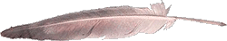

Zacznę jednak od przedstawienia podstawowego elementu rzeczonego Boga jakim jest pióro. Pióro jakie jest każdy widzi. Nie obraź się. Widok pióra przedstawiam dla tych, którzy być może nie widzieli go na własne oczy i dlatego imię Quetzalcoatla przetłumaczyli jako węża okrytego piórami ptaka Quetzala. Rzeczone pióro jako część centralną i rzekłbym nośną posiada tzw. stosinę, do której przymocowane są tzw promienie (z haczykami lub bez).

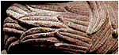

Jako człowiek, rysowanie lub rzeźbienie pióra rozpocząłbyś od stosiny. Jest to główna część, od której zależy kształt i wielkość pióra. I tak zapewne postąpiłby też człowiek w dawnych czasach. Miał, być może, mały zasób wiedzy, ale z powodzeniem nadrabiał to zmysłem obserwacji.

A jak wygląda pióro naszego węża? Spójrz na zdjęcie po prawej. Czy to jest pióro? Tak nie wygląda nawet liść palmowy do pokrycia dachu. Czy starożytny rzeźbiarz nie był bystrym obserwatorem, czy też do ujrzenia tu piór należy posiadać dyplom archeologa z piętnastoletnim stażem? W nazwie brzmi też nazwa pięknego ptaka Quetzala. Ptaszek ten, niezbyt duży, był i jest ceniony przez Indian dla swego upierzenia w kolorach zielonym, czerwonym i białym.

Historia nie podaje ile ptaków należało oskubać z piór by okryć jednego węża (być może ze względu na protesty zwolenników ochrony środowiska), a także pomija kolor piór jakich należało użyć. Ale dość żartów i zajmijmy się Bogiem. Quetzalcoatl jest aztecką nazwą Boga, który występuje jeszcze pod imionami Kukulcan (Majowie) czy Gucumatz (Quiche). Trudno mi wypowiadać się na temat samego przetłumaczenia imienia Boga, ale sądzę, że można je tłumaczyć zarówno jako "pierzasty wąż" lub też "wąż-ptak". Chyba jednak najbardziej odpowiednią nazwą była by - "latający wąż".

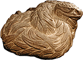

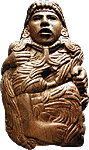

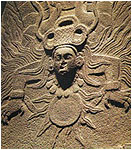

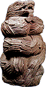

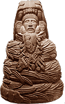

Piękny komplet (prawie) wizerunków pierzastego węża. Rzeźby te, według nauki, powstały stosunkowo niedawno. Jeśli wykonali je Aztecy otrzymujemy rok 1250 ne, a jeśli Majowie możemy cofnąć datę do roku 1500 pne. Jaką datę jednak byśmy nie przyjęli, pozostaje problem narzędzi. Czy te rzeźby wykonano z pomocą kamiennego dłutka? Czym cyzelowano drobne szczegóły? Jakim sposobem nadano kamieniowi taką gładkość i połysk? Zwróć uwagę na środkową postać, przedstawiającą Quetzalcoatla jako Boga Słońca. Czy na reliefie nie wygląda jak Bóg zlatujący z nieba otoczony płomieniami?

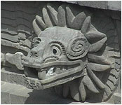

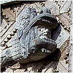

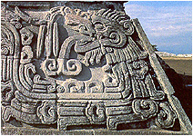

Inne postacie pierzastego węża przedstawione w Teotihuacan, Uxmal i Xochicalco. Tutaj też z trudnością można ujrzeć pióra okrywajace ciało węża, a ponadto ten z Xochicalco składa się z segmentów mogących zginać się nawet pod kątem prostym. Podsumujmy cechy tego ciekawego bóstwa.

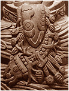

• okrywające go pióra wcale nie przypominają piór,  
• wąż może oplatać postać lub też postać może przebywać w jego wnętrzu,  
• wąż posiada dużo więcej zębów niż jego naturalny odpowiednik i bardziej tym przypomina chińskiego smoka niż przedstawianego grzechotnika,  
• w stosunku do postaci wąż wykazuje uległość, co pokazują złożone "zęby jadowe",  
• wąż z Teotihuacan posiada wokół głowy dwie aureole, ale czy to są pióra?  
• wąż z Uxmal posiada "hak holowniczy" na środku pyska, a wąż z Teotihuacan zakręcone rogi po obu stronach pyska,  
• język węża w niektórych przypadkach wygląda conajmniej dziwnie (zobacz obok).

Czy ten język nie przypomina jakiegoś zestawu technicznego? Relief na pierwszym "języku" jest identyczny z reliefem na języku rzeźby Słońca na słynnym kamiennym kalendarzu Azteków. Drugi zaś w ogóle nie przypomina rozdwojonego języka węża, za to pełno w nim jakichś pasów, taśm, drążków i przycisków. Czy tak nie wyglądał odpięty pas ówczesnego pilota? Czy to jest przedstawienie techniki znajdującej się w środku węża? To właśnie miał chyba na myśli twórca rzeźby. Czy coś jeszcze można powiedzieć o starożytnych wężach i samym Quetzalcoatlu? Można.

• Majowie twierdzą, że trzej prabogowie, których zwano piorunem, błyskawicą i prędkością, zstąpili z nieba razem z Bogiem o dwoistej postaci Tepeu Gucumatzem. Naukowcy oczywiście twierdzą, że chodzi tu o personifikację sił natury. Stara śpiewka, stosowana wtedy, gdy nie wiadomo co powiedzieć lub nie staje wyobraźni. Tak samo można opisać samolot czy rakietę (było szybko, głośno i jasno, a na dodatek z jednego Boga wyszedł drugi),  
• Kukulcan był "niebiańskim wężem" i "niebiańskim potworem", który co pewien czas przybywał na ziemię. Jaki wąż potrafi odbywać kosmiczne podróże? Specjaliści od personifikacji uśmiechają się tylko "wyniośle" (czytaj głupawo),  
• Quetzalcoatl według wyobrażeń Indian miał twarz jak ciężki kloc, a nie jak człowiek, a jego broda była bardzo długa i wielka. Swoją twarz starał się zachować w ukryciu. Człowiek czy maszyna?

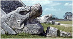

"Jego broda była bardzo długa i wielka". Nie wiem czy porównanie latajacego węża do współczesnego samolotu jest trafne, ale analogia jest uderzająca. Można się dopatrzeć otwartej paszczy i długiej brody. Dlaczego rzeźbiona paszcza węża jest zaopatrzona w zawias? Oko węża może symbolizoważ patrzenie przez przezroczystą kabinę (swoją twarz starał się zachować w ukryciu), a z otwartej paszczy Boga wychodził przecież drugi Bóg. Spytasz zapewne, a gdzie oni lądowali? Uczeni do dziś nie wiedzą co począć z kilkuset kilometrową siecią prostych, szerokich i wypoziomowanych dróg na całym Jukatanie, choć Indianie mówią wprost - to były drogi dla Bogów.

Z tego wszystkiego wyciągam wniosek, że węża należy potraktować jako urządzenie stricte techniczne. Węże potrafią latać. Potrafią przewozić w sobie Bogów. Z tego też powodu, jak sądzę, węża nie otaczały pióra. Węża otaczały płomienie. Być może dlatego pióra Quetzala, którymi Indianie zdobili węża miały mieć kolor czerwony, chyba że otaczające węża płomienie mieniły się czerwono, błękitnie i zielonkawo jednocześnie.

Z przedstawionych artefaktów wyciągam jeszcze jeden wniosek. W sztuce Ameryki Środkowej spotykamy dwa rodzaje węży. Same oraz z postacią w środku. Sądzę, że węże z postacią w swoim wnętrzu obrazują pojazd, którym poruszali się Bogowie. Same zaś węże pełniły funkcję znaku ostrzegawczego przed niebezpieczeństwem. Stąd takie wizerunki na piramidach, przed nimi lub w pobliżu, które pełniły taką sama rolę jak egipskie kobry na niektórych budynkach Egiptu. Mówiły zwykłym ludziom - nie wchodź, tam czeka cię śmierć.

**Obserwatoria astronomiczne ???**

Doskonała znajomość astronomii, szczególnie przez Majów, musiała zaowocować następną hipotezą. Jak i gdzie dokonywali swych obserwacji i pomiarów by osiągnąć tak niebywałą dokładność, którą my, cywilizacja wszechczasów, osiągnęliśmy dopiero niedawno. Oczywiście, że znaleziono. Poniżej obserwatoria astronomiczne w Chitzen Itza, Palenque i Mayapan.

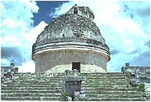

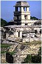

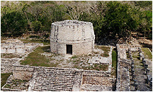

Na zdjęciach widzisz okrągłe budynki, których dachy z powodzeniem nadają się na stropy schronów przeciwatomowych, za to nie widać żadnego dogodnego miejsca do prowadzenia obserwacji. Może superteleskopy umieszczano w miejscach, które dziś są zniszczone? W Palenque za obserwatorium uznano czworokątną wieżę, która jako jedyna udaje "wieżowiec". Tu też trudno zauważyc miejsce dla obserwatora. Czy super dokładne obserwacje prowadzono na zasadzie: "Panie kapłan! Gwiazda wzeszła! Zapisz pan datę!". Do badaczy nie może dotrzeć, że na Jukatanie dogodnych dni do obserwacji nieba jest tak mało, że jak stwierdzili zawodowi astronomowie, na uzyskanie takiej dokładności potrzeba 6-10 tysięcy lat obserwacji. Jak to rozumieć, gdy według historyków Majowie pojawiają się na arenie historii 1500 lat pne. i znikają 1500 lat później? Ktoś tu ordynarnie kłamie i chyba nie są to astronomowie.

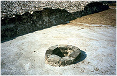

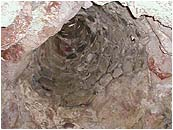

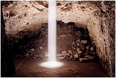

Następnym "poronieniem" wytężonych mózgownic jest obserwatorium astronomiczne w Xochicalco. Tu dla odmiany wylot "teleskopu" znajduje się na poziomie ziemi i posiada otwór o średnicy niecałego metra. Jeden nieświadomy Indianin mógł w każdej chwili przerwać obserwację, zanieczyszczając przy tym twarz astronoma. Otwór w głębi rozszerza się lejkowato, co faktycznie "ułatwia" obserwację dużego obszaru nieba. Za to raz w roku można obserwować piękne zjawisko świetlne z udziałem słońca. Czy obserwatorium wybudowano tylko dla jednego zjawiska? Niewiarygodne marnotrawstwo sił i środków.

Skoro Majom do uzyskania takich wyników zabrakło tylko kilku tysięcy lat, to jak weszli w posiadanie tak wysokiej wiedzy astronomicznej? Zwykła logika podpowiada tylko jedno rozwiązanie - Majowie tę wiedzę otrzymali. Od kogo? Od bardzo wysokiej cywilizacji - cywilizacji Bogów. Po co? Sądzę, że z dwóch powodów. Pierwszy, to słynny cykl 52-letni, pod koniec którego należało bacznie obserwować niebo, gdyż Ziemia zbliżała się do chmury "kosmicznych śmieci" pozostałych po kosmicznej katastrowie Planety X (Tiamat). Majowie nie oczekiwali, jak twierdzą niektórzy, na powrót Bogów. Ci co mieli nadejść nosili imiona "wielu" i "świder ognisty". Meteoryty. Drugi, to prawdopodobna data następnego "wielkiego uskoku skorupy ziemskiej", zapisana w konkretnej korelacji ciał niebieskich. Data Naui Ollin.

**Specyficzna "technologia" budowlana**

Wszystkie budowle Ameryki Środkowej charakteryzuje pewna specyficzna cecha. Całość stwarza wrażenie solidnej budowli. Jednak zrujnowane obiekty pokazują, że za fasadą kamiennych okładzin kryje się wypełnienie złożone z drobnych kamieni spojonych zaprawą. Czy zaczynano od zewnętrznych płyt, po ustawieniu których wypełniano środek, czy najpierw zaczynano od wypełnienia, które obudowywano okładzinami? Na ten temat winni wypowiedzieć się inżynierowie budowlani (ale w żadnym wypadku dzisiejsi archeolodzy). Faktem jednak jest, że przy takim sposobie budowania siłę roboczą mogli stanowić już ludzie. Same budowle oraz organizację budowy mogli planować Bogowie. Składu zaprawy nie znam, bo prawdopodobnie takiego badania nie przeprowadzono. Na skrajnych zdjęciach niżej piramida Quetzalcoatla w Teotihuacan i piramida w Edzna.

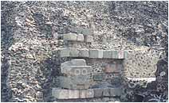

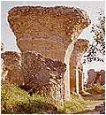

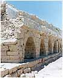

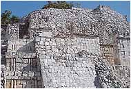

Zdjęcia środkowe przedstawiają analogiczny sposób budowania, ale nie pochodzą z Ameryki Środkowej. Lewe to Kartagina, a prawe przedstawia akwedukt zbudowany rzekomo przez Rzymian. Chyba zdenerwowało cię słowo "rzekomo", bo takiej herezji dawno nikt nie śmiał wygłosić, ale zanim zmienisz stronę odpowiedz sobie na pytania.

• W jakich dokumentach starożytnego Rzymu (pisanych lub rzeźbionych) jest opisana organizacja, koszty czy budowa choćby jednego akweduktu? Było to przecież ogromne przedsięwzięcie państwowe, a nie praca chałupnicza.  
• Dlaczego większość akweduktów znajduje się poza terytorium pierwotnego Rzymu, a w szczególności w Hiszpanii? Czy to Rzymianie budowali akwedukty w Azji Mniejszej? Czy budowali akwedukty swemu największemu wrogowi Kartaginie? Czy meksykańskie akwedukty to też robota Rzymian?  
• Na jakiej podstawie określono wiek budowy akweduktów? Nie określono go wcale. Rzymianie otrzymali akwedukty na własność przez "zasiedzenie".  
• W jakich to czasach większość akweduktów została zniszczona, przez co lub przez kogo? Dlaczego Rzymianie, jako budowniczowie, nie odbudowali nawet ich kawałka? Czy winien był upadek imperium, brak pieniędzy, siły roboczej czy po prostu nie potrafili tego zrobić?  
• Dlaczego w końcu Rzymianie tak pomniejszają, a wręcz pomijają rolę Etrusków, którym w zasadzie zawdzięczają swoje ucywilizowanie? Tak postępują narody egoistów żądne sławy tylko dla siebie i Rzymianie nie są tu żadnym wyjątkiem.

Podobnie jest z wiekiem Colosseum czy Cloaca Maxima. Nie ma żadnych możliwości określenia wieku ich zbudowania, a datowanie na podstawie pozostałości po gladiatorach czy przejedzonych Rzymianach metodą izotopu węgla na pewno nie da odpowiedzi na to pytanie. Osobiście bardzo wątpię w autorstwo Rzymian. Cywilizacja Rzymu, oprócz wojen, zniszczeniu kilku cywilizacji i paru historyków, nie wniosła kompletnie nic do rozwoju cywilizacji Europy i świata. Weszli na gotowe i przywłaszczyli sobie autorstwo. Kłamstwo powtarzane przez wieki stało się obowiązującą prawdą i jest już nie do wykorzenienia.

Czy rzymscy "budowlańcy" pracowali na całym świecie? Od lewej - Turcja, Cypr, Kartagina, Hiszpania i Meksyk.

Jakie jeszcze wnioski? Taką technologię budowlaną stosowano i w Ameryce Środkowej i w Afryce i w Europie. Pamiętasz, co pisał Platon? Królestwo Atlantydy sięgało w Afryce po granicę Egiptu (Kartagina), a w Europie aż po Tyrrenię (Etruskowie). Kiedy zginęła Atlantyda? Około 12,5 tysięcy lat temu. To wtedy, w tym kataklizmie zniszczone zostały piramidy Ameryki, Kartagina i "rzymskie" akwedukty. Nie tylko zresztą one. O prawdziwych historykach nie wspomnę.

**Śmiertelna gra w piłkę**

Jeszcze jeden dowód na pomieszanie z poplątaniem. Hiszpanie w nie tak dawnych czasach przywieźli na ojczysty królewski dwór grupę niewolników z Jukatanu, którzy zdumionym europejskim tubylcom pokazali grę w kauczukową piłkę odbijaną tylko biodrami. Gra była ostra. Grając zapamiętale, zawodnicy łamali sobie wszystko, co tylko dawało się złamać. Panowie dostawali wypieków na twarzy, damy mdlały, a ówcześni uczeni już kombinowali jak wytłumaczyć ten dziki rytuał swojej własnej dziczy.

W czasach już nam współczesnych, uczeni rozpoczęli poszukiwanie korzeni tej brutalnej gry, którą ochrzczono imieniem "tlachtli" i oczywiście znaleźli. Od tej pory każdy skrawek ziemi mający kształt prostokąta, otoczony murem okrzyknięto boiskiem do rytualnej piłki, gdzie zawodnicy odbijają sobie kauczukową kulę wyobrażającą "nasz świat miotany zachciankami bogów".

Być może na ślad wpadli po tym, jak wyczytali w ocalałych przekazach pisanych, że bogowie-planety toczyli walki między sobą. Żeby nie było zbyt łatwo, nauka "każe" jeszcze zawodnikom piłką o wadze kilku kilogramów trafić w otwór obręczy zawieszonej czasem sześć metrów nad ziemią. Na niektórych obręczach wyrzeźbiono dwa splecione ze sobą węże? Czy przejście piłki przez obręcz miało symbolizować "boskie zapłodnienie i narodziny nowej planety"?

Po każdym meczu, krwawa religia dawnych mieszkańców Ameryki nakazywała dobić i tak już zmęczonego kapitana drużyny, ale z reguły "poświęcano" wszystkich. Zwycięzcy otrzymywali dary, a przede wszystkim życie do następnego meczu. Mało tego, uczeni wymyślili jeszcze jedno utrudnienie. Aby chronić biodra przed urazami, zawodnicy nakładali na nie ciężkie, w kształcie podkowy jarzma, ważące po kilka kilogramów. Podobno były ze skóry, ale niektórzy wręcz twierdzą, że były to jarzma kamienne.

Spójrz na zdjęcia powyżej i zastanów się chwilę, co byś powiedział facetowi, który wręczając ci ciężką piłkę lekarską, kazał przerzucić ją przez obręcz wiszącą na ścianie? W tym momencie zgadzam się z tobą całkowicie, tyle że ja wyraziłbym to dosadniej. Czy możesz wyobrazić sobie, że Indianie musieli to robić tylko z pomocą bioder?

Jak wyglądają te "boiska" obejrzyj na zdjęciach. Na pierwszym zdjęciu boisko w Chitzen Itza. Czy widzisz tu boisko, czy plac defilad? Widać, że mecze musiano rozgrywać raczej bez świadków. Gdzie bowiem miejsce dla publiczności? Ilu ludzi biegało za piłką po tak rozległym placu? Jaką technikę stosowano na boisku w Xochicalco (zdjęcie środkowe), a jaką w Monte Alban (po prawej)?

Sprawa jukatańskiego standardu to nie tylko wymiary boisk, to także sprawa różnych średnic otworów, do których miały trafiać piłki. Czy używano różnej wielkości piłek? O co w tym wszystkim chodzi? Czy ta wydumana hipoteza miała usankcjonować krwawy rytuał, czy po prostu odfajkowano sprawę nie wnikając w szczegóły?

Boiska "odnajdywane" w wielu miejscowościach różnią się swoimi wymiarami. Ba, niektóre nie posiadają nawet obręczy. Przy niektórych widać boczne "schody", które od biedy można by zinterpretować jako miejsca dla publiczności, ale co znaczą te bez schodów, a co z takimi, które nie mają ich wcale? Pytania nasuwają się mimo woli.

• Dlaczego boiska nie mają jednakowych wymiarów, jedne są małe, a inne wielkie?  
• Dlaczego jedne ściany boczne są prostopadłe, a inne pochyłe?  
• Dlaczego niektóre pochyłe, boczne ściany są gładkie, a inne schodkowe?  
• Dlaczego jedne boiska mają pierścienie, a inne nie? Złodzieje?  
• Dlaczego pierścienie mają różne wymiary wewnętrznego oczka?  
• Czy mecze oglądali kibice, a jeśli tak to gdzie siedzieli?  
• Czy umieszczenie obręczy ponad głowami widzów było celowym utrudnieniem?

Wiadomo, czepiam się szczegółów, ale czy to naprawdę są boiska? Według mnie zbudował je ktoś inny i w zupełnie innym celu, a ci co wymyślili "tlachtli" należeli już do zupełnie innej cywilizacji. Przejęli budowle, a grę wymyślili sami. Ale kto by odróżniał takie szczegóły. Zwykły zjadacz chleba przełknie wszystko, a niektóry jeszcze pochwali tak wnikliwe podejście do sprawy.

Wynika z tego, że współczesna metoda budowania hipotez jest nadzwyczaj prosta. Jak z wiejskiej studni zrobić zwykły wychodek? Przepis jest prosty. Weź jednego archeologa, powierz mu relację przypadkowego autochtona i poczekaj spokojnie na jego teorię. Może to wyglądać tak:

Dawno, dawno temu, rolnik w środku swej zagrody wykopał studnię. Obudował piękną cembrowiną i czerpał z niej czystą wodę. Minęło kilka pokoleń i studnia wyschła. Na dnie zrobiło się bagno, które zaczynało lekko cuchnąć. Dzieci rolnika, którym bardziej w smak było życie "miastowe", przeniosły się, a ojcowiznę sprzedały bogatemu działaczowi partyjnemu z miasta, bo wieś była uboga, jak nie przymierzając nasza dzisiejsza po reformie znanego profesora ekonomii. Działacz, jako nowy właściciel, oczywiście zburzył stare, pobudował nowe. Starą studnię, której zapach już nie przypominał wody, wziął oczywiście za niezbędny element kanalizacji, zmienił architekturę, dorobił drzwi z serduszkiem i używał dalej, ale już nie opróżniając lecz zapełniając. Po jakimś czasie jego wnuki zainteresowały się osobliwą budowlą i zapytały dziadka co to jest. Dziadek rozpoczął opowieść. Dawno, dawno temu pewien rolnik miał dość chodzenia za stodołę za każdym razem i zbudował sobie...

Takim sposobem myślenia niektórzy dzisiejsi uczeni budują swoje teorie i wcale nie dziwi, że są tak zabawne.

Na zakończenie "kameralne" boiska w Coba. Jak na nich rozgrywano mecze tlachtli trudno mi sobie wyobrazić. Marzeniem moim jest obejrzeć taki mecz w wykonaniu tych, co wymyślili tę teorię. Oczywiście byłbym wspaniałomyślny i nie pozabijał przegranych w myśl przysłowia "Nie zabijaj, samo zdechnie".

**Czy w Europie coś przeoczono ? :-)**

  
  

Czy "tlachtli" nie było przypadkiem dyscypliną międzynarodową? Sądząc po poniższych zdjęciach, chyba tak, ale historycy boją się zaryzykować taką teorię. U nas może nie przejść. Prostokątne kształty nie pozostawiają jednak wątpliwości. Różnice są widoczne tylko w otoczeniu płyty głównej. Co? Nie ma obręczy? A któż zaręczy, że nie było? Uczeni od lat twierdzą, że złodziejstwo to drugi najstarszy zawód na świecie.

Europa miała predyspozycje. Boiska takie były między innymi w Delfach, Olimpii i Epidauros. Dlaczego w Europie dyscyplina ta nie była tak krwawą? To proste. W ówczesnej "Unii Europejskiej" zawodników nie obejmowała kara śmierci. Przechodzili do innych klubów. :-)

**Czas pomarudzić ...**

Jakie wnioski? Jak zwykle poniżej smutku. Współczesna archeologia i historia starożytna, a właściwie jej luminarze pomylili profesje. Zamiast pisać opowiadanka dla dzieci piszą bzdury dla dorosłych. Może jednak przeczuli, że dzieci nie dałyby się nabrać? Tlachtli, to klasyczny przypadek głupiego założenia i jeszcze głupszego dowodu. Krwawy, współczesny rytuał umiejscawia się w początkach dziejów, o których nie ma się zielonego pojęcia. Jest piłka trzeba znaleźć boisko. W ten sposób w budowle wzniesione nie wiadomo kiedy, w jakim celu i przez kogo, wtłacza się folklor indiańskiego plemienia sprzed kilkuset ostatnich lat. Wykorzystuje się w tym celu przekazy spisane przez tych, co wpierw wymordowali całą inteligencję cywilizacji, a potem odtwarzali historię na podstawie ludowych wierzeń, opowiadanych przez ocalałego z pogromów indiańskiego chłopa. Współcześni uczeni ze zwykłego kibla potrafią zrobić salę tronową, jeśli tylko pasuje do ich koncepcji.

• Nie ma absolutnie żadnego dowodu, że istniejące budowle Meksyku czy Jukatanu budowali ci, którym się to przypisuje. Żeby uwiarygodnić te głupoty, budowę jednej piramidy rozciąga się na setki lat. To, co czytamy na temat ich wieku, to dane spod przepoconego berecika archeologa w myśl zasady "ktoś to musiał zrobić".

• Dzieła sztuki z kamienia, niektóre wręcz ogromnych rozmiarów, przypisuje się cywilizacji, której szczytem rozwoju są kamienne żarna, łuki, dzidy i chaty kryte liściami, a która do transportu nadal używa osłów. Precyzyjną obróbkę kwarcu (czaszki) przypisuje się ludziom, którzy potrafili robić tylko gliniane ptaszki, gwizdawki i ozdóbki z piórek.

• Stare przekazy, poparte nawet rysunkami odrzuca się jako niewiarygodne i tworzy teorię, według której starożytni w poszukiwaniu nowej ojczyzny, wędrowali przez góry i doliny Meksyku po piachu i skałach na... łodziach. Jak widać, teoria darwinowskiej ewolucji w odniesieniu do mózgu archeologa nie całkowicie się sprawdza.

• Nieznajomość pisma starożytnych cywilizacji Ameryki skazuje uczonych na sięganie po przekazy pisane przez morderców tychże cywilizacji, spisywane kilkadziesiąt lat po upadku tej rodzimej kultury na podstawie opowiadań całkiem przypadkowych osób.

• Historię tamtych terenów piszą nie ci co ją tworzyli, a brak porównania przekazów pisanych w celu odnalezienia wspólnego źródła, powoduje stworzenie kilku grajdołów cywilizacyjnych, które według uczonych są odrębnymi cywilizacjami. Na razie historia tamtych terenów jest tylko historią miejscowego folkloru.

• Żaden z uczonych nie pokusił się nawet o drobną hipotezę tłumaczącą tak rozległe zniszczenia, które objęły cały rejon Ameryki Środkowej. Ludziom bełta się w głowie, że Aztekowie przed opuszczeniem Teotihuacan zasypali wszystkie piramidy, by nikt z nich nie korzystał. Opuszczenia "miast" tłumaczy się głodem, zarazą, wojnami, a tam gdzie można działalnością wulkanów. Najpierw trzeba ustalić, kiedy naprawdę zbudowano te "miasta", a wtedy powód ich opuszczenia stanie się jasny.

• Niezrozumienie historii Ameryki powoduje powstawanie hipotez, które z prawdą nie mają nic wspólnego, a wręcz uniemożliwiają ukazanie ich spójnej i prawdziwej historii. Dzisiejsze "jedynie prawdziwe historyczne teorie" są tylko wypocinami ludzi, dla których sama myśl o zastosowaniu zwykłej logiki powoduje uczucie zmęczenia i migrenę.

Z opisu poświęcenia świątyni w Tenochtilan (Aztekowie) przekazanego przez kronikarzy hiszpańskich wynika, że w przeciągu 4 dni złożono ofiarę z 72344 jeńców wojennych (inne źródła mówią o 64060). Można obliczyć, że przy nieustannej 24-godzinnej "pracy", co 5-6 sekund wyrywano serce jednemu jeńcowi. Litościwie, przeznaczając na zarzynanie tylko 12 godzin dziennie otrzymujemy jedno wyrwane serce co 3 sekundy. Na szczycie piramidy, zwanej Templo Major, były tylko dwa "stanowiska pracy" - jedno dla Huitzilopochtli, drugie dla Tlaloca. Czy opis hiszpańskiego klechy jest wiarygodny? Jednak na podstawie takich przekazów "stworzono" historię Ameryki Środkowej.

Czy kiedykolwiek dojdziemy prawdy? Wątpię. Dopóki najstarszą historię Ziemi będą badać i komentować historycy dzisiejszego pokroju, to chyba nigdy. Dla tego typu uczonych, którzy jeszcze usiłują coś pisać lub mówić na temat najstarszej historii naszej cywilizacji, proponuję bezwzględnie wprowadzić dewizę stosowaną w medycynie - "**Primum non nocere**". Póki jeszcze wszystkich nie zdołali ogłupić.
