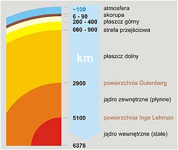
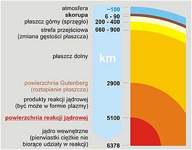
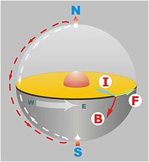
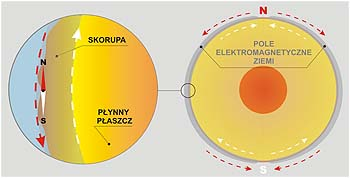
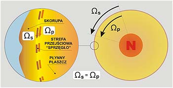
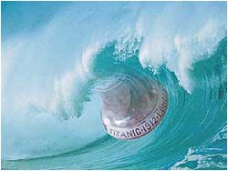

**Pole elektromagnetyczne a wielki uskok**

Nauka postępuje drogą, na której przyjmuje się teorie wynikające z ewolucji wiedzy,  
a z zasady odrzuca rewolucyjne. Tymczasem dokumentowanie jakiejkolwiek koncepcji  
wymaga inicjacji badań w takim kierunku. To zaś w obliczu niechęci wobec rewolucji  
naukowej **jest wręcz niemożliwe**. \[dr J.B.\]

Do dziś naukowe hipotezy na temat budowy naszej planety nie pozwalają wyciągnąć żadnych wniosków na temat zależności pomiędzy zjawiskami zachodzącymi na powierzchni Ziemi. Do dziś nie wiemy jak powstało pole elektromagnetyczne naszej planety i co je ciągle utrzymuje. Nikt nie badał do jakiej wysokości pole to ma wpływ na igłę magnetyczną (w samolotach przecież nie używa się kompasów). Czy ktoś wie, na jaką głębokość dociera energia "pioruna" w nierozproszonej postaci? Jak głęboko pod ziemią następuje rozproszenie tej energii, czy sięga najgłębszych części skorupy ziemskiej? Czy "piorun" uderzając w wodę przebiega aż do dna? A może jeszcze głębiej? Dlaczego intensywność burz maleje wraz z odległością od równika, by prawie nie występować w okolicach biegunów? Dlaczego burze występują częściej wieczorem, w nocy czy wczesnym rankiem, a rzadziej w środku dnia? Czy istnieją elektrostatyczne wyładowania podziemne i podwodne? Nauka nie odpowie w pełni na żadne z zadanych pytań z tego względu, że takich badań nie prowadzono i nie prowadzi się, bo nie widzi się sensu ich prowadzenia.

**Gorące "złomowisko" czy reaktor?**

Budowy wnętrza Ziemi nauczono nas w szkole i od tej pory jest to dla nas prawda absolutna. Wszelkie inne hipotezy budzą w nas odruch niewiary, a sami nie widzimy powodu zagłębiać się w nową myśl, bo w zasadzie nie widzimy w tym sensu, a sama zmiana sposobu myślenia nie przyniesie nam żadnych korzyści. Problem jest jednak głębszy, bo jak wiemy wszystko to, co dzieje się na powierzchni Ziemi, czy prędzej czy później dotknie nas osobiście. Jak do tej pory niewiele zjawisk zostało wyjaśnionych w sposób wiarygodny. Wiele zjawisk umyka racjonalnemu wyjaśnieniu. Dlaczego tak się dzieje? Dlatego, że wnioski wyciągamy na podstawie błędnych lub nie do końca jasnych założeń. Istnienie tzw. promieniowania tła przypisuje się promieniowaniu kosmicznemu. Jeśli w dalszym ciągu będziemy uważać, że jądro Ziemi jest magazynem "żelaznych gwoździ", to siłą rzeczy wniosek musi nas kierować w stronę kosmosu. To, że Ziemia wypromieniowuje ciepło w kosmos, tłumaczy się nagrzaniem jej przez Słońce. Wystarczy jednak w słoneczny dzień włożyć rękę pod kępkę mchu, by przekonać się, że ciepło już tam nie dochodzi. A co zrobić z bilansem ciepnym, który mówi, że Ziemia oddaje w kosmos więcej ciepła niż może otrzymać go od Słońca?

Czy czas już zmienić podstawowe założenie dotyczące budowy Ziemi? Wydaje się, że tak. To, że w środku Ziemi działa już miliardy lat atomowy reaktor nie jest tylko moim wymysłem. Tak myśli wielu naukowców i zwykłych ludzi (między innymi [Marvin Herndon](http://portalwiedzy.onet.pl/4868,12799,1375295,czasopisma.html)). Myśl ta nie może się jednak przebić w ortodoksyjnej nauce i rzadko takie hipotezy zamieszczają nawet zwykłe gazety, na dodatek w rubryce ciekawostki. Dotychczasowa hipoteza budowy Ziemi jest tylko i wyłącznie teorią dedukcyjną i to nie weryfikowaną od wielu, wielu lat. Nikt nie jest w stanie zbadać wnętrza Ziemi, a podziału na warstwy dokonano na podstawie wnioskowania z badań rozchodzenia się fal sejsmicznych i chyba tylko te są prawdopodobne.

  
Tak myśli większość,

  
a tak myślą nieliczni.

Jądro Ziemi to pierwiastki ciężkie, w tym przeważająca większość promieniotwórczych, które "spłynęły" do wewnątrz w procesie formowania się planety z pyłu kosmicznego. Na zarzut, że pierwiastki promieniotwórcze stanowią znikomą część w całym kosmosie, odpowiadam: stosunek procentowy pierwiastków radioaktywnych do ich reszty określono tylko na podstawie badań ich zawartości w skorupie ziemskiej i tę liczbę rozciągnięto na cały kosmos. Czy jest to wiarygodne? Z pewnością nie, bo wynik dotyczy tylko znikomego fragmentu kosmosu, a stąd już blisko do żelaznego jądra (czy nawet jąder skalisto-lodowych na innych planetach :-)), bo w skorupie ziemskiej żelaza jest sporo. Uwzględnienie takich mas w jądrach planet i gwiazd, to także być może brakująca masa we wszechświecie i teoretyczne dorabianie "ciemnej materii" nie ma żadnego sensu.

Reakcja rozszczepiania pierwiastków zachodzi na powierzchni jądra i jądro spala się jakby do wewnątrz. Bardzo możliwe, że tzw. powierzchnia Gutenberga jest powierzchnią jądra w momencie zaistnienia początkowej reakcji, czyli określa początkową wielkość jądra Ziemi. Dzisiaj pomiędzy powierzchnią Gutenberga a jądrem zalegają produkty rozpadu i bardzo możliwe, że w formie plazmy (a może w formie lotnej np. pary ołowiu jako końcowego produktu rozszczepiania pierwiastków radioaktywnych, nie wiem). Jak panuje tam temperatura? Prawdopodobnie trochę niższa niż podczas wybuchu jądrowego, ale wystarczająca, by cały czas utrzymywać płaszcz Ziemi w stanie płynnym i generować ruch konwekcyjny. Wraz z wygaśnięciem reaktora, Ziemia wystygnie i zamieni się w skalisty, martwy glob.

W miarę wzrostu odległości od jądra Ziemi temperatura wraz z ciśnieniem ciągle maleje, by w skorupie osiągnąć temperatury zbliżające się do zera na jej powierzchni. Można z tego wyciągnąć ogólny wniosek - po ziemią temperatura jest zależna od samej Ziemi, natomiast za temperaturę na powierzchni Ziemi jest odpowiedzialne Słońce i nasza ziemska atmosfera hamująca oddawanie słonecznego ciepła z powrotem w kosmos. Podobnie, jak sądzę, za promieniowanie tła odpowiada nasz wewnętrzny reaktor. Reakcja jądrowa wyzwala promieniowanie alfa, beta, gamma, neutronowe (może jeszcze inne, ale nie wiadomo) i to promieniowanie dociera do powierzchni Ziemi i dalej w kosmos. Teoretycznie więc jego wielkość powinna być zależna od grubości skorupy (największa wartość powinna być na dnie oceanu), ale najprawdopodobniej (ze względu na małe różnice w grubości skorupy ziemskiej) są to nieznaczne odchylenia nie dające się zmierzyć dzisiejszymi przyrządami.

**Największe "sprzęgło" świata**

Koncepcja jądra Ziemi, jako reaktora atomowego, ma też zasadniczy wpływ na hipotezę pola elektromagnetycznego. Jeśli reakcja nuklearna zachodzi na powierzchni kuli, to nie widzę żadnej możliwości powstawania tam spolaryzowanego i jednorodnego pola magnetycznego. Podobnie rzecz ma się z płynnym płaszczem, gdzie stały ruch konwekcyjny nie zapewnia jednolitej polaryzacji magnetycznej. Jeśli tam nie może zaistnieć jednorodne pole magnetyczne, to pozostaje tylko skorupa ziemska wraz z jej atmosferą. Stąd też moje "dziwne" pytania we wstępie artykułu.

Istnieją dwa rodzaje pola magnetycznego - naturalne i wzbudzane przepływem prądu elektrycznego. Zajmijmy się tym drugim. Wiemy, że w każdej chwili, gdzieś na Ziemi następuje wyładowanie atmosferyczne. Wyładowania trwają w zasadzie bez przerwy, choć nie występują wszędzie jednocześnie. Jest to wyładowanie elektrostatyczne, zawsze o tym samym kierunku atmosfera-ziemia. O potędze wyładowania nie ma sensu pisać, bo jest powszechnie znane. Zajmijmy się jego skutkami i to w sensie fizycznym. Rozpatrując każdy "piorun" jako prąd płynący w przewodzie, musimy dojść do wniosku, że generować musi potężne pole elektromagnetyczne.

**Tam gdzie płynie prąd elektryczny, musi działać też siła.**

Jeśli założyć, że każde wyładowanie dociera "w całości" do styku skorupa-płaszcz, to zgodnie z regułą "trzech palcy" generuje pole magnetyczne skierowane w stronę naszego "południa" i siłę skierowaną w kierunku zachód-wschód. Pomnóżmy to wszystko przez ilość wyładowań w czasie, a otrzymamy siłę być może zdolną do poruszenia skorupy ziemskiej i podtrzymywania obrotu kuli ziemskiej. Z tej koncepcji wynika także, że nasze pole elektromagnetyczne jest polem "**naskórkowym**" i jest generowane oraz utrzymywane tylko w obrębie skorupy ziemskiej. Możliwe, że z tego też powodu jest słabe i bardziej podatne na zakłócenia (anomalie) wynikające z niejednorodności składu ziemskiej skorupy.

Skorupa ziemska nie jest umocowana na stałe do płynnego płaszcza, a siła obrotu jest przenoszona na resztę globu przez siły tarcia występujące na styku skorupa-płaszcz, działając na zasadzie **sprzęgła hydraulicznego**. Prędkości kątowe skorupy i płaszcza wyrównywały się miliardy lat i dzisiaj wynoszą 24 godziny na pełny obrót. Czy jądro też się obraca? Tu powinni wypowiedzieć się teoretycy. Jeśli gęstość ośrodka będzie maleć wraz ze wzrostem ciśnienia i temperatury, to siły tarcia (a w zasadzie lepkości) w rzadkim ośrodku będą bardzo małe. Nie wiemy ponadto w jakim stanie fizycznym znajduje się materia pomiędzy jądrem a płaszczem. Jeśli ma konsystencję płynną lub zbliżoną do lotnej, siły tarcia mogą mieć znikomy wpływ na obrót samego jądra. Jądro może się obracać, ale wolniej w stosunku do reszty planety.

Naukowcy dowodzą , że prędkość obrotu Ziemi wokół własnej osi nie jest wielkością stałą. Na dzisiaj Ziemia ma tendencje do wyhamowywania, ale są to niezmiernie małe wartości i dla nas niezauważalne. Co może być przyczyną hamowania? Bardzo możliwe, że wypalanie się naszego jądra, które jest głównym "dostawcą" wolnych elektronów. Za dostarczanie energii do podtrzymania prędkości obrotu naszej planety odpowiada, jak sądzę, intensywność burz, a co za tym idzie ilość wyładowań atmosferycznych (choć nie można wykluczyć, że to jedyne wyładowania elektrostatyczne na Ziemi). Po to by obrót ziemi dookoła własnej osi przebiegał bez przeszków wymagana jest jednakowa prędkości kątowa ośrodków - skorupy i płaszcza. Ze względu na ogromną masę płaszcz możemy tu pominąć, gdyż raz nadaną prędkość powinien utrzymywać bardzo długo siłą bezwładności.

Zupełnie inaczej dzieje się ze skorupą ziemską. Jeśli podtrzymywanie pola elektromagnetycznego, a co za tym idzie i obrotu, jest zależne od intensywności wyładowań elektrostatycznych, to można wnioskować, że każda zmiana ich intensywności będzie wpływać na prędkość obrotu. Nie wolno nam także pominąć roli Słońca. W jaki sposób wybuchy na Słońcu wpływają na nasze pole magnetyczne. Czy powiększają czy zmniejszają jego wartość i jak znaczne mogą być te zmiany. Rolą nauki winno być wyliczenie sił "tarcia" na styku skorupa-płaszcz, a przede wszystkim maksymalnej tolerancji, przy której nasze sprzęgło nie doznaje "poślizgu" i przełożenie tego na skrajne wartości pola magnetycznego, które przecież już potrafimy mierzyć.

Każda zmiana prędkości musi się przełożyć na siły "tarcia" w ziemskim "sprzęgle", czyli na styku skorupa-płaszcz, a takie sprzęgło ma to do siebie, że na skutek różnych prędkości ścierających się "tarcz", może zaistnieć "poślizg" na styku dwóch ośrodków. Co oznacza to w warunkach ziemskich? Oznacza "wielki uskok skorupy ziemskiej". Jeśli to swoiste "sprzęgło" traci przyczepność, do głosu dochodzą masy nierówno rozłożone na powierzchni Ziemi oraz ruch obrotowy (hipoteza Hapgood'a), które wytworzą wypadkową decydującą o kierunku tego ruchu oraz o odległości przesunięcia skorupy. Oznaczać to także może, że "wielki uskok..." nie musi być zjawiskiem jednoetapowym. Może składać się z kilku etapów rozłożonych w czasie do momentu, mówiąc językiem potocznym, ponownego "zaskoczenia" ziemskiego sprzęgła. Charles Hapgood najprawdopodobniej miał rację. "Wielki uskok skorupy ziemskiej" może być cyklicznym zjawiskiem.

Teraz należy raz jeszcze przyjrzeć się badaniom naukowym i stwierdzić, czy w okresie "wędrówki" biegunów, występowały zmiany (i jak duże) pola magnetycznego Ziemi, ale za to muszą się już zabrać naukowcy, ludzie mający bezpośredni dostęp do wyników takich badań.

**Dopisano 15 marca 2006 r.**

Czy zmiany pola magnetycznego mogą mieć wpływ na trzęsienia ziemi? Jeśli powyższa hipoteza zawiera w sobie choć część prawdy, to chyba tak. Jeśli na świecie monitoruje się w sposób ciągły wahania ziemskiego pola magnetycznego, możnaby dokonać porównania "skoków" natężenia pola magnetycznego z trzęsieniami ziemi, które już miały miejsce. Idąc dalej możnaby zbadać położenia Księżyca w dniu wystąpienia trzęsienia. Księżyc ma największy wpływ na skorupę ziemską. Znamy przecież zjawisko przypływów i odpływów. Czy zjawisko to, choć w dużo mniejszym stopniu, dotyka także twardej skorupy? Jeśli tak, to może w połączeniu z wahaniami pola magnetycznego tworzy być może jakiś związek przyczynowo-skutkowy. Rzecz warta sprawdzenia tym bardziej, że nie pociąga za sobą jakiś ogromnych nakładów finansowych.

**Szansa przeżycia równa 0,0000000001**

Jestem okrutny? Nie, jestem realistą. Ludzkość nie jest przygotowana na taką ewentualność. Nauka odpowiedzialna za rzetelność i wiarygodność, a przede wszystkim za celowość badań, nie robiła i nie robi nic w tym kierunku. Z upływem wieków zamknęła się sama w sobie i jest raczej sztuką dla samej sztuki, niż pomocą dla ludzkości. Hipotezę Couvier'a potraktowano jako curiosum, hipotezę Hapgood'a nie inaczej. Dlaczego? Dlatego, że ostrzeżenia z przeszłości potraktowano jak klechdy ludowe nie wnikając w treść przekazu. Dlatego, że człowiek zrobił się zarozumiały i arogancki. Myśl, że może zmienić przyrodę tylko po to, by pracowała za niego, uczynił uczynił swoim życiowym mottem.

Jakie są tego skutki widać już coraz wyraźniej i są to skutki nad wyraz opłakane. Współczesna medycyna bierze się za klonowanie ludzi, a nie może dać sobie rady ze zwykłą ptasią grypą. Powtarzam raz jeszcze - współczesny człowiek nie odczuwa żadnej pokory przed siłami natury, a co gorsza wcale nie próbuje jej zrozumieć. Odrzucenie starożytnych przekazów i zagłuszanie inaczej myślących, wprowadziło prawie wszystkich w stan błogiego samozadowolenia i samouspokojenia. Troskę o ludzkość umiemy tylko wyrażać w różnych deklaracjach, czynów zaś żadnych.

Cóż z tego, że wiemy iż Noe wiadomość o potopie powziął na 300 lat przed jego zaistnieniem? Cóż z tego, że wiemy, że na tydzień przed nim otrzymał polecenie wejścia do arki?

Cóż z tego, że Księga Henocha ostrzegała - "Nastanie wielkie zniszczenie na całej ziemi, nastanie potop, przez cały rok będzie wielkie zniszczenie na ziemi."? Wszystko już było i nie ma prawa się już wydarzyć? Co zatem z tekstem Indian meksykańskich - "To jest piąte Słońce, które się utrwaliło, podczas tego Słońca nastąpi wstrząs, podczas niego będzie głód i tak zginiemy."? Jak potraktować tekst kroniki z Akakkor - "Kronika z Akakor zawiera tajemnice wybranych plemion. \[...\] Opisuje rozwój i upadek wybranego przez bogów ludu aż do końca świata, kiedy to bogowie powrócą po trzeciej wielkiej katastrofie, która zniszczy ludzi."?

Ludzie czytają to jak "Baśnie z 1000 i jednej nocy", a naukowcy nawet tam nie zaglądają, bo nie licuje to z ich "godnością". Co gorsza, na prawo i lewo rozgłaszają wiadomości o fałszywych znaleziskach, jeśli nie pasują do ich "wypieszczonych" teorii. Gdzie nasze setki lat na przygotowania? Zmarnowane na głupie pomysły i wojny. Kto nas ostrzeże? Nikt, a już na pewno nie współcześni naukowcy. Oni sięgaja po peryferie wszechświata, nie mając najmniejszego pojęcia o tym, co jest pod ich stopami. To im zawdzięczamy taką, a nie inną "szansę" przeżycia. Ziemia sama otrząśnie się z głupców, jak my otrzepujemy się z natrętnych mrówek. Tylko dlaczego przez głupców mają ucierpieć zwykli ludzie?
