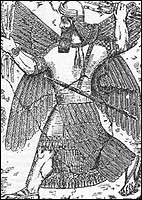

**Z księgi astronomicznej Henocha**  
Mądrość nie znalazła miejsca na swe zamieszkanie i jej siedzibą było niebo.  
Przyszła, aby zamieszkać wśród synów ludzkich, ale nie znalazła miejsca.  
Wróciła na swoje miejsce i zasiadła w pośrodku aniołów. \[z księgi Henocha\]

O Henochu słyszeli chyba wszyscy, a w szczególności czytający Biblię i zarażeni wirusem "denikenitis". Był jednym z patriarchów żyjących przed potopem. Jego synem był Matuzalem, ojciec Lamecha i dziadek Noego. Nazywany był boskim pisarzem lub pisarzem sprawiedliwości. Był pośrednikiem w rozmowach Boga z "upadłymi" aniołami. Został zabrany do nieba, do siedziby Boga, by po odebraniu nauk wrócić na Ziemię i przekazać "księgi mądrości" ludziom. On przekazał wieść o nadchodzącym potopie i to, że jedynym którego Bóg ocali od zagłady będzie Noe wraz z najbliższą rodziną. Po rocznym pobycie na Ziemi został powtórnie i już na stałe zabrany do siedziby Boga.

    **H**enoch, człowiek błogosławiony i sprawiedliwy, któremu Pan otworzył oczy i obdarzył świętym widzeniem w niebiosach, zabrał głos i powiedział: pokazali mi aniołowie! Usłyszałem od nich wszystko i zrozumiałem to, co zobaczyłem, choć przeznaczone to jest nie temu pokoleniu, lecz pokoleniom dalekim, które dopiero nadejdą.

Chciałbym zwrócić uwagę na specyficzny język księgi Henocha. Jest to język starotestamentowy, prosty i czasem nie do końca zrozumiały. Nasza interpretacja też nie jest bez znaczenia. Proste słowo "widzenie" interpretujemy jako wizjonerstwo czy jasnowidzenie kojarzone przede wszystkim z wróżeniem. Ja to odczytuję jako "naoczny świadek" widzący coś na własne oczy. Czy widzenie senne koniecznie musi być snem? We snie oglądamy coś, co nie dzieje się w rzeczywistości lub nie w czasie rzeczywistym. Z powodzeniem naszym sennym widzeniem może być oglądanie telewizji. Gdyby widzenia senne były rzeczywiście snami, to można odnieść wrażenie, że w tamtych czasach niektórzy ludzie bez przerwy spali.

**Droga Słońca - kalendarz**

Henoch po "wzięciu" do Nieba odbył swoistą wycieczkę, oglądając Kosmos i samą Ziemię. Wiele z jego przekazu jest mało zrozumiałe. Przekaz o trzech górach - "Ujrzałem tam święta górę, a pod górą, po jej wschodniej stronie była woda płynąca ku południowi.

Ujrzałem po stronie wschodniej inna górę, która była tej samej wysokości, a pomiędzy nimi była głęboka i wąska dolina, w której obok góry płynął potok. Po jej stronie zachodniej była inna góra, która była niższa od tamtej i niewysoka.", nie wiem czemu kojarzy mi się z trzema piramidami w Giza. Dlaczego są góry "święte" i "nie święte"? Czy "święte" góry były "budowane przez "świętych"?

Czytając księgę Henocha nie sposób nie zauważyć, że aniołowie nie mieli, jak dziś się przedstawia, ptasich skrzydeł opuszczonych do dołu i wyrastających z ich ciał . Henoch pisze: "W owych dniach ujrzałem, jak dano dwom aniołom długie powrozy. **Przypięli sobie skrzydła i polecieli na północ**. Zapytałem anioła mówiąc: "Dlaczego wzięli oni długie powrozy i poszli?" Powiedział do mnie: Udali się dokonać pomiarów.". Istnieją też opisy, że aniołowie mieli po cztery skrzydła? Pewnym wyjaśnieniem zagadki może być postać Marduka z reliefu przedstawiającego walkę z Tiamat. Podobne ułożenie skrzydeł mają wizerunki tzw. "skrzydlatych geniuszów" z reliefów mezopotamskich czy figurka demona Pazuzu. Skrzydła nie zwisają swobodnie w dół, te skrzydła są ułożone na krzyż. Jak z takimi skrzydłami można latać? Oczywiście, że tylko tak jak śmigłowiec. Przypiąć je sobie i polecieć, tak jak opisał Henoch. Przekazać zaś potomnym można było za pomocą symboli - tylko ptasie skrzydła kojarzą się z lataniem.

Księga astronomiczna jest spisanym przez Henocha wykładem, jaki otrzymał od anioła Uriela ("Uriel - jeden ze świętych aniołów, mianowicie gromu i drżenia"). Wykład o Słońcu jest bardzo precyzyjny i choć pisany nie naukowym językiem sprawę wyraża nader naukowo, o czym można się przekonać. Henoch napisał we wstępie: "Księga obrotów świateł niebieskich, stosownie do ich właściwości i klas, zgodnie z ich regulaminem i okresami, ich imionami i miejscem pochodzenia oraz miesiącami. \[To wszystko\] pokazał mi mój przewodnik święty anioł Uriel. Oznajmił mi wszystkie ich regulacje dokładnie takie, jakie przypadają na każdy rok świata i na wieki, aż nastanie nowe stworzenie, które trwać będzie na wieki.".

    **P**ierwsze prawo świateł jest takie. Światło słońce wschodzi we wschodnich bramach nieba, a chowa się w zachodnich bramach niebios. Widziałem sześć bram, z których słońce wychodzi i sześć bram, w których się chowa. W tychże bramach wschodzi i zachodzi księżyc. \[Tak samo\] dowódcy gwiazd razem z prowadzonymi przez nich \[zastępami\]. Jest \[ich\] sześć na wschodzie i sześć na zachodzie, każda dokładnie na swoim miejscu, jedna koło drugiej. W bramach tych są okna po stronie południowej i północnej. Najpierw wstaje światło większe zwane słońcem. Jego kolistość podobna jest do kolistości niebios. Cale wypełnione jest ogniem dającym światło i ciepło. Wiatr popycha powóz, na który \[ono\] wstępuje. Słońce zstępuje z nieba i północną drogą powraca na wschód. Jest tak prowadzone, żeby trafiło do właściwej bramy i \[znowu\] zaświeciło na niebie.

"Sześć bram", to obszar nieba, w szerokości którego następuje wschód Słońca, Księżyca, a także grupy gwiazdozbiorów zaliczanych do Zodiaku (dowódcy gwiazd razem z prowadzonymi przez nich). Za dowódców gwiazd można chyba uznać najjaśniejsze gwiazdy (alfa) w każdym gwiazdozbiorze. Sądząc po "widzeniu" północnej drogi powrotnej Słońca z zachodu na wschód, domyślać się należy wykładu prowadzonego w kosmicznej sali wykładowej.

    **I** tak w pierwszym miesiącu wstaje ono w dużej bramie, mianowicie w czwartej z sześciu bram, znajdujących się na wschodzie. W tej czwartej bramie, z której słońce wstaje w pierwszym miesiącu, znajduje się dwanaście okien, z których, gdy są otwarte, wydobywają się płomienie. Kiedy słońce wschodzi na niebo, to przez **trzydzieści dni** wychodzi tą czwartą bramą i dokładnie chowa się do czwartej bramy po zachodniej stronie nieba. W tych dniach dzień staje się codziennie dłuższy, a noc staje się coraz krótsza, aż do trzydziestego poranka. W tym okresie dzień jest dłuższy od nocy o 2/9 dnia i wtedy dzień ma dokładnie dziesięć części, a noc osiem części. Słońce wschodzi z czwartej bramy i zachodzi do czwartej bramy.  
    **P**otem na **trzydzieści poranków** powraca do piątej bramy po stronie wschodniej. Wschodzi z niej, a \[potem\] zachodzi do piątej bramy. Wtedy dzień staje się dłuższy o dwie części i dzień ma jedenaście części. Noc staje się krótsza i dochodzi do siedmiu części.  
    **N**astępnie słońce powraca na wschód i wchodzi do bramy szóstej. Ze względu na swój znak przez **trzydzieści jeden poranków** wstaje \[z szóstej, wschodniej bramy\] i zachodzi do szóstej bramy. W tym okresie dzień staje się dłuższy od nocy i dzień jest podwojeniem nocy. Dzień osiąga dwanaście części, a noc staje się krótsza i osiąga sześć części. Słońce wstaje tak, że dzień staje się krótszy, a noc dłuższa.  
    **S**łońce powraca na wschód i wchodzi do szóstej bramy i powstaje z niej i zachodzi przez **trzydzieści poranków**. Po skończeniu trzydziestu poranków dzień skraca się dokładnie o jedną cześć. Dzień ma wtedy jedenaście części, a noc siedem części. Słońce wychodzi z zachodu poprzez tę szósta bramę i udaje się na wschód.  
    **N**astępnie przez **trzydzieści dni** powstaje w piątej bramie. Potem zachodzi ponownie po stronie zachodniej, w piątej zachodniej bramie. W tym okresie dzień maleje o dwie części i dochodzi do dziesięciu części, a noc do ośmiu części. Słońce wschodzi przez tę piąta bramę i zachodzi do bramy piątej na zachodzie.  
    **W**schodzi w czwartej bramie przez **trzydzieści jeden poranków** zgodnie ze swoim znakiem i chowa się na zachodzie. W tym czasie dzień równy jest nocy. Noc ma dziewięć części i dzień dziewięć części. Słońce wschodzi przez te bramę i chowa się na zachodzie.  
    **P**owraca na wschód i wschodzi w trzeciej bramie przez **trzydzieści poranków** i chowa się na zachodzie w trzeciej bramie. W tym czasie noc wydłuża się, jest dłuższa od \[poprzedniej\] nocy, a dzień codziennie jest krótszy od \[dnia poprzedniego\] aż do trzydziestego poranka. Noc osiąga dokładnie dziesięć części, a dzień osiem części. Słońce wschodzi przez trzecia bramę, a zachodzi w trzeciej zachodniej bramie i wraca na wschód.  
    **S**łońce wstaje przez druga bramę wschodnią przez **trzydzieści poranków** i zachodzi w drugiej bramie po stronie zachodniej nieba. W tym dniu noc osiąga jedenaście części, a dzień siedem części. Słońce wschodzi w tym czasie drugą bramą i chowa się do drugiej zachodniej bramy.  
    **P**owraca na wschód do pierwszej bramy przez **trzydzieści jeden poranków** i zachodzi po zachodniej stronie do pierwszej bramy. W tym dniu noc wydłuża się i jest dwukrotnie dłuższa niż dzień. Noc osiąga dokładnie dwanaście części, a dzień sześć części.  
    **T**ak wiec słońce skończyło stację swej wędrówki i powróciło ponownie do stacji swej wędrówki. Przechodzi przez \[pierwszą\] bramę przez **trzydzieści poranków** i zachodzi po stronie zachodniej naprzeciwko niej. W tym czasie noc staje się krótsza o jedną część (...) osiąga jedenaście części, a dzień siedem części.  
    **S**łońce wraca, wchodzi do drugiej wschodniej bramy i powraca wzdłuż tych sekcji swej wędrówki przez **trzydzieści poranków**, powstając i zachodząc. W tym czasie dzień staje się krótszy, noc osiąga dziesięć części, a dzień do ośmiu części.  
    **W** tym czasie słońce wychodzi druga bramą, chowa się na zachodzie, powraca na wschód, powstaje w trzeciej bramie przez **trzydzieści jeden poranków** i chowa się po zachodniej stronie nieba. W tym czasie noc staje się krótsza i osiąga dziewięć części. Dzień \[również\] osiąga dziewięć części, \[tak że\] noc staje się równa dniowi.

Tak wygląda roczna wędrówka Słońca po ziemskim niebie według Henocha. Nie mam tylko pojęcia co to jest "znak" Słońca występujący w miesiącach mających 31 dni. Proszę zwrócić uwagę na podział doby. Suma części dnia i nocy jest liczbą 18. Jeśli długość doby w stopniach (360) podzielimy przez 18 otrzymamy liczbę 20. Czy to jest 1/3 z 60, czy jakaś wskazówka kierująca nas w stronę systemu dwudziestkowego. Dwudziestkowy system liczenia mieli Majowie, a i dziś jego echa pobrzmiewają w liczebnikach Francuzów i Basków. System sześćdziesiętny był stosowany w starożytnej Mezopotamii. Po za tym jak podzielić koło na 18 równych części, nie mając odpowiednich przyrządów?

    **R**ok liczy dokładnie trzysta sześćdziesiąt dni. Długość dnia i nocy oraz krótkość dnia i nocy różne są w zależności od biegu słońca. Dlatego jego wędrówka w dzień staje się dłuższa, a w nocy krótsza. To jest prawo i bieg słońca oraz jego powrót, ilekroć powraca. Sześćdziesiąt razy powraca i pozostaje. Jest to wielkie wieczne światło, które na wieki wieków nazwane jest słońcem. To, które powstaje, jest wielkim światłem, a nazwane tak jest z nakazu Pana ze względu na swój wygląd. Powstaje ono i zachodzi. Nie zmniejsza się ani nie odpoczywa. Dzień i noc wędruje tak na swym wozie. Jego światło siedmiokroć jest jaśniejsze od światła księżyca, ale w rozmiarach oba są równe.

Rok liczy 360 dni? Tak. Podobne kalendarze mieli i Egipcjanie i Majowie, w których na końcu dodawano 5 feralnych dni (w zapiskach Hiszpanów jest wzmianka, że czasem dodawano 6 dni feralnych), stąd wniosek że starożytni doskonale zdawali sobie sprawę z faktycznej długości roku. A u Henocha? Czytamy dalej.

    **P**rzywódcy tysiączników stojący na czele całego stworzenia i na czele wszystkich gwiazd kierują również czterema dodatkowymi dniami, które nie są odjęte od całkowitej liczby dni roku. Te \[ostatnie\] służą dla czterech dni, które nie zostały włączone do liczby dni roku. Z ich powodu ludzie postępują w ich czasie źle, bo te światła faktycznie stoją na pozycjach świata, jedno w pierwszej bramie i jedno w trzeciej bramie, jedno w czwartej bramie i jedno w szóstej bramie. Doskonała harmonia świata spełnia się w oddzielnych trzystu sześćdziesięciu stacjach świata.  
    **Z**godnie z \[tą liczbą\] słońce podróżuje po niebie, wchodząc i wychodząc przez bramy przez trzydzieści dni z tysiącznikami \[wyznaczonymi do\] tego porządku gwiazd \[i\] z czterema dodatkowymi \[dowódcami\], którzy dzielą rok na cztery części, przewodniczą im i pojawiają się z nimi w czterech dniach. Z ich powodu ludzie postępują błędnie nie wliczając ich do rocznego kalendarza. Mylą się z ich powodu, bo nie znają ich dokładnie. Faktycznie należą one do liczby dni roku i wpisane są weń na zawsze, jeden w pierwszej bramie, drugi w trzeciej, trzeci w czwartej, a czwarty w szóstej. Rok kończy się w trzysta sześćdziesiątym czwartym dniu. Liczba jego jest prawdziwa i odnotowane liczenie jest dokładne, bo Uriel pokazał mi światła, księżyce, święta, lata i dni.

Też są, lecz tylko cztery. Nie ma jednak wzmianki jak je dodawano. Czy po jednym dniu w każdym kwartale, czy "hurtem" na końcu roku. Nie ma też wzmianki o latach przestępnych. Jednak zasadniczy wniosek jaki się nasuwa, o którym nikt nie wspomina to ten, że

**ROK PRZED POTOPEM LICZYŁ 364 DNI**.

Co może być powodem, że dzisiejszy rok liczy sobie 365 dni i ćwierć dnia? Ziemia w swej drodze dookoła Słońca rokrocznie pokonuje tę samą liczbę kilometrów. Wydłużenie lub skrócenie orbity musiało by skutkować większą lub mniejszą odległością od Słońca, a więc raczej nieobliczalnymi skutkami klimatycznymi. Przyczyn długości doby należy szukać w samej Ziemi. Jeśli policzymy dzisiejszą drogę Ziemi wokół Słońca otrzymamy wynik 8760 godzin (dla 365 dni). Jeśli ten sam czas podzielimy przez 364 dni otrzymamy otrzymamy dobę liczącą 24 godziny i 4,2 sekundy.

Przyjmując założenie (Zajdler, Dzieje zegara), że Ziemia "hamuje" w ruchu obrotowym 0,00164 sekundy na 100 lat, to z obliczeń wynika taka ziemska doba mogła istnieć 25,6 mln lat temu. Czy jest możliwe, że Henoch żył w tak odległych czasach? Prawdopodobnie nie, choć istnieją poszlaki, że życie człowieka na Ziemi, to nie ostatnie kilkadziesiąt tysięcy lat. Hinduskie Wedy mówią o blisko 5 milionach lat. Ślady stóp, uznane przez naukę za fałszerstwa, to 450, 200, 140, 100 i 15 milionów lat temu. Sądzę jednak, że zmiana długości doby jest następstwem "wielkiego uskoku skorupy ziemskiej", zapamiętanego przez ludzkość jako ogólnoświatowy potop.

**Kalendarz Henocha**

A oto kalendarz sprzed potopu przedstawiony graficznie. Różni się od naszego, przede wszystkim początkiem roku, który u Henocha znajduje się gdzieś w okolicach naszego kwietnia, już po równonocy wiosennej.

---

**I**

---

**II**

---

**III**

---

**IV**

---

**V**

---

**VI**

---

**VII**

---

**VIII**

---

**IX**

---

**X**

---

**XI**

---

**XII**

**B-4**

**B-5**

**B-6**

**B-6**

**B-5**

**B-4**

**B-3**

**B-2**

**B-1**

**B-1**

**B-2**

**B-3**

30 dni

30 dni

31 dni

30 dni

30 dni

31 dni

30 dni

30 dni

31 dni

30 dni

30 dni

31 dni

**10:8**

---

**11:7**

---

**12:6**

---

**11:7**

---

**10:8**

---

**9:9**

---

**8:10**

---

**7:11**

---

**6:12**

---

**7:11**

---

**8:10**

---

**9:9**

---

Co ciekawe taki kształt roku wraca i w dzisiejszych czasach. W podręczniku "Astronomiczne podstawy geografii" Antoniego Opolskiego czytamy:

Najbardziej popularny jest projekt ustalenia ilości dni w roku kalendarzowym na 364. Rok taki składałby się z 4 jednakowych kwartałów po 91 dni. Każdy kwartał miałby jeden miesiąc 31 dni i dwa miesiące po 30 dni, co daje w sumie 13 całych tygodni. Pierwszy dzień każdego kwartału byłby niedzielą i w każdym miesiącu wypadałyby 4 niedziele. Dni miesięcy byłyby na stałe związane z dniami tygodnia. Projekt przewiduje, że 1 dzień w roku 365-dniowym byłby dniem świątecznym, nie wliczonym do żadnego tygodnia i bez żadnej nazwy. Byłby dniem przednoworocznym. W roku 366 dniowym taki sam dzień umieszczano by po ostatnim dniu czerwca. \[...\] Wewnętrzny podział roku byłby bardziej systematyczny i ujednolicony niż obecnie.

Powrót do boskiego kalendarza? Dziś w dobie "gadających" małp? Jest absolutnie niemożliwe, by wyewoluowany "naukowiec-racjonalista" mógł przełknąć taką obelgę. Dlatego projekt do dziś spoczywa w szufladach ONZ w oczekiwaniu na umieszczenie go w porządku obrad. Widać jednak z tego, że współczesna nauka kochać wyważanie dawno otwartych drzwi.

Wypływa z tego jeszcze jeden bardzo ważny wniosek. Ludziom przekazywano tylko tą wiedzę, która była naprawdę potrzebna. A wiedza potrzebna nam, to wiedza o Ziemi. Bogowie, gdyby uznali to za stosowne, przekazaliby także wiedzę o innych światach (choć i taką można znaleźc) i o budowie pozostałych planet naszego Układu Słonecznego. Jednak główny nacisk położyli na znajomość wiedzy o najbliższym nam otoczeniu. To ma swój sens, bo pokazano i prawa rządzące i zagrożenia dla istniejącego życia tu na Ziemi. Co nam dało dotychczas badanie przestrzeni pozaziemskiej? Nie licząc ofiar w ludziach i strat w sprzęcie kompletnie nic. Ludzkość wydała mnóstwo pieniędzy, zaangażowała najwyższą technologię i straciła czas tylko na to, by tylko domyślać się co istnieje poza Ziemią i tworzyć fantastyczne hipotezy nie mające nic wspólnego z prawdą. Ta lokomotywa nauki nigdy nie ruszy z miejsca, bo cała para poszła w gwizdek. Zapatrzeni w gwiazdy nie zauważymy, że ziemia obsuwa się nam spod stóp.
