**Eric Julien**  
\[ Tłumaczenie • **Achaja** • FPP Kod Czasu \]

**25 Maja 2006 - Dniem Przeznaczenia!**

Co zdarzy się 25 maja 2006 roku? Być może planetarna katastrofa mająca swój początek w Oceanie Atlantyckim na skutek uderzenia średniego rozmiaru meteorytu. Przy takim założeniu seria gigantycznych fal, włącznie z mega-tsunami, wysokości prawie 200 metrów zrodzi się z serii podwodnych erupcji. Te wodne giganty zmniejszające się w miarę pokonywanej odległości dotkną większość wybrzeży atlantyckich leżących pomiędzy równikiem a zwrotnikiem raka. Ofiary 25 maja 2006 roku będą rzędu dziesiątków milionów. Liczba zrujnowanych ocalonych będzie stale rosła. Straty ekonomiczne będą ogromne, wykraczające poza dotychczasową skalę zniszczeń, jakie dotychczas dotknęły ludzka cywilizację. Północna Ameryka i Europa nie będą bezpieczne, lecz będą w mniejszym stopniu dotknięte rozmiarami dramatu. Zasięg obejmie inne odległe kraje.

Obiekt niebieski (kosmiczny) ledwie większy niż ciężarówka, lecz napędzany przez ogromną energię kinetyczną (jego prędkość będzie bliska 40 km/sek) uderzy w Ziemię po przejściu przez atmosferę grubości 80 kilometrów, a następnie głębię oceanu na 1500 metrach w miejscu, aby osiągnąć i wstrząsnąć strefą grzbietu środkowo-atlantyckiego rowu przecinającego z północy na południe powierzchnię Atlantyku. Ogólnie rzecz biorąc, dziesiątki wulkanów będących w uśpieniu, zaczną wyrzucać bardzo duże ilości magmy powstającej w olbrzymich komorach. Będą wybuchać podgrzewając wodę do stanu wrzenia. To wizja, jaką miałem mniej więcej 3 lata temu. Powtórzyła się ona 7 kwietnia 2006 roku o godzinie 22.00, podczas medytacji na wybrzeżu Pacyfiku przy udziale jeszcze dwóch osób. Otrzymałem wówczas informacje uzupełniające te wizję - pojawiła się data 25 Maja 2006 roku!

Rozmiar tego obiektu kosmicznego będzie zbyt mały dla naszych teleskopów, ponieważ będzie to mały, opóźniony fragment komety. Naukowcy będą zaskoczeni przez ten obiekt, zobaczą go w zbyt krótkim czasie, zbyt późno, zaledwie kilkadziesiąt godzin przed uderzeniem. Ten fragment prawdopodobnie pochodzi z komety 73P Schwassmann-Wachmann 3, która minie Ziemię w bardzo bliskiej odległości dnia 14 maja 2006, trochę więcej niż milion kilometrów według symulacji wykonanej przez NASA. To 25-krotna odległość Ziemi od Księżyca.

Ostatnim razem, kiedy ta kometa mijała Ziemię przecinając płaszczyznę ekliptyki był 25 Maja 1947 r.! Był to rok zerowy w erze UFO ze słynnymi obserwacjami Kenneth'a Arnold'a i katastrofą w Roswell. Ta kometa, która przez 5 lat w płaszczyźnie orbitującej Ziemi, poruszała się z maksymalna prędkością po orbicie większej niż 6-krotna odległość od Ziemi do Słońca, zaczęła się rozpadać z niewiadomych przyczyn w 1995 roku.

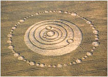

Wyobraźcie sobie obiekt niebieski stabilny od stuleci, ba nawet tysiącleci, który tajemniczo eksploduje przez przypadek kilka miesięcy po uruchomieniu programu Amerykańskich Gwiezdnych Wojen, zainicjowanego dla obrony przed wrogami z kosmosu. Ten obiekt niebieski (kometa) przekształca się w potencjalną broń planetarną. A teraz wyobraźcie sobie piktogram przedstawiający system słoneczny - "BRAKUJE ZIEMI" - kilka tygodni po fragmentacji komety. Wyobraźcie sobie, że ten piktogram obrazuje układ planet odnoszący się do daty 14 maja 2006 r. Daty, kiedy kometa będzie najbliżej, z planetą Mars nieco później, aby wykazać, że najtrafniejsza data będzie po 14 maja.

Teraz wyobraźcie sobie jeszcze jeden piktogram kilka tygodni później wskazujący datę 6 września 2003 r. Datę, kiedy otrzymano pozaziemską wiadomość "**Czy chcecie abyśmy się ujawnili?**". Wiadomość, którą rozpowszechniono w kilku językach na całym świecie, zachęcającej ludzi na całej Ziemi do pokojowego przyjęcia istot pozaziemskich poprzez zaakceptowanie faktu ich ujawnienia się. Wyobraźcie sobie, że każdy, kto otrzymał tę "Światową Wiadomość", tak samo jak datę 25 maja 2006 r., otrzymał także rozwiązanie naukowe zagadki UFO oraz główne motywy kierujące pozaziemskich gości. Dwie niezgłębione zagadki dotyczące teraźniejszości. Teraz będziecie mieć wyobrażenie, o co chodzi w tym artykule. Powyżej widać piktogram z 1995 roku zwany "Brakuje Ziemi". Przedstawia on system słoneczny z zewnętrznym pasem asteroid. Ziemi nie ma na jej orbicie, jak jest to zobrazowane, co sugeruje zniknięcie ludzkiej cywilizacji. Wiadomość tu zawarta nie może byc bardziej czytelna!

Wracając do daty planetarnej symulacji na 14 maja 2006 roku - przez stulecia kometa Schwassmann-Wachmann pokonywała setki okrążeń wokół Słońca, kiedy to pozostawała w całości. Odkąd nastąpiła jej fragmentacja w 1995 roku, stworzyła dwie elipsy okrążające Słońce. Oto, dlaczego fragmenty owe miały czas na odchylenie od siebie. W czasie mijania w 2001 roku, w tym samym miejscu na płaszczyźnie elipsy, Ziemia była w przeciwnym położeniu do obecnej pozycji. W tym roku Ziemia i kometa zachodzą na siebie orbitami niemal idealnie. \[...\] Widzimy dziś kometę 11 lat po tej niezrozumiałej fragmentacji, w niezweryfikowanym stanie rozproszenia. Nie znamy dokładnej liczby fragmentów. Ponadto mogą one być różnych rozmiarów. Im bardziej rozczłonkowana kometa zbliża się do Ziemi, fragmentów będzie więcej. \[...\]

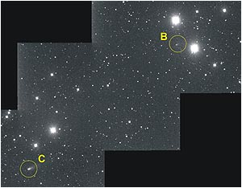

W ten sam sposób, 11 dni po zbliżeniu 14 maja 2006 kometa, a raczej jej fragment B, przetnie elipsę dokładnie 25 maja 2006 roku! Ale kometa przemieszcza sie szybciej niż Ziemia, i ponieważ porusza się po równoległej trajektorii, więc jakiekolwiek zagrożenie wydaje się bezpodstawne. Kometa powinna być jakieś 17 milionów kilometrów od Ziemi, kiedy przetnie jej orbitę przebiegającą dookoła Słońca. To jest mniej więcej tak jak pędzący pociąg, który mija nas, kiedy podążamy równolegle do niego. Nasze drogi się skrzyżują, ale nie przy tej samej prędkości, pociąg będzie daleko przed nami w czasie, gdy my dotrzemy do punktu skrzyżowania. Ale jest jedno "ale" - nie wszystkie wagony tego pociągu mogą przejechać do 25 maja 2006 roku. Poza tym cechą charakterystyczną tej komety jest niska moc świetlna tzw. luminescencyjność jej fragmentów, niemal jak gasnącej gwiazdy. Ujrzeć ją możemy prawdopodobnie od 3 dni do nawet tylko kilku godzin przed uderzeniem. \[...\]

Fragment B (w powiększeniu na zdjęciu niżej) komety znajdzie się w polu ekliptycznym dokładnie 25 maja 2006 r. w odległości 17 milionów kilometrów przed Ziemią. Ale wyobraźcie sobie opóźniony fragment przyciągany przez ziemską grawitację i po trajektorii zachwianej przez energię, która doprowadziła do rozerwania komety na części, ciągnących się przez dziesiątki milionów kilometrów i teraz oto mamy dwie orbity komety wokół Słońca. Niemożliwe? Społeczność naukowców będzie zapewniać, że niebezpieczeństwo nie istnieje. Naprawdę żadne. Tyle ogłosili do tej pory. Także dla naukowców nic nie wydarzy się w dniu 25 maja 2006 r. Taki jest stan obecny dotyczący tych danych! Moim życzeniem jest, aby tak było, w przeciwnym razie sprawa będzie dramatyczna, naprawdę dramatyczna. Ale właściwie dlaczego rozstrzygać problem, który tak naprawdę "nie istnieje"? Zdaję sobie sprawę z odpowiedzialności ciażącej za implikacje, jakie może wywołać ten artykuł. W najlepszym razie pomylę się i zostanę uznany za durnia, który roznosi złe wieści. W gorszym wypadku, opinia światowa będzie zdruzgotanie tylko efektami fizycznymi i psychologicznymi zniszczeń, jakie to wydarzenie spowoduje, ale także i najbardziej, z powodów jakie wymieniłem wyżej. Prawdę powiedziawszy musimy zrozumieć powagę sytuacji i ciążącą odpowiedzialność na każdym z nas za to prawdopodobne wydarzenie!

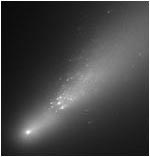

Musicie wiedzieć, że wcześniej zanim odkryłem to, co przeczytaliście o rozbiciu komety, otrzymałem 7 kwietnia 2006 roku w wiadomości od pozaziemskich przyjaciół. Według nich, mega-tsunami na oceanie Atlantyckim, którego doświadczyłem w świadomym śnie trzy lata temu, może mieć miejsce 25 maja 2006 roku. Może to nastąpić trzy dni wcześniej lub później od tej daty. Mam dwóch świadków, którzy potwierdzą chronologie faktów, które opisałem tutaj, ale przede wszystkim dziesiątki czytelników internetowych i depozyt rękopisu zawierający opis mojego świadomego snu sprzed 3 lat. Wtedy to, kilka godzin po otrzymaniu owego telepatycznego opisu podającego datę 25 maja 2006, pewna osoba poinformowała mnie na forum o istnieniu komety 73P Schwassmann-Wachmann 3 i o jej charakterystyce. Wyobraźcie sobie moje zdziwienie i osłupienie, kiedy odkryłem, że owa kometa naprawdę minie Ziemię w bliskiej odległości w maju 2006 roku i osłupia nadal, że przetnie powierzchnię ekliptyki Ziemi w dniu 25 maja 2006 roku, tej samej daty, która otrzymałem w telepatycznym przekazie! Wiedząc to, co zrobilibyście na moim miejscu? Moglibyście to ukryć, ponieważ nikt nie jest w stanie zmienić przeznaczenia. Czy może wzięlibyście na siebie odpowiedzialność aby poinformować innych? Ja zdecydowałem się mówić, tak jak wy. Przeczytajcie, dlaczego.

Przez 60 lat społeczność ufologów podnosiła wiele pytań dotyczących tajemnic związanych z Niezidentyfikowanymi Obiektami Latającymi. Tysiące ludzi na całym świecie, a wśród nich naukowcy o wielkiej reputacji, studiowali i zastanawiali się nad naturą i pochodzeniem tych obiektów obserwowanych przez setki tysięcy świadków. Gdyby współczesna nauka łatwiej akceptowała duże prawdopodobieństwo istnienia pozaziemskich form życia we wszechświecie i nawet z wysoko rozwiniętymi cywilizacjami, tym łatwiej odrzuciłaby pomysł, że istoty te przybywają do nas w imię głównych zasad nauki, która ma zaledwie sto lat. Ale poza fałszem nauki przeszkodą do takich wizyt zdaje się być także trudność w określeniu motywacji, jaka kieruje owymi istotami, który wydają się nie chcieć kontaktu z nami, dopóki będą uważani za tych, którzy zakłócają naszą przestrzeń powietrzną na pokładach swych statków. To nie jest kwestia wiary, lecz rozległych danych ze szczegółowych raportów, które przedstawiają pewność w sprawie fenomenu UFO.

Jeśli według powszechnej opinii nie wierzysz w dane dotyczące UFO, to jest tak dlatego, że nie zostałeś poinformowany lub doinformowany i jest to kwestia tego, że "ktoś" nie wykonał należycie swojej pracy. Jesteś tak jak wielu z nas bardziej niedoinformowany lub nawet dezinformowany i nie masz o tym pojęcia. Dowody tego dochodzenia są wspierane przez wiele setek spraw. Przez 60 lat naukowe pytania dotyczące motywacji pozaziemskich istot nigdy nie były analizowane przez społeczność ufologów. Jednym z głównych powodów jest rola, jaką odgrywali ci, którzy przyczynili sie do usuwania dowodów istnienia pozaziemskich istot poza czyjkolwiek zasięg. Ci "ludzie-cienie" są dzisiaj wysoko postawieni i maja władzę. Są to ci, którzy teraz są najpotężniejsi na Ziemi. Ta sieć nosi miano "międzynarodowego kompleksu wojskowo-przemysłowego". Co określa tego "potwora" bez twarzy? Jest to piktogram, który pojawił się w Tichborne, w Anglii. W roku 1995, roku fragmentacji komety 73P Schwassmann-Wachmann 3, której rozerwanie ja osobiście wiażę z niechęcią istot pozaziemskich. Przedstawia on konfigurację środka planet systemu słonecznego datowaną na 6 września 2003 roku, a więc 8 lat po rozerwaniu komety.

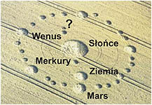

Jakie było znaczenie tej orbitalnej konfiguracji zarejestrowanej w kukurydzy i rozpowszechnionej na cały świat przez Internet? Piktogram i naukowcy nie mieli żadnej innej odpowiedzi. Wiadomo, że niektóre piktogramy są dziełem artystów-żartownisiów, ale pewna liczba piktogramów jest wyraźnie niewiadomego pochodzenia. Rzeczywiście naukowi eksperci od sprawdzania pochodzenia piktogramów przypisują im pewne cechy charakterystyczne niemożliwe do podrobienia wszystkich na raz - rozmywanie lub powiększanie się węzłów zbóż, promieniowanie mikrofali, szybkość wykonania, krzyżowanie się łodyg, mdłości, ginące owady i zwierzęta, szybkość wzrostu bakterii, a nawet obecność poruszających się kul świetlnych. Ale głównym punktem daty 6 września 2003 r. przekazanym przez przedstawienie systemu słonecznego w kukurydzy nie jest to, co wydaje się być wyzwaniem, lecz to, w jaki sposób należy powiązać ten piktogram z 6 września 2003 r. z tym, co ogłosiłem w tym artykule.

Ten bezcenny drogowskaz mówi sam za siebie. Widać na nim, bowiem intruza tuż za Wenus. Wenus nie ma księżyca tak jak my. To, co jest niewiarygodne to dokładna pozycja intruza, który tylko czai się, aby przeciąć orbitę naszej Ziemi. Widać wyraźnie, że pozycja jego jest nieco wewnątrz okręgu, dokładnie jak to będzie, kiedy kometa przetnie płaszczyznę ekliptyki w maju 2006 r. Tak, więc piktogram zarejestrowany w kukurydzy jest nośnikiem światowej wiadomości z 6 września 2003. Symulacja orbit NASA potwierdza dokładnie powiązanie tej daty. Czy piktogram zawiera jakiekolwiek znaki co do daty 6.09.2003 r.? Nie! Nic też nie wydarzyło się się 6.09.2003 r., poza odbiorem wiadomości od pozaziemskich istot dotyczącą światowego referendum w sprawie - "Czy chcecie abyśmy się ujawnili?", która okrążyła świat w ponad 15 językach i w ponad 100 krajach. Setki tysiące ludzi odpowiedziało w ciszy na to międzyplanetarne wezwanie. Setki stron Internetowych wyświetliło tę 11-stronicową wiadomość przetłumaczoną przez nieznane osoby.

Skąd pochodziła ta wiadomość? Otrzymałem tę wiadomość telepatycznie pod pewnymi warunkami, które przedstawiłem w mojej drugiej książce "Children of Stars" (Dzieci gwiazd). Opisałem tam moje eksperymentalne kontakty z pozaziemskimi gośćmi oraz główną motywację, która kierowała naszymi niebieskimi sąsiadami, kiedy ujawnili swą obecność masowo pod koniec 1940 roku - mianowicie broń nuklearną! W ostatnim artykule wykazałem bliską zależność, która istnieje pomiędzy użyciem broni nuklearnej podczas testów atomowych (blisko 2500 pomiędzy 1945 i 1998 rokiem) a fizyczną obecnością UFO, potwierdzoną przez radary i celowniki kontroli powietrznej oraz pilotów, którzy pracowali w lotnictwie wojskowym i cywilnym. Te relacje są potwierdzone także przez raporty z wypadków UFO, zgłaszanych przez różne źródła. Te powiązania są wyjaśnione naukowo w pierwszej mojej książce "The Science of Extraterrestrial" (Nauka pozaziemska).

Książka ta opisuje językiem laickim (bardzo przystępnie) powody wynikające z naszych fundamentalnych naukowych błędów i przedstawia nowy paradygmat - fraktal czasu - pokazujący dogłębnie nasze błędne postrzeganie rzeczywistości. Teoria Względności Absolutnej rozwiązuje nie tylko wszystkie zagadki UFO, ale także zdarzenia paranormalne, takie jak formowanie piktogramów przedstawionych powyżej, oraz wielką naukę, zarówno makroskopowe i mikroskopowe zagadki. Jakkolwiek nie jestem naukowcem, to wszystko to, co napisałem pochodzi z wielu osobistych przemyśleń i informacji dostarczanych przez grupy istot pozaziemskich, które ja nazywam "błękitnymi istotami". One nie są źródłem fragmentacji komety Schwassmann-Wachmann. Są mali, o wydłużonych kończynach i pełni wdzięku. Mają wielki mózg, bardzo duże ciemne oczy i niewiarygodnie błękitną skórę. Z ich ciał, tak jak z oczu emanuje dziwne światło, tak jakby słońce mieszkało wewnątrz ich ciał a ich skóra przepuszczała promienie słoneczne. Ich ruchy są powolne i bardzo płynne. Są bardzo logiczni, hojni i radośni. Rysunek jako tako oddaje ich wygląd.

Lecz ta rasa istot pozaziemskich nie jest jedyna, która nas odwiedza i nadzoruje jak neurotyczne dzieci. Są inne przyjazne rasy, ale są również i wrogie. Trudność w porównaniu pochodzi z faktu, że te rasy w większości są niematerialne, świetliste lub niewidzialne poza momentem detonacji broni atomowej nad ziemią, gdzie wtedy materializują się ich pojazdy i niszczy duch Natury istniejący w innym świecie. Według wszelkiego prawdopodobieństwa większość z was przestanie czytać ten tekst od tej linijki. Moje spostrzeżenia wydają się wam obłąkane. Jeśli ogłoszę wam, że kompleks militarno-przemysłowy kieruje waszym krajem pod jedną lub drugą formą, i że ten sam kompleks jest potajemnie sterowany przez wrogie istoty pozaziemskie, które szukają całkowitej dominacji nad ludzkością po tym jak ją częściowo zniszczą, to stwierdzicie, że przypomina to teorie spiskową z jakiegoś taniego szmatławca.

To, co jest obłąkane, tak naprawdę jest przykrywką milczenia i dezinformacji, która obejmowała przez 60 lat obiekty istot pozaziemskich. To, co jest obłąkane to wojna nuklearna, do której przygotowują nas pewni przywódcy lub doradcy przywódców w imię pokoju. Jako nazwa "wojna prewencyjna z użyciem broni atomowej", sprawia włączenie jej do konwencjonalnych broni, aby walczyć przeciw rozpowszechnianiu i rozprzestrzenianiu broni atomowej! W konsekwencji prewencyjny atak poprzez obiekt niebieski tajemniczo rozerwany w 1995 r. wydaje się być wyjściem z sytuacji wybranym przez pewne istoty pozaziemskie, aby zminimalizować ich własne zniszczenia na Ziemi. Odłamek komety Schwassmann-Wachmann może uderzyć w naszą planetę około 25 maja 2006 roku, jako poważne ostrzeżenie. Jeśli oczywiście przywódcy nie zmienią postępowania. Ta ogromna wola zależy od was, od działań jakie podejmiecie, aby przekonać ich o ich głupocie.

Co takiego wydarzyło się dla istot pozaziemskich, że jak podejrzewam, przekształcili w roku 1995 kometę w broń masowej superdestrukcji? 1994 to rok, w którym obserwowano wzrost fali interesów związanych z katastrofą UFO w Roswell, jednocześnie aby sprawę stłumić, nakręcono spreparowany film ukazujący autopsję obcych. Jednak co ważniejsze rząd Stanów Zjednoczonych zdecydował się poza kulisami użyć Narodowego Programu Obrony Przeciwrakietowej to jest programu Gwiezdnych Wojen! Program ten w swym zamierzeniu nie był skierowany przeciwko wrogom tu na Ziemi, jak twierdził rząd. Był skierowany przeciwko istotom pozaziemskim! Widać aż nadto dobrze, że zakulisowa polityka rządu połączona z agresywnym zachowaniem wojska, stała się wystarczającym powodem dla niektórych istot pozaziemskich aby przedsięwziąć środki zapobiegawcze czyli uderzyć w Ziemię. W ciągu następnych kilku dni stajemy w obliczu decyzji rozstrzygających o dalszych losach świata.

W rezultacie przeciwko nuklearnej armadzie stworzonej przez ludzkość, przeciwko laserowemu programowi sterowania bronią energetyczną, niektórzy "gwiezdni goście" przedsięwzięli "przekonujące" środki i zdecydowali się użyć pierwszego poważnego ostrzeżenia na dzień 25 maja 2006 roku, kilka tygodni przed uruchomieniem nuklearnego ataku na Iran, angażującego i rozprzestrzeniającego potencjalną planetarną wojnę atomową, która jak mniemam, może zniszczyć całą część planów istnienia, niewidzialnych dla naszych oczu świata "gwiezdnych gości". Wydarzenia przyspieszają, ale świadomość jednostek przypomina ślepy zaułek. Żyjemy w niewiedzy zagrożenia, którą naukowcy i żołnierze, politycy i religijne porządki świadomie utworzyli i podtrzymują od 60 lat. Oni wiedzieli o związku pomiędzy UFO a bronia nuklearną. Gdyby tak nie było nie wyprodukowaliby 4000 nuklearnych nośników mogących zniszczyć dwa subkontynenty. Niebezpieczeństwo zagraża nam dzisiaj, ponieważ po raz pierwszy w historii ludzkości wojna z niszczycielską bronią atomową jest wyznaczona w kalendarzu na 2006 rok.

Wojna ta - jak każda w historii - stwarza realne niebezpieczeństwo dla naszych pozaziemskich sąsiadów. Jeśli nie uczynimy nic, aby poważnie potraktować te ostrzeżenia, boleśnie to odczujemy. Ale możemy zareagować dając znać naszym pozaziemskim sprzymierzeńcom, że wiemy, jaka jest stawka. Przez puszczenie w obieg możliwie jak najszerszy nawet na zasadzie czysto anonimowej Światowe Referendum "Czy chcecie abyśmy się ujawnili", być może zwiększymy szanse na pokojowe rozwiązanie kwestii pozaziemskich. Era braterstwa ludzkości może stać się tak bardzo realna. Wrogowie ludzkości, to zarówno ludzie jak i pozaziemskie istoty, tak samo sprzymierzeńcami ludzkości są również istoty pozaziemskie. Czas, jaki nam pozostał to tylko kilka dni. Jeśli uda się zaalarmować naszych przywódców i współobywateli przez rozpowszechnienie pozaziemskiego przesłania i tym artykułem, który każdy może przetłumaczyć i uczynić znanym, może unikniemy najgorszego. Fragment komety, prawdopodobnie nadal niewidzialny dla naszych instrumentów pomiarowych, być może zostanie zniszczony przez istoty pozaziemskie, tych którzy zabezpieczają jego trajektorię, jak to już miało miejsce w przeszłości.

Prędzej czy później, jedno zawsze spotka drugie bardziej niezwykłe niż ono samo. Lepiej jest budować wspólną cywilizację na Ziemi zanim przeniesie się ona w kosmos. Po tym możliwym ostrzeżeniu 25 maja 2006 r., następny krok "obcych" może być znacznie większy i nieskończenie bardziej niszczycielski do tego stopnia, że wyeliminuje ludzka rasę z powierzchni Ziemi, tak jak to sugerował piktogram "Brakuje Ziemi". Logicznie rzecz biorąc, najwyższe ryzyko jest wyjątkowo prawdopodobne i prowadzi ku najgorszemu, które może nadejść. Wierzę, że powinniśmy wybrać działanie! Być może ty sam uratujesz kilka milionów istnień...

---

• \[...\] - oznacza usunięty tekst odnoszący się do rysunków trajektorii komety, których nie ma w tym artykule. Były nieczytelne.  
• Na dzień **30 kwietnia 2006 r**. kometa [Schwassmann-Wachmann 3](http://wiadomosci.onet.pl/1313660,16,1,0,120,686,item.html) składa się już z ponad 40 kawałków.

**9 maja 2006**  
post: Jakub - FPP Kod Czasu

Mówi się też o tym, że **asteroid GY-2 minie nas w odległości 15000 km (piętnaście tysięcy kilometrów!!!)**. Tylko czy nie za dużo tego jak na jeden raz? Chyba przestaje to wygladać na przypadek. Z jednej strony kilkadziesiąt kawałków komety, która cały czas produkuje nowe kawałki, z drugiej strony asteroid o rozmiarach mogących zniszczyć naszą cywilizację w przypadku uderzenia. Zaczyna to wyglądać, że ktoś lub coś chce mieć pewność stuprocentowego trafienia. W każdym razie jeżeli nic się nie stanie, możemy mówić o szczęściu większym niż trafienie szóstki w totolotka. Do tego wszystkiego ten piktogram przedstawiający nasz system w dniu 14.05.2006r. Tyle że pochodzi z lat ubiegłych. Były też, specjalnie czynione próby, przez ludzi parajacych się fałszerstwem piktogramów, wynik był negatywny, nie udało się powtórzyć z taką dokładnością i szczegółami owego piktogramu. Załączam tu ów piktogram i animację komputerową naszego układu na dzień 14.05.2006.

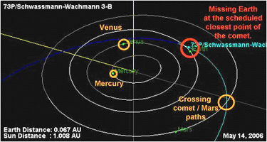

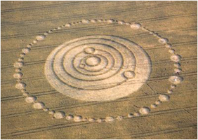

NASA zaktualizowała swoją tabelę obiektów zagrażających ziemi. Wyglada to na cichy alarm dla planety Ziemia. \[...\] Nastąpiła długo spodziewana aktualizacja danych NASA odnośnie komety Schwassman-Wachmann. Według danych oficjalnych mamy już 64 fragmenty komety nie licząc tych, których wciąż nie udało się zaobserwować. NASA zaktualizowała zatem tabelę obiektów NEC (Near-Earth-Comets) zagrażających Ziemi. Na czele listy wciąż znajduje się fragment 3-BD wraz ze swoją minimalną odległością chybienia wynoszącą ledwie 15 tysięcy km. Ilość fragmentów komety wzrosła już do 64 (oficjalnie). Wciąż na czele listy znajduje się fragment 3-BD wraz ze spodziewaną odległością 15000 km w jakiej ma minąć Ziemię (0,04LD).

A zatem wpis ten nie jest pomyłką. Skoro tak to:

**•** fragment 3-BD przeleci w odległości 15000 km (spodziewanej) co jest wartością mniejszą niż granica Roche'a dla naszej planety. Co to oznacza? Oznacza to że jeśli fragment faktycznie zbliży się tak bardzo do Ziemi nie będzie już w stanie wyrwać się z zasięgu grawitacyjnych fal pływowych i albo spali się w atmosferze albo uderzy w powierzchnię planety. NASA nie podaje wielkości tych obiektów dlatego nie wiadomo jak bardzo zagrażać może nam właśnie 3-BD  
**•** pojawiły się komentarze, że wpis ten to sygnał, alarm, informacja dla wszystkich tych którzy śledza tabelę. Spodziewana data przelotu to 11 maja. Godzina przelotu to 21:53 dodatkowo przyjęto parametr błędu wynoszący 11 godzin i 11 minut (sic!).

**Uratować życie w Maju - zrozumieć tsunami 25 maja 2006 - Eric Julien, 3 maj 2006 r.**  
post: Jakub - FPP Kod Czasu, tłumaczenie: Eurycide

To jest mój trzeci artykuł o mojej przepowiedni ogromnego tsunami na Oceanie Atlantyckim 25 maja 2006 roku. Dotknie ono wszystkich zamieszkujących wybrzeża dookoła Oceanu Atlantyckiego gdzie uderzy fragment komety SW-3 powodując brutalne ożywienie podwodnych wulkanów. W tym artykule chcę rozpatrzyć aspekt o którym wcześniej nie było mowy, a mianowicie o bezpośrednich i niebezpośrednich skutkach uderzenia w Ziemię. \[...\] Rok temu, 7 kwietnia odebrałem telepatyczną wiadomość od pozaziemskiej cywilizacji potwierdzającą wizję, którą miałem 3 lata wcześniej - Ogromne tsunami będzie miało miejsce 25 maja 2006 roku. Od tego czasu zacząłem zgłębiać i badać kometę SW-3 i jej fragmenty, która nie tylko przeleci bardzo blisko Ziemi w maju tego roku, ale przetnie naszą ekliptykę właśnie 25 maja. Posiadam retrospektywiczny dowód mojej wizji zamieszczony w mojej zarejestrowanej i chronionej prawami autorskimi książce.

Z moimi pracami dotyczącymi nauki i życia pozaziemskiego zgadza się wielu naukowców. W moich wcześniejszych wizjach udało mi się przewidzieć trzęsienie ziemi w Iranie pod koniec 2003 roku. Dodatkowo po publikacji pierwszej części artykułu o katastrofie w maju tego roku otrzymałem wiele podziękować od ludzi, którzy mają takie same wizje wielkich fal na Atlantyku. \[...\] Aby uniknąć paniki poprzez cierpliwe czekanie na bieg wydarzeń już dziś spokojnie apeluję... Przenieś się z dala od wybrzeży na obszary położone kilkadziesiąt kilometrów dalej i kilkaset metrów wyżej. Zrób to jak najwcześniej, najpóźniej 24 maja tego roku. Pamiętaj, że Ci którzy deklarują, że do zderzenia nie dojdzie nie będą prawdopodobnie w zagrożonym miejscu żeby Ci pomóc albo zapewnić schronienie. Uwierz sobie i moim słowom. Będziecie zaskoczeni jeśli pozostaniecie zupełnie sami i pozbawieni wszelkiej pomocy. Ostrzeż swoich bliskich zagrożonych kataklizmem. Ocal życia ludzkie w maju 2006 roku!

**To nie jest koniec świata! zapewniam was, ale jest to katastrofa na skalę globalną a my musimy zminimalizować efekt i ocalić tych którzy są w zagrożeniu**.

Astronomowie są poinformowani o istnieniu pewnej liczby fragmentów komety ale technicznie nie są w stanie policzyć ich wszystkich. Ogromna ich liczba może drastycznie zbombardować Ziemię i nikt nie będzie przypuszczał najgorszego na pare dni lub godzin przed uderzeniem. To jest naukowy fakt. Niektórzy będą was przekonywać o nikłym prawdopodobieństwie wystąpienia kataklizmu jednak tak naprawdę szanse na uderzenie są równe szansom na to, że do niego nie dojdzie. Podobnie jak było z katastrofą dwóch promów kosmicznych - za to winę ponosi NASA która obecnie deklaruje, że fragmenty komety nie stanowią zagrożenia. Astronomowie pamiętają asteroidę 2002 MN o wielkości 100 metrów którą wykryto dopiero po tym jak minęła Ziemię w odległości 120 tysięcy km. Podobnie było z obiektem 2004 FH o średnicy 30 metrów zlokalizowanym zaledwie trzy dni przed tym zanim minął on naszą planetę w odległości ledwie 43 tysięcy km. To są fakty. Dodatkowo nikt z nas na tej planecie nie wie dlaczego kometa SW-3 rozpadła się w 1995 roku, dlatego ja ciągle będę tu przywoływał opisywane wcześniej zbożowe piktogramy jako znak tego co nas czeka \[...\]

Nawet gdy bezpośrednio Ziemia nie otrzyma uderzenia fragmentem komety to kiedy przelatywać ona będzie po własnej ścieżce, Ziemia znajdzie się w zasięgu jej warkocza (ta sama płaszczyzna ekliptyki!) i zostaniemy zbombardowani odłamkami (meteor shower). Moje prywatne badania pozwoliły ocenić ilość tych odłamków na 64 tysiące! (być może analogią możę być zbożowy piktogram z kręgiem asteroid do okoła, których jest 65... być może wcale nie 65... a 65 tysięcy). Znajdziemy się po prostu w zasięgu czegoś na kształ chmury meteorów. \[...\] NASA została poinformowana aby nie upubliczniać żadnych danych mogących wywołać panikę światową. Na stronie NASA można znaleźć tabelę z obiektami potencjalnie zagrażającymi Ziemi. Ostatni obiekt w tabeli, która od paru dni nie jest aktualizowana, oznaczony jest jako 3-BD mający przelecieć w odległości 0,04 LD (czyli odległości od Ziemi do Księżyca 384000 km x 0,04). Ten fragment wydaje się przelecieć znacznie bliżej niż pozostałe co wyróżnia go na tle całej tabeli (warto dodać, że na całym świecie dyskutuje się najczęściej o tym fragmencie).

**\[ 73P/Schwassmann-Wachmann 3-BD \] \[ 2006-May-11 21:53 \] \[ ± 11:11 \] \[ 33.7/0.0867 \] \[ 0.04/0.00010 \]**

Dwa detale wyróżniają ten wpis. Pojawił się on na pierwszym miejscu listy spośród 70 już zanotowanych obiektów. Dodatkowo opisano go, że minie Ziemię 11 maja (11) o godzinie 21:52 (2+1+5+3=11) w przybliżeniu +/- 11 godzin i 11 minut! Czy nie jest to ukryty sygnał - ostrzeżenie od osoby, która publikuje te dane mówiący "TA TABELA JEST FAŁSZYWA!"? Miejcie na uwadze że w pierwszych minutach po publikacji tych danych podano że obiekt SW-3BD przeleci w odległości 0.0 a więc UDERZY w planetę, potem dopisano 4 setne i aktualnie mamy w tabeli 0.04LD.

---

Asteroid "2006 GY-2" uważa się za fragment komety Schwassmann-Wachmann 3 o wielkości od około 500 do 1000 metrów (choć raczej nim nie jest, bo ma zupełnie inną orbitę). Leci z prędkością 20000 km/sek. Jak dobrze rozumiem, to asteroid GY-2 minął nas 5 maja, 11 maja przeleci fragment SW-3BD, a 25 maja wejdziemy w chmurę meteorów z ogona komety SW-3. Mamy bardzo ciekawy miesiąc...

**Przypatrzmy się komecie** (12 maja 2006 r.)  
tabela: Jakub - FPP Kod Czasu

Niestrudzony i skuteczny tropiciel śladów, Jakub z "FPP Kod Czasu", znalazł tabelę podaną przez NASA, a dotyczącą parametrów przelotu komety 73P Schwassmann-Wachmann 3 w pobliżu Ziemi w miesiącu maju 2006 r. Poniżej podaję tabelę. Jeśli przeraża ilość cyfr, można ją pominąć, choć zaręczam, że spokojne jej przestudiowanie prowadzi do ciekawych wniosków. Już Jakub w swoim poście zauważył, że brak jest danych dotyczących dwóch fragmentów - **SW-3-D** i **SW-3-S**, a ponadto tabela urywa się na dniu 17 maja. Dlaczego? Czy to koniec "defilady" czy NASA chce coś ukryć? Tabela zawiera dane dotyczące 55 fragmentów komety, a w oficjalnych komunikatach ilość ich określa się na ponad 60. Czy te kilka lub kilkanaście fragmentów jest nieobserwowanych, zostało "zgubionych" czy też obliczenia wskazują na coś, co NASA boi się ujawnić? A może ma zakaz publikacji?

Skąd taka tolerancja czasu (błąd czasowy ±, d-dni, g-godzin, m-minut) od sekund do całych dni? Czy obliczenia prowadzi człowiek czy komputer? Czy faktycznie dane są określane dla tego samego fragmentu czy też się je "gubi"? Czy NASA prowadzi ciągłą obserwację komety czy też składa wyniki z wyrywkowej obserwacji? Jak odróżnia się poszczególne fragmenty, by mieć pewność, że dane dotyczą tego samego obiektu? Wydaje się, że gdyby nie cała masa astronomów-amatorów, to NASA wogóle nic by nie "widziała". Taka jest prawda - instytucja powołana do ochrony ziemskiego życia przed śmiercią z Kosmosu opiera się głównie na entuzjastach spoza jej grona. Za co więc im się płaci? Oczywiście za kosztowne "bzdety". Za piękne zdjęcia Saturna, za poszukiwanie wody na Tytanie czy za jałowe dysputy "czy na Marsie było życie?". Robią wszystko oprócz rzeczy najważniejszej - ostrzegania mieszkańców Ziemi przed zagrożeniem z Kosmosu.

**Oznaczenie fragmentu**

**Dzień Maja**

**Godzina**

**Błąd czasowy** (±)

**Odległość od Ziemi** (km)

**Prędkość lotu** (km/s)

SW-3-AT  
SW-3-AS  
SW-3-AV  
SW-3-BA  
SW-3-AZ  
SW-3 (matka)  
SW-3-BD  
SW-3-BC  
SW-3-AP

**11**

03:24  
07:51  
13:38  
13:49  
16:29  
21:12  
21:53  
22:22  
22:41

1m  
‹ 1m  
21m  
12m  
14m  
1m  
11g11m  
‹ 1m  
‹ 1m

13 017 600  
13 017 600  
12 633 600  
12 556 800  
12 288 000  
12 326 400  
12 940 800  
12 211 200  
12 326 400

15 200  
15 380  
15 220  
15 020  
14 880  
15 150  
14 790  
15 070  
15 260

SW-3-BE  
SW-3-AR  
SW-3-AF  
SW-3-C    
SW-3-V    
SW-3-BF  
SW-3-BB

**12**

05:46  
05:55  
09:29  
10:22  
11:08  
13:00  
22:11

10m  
14m  
4g11m  
‹ 1m  
1d16g25m  
1m  
2g14m

11 750 400  
11 980 800  
11 712 000  
11 750 400  
7 872 000  
11 520 000  
11 520 000

14 900  
15 110  
14 760  
15 040  
15 110  
14 880  
14 710

SW-3-AM  

**13**

16:15  

15g10m  

9 100 800  

14 830  

SW-3-AW  
SW-3-Q    
SW-3-P    
SW-3-B    
SW-3-AQ  
SW-3-AO  
SW-3-G    
SW-3-AU  
SW-3-J    
SW-3-R    
SW-3-BN  
SW-3-K    
SW-3-M    
SW-3-BO  
SW-3-N    
SW-3-H  

**14**

00:16  
00:28  
04:54  
06:41  
06:43  
09:21  
15:03  
15:13  
15:58  
19:20  
19:54  
20:54  
22:28  
23:13  
23:27  
23:55

15m  
2g08m  
7m  
‹ 1m  
‹ 1m  
2g52m  
‹ 1m  
3m  
22m  
‹ 1m  
1m  
5m  
2m  
3m  
‹ 1m  
‹ 1m

10 060 800  
10 444 800  
10 099 200  
9 984 000  
9 945 600  
10 176 000  
9 715 200  
9 715 200  
9 600 000  
9 561 600  
9 408 000  
9 484 800  
9 408 000  
9 408 000  
9 408 000  
9 408 000

14 460  
14 810  
14 730  
14 690  
14 590  
14 640  
14 620  
14 610  
14 590  
14 600  
14 410  
14 580  
14 550  
14 540  
14 540  
14 560

SW-3-BQ  
SW-3-BP  
SW-3-AK  
SW-3-AN  
SW-3-L    
SW-3-AE  
SW-3-AL  
SW-3-Z    
SW-3-W   
SW-3-AI  
SW-3-X    
SW-3-BH  
SW-3-BI  
SW-3-BJ  
SW-3-AB  
SW-3-AC  
SW-3-BG  
SW-3-AY  
SW-3-AD

**15**

00:10  
00:37  
01:36  
01:44  
02:44  
03:46  
08:17  
09:45  
11:18  
11:38  
13:39  
13:43  
16:28  
18:27  
19:46  
19:51  
20:55  
22:34  
23:40

2m  
‹ 1m  
23g29m  
3m  
‹ 1m  
18m  
2g28m  
7g50m  
24m  
1d01g37m  
3m  
3g31m  
4m  
44m  
‹ 1m  
1m  
1g59m  
1g04m  
1d07g05m

9 369 600  
9 254 400  
8 985 600  
9 331 200  
9 331 200  
9 331 200  
9 216 000  
9 484 800  
9 100 800  
8 601 600  
8 947 200  
8 793 600  
8 716 800  
8 755 200  
8 716 800  
8 793 600  
8 563 200  
8 448 000  
8 832 000

14 540  
14 370  
14 540  
14 570  
14 560  
14 580  
14 600  
14 470  
14 540  
14 490  
14 470  
14 280  
14 260  
14 390  
14 380  
14 450  
14 270  
14 100  
14 380

SW-3-AH  
SW-3-BK  
SW-3-BL  
SW-3-Y    
SW-3-T    
SW-3-BM  
SW-3-AJ  
SW-3-U    
SW-3-AA  
SW-3-AG

**16**

04:25  
05:17  
05:52  
06:39  
07:15  
07:42  
10:07  
11:04  
12:03  
12:34

16g  
4g16m  
4g57m  
1g09m  
49m  
5g26m  
1g06m  
1g21m  
27m  
5m

9 024 000  
8 371 200  
8 486 400  
9 024 000  
8 832 000  
8 256 000  
10 176 000  
8 256 000  
8 025 600  
8 294 400

14 330  
14 170  
14 390  
14 740  
14 630  
14 150  
15 980  
14 250  
14 100  
14 340

SW-3-AX  
SW-3-E  

**17**

08:24  
16:04

8g01m  
1m

7 488 000  
7 526 400

14 170  
14 130

**???**

Astronomowie do dziś nie wiedzą dlaczego kometa uległa rozpadowi. Wini się za to bądź siły grawitacyjne Słońca i planet albo wzrost ciśnienia wewnątrz komety lub zderzenie z innym obiektem. W pierwszym przypadku kometa musiałaby przejść poniżej granicy Roche'a któregoś z obiektów, a która wynosi około 2,5 promienia obiektu (dla Ziemi - około 16 tysięcy km, dla Jowisza - 179 tysięcy km, a dla Słońca - 1,7 mln km). Płaszczyzna orbity SW-3 jest nachylona pod kątem ok. 11° do płaszczyzny orbit układu słonecznego, a jej orbita nie przechodzi w pobliżu Słońca, więc pierwszy przypadek możnaby wykluczyć. Pierwszy rozpad komety rozpoczął się w odległości ponad 200 mln km od Ziemi, a komety zwykle zaczynają uwalniać wodę (wtedy to zwiększa się ciśnienie wewnątrz) po przekroczeniu odległości pasa planetoid od Słońca lecąc w jego kierunku. Trzeci wariant - zderzenie. Jeśli tak, to czemu fragmenty nie rozprysły się w różnych kierunkach, a tworzą "łańcuszek"? A jeśli wykluczymy te trzy możliwości?... Zostaje tylko coś lub ktoś.

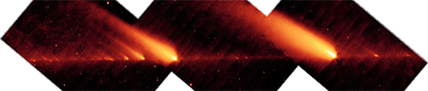

Porównajmy teraz prędkości fragmentów komety. Skąd się biorą takie różnice? SW-3-AY - 14100 km/sek, a SW-3-AJ - 15980 km/sek. Gdyby przeanalizować ten wyścig, to zawodnik SW-3-AJ już w pierwszej sekundzie wyprzedzi swego przeciwnika o 1880 km, w ciągu doby różnica urośnie do 162,4 mln km, a po miesiącu wyniesie już 4,8 mld km (odległość Plutona od Słońca wynosi "tylko" 5,9 mld km). Przecież "łańcuszek" SW-3 nie rozciąga się na takiej odległości, a mówimy tylko o miesiącu lotu.

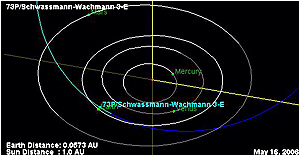

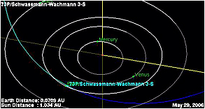

a jednak symulacje sięgają poza 17 maja...

Spójrzmy jeszcze na odległość przelotu fragmentów komety od Ziemi. Dla ułatwienia policzyłem średnią odległości dla przelatujących w jednym dniu. I tak w dniu 11.05 - wynosi ona 12590933 km, 12.05 - 11157943 km, 13.05 - 9100800 km, 14.05 - 9739200 km, 15.05 - 8977516 km, 16.05 - 8674560 km i 17.05 - 7507200 km. W ciągu 7 dni "droga" komety zbliży się do Ziemi o 5 mln km, czyli w dniu 24.05 powinna przebiegać w odległości 2,4 mln km, a 31.05 -(minus)2,6 mln km. Oznacza to, że pomiędzy 24 maja a 31 maja Ziemia przetnie jej orbitę (a właściwie jej odłamków). Czy naprawdę 17 maja minie nas ostatni fragment komety z napisem "koniec wyścigu", czy też jej "łańcuszek" jest dłuższy, lecz ukrywa się to, nie chcąc "denerwować" mieszkańców Ziemi? Czy Eric Julien bezpodstawnie wszczął alarm? Ja z całego serca mu życzę, aby się jednak mylił, lecz swoją drogą spełnienie przewidywań Julien'a to jedyna rzecz, która mogłaby wstrząsnąć umysłami głupców i arogantów. Mogłaby, bo jak powiadają głupota jest chorobą nieuleczalną.

post: Jakub, FPP Kod Czasu, 14 maja 2006 r. - Asteroid GY-3 minie nas dopiero w dniu 16 maja 2006 r. w odległości około 2,5 mln km. Na zachodzie zaczyna brakować tzw. "emergency food", czyli paczkowanej żywności na wypadek kataklizmu, wojny, a w spokojnych czasach dla turystów (coś w rodzaju naszej żołnierskiej "żelaznej racji"). Panika, zapobiegliwość, zbiorowa psychoza? Czy ludzie coś przeczuwają, działa swoista "poczta pantoflowa", czy po prostu bardziej wierzą Julien'owi niż swoim oficjalnym instytucjom?

[**Zdaniem fachowców:**](http://www.astrohobby.pl/modules.php?name=News&file=article&sid=430)

**A co tak naprawdę stanie się około 25.V?** Nic specjalnego, oprócz tego że pod koniec maja fragmenty komety przetną płaszczyznę ekliptyki - tym samym ich szerokość ekliptyczna ß, zmieni się z dodatniej na ujemną... Oczywiście należy pamiętać, że skoro przecinają płaszczyznę ekliptyki, to nie oznacza, że tym samym przecinają orbitę Ziemi! Orbity fragmentów komety w pobliżu peryhelium znajdują się już wewnątrz orbity Ziemi (podobnie jak orbity Merkurego i Wenus, które też co jakiś czas przecinają ekliptykę!). Ponieważ orbity fragmentów komety nachylone są o kąt ok. 11°, to także z tego względu nie mogą one zbyt blisko przeciąć ziemskiej orbity... A oto daty przejścia przez węzeł zstępujący niektórych fragmentów 73P/, czyli inaczej mówiąc: przejścia ich "z nad" do "pod" płaszczyzny ekliptyki:

fragment V

22.V

o godzinie

3:30 UT

fragment U

23.V

o godzinie

6:40 UT

fragment AT

23.V

o godzinie

17:00 UT

fragment T

24.V

o godzinie

5:30 UT

fragment C

24.V

o godzinie

10:00 UT

fragment B

25.V

o godzinie

9:00 UT

fragment G

25.V

o godzinie

13:20 UT

fragment AA

26.V

o godzinie

14:20 UT

fragment S

6.VI

o godzinie

9:30 UT

A co z tymi fragmentami, które nie są jeszcze znane nauce lub jeszcze się nie oderwały od znanych fragmentów? Czy stanowią dla nas zagrożenie?! Nim zaczniemy się obawiać "kosmicznego intruza", to warto poznać go bliżej, a wtedy okazuje się, że "nie taki diabeł straszny...". Komety są zwykle dużo mniej gęste od planetoid (meteorytów), gdyż składają się z luźnych okruchów "zlepionych" lodem (niekoniecznie wodnym). Struktura komet jest poza tym bardzo porowata, pełna wolnych przestrzeni. Postępujący wciąż rozpad 73P/Schwassmann-Wachmann 3 wyraźnie o tym świadczy - niegdysiejsze jądro rozpadło się podczas jednego z ostatnich powrotów na wiele mniejszych lub większych fragmentów, które to obecnie rozsypują się w "pył"... Chociaż prócz kilkudziesięciu znanych fragmentów, są z pewnością mniejsze, których nie odkryto, to są one zbyt małe by mogły wyrządzić szkodę - przy wejściu w atmosferę ulegną prędzej rozproszeniu już w górnych warstwach atmosfery, nie stanowiąc dla nas zagrożenia...

Natomiast orbity największych fragmentów - które mogłyby być rzeczywiście dla nas groźne - są znane bardzo dobrze i wiadomo o nich że nie są w stanie obecnie dotrzeć zbyt blisko Ziemi... Kolejny raz zbliżą się stosunkowo blisko dopiero za 16 lat, czyli w trakcie trzeciego obiegu - co oznacza, że w ciągu tak długiego czasu mogą się one rozpaść do reszty! Zamiast więc obawiania się "kosmicznej katastrofy", proponuję Państwu spróbować obserwować tego niezwykłego gościa na niebie, póki jeszcze istnieje...

**18 maja 2006**  
post: Jakub - FPP Kod Czasu

Kometa Schwassmann-Wachmann 3 w dalszym ciągu ulega podziałowi, co pierwsi zaobserwowali astronomowie-amatorzy, a potwierdzły włoskie obserwatoria. Dziwne, że nie ma komunikatów od największych "zawodowych" obserwatoriów. W dniach 9-11 maja, w Stanach Zjednoczonych AP odbyły się ćwiczenia (czy próba generalna?) związane z likwidacją skutków wielkich trzęsień ziemi i mają zostać powtórzone w dniach 23-25 maja. Zbieżność dat? Być może... W dniach od 17 kwietnia do 17 maja w rejonie Australii zanotowano wzmożoną aktywność sejsmiczną (145 trzęsień od 4,3°R do 8,0°R). Trudno się w tym doszukać zależności kometa-ziemia, ale jest to faktem. 16 maja doniesiono o obserwacji kul ognia w atmosferze w rejonie Australii.

Ogromna kula ognia, która przemknęła przez niebo około 6.20 we wtorek była w rzeczywistości fragmentem komety SW-3 o wielkości lodówki, potwierdził astronom Andre Claydon. Ziemia przemierza pas szczątek komety Schwassmann-Wachmann, rozbitej na 64 fragmenty, powiedział dyrektor obserwatorium w Springbrook. Niektóre z tych fragmentów uderzają w atmosferę i będą nadal uderzać, tworząc spektakularne światła przez następne 5 dni.

Agencja Reutera donosi o giełdowych stratach inwestorów sięgających bilionów dolarów, głównie z powodu masowej wyprzedaży akcji. Zanosi się na krach giełdowy. Wpływ nic nie znaczącej komety? Być może...

---

Spotkałem się już z zarzutem "siania paniki". Czy pisanie o realnym zagrożeniu życia na Ziemi jest sianiem paniki? Czy takie wiadomości są mniej ważne od kolejnego rekordu świata w rzucie berecikiem z antenką czy odnalezieniu nowej małpy? Ja, przy wydatnej pomocy przyjaciół, staram się zwrócić uwagę na to, jak traktuje się wiadomości najwyższej wagi. Staram się zwrócić uwagę na dość istotne rozbieżności w informacjach lub o ich lekceważeniu albo zatajaniu. Chcę pokazać, że prawdziwa informacja zostaje zatrzymywana przez sito trzymane w rękach polityków. Czy miernota będąca u władzy ma być panem naszego życia i śmierci? Jeśli nic się nie stanie, świat przejdzie nad tym do porządku dziennego, wyśmiawszy przed tym Juliena. A jeśli (odpukać w niemalowane) stanie się to, co przewiduje Julien, to przynajmniej Ty, drogi czytelniku, będziesz umiał wskazać winnego za tragedię wielu ludzi, z których choć część można było uratować.

**21 maja 2006**  
post: Jakub - FPP Kod Czasu

Tak wygladają bliższe szczegóły planowanych ćwiczeń w dniach 22-25 maja 2006 r. w USA:

• Więcej niż 400 ratowników ze Stanów Zjednoczonych i Kanady będzie w obozie Rilea w Warrenton następnego tygodnia na 3-dniowych ćwiczeniach majacych na celu przetestowanie przygotowania regionu na wielkie trzęsienie ziemi i tsunami.  
• Nazwana Pacific Peril, symulacja będzie obejmowała trzęsienie ziemi o sile 9 stopni na północno-zachodnim wybrzeżu od północnej Kalifornii po wyspę Vancouver.  
• Scenariusz symulacji przewiduje tsunami i silne nawracające wstrząsy na linii brzegowej przez następne 12 godzin od trzęsienia.  
• Ćwiczenia od wtorku do czwartku będą miały na celu przetestowanie koordynacji dowodzenia, w szczególności komunikacji pomiędzy agencjami, ale nie będą obejmowały ewakuacji.  
• Ćwiczenia będą symulowały 12 godzinną aktywność sejsmiczną już po zmierzchu kiedy szukanie i ratowanie i wszelkie działania mające na celu ratowanie życia ludzkiego są utrudnione powiedział Jay Wilson, koordynator sztabu ratownictwa w Oregonie.

---

"Chcemy zagłębić się bardziej w samą katastrofę i jej skutki, bardziej niż tylko w jej początek, po to aby mieć pewność że każdy wie jaka jest jego rola i jak lepiej koordynować działania" powiedział Wilson.

W Australii zaobserwowano upadek meteorytu na kontynent oraz prawdopodobnie też upadek meteorytu do oceanu (ogłoszono alarm przed tsunami, który wkrótce odwołano). Obserwuje się też stały wzrost ilości meteorytów. Rejestruje się już nie pojedyncze, a po kilka ognistych kul w atmosferze.

---

Polskie i poza australijskie media milczą.

**22 maja 2006**

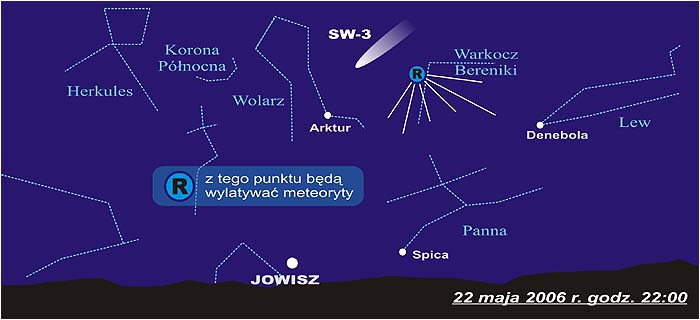

Dzisiaj 22 maja możemy obserwować deszcz meteorów, o ile pozwoli na to bezchmurne niebo. (R - radiant, punkt z którego będą "wylatywać")

**post: Jakub - FPP Kod Czasu** (tłumaczenie tekstu z amerykańskiego forum)

Przez zeszłe kilka miesięcy było wiele dostaw towaru do naszego lokalnego Wal-Mart (market) tutaj gdzie mieszkam w Missiouri. Jestem menadżerem zaopatrzenia i muszę powiedzieć, że ciężarowki nie przewożą kontenerów Wal-Mart'a. Powiedziano nam, żebyśmy nie rozpakowywali palet (które wygladają nieco jak wojskowe zaopatrzenie), takie same jak te z wojny w zatoce perskiej, gdzie byłem logistykiem i zaopatrzeniowcem. Nasz magazyn jest teraz pełny. Kilku z nas rozpakowało zawartość (ryzykując złapanie), i znalezliśmy paczki z żywnością długoterminową (emergency food). Zarząd firmy, zachowuje się ostatnio bardzo dziwnie, ciągle się spieszą i ciągle mają jakieś ważne spotkania. Wiem, ze mamy podpisany duży kontrakt z FEMA i nasz Wal-Mart to jedyny market w promieniu 50 mil od centrów mieszkaniowych.  
Uznajcie tą wiadomość jak chcecie, to może nic nie znaczyć, jednak nigdy nie widzialem zaopatrzenia takiego jak obecnie, choc jestem tu zatrudniony od 5 lat. Ludzie w Stanach robią zaopatrzenie głównie: mąka, makaron, miód i masło orzechowe (duża wartość odżywcza), mleko w proszku, soki owocowe w proszku, fasola w puszkach, sól (dla smaku, do przechowywania potraw - pozwala na zachowanie swieżości), konserwy mięsne w puszkach, warzywa w puszkach (ważne ze względu na witaminy), multiwitaminy centrum (jedna tabletka dziennie), woda w butlach (popularna w kartonach 5 l, 5 lat przydatności).

W dalszym ciągu Ziemia jest bombardowana z kosmosu, od wczoraj notuje się po kilka kul ognia naraz. Jak dotąd za wyjątkiem jednego przypadku z Australii nie ma potwierdzonych przypadków dotarcia do ziemi owych kawałków SW-3. Co dzieje się na bieżąco w atmosferze można śledzić pod [linkiem](http://www.flickr.com/photos/radiofireballs/show/).

**[interia.pl 22.06.2006 17:42](http://biznes.interia.pl/news?inf=751338)** Globalna panika jaka dotknęła w poniedziałek wszystkie emerging markets sprowadziła wszystkie indeksy warszawskiej giełdy na pokaźnych rozmiarów minusy. \[...\] Pewne zaskoczenie może budzić fakt, że fali panicznej wyprzedaży na giełdowym parkiecie towarzyszyła bardzo spokojna postawa polskiej waluty oraz stabilne notowania surowców na światowych rynkach. Polski rynek kolejny raz przypomniał jednak że jest częścią globalnego rynku finansowego i nie ma możliwości oprzeć się w dłuższym czasie ogólnoświatowym trendom.

**23 maja 2006**

Wczoraj od 22:00 do 23:00 oczekiwałem deszczu meteorów i nic..., nawet ziarnko piasku nie rozjarzyło nieba. Wysłuchałem tylko śpiewu słowików i doznałem niezapomnianych wrażeń węchowych z doskonale umieszczonego i zabezpieczonego (według braniewskich rajców) miejskiego wysypiska śmieci, a dzisiaj z oficjalnych informacji (onet.pl - nauka) można się dowiedzieć, że:

Naukowcy amerykańscy obliczyli, że 13 kwietnia 2036 roku może dojść do zderzenia Ziemi z asteroidą o nazwie Apophis, której siła będzie wystarczająca do całkowitego zniszczenia małego państwa. Prawdopodobieństwo zderzenia wynosi obecnie 1 do 6250, czyli wystarczająco dużo, aby astronomowie uderzyli na alarm. Apophis jest obecnie najpoważniejszym zagrożeniem dla naszej planety, więc NASA wydaje miliony dolarów na monitoring tej i innych asteroid. Bezpośrednie uderzenie asteroidy wielkości Apophisa w rejony miejskie spowodowałoby większe zniszczenia niż huragan Katrina, azjatyckie tsunami z 2004 roku oraz słynne trzęsienie ziemi w San Francisco z 1906 roku razem wzięte.

Naukowcy planują kolejne misje kosmiczne, które tak jak sonda Deep Impact, zbadają komety poprzez bliskie przeloty lub uderzenia pociskami - informują strony internetowe University od Maryland. W ciągu ostatnich pięciu lat trzy misje kosmiczne dostarczyły wielu ciekawych informacji o kometach niejako z pierwszej ręki. Były to Deep Impact, Deep Space 1 i Stardust.

Wychodzi na to, że ja tu, za przeproszeniem, o "dupie Maryny" rozprawiam, a niebezpieczeństwo czai się zupełnie gdzie indziej. Mamy więc czas "podrażnić" się z paroma innymi kometami. Trafić powinniśmy i wydamy znów pieniądze po to, by stwierdzić jak zwykle - "nasza wiedza o kometach niewątpliwie wzrosła, ale misje te dostarczyły nam znacznie więcej pytań niż odpowiedzi." i zaczniemy planować kolejne uderzenia, które może którąś wytrącą z równowagi i to dosłownie.

**post: Jakub - FPP Kod Czasu** (fragmenty). No proszę zaczyna się wreszcie coś w mediach dziać, i znowu dziwnie pasuje do tego co przewidział Eric Julien, że dopiero w ostatniej chwili będą jakieś informacje. Na razie delikatne jakby przygotowanie do następnych. [Kosmiczna katastrofa tuż obok Ziemi](http://ww6.tvp.pl/5843,20060516342698.strona). \[...\] Co będzie z nami? Po pierwsze: kometa nie jest na kursie kolizyjnym z Ziemią. Po drugie: jeżeli dotrą do nas kawałki, to te najmniejsze, zatem jeżeli mamy się czegoś spodziewać, to wzmożonej aktywności meteorów popularnie zwanych spadającymi gwiazdami. Kto wie, być może doczekamy się fantastycznego i całkiem bezpiecznego deszczu meteorów? Niestety - w tej chwili nie sposób go przewidzieć. Warto zatem uważnie patrolować niebo tej wiosny i lata. \[...\] Kometa pędząc ku Słońcu zapewne będzie dalej rozmieniała się na drobne i w końcu maja zniknie nam z oczu, ale być może jej pozostałości będą rozbłyskiwać na niebie w postaci meteorów. Zabawmy się zatem w zaznaczanie ich dróg na mapach nieba, próbujmy je liczyć oraz zapisujmy czas ich występowania. Może odkryjemy nowy rój "spadających gwiazd"?

---

Większość artykułu to typowa "woda z komety", a te zawoalowane delikatne przestrogi (jeśli mają nimi być) podkreśliłem. Jest też apel do astronomów-amatorów o pomoc dla zawodowców (oczywiście w formie bezpłatnej zabawy), bo nie są w stanie "policzyć" wszystkiego. Atmosfera wokół tego wszystkiego zaczyna przypominać opis Sahagun'a - "**Powiadano, że kiedy nadeszła noc, bardzo się bano, oczekiwano, że gdy świder ognisty nie spadnie szczęśliwie, wówczas wszystko zginie, wszystko się skończy, nastanie zupełna noc. \[...\] A wszyscy byli owładnięci wiarą w czary do tego stopnia, że każdy starał się mieć na baczności przed niebem, przed gwiazdami, których imiona to wielu i świder ognisty**.". Jak z tego widać, my nie pierwsi i z pewnością nie ostatni...

**24 maja 2006**  
post: Jakub - FPP Kod Czasu

Najaktywniejsze w tej chwili jest forum Erica Juliena. Tekst jednego z forumowiczów:

Coś zbliża się pod kątem 45° z prędkością 11 mil na sekundę na południu od Azorów - dokładny czas nie jest znany, ale są to okolice 25-27 maja - obiekt ma 1,5 tony. Wschodnie bunkry na terenach Ameryki dostały zaopatrzenie i aktualnie posiadają status "przygotowane", na ćwiczenia "Pacific Peril" w dniach 23-26 maja. Na morzu panuje wzmożony ruch statków wojskowych. Wywiad sugeruje 100-metrową falę (wszystko będzie zależalo od aktywności wulkanicznej). Najbardziej ucierpi Nowy Jork i Floryda.

---

Spokojnie proszę, bez paniki. Tekst do złudzenia przypomina założenie do ćwiczeń, bo od kiedy przewidywaną wysokością fali tsunami zajmuje się wywiad wojskowy i skąd zwykły śmiertelnik wziąłby dane o "wzmożonym ruchu statków wojskowych" (przyp. wojskowy nigdy nie użyje słowa "statek" w odniesieniu do okrętu wojennego)? Wygląda to na "kontrolowany przeciek" z prowadzonych ćwiczeń. Wziąć należy też pod uwagę, że to strona Erica Juliena, który musi bronić swojej racji. Na forum jak wiadomo może się znaleźć wszystko, łącznie z "symbiotycznymi bakteriami" działającymi na zasadzie "przyczepiło się gówno okrętu i mówi - płyniemy". Bardzo możliwe, że doszło do jakiejś nieokreślonej współpracy (np. scenariusz ćwiczeń opracował Julien) i w razie czego wszystko zamknie się w ramach ćwiczenia. Wilk syty i owca cała. Oficjalnie NASA zajęła stanowisko:

**post: Jakub - FPP Kod Czasu**. Na liście (NASA) brakuje następujacych fragmentów: 3-A , 3-F, 3-I, 3-O, brakuje również fragmentu 3D który podobno zdążył już całkowicie wyparować. Czyżby te brakujące też już wyparowały - bardzo możliwe. Najdziwniejsze jednak jest to, że na liście jest mimo to aż 6 nowych fragmentów i ma ona teraz 67 kawałków. \[...\] No proszę wreszcie NASA zaczęła się wybudzać ze snu zimowego. \[...\] ... ziemia wejdzie w warkocz fragmentu 3-S w dniu: 06.06.2006. Datę tą jak ktoś chce można zapisać również 06.06.06. Dziwne te trzy szóstki nieprawdaż? W dniu 06.06.06 nie sugerujcie się podaną odległością fragmentu 3-S, ona dotyczyć będzie tylko tego fragmentu, natomiast warkocz będzie w odległości 0,000.

---

Przewidywania, prognozy czy przepowiednie mają jedną wspólną cechę - ich prawdziwość możemy zweryfikować dopiero po fakcie. Jeśli jutro nic się nie stanie, to nie martwmy się, bo ostatni fragment komety minie Ziemię dopiero 6 czerwca. Zasada jest prosta. Każdy z dużych fragmentów przecina orbitę Ziemi z wyprzedzeniem, a Ziemia po pewnym czasie wchodzi w jego warkocz i wszystko zależy od tego co znajduje się w tym warkoczu, a może być wszystko - od pyłu po większe kawałki.

**post: Jakub - FPP Kod Czasu**. Jak się okazuje niedługo trzeba czekać na następne niespodzianki, proszę bardzo oto ona: "Następna niespodzianka? Być może chodzi o plamę słoneczną. Coś nadlatuje od strony Słońca. Małe czy duże na razie nie wiemy.

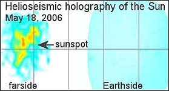

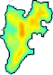

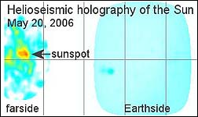

---

Nie znam się na interpretacji tego typu zdjęć i trudno mi coś powiedzieć na ten temat. Być może faktycznie chodzi o plamy na Słońcu, bo gdyby to "coś" nadlatywało od strony Słońca, to nie powinno zmieniać kształtu a tylko wielkość. Tu zmienił się kształt zaledwie w ciągu dwóch dni. Ponadto zmiana kolorów obrazuje chyba rozkład temperatur. Jeśli jest to obiekt pozasłoneczny, to skąd tak wielka "korona" temperatury? Gdyby chodziło o obiekt kometarny, to otoczka powinna mieć kształt bardziej zbliżony do kształtu obiektu. Dzięki Julienowi możemy jednak stwierdzić, że w kosmosie nie jestesmy sami, a otacza nas mnóstwo "kosmicznych śmieci", które uparły się wziąć Ziemię za swoje "wysypisko".

**post: Jakub - FPP Kod Czasu. 23:30**. Na zagranicznych forach cytowany już jest niemal wszędzie następujący tekst. W skrócie brzmi to:

Pracuję w jednej ze stacji radarowych umieszczonych pod ziemią (chodzi o wojskowe instalacje wczesnego ostrzegania) w jednym z krajów Europejskich. W kierunku ziemi zbliża się tysiące obiektów, większość z nich jest drobna, ale to co wzbudziło mój niepokój to to, że za nimi podąża kilka naprawdę wielkich obiektów z dużą prędkością. Jestem bardzo poważnie zaniepokojony, wiem że mogę zadzwonić do pozostawionej na powierzchni żony z dziećmi, ale nie chcę wzbudzać paniki, tak długo dopóki nie bedę pewny w 100%.

Ps. Może to być fałszywka, ale jeżeli nie i tekst ten okaże się autentykiem?

---

Już Artur C. Clark chciał zmierzyć radarem odległość od Ziemi do Księżyca, ale mu nie wyszło. Po za tym jak pracownik jednego z najważniejszych ogniw w systemie obrony NATO może samowolnie decydować o rejonie obserwacji?

**25 maja 2006**

Jest 11:27 i nic do tej pory się nie wydarzyło. Oby tak zostało.

**post: Jakub - FPP Kod Czasu**. Informacje te są na razie niczym nie potwierdzone, pochodzą z jednego z forów w USA. Oto tłumaczona treść jednego z postów: Jestem we wschodnim NC około 20 mil od wybrzeża. Byłem w drodze z pracy do domu i zobaczyłem coś jasnego jak słoń przecinające horyzont i lecące w stronę oceanu. Od momentu gdy to zobaczyłem minely jakieś 3 sekundy i zniknęło za horyzontem. Czy ktoś to widział? Była to najbardziej dziwna rzecz jaka kiedykolwiek widziałem! Cholernie fajna! Czy ktoś wie co to było? Czy spadają teraz meteory i czy mogą być tak jasne jak słońce? Również z Atlanty donoszą o dziwnych zjawiskach.

---

Jeśli ktoś zna angielski to znajdzie wiadomość pod tym [linkiem](http://www.godlikeproductions.com/bbs/message.php?messageid=240222&mpage=1&showdate=5/25/06).

Jest 22:57. Minął dzień, jest spokojnie. Na razie nie wydarzyło się nic, co przewidywał Julien. Czy to dobrze czy źle? Sądzę, że i dobrze i źle. Dobrze, bo nie wydarzyła się tragedia o niewyobrażalnych skutkach nie tylko dla zwykłych ludzi ale i dla ludzkości. Dobrze, bo być może ludzkość uniknęła wojny (doskonała okazja do wyrównania rachunków lub do spełnienia "snów o potędze"). Dobrze, bo być może dotarła do niektórych polityków świadomość ludzkiej bezsilności. Źle, bo zostało już po raz kolejny nadszarpnięte zaufanie zarówno do czynników oficjalnych jak i do "proroków". Źle, bo ludzkości należy się lekcja pokory przed siłami natury, ale tę lekcję przełożono na później.

Sprawdziło się tylko jedno. Im bardziej niedoskonała nauka, tym szybciej w to miejsce wchodzą ludzie spoza nauki i nie zawsze o rzetelnych intencjach. Julien wcale nie przegrał, bo niejako przy okazji pokazał "nędzę" oficjalnej nauki, która nie potrafiła ani potwierdzić wiadomości ani im zaprzeczyć. Pokazał, że manipuluje się wiadomościami - od zmian danych po milczenie lub może nawet zakaz publikacji. Pokazał, że cele współczesnej nauki mijają się z celami zwykłych ludzi. Bądźmy jednak pewni, że dzisiejsza sytuacja nikogo i niczego nie nauczy. Julien zostanie zdeptany, a politycy i naukowcy nie zrobią nic, by poprawić istniejącą sytuację. I tak do następnego razu... Jeszcze jednak nie usypiajmy w samozadowoleniu. Ostatni wagon pociągu SW-3 minie nas dopiero 6 czerwca.

**26 maja 2006**

**post: Jakub - FPP Kod Czasu**. Dobrze poinformowane źródła zbliżone do CIA twierdzą, że w CIA uważa się iż należy odczekać 48 godzin, gdyż nadal istnieje duże prawdopodobieństwo trafienia odłamka komety w Atlantyk w poblizu Azorów.

---

Być może obawy dotyczą fragmentu SW-3-AA, który ma minąć Ziemię 26 maja o godzinie 14:20 UT (czyli 16:20 czasu polskiego).

Z zachodniego [forum](http://25mai2006.frbb.net/ftopic102.SAVE-LIVES-IN-MAY-ENGLISH-SECTION-FORUM.htmforum): "Społeczeństwo zostanie zaalarmowane o 6:00 pm. Pierwsze odtrzeżenie nada CNN. Następne bedą nadchodzić z Pentagonu. Rejony ewakuacji rozciągać się będą od Key West na Florydzie do Plymouth Rock w Massachusetts. Uderzenie trzech asteroidów nastąpi o 22:00. - Bob Neumann"

---

Jest to wiadomość z forum, a więc w żaden sposób nie poddająca się weryfikacji. Zachodnie fora zaczynają być samonakręcającą się maszyną i występuje swoista licytacja "grozy". Podane czasy dotyczą USA i dopiero o północy naszego czasu mają zostać "podane przez CNN", a asteroidy "uderzą" o 4:00 nad ranem naszego czasu. Jak sądzę (o ile nic się nie stanie) z takim stanem rzeczy będziemy mieli do czynienia aż do 6 czerwca. Najlepszym sprawdzianem będzie poranne sprawdzenie danych z trzęsień ziemi na stronie [USGS](http://earthquake.usgs.gov/eqcenter/recenteqsww/). Takie uderzenia muszą zostać zarejestrowane przez sejsmografy na całym świecie. Idę więc spać.

**27 maja 2006**

Nic nie walnęło, ale za to zatrzęsło wyspą Jawa i to z tragicznym skutkiem - ponad 1500 ofiar (na razie i to nie licząc zasypanych pod budynkami) w Yogyakarta. W pobliżu znajduje się, znów aktywny od niedawna, wulkan Merapi, u którego stwierdzono zapadające się zbocze. Na razie nie wiadomo, czy trzęsienie ziemi przyspieszy wybuch wulkanu czy też działaność wulkanu jest przyczyną trzęsienia. W każdym razie jest to śmiertelny coctail.  
W sprawie komety amerykańskie fora jednak się nie poddają. Mówią teraz zachowujący anonimowość przedstawiciele NASA. Leci następny odłamek i choć już malutki, bo około 20 kg, za to z 3-krotną prędkością światła (savelivesinmay.com - 900000km/sek.) co daje niewyobrażalną energię. Może przewiercić Ziemię na wylot. 

A jednak coś chyba spadło. W USA odnaleziono odłamek odłamka SW-3-d, który oznaczono wymownym symbolem [SW-3-D-2d](034-sw3d-obraz.md). 

**28 maja 2006**

Eric Julien jeszcze się nie poddał. Jak pisze "Ergorg" z FPP Kod Czasu - "EJ ostatnio napisał, że wszystkie przepowiednie miał w niedziele i uważa, że jest to ostatni dzień podczas którego coś się może zdarzyć". Natomiast Jakub (FPP KCz) uważa, że "przekaz mógł zostać obarczony pewnymi błędami i tsunami należy spodziewać się po zwiększonej aktywności sejsmicznej w rejonie Pacyfiku".

---

Liczba ofiar w rejonie Yogyakarty wzrosła do 4,3 tysiąca i zapewne nie są to jeszcze rzeczywiste dane. Trwa akcja ratunkowa i być może dlatego jeszcze nie wypada mówić o zniszczeniach w kulturze materialnej. W rejonie trzęsienia ziemi znajduja się zabytki tej klasy co Borobudur i Prambanan.

**post: Ergorg - FPP Kod Czasu**. Dzisiaj dostałem mejla od przyjaciela Erica Juliena - "Uważamy, że już było znaczące uderzenie w Ocean Atlantycki, które może wzbudzić tsunami dla Atlantyckich wybrzeży. Nie sprawdzaliśmy. Mamy również sprawozdanie z wybrzeża Hiszpanii jakoby dzisiaj rano była tam fala wysoka na 253,6 stóp.

---

Znaczące uderzenie w ocean powinno wzbudzić falę sejsmiczną. Odnotowano dziś tylko jedno trzęsienie ziemi około 13:50 (pow. 5°R) w rejonie wyspy Niedźwiedziej (na styku morza Grenlandzkiego i morza Barentsa) ale jest to wyżej niż północny Atlantyk. Co do wysokości fali mam pewne wątpliwości. Podana wysokość fali około 80 metrów na pewno zostałaby zauważona przez media (nie mówiąc o szkodach), a te uparcie milczą.

**29 maja 2006**

Nic nie spadło. Oczywiście nic tak wielkiego, jak przewidywał Julien. Nie znaczy to, że niebezpieczństwo mineło. Wręcz przeciwnie trwa nadal. Ziemia cały czas przedziera się przez "ogony" fragmentów komety. Astronomowie przez tylko jedną godzinę ( między 6:00 a 7:00 UT) zarejestrowali opad na Ziemię około 300 okruchów SW-3. Jest to "drobnica" i nie jest wykluczone, że wśród niej może znaleźć się większy kawałek. Oby nie za duży...

**6 czerwca 2006**

Wyglada na to, że szczęśliwie prawie wszystko przeleciało obok, bo co nieco opadło na ziemię. Nic wielkiego nie walnęło w Atlantyk, następny wizjoner poniósł klęskę, ci co powinni zabrać głos jak zwykle zaniemówili i wszystko wróciło do tzw. normy. Zatem do następnej komety.

**11 czerwca 2006**

Zdaje się, że się pospieszyłem. Dość ciekawe zjawisko odnotowano w północnej Norwegii.

**post: Blue - FPP Kod Czasu (tłumaczenie Euricide)**. Około 2:05 rano 7 czerwca (w środę) mieszkańcy północnej części Troms i zachodnich obszarów Finnmark mogli zobaczyć kulę ognia przemierzającą niebo. Kilka minut później uderzenie zostało zarejestrowane przez fundację NORSAR - badającą zjawiska geofizyczne i sejsmologiczne. Głośny dźwięk i mocne sejsmiczne drgania zostały zarejestrowane na stacji pomiarowej w Karasjok o 2:13 rano.  
Farmer Peter Bruvold był na zewnątrz na swojej farmie w Lyngseidet z kamerą ponieważ jego klacz po raz pierwszy miała spodziewać się przyjścia na świat źrebięcia. "Widziałem jaskrawe błyski światła na niebie, światło to miało za sobą ogon dymu" powiedział Bruvol. Sfotografował on obiekt i kontynuował poród kiedy usłyszał ogromny huk. "Usłyszałem ten dźwięk 7 minut później. Brzmiało to tak jakby wybuch dynamitu w odległości około kilometra."  
Astronomowie podekscytowali się doniesieniami. "Mieliśmy drżenie gruntu, domy trzęsły się a firanki zostały wdmuchane do domów" powiedział najbardziej znany astronom norweski Knut Jorgen Roed Odegaard. Powiedział on też, że nie umie sobie wyobrazić aby kiedykolwiek w czasach współczesnych doszło do tak potężnej katastrofy z udziałem meteorytu w Norwegii. Jeśli meteoryt był na tyle duży na jaki nam się wydaje, możemy samą eksplozję porównać do wybuchu bomby jądrowej tej jaka została zrzucona na Hiroshimę. Oczywiście meteoryt nie jest radioaktywny ale porównujemy samą siłę uderzenia" powiedział Roed Odegaard.

---

Mamy dwie możliwości: albo ktoś "z dobrego serca" pomaga Julienowi albo została wprowadzona ogólnoświatowa blokada tego typu informacji, przynajmniej w naszych dostępnych mediach, bo norweska prasa i Instytut Astrofizyki w Oslo podały to w oficjalnych wiadomościach. Pod adresami: \[[1](http://www.astro.uio.no/i.../ildkule06.html)\] oraz \[[2](http://www.aftenposten.no...ticle213494.ece/)\]. Dziwi mnie, że strony monitorujące trzęsienia ziemi nie odnotowały wstrząsu w tym rejonie (wybuch około 20kT), natomiast pokazują dzisiejsze tąpnięcie w kopalni Polkowice. Jak pamiętam pokazały również wstrząs spowodowany detonacją "tylko" 1,5 tony trotylu w KGHM. Coś tu nie gra...

  **post: Jakub - FPP Kod Czasu**. Zjawisko deszczu meteorytów bombardujących naszą atmosfere powinno już słabnąć, jednakże dane obserwacyjne wskazują, że ciągle narasta. \[...\] czas trwania tego wydłuża się z dnia na dzień, i w dniu 10.06 zjawisko to obserwowane było przez wiele godzin. \[...\] Wyglada na to, że ogon komety się nie skończył, a ciągle jest i udowadnia nam to ponownie.

Obok zdjęcie z satelity SOHO obserwującego Słońce z dnia 10 czerwca 2006 r. Satelita ten krąży wokół Słońca w odległości 1,5 mln km od Ziemi znajdując się zawsze pomiędzy Ziemią a Słońcem.

---

Obserwacje, o których pisze Jakub sa podawane i uaktualniane co minutę na stronie [G7IZU Radio Reflection Detection](http://kodczasu.ronus.pl/forum/viewtopic.php?t=467&start=330) i jeśli ktoś chce (i rozumie te wykresy) może je na bieżąco śledzić.

**17 czerwca 2006**

A już myślałem, że kometa SW-3 żegna się w wielkim stylu. Rankiem RFM-FM podało, że w Łomży meteoryt rozbił samochód. Walnął w przednią szybę i rozbił deskę rozdzielczą. Szczęściem samochód był pusty. Po oględzinach przez policję okazało się, że szczątki są metalowe i zaczęto obwiniać przelatujący wcześniej samolot pasażerski o "zgubę" jakiejś części. Ale nic nie jest proste. Ściągnięto ekspertów aż z Orzysza i okazało się, że jest to część silnika rakietowego i to z drugiej połowy XIX w. z rosyjskimi napisami \[[Wprost](http://www.wprost.pl/ar/?O=91557&C=71)\]. No i teraz dopiero się zacznie. Skąd w Łomży silniki rakietowe? Może terroryści zaatakowali samolot, ale rakieta nie doleciała? Może to entuzjaści z tajnej Manufaktury Paliw Przyszłości, którzy nie powiadomoli policji o starcie pierwszej polskiej rakiety na eksperymentalne "biopaliwo"? A może to efekt ucieczki kosmitów z polskiego raju? Czas pokaże, a w każdym bądź razie kometa SW-3 pożegnała się chyba na dobre, bo liczba meteorytów zmalała do normy. Jej następne odwiedziny dopiero za ponad pięć lat.

**18 czerwca 2006**

Dokonano już korekty - silnik jest z drugiej połowy XX wieku.

Następne doniesienia zaczynają komplikować sprawę.  
**interia.pl**. - "Dziwny przedmiot, który spadł w sobotę na zaparkowany w Łomży samochód to część nośna pocisku rakietowego, a nie silnik rakietowy czy, jak domniemywano, część samolotu - poinformował rzecznik łomżyńskiej policji Krzysztof Leończak. Pocisk, który utkwił w desce rozdzielczej samochodu osobowego, pochodzi najprawdopodobniej z okresu drugiej wojny światowej. Policja przypuszcza, że może to być pocisk z rosyjskiej katiuszy. - Ktoś nieodpowiedzialny musiał odpalić ten pocisk z odległości kilku kilometrów; pocisk spadł, gdy wyczerpało się wewnątrz paliwo. To szczęście, że nie doszło do większej tragedii - dodał Leończak. Pocisk ma ok. 15 centymetrów średnicy i ponad 50 centymetrów długości. Posiada rosyjskojęzyczne oznaczenia."

---

Pocisk do "katiuszy" to prawie dwumetrowa rakieta kalibru 132 mmm o wadze około 43 kg, której nie odpali się "z wolnej ręki". Głowica jest połączona z silnikiem rakietowym na stałe, a odpalenie następuje tylko za pomocą impulsu elektrycznego poprzez dwa styki umieszczone na kadłubie rakiety (prąd doprowadza się do styków umieszczonych w szynie wyrzutni). Po odpaleniu całość leci na odległość około 10 km i dopiero wybuch głowicy może oderwać silnik. W głowicy mamy około 20 kg trotylu, której wybuch powinien zmieść wszystko w okolicy, łącznie ze świadkami. Strzelałem osobiście z tego "ustrojstwa" i nie spotkałem tzw. pocisków ćwiczebnych, czyli z głowicami bez materiału wybuchowego. Ale skoro "Polak potrafi", więc wszystko jest możliwe.

**19 czerwca 2006**

**RMF-FM**. - Silnik rakiety katiusza, którego fragment spadł w Łomży na jeden z zaparkowanych samochodów **został odpalony przez pracownika złomowiska** - dowiedział się reporter RMF. Policyjni pirotechnicy sprawdzają teraz na złomowiskach, czy nie ma na nich podobnych niewypałów.

---

Polska już jest krajem wariatów. Tylko patrzeć jak kury zaczną znosić granaty.

**20 czerwca 2006**

**[onet.pl](http://wiadomosci.onet.pl/1341902,16,1,0,120,686,item.html)**. - 13 czerwca b.r. około godziny 19:15, nad północną Polską zaobserwowany został bolid o dużej jasności, widoczny na zupełnie jasnym jeszcze niebie (tzw. bolid dzienny). Jednocześnie na znacznym obszarze wokół Trójmiasta słychać było silny, głuchy grzmot, będący akustycznym następstwem zjawiska.

---

Brak dokumentacji naukowej, bo nasz "Urząd ds. Nefilim" rozpoczyna pracę po zmroku i trzeba było tygodniowego "dochodzenia", by ogłosić to w mediach. Polska rzeczywistość czy światowy knebel?

**26 czerwca 2006**

Czy to już koniec? Nie wiadomo... W każdym bądź razie trochę się wszystko uspokoiło. Przed nami już tylko rok 2012 i jeszcze ponoć gorszy 2014. Dlaczego? Otóż, ponoć kilkadziesiąt tysięcy lat świetlnych od nas wybuchła gwiazda o masie 400 mld naszych słońc, tworząc gigantyczna falę uderzeniową. Czoło fali dotrze do Ziemi 1 września 2014 r. Jak twierdzą amerykańscy naukowcy ta "chmura chaosu" zmiata wszystko na swej drodze. Życzę wszystkim dobrego samopoczucia.   

**CZY CHCECIE ABYŚMY SIĘ UJAWNILI**

\[ Tłumaczenie • **Jakub** • FPP Kod Czasu \]

**Nieważne, kto przekazał ci tę wiadomość, dla ciebie ta osoba powinna pozostać anonimowa. Ważne jest to, co zrobisz z tą informacją! Każdy z was pragnie czynić użytek ze swojej wolnej woli i doświadczać szczęścia. Nam zostały te dwie rzeczy pokazane i obecnie mamy do nich dostęp. Wasza wolna wola zależy od wiedzy o mocy, jaką posiadacie. Wasze szczęście zależy od miłości, jaką dajecie i jaką otrzymujecie. Jak wszystkie świadome rasy na tym etapie rozwoju, możecie czuć się odizolowani na swojej planecie. To wrażenie sprawia, że jesteście pewni swojego losu. Jednakże, znajdujecie się na skraju wielkiego przewrotu, z którego zaledwie garstka ludzi zdaje sobie sprawę. Nie do nas należy odpowiedzialność za zmianę waszej przyszłości, jeśli wy sami o tej zmianie nie zdecydujecie. Potraktujcie tę wiadomość jako światowe referendum a swoją odpowiedź jako głos.**

**Kim jesteśmy?**

Ani wasi naukowcy, ani przedstawiciele religijni nie wypowiadają się jednoznacznie na temat niewyjaśnionych zjawisk nadprzyrodzonych, jakich ludzkość była świadkami od tysięcy lat. Aby poznać prawdę, trzeba jej stawić czoło bez filtrów własnych przekonań, bez względu na to jak godne szacunku mogą być. Coraz większa liczba waszych anonimowych naukowców bada nowe ścieżki wiedzy i coraz bardziej zbliża się do rzeczywistości. Dziś wasza cywilizacja zalana jest oceanem informacji, z których tylko niewielka część, ta mniej niepokojąca, jest rozpowszechniana. To, co w waszej historii wydawało się śmieszne, bądź nieprawdopodobne, często stawało się możliwe a potem stawało się rzeczywistością, szczególnie w ciągu ostatnich 50 lat. Miejcie świadomość, że przyszłość będzie jeszcze bardziej zaskakująca. Odkryjecie rzeczy zarówno najgorsze jak i najlepsze.

Podobnie jak miliardy innych istot w tej galaktyce, my również jesteśmy świadomi, niektórzy nazywają nas istotami pozaziemskimi, choć rzeczywistość jest jeszcze bardziej misterna. Nie ma żadnej większej różnicy między nami a wami, poza doświadczeniem kilku stopni ewolucji. Podobnie jak w każdej zorganizowanej strukturze, w naszych wewnętrznych relacjach także istnieje hierarchia. Nasza oparta jest na mądrości kilku ras. Zwracamy się do was za aprobatą tej hierarchii. Podobnie jak większość z was, poszukujemy Najwyższej Istoty. Dlatego też nie jesteśmy bogami ani bożkami, ale jesteśmy wam równi w Kosmicznym Braterstwie. Fizycznie nieco się od was różnimy, ale większość z nas ma postać humanoidalna. Istniejemy naprawdę, ale większość z was jeszcze tego nie dostrzega. Nie jesteśmy tylko zjawiskiem, ale świadomością, jak wy. Nie udaje się wam dostrzec nas, bo przez większość czasu pozostajemy niewidzialni dla waszych zmysłów oraz aparatury pomiarowej. W chwili obecnej pragniemy zapełnić te lukę w waszej historii. Podjęliśmy wspólną decyzję, ale to nie wystarczy. Potrzebujemy też waszej decyzji. Poprzez tę wiadomość będziecie mogli ją podjąć! Każdy z was osobiście. Nie mamy na Ziemi przedstawiciela, który mógłby pomóc wam w podjęciu decyzji.

**Dlaczego jesteśmy niewidzialni?**

Na pewnych etapach ewolucji, kosmiczne "ludzkości" odkryły nowe formy nauki wykraczające poza sferę materialna. Dematerializacja i materializacja stanowi ich część. Wasza ludzkość osiągnęła to w kilku laboratoriach w ścisłej współpracy z istotami pozaziemskimi kosztem niebezpiecznych kompromisów, które celowo są ukrywane przed wami przez niektórych z waszych przedstawicieli. Poza zjawiskami i obiektami powietrznymi, znanymi waszym naukowcom jako UFO, zbudowane zostały jeszcze wielowymiarowe statki kosmiczne. Wiele osób miało kontakt wzrokowy, słuchowy, dotykowy bądź psychiczny z tymi statkami, z czego niektóre są pod wpływem sił nadprzyrodzonych, które wami rządzą. To, że tak rzadko je widujecie spowodowane jest niezwykłymi korzyściami, jakie daje stan dematerializacji tych statków. Ponieważ nie widzieliście ich na własne oczy, nie wierzycie, że istnieją. W pełni to rozumiemy. Większość obserwacji dotyczy przypadków indywidualnych, po to by móc wpłynąć na dusze jednocześnie nie zmieniając zorganizowanego systemu.

Jest to celowe działanie otaczających was ras, z różnych przyczyn i ma różne rezultaty. Dyskrecja ze strony negatywnych istot wielowymiarowych, które odgrywają rolę w sprawowaniu władzy w cieniu ludzkiej oligarchii, motywowana jest ich wola, by nikt nie wiedział o ich obecności, oraz władzy jaką posiadają. Nasz dyskrecja wynika z szacunku dla wolnej woli, dzięki której ludzie mogą decydować o swoich sprawach, tak by samodzielnie osiągnąć techniczną i duchową dojrzałość. Wejście ludzkości do rodziny cywilizacji galaktycznych jest bardzo oczekiwane. Możemy pokazać się wam i pomóc wam osiągnąć to zjednoczenie. Nie zrobiliśmy tego do tej pory, ponieważ niewielu z was naprawdę tego chciało, głównie z powodu ignorancji, obojętności, lęku, oraz ponieważ sytuacja tego nie wymagała, ani nie usprawiedliwiała. Wielu z tych, którzy badają nasza obecność liczy światła nocą, ale niczemu to nie służy. Często myślą o nas jak o przedmiotach, gdy tu chodzi o świadome istoty.

**Kim Wy jesteście?**

Jesteście spadkobiercami wielu tradycji, które przez wieki wzajemnie się wzbogacały. To samo odnosi się do innych gatunków na Ziemi. Waszym celem jest zjednoczenie się w poszanowaniu tych korzeni, by ukończyć wspólny projekt. Wydaje się, ze wygląd (aspekt zewnętrzny) waszych kultur prowadzi do podziałów między wami, ponieważ przedkładacie go nad swą głębszą istotę. Kształt jest teraz ważniejszy niż esencja waszej subtelnej natury. Ta przewaga formy jest bastionem chroniącym przed jakimkolwiek niebezpieczeństwem. Wzywamy was byście przezwyciężyli kształt a jednocześnie nadal szanowali go za jego bogactwo i piękno. Zrozumienie świadomości formy sprawia, że kochamy ludzi w całej ich różnorodności. Pokój nie znaczy, że nie ma wojny, składa się na niego stawanie się tym, czym w rzeczywistości jesteście - braterstwem podobnych sobie. Ilość rozwiązań, jakie są dla was dostępne zmniejsza się. Jedną z nich jest kontakt z inną rasą, która byłaby odbiciem tego, kim jesteście w rzeczywistości.

**Jaka jest wasza sytuacja?**

Poza rzadkimi okazjami, nasze interwencje miały niewielki wpływ na waszą zdolność do podejmowanie zarówno indywidualnych jak i wspólnych decyzji dotyczących waszej przyszłości. Naszą motywacją była nasza znajomość waszych głębokich mechanizmów psychologicznych. Doszliśmy do wniosku, ze wolność jest budowana każdego dnia, gdy istota staje się świadomą siebie i swojego otoczenia, stopniowo pozbywając się bezwolności i ograniczeń, jakiekolwiek one są. Pomimo wielkich odważnych i pełnych zapału ludzi, ten bezwład jest sztucznie utrzymywany dla zysku, jaki ma rozwijająca się scentralizowana władza. Do niedawna ludzkość miała wystarczającą kontrole nad swoimi decyzjami. Ale stopniowo traci coraz bardziej kontrole nad własnym losem, ze względu na wzrastające wykorzystanie zaawansowanych technologii, których skutki śmiertelne dla ludzkiego i ziemskiego ekosystemu stają się nieodwracalne. Powoli, ale stale tracicie swą niezwykłą zdolność, by czynić życie czymś pożądanym. Wasza żywotność spadnie w sztuczny sposób, niezależnie od waszej własnej woli. Istnieją technologie, które maja wpływ zarówno na umysł jak i na ciało. Takie plany są już w drodze.

Można to zmienić, o ile zachowacie w sobie tę twórczą siłę, nawet jeśli współistnieć będzie ona z ciemnymi intencjami, tych którzy potencjalnie mogą wami rządzić. Z tego powodu pozostajemy niewidzialni. Ta indywidualna moc zniknie, jeśli z wielka mocą nie zareagujecie wspólnie. Nadchodzi czas przełomu, jakkolwiek to rozumiecie. Ale czy macie czekać do ostatniej chwili by znaleźć rozwiązanie? Czy musicie spodziewać się lub doświadczać bólu? W waszej historii pełno jest przykładów spotkań ludów, które musiały odkryć siebie nawzajem w warunkach często konfliktowych. Podboje niemal zawsze dokonywane były ze szkodą dla innych. Ziemia stała się teraz wioską, gdzie wszyscy znają się nawzajem, ale konflikty wciąż trwają, zagrożenia różnego rodzaju narastają i są coraz silniejsze. Choć istota ludzka jako jednostka ma wiele potencjalnych umiejętności, nie umie z nich korzystać z godnością. To dotyczy zdecydowanej większości z was, głównie ze względów geopolitycznych. Jest was kilka miliardów. Wykształcenie waszych dzieci i warunki życia, jak również warunki życia wielu zwierząt i roślin są uzależnione od garstki przedstawicieli politycznych, finansowych, wojskowych i religijnych.

Wasze myśli i wierzenia są tak skonstruowane, by mogły służyć interesom mniejszości, byście byli niewolnikami, lecz jednocześnie by dać wam wrażenie, że w pełni kontrolujecie swój los, generalnie tak wygląda rzeczywistość. Ale od pragnienia do faktów jest długa droga, zwłaszcza, kiedy nie zna się reguł gry. Tym razem nie jesteście zdobywcami. Podawanie stronniczych informacji to strategia stosowana od tysiącleci wobec ludzkich istot. Natychmiastowe sztuczne wywoływanie w was uczuć emocji, bądź wprowadzanie organizmów, które nie są częścią was poprzez technologie jest jeszcze starszą strategią. Obok wspaniałych możliwości rozwoju istnieje zagrożenie zniszczeniem i klęską. Te niebezpieczeństwa i możliwości istnieją teraz. Widzicie jednak tylko to, co się wam pokazuje. Wyczerpanie się zasobów naturalnych jest zaprogramowane, tymczasem nie został opracowany żaden długoterminowy wspólny projekt. Mechanizmy wyczerpania ekosystemu przekroczyły nieodwracalny limit. Brak zasobów naturalnych oraz ich niesprawiedliwy podział, a ich cena będzie rosła z dnia na dzień, spowoduje bratobójcze walki na wielką skalę, również w sercu waszych miast i wsi.

Rośnie nienawiść, ale miłość także. Dzięki temu wierzycie w to, ze możecie znaleźć rozwiązanie. Ale masa krytyczna jest niewystarczająca, a sabotaż jest bardzo sprytnie przeprowadzany. Ludzkie zachowanie, uformowane w przeszłości nawyki i uwarunkowania powodują takie obezwładnienie, że ta perspektywa prowadzi was w ślepy zaułek. Powierzacie te problemy przedstawicielom, których oddanie wspólnemu, dobrze pojętemu interesowi, ustępuje interesom korporacji. Oni zawsze debatują nad formą, ale rzadko nad treścią. W momencie działania, opóźnienia skumulują się do tego stopnia, że będziecie mogli nie tyle wybierać, co poddać się. Właśnie dlatego, bardziej niż kiedykolwiek w przeszłości, wasze dzisiejsze decyzje będą miały bezpośredni i znaczący wpływ na to czy jutro przetrwacie. Co mogłoby radykalnie odmienić ten bezwład typowy dla cywilizacji? Skąd ma przyjść zbiorowa świadomość, która zjednoczy wszystkich i zatrzyma ten bieg przed siebie na oślep? Plemiona, populacje, narody zawsze stykały się ze sobą i wzajemnie na siebie oddziaływały. W obliczu zagrożeń dla całej ludzkiej rodziny, być może nadszedł czas na bliższą współpracę. Lada moment nadejdzie wielka fala. Aspekty jej pojawienia się będą zarówno bardzo pozytywne jak i bardzo negatywne.

**Kim jest trzecia strona?**

Są dwa sposoby by nawiązać kosmiczny kontakt z inną cywilizacją - albo przez przedstawicieli, albo bezpośrednio z poszczególnymi osobami, bez wyróżniania jakiejś konkretnej grupy. Pierwszy sposób wiąże się z konfliktem interesów, drugi sposób przynosi świadomość. Pierwszy sposób został wybrany przez grupę ras, które chcą utrzymywać ludzkość w niewolnictwie, dzięki czemu mogą kontrolować zasoby ziemskie, genotyp oraz energie ludzkich emocji. Drugi sposób został wybrany przez grupę ras zjednoczonych w duchu służby. Z naszej strony, wybraliśmy bezinteresowną służbę i kilka lat temu zwróciliśmy się do przedstawicieli władzy, którzy odrzucili nasza wyciągniętą do zgody rękę pod pretekstem, że nie jest to zgodne z interesem ich strategicznej wizji. Właśnie dlatego poszczególne osoby muszą dziś wybrać same bez wtrącania się ze strony przedstawicieli władzy. Proponujemy wam teraz to, co zaproponowaliśmy wtedy tym, którzy jak wierzyliśmy, mogli przyczynić się do waszego szczęścia! Większość z was ignoruje fakt, ze istoty pozaziemskie brały udział w sprawowaniu scentralizowanej władzy, będąc dla was niewykrywalnymi do tego stopnia, że nawet nie podejrzewacie ich istnienia. Niemalże przejęli nad wami kontrole w niezauważalny sposób. Nie muszą nawet ujawnić się na planie fizycznym, co właśnie w najbliższej przyszłości mogłoby sprawić, że będą niezwykle skuteczni i będą siać postrach. Jednakże, miejcie świadomość, ze duża liczba waszych przedstawicieli walczy z tym niebezpieczeństwem!

Miejcie świadomość, ze nie wszystkie porwania przez UFO są przeciwko wam. Trudno jest rozpoznać prawdę! Jak w takich warunkach możecie korzystać z wolnej woli, gdy jesteście tak bardzo manipulowani? Od czego tak naprawdę jesteście wolni? Pokój i zjednoczenie waszych narodów byłyby pierwszym krokiem ku harmonii z cywilizacjami innymi, niż wasza. I właśnie tego ci, którzy manipulują wami z ukrycia chcą uniknąć za wszelką cenę, dzieląc - rządzą! Rządzą również tymi, którzy rządzą wami. Ich moc pochodzi z tego, że mogą zasiać w was nieufność i lęk. To bardzo szkodzi waszej kosmicznej naturze. Ta wiadomość nie miałaby sensu gdyby nie to, ze działalność istot wami manipulujących sięgnęła szczytu i gdyby nie to, że ich zwodnicze i mordercze plany mogą się stać rzeczywistością za kilka lat. Terminy ich realizacji zbliżają się ku końcowi i ludzkość doświadczy niespotykanych cierpień w ciągu kolejnych dziesięciu cykli. Aby obronić się przed tą agresją, która nie ma twarzy, musicie przynajmniej mieć wystarczająco dużo informacji o tym, co prowadzi do rozwiązania tego problemu. Tak samo jak wśród ludzi, także wśród tych, którzy chcą was zdominować istnieje opozycja. Tu nie wystarczy wygląd, by odróżnić wrogów od przyjaciół. W waszym obecnym stanie psychiki, niezwykle trudno będzie wam ich odróżnić. Oprócz intuicji, gdy przyjdzie czas, będzie wam potrzebne szkolenie. Mając świadomość jak cenna jest wolna wola, przedstawiamy wam alternatywę.

**Co możemy zaoferować?**

Możemy wam zaoferować bardziej całościową wizję wszechświata i życia, konstruktywne współdziałanie, doświadczenie sprawiedliwych i braterskich kontaktów, wiedzę techniczną prowadzącą do wyzwolenia, zlikwidowanie cierpienia, panowanie nad własną mocą, dostęp do nowych form energii oraz lepsze pojmowanie świadomości. Nie możemy pomóc wam w przezwyciężeniu indywidualnych i zbiorowych lęków, i nie narzucimy praw, których byście sami nie wybrali.

**Co będziecie z tego mieć?**

Jeśli zdecydujecie, ze taki kontakt ma nastąpić, z radością zapewnimy istnienie braterskiej równowagi w tym rejonie wszechświata, owocną współpracę dyplomatyczną, i wielką radość wynikającą ze świadomości, że zjednoczyliście się, by dokonać tego, co leży w zakresie waszych możliwości. We wszechświecie Radość jest niezwykle cenna, bowiem jej energia jest boska.

**Jakie pytanie wam zadajemy?**

**CZY CHCECIE BYŚMY SIĘ UJAWNILI ?**

**Jak odpowiedzieć na to pytanie?**

Prawdę duszy można odczytać poprzez telepatię. Wystarczy, że jasno zadacie sobie to pytanie i udzielicie odpowiedzi, tak jak chcecie - indywidualnie bądź w grupie. Nieważne czy jesteście pośrodku miasta czy pustyni, to nie ma wpływu na waszą odpowiedź. TAK albo NIE, NATYCHMIAST PO ZADANIU SOBIE PYTANIA! Po prostu zróbcie to jakbyście mówili do siebie, ale myślcie o wiadomości. To uniwersalne pytanie i tych kilka słów w odpowiednim kontekście wiele znaczy. Nie pozwólcie by ogarnęła was niepewność. Właśnie dlatego powinniście przemyśleć to z pełną świadomością. Aby połączyć jak najlepiej pytanie z odpowiedzią radzimy by odpowiedzieć po ponownym przeczytaniu tej wiadomości. Nie spieszcie się z odpowiedzią. Oddychajcie głęboko i pozwólcie, by przeniknęła was moc waszej wolnej woli. Bądźcie dumni z tego, kim jesteście! Problemy, jakie macie, mogły was osłabić. Zapomnijcie o nich na kilka minut po to, byście byli sobą. Poczujcie jak siła w was rośnie. Macie władzę nad sobą! Jedna myśl, jedna odpowiedź może drastycznie zmienić waszą najbliższą przyszłość, w taki czy inny sposób. Wasza indywidualna decyzja, by zapytać siebie, czy mamy ujawnić się na planie materialnym, jest cenna i ważna dla nas. Możecie wybrać sposób, jaki najbardziej wam odpowiada. Rytuały są bezużyteczne. Szczera prośba z serca i wolnej woli zawsze dotrze do tych z nas, do których jest wysyłana. W swoich prywatnych wyborach określicie swoją przyszłość.

**Jaki będzie efekt?**

Decyzję tę powinno podjąć jak najwięcej z was, nawet jeśli będzie się zdawało, że to tylko mniejszość. Zalecane jest jej rozpowszechnienie w każdy możliwy sposób, w tylu językach w ilu to możliwe, wśród osób was otaczających, bez względu na to, czy wydają się być otwarci czy nie na nową wizję przyszłości. Zróbcie to w humorystyczny lub ironiczny sposób, jeśli to ma wam pomóc. Możecie nawet otwarcie się naigrywać, jeśli dzięki temu będziecie się lepiej czuć, ale nie bądźcie obojętni, bo przynajmniej w taki sposób możecie uczynić użytek ze swojej wolnej woli. Zapomnijcie o fałszywych prorokach i przekazach na nasz temat, jakie otrzymaliście. Ta prośba jest jedną z najgłębszych, jakie mogą być. Samodzielne podjecie decyzji jest waszym prawem, jak również waszą odpowiedzialnością! Pasywność prowadzi jedynie do braku wolności. Podobnie, brak decyzji nigdy nie jest skuteczny. Jeśli chcecie działać w zgodzie ze swoimi przekonaniami, co jest dla nas zrozumiale, możecie powiedzieć NIE. Jeśli nie wiecie, jaka podjąć decyzje nie mówcie TAK z czystej ciekawości.

To nie przedstawienie, to codzienne prawdziwe życie. MY ZYJEMY! W waszej historii pełno jest przykładów, kiedy niewielkie grupy pełnych determinacji kobiet i mężczyzn potrafiły zmienić bieg wydarzeń. Tak samo jak mała grupa może przejąć władzę na Ziemi i mieć wpływ na losy większości, tak i mała grupa może radykalnie odmienić wasz los, jako odpowiedź na niemoc w obliczu tak wielkiej bezwolności i przeszkód! Możecie ułatwić narodziny ludzkości do Braterstwa. Jeden z waszych filozofów powiedział: "Dajcie mi punkt podparcia a poruszę Ziemię". Rozpowszechnienie tej wiadomości będzie punktem podparcia, staniemy się dzwignia na całe świetlne lata, w rezultacie naszego pojawienia się będziecie mogli ... poruszyć Ziemię.

**Jakie będą konsekwencje decyzji na tak?**

Dla nas natychmiastową konsekwencją zbiorowej decyzji na tak będzie materializacja naszych statków na waszym niebie i na Ziemi. Dla was bezpośrednim efektem będzie gwałtowne porzucenie wielu dogmatów i przekonań. Prosty kontakt wzrokowy spowodowałby wielkie reperkusje dla waszej przyszłości. Duża część nauki zostałaby zmodyfikowana na zawsze. Organizacja waszych społeczeństw na zawsze zmieniłaby się zdecydowanie na lepsze, we wszystkich dziedzinach. Moc byłaby domena jednostek, ponieważ zobaczylibyście, że istniejemy. A dokładniej, zmieniłaby się wasza skala wartości! Dla nas najważniejsze byłoby to, ze ludzkość stałaby się jedną rodziną wobec tego nieznanego, które reprezentujemy! Niebezpieczeństwo oddaliłoby się od was, ponieważ bezpośrednio zmusilibyście tych nieproszonych gości, tych których nazywamy trzecią stroną by się ujawnili i zniknęli. Wszyscy nosilibyście to samo imię i mieli te same korzenie - Ludzkość! Później możliwa byłaby pokojowa i pełna szacunku wymiana, jeśli tak byście zdecydowali. Teraz ten, kto jest głodny nie może się uśmiechać, ten kto się boi, nie może nas powitać. Smutno nam, gdy widzimy mężczyzn, kobiety i dzieci doświadczających głębokiego cierpienia ciała i duszy, podczas gdy noszą w sobie takie światło. To światło może być waszą przyszłością.

Nasze stosunki mogą być postępowe. Przebiegałoby to w etapach kilku lub kilkudziesięcioletnich - pojawienie się naszych statków, fizyczne pojawienie się wśród ludzi, współpraca w zakresie rozwoju technicznego i duchowego, odkrywanie części galaktyki. Za każdym razem mielibyście nowy wybór. Moglibyście sami zdecydować czy przekroczenie kolejnego progu jest konieczne dla waszego zewnętrznego i wewnętrznego dobrobytu. Żadna decyzja nie byłaby podjęta jednostronnie. Odeszlibyśmy, gdybyście wspólnie podjęli taką decyzję. Zależnie od szybkości rozpowszechniania wiadomości minie kilka tygodni bądź miesięcy zanim się ujawnimy, jeśli taka będzie decyzja większości z tych, którzy skorzystają z możliwości wyboru i jeśli wiadomość zostanie wystarczająco rozpropagowana. Główna różnica między waszymi modlitwami do istot duchowych a waszą obecną decyzją jest bardzo prosta - my mamy możliwości techniczne do materializacji! Dlaczego jest to taki historyczny dylemat? Wiemy, ze obcy uważani są za wrogów tak długo jak są symbolem nieznanego. Na początkowym etapie emocje, jakie wywoła nasze pojawienie się, wzmocnią związki między wami na skale światową. Skąd będziecie wiedzieć, czy nasze przybycie będzie konsekwencją waszego zbiorowego wyboru? Bo inaczej bylibyśmy tu już dawno, na waszym poziomie życia! Jeśli nas jeszcze nie ma to dlatego, że nie podjęliście takiej decyzji w wyraźny sposób. Niektórzy z was mogą myśleć, ze chcemy byście uwierzyli, ze sami wybraliście, choć nie byłoby to prawda, po to byśmy mogli usprawiedliwić nasze przybycie.

Jaki interes mielibyśmy w tym, by otwarcie oferować wam coś, do czego nie macie jeszcze dostępu, dla dobra większości z was? Jak możecie mieć pewność, że nie jest to jedynie kolejna subtelna manipulacja trzeciej strony, by was jeszcze bardziej zniewolić? Bo walka jest skuteczniejsza, jeśli wiemy, z czym walczymy. Czy terroryzm, który was toczy nie jest najlepszym przykładem? Cokolwiek się dzieje, wy jesteście jedynymi sędziami w swoich własnych sercach i duszach! Każdy wasz wybór będzie dobry i zostanie uszanowany! Pod nieobecność przedstawicieli ludzkości, którzy potencjalnie mogliby wprowadzić was w błąd, ignorujcie wszystko, co nas dotyczy jak również to, co pochodzi od tych, którzy wami manipulują bez waszej zgody. W sytuacji, w której się znajdujecie, zasada bezpieczeństwa mówiąca, że lepiej nie próbować nas odnaleźć już nie obowiązuje. Już jesteście w puszce Pandory, którą trzecia strona stworzyła wokół was. Jakakolwiek będzie wasza decyzja musicie się z niej wydostać. W obliczu takiego dylematu - jedna nieznana przeciw drugiej, musicie kierować się intuicją. Czy chcecie nas zobaczyć na własne oczy, czy tylko Wierzyc w to, co mówią wasi filozofowie? Oto jest prawdziwe pytanie! Po tysiącleciach ten dzień, taki wybór wcześniej czy później musiał nadejść wybór między dwoma niewiadomymi

**Po co rozpowszechniać tę wiadomość?**

Przetłumaczcie i rozpowszechnijcie tę wiadomość. Takie działanie będzie miało nieodwracalny i historyczny wpływ na waszą przyszłość w skali tysiącleci, w przeciwnym przypadku opóźni to możliwość wyboru o kilka lat, co najmniej o jedno pokolenie, jeśli to pokolenie dożyje. Rezygnacja z wyboru oznacza poddanie się woli innych. Nie poinformowanie innych oznacza ryzyko, że wynik będzie niezgodny z oczekiwaniami. Obojętność oznacza dobrowolną rezygnację z wolnej woli. To dotyczy waszej przyszłości. Tu chodzi o wasz rozwój. Możliwe, że nie przyjmiecie tego zaproszenia oraz, że z powodu braku informacji przejdzie ono bez echa. Tak czy inaczej, we wszechświecie żadne pragnienie nie jest ignorowane. Wyobraźcie sobie, że pojawilibyśmy się jutro. Tysiące statków. Wyjątkowy szok kulturowy we współczesnej historii ludzkości. Wtedy będzie za późno, by żałować decyzji, bo niczego nie da się już wtedy odwrócić. Nalegamy, byście nie śpieszyli się z decyzja, ale przemyśleli to! I zdecydowali!

Wpływowe media nieszczególnie będą zainteresowane rozpowszechnianiem tej wiadomości. Dlatego właśnie twoim zadaniem, jako anonimowej ale wyjątkowej, myślącej i kochającej istoty, jest przekazanie jej dalej. Sami budujecie własny los...

**CZY CHCECIE ABYŚMY SIĘ UJAWNILI**

**Nawet jeśli okaże się, że Julien się myli, to samo przesłanie uważam za piękne, jestem za i podpisuję się pod nim obiema rękami**.
