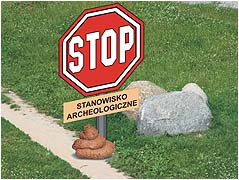

**Polska cwaniacka archeologia**  
Artykuł Marcina Rybaka z Gazety Wyborczej

Jest tajemnicą poliszynela, że w Polsce wszystkie agencje tworzy się w celu łatwego i szybkiego zarobku, ale w odróżnieniu od rządowych tylko agencje towarzyskie dają przyjemnośc obywatelowi. Agencje rządowe i tzw. gospodarstwa pomocnicze tworzone przez kolejne rządy "mające naprawiać Rzeczpospolitą" sa zręcznym kamuflażem słodkiego nicnierobienia i brania za to dużych pieniędzy. Jest to też bardzo zręczny, bo zgodny z prawem, system okradania państwa, czyli zwykłych harujących obywateli. To, co od czasu do czasu widzimy czy słyszymy, to tylko partacka robota nieudaczników albo zbyt zachłannych jednostek nowej klasy - klasy próżniaków, popularnie zwanych partiami politycznymi. Każda partia nie po to walczy o władzę i wydaje ciężkie pieniądze na kampanie, by mądrze rządzić krajem. Tego nie było, nie ma i nie będzie w żadnym programie. Jedynym celem jest usadowienie zasłużonych działaczy w wygodnych fotelach z bezpośrednią bliskością kasy. A jeśli zabraknie miejsc? Wtedy utworzy się jakąś Agencyjkę na przykład do spraw Dzietności Polskich Kobiet czy Kontroli Rozciągliwości Gumek Recepturek. Pieprzenie o tanim państwie jest tylko pieprzeniem, bo jak już wiemy tanie państwo kosztuje i to drogo.

Tylko dziecko i mało rozgarnięty dorosły sądzić może, że Urząd ds. Ochrony Środowiska Naturalnego faktycznie dba o nasze środowisko naturalne. Tylko głupek może sądzić, że Green Peace'owi zależy na ochronie zwierząt. Tylko dureń może przypuszczać, że Agencja Restrukturyzacji i Modernizacji Rolnictwa zrobiła lub zrobi cokolwiek dla rolników. Wszelkie Towarzystwa Wzajemnej Adoracji czyli Polskie Związki Czegoś Tam, Agencje Do Jakiś Spraw czy Komitety lub Fundacje typu "Pieniądze bez barier" powstają po to, by zarabiać pieniądze tylko dla siebie i wzajemnie się popierać. Ostatnimi czasy do takich hien dołączyła nasza archeologia, a właściwie jej cwaniacka część. Okazało się, że marna skorupa po glinianym ptaszku z odpustu może być warta miliony. Miliony już jest warte przypuszczenie, że taka skorupa może leżeć w miejscu, gdzie ktoś inny chce coś wybudować. Pieniądz leży i wystarczy się tylko archeologicznie pochylić.

**Milionowe łapówki za kontrakty archeologiczne?**

**Archeolog: - Pierwszą łapówkę wręczyłem osobiście w 1998 r. Wtedy to był ledwie jeden procent kontraktu. Potem kwota haraczu doszła nawet do 10 proc. Szóstka naukowców przyznała się, że za łapówki zdobywali milionowe kontrakty na wykopaliska przy budowie autostrad**.

Łapówki miał brać sam dyrektor ministerialnego Ośrodka Ochrony Dziedzictwa Archeologicznego **Marek Gierlach**. Taki oto "układ" "Gazeta" odnalazła w dziedzinie - wydawałoby się - całkiem wolnej od współczesnych pokus. Ale w polskiej archeologii pojawiły się pieniądze, o jakich wcześniej badacze nawet nie śnili. Dziesiątki, setki milionów złotych trafiły do naukowców dzięki drogom. Przepisy nakazują bowiem, by przed każdą inwestycją drogową przeprowadzać badania archeologiczne: wybrać tzw. stanowiska, wykopać, co kryje ziemia, skatalogować i opracować naukowo skorupy, narzędzia, ślady cmentarzy i osad. Płaci Generalna Dyrekcja Dróg i Autostrad, dla niej to ledwie parę procent inwestycji. Od dziesięciu lat o kontrakty walczą więc instytuty naukowe, firmy prywatne i konsorcja złożone z wyższych uczelni, muzeów, firm i stowarzyszeń. Wielkie pieniądze dzieli się bez przetargów, bo Urząd Zamówień Publicznych uznał, że autostradowe wykopaliska to badania naukowe, a nie biznes.

Miała liczyć się jakość prac, a tę gwarantują fachowcy. I tu pojawia się główny fachowiec **Marek Gierlach**. Już za AWS tworzył jednoosobową komórkę ds. archeologii przy Generalnej Dyrekcji Dróg. Potem został szefem Ośrodka Ochrony Dziedzictwa Archeologicznego (OODA) powołanego przez wiceminister kultury **Aleksandrę Jakubowską**. Prac ośrodka pilnuje rada naukowa. Rzecz jednak w tym, że część zleceń trafia do instytucji naukowych, w których pracują członkowie rady. Także oni (odpłatnie) recenzują opracowania wykopalisk. A bez pozytywnej recenzji wykonawca nie dostanie wszystkich pieniędzy. Warszawski archeolog prof. Aleksander Bursche: - To patologia. Osoby w radzie naukowej instytucji, która wyznacza wykonawców, nie powinny same brać zleceń ani recenzować prac.

**Na przykład Wrocław**

Obwodnica Wrocławia. Planowana długość to tylko 35 km, wartość prac archeologicznych - aż 57 mln zł (obniżona do 30 mln). Jesienią 2005 r. wybrano wykonawców tych badań. Tort podzielono na cztery kawałki. Dwa największe dostały oddziały Instytutu Archeologii i Etnologii PAN (wrocławski i krakowski), czemu trudno się dziwić, skoro większość członków rady naukowej OODA to właśnie pracownicy Instytutu. Trzeci kawałek (pierwotnie 15,6 mln) dostało Poznańskie Towarzystwo Prehistoryczne. Na swej stronie informuje, że jego członkiem jest sam... **Marek Gierlach**. Ostatni (pierwotnie 7,3 mln zł) wzięła zielonogórska Pracownia Archeologiczno-Konserwatorska, ale po naciskach środowiska wycofała się. Tę część kontraktu przejął wrocławski PAN. Badaniom szefuje teraz **prof. Gediga**, członek rady naukowej ministerialnego OODA. To on protestował przeciw zleceniu dla pracowni. Gediga: - Chodzi o to, by badania prowadziły renomowane instytuty, a nie firmy prywatne. I dla nich jest oczywiście miejsce. Mogą dostać od nas zlecenie i pracować pod naszym nadzorem. Tylko tak zapewnimy odpowiedni poziom.

**Układ się sypie**

Już cztery lata temu do ministra infrastruktury **Marka Pola** pisał prof. Bogdan Marciniec, prezes poznańskiej Fundacji Uniwersytetu im. Adama Mickiewicza, która w ramach konsorcjum starała się o autostradowe kontrakty. Skarżył się na stworzony przez Gierlacha "system powiązań personalnych", którego celem miał być "wtórny obieg środków finansowych". Prof. Marciniec pamięta swoje rozmowy z dyr. Gierlachem: - Dawał mi do zrozumienia, że wybór wykonawcy badań zależy od niego. Zależało mu, bym był o tym przekonany. Ostatnio wykopaliskami zainteresowała się ABW, po informacjach o horrendalnie drogich badaniach przy wrocławskiej obwodnicy. Śledztwo ruszyło w środę, gdy do wrocławskiej delegatury Agencji zgłosiło się sześcioro archeologów. Opowiedzieli, jak dawali łapówki pracownikom ministerialnego OODA w zamian za zlecenia na badania w całej Polsce. Od 1998 do 2003 r.mieli przekazać ponad milion złotych. Brać miał też dyr. Gierlach.

Te rewelacje potwierdza opowieść dr. Aleksandra Limisiewicza z wrocławskiej firmy Akme (specjalizuje się m.in. w wykopaliskach) i zarazem pracownika archeologii na Uniwersytecie Wrocławskim. - Z propozycją korupcji zetknąłem się raz. Na przełomie 2001 i 2002 roku przyjechał do Wrocławia zastępca Gierlacha **Rafał Maciszewski**. Pojechaliśmy do mego gabinetu. Chciałem się z nim zbliżyć, by rozpoznać, jak uniwersytet może zdobyć zlecenia. Napiliśmy się. Powiedział mi wprost, że jak firma Akme da 7%, to będą zlecenia na obwodnicę Wrocławia. Nie podjąłem tematu, Maciszewski do niego nie wracał.

**Gierlach i Maciszewski zaprzeczają**

Gierlach nie chce komentować zarzutów o łapówki: - Nie będę udowadniał, że nie jestem wielbłądem. Zapewnia, że prace przy autostradach prowadzą wszystkie liczące się placówki archeologiczne, nikt nie jest preferowany. Twierdzi, że jego OODA pilnował jakości wykopalisk i powstających opracowań naukowych: - Mieliśmy kilka kontroli NIK. Nigdy nie było poważniejszych zastrzeżeń. Zaprzecza, by instytucje związane z radą naukową OODA były preferowane przy wyborze wykonawców: - Rada składa się z wybitnych archeologów. Trudno, by pominąć w badaniach instytuty, w których pracują. Wtedy wykopaliska realizowałaby czwarta liga. Maciszewski też nie czuje się winny. Owszem, spotkał się z dr. Limisiewiczem na wódce. Ale w Warszawie, a nie we Wrocławiu. I to Limisiewicz, a nie on, proponował łapówkę: "Pocałuj się w d..." - tak mu odpowiedziałem. Dodaje, że miał więcej korupcyjnych propozycji. - Dlaczego nie zawiadomił Pan prokuratury? - Miałem wątpliwości, czy na pewno chodzi o łapówkę. Nikt nie przyszedł z kopertą. Były tylko opowieści o wczasach na Hawajach. Propozycji Limisiewicza też nie potraktowałem poważnie.

**Ujazdowski odwołuje**

Gierlach i Maciszewski nie zarządzają już Ośrodkiem. Pierwszego odwołał w piątek minister Kazimierz Ujazdowski, drugi podał się do dymisji. Wiceminister kultury Tomasz Merta: - Od kilku miesięcy resort miał sygnały, że coś złego się dzieje w OODA. Część środowiska archeologów skarżyła się na sposób wybierania wykonawców wykopalisk. Pojawiały się posądzenia, że Ośrodek stworzył nieprzejrzysty, korupcjogenny system. W czwartek zawiadomiliśmy prokuraturę.

**Sołtysie! Twoja wieś nie musi być biedna! Za drobne 7 milionów możesz mieć u siebie wczesny ośrodek państwowości polskiej. W koszta wliczamy wykopy, budowę ruin, starożytne skorupy i reklamę we wszystkich mediach. Za drobną dopłatą możesz nawet zostać potomkiem przedpiastowskiego rodu**.

---

Taką samą metodą pozyskują finanse wszelkiej maści stowarzyszenia ochrony środowiska - nie można rozpocząć budowy, bo w zeszłym roku przechodziła tędy żaba, więc albo zostanie wybudowany specjalny tunel, albo za równowartość tunelu żaby nie umieścimy w raporcie.

Jest też rzeczą niewiarygodną, że państwo lekką ręką wydaje miliony, by ratować jakąś nieznaną "muchę popierduchę", a piekarza ratującego głodnych, niesprzedanym czerstwym chlebem, którego nie chciał wyrzucać na śmietnik, doprowadza się do bankructwa.  
Państwo prawa? Tfu! Kanalie.

**Witamy w świecie mafii**  
o konserwatorach zabytków w Najjaśniejszej Rzeczypospolitej  
Artykuł ze strony [Hotnews.pl](http://hotnews.pl/artpolska-993.html)

Dlaczego w Polsce rzadko kręci się dobre filmy o mafii? Bo zazwyczaj wszystkie możliwe scenariusze wykorzystywane są w życiu. Najlepsze z nich są "opatentowane" i rzadko pada na nie światło dzienne. Twórcy najznakomitszych dzieł ostrzegają, że w przypadku ich upublicznienia gwarantują wycieczkę na drugi świat. Są też tacy, którzy nie posiadając "biura podróży" potrafią, nawet w trakcie akcji, przerobić kałasznikowa na kolorowego, niczym nieumoczonego lizaczka - i wszystko jest jak być powinno. Nikt nic nie wie, nikt nic nie słyszał. Kto wziął? Przypuścmy rozumowanie absurdalne - to wszystko zbieg okoliczności... Poznajcie Marka Rubnikowicza, Wojewódzkiego Konserwatora Zabytków.

Gdyby nie postępowanie prowadzone w Toruniu przez Urząd Kontroli Skarbowej do dzisiejszego dnia nikt nie otworzyłby ust. Doszło jednak do ostrego spięcia interesów i widocznej groźby poniesienia konsekwencji prawnych. Były zastępca Wojewódzkiego Konserwatora Zabytków Paweł Połom otworzył usta i za to wyleciał (woj. kujawsko-pomorskie). Zanim zaczęło się "gotować" Marek Rubnikowicz wyczuwając wzrost temperatury zapewnił sobie stołek w Toruńskiej Radzie Muzeum Okręgowego. Teraz siedzi na dwóch. Czy wyleci ze wszystkich ciągnąc za sobą cały układ? O tym zadecyduje prokuratura.

**Witamy w układzie**

Chodzi o grube pieniądze - dziesiątki milionów złotych... rocznie w skali lokalnej, setki milionów złotych w skali kraju. Ten, kto ma "parasol ochronny" u Wojewódzkiego Konserwatora Zabytków (i niestety dotyczy to właściwie całej Polski) wygrywa większość najwyżej wycenionych przetargów. Ten, kto z kolei wygra mniejszy przetarg i załóżmy nagle przestanie się "podobać", dostanie za swoje przy odbiorze poddanego pracom obiektu, niezależnie od poprawności ich wykonania względem pozostałych wykonawców. Naszą pracę może bowiem oceniać inspektor będący jednocześnie pracownikiem a nawet właścicielem konkurencyjnej firmy... Wracamy jednak do Torunia, miasta Kopernika. O tym, że dokonano tutaj wielkiego odkrycia wie prawie każdy, o tym że powódź może zaistnieć także na wyżynie wiemy od niedawna.

**"Restauro"**

Stałym gościem u Wojewódzkiego Konserwatora Zabytków, który jest jednym z decydentów przy wyborze ofert, jest Sławomir Musiela - właściciel z jednej z największych, pod względem ilości wygrywanych przetargów, firm konserwatorskich w regionie - "Restauro". Tragiczna jakość wykonywanych robót oraz... kosmiczne pieniądze potęgują wrażenie bezradności. Bo czym można tłumaczyć zrywanie wiertarkami zabrudzeń z zabytkowej katedry św. Janów w Toruniu, co zostało bez konsekencji uwidocznione na jednym ze zdjęć opublikowanych w lokalnej prasie, za co przyjdzie zapłacić podatnikom kilka milionów złotych?

Częste spotkania obu Panów doprowadziły do wytworzenia się całkiem zmyślnego planu eliminacji konkurencji. Stworzono specyfikacje ofert przetargowych, przez którą przejść może tylko kilka firm, zaś dominację utrzymuje firma "Restauro". Zapis o koniecznym u oferenta przerobie rocznym powyżej 4,5 mln zł zaskoczył najbardziej obojętnych. Do tego doszła zasada wykonalności w ostatnich latach konkretnych rodzajów prac. Tutaj oferty firmy "Restauro" wpasują się idealnie (jedna ze specyfikacji autorstwa powyższego "eksperta" przytoczona w tekście: [Zamówienia publiczne - dziwka na wynajem](http://hotnews.pl/artpolska-772.html)). Co za zbieg okoliczności...

**Wracamy do wody**

Tak, teraz poleje się trochę wody za 800 tysięcy złotych. Tyle bowiem kosztowała konserwacja przez firmę "Restauro" kamieniczki należącej do firmy "Restauro" wraz z przyległym murem, która dzięki poparciu wojewódzkiego konserwatora zabytków Marka Rubnikowicza i zamkniętym oczom miejskiego konserwatora zabytków Lecha Narębskiego została sfinansowana... z funduszu powodziowego, mimo że stoi ona kilkanaście metrów ponad górną granicą średniego poziomu przepływającej blisko 100 metrów dalej rzeki Wisły (powodzi, która mogłaby częściowo podtopić budynek nie było w Toruniu od setek lat). Sprawą od niedawna zajmuje się prokuratura. W obronie pomysłowego urzędnika zdążyli już wystąpić nawet niektórzy duchowni (bo interes się kręci także i tam).

Sam najbardziej zainteresowany Marek Rubnikowicz twierdzi, że wszystko było w porządku - "Co do uruchomienia pieniędzy powodziowych też wszystko jest, moim zdaniem, w porządku. Moim zadaniem jest znajdowanie pieniędzy na ratowanie zabytków". Kto ma rację? Zobaczymy wkrótce. Chodzi przecież o nasze pieniądze - pieniądze podatników liczone w milionach złotych. Mogę natomiast Państwa zapewnić, że afery związane z przetargami publicznymi i zamówieniami z wolnej ręki mają taką moc, że bezproblemowo przyćmiłyby jedną z największych afer paliwowych. Warto naświetlić sprawę jeszcze bardziej.
