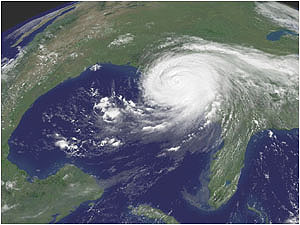
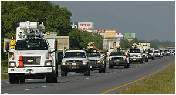
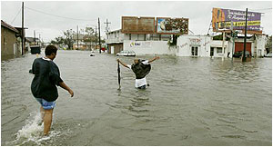

**Co nam ma uświadomić huragan Katrina**

[**Timothy Garton Ash**](http://serwisy.gazeta.pl/wyborcza/1,34474,2910537.html) **(ur. 1955) - brytyjski historyk, pisarz i publicysta, profesor studiów europejskich na Uniwersytecie Oksfordzkim. Ostatnio wydał "Wolny świat. Dlaczego kryzys Zachodu jest szansą naszych czasów". Poniżej jego artykuł.**

Wydarzenia w Nowym Orleanie po ataku huraganu pokazały, jak szybko pryska ludzka solidarność i jak łatwo anioły zamieniają się w bestie. Wiek XXI może być czasem barbarzyństwa - w Ameryce, Europie, wszędzie. "Anarchia i gwałty po przejściu huraganu", "Czy grozi nam powszechne zdziczenie?" - zanim odwrócimy gazetową stronę, pomyślmy, jaką naprawdę nauką jest dla nas "Katrina". Niekompetencja rządów Busha? Skandaliczne zaniedbania czarnej biedoty? Nieprzygotowanie na klęski żywiołowe? To prawda, ale przede wszystkim nauką jest to, że nasza cywilizacja jest cienką skorupką

Z kosmosu nie widać tragedii (fot. NASA)

\- jeden wstrząs i wszystko się wali, a ludzie walczą o przetrwanie jak wściekle psy.

Powiadacie, że rabunki, gwałty i napady z bronią w ręku, jakie miały miejsce w Nowym Orleanie parę godzin po kataklizmie, nie zdarzyłyby się w cywilizowanej Europie? Naprawdę? Zdarzyły się na całym naszym kontynencie zaledwie 60 lat temu. Poczytajmy wspomnienia ludzi, którzy przeżyli Holocaust i Gułag, opowieści Normana Lewisa z Neapolu z 1944 r. czy opublikowane niedawno, a napisane w z 1945 r. dzienniki pewnej mieszkanki Berlina. To samo było w Bośni przed zaledwie dziesięcioma laty. I nie była to vis maior - siła wyższa - Europejczycy sami zafundowali sobie swoje katastrofy.

Chodzi zawsze o to samo: usuńmy podpory naszego zorganizowanego, cywilizowanego życia - jak żywność, schronienie, pitna woda i minimum bezpieczeństwa - a w parę godzin wrócimy do Hobbesowskiego stanu natury - wojny wszystkich ze wszystkimi. Niektórych stać czasem na heroiczną solidarność, ale większość walczy zwykle o własne i zbiorowe przetrwanie. Niektórzy bywają przez chwilę aniołami, inni - częściej - bestiami.

Słowo "cywilizacja" w jednym ze swych najwcześniejszych znaczeń odnosiło się do procesu cywilizowania ludzkich zwierząt, przez co rozumieć trzeba uznanie wzajemnej godności albo przynajmniej potrzebę jej uznania (jak głosił swego czasu właściciel niewolników Thomas Jefferson, nawet jeśli sam nie stosował się do swych sugestii). Czytając kiedyś Jacka Londona, natrafiłem na niezwykłe słowo "decywilizacja" - odwrotny proces, w wyniku którego ludzie przestają być cywilizowani i stają się barbarzyńcami. "Katrina" unaocznia nam, że "decywilizacja" jest zawsze możliwa.

Przykłady widzimy na co dzień - pomyślmy o kłótniach kierowców albo o rozmowach w kolejce do opóźnionego czy skasowanego nocnego lotu. Kokon prywatności, jaki nosimy z sobą w lotniskowych poczekalniach, zamienia się w chwilową solidarność. Zrozumienie, gdy spoglądamy ku sobie ponad płachtami gazet lub ekranami laptopów. Wspólne dawanie wyrazu złości lub ironii.

Często wyrasta z tego grupowa solidarność skierowana przeciwko niewinnej obsłudze z British Airways, Air France lub American Airlines (wspólny wróg to jedyny pewny sposób na solidarność).

Nagle pojawia się plotka: jest parę wolnych miejsc w locie z bramki nr 37. Solidarność pryska, anioły zamieniają się w zwierzęta. Chorzy, starcy, kobiety i dzieci zostają w tyle. Faceci w ciemnych garniturach z dyplomami z Harvardu i Oksfordu o nienagannych manierach walczą jak goryle. Kiedy przepchną się po swoje, czyli kartę pokładową, wycofują się do kątów, unikając spojrzeń. Goryl dostał banana (wierzcie, wiem, o czym mówię - sam bywałem gorylem). A wszystko po to, żeby uniknąć nocy w Holiday Inn w Des Moines.

Bogactwo zdążyło uciec ... (foto AFP)

... bieda pozostała (foto AFP)

"Decywilizacja" w Nowym Orleanie była oczywiście czymś tysiąckroć gorszym. Nie mogę pozbyć się wrażenia, że coś takiego będzie zdarzać się częściej - znacznie częściej - kiedy zagłębimy się w XXI stulecie. Po prostu zbyt wiele mogących cofnąć ludzkość w rozwoju gróźb wisi w powietrzu. Do najoczywistszych należy nasilenie się klęsk żywiołowych w następstwie zmian klimatycznych. Jeśli ten kataklizm uznany zostanie przez amerykańskich polityków w rodzaju Johna McCaina - by się posłużyć wyświechtanym frazesem, jakim oni bez wątpienia się posłużą - za sygnał alarmowy przypominający Amerykanom o konsekwencjach pompowania w atmosferę dwutlenku węgla, to okaże się, że nawet mroczna chmura huraganu "Katrina" miała swą jasną stronę. Ale może już być za późno.

Jeśli prawdziwe są ostatnie doniesienia o tym, że topią się nie tylko polarne czapy lodowe, ale i syberyjska wieczna zmarzlina - co z kolei spowoduje dalszy wzrost emisji gazów cieplarnianych - może okazać się, że uruchomione zostały nieodwracalne procesy. Gdyby tak było - gdyby znaczne obszary świata nękać miały nieprzewidywalne burze, powodzie i wahania temperatury - wówczas to, co wydarzyło się w Nowym Orleanie, może okazać się kaszką z mleczkiem.

Tornada te będą w pewnym sensie dziełem człowieka. Jednak ludzie stwarzają sami sobie bardziej bezpośrednie zagrożenia.

Jak dotąd zamachy terrorystyczne powodują gniew, lęk, pewne ograniczenia swobód obywatelskich, oraz przypadki maltretowania więźniów w Guantanamo i Abu Ghraib, lecz nie masową histerię ani polowanie na kozły ofiarne. Szczególnie w Londynie - światowej stolicy flegmatyków. Ale wyobraźmy sobie, że to dopiero początek. Że w dużym mieście terroryści odpalają brudną bombę, a nawet mały ładunek jądrowy. Co wtedy?

Masowa migracja z biednego i przeludnionego Południa naszej planety na bogatą Północ przypomina potężną falę powodziową (nie przypadkiem zwalczający imigrację populiści chętnie odwołują się do tej właśnie metafory). Kiedy pewnego dnia klęska naturalna lub polityczna wyprawi w podróż kolejne miliony, nasze imigracyjne bariery mogą okazać się równie nieskuteczne jak wały przeciwpowodziowe w Nowym Orleanie. Ale nawet przy obecnym poziomie napływu uchodźców spotkanie, do jakiego dochodzi - zwłaszcza między muzułmańskimi przybyszami a obecnymi mieszkańcami Europy - mają siłę dynamitu. Na ile ucywilizowania będzie nas stać?

Sposób, w jaki mówią o sobie nawzajem niektórzy Europejczycy i niektórzy islamscy imigranci, każe myśleć o nadchodzącej nowej fali europejskiego barbarzyństwa. Pojawia się też wyzwanie, którym jest konieczność włączenia w system światowy rodzących się mocarstw - szczególnie Indii i Chin. Wojna jest zagrożeniem zwłaszcza w tym ostatnim przypadku - kraju, w którym komunizm w schyłkowej fazie dla odwrócenia uwagi odwołuje się do nacjonalizmu, by tylko utrzymać się przy władzy. A nie ma pewniejszej i szybszej drogi do zdziczenia niż wojna.

Zapomnijmy więc o zderzeniu cywilizacji Samuela Huntingtona. Jak mówi stare rosyjskie przysłowie, to było dawno temu i nieprawda. Niebezpieczeństwo zagraża cywilizacji jako takiej - owej cienkiej skorupce, pod którą kłębi się magma natury, w tym i natury ludzkiej. W Nowym Orleanie zrobiono w tej skorupce mały otwór, przez który ujrzeliśmy, co kryje się w środku. To, jak łatwo zatriumfowało Zło, dowodzi, jak trudno chronić wątłe Dobro.

Gdybym miał wygłaszać polityczne kazania, powiedziałbym, że winniśmy uznać "Katrinę" za apel o potraktowania serio tych wyzwań, który powinien wymusić na wielkich blokach i mocarstwach świata - Europie, USA, Chinach, Indiach, Rosji, Japonii, Ameryce Łacińskie, ONZ - międzynarodową współpracę na wyższym poziomie. Jednak po trzeźwym namyśle dochodzę do mniej optymistycznego wniosku - że gdzieś około 2000 roku świat osiągnął szczyt ucywilizowania, który przyszłe pokolenia mogą wspominać z nostalgią i zazdrością.

Przełożył Sergiusz Kowalski ([Gazeta.pl 11.09.2005](http://serwisy.gazeta.pl/swiat/1,34181,2910537.html))

---

Wstrząsający artykuł ale tylko dla ludzi, którzy rozumieją o czym mowa i którym leży na sercu przyszłość naszej cywilizacji. Nas nie zniszczy efekt cieplarniany, bo prędzej zniszczymy się sami. Po Ameryce już krąży dowcip, że po przejściu huraganu CIA wpisała Pana Boga na listę najgroźniejszych terrorystów. Żarty żartami, lecz wyraźnie było widać brak ludzkiej solidarności i brak natychmiastowej i skutecznej pomocy. Dlaczego akurat tam, w najbogatszej Ameryce, w kraju najnowocześniejszej techniki tak odczuto skutki kataklizmu? Powód jest jeden i zasadniczy. Człowiek w dalszym ciągu lekceważy siły Natury i wchodzi jej w drogę.

To nie kto inny jak tylko człowiek zbudował miasto w depresji pomiędzy rzeką i jeziorem. Czyżby nie przewidziano przerwania wałów przeciwpowodziowych? Przewidziano. Raport o tym opublikowano w 2003 r. Dlaczego najbiedniejszych pozostawiono na pastwę losu? Dlaczego nie uświadomiono mieszkańcom groźby zalania najniżej położonych części miasta? Dlaczego do ewakuacji tych, którzy nie mieli czym opuścić miasta nie użyto transportu powietrznego? Dlaczego tak późno rozpoczęto akcję ratunkową? Może na zimno skalkulowano rozwiązanie problemu miejscowej biedy? Pytań jest dużo, ale to jest wewnętrzna sprawa Ameryki.

Tsunami na oceanie Indyjskim w grudniu 2004 r. i huragan nad Nowym Orleanem niespełna rok później pokazały dwa rodzaje zachowań ludzkich społeczności diametralnie różniące się między sobą. Z czego to wynika? Z innego pojmowania i podejścia do otaczającego świata. Ludzie Azji mają dużo więcej pokory przed siłami natury niż społeczności uważające się za wysoce ucywilizowane. Tam nie tylko wiedzą czego się spodziewać, ale też wiedzą jak wspierać się wzajemnie po takim kataklizmie nie czekając na pomoc z zewnątrz. Tam wspólna walka o przetrwanie i wzajemna pomoc, tu indywidualna walka o przetrwanie za wszelką cenę, nawet za cenę życia innego człowieka. Tam głęboka wspólnota duchowa, tu najzwyklejszy zwierzęcy instynkt. Cywilizacja to nie wysoka technika, ale to co ma się w głowie i stosunek do drugiego człowieka.

Ludzie otrzymali dwie nad wyraz bolesne lekcje. Co z nich wynika? Przede wszystkim to, że najwyższy czas uświadomić wszystkim, że nie ma bezpiecznego miejsca na kuli ziemskiej. Klimat zaczyna się zmieniać w sposób gwałtowny i tego rodzaju katastrofy będą na porządku dziennym. Cywilizacja inteligentnych małp przyspieszyła bieg wydarzeń i zaczyna oglądać na własne oczy skutki nieprzemyślanych i krótkowzrocznych decyzji. Przestrogi klimatologów uważano za kasandryczne krakanie. Przy bezwzględnym dążeniu do zysku zlekceważono ostrzeżenia o naruszaniu równowagi w przyrodzie. Zbudowano miasta-molochy, które dziś są pułapką dla milionów ludzi. Nie łudźmy się. Wielkie aglomeracje nie przetrwają bardzo silnych huraganów czy trzęsień ziemi. Zamieszkałe pradoliny rzek i rozlewisk powodziowych z pewnością kiedyś zaleje wielka woda. Miejscowości zbudowane na malowniczych stokach gór "spłyną" kiedyś w doliny. Nadmorskie kurorty w przyszłości "spłucze" do morza jakieś wielkie tsunami. Natura od wieków pokazuje miejsca niebezpieczne dla ludzi, ale arogancki Pan Wszystkiego - człowiek, lekceważy to i w dalszym ciągu uważa, że jest w stanie przeciwstawić się siłom przyrody.

Każdy, u którego intelekt znajduje się wyżej niż metr nad jego stopami doskonale to rozumie, szkoda jednak że nie ci od których zależy los narodów i świata. Kataklizmy na razie występują pojedynczo i w znacznych odstępach czasu, a czy potrafimy sobie wyobrazić katastrofę wielu miejscach na raz? Czy to jest wina Natury, wina Siły Wyższej na którą tak lubimy zrzucać odpowiedzialność? Nie, to jest wina człowieka, który wreszcie winien uświadomić sobie, że wielkie wymieranie stoi tuż za progiem i tym razem nie dotyczy dinozaurów. Słabi i najbiedniejsi umrą zapewne pierwsi, za to silni i bogaci umierać będą dłużej lecz w męczarniach fizycznych, a przede wszystkim w psychicznych. Brak nadziei też zabija i to szybko.

Wydajemy wielkie pieniądze na szukanie wody na innych planetach, szukamy życia poza Ziemią, w dalszym ciągu marnujemy ogromne środki na zaspokojenie "odwiecznych marzeń ludzkości". Czy nie mylimy priorytetów? Po co nam woda na Marsie, gdy niedługo na Ziemi będziemy umierać z pragnienia. Cóż z tego, że znajdziemy życie poza naszą planetą, gdy nie będzie miał kto rozmawiać z inną cywilizacją. Cóż z tego, że odkryliśmy najdalszą planetę Układu, gdy nie potrafimy wykryć na czas "kosmicznych śmieci" bezpośrednio zagrażających naszej planecie.

Owszem, takie badania też są potrzebne, ale nie w pierwszej kolejności i nie za wszelką cenę. **Kto i kiedy ustali wreszcie sensowny i wspólny cel dla całej ludzkości?** Ludzie mający wspólny cel z pewnością przestaną zajmować się wojnami i podsycaniem wzajemnej nienawiści. Wiadomo, że wszyscy osiągniemy ten sam kres, ale problem jest w tym, by ten kres był naturalny i daleki, nie zaś gwałtowny i tragiczny. Tsunami na oceanie Indyjskim, huragan w Ameryce, tornada w Hiszpanii, gwałtowne powodzie w Europie - czy to nie uświadamia nam, że nasza działalność podąża w złym kierunku? **Kiedy wreszcie i wszyscy uświadomimy sobie, że najważniejszy w tym wszystkim jest człowiek i jego miejsce na Ziemi? Kiedy wszyscy uświadomimy sobie, że w tej chwili największym wrogiem człowieka jest drugi człowiek?**

Wielkie kataklizmy pokazują, że współczesny świat nie jest jednolitą cywilizacją. Dziś narody stanowią anonimowy tłum w rękach polityków, bezkształtną masę w której pojedynczy człowiek się nie liczy, zaś anonimowość może bezkarnie zabijać i niszczyć. Wystarczy jeden okrzyk bojowy przywódcy i całe narody ruszają na tych, których wskaże. Wojna jednych przeciwko drugim, to dziś zasadniczy cel ludzkości. Człowiek wymyśla coraz to nowsze rodzaje broni, nowe strategie i formy walki. Pochłania to ogromne środki, które można spożytkować dla budowania cywilizacji jutra, w której będą żyć nasi potomni. Dla większości jednak jutro, to dzień dzisiejszy i nie obchodzi ich, że nasze dzieci będą żyć na jednym wielkim śmietnisku bez żadnych szans na przeżycie. Doszliśmy już prawie do perfekcji w atakowaniu innych. Wojna błyskawiczna to już światowy standard, ale pomoc błyskawiczna to odległa przyszłość. Podróż dookoła świata zajmuje nam już tylko godziny, ale pomoc potrzebującym, to już miesiące a nawet lata.

Technika uzależniła człowieka od siebie i co gorsze zaczyna go przerastać. Aby uśmiercić duże miasto wystarczy na kilka dni wyłączyć prąd. Człowiek mając coraz mniej zajęć zaczyna głupieć i wymyśla coraz to nowsze formy rozrywki by zabić panującą nudę. Dziwaczne pomysły zdają się nie mieć granic. Rzucanie byle czym na odległość, zjadanie robaków na czas czy wyścigi na świniach to już obrazek powszedni. Jesteśmy już chyba w przededniu mistrzostw świata w zjadaniu własnych odchodów. Dlaczego "ewolucja" ludzkiego rozumu jest odwrotnie proporcjonalna do postępu nauki, techniki i wzrastającego bogactwa? Kiedy wszyscy uświadomimy sobie, że walka która nas czeka i do której musimy się przygotować, to walka o przetrwanie gatunku ludzkiego, tej inteligentnej ponoć małpy która od stuleci kopie sobie własny grób? To ma nam uświadamić huragan Katrina. Czy jednak czegoś nauczy? Osobiście w to wątpię, bo jak rzekł pewien mądry człowiek "historia uczy nas tylko tego, że jeszcze nigdy nikogo niczego nie nauczyła".  
  

**Jeżeli w najbliższym czasie ludzkości nie połączy wspólny cel - przetrwanie,  
to w ciągu niespełna stu lat rozum zniknie z powierzchni Ziemi.**

  
Czy nie o takiej cywilizacji pisał Platon ponad 2 tysiące lat temu? - "Gdy jednak zanikł w nich boski pierwiastek dlatego, iż w wielkiej mierze i często zastępował go element śmiertelny i brał w nich górę ludzki charakter, wówczas nie potrafili już dłużej znosić swego obecnego powodzenia i zaczęli zachowywać się haniebnie. Temu, kto umie patrzeć, wydawali się wstrętni, bo spośród wszystkich wartościowych rzeczy zniszczyli całkowicie najcenniejsze". Widać nie jesteśmy pierwsi, za to już chyba ostatni.

---

P.S. Jeśli sentyment weźmie górę nad rozsądkiem i ludzie postanowią odbudować Nowy Orlean na starym miejscu, to bądźmy przygotowani na podobne sceny w najbliższej przyszłości. To już jednak ich, amerykańska biżuteria.
