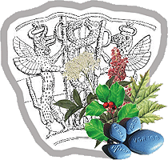
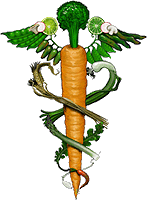

**Weź własne zdrowie we własne ręce**  
Człowiek nie umiera od chorób, człowiek umiera od lekarstw. Galen

dawno • wczoraj • dzisiaj

Opracowując artykuły "Zapomnianej medycyny" zastanawiałem się, czy faktycznie prekursorami dzisiejszej medycyny byli starożytni. Czy faktycznie do swoich sukcesów dochodzili przez tysiące lat metodą "prób i błędów"? Jak to wyglądało? Czy przypadkowym osobom podawano nieznany specyfik i czekano na efekt? Na kim to próbowano? Na ochotnikach, więźniach, niewolnikach? A jak to jest, że my współczesni mamy tylko mgliste pojęcie o medycynie "ledwie" sprzed 1000 lat? Bogiem medycyny według Greków był Asklepios syn Apollina, którego zabił Zeus za nadmierne wskrzeszanie zmarłych. Egipcjanie twierdzą, że Toth nauczył ludzi stosowania roślin, pokazał im dobre i trujące. Czy to nie oznacza, że cała medyczna wiedza została nam ludziom przekazana? Czy zaginęła w kataklizmie 12,5 tysiaca lat temu? Być może, ale zapewne jakieś jej resztki przetrwały i być może z tych szczątków korzystali Hipokrates czy Galen. Ale i ta wiedza ginęła na przestrzeni dziejów, a w ostatnich czasach została "dobita" przez "nowoczesną" medycynę i koncerny farmaceutyczne.

Czy zakaz przeprowadzania sekcji zwłok był wymysłem kościoła? Prawdopodobnie nie. To był zakaz przekazany przez Bogów, by ustrzec ludzi przed błędami działających po omacku, przed pochopnym "tworzeniem" potworów. Badania nowoczesnej biotechnologii i genetyki mogą zostać wykorzystane w sposób, o którym my maluczcy mamy tylko mgliste pojęcie. Czy przypadkiem współczesna medycyna jako nauka "wyzwolona" nie brnie w ślepy zaułek? Dlaczego odrzucono wiedzę starożytnych? Czy dlatego, że były to zabobony? A co w zamian daje nam medycyna? Chemiczne leki "szybkiego reagowania", które likwidując jeden objaw wpędzają nas w następną chorobę. Specjalista od serca potrafi "rozwalić" nam wątrobę, bo wątroba to nie jego specjalność. Dziś, gdy człowiek zachoruje rozpoczyna wędrówkę od cierpienia do cierpienia i nie wie kiedy ją zakończy i czy zakończy szczęśliwie. Doskonale współdziałający organizm jakim jest człowiek, jest dziś traktowany jak zepsuty samochód w warsztacie samochodowym. Problem jest taki, że samochód do człowieka ma się tak, jak ręczny świder do komputera. Czasy, w których żyjemy, są czasami absurdu. Człowiek, który ratuje tonącego może być ukarany za to, że nie posiada karty pływackiej.

Od najmłodszych lat jesteśmy oswajani z widokiem białego kitla i to tak dogłębnie, że lekarza uważamy niemal za cudotwórcę. Jesteśmy przeświadczeni, że nikt inny tylko On potrafi nas wyleczyć ze wszystkich dolegliwości i chorób. Niemal z namaszczeniem przełkniemy wszystko, co nam zaaplikuje nie zastanawiając się nawet, czy nie popełnił jakiegoś błędu. Lekarz to zawód i jak w każdym zawodzie są ludzie z powołania, są dobrzy rzemieślnicy, ale są i partacze. Lekarz to też człowiek i też może popełnić błąd, tyle tylko że jego błąd może mieć nieobliczalne konsekwencje. Odrzucenie przez nowoczesną medycynę tak zwanej "medycyny ludowej" rzuciło ją w ramiona wyspecjalizowanych koncernów chemicznych, które jak wskazuje coraz więcej informacji, zamiast leczyć zaczynają nas truć, a nawet zabijać. Czy medycynę należy obarczać całą winą? Z pewnością nie. To człowiek zrobił się wygodny i własne zdrowie oddał w ręce innych. Z własnego wygodnictwa odrzucił wiedzę przodków i choć porusza się po aptece z ogromną ilością leków nie potrafi ich rozpoznać i użyć.

Jak wiadomo, używanie czosnku reguluje ciśnienie, ale nie wszyscy lubią lub mogą jeść czosnek. Nie wszyscy też wiedzą, że takie same działanie ma skórka cytryny wraz z białym miąższem. Wystarczy wziąć słoiczek po dżemie. Wyszorować i sparzyć dwie cytryny, wycisnąć i wypić sok (jest to dzienne zapotrzebowanie na witaminę C). Skórki zemleć w maszynce do mięsa (lub zetrzeć na drobnej tarce) i przełożyć do słoiczka, dodać do tego łyżkę miodu i wstawić do lodówki. Codziennie wieczorem (przed snem) zjeść 1 łyżeczkę od herbaty samego tylko specyfiku. Po 1-2 tygodniach używania jest widoczna poprawa, a po 1-2 miesiącach można konsultować z lekarzem zmiany w przyjmowaniu leków. Czosnek i cytryna działają **leczniczo**, a nie objawowo. Ponadto one **regulują** ciśnienie, a więc pomagają leczyć zarówno nadciśnienie jak i ciśnienie zbyt niskie.

Nasze państwo też przykłada swoja rękę do wprowadzania ludzi w błąd. Kto ogląda telewizję lub słucha radia jest wprost bombardowany reklamami cudownych leków prezentowany przez fałszywych lekarzy, połączonych z rymowankami typu "kiła ci minie po flegaminie", natychmiastowych odchudzanek w rodzaju 14 kilogramów w jeden tydzień, czy wprost cudownych jogurtów, które nie psują się nawet po dwóch tygodniach. Mądry skrzywi usta w pogardliwym uśmiechu, ale nieświadomy natychmiast kupi. I o to w tym wszystkim chodzi, bo towar na półce to zamrożony pieniądz producenta. Nie jest ważne czy produkt jest zdrowy, ważne jest żeby szybko sprzedać. A wystarczy się zastanowić jak smakuje zsiadłe mleko po tygodniu, by natychmiast zrozumieć, że coś musiano dodać, by taki jogurt przetrwał. Wszyscy i to w szybkim tempie, stajemy się magazynami broni chemicznej.

Jest i druga strona medalu. Żadne państwo nie jest zainteresowane edukowaniem swych obywateli na temat zdrowego żywienia z bardzo prozaicznego powodu. Po pierwsze - uderza to w przemysł rolno-spożywczy a przy okazji w przemysł chemiczny. Nie jedząc szkodliwego białego chleba i cukru puścilibyśmy "z torbami" piekarzy, cukierników i cukrowników, a gwałtowny spadek spożycia niezdrowego mleka odczuli by hodowcy i cały przemysł mleczny. A po drugie - co by się stało, gdyby zacząć uczyć od przedszkola zasad zdrowego żywienia? Po dwudziestu latach okazałoby się, że lekarze nie są wcale potrzebni i należałoby służbę zdrowia zredukować do pogotowia ratunkowego uczestniczącego tylko w ratownictwie medycznym. To nie zdrowie ludzi jest najważniejsze. Najważniejszy jest zysk ze sprzedaży niezdrowej żywności i zysk koncernów farmaceutycznych na leczeniu ludzi. To dlatego jesteśmy zasypywani reklamami "Big-Maców", "Marsów", czekoladek i pomysłami polityków na "szklankę mleka dla każdego ucznia", a zaraz potem złotymi środkami na "wszelkie bóle i swędy". Żyjemy naprawdę w dziwnym kraju - z najtańszej mąki wypieka się najdroższy chleb, a głupcy zamiast się leczyć sięgają po władzę.

  A jednak można !!! Obowiązkowo owoce i warzywa, za to frytki nie częściej niż dwa razy w tygodniu - taka dieta czekać będzie angielskich uczniów zgodnie z nowymi standardami żywieniowymi dla szkół publicznych ogłoszonymi przez rząd. Od września szkolne posiłki w Anglii nie będą już mogły zawierać kiepskiej jakości przetworów mięsnych, napojów gazowanych, chipsów ani czekoladek. Zakazana będzie sprzedaż niezdrowego, taniego jedzenia (junk food) w szkolnych sklepikach i automatach. W niepamięć mają odejść potrawy słone i tłuste. Dzieciom należy regularnie serwować w szkołach mięso wysokiej jakości, drób i ryby. To naprawdę ambitny program - powiedział w BBC przedstawiciel resortu edukacji Jim Knight, przyznając zarazem, że uporanie się z "dziesięcioleciami zaniedbań" w dziedzinie żywienia uczniów będzie wymagać czasu. (maj 2006)

Nie ma sensu negowania naukowej medycyny, bo przecież w domu nie złożymy sobie złamanej nogi czy przyszyjemy ucho odgryzione przez łagodnego psa. Medycyna jest potrzebna do leczenia nagłych i ciężkich przypadków, do ratowania ludzi w katastrofach i wypadkach, a my pędzimy do lekarza już po ukąszeniu komara.

Chcę pokazać, że przy odrobinie wiedzy możemy się leczyć sami, tym co jemy, nie wydając ciężko zarobionych pieniędzy na "cudowne" leki. Pokazać, że przy zmianie nawyków żywieniowych, możemy schudnąć bez "cudownych" diet, które polegają na wyniszczeniu organizmu. Pokazać, że przez nasze ręce codziennie przewijają się leki naturalne, które my sami uporczywie niszczymy kilkakrotnie odgrzewając, gotując i smażąc. Kto musi, nadal będzie brał antybiotyki, ale niech jednocześnie pamięta, że leczenie po ich użyciu trwa wiele miesięcy. Kto będzie chciał, będzie nadal brał codziennie aspirynę, która rzekomo chroni przed zawałem, ale niech jednocześnie pamięta, że zniszczy w ten sposób śluz żołądka, co doprowadzi do jego owrzodzenia, a przy zachorowaniu na grypę wpędzi go w zapalenie płuc (jeśli musimy zażyć aspirynę, to koniecznie przed aspiryną zażyć należy łyżeczkę zmielonego siemienia lnianego). Kto chce, będzie łykał witaminę C w tabletkach, ale niech będzie świadomy, że od niej nabawi się skrzepów krwi, kamieni w nerkach i przy okazji zaburzy organiczną gospodarkę cukrami.

Odradza się, choć powoli, medycyna naturalna i ziołolecznictwo. Medycyna stosowana przez nasze babcie, a czasem jeszcze przez mamy nauczone przez swoje matki. Dlaczego powoli? Po pierwsze literatura na ten temat jest wydawana w bardzo małych nakładach (bo kto to będzie czytał?), po drugie trudno jest zwalczać narzucony nam od młodości schemat "choroba-lekarz-ozdrowienie", a po trzecie do ataku ruszyły połączone siły koncernów farmaceutycznych zarabiajających krocie na terapiach prowadzonych za pomocą produkowanych przez siebie chemikaliów. Środek naturalny leczący chorobę nie zostanie dopuszczony do oficjalnego użytku, dopóki nie zostanie dogłębnie rozłożony na czynniki pierwsze przez chemików, a szanowne grono medyków nie zrozumie na czym polega jego działanie, czyli w praktyce nigdy. Chemicy po pewnym czasie wyekstrahują jakiś związek chemiczny i to on wejdzie do medycyny jako lek oficjalny, przynosząc jednocześnie zyski producentowi. Otrzymamy nowy super lek, a po wielu latach zaczną się procesy o odszkodowanie za groźne skutki uboczne, których nauka nie potrafiła przewidzieć.

---

**Na wszelki wypadek należy pamiętać, że wszelkie tabletki popijamy tylko czystą wodą, przegotowaną lub mineralna niegazowaną. Znane są przypadki zapaści po popiciu niektórych leków sokami cytrusowymi, a nawet śmierci po popiciu  
sokiem grapefruitowym.

---

**

Do niczego też absolutnie nie namawiam. Każdy ma swój rozum i potrafi myśleć. Ja przekazuję to, co piszą inni, naprawdę mądrzy ludzie. Ludzie, którzy są lekarzami z wieloletnią praktyką, ludzie którzy na nowo odkrywają dawno zapomnianą wiedzę i którzy to wszystko próbowali na sobie. Nie mam zamiaru także propagować wegetarianizmu czy wręcz weganizmu. Człowiek musi też spożywać białko zwierzęce, ale spożywać z umiarem. Weźmy się za siebie, zacznijmy "poprawnie" jeść, poprawmy odporność własnego organizmu, a wtedy będziemy mniej chorować. I jeszcze jedno. Te kwiaty zasadził i wyhodował ktoś inny. Ja je tylko zebrałem w bukiecik. Życzę "owocnej" lektury.

  Brytyjski następca tronu książę Karol zaapelował we wtorek podczas sesji Światowej Organizacji Zdrowia w Genewie, o nieodrzucanie dorobku tradycyjnej medycyny. "Wydaje mi się okropne, że w nieustającej pogoni za modernizacją wiele metod leczniczych, które już się sprawdziły i dowiodły swej skuteczności, nie jest już wykorzystywanych, bo uważa się jej za nienowoczesne". (maj 2006)

---

**W opracowaniach wykorzystałem książki**:

•  Jadwiga **Górnicka** - Apteka natury, poradnik zdrowia.  
•  Irena **Gumowska** - Czy wiesz co jesz?  
•  Patrick **Holford** - Zasady zdrowego odżywiania.  
•  Adolf **Januszewski** - ABC radiestezji.  
•  Henryk **Jasiak**, Monika **Jucewicz** - Życie bez lekarza.  
•  Andrzej Czesław **Klimuszko** - Wróćmy do ziół.  
•  Krystyna **Mikołajczyk**, Adam **Wierzbick** - Zioła.  
•  Witold **Porzęcki** - Ziołolecznictwo.  
•  Andrzej **Skarżyński** - Bliżej natury.  
•  Grzegorz Franciszek **Sroka** - Poradnik ziołowy.  
•  Jan **Schulz**, Edyta **Ueberhuber** - Leki z Bożej apteki.  
•  Michał **Tombak** - Droga do zdrowia.  
•  Michał **Tombak** - Jak żyć długo i zdrowo.  
•  Michał **Tombak** - Jak żyć 150 lat?  
•  Michał **Tombak** - Uleczyć nieuleczalne. Cz.1.  
•  Teresa **Tuszyńska** - Zdrowie nie ma ceny.  
•  Marzena i Tadeusz **Woźniakowie** - Ojca Grande przepisy na zdrowe życie.  
•  Marzena i Tadeusz **Woźniakowie** - Ojca Grande przepisy na zdrowe życie. Cz. 2.
