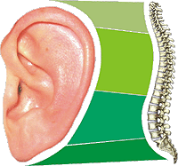

**Nasz fundament - kręgosłup**  
Najlepszym lekarstwem jest ruch. Niestety nie ma go w tabletkach.

Fundamentem naszego ciała jest kręgosłup i nie trudno dojść do wniosku, że gdy fundament zaczyna się rozlatywać, po jakimś czasie zawali się cały dom. Zgodnie z naukową medycyną podzielono go na cztery strefy - pierwsze 7 nazwano odcinkiem szyjnym, następnych 12 zaliczono do "strefy" piersiowej, kolejne 5 odcinkiem lędźwiowym, potem następne 4 zrośnięte ze sobą nazwano kością krzyżową i na sam koniec wyodrębniono 4 szczątkowe kręgi znane pod nazwą kości ogonowej. O tym, że człowiek ją posiada doskonale wiedzą ci, co doznali jej stłuczenia i doświadczyli bólu porównywalnego z bólem zęba.

Poszczególne kręgi są do siebie idealnie dopasowane i utrzymywane za pomocą wiązadeł mięśniowych, a pomiędzy nimi znajdują się elastyczne "przekładki" umożliwiające przekręcanie i wyginanie ciała. Jeśli po gwałtownym ruchu czy uderzeniu jakaś część nie wróci na swoje miejsce, lub zostanie ściśnięta "przekładka zaczynają się kłopoty. Mówimy wtedy o przemieszczeniu czyli "wypadnięciu" dysku. Z wiekiem zaczynają się też wycierać "przekładki". Jedynym okresem, gdzie kręgosłup może "odpocząć" i pozwolić sobie na regenerację jest sen (przesypiamy około 1/3 naszego życia). Spać powinniśmy na twardym materacu i na twardej poduszce i do tego na wznak. Miękkie "pielesze" powodują, że nasz kręgosłup w czasie snu pozostaje nienaturalnie wygięty, co pogarsza pracę wątroby, zaś spanie na miękkiej poduszce zakłóca proces oddychania przez nos, a oddychanie przez usta jest początkiem inwazji bakterii i wirusów i "łapiemy" katar, choroby gardła czy zapalenie oskrzeli lub płuc.

**Gdzie boli kręgosłup**

Prof. Tombak twierdzi, że stan naszego kręgosłupa odzwieciedla brzeg naszego ucha. Jeśli jest wyraźnie zarysowany, to znaczy, że nasz kręgosłup jest zdrowy. Jeśli na brzegu pojawiły się wgniecenia, świadczy to o osłabieniu poszczególnych części kręgosłupa. Po lewej stronie zamieściłem rysunek, który może pomóc w lokalizacji uszkodzeń. Zaczynając od góry pojawiające się wgniecenia sygnalizuja uszkodzenie kręgów szyjnych, potem piersiowych, lędźwiowych i części krzyżowej. Zwichnięty kręg uciska nerwy i naczynia krwionośne, które powiązane są z konkretnymi organami naszego ciała. Jeśli nerw jest uszkodzony, to i organ, którym on "kieruje" źle funkcjonuje.

Przy przemieszczeniu **kręgów szyjnych** mogą się pojawić następujące dolegliwości - bóle głowy, rozdrażnienie, nerwowość, bezsenność, katar, wysokie cisnienie, ciągłe przemęczenie, alergia, głuchota, choroby oczu, wypryski, pryszcze, różnorodne egzemy, choroby gardła, przeziebienia, choroby tarczycy.

Przy przemieszczeniu **kręgów piersiowych** - astma, kaszel, ciężki oddech, sapanie, bóle rąk (od łokcia w dół), pleców, choroby związane z nieprawidłowym funkcjonowaniem serca, bronchit (zapalenie oskrzeli), zapalenie płuc, choroby pęcherzyka żółciowego, choroby wątroby, niskie ciśnienie, zaburzenia w krwioobiegu, zapalenie stawów, choroby zołądka, zgaga, owrzodzenie żołądka, i dwunastnicy, nieżyt żołądka, choroby nerek, stany ciągłego zmęczenie, choroby skóry (wągry, wypryski, pryszcze, egzema, czyraki), reumatyzm, bóle brzucha, niektóre rodzaje bezpłodności.

Przy przemieszczeniu **kręgów lędźwiowych** - zaparcia, biegunki, skurcze w nogach, choroby pęcherza moczowego, rozregulowanie cyklu miesiączkowego, bolesna miesiączka, impotencja, silne bóle w kolanach, ischias, lumbago, bóle lędźwiowe, zły krwioobieg w nogach, obrzeki kostek, "zimne" nogi, słabość w nogach, skórcze w mięśniach nóg, hemoroidy.

Każdy narząd organizmu, pośrednio lub bezpośrednio jest połączony z odpowiednim segmentem rdzenia kręgowego poprzez nerwy obwodowe. Istnieje ścisły związek pomiędzy poszczególnymi kręgami kręgosłupa a chorobami. Według prof. J. Aleksandrowicza poszczególne kręgi są powiązane z następującymi organami, a co za tym idzie z chorobami tych organów.

**7 kręgów szyjnych**

**12 kręgów piersiowych**

**5 kręgów lędźwiowych**

**1**. unaczynienie głowy, przysadka, owłosiona skóra głowy, kości twarzy, mózg, ucho środkowe i wewnętrzne, układ współczulny.  
**2**. oczy, narząd oczny, narząd słuchowy, zatoki, wyrostek sutkowaty, język, czoło.  
**3**. policzki, ucho zewnętrzne, kości twarzoczaszki, zęby, nerw trójdzielny.  
**4**. nos, usta, jama ustna, trąbka Eustachiusza..  
**5**. struny głosowe, gardło.  
**6**. mięśnie karku, ramiona, migdały.  
**7**. tarczyca, łokcie, torebka stawu biodrowego.  

**1**. przedramię, dłoń, przełyk, tchawica.  
**2**. serce i zastawki, naczynia wieńcowe.  
**3**. płuca, oskrzela, opłucna, sutki.  
**4**. pęcherzyk żółciowy, przewód żółciowo-wspólny.  
**5**. wątroba, splot słoneczny, krew.  
**6**. żołądek.  
**7**. trzustka, wyspy Langerhansa, dwunastnica.  
**8**. śledziona, przepona.  
**9**. nadnercza.  
**10**. nerki.  
**11**. nerki, moczowody.  
**12**. jelito cienkie, jajowód, układ limfatyczny.  

**1**. jelito grube, węzły pachwinowe.  
**2**. wyrostek robaczkowy, brzuch, udo, kątnica.  
**3**. narządy płciowe, jajniki (jądra), macica, pęcherz, kolano.  
**4**. gruczoł krokowy, mięśniówka lędźwiowej części grzbietu, nerw kulszowy.  
**5**. podudzia, stopy.  

---

**Kość krzyżowa** (5 kręgów zrośniętych) - biodra, pośladki.  
**Kość ogonowa** (4-5 kręgów) - odbyt.

Powyższy wykaz nie upoważnia do wykonywania jakichkolwiek eksperymentów. Nasz kręgosłup w ręku amatora lub pseudokręgarza, to w najlepszym przypadku dożywotnie kalectwo.

**Ćwiczenia łatwe i konieczne**

Prof. Tombak pisze - Przez całe życie "pracujemy" na stan własnego kręgosłupa. Jesli zaniedbujemy go na codzień, musimy liczyc się z faktem, że nastąpi moment, kiedy ból przekroczy granicę naszej wytrzymałości. Wtedy znajdziemy czas, a nawet mnóstwo czasu na leczenie. Ponieważ nie wynaleziono dotychczas żadnego lekarstwa na kręgosłup (oprócz warsztatu chirurga), prof. Tombak zwraca szczególną uwagę na profilaktykę. Chcąc utrzymać nasz kręgosłup w kondycji zaleca przestrzeganie następujących praw:

**1\. Spać na twardym materacu.  
2\. Spać na twardej poduszce.  
3\. Wykonywać odpowiednie ćwiczenia.  
4\. Być w ciągłym ruchu.  
5\. Prawidłowo odżywiać organizm.**

i stosować działania profilaktyczne:

**•** 

**Należy cały czas obserwować siebie, chodzić prosto, stać prosto, siedzieć prosto, brzuch powinien być wciągnięty, plecy wyprostowane, głowa uniesiona lekko w górę.**

**•** 

**Siedząc nie należy nigdy zakładać nogi na nogę, ponieważ pod kolanami znajdują się dwie duże arterie (tętnice), których ucisk powoduje naruszenie ogólnego krążenia krwi.**

**•** 

**Przyzwyczajenie siadania z nogą założoną na nogę z wiekiem powoduje bóle w kręgosłupie i mięśniach nóg, żylaki, choroby naczyń krwionośnych kończyn dolnych.**

**•** 

**Nie podnoś ciężarów z pozycji stojącej. Mniej obciążasz kręgosłup jeśli uginasz kolana.**

**•** 

**Wzmacniaj mięśnie brzucha - odciążają kręgosłup o 20%.**

**•** 

**Nosząc ciężary rozkładać je równomiernie na oba ramiona.**

Zaleca też zestaw ćwiczeń, by nasz kręgosłup utrzymać w należytej kondycji. Ćwiczenia te są proste, lekkie i nie zabierają zbyt wiele czasu. Mogą je wykonywać dosłownie wszyscy, nawet ci którzy poruszają się z trudem, a także genetycznie leniwi.

Zestaw nr 1 (łóżkowy)

**•** 

**Po przebudzeniu się należy kilka razy się przeciągnąć.**

**•** 

**Leżąc na placach z całej siły naciskać tyłem głowy na poduszkę przez 5 sekund i 5 sekund odpoczywać. Powtarzać 6 razy.**

**•** 

**Położyć poduszkę na piersi i przez 5 sekund mocno ja obejmować i 5 sekund odpoczywać. Powtórzyć 6 razy.**

**•** 

**Położyć poduszkę między nogami i przez 5 sekund mocno ściskać ją kolanami i 5 sekund od-poczywać. Powtórzyć 6 razy.**

**•** 

**Na 5 sekund podnieść nogi do góry pod katem 45° i 5 sekund odpoczywać. Powtórzyć 6 razy.**

**•** 

**Palcami jednej nogi ściągać na siebie palce drugiej nogi na zmianę 6 razy.**

Zestaw nr 2 (dywanowy) - japoński, doskonale regenerujący wszystkie układy organizmu, wysoki procent wyleczenia chorób kręgosłupa, przetestował go sam autor uleczając się z dolegliwości kręgosłupa.

**"rybka"**

**pozycja wyjściowa: leżąc na plecach podłożyć dłonie pod kark na wysokości 4 i 5 kręgu szyjnego i całym ciężarem przylgnąć do podłogi. Nogi złączyć, palce nóg "podciągnąć" w stronę głowy. Wszystkie wypukłości (potylica, ramiona, łydki, miednica) wcisnąć w podłogę.  
wykonanie: w tej pozycji rozpocząć szybkie kołysanie z prawa na lewo i z lewa na prawo, na podobieństwo szybko płynącej rybki. Ćwiczenie należy wykonywać po 1 minucie rano i wieczorem.**

**"karaluch"**

**pozycja wyjściowa: pod szyję położyć twardy wałek, podnieść do góry ręce i nogi tak, aby stopy były równoległe do podłogi.  
wykonanie: w takiej pozycji potrząsać rękami i nogami jednocześnie (podobnie jak przewrócony karaluch). Ćwiczenie należy wykonywać 1-2 minuty rano i wieczorem. Ćwiczenie daje efekt biegu, ale bez obciążania stawów i serca.**

**"łączenie dłoni i stóp"**

**\- położyć się na plecach. Dłonie złączyć i dociskać do siebie lekko 10 razy opuszki palców obu rąk,  
\- złożyć dłonie równolegle do tułowia i 10 razy przemieszczać je w kierunku stóp i z powrotem jakby rozcinając ciało na pół,  
\- złączyć stopy tak, by przylegały do siebie, w takiej pozycji podnieść nogi i 10 razy przesuwać je wprzód i w tył uginając w kolanach, wykonując przy tym te same ruchy rękoma co w punkcie wyżej,  
\- zamknąć oczy i poleżeć ze złączonymi stopami i dłońmi przez 2-3 minuty.**

Zestaw nr 3 (krzesełkowy) - koryguje pracę mięśni, nerwów, wewnętrznych organów i naczyń krwionośnych, normalizuje prace układu nerwowego i pokarmowego, ma dobry wpływ na zdolności umysłowe. Jest wskazany dla osób, które prowadzą intensywny tryb życia.

**•** 

**Usiąść na krześle, ręce położyć na kolanach, podnosić i opuszczać ramiona 10 razy.**

**•** 

**W tej samej pozycji robić skłony głową w prawa i lewą stronę, po 10 razy w każdą stronę.**

**•** 

**Skłaniać głowę do przodu i do tyłu po 10 razy w każdą stronę.**

**•** 

**Skłaniać głowę w prawo 10 razy i w lewo 10 razy.**

**•** 

**Wyciągnąć ręce do przodu w poziomie i kręcić głową w prawo i w lewo po 5 razy.**

**•** 

**Podnieść ręce do góry nad głową i kręcić głową w prawo i w lewo po 5 razy.**

**•** 

**Położyć ręce na ramionach pod katem prostym, odchylać ręce do tyłu i jednocześnie ciągnąć podbródek do przodu i w górę.**

**•** 

**Ręce położyć na kolanach, zamknąć oczy i powoli kręcić głową w prawo i lewo po 5 razy, następnie z zamkniętymi oczami zrobić 3 razy głęboki wdech i wydech, otworzyć oczy.**

**•** 

**Po wykonaniu tych ćwiczeń należy przyjąć kontrastowy prysznic - 30 sekund ciepły i 10 sekund zimny lub chłodny.**

Zestaw nr 4 (krzesełkowy) - regeneracja kręgów szyjnych i oddychanie.

**•** 

**siedząc na krześle unosimy i opuszczamy ramiona 10 razy,**

**•** 

**skłaniamy głowę w prawo i w lewo po 10 razy starając się dotknąć uchem ramienia,**

**•** 

**skłaniamy głowę w przód i w tył 10 razy,**

**•** 

**obracamy głowę w prawo i w lewo po 10 razy,**

**•** 

**wyciągamy ręce do przodu wnętrzami dłoni skierowanymi do siebie i kręcimy głową w lewo i w prawo po 10 razy,**

**•** 

**podnosimy ręce do góry wnętrzami dłoni skierowanymi do siebie i kręcimy głową w lewo i w prawo po 5 razy,**

**•** 

**kładziemy ręce na ramionach, odciągamy łokcie do tyłu jakbyśmy chcieli ścisnąć jabłko między łopatkami, jednocześnie wyciągając do przodu podbródek. Wykonywać rano i wieczorem po 3 minuty,**

**•** 

**siedząc na krześle, kładziemy ręce na kolanach, zsuwamy się na brzeg krzesła i kołyszemy ciałem w prawo i w lewo, w jego rytmie wciągamy i wypinamy brzuch. Powtarzamy 10 razy.**

Zestaw nr 5 (masaże) - ogólnowzmacniający.

**•** 

**kciuki obu rąk położyć za uszami, przycisnąć małżowiny obiema rękami i masować uszy od góry do dołu 30 razy palcami wskazującymi;**

**•** 

**prawą dłoń położyć na czole tak, aby mały palec leżał na lewej brwi. Teraz położyc na prawej dłoni lewą w taki sposób, by mały palec lewej dłoni znalazł się na prawej brwi. Przesuwać dłonie w prawo i w lewo 30 razy cały czas przyciskając je do czoła, tak by małe palce ślizgały się po brwiach;**

**•** 

**zwinąć dłoń w pięść, opuszkami kciuków przycisnąć gałki oczne i delikatnie, okrężnymi ruchami masować oczy 15 razy zgodnie z ruchem wskazówek zegara i 15 razy w przeciwną stronę;**

**•** 

**położyć prawą dłoń na brzuchu, z wierzchu przycisnąć lewą i masować okrężnym ruchem 30 razy zgodnie z kierunkiem ruchu wskazówek zegara. Potem odwrotnie - lewa ręka na brzuch, na nią prawa i 30 ruchów okrężnych w przeciwnym kierunku (można wykonywać leżąc, siedząc lub stojąc);**

**•** 

**wciągnąć brzuch jak najmocniej jak się da, a potem wypiąć mocno niczym balon. I tak 30 razy;**

**•** 

**Spleść dłonie na karku i masować go, przesuwając ręce z lewa w prawo 30 razy i z góry na dół 30 razy;**

**•** 

**pocierać dłoń o dłoń tak, by ręce zrobiły się gorące, położyć dłonie na oczy i policzyć do 30.**

Warunkiem uzyskania powodzenia jest systematyczne i codzienne wykonywanie ćwiczeń. W niedzielę możemy sobie odpuścić, ponieważ jest "dniem lenia" :-), wykonując jednak zestaw łóżkowy.

Na koniec zestaw ćwiczeń dla sprawniejszych fizycznie:

**ćwiczenie 1**

**Położyć się na podłodze, podłożywszy miękki dywanik, ręce wzdłuż ciała dłońmi w dół. Silnie podrzucamy nogi do góry, próbując dosięgnąć czoła kolanami, po czym nogi opuścić. Powtarzać 10 razy.**

**ćwiczenie 2**

**Wstać. Zgiąć się w przód dotykając palcami podłogi, a najlepiej całą dłonią. Głowę skłaniać w przód i w tył w takt skłonów tułowia. Wstać, nogi na szerokość ramion. Dłonie zacisnąć w pięści.**

**ćwiczenie 3**

**Wykonywać jednocześnie krążenie obu rąk w stawach barkowych zakreślając koła. 10 razy do przodu i 10 razy do tyłu.**

**ćwiczenie 4**

**Zginanie kręgosłupa na boki. Dłonie ślizgają się po tułowiu, jedna w dół do kolana, druga podnosi się pod pachę. Jednocześnie przy skłonie w prawo głowa obraca się z prawej strony na lewą. Powtarzamy to samo w drugą stronę.**

**ćwiczenie 5**

**Nogi rozstawiamy na szerokość ramion. Podnosimy prawą rękę i dotykamy lewej łopatki. Potem to samo z lewą ręką dotykając prawej łopatki. Powtarzamy 10 razy.**

**ćwiczenie 6**

**Nogi rozstawiamy na szerokość ramion. Podnosimy ręce do góry nad głową i obracamy tułowiem na przemian w lewo i w prawo po 10 razy. Ręce i głowa obracają się razem z tułowiem.**

**ćwiczenie 7**

**Stajemy prosto. Nogi rozstawiamy na szerokość ramion. Podnosimy prawą nogę starając się dotknąć nogą klatki piersiowej, następnie to samo lewą nogą i powtarzamy 10 razy.**

**ćwiczenie 8**

**Stawiamy przed sobą krzesło. Obydwoma rękami łapiemy za oparcie i robimy przysiady minimum 10 razy.**

**Ćwicz nawet w biurze**

Jest to zestaw ćwiczeń rozluźniający mięśnie i likwidujący zmęczenie podczas długiej siedzącej pracy. Wykonywać go mogą nawet najbardziej chorzy ludzie. Miejsce dowolne - biuro, oczekiwanie przed gabinetem szefa, czekanie na tramwaj lub autobus, rozmowa przez telefon, czyli dosłownie wszędzie i przy minimalnej ilości czasu. No może tylko bez ostatniego ćwiczenia, by nie narazić się na zdziwione spojrzenia nieświadomych współplemieńców.

**Wibromasaż**

**Należy wspiąć się na palce tak, aby obcasy oderwały się od ziemi na wysokość 1-2 cm, a następnie całą masą ciała opaść na pięty. Cwiczenie wykonujemy nie za szybko, nie częściej niż 1 uderzenie co sekundę i przez okres nie dłuższy niż 1 minuta. Osoby, które parają się pracą siedzącą powinny wykonywać ćwiczenie 3-5 razy dziennie. Jest to również doskonała profilaktyka przeciw żylakom i schorzeniom serca.**

Druga grupa ćwiczeń, to tzw. zamki mięśniowe, unikalne w prostocie i niewidoczne dla otoczenia, a rozluźniające całe ciało, poprawiające krążenie krwi i profilaktyczne przeciw schorzeniom narządów rodnych kobiet i prostaty u mężczyzn.

**Przedni dolny zamek**

**Wykonanie go osiagamy poprzez skurczenie mięśni obejmujących ujście moczowodu. Zwykle mimowolnie kurczymy je, kiedy trzeba dobiec do toalety lub wydalić resztki moczu przy jego oddawaniu. Aby było łatwiej wykonać to ćwiczenie, proszę spróbować świadomie wstrzymać mocz w trakcie oddawania i zapamiętać to odczucie. Ćwiczymy to 3-5 razy dziennie w ilości po 10 razy.**

**Tylny dolny zamek**

**Podobnie jak wyżej, ale obkurczamy mięśnie odbytnicy, tak jakbyśmy chcieli wstrzymać opróżnianie jelita grubego. Ćwiczymy to, podobnie jak wyżej, 3-5 razy dziennie w ilości po 10 razy.**

**Całkowity zamek**

**Jest to jednoczesne wykonanie dwóch poprzednich ćwiczeń. Daje to podwójny efekt uzdrawiający. Ćwiczenie najlepiej wykonywać podczas wydechu 1 raz dziennie powtarzając je 10 razy.**

"Między nami po ulicy, snują się..." napisała kiedyś Agnieszka Osiecka. Dotyczy to nie tylko zamyslonych studentów. Prawie wszyscy chodzimy przygarbieni, osowiali, przytłoczeni życiem. Polacy są chyba najbardziej pesymistycznie nastawionym narodem. Wiadomo jakie państwo, taki naród. Ale to nie powód, by gorzknieć od środka. Głowa do góry, optymiści żyją dłużej, a niepalący umierają zdrowsi. Następne ćwiczenia poprawią nam chociaż sylwetkę.

**Podchodzimy do ściany, przylegamy do niej jednocześnie piętami, pośladkami i potylicą i stoimy tak około 3-5 minut. Następnie wciągamy brzuch, patrzymy prosto przed siebie i myślimy pozytywnie o sobie.**  
  

**Ćwiczenie pozwalające szybko zdjąć napięcie z mięśni całego ciała. Wykonujemy je stojąc. Zginamy prawą nogę w kolanie i lewą ręką przyciskamy piętę do prawego pośladka przytrzymując jednocześnie prawą reką dolną część kolana. Stoimy w tej pozycji 1-2 minuty i zmieniamy nogę.  
Uwaga! Nie wykonywać po przedawkowaniu ulubionego napoju - siła grawitacji jest nieubłagalna.**

I proszę pamiętać. Ćwiczenia należy wykonywać systematycznie i codziennie. Wykonywanie ich w "przypływie sumienia" nie da nic. To musi wejść do codziennych obowiązków, a wtedy efekty będą widoczne. Drugą sprawą jest codzienny optymizm. Najgorszą rzeczą dla człowieka jest tylko jego śmierć. Z każdej sytuacji jest wyjście, a **Polak**, jak wszystkim wiadomo, **potrafi**.
