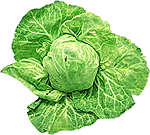

**Co może zwykła kapusta?**  
Człowiek żyje z jednej czwartej swego pożywienia,  
a z pozostałych trzech czwartych żyją lekarze.

W leczeniu naturalnym w grupie 10 najbardziej skutecznych w leczeniu roślin, pierwsze miejsce przypada bezapelacyjnie kapuście. Według doktor Górnickiej, jeśli jej właściwości lecznicze przyjąć za 100%, to pozostałe plasują się za nią i to w sporej odległości - kiełki zbożowe (30%), cytryna (29%), marchew (26%), czosnek (25%), cebula (23,5%), borówka (21,5%), ziemniek (20%), winogrona (18%), i pietruszka (15%). Kapusta biała, włoska i czerwona ma zastosowanie na użytek wewnętrzny i zewnętrzny, a lecznicze właściwości mają świeże liście, a także kapusta gotowana, duszona, kiszona oraz surówka i świeży sok.

**Co może zwykła kapusta**

Szczególne właściwości mają świeże liście. Stosowane zewnętrznie leczą następujące choroby: katar, zapalenie oskrzeli, choroby żołądkowo-jelitowe, wątrobowe, pęcherzowe, egzemę, opryszki, trądzik, łupież, gangreny i martwice, guzy i nowotwory, hemoroidy, różne infekcje (ropienie, ropowica, czyraki, zastrzał), nerwobóle reumatyczne, zębowe, nerwu twarzowego, dnawy, kolkę nerkową, oparzenia, pęknięcia i odmroziny z pęcherzami, półpasiec i gorączki napadowe, przerost węzłów chłonnych, wykwity skórne w kile, ropień zimny, gruźlicę stawową i kostną, stłuczenia, siniaki, silne bóle głowy, migrenę, ukąszenia, zapalenia opłucnej, astmę, zapalenie naczyń chłonnych, włośniczek, dolegliwości naczyniowe, żylaki, obrzęk migdałków podniebiennych.

Przy owrzodzeniach żylakowych goleni, egzemach, ranach zaniedbanych lub zakażonych, liście z kapusty wywołują niekiedy zaostrzenie się ropienia lub ponownie bardziej lub mniej ostrych bólów. Zjawiska te potwierdzają proces odtruwania i regenerację leczonych tkanek. W takim przypadku należy stosować leki przez jedną do dwóch godzin z przewrwami 6-12 godzin. W przypadku stwierdzenia nietolerancji (swędząca wysypka skórna) należy przerwać przykładanie liści i zastąpić je okładem z czystej oliwy z oliwek, z migdałów lub ze słonecznika. Gdy ustąpi zapalenie, można wznowić przykładanie z liści ograniczając, jeżeli zachodzi potrzeba, czas trwania okładu. W przypadku nietolerancji nie stanowią ujmy dla naszej metody, zdarza się bowiem bardzo rzadko (a najczęściej z powodu stosowania chemicznych środków owadobójczych). Podobne zjawisko występuje, przy stosowaniu naparu z rumianku - u jednej osoby na tysiąc wywołuje bezsenność, podczas gdy u innych działa leczniczo.

Do leczenia można również używać mięsistych liści kapusty czerwonej lub włoskiej. Im świeższe, tym skuteczniejsze ich działanie. Przed użyciem należy je umyć, wysuszyć, wykroić środkową żyłę główną, a w przypadku przykładania na wrzód lub czułą ranę także resztę unerwienia. Rozgnieść liście wałkiem do ciasta lub butelką na czystej stolnicy. Gdy ukaże się sok na powierzchni, można przystąpić do sporządzania okładu. Jedną lub warstwę z dwu, trzech liści, przyłożyć i owinąć bandażem. W przypadku bardzo czułej rany moczyć liście we wrzątku przez 2 sekundy, co je zmiękcza, a przed nałożeniem na wrzód o brzegach obrzękniętych, twardych i popękanych macerować (moczyć) liście przez 1/2 godziny w oleju słonecznikowym co powiększa ich antytoksyczność i czyni je bardziej gojącymi.

Na ranę zakażoną lub wrzód, egzemę sączącą można przykładać pasemka liści zachodzące na siebie brzegami. Sok wówczas sączy się znacznie łatwiej i spływa na ranę. Na postrzał, nerwoból lędźwiowy, bóle pochodzenia reumatycznego i różne dolegliwości pęcherzykowe zaleca się kataplazmy przyrządzane z dwóch lub trzech liści gotowanych w małej ilości wody przez 20 minut z dodatkiem 2 cebul i 1 łyżki otrąb. Po wyparowaniu wody umieszcza się wszystko na tamponie z gazy i ciepłe przykłada do rany. Nie należy przykładać gorących okładów na żołądek, który boli. Diagnozę dolegliwości powinien wystawić lekarz, gdyż w przypadku zapalenia wyrostka robaczkowego lub przydatków macicy nie przykłada się gorących opatrunków.

Kapusta na użytek wewnętrzny w postaci surówki lub żwieżego soku jest zalecana na dolegliwości gastryczne, jelitowe, układu oddechowego i ogólnego osłabienia. Żelazo, magnez i miedź zawarte w kapuście leczą anemię (nie pić płynów o temperaturze powyżej 45°C). Kapusta była i jest najlepszym lekiem na szkorbut. Na marskość i puchlinę brzuszną można spożywać z korzyścią sok z kapusty (400 g dziennie w porcjach po 200 g) lub kapustę gotowaną bądź surową (surówki). Sok z kapusty zaleca sie alkoholikom i na wrzód trawienny. Spożywanie kapusty zaleca się także cukrzykom. Właściwości gojące i zabliźniające soku z kapusty są wykorzystywane przy leczeniu zapalenia wrzodziejącego okrężnicy. Skutek leczniczy zawdzięczamy kleistym śluzom roślinnym, siarce, solom potasowym oraz witaminom i enzymom roślinnym. Należy jednak pamiętać, że witaminy i enzymu łatwo przechodzą do wody i są niszczone podczas gotowania, dlatego zaleca się spożywać kapustę w stanie surowym.

Do surówki z kapusty nalezy dodawać zmielony kminek z majerankiem, co ułatwia trawienie. Tak więc kapusta choć ciężkostrawna jest nadzwyczaj korzystna dla żołądka i jelit, szczególnie w postaci świeżego soku. Korzystna dla organizmu jest również kapusta kiszona. Zawiera ona enzymy pomagające w trawieniu tłuszczów i błonnika. Dodawanie do kapusty nadmiernych ilości wędlin czyni pokarm trudniej strawnym. Enzymy kapusty działają silnie dezynfekujące na przewód pokarmowy. Nie należy więc ich niszczyć i nie płukać kapusty kiszonej. Na dolegliwości przewodów moczowych, układu oddychania i jelit dobrze robi popijanie 1 szklanki świeżego soku prosto z sokowirówki.

Sok z kapusty przyrządzamy z liści surowej kapusty. Pamiętać należy, że "wydajność" zależy od jej świeżości. Kapusta prosto z pola czy działki zawiera dwa razy więcej soku niż kapusta przechowywana. Do przyrządzania soku wybieramy tylko zdrowe liście. Liście zwiędłe, przygnite, z oznakami działalności szkodników odrzucamy. Liście myjemy, pozostawiamy do wyschnięcia i kroimy na mniejsze części, tak by zmieściły się do sokowirówki i wyciskamy sok. Kto nie posiada sokowirówki może do tego celu użyć zwykłej maszynki do mięsa.

Sok z kapusty nie jest przyjemny w smaku, dlatego też zaleca się pić go z dodatkiem soku z marchwi, a w przypadkach różnych typów kamicy nerkowej soku z sałaty głowiastej, kapusty włoskiej bądź różowej, buraka cukrowego, szparagu, ogórka, dyni, młodej kukurydzy, pomidorów, natki pietruszki, papryki, kalafiora, cebuli. Ma to zasadnicze znaczenie, gdyż organizm kumuluje aminokwas cysteinowy powodujący kamicę cysteinową.

**Co i jak stosować**

Doktor Górnicka podaje sposoby wykorzystania kapusty w lecznictwie zastrzegając, że pisze to na podstawie doświadczeń lekarzy francuskich.

| **Afonia** | Utrata głosu. Sok z kapusty z małym dodatkiem miodu do spożywania i do płukania. Spożywać surówkę z kapusty z czerwonym burakiem. |
| --- | --- |
| **Alkoholizm** | (środki odwykowe). Spożywanie kapusty surowej lub duszonej oraz świeżego soku działa odtruwająco i odwykowo. |
| **Anemia** | Jedna do dwóch szklanek dziennie soku z surowej kapusty. |
| **Angina** | Liście z kapusty jako okład na szyję na noc uśmierzają bóle i pomagają w detoksykacji poprzez wydalanie trucizn z organizmu. Płukanie gardła sokiem z kapusty ma działanie czyszczące, gojące i zabliźniające. |
| **Astenia** | **zmęczenie, słabość ogólna**. Dziennie popijać do 2 szklanek soku. Stosować reguły prawidłowych zestawów produktów spozywczych. Unikać zdenerwowania i niewłaściwej przemiany materii. |
| **Astma** | **zapalenia oskrzeli, bronchit**, katar sienny. 3-4 liście kapusty jako okład na pierś i na szyję, u podstawy płuc lub na łopatki, według lokalizacji bólu. Zostawić na 3-4 godziny, a nastepnie całą noc. Na przewlekły bronchit stosować mieszankę - wywar z 60 g kapusty gotowanej w 1/2 litrze wody przez 1 godzinę. Pod koniec gotowania dodać 60 g miodu. Popijać do 2 szklanek soku dziennie. |
| **Bezsenność** | Na noc przyłożyć 3 liście na kark, a niekiedy na nogi. |
| **Biegunka** | **bóle jelitowe, bóle żołądkowe**. Stosować przez całą dobę okłady z kapusty na brzuch. Spożywać kapustę długo gotowaną i popijać wywar. Spożywać sok gotowany z borówki czarnej i pyłek kwiatowy. Przyczyną może być nieodpowiedni zestaw pokarmów albo zatrucie polekowe. O wyborze środka ziołowego decyduje lekarz. Bardzo korzystnie działa syrop z niedojrzałych orzechów włoskich drobno posiekanych i zasypanych cukrem. Zażywać 1/2 łyżeczki co godzinę. |
| **Ból głowy** | (silny i uporczywy). Przyłożyć dwa liście do czoła i 3 liście na kark na 4 godziny lub na całą noc. Przyłożyć liście do strefy wątroby. |
| **Ból lędźwiowy** | (postrzał). Przyłożyć 3 warstwy liści na 4 godziny lub na noc. Kontynuować aż do uśmierzenia bólu. Konsultować u lekarza. |
| **Bóle reumatyczne** | **bóle mięśni, dna, artretyzm**. Przykładać liście kapusty. Popijać sok. |
| **Choroba serca** | Przykładanie miejscowe liści zmniejsza przekrwienie i normalizuje krwioobieg. Zostawić 3 liście na kilka godzin. Jest to leczenie pomocnicze. |
| **Czyrak** | **ropień, wąglik**. Przykładać surowe liście na 2-4 godzin lub na całą noc aż do eliminacji ropienia. Popijać świeży sok i jeść kapustę surową lub duszoną. |
| **Cukrzyca** | Popijać świeży sok do 2 szklanek dziennie. Spożywać cebulę. Stosować liście pelargonii. Uwaga! Tylko w stwierdzonym stadium początkowym. W chorobie rozwiniętej może być tylko działaniem wspomagającym. |
| **Egzemy** | Stosować okłady z kapusty przez 1 miesiąc, godzinę dziennie. Jeżeli egzema jest sucha, należy uprzednio oliwić każdy liść. Jeść kapustę surową i duszoną. Popijać świeży sok. |
| **Gangrena** | **nekroza, martwica**. Przykładać surowe liście. Patrz też **rany**. |
| **Głuchota** | Wkraplać do uszu mieszankę soków z kapusty i cytryny (po połowie). |
| **Gruźlica** | **zapalenie opłucnej**. Delikatne działanie rewulsyjne liścia z kapusty jest bardzo korzystne. Przykłada się 3-4 liście na miejsce dolegliwe na całą noc. Popijać do 2 szklanek soku ze świeżej kapusty dziennie. |
| **Grypa** | Popijać do 3 szklanek soku dziennie. Popijać rozcieńczone olejki eteryczne lawenda, sosna). |
| **Hemoroidy** | Stosować zioła Rektosan. Wkładać do odbytu liście w formie czopka na noc na 4 godziny. |
| **Kac** | Na kaca - głód i praca. :-) Nie brać "klina", pić sok z kiszonej kapusty. |
| **Kamienie moczowe** | Popijać 2 szklanki soku dziennie. |
| **Katar** | Stosować 1 łyżkę syropu 3-4 razy dziennie do naparu kaszlowego. Skład syropu - 500 g soku z kapusty czerwonej, 5 g szafranu, 250 g miodu. Zagotować. |
| **Kolka watrobowa** | **kolka żółciowa**). Do zbolałego miejsca przykładać liście. Wszystkie inne leki uspokajajace są również pochodzenia roślinnego. |
| **Liszajec** | Popijać sok. |
| **Łojotok** | Popijać sok. |
| **Macica** | (**zapalenie**). Przykładać liście do dolnej części brzycha, co zmniejsza przekrwienie w pasie miednicowym. Konsultować u lekarza. |
| **Marskość wątroby** | Popijać sok ze świeżej kapusty. Popijać glinkę. |
| **Maseczka kosmetyczna** | Przykładanie liści ożywia tkanki i absorbuje nieczystości. Przykładanie kapusty na 1/2 godziny regeneruje i oczyszcza skórę, poprawia krwioobieg, absorbuje skupiska tłuszczu z tkanki podskórnej. Podobnie działa brzoskwinia, truskawka i ogórek. |
| **Migrena** | Przyłożyć 2-3 warstwy liści na zbolałe miejsce, nadto na wątrobę lub na dolna część brzucha w zależności od źródła migreny. |
| **Nadciśnienie** | Przykładać liście do łydek, na pas lędźwiowy, na kark na 2-3 godziny lub na całą noc. |
| **Nerwowość** | Popijać 2 szklanki soku dziennie. |
| **Nerwoból** | (zębowy, twarzowy, reumatyczny, **rwa kulszowa**). Przykładanie liści na przebiegu bolesnego nerwu uspokaja stopniowo ból. Liści nie ogrzewać. 3 warstwy liści przykłada się na 4 godziny pod koniec dnia lub na całą noc. |
| **Nieżyt jelit** | Popijać sok. Zjadać rano 2 łyżki kapusty kiszonej. |
| **Obrzęki** | Popijać 1-2 szklanki soku dziennie. |
| **Oczy** | (podrażnione, łzawiące, zaczerwienione, zapalenie spojówek). Wprowadzić do oka kilka kropli świeżego soku wieczorem przed snem. Można również przemywać oczy naparem z rumianku, chabru, bławatka, płatków z róży, wody solonej (1 łyżeczka soli morskiej na 500 g wody), cytryną (1 kropla do każdego oka 2-3 razy dziennie). |
| **Odmrożenia** | (z pęcherzykami). Przykładać liście. |
| **Oparzenia** | Jak najszybciej przyłożyć zmiażdżone liście. Uśmierza to bóle i działa gojąco. Na oparzenia I stopnia można przyłożyć gotowane obierki z ziemniaków lub tartej marchwi. W przypadku oparzeń II i III stopnia o leczeniu decyduje lekarz. |
| **Opryszczki skórne** | Przykładać liście na noc i zmywać rano sokiem. Często potrzebna jest konsultacja lekarska. |
| **Owrzodzenia** | **żylakowe goleni**. Jest około 34 typów owrzodzeń. Kapusta jest tutaj wyborowym lekiem. Przykładanie liści na 4 godziny dziennie lub na noc kończy się przeważnie zagojeniem rany. |
| **Pęcherzyk żółciowy** | Przyłożyć na noc 3 liście na górną część brzucha, w razie potrzeby także w ciągu dnia. |
| **Półpasiec** | Liście uśmierzają bóle. Stosować 3-4 razy dziennie po 4 godziny. Na pęcherzyki półpaśca pomagają lepiej olejki eteryczne. Półpasiec w początkowej fazie jest do wyleczenia w ciągu kilku dni. Jak postępować decyduje lekarz. |
| **Prostata** | Przykładać co drugi wieczór liście na dolną część brzucha, a w wolne dni na krocze na całą dobę. |
| **Przekrwienie mózgu** | **udar słoneczny**. Przykładać 3-4 liście na głowę i kark co 4 godziny z przerwą 2-3 godziny. |
| **Rany zwykłe** | Oczyścić ranę z ropy i szczerniałej krwi, obmyć gotowana wodą z sola morską (1 łyżeczka na szklankę wody) Zmieniać bandaże aż do kompletnego zagojenia rany. Na początku zmienia się okład z kapusty co 2 godziny a później co 4 godziny. Bandaż wieczorny pozostawiamy na noc, jeżeli przypadek nie jest groźny. W przeciwnym wypadku zmieniać bandaż częściej i oczyszczać ranę. |
| **Robaki jelitowe** | Popijać rano przez 3 kolejne dni szklankę soku (dla dzieci 20-30 g) dziennie. W razie potrzeby uzupełnić okładem z liści na dolną część brzucha na noc. Można również podawać choremu czosnek, nasiona kapusty, dynię zwyczajną. |
| **Ropień zimny** | przykładać liście i popijać sok do 2 szklanek dziennie. |
| **Skaza moczowa** | Pić 2 szklanki soku dziennie. |
| **Skaza dnawa** | (**zapalenie**). Pić 2 szklanki soku dziennie. |
| **Skóra popękana** | Przykładać miejscowo liście moczone w oleju słonecznikowym lub z oliwek. |
| **Sinusitis** | **nieżyt nosa, katar**. Jest to zapalenie zatok przynosowych (jam bocznych nosa). Przyłożyć 3 warstwy liści. Rano i wieczorem wpuścić 1/2 łyżeczki soku do nozdrzy. Stosować inhalacje z mieszanki olejków eterycznych, z igliwia sosny, tymianku, lawendy, z eukaliptusa, dając 20 kropli do czaszy z gorącą wodą. |
| **Stłuczenie** | **kontuzja**. Przykładać liście. |
| **Stan depresji** | Popijać dziennie do 2 szklanek soku. |
| **Skąpomocz** | Popijać dziennie do 2 szklanek soku. |
| **Szkorbut** | Popijać dziennie do 2 szklanek soku. Jeść surówkę. |
| **Ukąszenie owadów** | Szybko natrzeć liściem i zrobić bandaż z liści. Stosuje się również por, cebulę, czosnek, szałwię, lawendę, natkę pietruszki i inne zawierające olejki eteryczne. |
| **Tętnica** | (**zapalenie**). Przyłożyć 3-4 liście jako okład na noc. Uśmierza to bóle i poprawia krążenie krwi. |
| **Twarda wątroba** | Przykładać liście, które mają działanie rewulsyjne i zmniejszają przekrwienie. Działa to uspokajająco, łagodząco i uśmierzająco na bóle wątroby w przypadkach dolegliwości pęcherzyka żółciowego i niewydolności wątroby. Przykładać warstwę z 3 liści zarówno w dzień co 4 godziny, jak i na noc. Do ziół leczących wątrobę zaliczmy też czarną rzodkiew, liście karczocha, nawłoć pospolitą, ostropest plamisty, korzeń mniszka, korzeń podróżnika (leki Herbapolu - Syrimalol, Fitolizyna). |
| **Węzły chłonne** | (**zapalenie**). Przykładanie liści uspokaja bóle i pomaga w usunięciu toksyn. |
| **Wrzód zołądka** | Popijać 2-3 szklanki soku dziennie. |
| **Zapalenie zatok** | Przyłożyć 2 liście na 4 godziny lub na całą noc. Rano i wieczorem wprowadzać do nozdrzy 1/2 łyżeczki świeżego soku. Stosować inhalację z olejków eterycznych. |
| **Zapalenie okrężnicy** | Przyłożyć 3-4 liście na brzuch na noc. Popijać 1-3 szklanki soku dziennie między posiłkami. Po miesiącu zrobić kilkudniową przerwę. Zaleca się również stosowanie olejków aromatycznych i pyłku kwiatowego. Korzystny jest również sok z borówki. |
| **Zaparcie** | Popijać wodę z gotowanej kapusty 2-4 szklanki dziennie. |
| **Zapalenie stawów** | Pić sok. Jeść kapustę duszoną w oleju słonecznikowym z dodatkiem szczypty kminku, robić na noc okłady z liści świeżej kapusty. |
| **Zapalenie oskrzeli** | Stosować sok z kapusty z dodatkiem soku z czarnej rzepy i kilku kropel cytryny, osłodzony cukrem lub miodem. |
| **Zwichnięcia** | Przykładać rano i wieczorem po 3 liście, przykryć watą i delikatnie zabandażować. Sprzyja to odpływowi wysięku z uszkodzonej części kończyny. Zmniejsza przekrwienie. |
| **Żylaki** | **zapalenie tętnic**. Okłady z liści zmniejszają przekrwienie. Dotyczy to również ciężkich nóg i sinicy skóry. Na noc przyłożyć 3 warstwy liści na powierzchnię wiekszą niż objęta dolegliwością. Przykryć watą, lekko zabandażować. Aktywuje to krwioobieg, ożywia tkanki, oczyszcza włośniczki z nieczystych substancji. |
