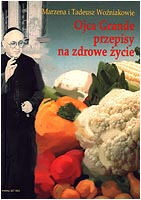

**PO TO JEDZ, BY ZDROWYM ŻYĆ**

 **Witaj, źle odżywiany internauto**

Ostatnia aktualizacja: 30.04.2004

**Nie ma ludzi zdrowych - są tylko nie przebadani**, głosi stara maksyma medyczna. Dopóki człowiek jest młody nie zastanawia się zbytnio nad tym co je, jak się ubiera i w ogóle ma przeświadczenie, że jest nieśmiertelny. Twój procesor "Mózgotell" odpowiedzialny za zdrowie włącza się im dopiero w przypadku pierwszej cięższej choroby, gdzie przykuty do łóżka ma wreszcie czas, aby zastanowić się nad kruchością tego co nazywamy zdrowiem.  Wtedy rośnie popyt na literaturę z kręgu medycyny, nie tylko naukowej. Taka literatura rośnie w Polsce jak grzyby po deszczu. Ale pamiętaj, że są też grzybki trujące, a i u nas nie brak szarlatanów, którzy za marną złotówkę wyślą Cię przed oblicze Najwyższego. Dzięki pewnemu małżeństwu z Gdańska przedstawię Ci jedyny autorytet w Polsce, który leczy... żywnością. Aptek z takimi lekami jest w Polsce tysiące, Twoim zadaniem jest tylko wybrać najzdrowsze leki.

**Ojciec Jan Grande**

Ojciec Jan Grande (na zdjęciu) należy do zakonu ojców bonifratrów. Urodził się w roku 1934 w okolicach Grodna. Jak olbrzymia większość Polaków tam zamieszkałych doznał "dobrodziejstw" bolszewizmu. Zesłany z rodziną, wojnę przeżył na dalekiej Syberii na pograniczu mongolskich stepów Kirgizji. To tam, jak sam mówi, pobierał pierwsze nauki ze zdrowego żywienia. Z ziołolecznictwem zetknął się już na Syberii, potem w Tybecie, Kijowie i Petersburgu. Studiował starą szkołę wschodniej medycyny niekonwencjonalnej. Po powrocie do Polski ukończył szkołę felczerską i wiele lat pracował w służbie zdrowia. W 44 roku życia wstąpił do zakonu. Warszawa, Łódź i wreszcie Wrocław, gdzie przebywa i leczy do dzisiaj. Jest jednym z najbardziej obleganych zakonników i bez przerwy naprawia to, co zepsuła dzisiejsza cywilizacja.

**Marzena i Tadeusz Woźniakowie** - małżeństwo dziennikarzy gdańskich, które w roku 1995 przypadkowo natrafiło na maszynopis z relacją ze spotkania z ojcem Janem Grande, poświęconą zdrowemu żywieniu, a właściwie poradnictwu żywieniowemu, jakie zakonnik odbył w Łodzi w roku 1990. Jego wykład "Opowiadanie o sposobie żywienia i pielęgnowania organizmu ludzkiego" zaowocował artykułami w "Wieczorze Wybrzeża", a następnie książką (dziś biały kruk) "Ojca Grande przepisy na zdrowe życie".

Mimo braku szumnej reklamy, przed kioskami "Ruchu" i księgarniami tworzyły się długie kolejki. Szczęśliwcami zostało tylko nieco ponad 1% Polaków. Dziennikarze z Gdańska wykonali pracę, której owoc winien być w każdym polskim domu. Ale niestety w Polsce nastały czasy, gdzie głupota przodem idzie. Era fizycznego wyniszczania Polaków, zapoczątkowana przez słynnego reformatora służby zdrowia, psychiatrę zresztą, zbiera już swoje żniwo. Dlatego tak ważne jest, by uświadamiać ludziom mądre i proste rady, jak żyć, by nie chorować. Przeczytaj zatem dokładnie, bo nie wiesz co stracisz.

**Ojca Grande widzenie człowieka**

  
  
  

**Pan Bóg stworzył nas z wapnia i krzemu**

Przez miliony lat (prawdopodobnie żyjemy przeszło 450 mln lat) człowiek tak dobierał pożywienie, by było w nim wszystko, co jest potrzebne do wzrostu organizmu i jego odnawiania. Dobierać musimy w pożywieniu te składniki, z których sami jesteśmy zbudowani. Potwierdza to również nowoczesna nauka.

Przyjrzyjmy się zatem tym pierwotnym budulcom. Nasz Stwórca, Przedwieczny, postawił przed sobą nie byle jakie zadanie: Jak i z czego ulepić człowieka , czym ma być ta symboliczna glina, w co ją wyposażyć i jak połączyć. Po zastanowieniu wziął wapń, domieszał do niego po trochu: krzemu, żelaza, kobaltu, magnezu, cynku, zbudował rodzaj rusztowania na planie krzyża.

Na jego czubku osadził coś, co można dziś nazwać puszką na mózg - komputer. Następnie zapalił dwie żarówki. Dość chwiejną konstrukcję poobklejał mięśniami, poprzetykał żyłami, oplótł 180-kilometrową siecią nerwów. Ulokował między tym wszystkim 9 fabryk przemiany materii i ogromne zakłady farmaceutyczne.  
Ostatnim pociągnięciem Mistrza było okrycie całości delikatną, aksamitną, bardzo unerwioną skórą, a ostatnim "muśnięciem" nadanie tajemniczego blasku "żarówkom". Tchnął swoją energię, odsunął się o krok i patrzył, nie wiedząc co będzie dalej.

**Wreszcie rzekł: Idź, zbieraj, szukaj, dobieraj to, z czego jesteś sam zbudowany.**

Autor wykładu usprawiedliwia się, że opowiada tak obrazowo, aby wszyscy zrozumieli, że jeżeli w naszych organizmach coś się popsuje, to znaczy, że zachwiana została pierwotna równowaga jego składników.

**Ojcowskie przestrogi i porady**

  
  
  

**Margaryna - wyrzucić to mazidło z kuchni natychmiast!** Margaryna, jako produkt o wysokim stopniu przetworzenia, robi szkody w ludzkim organizmie. Wystarczy pomyśleć - jaki proces technologiczny musi przejść olej naturalny, ile po drodze trzeba dodać substancji chemicznych (w tym i rakotwórczych), sztucznie produkowanego kwasu masłowego (który prawdopodobnie niszczy śluzówkę), utrwalaczy i barwników (gdyby nie pomarańczowa farbka - margaryna byłaby trupio blada), aby uzyskać postać efektownie zapakowanej kostki.

Osobiście spotkałem się już z fałszowaniem masła, do którego dodaje się margarynę zalegającą magazyny. Nie oddałem do San-Epidu, bo przestałem ufać każdej instytucji działającej pod rządem eSeLDUPu.

**Cukier** - na zachodzie, szczególnie w Stanach Zjednoczonych, cukier zapisano już do księgi niebezpiecznych potraw, na drugim miejscu po narkotykach. Przyjął też nazwę **białej śmierci**. Zanim cukier zostanie przetrawiony, przechodzi w organizmie 4-krotną formę przeobrażenia chemicznego. W pierwszym rzędzie łączy się z solami tłuszczów nasyconych i produkuje ogromne kryształy cholesterolu. Po drugie - jest przyczyną powstawania kamicy nerkowej. Dziś używamy cukru bez ograniczeń, a ten oczyszczony cukier jest najzwyklejszą chemią, która zwiększa niepomiernie ilość kalorii, a nie daje spodziewanej energii. Przechodząc w organizmie kilkukrotną przemianę, produkuje "po drodze" mnóstwo substancji złośliwych. W dodatku bardzo gorliwie szuka towarzystwa tłuszczów nasyconych i wiąże się z nimi, tworząc masę cholesterolu.  
Sacharyna - bardzo wysusza śluzówkę. Łyżka miodu wystarcza na dzienną dawkę energii.

**Jeśli nie możesz obejść się bez cukru, to nigdy nie łącz go z tłuszczami.**

**Ocet - nie używać**. Wg ojca Grande "uchowaj Boże, siedem nieszczęść".

**Sól**\- Mycie, płukanie i ważenie soli jest zbrodnią przeciw naturze. Sól kopalniana niesie ze sobą ogromne bogactwa selenu, żelaza i kobaltu. Tymczasem w przemysłowej obróbce są one wypłukiwane do Wisły, a stamtąd do morza, na dodatek - trują po drodze pół życia w rzekach.  
Co dalej robi nasz przemysł żywieniowy? Otóż, kupuje się za granicą za ciężkie dolary jod, nasyca się nim wypłukaną sól, miele ją, bieli i sprzedaje bezwartościową substancję, z której jod - po otwarciu torebki - bardzo szybko ulatuje. Szukajmy soli kopalnianej z Kłodawy, jak najmniej oczyszczonej, szarej, "brzydkiej" z wyglądu.

**Cytryna** - Cytryna jest błogosławieństwem, ale nie dla zębów, bo się rozlezą tak, że połamią się nawet na zwykłej bułce. Nigdy nie można dopuścić do tego, żeby ktoś gryzł cytrynę. Okropność. Sok, owszem, możemy dodawać do wszystkiego, ale nie wolno mu oddziaływać na szkliwo zębów, bo w krótkim czasie rozpuści je.  
Nie należy wrzucać cytryny do herbaty. Płatki herbaciane posiadają w swoim składzie mikroskopijną ilość glinu (aluminium), który sam w sobie nie jest szkodliwy, natomiast pod wpływem kwasu cytrynowego, chemizuje się i przenoszony w krwioobiegu osiada w mózgu, tworząc sprzyjające tło dla choroby Alzheimera.

**Kawa** Obniżając poziom magnezu, obniża zarazem ciśnienie. Kwas solny wyprodukowany przez nią zakwasza przewód pokarmowy, zagęszcza osocze krwi i robi się ślimacze krążenie. Kawa pozornie poprawia samopoczucie, zwiększając objętościowo zasób krwi (podobnie jak przedawkowany alkohol zwiększa ilość krwi z 6 litrów na 8), ale zarazem uzależnia, domagając sie coraz to nowych porcji. Jesli już ktoś nie może obejść się bez tej używki, to niech nie przekracza dwóch filiżanek dziennie.

**Zasmażka** Powodują one uszkodzenia wątroby i trzustki. Zasmażka, funkcjonująca wbrew zasadom kultury trawiennej, jest odkryciem czasu głodu pierwszej wojny światowej, kiedy to trzeba było zrobić coś z niczego i na łyżce mąki prażonej w tłuszczu powstawał garnek zupy.

**Leczenie po leczeniu antybiotykami** - Ojciec Jan uważa antybiotyki za niebezpieczne. Po kuracji antybiotykami trzeba odtruć organizm, usunąć toksyny z wątroby i nerek, oczyścić śluzówkę z grzybicy, jeśli taka się pojawi, wreszcie - przywrócić właściwe wydzielanie soków trawiennych.  
Czasami, po przeholowaniu kuracją antybiotykami, oczyszczanie organizmu jest dłuższe niż samo leczenie. Należy pamiętać, aby przy zażywaniu antybiotyków każdego dnia wypić szklankę kefiru oraz wziąć trzy razy dziennie witaminę B-kompleks. Jeżeli zaczyna się grzybica w śluzówce - trzeba podawać bardzo duże ilości cebuli. Jeśli jednak jest już i wątroba poszkodowana i nie chce przyjmować cebuli, należy ją zastąpić kombinacją ziół goryczkowych, przeciwzapalnych, powlekających oraz oczyszczających układ moczowy.

**Jajka** Jajka - wbrew wszystkiemu, co się o nich mówi - są lekarstwem przeciw miażdżycy. Można zjadać 6 jajek dziennie i obniżyć nimi poziom cholesterolu. Ale pamiętajmy - jeśli tylko do jajek dodamy łyżeczkę cukru, na przykład w osłodzonej herbacie - poziom ten momentalnie rośnie. Białko proste w jajku daje człowiekowi ogromne siły, a żółtko zawiera wszystkie mikroelementy, biopierwiastki i witaminy. Nie ma nic lepszego dla odżywienia organizmu jak żółtko, bo w nim jest wszystko to, czego potrzebuje do życia i wzrostu rozwijające się kurczątko. Jajko zawiera w sobie drogocenną substancję - **lecytynę** - zapobiegającą miażdżycy. Ale nie można go łączyć z tłuszczami nasyconymi, na przykład - smażyć na maśle i dodawać cukru.

**Sposób na kaca** - Na kaca - głód i praca, mawiała żona mojego kolegi. Ojciec Jan uważa inaczej: na śniadanie zjadamy dwa jajka na miękko, popijamy dużym kubkiem kakao, po chwili wypijamy szklankę soku z kiszonej kapusty.

**Zagęszczanie potraw** - Tylko mąką rozbełtaną w mleku, śmietanie lub wodzie. Nigdy zasmażką.

**Przepisy kulinarne ojca Grande**

  
  
  

Wszystko powinno być gotowane pod przykryciem, nic bez przykrycia. Dlatego powinniśmy mieć duże garnki, wykorzystane tylko do połowy. Nigdy nie można gotować w małym garnku. Ucieka witamina B1, której wszyscy mamy ciągły niedostatek, bo tej witaminy, podobnie jak witaminy C organizm nie kumuluje... Dlatego wszystkie garnki muszą być przykryte pokrywką i należy tak gotować, żeby z nich nic nie uciekało: pół garnka objętości i pół garnka na parę. I jeszcze jedno. Trzeba zlikwidować wszelkie aluminium w kuchni - okropnie niszczy kości i śluzówki.

| **Karkówka na zimno do chleba** (do jedzenia zamiast wędliny) | Wlewamy na dno brytfanny dwie łyżki oleju, kładziemy kilka cienkich plastrów słoniny, na nie sparzone liście kapusty i dużą karkówkę w całości. Obkładamy ją pociętymi w plastry warzywami: mmedaltwią, cebulą, ziemniakami. Można dodać jabłka obrane z łupiny, pociete na ćwiartki. Wszystko to posypać pieprzem i cynamonem, dodać jagody jałowca, wstawić pod przykrywką do piekarnika. W trakcie pieczenia wlać szklankę białego wina. |
| --- | --- |
| **Golonka na chłodno** | Przed gotowaniem golonkę należy dokładnie ogolić (nie opalamy jej), najlepiej starą maszynką do golenia. Gotujemy dość długo, tak jak na galaretę, żeby nabrała swoistej lepkości. Wyjmujemy z wywaru odejmując skórkę i mięso od kości, kroimy w kawałki i układamy warstwami, najlepiej w niewielkich, wysokich foremkach, takich jak do pieczenia pierników. Nie zalewamy wywarem, który następnego dnia możemy zużyć do ugotowania krakowskiego kapuśniaku. Golonka po schłodzeniu, a najlepiej na drugi dzień, ma ścisłą konsystencję. |
| **Zimne nóżki** | Gotujemy nóżki wieprzowe z dodatkiem jarzyn, pieprzu, owoców jałowca. Oddzielamy mięso od kości, układamy je w foremkach, zalewamy przecedzonym wywarem, do którego dodaliśmy wczesniej ząbek surowego roztartego czosnku (dake on lepszy smak i klarowność). Tłuszcz, który się zebrał po wystudzeniu, odrzucamy. |
| **Biała kiełbasa pieczona** | Białą kiełbasę nacieramy olejem słonecznikowym (żeby nie pękała) i układamy na blasze do pieczenia ciast. Następnie obkładamy warzywami według indywidualnych pomysłów, ale może to być ten sam zestaw, co przy karkówce. Pieczemy pół godziny, po czym wyjmujemy blachę z piekarnika, smarujemy kiełbasę ketschupem, na warzywa kładziemy dwie łyżki masła i ponownie zapiekamy 20 minut. Wykładamy na półmisek. |
| **Ziemniaki po żydowsku** | Ziemniaki (kupione, przyniesione z piwnicy) należy porządnie wyszczotkować pod bieżącą wodą i dopiero te czyste należy bardzo cieniutko obrać. Okazuje się, że tuż pod skórką ziemniaka są całe pokłady magnezu, kobaltu, żelaza, tych najcieższych pierwiastków, których nam ciągle brakuje. Obrane ziemniaki lekko przepłukać i wrzucić do czystego garnka (najlepiej przeznaczonego tylko do gotowania ziemniaków, nie może to być garnek aluminiowy!). W garnku ziemniaków może być tylko do połowy jego wysokości. Ile osób w domu, tyle główek cebuli pokrojonych w ćwiartki kładziemy na wierzchu, dodajemy szczyptę kminku, dużą łyżkę masła i dwie szklanki mleka. Nie solimy. Dopiero to wszystko zalewamy wrzącą wodą do połowy garnka, drugą połowę zostawiając na parę. Przykrywamy pokrywką i gotujemy na "dobrym ogniu". Gdy stwierdzimy, że są już miękkie, solimy do smaku. Gotujemy jeszcze przez chwilę i odstawiamy. Odcedzamy do innego czystego garnka. Ziemniaki wysypujemy na półmisek, posypujemy zielonym szczypiorkiem i możemy jeść nawet bez mięsa. |
| **Placki ziemniaczane** | Ubić porządnie dwa jajka, wlać do tego pół litra przegotowanego mleka, zetrzeć na tarce dwie duże główki cebuli i dokładnie wymieszać. Jeśli ktoś lubi miękkie placki, to niech wsypie troszkę proszku do pieczenia. Dopiero teraz dodajemy do tego pięć startych ziemniaków (skrobia nigdy nie czernieje w mleku). Po wymieszaniu smażymy na oleju. Jajko też ma inną strukturę, jesli jest najpierw rozbite z mlekiem. Z tak przygotowanego ciasta placki będą jasnożółte z różowym odcieniem, jak z młodych ziemniaków, łatwostrawne. **O. Grande**: jeśli zostaną na dzień następny, to wtedy należy zrobić zupę pomidorową, a zamiast ryżu dodać pokrojone w paseczki placki ziemniaczane. |
| **Kalafior** | Kalafiora nie wolno przegotować. W osolonym wrzątku, z odrobiną "Vegety" dla smaku, gotujemy kalafior około 10 minut, dolewając szklankę mleka. Następnie podbieramy go widelcami, kiedy jest jeszcze chrupki i delikatnie namaszczamy świeżutkim naturalnym masłem, zeby zrobił się aż złocisty... Uchowaj Boże "potraktować" go prażoną tartą bułką. I wątroba i trzustka jej nie tolerują. |
| **Fasola i groch jako półprodukt** | Fasolę namaczamy z dość dużą ilością kminku, który przeciwdziała wzdęciom i wytwarzaniem dużej ilości gazów. Gotujemy ją bez mięsa i bez soli dodając łyżkę masła, w tej samej wodzie, w której moczyliśmy ją z kminkiem w oddzielnym garnku. Przechowujemy w chłodnym miejscu jako półfabrykat do zupy i innych potraw np. fasolki po bretońsku. Podobnie gotujemy groch (koniecznie niełuskany). |
| **Grochówka Fasolówka** | Gotujemy najzwyklejszą zupę ziemniaczaną z posiekaną chudą kiełbasą, przyprawiamy majerankiem, tymiankiem i dodajemy wykonany przedtem półprodukt - fasolę lub groch. |
| **Zupa "przeciw starości"** | Siekamy trzy główki cebuli w kostkę, ścieramy na wiórki trzy mmedaltewki i pół sporego selera, kroimy w drobną kostkę trzy ziemniaki i trzy pietruszki. Wrzucamy do rondla zalewając dwoma szklankami wody. Jako przyprawa służy szczypta kminku i sól. Gotujemy do miękkości, zaprawiając na koniec pełnotłustym mlekiem. Zupa powinna mieć gęstą konsystencję. |
| **Pieczone buraki** | Kilka umytych, średniej wielkości buraków pieczemy w piekarniku na blasze (wstawiając tam kubek z wodą, żeby trochę parowało) przez około pół godziny w temperaturze 200ºC aż będą miękkie. Po ostygnięciu wkładamy do lodówki. |
| **Kefir domowy** | Mleko gotujemy na wolnym ogniu przez pół godziny, by odparowało. Pozostawiamy do ostudzenia w ciemnym garnku (najlepiej kamionkowym, tylko do kefiru). Do ostudzonego mleka dodajemy szklankę zwykłego kefiru, kupionego w sklepie, przykrywamy pokrywką i zostawiamy w ciepłym miejscu. Kefir jest gotowy do spożycia już na drugi dzień. Zostawiamy szklankę tego kefiru do zakwaszenia następnego mleka. **O. Grande**: grzybki Kefira zakwaszając mleko, polują na bakterie. A ponieważ odżywiają się bakteriami gnilnymi, oczyszczaja mleko z wszelkich brudów. Poza tym wytwarzają mlekowy kwas chemiczny odwrotnie złożony, który z naszych organizmów, nawet trupi jad rakowy usuwa. |
| **Kwas chlebowy** | Trzy kilogramy sucharów z ciemnego, razowego chleba, pół kilograma miodu, dwa kilogramy cukru oraz drożdże winne. Wszystko to zalewamy wodą w dużym kamiennym garnku, przykrywamy lnianym ręcznikiem, stawiamy na dwa, trzy dni w ciepłym miejscu. Gdy zacznie fermentować, przelewamy do butelek, szczelnie zamykamy i przez kilka dni przetrzymujemy gdzieś w chłodzie. Na lato jest to znakomity, orzeźwiający i zarazem leczący napój. |
| **Herbata** | Do gotowania herbaty przeznaczamy osobny wyparzony, emaliowany czajnik. Suchą herbatę zalewamy wodą, doprowadzamy do wrzenia, gotujemy przez 2 minuty i odstawiamy na pół godziny by "naciągnęła". Z tak przygotowanej esencji robimy herbatę. Dobrze zaparzona, mocna herbata zabezpiecza przed chorobami krążenia, serca, niewydolnością mózgu, kłopotami z zapaleniem śluzówki na tle ataku szczepów wirusowych, a nawet przed grypą. |
| **Kakao** | By było bez kożuchów, gotujemy kakao wieczorem na wodzie. Rano podgrzewamy i dodajemy pół na pół pełnotłustego mleka z kartonika. Napój lekko strawny, bogaty w kofeinę i tebrominę, która świetnie wpływa na pamięć, dostarcza witamin z grupy B, witaminy PP i magnezu. Kakao na mleku. Popełniamy tu podobny błąd jak przy parzeniu herbaty. Zalanie gotującym mlekiem nie wydobędzie z kakao ani właściwego zapachu ani treści odżywczych. Wystarczy zwrócić uwagę, że mleko kipi w temperaturze 85-90°C, natomiast sproszkowane kakao powyżej 100°C, jest bardziej gorące od rosołu, dłużej od niego stygnie. Prawidłowo przyrządzone przypomina płynną czekoladę, w szklance widać charakterystyczną, nie opadającą na dno zawiesinę. |
| **Woda krzemionkowa** | Kto chce mieć w domu dobrą krzemionkową wodę, którą orzeźwi się o każdej porze roku, niech zrobi tak: pół kilograma suszonego skrzypu pokruszyć, wsypać do emaliowanego garnka, zalać przefiltrowaną wodą, zostawić na noc. Rano pogotować 20 minut, odstawić. Kiedy ustoi się, przecedzić przez niezbyt gęste sitko, wlać do kamiennego wyziębionego garnka. Garnek paruje i nie pozwoli, by woda się nagrzała i w ten sposób pozyskujemy krzemionkę - wysmienitą, twardą wodę wprost do picia, do herbaty, do mycia zębów, do gotowania zup... |
| **Woda mrożona** | Kranówka zdatna do picia. Wlać wodę do garnka (w zależności od potrzeb) i trzymać odkryty przez całą noc, żeby uleciał chlor. Potem gotujemy przez 10 minut, studzimy i rozlewamy do plastikowych butelek po wodzie mineralnej. Układamy je w zamrażalniku na kilka godzin. Uważać należy by woda całkowicie nie zamarzła, bo otrzymamy efekt wybuchu granatu. Wyjmujemy, gdy częściowo przemieni się w lód. Po przemrożeniu, woda nabiera smaku i charakteru wody pierwotnej, szybciej gasi pragnienie, nie działa przeziębiająco, nawet jeśli jeszcze lód stoi w butelce. W czasie przemrożenia podlega procesowi zbliżonemu do oczyszczającej destylacji i świetnie nadaje się do bezpośredniego spożycia. |
| **Kompot ziemniaczany** | Wodę, odcedzoną po ugotowanych ziemniakach, zalewamy zimnym mlekiem w objętości 2/3 wywaru. Dodajemy siekaną rzeżuchę lub szczypiorek, mieszamy i nalewamy do kubków. |
| **Syrop buraczany** (do słodzenia) | Kilkanaście buraków cukrowych myjemy i obieramy delikatnie i kroimy w drobną kostkę. Wrzucamy do sporego garnka, zalewamy wodą i zostawiamy na kilka godzin na wolnym ogniu (wodę należy uzupełniać). Po jakimś czasie z buraków zacznie wydobywać się ciecz początkowo szara, następnie koloru miodu, wreszcie właściwa - brunatna jak mocna herbata. Po ostudzeniu zlewamy do butelek lub słoików. Wygotowane buraki z garnka spożywamy po trochu, rozkoszując się naturalnym smakiem. Amatorom jeszcze bardziej wyrafinowanych wrażeń smakowych polecam wzbogacenie syropu rumem (na 5 litrów syropu pół litra rumu). |
| **Barszcz wigilijny** | Bardzo dobry barszcz zrobimy z pieczonych buraków. 3-4 buraki ucieramy na tarce, zalewamy przegotowaną wodą, dodajemy ząbek czosnku, utarty z solą, trochę kwasku cytrynowego, cukier, łyżkę oleju i już jest wspaniały barszcz. |
| **Kutia wigilijna** | Przyrządza się ją z łuszczonej obtłuczonej przenicy, którą należy namoczyć, a następnie dosyć długo gotować na małym ogniu. Jałowo bez soli i cukru. Kiedy zaczyna pęcznieć dodajemy trochę świeżego masła, żeby nie pękała. Równolegle przygotowujemy mak, uprzednio dobrze wymoczony. Przepuszczamy go dwukrotnie przez maszynkę do mięsa, po czym jeszcze dobrze ucieramy w makutrze. Dodajemy do niego miód i lekko sparzone rodzynki. Przenicę formujemy w babkę, na wierzchu możemy ułożyć rozetkę z łuskanych włoskich orzechów i migdałów, a boki obkładamy makiem. Nabiera się tę potrawę dużą łyżką, po trosze wszystkiego. |
| **Karp wigilijny** | Karpia pieczemy na oleju panierując w mące i jajku na kilka godzin przed kolacją i podajemy po podgrzaniu. Organizm najlepiej toleruje rybę, która zdążyła ostygnąć i stężeć. |

**Poglądy prywatne**

  
  
  

**Bioenergioterapia** - Uważam, że jest to znachorstwo i nabieranie ludzi. W samym Wrocławiu urzęduje obecnie około 40 szarlatanów różnej maści, a w Polsce będzie ich legion. Jestem życiowym realistą i praktykiem i nie uznaję żadnej bioenergoterapii. Każdy z nas ma w sobie samym własną elektrownię, bioprądy, niezbędny mu do życia zasób energii i optymizmu.  
Jeśli organizm jest zdrowy, dobrze trawi, ma kontakt z naturą i słońcem, nie bombardujemy go nadmiarem stresów - to energia i radość życia, bez niczyjej pomoc, wprost z niego promieniują.

**Żona - domowy Minister Zdrowia i Opieki Społecznej** - Żeby tak jeszcze tylko współczesne kobiety zechciały pojąć ile od nich zależy. Przemądrzałe toto, zarozumiałe, w dodatku złośliwe... Otóż, niechby te nasze baby, każda jedna, wzięły sobie do serca, że dla swojej rodziny znaczą tyle co minister zdrowia, a ich kuchnie są zakładami leczniczo-farmaceutycznymi, w których przygotowuje się życiodajne potrawy. Produkcja w naszych polskich kuchniach musi być życiodajna. Potrawy - podawane na ładnych talerzach - mają być proste i tak dobrane, by dostarczały domownikom 68 niezbędnych składników żywieniowych. Dlaczego 68? Bo mniej więcej na tyle wyspecjalizowanych grup jest podzielona liczba krwinek gospodarujących w ludzkim organizmie i odpowiadających za funkcjonowanie jego składowych.

Mądrze prowadzona kuchnia jest błogosławieństwem dla domu, tylko trzeba z niej powyrzucać zachodnie smiecie, nadmiar chemii i przetwórstwo spożywcze. Polskie kobiety, przynajmniej te, które nie chcą do cna zdurnieć, niech uważają szczególnie wtedy, kiedy jest nadzwyczaj piękne opakowanie i głośna reklama w telewizji.

Uniwersytet domowy zaczyna się w kuchni. Niechże taka matka nie pozwala, by córka nastolatka uwaliła się w fotelu przed telewizorem, podczas kiedy ona nie wie w co najpierw ręce włożyć.Wszystkie kobiety w rodzinie, poczynając od siedmio-, ośmioletnich dziewczynek, powinny mieć nawyk kręcenia sie po kuchni. Kiedy matka kroi chleb, już stoi przy niej córka - podstawia talerz, myje jajka pod bieżącą wodą, żeby nie było salmonelli... Niech te dziewczynki obserwują przy kuchennych czynnościach własną matkę, a nie jakąś obcą panią, która w telewizji uprawia "gotowanie na ekranie", nie mając pojęcia o tym co robi, nie tłumacząc telewidzom, dlaczego dobiera takie, a nie inne składniki i jaka jest ich wartość żywieniowa.

**Jak baba ugotuje, tak się jej chłop czuje.**

**Alkoholizm** - Z góry protestuję przeciwko takiej kwalifikacji. Alkoholizm nie jest chorobą, lecz psychiczną rozpustą, podobnie jak każdy inny nałóg. Mówiąc o chorobie usprawiedliwiamy zwyczajnych przestępców obyczajowych. Przede wszystkim, człowiek musi znać wagę czasu, który przeżywa i nie marnować go na przesadne rozrywki. Trzeba być zawsze czymś zajętym.  
Tak więc, nie usprawiedliwia on za bardzo pijaków. Twierdzi też, że pijak w domu stanowi produkt niedbałości kuchennej żony. Kobiety same "produkują" pijaków...

...Stosując niewłaściwe, "nowoczesne" odżywianie i źle traktując męża. Po kilku, kilkunastu latach małżeństwa, kobiety całkowicie przekierowują swoją uwagę na dzieci, a potem na ich rodziny. Mąż jest zauważany tylko wtedy, kiedy przynosi pieniądze, a czasem ma się do niego pretensję za samo to, że istnieje. Cóż dziwnego, że szuka zrozumienia pomiędzy podobnymi mu, trochę sponiewieranymi, nie domytymi kumplami. Po szklance piwa świat zdaje im się lepszy. I tak to się toczy: od szklanki piwa do szklanki denaturatu.

Chodzi o to, by kobieta uświadomiłe sobie, że ma wobec męża obowiązek opiekuńczy. Darujmy już sobie - na określonym etapie - zbliżenia seksualne, ale należy pamiętać, że mężczyzna jest przez całe życie dużym dzieckiem, trochę nieporadnym i safandułowatym, który potrzebuje opieki, potrzebuje czasem czułości...

Dziwię się, że świat medyczny mówi o "chorobie" - jak gdyby nie była to sprawa wolnej woli, zwykłego widzimisię i dobrowolnego wyboru dokonanego przez "pacjenta"...

**Odchudzanie, diety, wegetarianizm** - Ojciec Jan nie pochwala diet przegłodzeniowych. Uważa, iz wszystkie tego typu nowomodne praktyki prowadzą do paskudnych nastepstw. Leczył niejedną ofiarę diety-cud, ludzi, którzy zapadli na poważną chorobę psychiczną - jadłowstret, czyli tak zwaną anoreksję.  
Nie mówiąc już o dziwnej modzie na hinduizm. Jest to, o czym nie wszyscy wiedzą, hinduizm "sekciarski", przeszczepiony najpierw na grunt amerykański, niewiele mający wspólnego z prawdziwymi naukami Wschodu, prowadzący na psychiczne manowce. no i nasza młodzież, szukająca nie wiadomo czego, zachwyciła się tą formą dziwacznej ascezy, między innymi zywieniowej.  
Należy wiedzieć, iż nasze społeczeństwo jak i inne ludy środkowej Europy, ma niejako w genach zapisaną najwłaściwszą dietę. Potwierdza ją kilkusetletnia i w żaden sposób nie należy przestawiać się na tę wschodnią ascezę jadłospisową, czy radykalny wegetarianizm.  
Dla przykładu, gdybyśmy chcieli zastapić kawałek mięsa innym rodzajem białka, to musielibyśmy zjeść 4-litrowy garnek gotowanej soi i jeszcze byłoby mało. Wszystkie diety bezmięsne są dietami fałszywymi, powodują patologiczne zmiany wskutek wrzodziejącego jelita grubego, utratę odporności, wyniszczenie organizmu.

**Dyskoteki** - wynalazek diabła. Hałas i migające światła robią ogromne spustoszenie w organiźmie młodych ludzi. Dzieci 12-13 lat nie powinny chadzać na całonocne tańce. Najwyżej do północy. Mądry rodzic zanim puści dziecko na dyskotekę winien mu dać do połknięcia trzy witaminy B complex i tyleż samo po przyjściu.

**Szukajcie, aż znajdziecie**

  
  
  

Książki, które powinny mieć poczesne miejsce w Twojej bibliotece. Książki, które powinieneś przeczytać Ty i Twoja rodzina.

Książki, które być może, zaczną odbudowywać polską, zdrową kuchnię, sięgającą korzeni Polski przedrozbiorowej. Według ojca Grande kanon dobrego żywienia jest podstawą zdrowia każdej rodziny, bez względu na koleje losu, kapitałem na całe życie.

Marzena i Tadeusz Woźniakowie **Ojca Grande przepisy na zdrowe życie**, Wydawnictwo "Prasa Bałtycka" Sp. z o.o., Targ Drzewny 3-7, 80-958 Gdańsk, 1996 r., Druk i oprawa Zakłady Graficzne w Gdańsku fax (058) 32-58-43, ISBN 83-905459-7-7, Index 307 955, s. 160, miękka oprawa.

Marzena i Tadeusz Woźniakowie **Ojca Grande przepisy na zdrowe życie część 2**, Wydawnictwo Polskapresse Sp. z o.o., Oddział Prasa Bałtycka tel. (058) 3003-605, Wydanie pierwsze, Druk Wydawnictwo Diecezji Pelplińskiej "Bernardinum" ul. Ks. Biskupa Dominika 11, 83-130 Pelplin, ISBN 83-916874-0-6, Index 315 419, s. 142, miękka oprawa.

**Porady w pigułce**

  
  
  
  

**  
-   Nie obżeraj się.
-   Nie spożywaj rano potraw smażonych.
-   Kategorycznie nie używaj margaryny.
-   Nie używaj cukru. Jeśli musisz, to nigdy nie łącz go z tłuszczami nasyconymi.
-   Nie łącz nabiału z mięsem.
-   Nie jadaj zup w proszku.
-   Nie gotuj ryżu czy kaszy w sprzedawanych,  
    plastikowych opakowaniach, skażasz chemią samą potrawę.
-   Unikaj potraw przyrządzanych w kuchenkach mikrofalowych.
-   Codziennie pij mleko lub kefir.
-   Raz w tygodniu jedz groch, fasolę i kaszę gryczaną.
-   Używaj soli tylko nieoczyszczonej.
-   Śpij 8 godzin. Zasypiaj bezwzględnie przed 23.oo.  
    Drzemka popołudniowa szkodzi.**

Najważniejszym wnioskiem, jaki ja wyciągam z nauk ojca Grande, jest jeden: **nie eksperymentuj z odżywianiem na sobie**. Jesteś jedynym egzemplarzem i w przypadku niepowodzenia nie masz możliwości skorzystania z egzemplarza zapasowego. Przestań wierzyć w cudowne diety i zdrowotne głodówki. Jedz po to, by żyć, a nie żyj po to, aby jeść. Autorzy "cudownych" recept nie eksperymentują na sobie. Są głupcami i żerują na jeszcze głupszych.

[witaminy](014-w-i-t-a-m-i-n-y.md) |  [mikroelementy](015-makro-i-mikroelementy.md) |  [E-dodatki](016-czy-wiesz-co-jesz.md) |  [kalorie](017-bialka-tluszcze-weglowodany.md) |  [normy kliniczne](018-normy-medycyny-klinicznej.md)

**Chcesz szybko stracić na wadze??? - Kup ją za dwieście i sprzedaj za sto.**
