**Lecznicze mudry**  
Na podstawie "Zdrowie nie ma ceny" Teresy Tuszyńskiej.

Mudry wywodzą się z starohinduskiej Ayurwedy (wiedza o życiu). Polegają na układach palców ręki lub obu rąk, które mają działanie uzdrawiające. Tradycyjna medycyna hinduska uważa, że nadmiar lub niedostatek któregoś z elementów (słońca, powietrza, nieba, ziemi lub wody) jest przyczyną choroby i róznych dolegliwości, gdyż polega na zachwianiu równowagi mikrokosmosu naszego ciała. Reguła wyrównania energii występuje wtedy, gdy czubkiem któregoś z palców dotknie się opuszka kciuka. Aby zredukować któryś z elementów należy lekko nacisnąć kciuk, natomiest by wzmocnić jakiś element należy kciukiem lekko nacisnąć odpowiedni opuszek palca. Nie wpływają na siebie wzajemnie tylko serdeczny i mały palec.

**Jak wykonywać**

Wszystkie ćwiczenia wykonujemy bez naprężania mięśni i bez wysiłku. Po prostu palce stykamy z delikatnym naciskiem. Ćwiczenia należy wykonywać obydwoma dłońmi (jeśli ktoś nie może, wykonuje jedną podwajając jednocześnie czas ćwiczenia). Ogólny czas ćwiczeń nie powinien być krótszy niż 45 minut dziennie (lub rozłozony np. 3 razy po 15 minut).

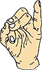

**Mudra ratująca życie**. Apan Vayu Mudra  
Ułożenie: Palec wskazujący należy zgiąć tak, aby czubkiem dotknął podstawy kciuka, natomiast palce - serdeczny, środkowy i kciuk stykamy opuszkami, mały zaś pozostaje wyprostowany.  

---

Mudra jest pomocna przy wielu schorzeniach, przede wszystkim jednak pomaga w dolegliwościach serca. Zastosuj ją jako pierwszą pomoc w razie ataku serca. W takim wypadku należy to ćwiczenie wykonać natychmiast i to obydwoma rękami. Działanie mudry mozna przyrównać do zażycia dawki nitrogliceryny. Profilaktycznie stosować codziennie 3 razy po 15 minut.

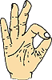

**Mudra wiedzy**. Gyan Mudra  
Ułożenie: Należy połączyć ze sobą czubek kciuka i palca wskazujacego. Pozostałe trzy palce powinny być wyprostowane i rozluźnione.  

---

Mudra jest w stanie rozwiązać wiele problemów zdrowotnych. Znacznie zmniejsza napięcie wewnętrzne, uspokaja, a także "porządkuje" wnętrze organizmu, rozluźnia psychicznie i duchowo. Wzmacnia pamięć i poprawia koncentrację. Jest pomocna przy bezsenności, jak również przy depresjach. Obniża zbyt wysokie cisnienie krwi i pogłębia działanie innych mudr, dlatego zaleca się jej stosowanie z innymi mudrami.

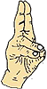

**Mudra życia**. Pran Mudra  
Ułożenie: Trzeba złączyć opuszki trzech palców - serdecznego, małego i kciuka. Pozostałe palce trzymamy swobodnie wyprostowane. Wykonujemy obydwiema rękami.  

---

Mudra związana z oczami. Doskonale wpływa na wzrok, polepsza ostrość, leczy różne choroby oczu, a jednocześnie ma na celu wyrównanie poziomu energetycznego w całym organizmie. Podnosi witalność, dodaje sił, a także redukuje objawy senności i nerwowości.Jej praktykowanie jest wskazane w stanach zmęczenia i wyczerpania.

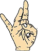

**Mudra nieba**. Shunya Mudra  
Ułożenie: Zginamy środkowy palec w ten sposób, aby opuszką dotknął podstawy kciuka, kciukiem zaś go lekko przyciskamy. Pozostałe palce powinny być wyprostowane i rozluźnione.  

---

Zalecana na wszystkie schorzenia uszu, bóle uszu i wszelkie schorzenia związane ze słuchem. Stosując tę mudrę, często w kilkanaście minut możemy sobie polepszyć słuch i zlikwidować ból uszu, a przy dłuższym praktykowaniu całkowicie wyleczyć prawie wszystkie choroby uszu.

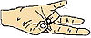

**Mudra ziemi**. Prithvi Mudra  
Ułożenie: Stykamy (lekko przyciskając) opuszkami palec serdeczny i kciuk, a pozostałe palce pozostawiamy swobodnie wyprostowane.  

---

Wyrównuje deficyt energetyczny organizmu oraz zachwianą równowagę wewnętrzną. Poprawia stan psychofizyczny, działa przeciw słabością psychicznym, załamaniom, stresom i przeciwdziała witalnemu wyniszczeniu. Stosując te mudrę możemy odzyskać równowagę i odzyskać zaufanie do siebie.

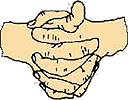

**Mudra podnosząca**. Linga Mudra  
Ułożenie: Dłonie składamy razem wewnętrznymi powierzchniami, a palce splatamy. Wystający kciuk otaczamy "obręczą", którą tworzą palec wskazujący z kciukiem drugiej reki.  

---

Mobilizuje siły obronne organizmu i jest bardzo pomocna przy przeziębieniach, kaszlu, grypie i zapaleniu płuc. Powoduje wewnętrzne rozgrzanie i uwalnianie śluzu, który zbiera się w płucach. Ćwiczenie pomaga ludziom, którzy przy zmianie pogody cierpią na zakłócenia pracy dróg oddechowych. Nie wolno stosować długo, gdyż może wywołać uczucie zobojętnienia i letargu. Jest to sygnał do skrócenia lub przerwania ćwiczeń.

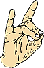

**Mudra energii**. Apan Mudra  
Ułożenie: Należy połączyć opuszki palców - środkowego, serdecznego i kciuka. Pozostałe dwa palce, wskazujący i mały, powinny być swobodnie wyprostowane.  

---

Przeciwdziała bólowi, wydala z organizmu różne trucizny i zanieczyszczenia, oczyszczając organizm, oraz leczy dolegliwości i choroby układu moczowego. Szczególnie wskazana przy zatruciach i w wypadku bólu.

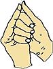

**Mudra muszli**. Shankh Mudra  
Ułożenie: Łączymy cztery palce prawej ręki i obejmujemy nimi kciuk lewej. Kciuk prawej ręki powinien dotykać wystającego środkowego palca lewej ręki (palce nie mogą być spięte).  

---

Pomaga we wszystkich dolegliwościach gardła i krtani, leczy chrypkę. Może wzmocnić i polepszyć głos, gdyż jest związana z głosem i śpiewem. Tak często przy śpiewie trzymają ręce śpiewacy operowi. Złączone dłonie przypominaja kształt muszli.

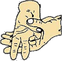

**Mudra Varuny**. Varuna Mudra  
Ułożenie: Mały palec prawej reki zginamy tak, by dotykał podstawy kciuka, i kciukiem lekko go dociskamy. Lewą ręką obejmujemy prawą od spodu i jednocześnie kładziemy kciuk lewej reki na kciuku prawej.  

---

Pomaga ludziom, którzy maja za dużo śluzu i wydzielin w organach wewnętrznych (np. płuca, żołądek, śledziona), ponieważ blokują one energię całego organizmu. Mudrę stosujemy w dolegliwościach zołądka, wątroby, śledziony, w chorobach płuc i innych narządów wewnętrznych.

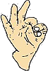

**Mudra wiatru**. Vayu Mudra  
Ułożenie: Palec wskazujący zginamy tak, by dotykał opuszką podstawy kciuka. Kciukiem lekko go przyciskamy, a pozostałe palce (środkowy, serdeczny i mały) trzymamy wyprostowane i rozluźnione.  

---

Osłabia "wiatry" w różnych częściach ciała, który wywołuje róznorakie schorzenia, jak np. reumatyzm, ischias czy drżączkę rąk, szyi czy nawet głowy. Często się zdarza, że po kilkunastu godzinach ćwiczeń poprawia się samopoczucie i stan zdrowia. Przy schorzeniach przewlekłych należy ją ćwiczyć naprzemian z Mudrą życia i natychmiast zakończyć po ustąpieniu objawów chorobowych.

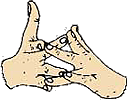

**Mudra krowy**. Surabhi Mudra  
Ułożenie: Mały palec lewej ręki powinien dotykać serdecznego palca prawej ręki, a mały palec prawej ręki musi dotykać serdecznego palca lewej ręki. Jednocześnie palec środkowy prawej ręki łączymy z palcem wskazującym lewej, a palec środkowy lewej ręki z palcem wskazującym prawej. Kciuki pozostają rozstawione w rozluźnieniu podobne do rogów krowy.  

---

Bardzo skuteczna przy wszelkich dolegliwościach reumatycznych, goścowych i zapaleniach stawów.

Mudry nie powodują żadnych skutków ubocznych, a mogą jedynie pomóc. Przy niektórych schorzeniach na efekty należy poczekać kilka tygodni, a nawet miesięcy. Zdarza się jednak, przy chorobach lekkich lub niezaawansowanych, że efekty uzyskujemy po jednym lub kilku dniach ćwiczeń.
