**Refleksoterapia stóp**  
Na podstawie książek: Jadwigi Górnickiej - "Apteka natury"  
oraz teresy Tuszyńskiej - "Zdrowie nie ma ceny".

Technika ta przywędrowała ze wschodu, z Chin, gdzie jest była i jest znana pod nazwą akupresury. Dawno, dawno, 5000 lat temu w Chinach... Tak zaczyna się każdy opis akupresury. Zastanawiam się tylko w jaki sposób dochodzono do takich wyników. Ciało człowieka posiada ponad 1500 miejsc do nakłuwania lub uciskania. W jakim tempie odkrywano te punkty? Ilu ludzi było w to zaangażowanych? Kto wreszcie i jak zorganizował przepływ informacji do jednej bazy danych? Dlaczego nasza "nowoczesna" medycyna przez kilkaset lat nie odkryła żadnego nowego punktu? Wszystko wskazuje na to, że wiedza o tym została człowiekowi przez "kogoś" przekazana i bajanie o tysiącach lat nie ma żadnego sensu. Gdyby jeden punkt odkrywano, badano i weryfikowano w zawrotnym tempie raz na 10 lat, to do 5000 lat możemy spokojnie dołożyć 15 tysięcy lat, a to już nie przełknięcia przez oficjalną naukę. Frapujące jest także to, że refleksoterapię stosowali także Indianie, a w najstarszej Europie Francuzi. Skąd ją znali? "Nowoczesny" świat zainteresował się refleksoterapią dopiero w XX wieku.

Akupresura polega na masażu bądź ucisku tak zwanych stref refleksyjnych znajdujących się na stopach mających powiązania z poszczególnymi organami wewnętrznymi. Masaż stref refleksyjnych stóp powoduje lepszy przepływ krwi i bioenergii, które docierają do organu powiązanego z dana strefą. Podczas masażu energia biochemiczna dociera łatwiej do chorego organu i po określonym czasie następuje wyraźna poprawa, a następnie wyleczenie. Stwierdzono, że bardzo niekorzystny wpływ na krążenie krwi i bioenergii ma niewygodne i ciasne obuwie. Należy więc unikać butów uciskajacych stopę i wywołujących na niej stwardnienia i modzele oraz powodujących, że stopa staje się zimna, co jest oznaką niewłaściwego przepływu krwi. Nieodpowiednie obuwie może wywołać brak reakcji na masaże.

Masaże przyczyniają się do lepszego ukrwienia chorych narządów i wpływają na polepszenie sił witalnych organizmu. Masażom stóp moga poddawać się wszyscy, i młodzi i starzy, od niemowlaka po staruszka. Wiek nie stanowi żadnej przeszkody ani przeciwskazań. W przypadku przykrej reakcji organizmu, co zdarza się niezmiernie rzadko, należy zaprzestać masażu. Refleksoterapia stosowana właściwie nie daje objawów ubocznych. Masaż stóp przynosi dobre skutki lecznicze w wielu chorobach.

**Bez zapoznania się z podstawowymi wiadomościami, a szczególnie bez znajomości masażu wstępnego i kolejności masowania receptorów, stanowczo odradzam eksperymentowania na sobie lub na kimś innym - skutki mogą okazać się fatalne.**

**Technika masażu**

**AKUPRESURA JEST DOSKONAŁĄ METODĄ PROFILAKTYCZNĄ, LECZNICZĄ I POMOCNICZĄ**

Decydując się na akupresurę profilaktyczną stóp należy bezwzględnie pamiętać, że masaże muszą być wykonywane w ściśle określonej kolejności:

**•** 

**Przed rozpoczęciem** masażu należy się rozprężyć, rozluźnić. Poleca się np. wziąć 20 głębokich oddechów najlepiej przy otwartym oknie.

**•** 

**Przed przystąpieniem** do masażu należy całą stopę rozgrzać przez intensywne wygniatanie albo przez lekkie natłuszczenie kremem czy olejkiem.

**•** 

Strefy refleksyjne masujemy brzuścem (opuszkiem) kciuka albo kostką zgiętego (kłykciem) palca w sposób okrężny. Miejsce masowane należy przed tym posmarować kremem kosmetycznym, lub lepiej olejem roślinnym. Pamiętać też należy, że **kierunek masażu powinien być zgodny z przepływem zawartości** - np. z jelita cienkiego do grubego, z nerki do pęcherza itp.

Masując ręcznie warunkiem dobrego masażu jest dobra pozycja masażysty i masowanego. Obydwaj powinni usiąść wygodnie naprzeciw siebie w pozycji bez napięcia. Podczas masażu punktów refleksyjnych na spodzie stopy, noga masowanego powinna spocząć na kolanie masującego. Przy masażu wierzchniej strony stopy osoba masowana winna postawić nogę na kolanie masującego. Przy masowaniu pięty, kostek i nogi osoba masowana przyjmuje pozycję wygiętą i trzymając się masowanego stawia stopę bokiem na kolanie masującego.

**•** 

**Masaż zawsze zaczynamy od lewej nogi** (po stronie serca) i od śródstopia. U niektórych osób strefy refleksyjne mogą być lekko przesunięte. Nie należy się tym martwić. Ważne jest, by masować bolesne miejsce na stopie.

Masaż każdego punktu rozpoczynamy od ruchów łagodnych, powoli i systematycznie zwiększając nacisk, jednocześnie obserwując twarz osoby masowanej. Siła nacisku ma być taka, aby osoba masowana wytrzymywała ból przy ucisku. Przeciętna siła ucisku palca masującego winna wynosić 5-10 kg (najlepiej sprawdzić to na wadze kuchennej, przyciskając szalkę). Efekt ozdrowieńczy jest tym szybszy, im większy nacisk został użyty. Przystępując po raz pierwszy do masażu osobie, która jeszcze nie była masowana, stosujemy następujący scenariusz czasowy:

**•** 

W **pierwszym tygodniu** stosujemy ograniczone czasy masażu - 3 razy 3 sekundowe uciski na receptor z przerwą 1-2 sekund.

**•** 

W **drugim tygodniu** podwajamy czas.

**•** 

Od **trzeciego tygodnia** stosujemy normalne czasy masażu.

**KAŻDY MASAŻ CHOREGO NARZĄDU (LECZNICZY I PROFILAKTYCZNY) MUSI KAŻDORAZOWO POPRZEDZAĆ MASAŻ WSTĘPNY**

**•** 

Najpierw należy poddawać masażom strefy **nerek**, **moczowodu**, **pęcherza moczowego** i **nadnercza**. Tym układom należy poświęcić najwięcej uwagi. Pomaga to rozpuszczać i usuwać z krwioobiegu trucizny (przede wszystkim kwas moczowy). Gdybyśmy zaczęli masaż od innych receptorów, moglibyśmy doprowadzić do zablokowania nerek toksynami i złogami.

**•** 

Następnie **głowy** w celu usprawnienia ośrodka sterującego układami i narządami,

**•** 

W dalszej kolejności - strefy refleksyjne **żołądka**, **jelita**, **wątroby** i **trzustki**. W tym układzie mamy organy, w których zachodzi odtruwanie i przemiana materii. Od ich sprawnego działania zależy przygotowanie materiałów do budowy i odbudowy organizmu.

**•** 

Na koniec **punkty limfatyczne**, które usprawniają rozkład substancji żużlowych i dostarczają organizmowi substancji o działaniu obronnym.

Dopiero po wykonaniu masażu tych stref refleksyjnych można przejść do masowania stref refleksyjnych chorego narządu. Jeśli w masażu leczniczym powtarzają się receptory z masowania wstępnego, to masujemy je ponownie.

**•** 

W przypadku chorych narządów czas masowania winien wynosić 10-15 minut, a w stanach krytycznych nawet 20-25 minut. W ostatnim przypadku wskazane jest masowanie receptorów kilka razy dziennie po 5-10 minut i za każdym razem po wykonaniu masażu wstępnego.

**•** 

Pamiętać należy, że czas masowania receptorów kręgosłupa i wątroby zależy od sprawności nerek. W przypadku kamicy stopniowo zwiększamy czas, by złogi zaczęły się rozpuszczać a nie rozkruszać i do moczu szedł piasek, a nie kolczaste kawałki, które mogą zaczopować przewód moczowy.

Każdy masaż rozpoczynamy od masażu **diagnostycznego**. Należy ustalić, które organy są niewydolne i jaki jest stopień ich niewydolności. Jest to bardzo trudny etap i wymaga od badającego ogromnej wiedzy (w tym medycznej) i doświadczenia. Niezbędny jest przy tym wywiad z chorym pacjentem. Przy chorym organie jego punkt refleksyjny jest czuły na dotyk, wrażliwy, a czasem jego dotyk sprawia badanemu ból. Dopiero po badaniu diagnostycznym przechodzimy do masażu profilaktycznego (lub wstępnego), którego zadaniem jest zapewnienie pełnej sprawności funkcjonalnej organizmu przy aktualnie dobrym samopoczuciu. Ostatnim etapem jest masaż leczniczy. Jego celem jest przywrócenie sprawności funkcjonalnej organowi lub organom, które jak ustalono w wyniku przeprowadzonej diagnozy, nie mają pełnej wydolności.

---

**Przeciwskazania - rozległe skaleczenia skóry, ciąża, ciężkie choroby krążenia krwi lub choroby z niewydolnością serca, wysoka gorączka, schizofrenia, przejście ciężkiej operacji, wszystkie choroby wrodzone, przeszczepy narządów, zawansowane choroby nowotworowe złośliwe, przypadki wymagające interwencji chirurga (złamania, przedziurawienia żołądka i dwunastnicy, niedrożność jelit itp.). Nie wolno masować receptorów gdzie znajdują się "wkładki nieorganiczne" - rozrusznik serca, spiralka, szkła kontaktowe.**

---

Jeśli nasze stopy posiadają stwardnienia, odciski i modzele, to najpierw trzeba się ich pozbyć, gdyż żaden masaż nie przyniesie rezultatu.

---

Z powodu intensywnego podrażnienia jednego organu może (ale nie musi) występować przejściowa reakcja, która znika po pewnym czasie. Masażu nie należy przerywać, bo reakcje te są przejściowe i świadczą o tym, że organizm podjął trud wydalania substancji toksycznych. Do takich objawów należą:

**1.**

Opuchnięcie stawów skokowych lub nadgarstków.

**2.**

Nasilony obraz żylaków.

**3.**

Zwiększony ból w narządzie, którego receptor jest masowany.

**4.**

Siniaki i torbiele, które pojawiają się na ciele, a szczególnie na nogach.

**5.**

Stopniowe ciemnienie moczu, aż do barwy pomarańczowej, a nawet brązowej.

**6.**

Podwyższona temperatura ciała. Nie należy jednak zażywać środków obniżających temperaturę, ponieważ w wyższej zabijane są bakterie, wirusy i obce ciała. Powinno się ten okres przeleżeć w łóżku aż temperatura samoistnie opadnie.

**7.**

Niebieskie plamy, gdy gospodarka wapniem jest zdezorganizowana.

A co zrobić, gdy ktoś nie ma drugiej osoby pomocnej w masażu, a samemu jest mu bardzo trudno go wykonać? Można i należy sobie poradzić w inny sposób. Specjaliści wyliczyli, że w naszych stopach znajduje się 72 tysiące zakończeń nerwowych i dlatego powinniśmy się starać chodzić boso po drobno kamienistym podłożu. Takie podłoże możemy zrobić sobie w domu. Należy tylko nazbierać kamyczków z morskiej plaży lub poprosić kogoś z budowy by wam podarował około 1,5 kg kamieni po odsianiu przy robieniu zaprawy cementowej. Najlepsze to takie o średnicy od 1 do 3 cm i koniecznie zaokrąglone, by nie pokaleczyć stóp. W domu należy je przebrać, wypłukać i zagotować w wodzie, by usunąć możliwe bakterie i inne zanieczyszczenia organiczne. Następnie wsypujemy je do miski, nalewamy chłodnej wody i drepczemy przez około 10 minut dziennie. Jeśli dreptać będziemy w zimnej wodzie przez 1-2 minuty będziemy się od razu hartować, co sprzyja obronie organizmu przed infekcjami. Sami chodźmy i pozwólmy domownikom chodzić boso po mieszkaniu (oczywiście jeśli nikt w domu nie ma grzybicy stóp). To też hartuje. Jak mawiał Hipokrates - najlepsze obuwie, to brak obuwia.

Jak pisze Teresa Tuszyńska, jest wiele osób, które dzięki akupresurze odzyskały zdrowie i radość życia. Wprawdzie nauka jeszcze nie do końca wyjaśniła, jak to się dzieje, że akupresura przynosi tak duże efekty, to mamy jednak szereg dowodów na potwierdzenie jej skuteczności. Aby się o tym przekonać wystarczy zrobić proste doświadczenie - należy pomasować środkowy palec u nogi (receptor środkowego palca ręki) - po prawidłowym masażu środkowy palec ręki da wrażenie ciepła, gdyż nastąpiło lepsze ukrwienie.

Pamiętajmy też, że (na wszelki wypadek) trzeba zgłosić lekarzowi o naszym rozpoczęciu terapii akupresurą i od czasu do czasu skontrolować wyniki badań.

**Masaż wstępny**

Masaż wstępny powinien trwać około 30 minut (na każdą stopę poświęcamy około 15 minut).

**UKŁAD WYDALNICZY**

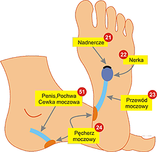

**Masujemy receptory w kolejności - nerka, przewód moczowy, pęcherz moczowy, cewka moczowa, penis i nadnercze. Pamiętajmy, aby masaż długich receptorów prowadzić w kierunku wydalania substancji. Receptory rozmieszczone są symetrycznie na obu stopach (lewa nerka - lewa stopa) i po 5 minutach masowania lewej stopy, analogiczne czynności wykonujemy przez 5 minut na prawej stopie**.

**Nerki** - wydalają toksyny, a w szczególności kwasy moczowe i wodę. Strefa refleksyjna nerek znajduje się dość głęboko w środku stopy, w miejscu nie podlegającemu normalnemu ruchowi, z wyjątkiem kiedy chodzi się boso po nierównym kamienistym terenie. Przez masaż strefy refleksyjnej nerka staje się bardziej ukrwiona i bardziej wydolna. W okresie od 1 do 6 tygodni można stwierdzić zabarwienie się moczu, który przybiera kolor żółty, żółtobrunatny lub czerwonobrunatny. Zapach moczu może ulec zmianie i może mieć przejściowo przykry zapach. Kiedy nerka jest mało wydolna można zaobserwować zakłócenia: W obiegu krwi - wywołuje wysokie ciśnienie krwi, zwapnienie arterii i kurczowe żył. W mięśniach i tkance łącznej - wywołuje reumatyzm. W stawach - prowadzi do zapaleń w stawach i do chronicznych, zwyrodnieniowych zmian w stawach. W oczach - dość częste zaburzenia wzroku. Na skórze - różnego typu egzemy i łuszczyce. W nerkach - odkładanie kamieni i piasku.

**Przewody moczowe** - oba maja postać długich, cienkich i mięsistych rurek, które zaczynają się lejkowato na miedniczce nerkowej i prowadzą do pęcherza moczowego. Mogą występować następujące zakłócenia w ich pracy - zaginanie lub zawężenie przewodów, które powodują wstrzymanie moczu i jego prąd odwrotny z pęcherza do nerek albo zapalenia manifestujące się jako krótkie (strzyknięcia, ciągnięcia), kłujące bóle w dolnej części brzucha, często brane jako zapalenie jajowodu.

**Pęcherz moczowy i cewka moczowa (penis)**. Pęcherz moczowy jest muskularną jamą pomiędzy mięśniem zwieracza i cewką moczową. Mogą występować zapalenia objawiające się piekącymi bólami przy oddawaniu moczu. Bóle te występują częściej u kobiet. Kurcze pęcherza moczowego powodujące moczenie nocne ze względu na słabe mięśnie zwieracza.

**GŁOWA (MÓZGOWIE)**

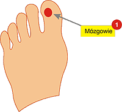

**Receptory mózgowia występują na obu stopach, w części środkowej palucha lekko przesunięte w kierunku pozostałych palców. Na prawej stopie znajduje się receptor lewej półkuli mózgu, na lewej - prawej półkuli. Całość masujemy około 2 minut (po 1 minucie na każdą stopę)**.

Mózgowie stanowi centralę organizmu. Każdy narząd ma połączenie z mózgowiem (percepcyjne i sterujące). Znajdują się w nim ośrodki: oddychania, czynności serca, sterowania, ciśnienia krwi, funkcjonowania żołądka i dwunastnicy, emocji, przyjemności itd. Mózg to istota szara mózgowia, a w nim znajduje się ośrodek mowy, świadomości, percepcji zmysłowej, doznawania wrażeń i uczuć ruchu. Zakłócenia pracy mózgowia, to zakłócenia we wszystkich organach. Przykładowo po wstrząsie mózgu może dojść do obecności krwi w moczu mimo, że nerki nie zostały uszkodzone. To właśnie mózg przekazuje nerkom fałszywe rozkazy i podobnie może się stać z każdym organem.

Po wstrząsie mózgu stwierdza się, że oba paluchy stopy stają się bardzo wrażliwe i bolesne przy dotyku. Przy leczeniu trzeba pomaleńku i delikatnie masować te miejsce 3 razy dziennie. Po 10 dniach osiąga się pozytywne rezultaty. Dużo osób cierpi na bóle głowy, których przyczyny są różnorakie. Najczęstszą jest noszenie zbyt ciasnego obuwia (szczególnie przez kobiety). Już po 2-3 godzinach noszenia ciasnego obuwia możemy zacząć odczuwać silne bóle głowy. Do przyczyn bólu głowy można jeszcze zaliczyć zakłócenia w przewodzie trawiennym. Bóle głowy mogą powodować zakłócenia okresowe w cyklu menstruacyjnym, nadwerężenie wzroku czy konflikty psychiczne.

**UKŁAD TRAWIENNY**

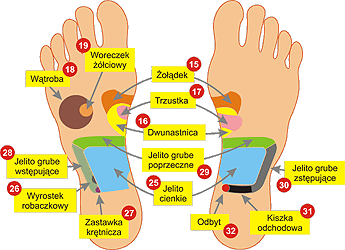

**Receptory układu trawiennego masujemy około 5 minut.  
Na **prawej stopie** masujemy: żołądek, dwunastnicę, trzustkę, wątrobę i woreczek żółciowy (pamiętając, że oba narządy mają receptory tylko na prawej stopie), następnie jelito cienkie, wyrostek robaczkowy, zastawkę krętniczą, jelito grube wznoszące i kończymy na jelicie poprzecznym.  
Na **stopie lewej** - żołądek, dwunastnicę, trzustkę, jelito cienkie, jelito poprzeczne, jelito grube zstępujące, kiszkę odchodową i odbyt**.

**Żołądek**. Zakłócenia w jego pracy, to wymioty, wzdęcia, uczucie pełności, dolegliwości sercowe i wrzody żołądka. **Dwunastnica** to pierwsze 25 cm jelita cienkiego. Pracuje w środowisku zasadowym i nawet mała ilość kwasów powoduje jej zakłócenia. Kiedy zbyt zakwaszona zawartość dostanie się do dwunastnicy ta reaguje spazmatycznym skurczem. Wtedy też gwałtownie zacieśniają się ujścia z trzustki i woreczka żółciowego co powoduje niedobór żółci i enzymów trawiennych, a to z kolei zakłóca odtruwanie wątroby, trawienie tłuszczów i wypróżnianie.

**Wątroba** ma do spełnienia około 500 funkcji i jest głównym organem przemiany materii. Zakłócenia w pracy wątroby są przyczyną żółtaczki, marskości, bólów, braki w substancjach budulcowych, zapalenia pęcherzyka żółciowego. Jesteśmy ciągle zmęczeni, rozdrażnieni i cierpimy na bezsenność. **Pęcherzyk żółciowy** jest zbiornikiem żółci produkowanej przez wątrobę (około 1 litra dziennie), której zadaniem jest wspomaganie trawienia tłustego pożywienia. **Trzustka** produkuje soki trawienne (do rozkładu węglowodanów i białek) i hormony (glukagon i insulinę). Chora trzustka to choroby przemiany materii, zakłócenia budulcowe w organizmie i cukrzyca.

**Jelito cienkie**. Zakłócenia w jego pracy to wzdęcia i biegunka przewlekła w wyniku której cierpi się na bóle brzucha, wypadanie włosów, zmęczenie, nerwowość, depresję i przedwczesne starzenie się. **Jelito grube** składa się z jelita ślepego, okrężnic - wstępującej, poprzecznej, zstępującej, i esowatej oraz odbytu. Zakłócenia pracy jelita grubego to wzdęcia w podbrzuszu, zapalenie wyrostka robaczkowego, biegunki, zaparcia, zapalenia odbytu i hemoroidy.

**UKŁAD LIMFATYCZNY**

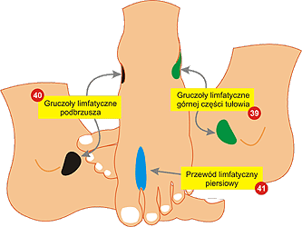

**Receptory układu limfatycznego masujemy około 2 minut (po 1 minucie na każdą stopę) w kolejności - węzły chłonne górnej części tułowia, węzły chłonne trzewne i limfatyczny przewód piersiowy**.

Tory limfatyczne zaczynają się od cienko zakończonych rureczek. Łączą się one w naczynia większe, które przenoszą limfę w kierunku centralnym. W ten sposób naczynia dolnej połowy ciała doprowadzają limfę do zbiornika limfy, znajdującego się pod przeponą brzuszną. Stąd limfa płynie do strumienia limfatyczno-piersiowego, który pobiera też pewną ilość płynu limfatycznego górnej połowy organizmu i kieruje ją do dużych arterii.

Naczynia limfatyczne przenoszą dziennie około 2 litrów wody tkankowej i tłuszczów z jelit. W tej wodzie tkankowej znajdują się również bakterie i substancje obce (węgiel, popiół i inne), a także enzymy. Limfa jest ogniwem pośrednim pomiędzy krwią i tkankami. Węzły limfatyczne (chłonne) mają zadanie filtrowania limfy i tworzenia białych krwinek (limfocytów), które muszą być odnawiane co drugi dzień. Węzły znajdują się w tkance łącznej miednicy, brzucha, w środkowej części klatki piersiowej, żołądku, dwunastnicy, a także (dobrze wyczuwalne przy infekcjach) w pachwinie, pod pachami i w gardle. Do sieci limfatycznej należą również migdałki, śledziona i wyrostek robaczkowy (bezlitośnie wyrzynany już przy pierwszym zapaleniu, bo przez medycynę jest traktowany jako organ niepotrzebny i zanikający w wyniku ewolucji podobnie jak kość ogonowa).

Z zaburzeniami limfatycznymi związane jest przekrwienie we wszystkich organach, mięśniaki, torbiele, wrzody czy nowotwory. Objawem może być woda w nogach, spuchnięte kostki, cellulitis oraz niedobór przeciwciał. Należy pamiętać, że walce przeciwciał z infekcją zawsze towarzyszy gorączka i nie należy jej "zbijać" środkami syntetycznymi, gdyż w ten sposób sami obniżamy odporność organizmu i przedłużamy walkę z chorobą.

**Przedstawione wiadomości, to wstęp do masaży profilaktycznych i leczniczych. Należy je bezwzględnie opanować i zapamiętać, jeśli chce się pomóc sobie lub innym. Proszę też pamiętać, że są to "suche" wiadomości i swoje wątpliwości należy pogłębiać lekturą fachowych opracowań lub pod okiem doświadczonego masażysty lub terapeuty.**

**Masaż profilaktyczny dla zdrowych**

Masaż profilaktyczny dla ludzi zdrowych wykonuje się prawie identycznie jak masaż wstępny z dodaniem masowania receptorów karku i kręgosłupa.

     **•** **MASAŻ RECEPTORÓW UKŁADU WYDALNICZEGO - 5 minut**

**Masujemy receptory w kolejności - nerka, przewód moczowy, pęcherz moczowy, cewka moczowa, penis i nadnercze. Pamiętajmy, aby masaż długich receptorów prowadzić w kierunku wydalania substancji. Receptory rozmieszczone są symetrycznie na obu stopach (lewa nerka - lewa stopa) i po 5 minutach masowania lewej stopy, analogiczne czynności wykonujemy przez 5 minut na prawej stopie**.

**Nerki** - wydalają toksyny, a w szczególności kwasy moczowe i wodę. Strefa refleksyjna nerek znajduje się dość głęboko w środku stopy, w miejscu nie podlegającemu normalnemu ruchowi, z wyjątkiem kiedy chodzi się boso po nierównym kamienistym terenie. Przez masaż strefy refleksyjnej nerka staje się bardziej ukrwiona i bardziej wydolna. W okresie od 1 do 6 tygodni można stwierdzić zabarwienie się moczu, który przybiera kolor żółty, żółtobrunatny lub czerwonobrunatny. Zapach moczu może ulec zmianie i może mieć przejściowo przykry zapach. Kiedy nerka jest mało wydolna można zaobserwować zakłócenia: W obiegu krwi - wywołuje wysokie ciśnienie krwi, zwapnienie arterii i kurczowe żył. W mięśniach i tkance łącznej - wywołuje reumatyzm. W stawach - prowadzi do zapaleń w stawach i do chronicznych, zwyrodnieniowych zmian w stawach. W oczach - dość częste zaburzenia wzroku. Na skórze - różnego typu egzemy i łuszczyce. W nerkach - odkładanie kamieni i piasku.

**Przewody moczowe** - oba maja postać długich, cienkich i mięsistych rurek, które zaczynają się lejkowato na miedniczce nerkowej i prowadzą do pęcherza moczowego. Mogą występować następujące zakłócenia w ich pracy - zaginanie lub zawężenie przewodów, które powodują wstrzymanie moczu i jego prąd odwrotny z pęcherza do nerek albo zapalenia manifestujące się jako krótkie (strzyknięcia, ciągnięcia), kłujące bóle w dolnej części brzucha, często brane jako zapalenie jajowodu.

**Pęcherz moczowy i cewka moczowa (penis)**. Pęcherz moczowy jest muskularną jamą pomiędzy mięśniem zwieracza i cewką moczową. Mogą występować zapalenia objawiające się piekącymi bólami przy oddawaniu moczu. Bóle te występują częściej u kobiet. Kurcze pęcherza moczowego powodujące moczenie nocne ze względu na słabe mięśnie zwieracza.

     **•** **MASAŻ RECEPTORÓW GŁOWY I KARKU - 2 minuty**

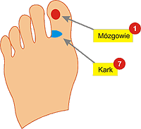

**Masujemy receptory mózgowia i receptory karku. Receptory na każdej stopie masujemy około 1 minuty**.

Powtórzę to, o czym już pisałem w masażu wstępnym. Mózgowie stanowi centralę organizmu. Każdy narząd ma połączenie z mózgowiem (percepcyjne i sterujące). Znajdują się w nim ośrodki: oddychania, czynności serca, sterowania, ciśnienia krwi, funkcjonowania żołądka i dwunastnicy, emocji, przyjemności itd. Mózg to istota szara mózgowia, a w nim znajduje się ośrodek mowy, świadomości, percepcji zmysłowej, doznawania wrażeń i uczuć ruchu. Zakłócenia pracy mózgowia, to zakłócenia we wszystkich organach.

Niezależnie od stref refleksyjnych kręgów szyjnych jest jeszcze oddzielna strefa refleksyjna występująca na obu stopach w miejscu przyczepu dużego palucha. Jest to strefa refleksyjna karku. W karku możemy odczuwać kurcze, sztywność i bóle, a jest to spowodowane noszeniem niewygodnego obuwia (szczególnie o ostrym przednim zakończeniu). W wyniku ściskania palców na boku palucha może tworzyć się tzw. modzel. Jest to stwardnienie, zgrubienie lub skóry powstające w wyniku dłuższego ucisku mechanicznego. Modzel powoduje złe ukrwienie karku i stąd zakłócenia w jego funkcjonowaniu.

     **•** **MASAŻ RECEPTORÓW UKŁADU TRAWIENNEGO - 5 minut**

**Receptory układu trawiennego masujemy około 5 minut.  
Na **prawej stopie** masujemy: żołądek, dwunastnicę, trzustkę, wątrobę i woreczek żółciowy (pamiętając, że oba narządy mają receptory tylko na prawej stopie), następnie jelito cienkie, wyrostek robaczkowy, zastawkę krętniczą, jelito grube wznoszące i kończymy na jelicie poprzecznym.  
Na **stopie lewej** - żołądek, dwunastnicę, trzustkę, jelito cienkie, jelito poprzeczne, jelito grube zstępujące, kiszkę odchodową i odbyt**.

**Żołądek**. Zakłócenia w jego pracy, to wymioty, wzdęcia, uczucie pełności, dolegliwości sercowe i wrzody żołądka. **Dwunastnica** to pierwsze 25 cm jelita cienkiego. Pracuje w środowisku zasadowym i nawet mała ilość kwasów powoduje jej zakłócenia. Kiedy zbyt zakwaszona zawartość dostanie się do dwunastnicy ta reaguje spazmatycznym skurczem. Wtedy też gwałtownie zacieśniają się ujścia z trzustki i woreczka żółciowego co powoduje niedobór żółci i enzymów trawiennych, a to z kolei zakłóca odtruwanie wątroby, trawienie tłuszczów i wypróżnianie.

**Wątroba** ma do spełnienia około 500 funkcji i jest głównym organem przemiany materii. Zakłócenia w pracy wątroby są przyczyną żółtaczki, marskości, bólów, braki w substancjach budulcowych, zapalenia pęcherzyka żółciowego. Jesteśmy ciągle zmęczeni, rozdrażnieni i cierpimy na bezsenność. **Pęcherzyk żółciowy** jest zbiornikiem żółci produkowanej przez wątrobę (około 1 litra dziennie), której zadaniem jest wspomaganie trawienia tłustego pożywienia. **Trzustka** produkuje soki trawienne (do rozkładu węglowodanów i białek) i hormony (glukagon i insulinę). Chora trzustka to choroby przemiany materii, zakłócenia budulcowe w organizmie i cukrzyca.

**Jelito cienkie**. Zakłócenia w jego pracy to wzdęcia i biegunka przewlekła w wyniku której cierpi się na bóle brzucha, wypadanie włosów, zmęczenie, nerwowość, depresję i przedwczesne starzenie się. **Jelito grube** składa się z jelita ślepego, okrężnic - wstępującej, poprzecznej, zstępującej, i esowatej oraz odbytu. Zakłócenia pracy jelita grubego to wzdęcia w podbrzuszu, zapalenie wyrostka robaczkowego, biegunki, zaparcia, zapalenia odbytu i hemoroidy.

     **•** **MASAŻ RECEPTORÓW KRĘGOSŁUPA - 1 minuta**

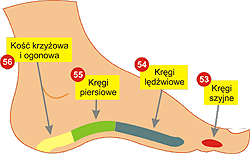

**Receptory kręgosłupa występują na obu stopach, w części wewnętrznej. Masujemy w kolejności - kręgi szyjne, kręgi piersiowe, kręgi lędźwiowe oraz kość krzyżową i ogonową. Każdą stopę masujemy około 30 sekund**.

Kręgosłup jest osią szkieletu. Jego ruch umożliwia około 200 mięśni i o wiele więcej tzw. pasm mięsistych. Jest podatny na urazy przeważnie natury mechanicznej. Wielu lekarzy zwraca uwagę na podnoszenie ciężarów przy zgiętych kolanach. Jeśli podnosimy przy zgiętych kolanach ciężar 50 kg, to taki ciężar obciąża kręgosłup, natomiast podniesienie 50 kg na sztywnych kolanach obciąża nasz kręgosłup ciężarem do 760 kg.

Zbyt duży nacisk na kręgi może spowodować wtłoczenie galaretowatej masy do wewnątrz kręgu i ucisk na przebiegający tamtędy nerw, co zawsze skutkuje chorobą organu powiązanego z tym nerwem. Masowanie stref refleksyjnych powoduje lepsze ukrwienie i zmniejsza bóle.

     **•** **MASAŻ RECEPTORÓW UKŁADU LIMFATYCZNEGO - 2 minuty**

**Receptory układu limfatycznego masujemy około 2 minut (po 1 minucie na każdą stopę) w kolejności - węzły chłonne górnej części tułowia, węzły chłonne trzewne i limfatyczny przewód piersiowy**.

Tory limfatyczne zaczynają się od cienko zakończonych rureczek. Łączą się one w naczynia większe, które przenoszą limfę w kierunku centralnym. W ten sposób naczynia dolnej połowy ciała doprowadzają limfę do zbiornika limfy, znajdującego się pod przeponą brzuszną. Stąd limfa płynie do strumienia limfatyczno-piersiowego, który pobiera też pewną ilość płynu limfatycznego górnej połowy organizmu i kieruje ją do dużych arterii.

Naczynia limfatyczne przenoszą dziennie około 2 litrów wody tkankowej i tłuszczów z jelit. W tej wodzie tkankowej znajdują się również bakterie i substancje obce (węgiel, popiół i inne), a także enzymy. Limfa jest ogniwem pośrednim pomiędzy krwią i tkankami. Węzły limfatyczne (chłonne) mają zadanie filtrowania limfy i tworzenia białych krwinek (limfocytów), które muszą być odnawiane co drugi dzień. Węzły znajdują się w tkance łącznej miednicy, brzucha, w środkowej części klatki piersiowej, żołądku, dwunastnicy, a także (dobrze wyczuwalne przy infekcjach) w pachwinie, pod pachami i w gardle. Do sieci limfatycznej należą również migdałki, śledziona i wyrostek robaczkowy (bezlitośnie wyrzynany już przy pierwszym zapaleniu, bo przez medycynę jest traktowany jako organ niepotrzebny i zanikający w wyniku ewolucji podobnie jak kość ogonowa).

Z zaburzeniami limfatycznymi związane jest przekrwienie we wszystkich organach, mięśniaki, torbiele, wrzody czy nowotwory. Objawem może być woda w nogach, spuchnięte kostki, cellulitis oraz niedobór przeciwciał. Należy pamiętać, że walce przeciwciał z infekcją zawsze towarzyszy gorączka i nie należy jej "zbijać" środkami syntetycznymi, gdyż w ten sposób sami obniżamy odporność organizmu i przedłużamy walkę z chorobą.

Masaż profilaktyczny wykonany prawidłowo na pewno nikomu nie zaszkodzi, a zapewni pełną sprawność funkcjonalną naszego organizmu. Należy pamiętać, że najlepszym masażem jest masaż naturalny, a taki zapewnia nam chodzenie boso po nierównościach - kamieniste plaże, podłoże leśne z szyszkami, polne ścieżki czy nawet domowe "ostre" wycieraczki lub drewniane wałki turlane "od niechcenia" stopami podczas oglądania telewizji. Chodźmy sami i pozwólmy innym domownikom (dzieciom też) chodzić boso po mieszkaniu.

**Masaże w leczeniu chorób**

Masaż receptorów stóp pomaga w wielu chorobach i dolegliwościach. Dużą skuteczność ma w leczeniu takich chorób jak stany stresowe, nadciśnienie, astma, dolegliwości nerek i pęcherza moczowego, bóle głowy, wrzody żołądka i dwunastnicy, zaburzenia wzroku a nawet guzy piersi. Nie zawsze jednak można liczyć na to, że od razu nastąpi poprawa stanu zdrowia. Na swoją chorobę "pracujemy" przecież miesiącami i latami. Zdarzają się przypadki natychmiastowego (lub prawie) wyleczenia, ale najczęściej musimy poczekać kilka tygodni, a nawet miesięcy. Ogromną rolę odgrywa tu nasza psychika. Musimy uwierzyć, że któregoś dnia zobaczymy pozytywne skutki tej metody leczenia.

**PRZED PRZYSTĄPIENIEM DO MASAŻU LECZNICZEGO NALEŻY BEZWZGLĘDNIE WYKONAĆ MASAŻ WSTĘPNY**

Na rysunkach poniżej przedstawiam rozmieszczenie najczęściej masowanych receptorów. Nasza refleksoterapia, uznana przez oficjalną medycynę, zna około stu punktów do masażu, a to podobno zaledwie 10% tego, co zna i używa akupresura chińska. Przed przystąpieniem do masaży leczniczych najlepiej zgrać je na własny twardy dysk i wydrukować. Będzie o wiele łatwiej odszukiwać potrzebne receptory czytając opis masaży przy poszczególnych chorobach.

**Położenie receptorów układu moczowo-płciowego**.

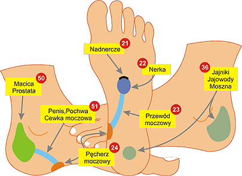

**Położenie receptorów układu trawiennego**.

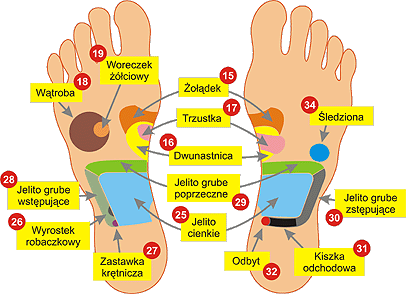

**Położenie receptorów układu limfatycznego i gruczołów dokrewnych**.

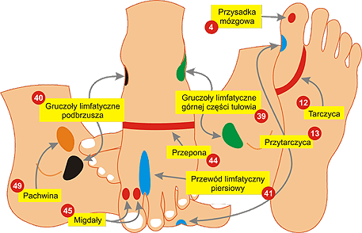

**Położenie pozostałych receptorów**.

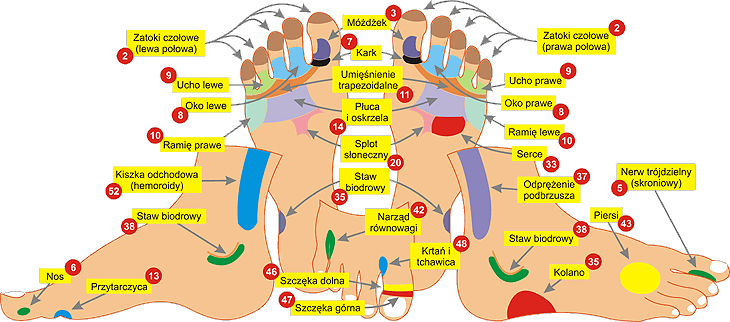

Poniżej wykaz najczęściej spotykanych chorób i dolegliwości, które możemy leczyć refleksoterapią. Teresa Tuszyńska podaje je za "Refleksoterapią dłoni i stóp" wydaną przez Bydgoskie Stowarzyszenie Radiestezyjne (Bydgoszcz 1988). Przypomnieć jeszcze należy, że każdy masaż leczniczy musi byc poprzedzony **masażem wstępnym** oraz to, że pomimo wystąpienia masażu receptora w masażu wstępnym, w masażu leczniczym **masujemy go powtórnie**.

**BEZSENNOŚĆ**

**CHOROBA WIEŃCOWA**

**IMPOTENCJA**

**SŁUCH (osłabienie)**

  
**masujemy receptory:**  
**•**  głowa (**1**)

---

  
**masujemy receptory:**  
**•**  serce (**33**)

---

  
**masujemy receptory:**  
**•**  jądra (**36**)

---

  
**masujemy receptory:**  
**•**  ucho (**9**)

---

**WZROST (zaburzenia)**

**CHOROBA BASEDOWA**

**GARDŁO (zapalenie)**

**Nadczynność tarczycy**

  
**masujemy receptory:**  
**•**  przysadka mózgowa (**4**)

---

  
**masujemy receptory:**  
**•**  przytarczyca (**13**)  
**•**  przysadka mózgowa (**4**)

---

  
**masujemy receptory:**  
**•**  szczęka dolna (**46**)  
**•**  szczęka górna (**47**)

---

  
**masujemy receptory:**  
**•**  przysadka mózgowa (**4**)  
**•**  tarczyca (**12**)

---

**NADKWASOTA**

**PIECZENIE STÓP**

**WOLE**

**Wrzód dwunastnicy**

  
**masujemy receptory:**  
**•**  żołądek (**15**)  
**•**  splot słoneczny (**20**)

---

  
**masujemy receptory:**  
**•**  masować wszystkie  
receptory na stopie

---

  
**masujemy receptory:**  
**•**  przysadka mózgowa (**4**)  
**•**  tarczyca (**12**)

---

  
**masujemy receptory:**  
**•**  żołądek (**15**)  
**•**  dwunastnica (**16**)

---

**ZEZ**

**CUKRZYCA**

**MOCZENIE NOCNE**

**OMDLENIE**

  
**masujemy receptory:**  
**•**  głowa (**1**)  
**•**  oczy (**8**)

---

  
**masujemy receptory:**  
**•**  żołądek (**15**)  
**•**  dwunastnica (**16**)  
**•**  trzustka (**17**)

---

  
**masujemy receptory:**  
**•**  nerka (**22**)  
**•**  przewód moczowy (**23**)  
**•**  pęcherz moczowy (**24**)

---

  
**masujemy receptory:**  
**•**  serce (**33**)  
**•**  nadnercze (**21**)  
**•**  głowa (**1**)

---

**SZUM W USZACH**

**DALEKOWZROCZNOŚĆ**

**DNA (skaza moczanowa)**

**Dolegliwości serca**

  
**masujemy receptory:**  
**•**  głowa (**1**)  
**•**  ucho (**9**)  
**•**  błędnik (**42**)

---

  
**masujemy receptory:**  
**•**  nerka (**22**)  
**•**  przewód moczowy (**23**)  
**•**  pęcherz moczowy (**24**)  
**•**  oczy (**8**)

---

  
**masujemy receptory:**  
**•**  nerka (**22**)  
**•**  przewód moczowy (**23**)  
**•**  pęcherz moczowy (**24**)  
**•**  nadnercze (**21**)

---

  
**masujemy receptory:**  
**•**  żołądek (**15**)  
**•**  nadnercze (**21**)  
**•**  serce (**33**)  
**•**  kręgi lędźwiowe (**54**)

---

**EGZEMA**

**KRÓTKOWZROCZNOŚĆ**

**OKRES (bolesny)**

**MIGRENA**

  
**masujemy receptory:**  
**•**  nerka (**22**)  
**•**  przewód moczowy (**23**)  
**•**  pęcherz moczowy (**24**)  
**•**  przytarczyca (**13**)

---

  
**masujemy receptory:**  
**•**  nerka (**22**)  
**•**  przewód moczowy (**23**)  
**•**  pęcherz moczowy (**24**)  
**•**  oczy (**8**)

---

  
**masujemy receptory:**  
**•**  jajniki (**36**)  
**•**  macica (**50**)  
**•**  odprężenie podbrzusza  
(bóle okresowe) (**37**)

---

  
**masujemy receptory:**  
**•**  nerw trójdzielny (**5**)  
**•**  przytarczyca (**13**)  
**•**  narząd równowagi (**42**)  
**•**  ewentualnie żołądek (**15**)

---

**NADCIŚNIENIE**

**ZAPALENIE PROSTATY**

**DOLEGLIWOŚCI SERCA**

**STWARDNIENIE TĘTNIC**

  
**masujemy receptory:**  
**•**  nerka (**22**)  
**•**  przewód moczowy (**23**)  
**•**  pęcherz moczowy (**24**)  
**•**  móżdżek (**3**)

---

  
**masujemy receptory:**  
**•**  nerka (**22**)  
**•**  przewód moczowy (**23**)  
**•**  pęcherz moczowy (**24**)  
**•**  prostata (**50**)

---

  
**masujemy receptory:**  
**•**  żołądek (**15**)  
**•**  serce (**33**)  
**•**  nadnercze (**21**)  
**•**  kręgi piersiowe (**54**)

---

  
**masujemy receptory:**  
**•**  nerka (**22**)  
**•**  przewód moczowy (**23**)  
**•**  pęcherz moczowy (**24**)  
**•**  nadnercze (**21**)

---

**ALERGIA**

**BÓLE GRZBIETU**

**DUSZNOŚĆ**

**ISCHIAS**

  
**masujemy receptory:**  
**•**  nerka (**22**)  
**•**  przewód moczowy (**23**)  
**•**  pęcherz moczowy (**24**)  
**•**  nadnercze (**21**)  
**•**  przytarczka (**13**)

---

  
**masujemy receptory:**  
**•**  kręgi szyjne (**53**)  
**•**  kręgi piersiowe (**54**)  
**•**  kręgi lędźwiowe (**55**)  
**•**  kość krzyżowa i ogonowa (**56**)

---

  
**masujemy receptory:**  
**•**  głowa (**1**)  
**•**  pień mózgu, móżdżek (**3**)  
**•**  nos (**6**)  
**•**  płuca (**14**)  
**•**  serce (**33**)

---

  
**masujemy receptory:**  
**•**  nerka (**22**)  
**•**  przewód moczowy (**23**)  
**•**  pęcherz moczowy (**24**)  
**•**  nadnercze (**21**)  
**•**  kolana (**35**)

---

**OKRES NIEREGULARNY**

**NIEDOCIŚNIENIE**

**PÓŁPASIEC**

**Zwyr. stawu kolanowego**

  
**masujemy receptory:**  
**•**  przysadka mózgowa (**4**)  
**•**  jajniki (**36**)  
**•**  odprężenie podbrzusza  
(bóle okresowe) (**37**)  
**•**  macica (**50**)

---

  
**masujemy receptory:**  
**•**  nerka (**22**)  
**•**  przewód moczowy (**23**)  
**•**  pęcherz moczowy (**24**)  
**•**  pień mózgu (**3**)  
**•**  narząd równowagi (**42**)

---

  
**masujemy receptory:**  
**•**  nerka (**22**)  
**•**  przewód moczowy (**23**)  
**•**  pęcherz moczowy (**24**)  
**•**  nadnercze (**21**)  
**•**  przytarczyca (**13**)

---

  
**masujemy receptory:**  
**•**  nerka (**22**)  
**•**  przewód moczowy (**23**)  
**•**  pęcherz moczowy (**24**)  
**•**  nadnercze (**21**)  
**•**  kolano (**35**)

---

**ANGINA PECTORIS**

**JASKRA**

**TRĄDZIK**

**ZAĆMA**

  
**masujemy receptory:**  
**•**  nerka (**22**)  
**•**  przewód moczowy (**23**)  
**•**  pęcherz moczowy (**24**)  
**•**  żołądek (**15**)  
**•**  nadnercze (**21**)  
**•**  serce (**33**)

---

  
**masujemy receptory:**  
**•**  nerka (**22**)  
**•**  przewód moczowy (**23**)  
**•**  pęcherz moczowy (**24**)  
**•**  nadnercze (**21**)  
**•**  mózg (**1**)  
**•**  oczy (**8**)

---

  
**masujemy receptory:**  
**•**  nerka (**22**)  
**•**  przewód moczowy (**23**)  
**•**  pęcherz moczowy (**24**)  
**•**  nadnercze (**21**)  
**•**  wątroba (**18**)  
**•**  woreczek żółciowy (**19**)

---

  
**masujemy receptory:**  
**•**  oczy (**8**)  
**•**  nadnercze (**21**)  
**•**  głowa (**1**)  
**•**  nerka (**22**)  
**•**  przewód moczowy (**23**)  
**•**  pęcherz moczowy (**24**)

---

**BRAK APETYTU**

**KOLKA**

**Zapalenie migdałów**

**OKO (jęczmień)**

  
**masujemy receptory:**  
**•**  żołądek (**15**)  
**•**  jelito cienkie (**25**)  
**•**  zastawka krętnicza (**27**)  
**•**  jelito wstępujące (**28**)  
**•**  jelito poprzeczne (**29**)  
**•**  jelito zstępujące (**30**)  
**•**  tarczyca (**12**)

---

  
**masujemy receptory:**  
**•**  żołądek (**15**)  
**•**  dwunastnica (**16**)  
**•**  trzustka (**17**)  
**•**  jelito wstępujące (**28**)  
**•**  jelito poprzeczne (**29**)  
**•**  jelito zstępujące (**30**)  
**•**  kiszka odchodowa (**31**)

---

  
**masujemy receptory:**  
**•**  migdałki (**45**)  
**•**  gruczoły limfatyczne górnej  
części tułowia (**39**)  
**•**  gruczoły limfatyczne  
podbrzusza (**40**)  
**•**  piersiowy przewód  
limfatyczny (**41**)

---

  
**masujemy receptory:**  
**•**  oko (**8**)  
**•**  gruczoły limfatyczne górnej  
części tułowia (**39**)  
**•**  gruczoły limfatyczne  
podbrzusza (**40**)  
**•**  piersiowy przewód  
limfatyczny (**41**)

---

**OPARZENIA**

**SZCZĘKI (ból)**

**Zap. zatok czołowych**

**ŻYLAKI**

  
**masujemy receptory:**  
**•**  receptory oparzonych  
narządów  
**•**  nerka (**22**)  
**•**  przewód moczowy (**23**)  
**•**  pęcherz moczowy (**24**)  
**•**  nadnercze (**21**)  
**•**  przytarczyca (**13**)

---

  
**masujemy receptory:**  
**•**  gruczoły limfatyczne górnej  
części tułowia (**39**)  
**•**  gruczoły limfatyczne  
podbrzusza (**40**)  
**•**  piersiowy przewód  
limfatyczny (**41**)  
**•**  nerw trójdzielny (**5**)  
**•**  szczęka dolna (**46**)  
**•**  szczęka górna (**47**)

---

  
**masujemy receptory:**  
**•**  zatoki (**2**)  
**•**  gruczoły limfatyczne górnej  
części tułowia (**39**)  
**•**  gruczoły limfatyczne  
podbrzusza (**40**)  
**•**  piersiowy przewód  
limfatyczny (**41**)

---

  
**masujemy receptory:**  
**•**  nerka (**22**)  
**•**  przewód moczowy (**23**)  
**•**  pęcherz moczowy (**24**)  
**•**  nadnercze (**21**)  
**•**  kręgi piersiowe (**54**)  
**•**  kręgi lędźwiowe (**55**)  
**•**  kość krzyżowa i ogonowa (**56**)

---

**ANGINA**

**BÓL GARDŁA**

**HEMOROIDY**

**KATAR SIENNY**

  
**masujemy receptory:**  
**•**  gruczoły limfatyczne górnej  
części tułowia (**39**)  
**•**  gruczoły limfatyczne  
podbrzusza (**40**)  
**•**  piersiowy przewód  
limfatyczny (**41**)  
**•**  krtań (**48**)  
**•**  migdały (**45**)

---

  
**masujemy receptory:**  
**•**  gruczoły limfatyczne górnej  
części tułowia (**39**)  
**•**  gruczoły limfatyczne  
podbrzusza (**40**)  
**•**  piersiowy przewód  
limfatyczny (**41**)  
**•**  migdały (**45**)  
**•**  krtań (**48**)

---

  
**masujemy receptory:**  
**•**  nerka (**22**)  
**•**  przewód moczowy (**23**)  
**•**  pęcherz moczowy (**24**)  
**•**  nadnercze (**21**)  
**•**  kiszka odchodowa (**31**)  
**•**  odbyt (**32**)  
**•**  kiszka odchodowa  
(hemoroidy) (**52**)

---

  
**masujemy receptory:**  
**•**  nerka (**22**)  
**•**  przewód moczowy (**23**)  
**•**  pęcherz moczowy (**24**)  
**•**  nadnercze (**21**)  
**•**  nos (**6**)  
**•**  przytarczyca (**13**)  
**•**  płuca i oskrzela (**14**)  
**•**  krtań (**48**)

---

**ŚWINKA**

**Zwężenie tętnic**

**UPŁAWY**

**USZY (ból)**

  
**masujemy receptory:**  
**•**  gruczoły limfatyczne górnej  
części tułowia (**39**)  
**•**  gruczoły limfatyczne  
podbrzusza (**40**)  
**•**  piersiowy przewód  
limfatyczny (**41**)  
**•**  gruczoły płciowe (**36**)  
**•**  migdały (**45**)

---

  
**masujemy receptory:**  
**•**  nerka (**22**)  
**•**  przewód moczowy (**23**)  
**•**  pęcherz moczowy (**24**)  
**•**  nadnercze (**21**)  
**•**  przytarczyca (**13**)  
**•**  receptory narządów,  
w których występuje  
zwężenie tętnic

---

  
**masujemy receptory:**  
**•**  gruczoły limfatyczne górnej  
części tułowia (**39**)  
**•**  gruczoły limfatyczne  
podbrzusza (**40**)  
**•**  piersiowy przewód  
limfatyczny (**41**)  
**•**  pochwa (**51**)  
**•**  macica (**50**)

---

  
**masujemy receptory:**  
**•**  głowa (**1**)  
**•**  ucho (**9**)  
**•**  gruczoły limfatyczne górnej  
części tułowia (**39**)  
**•**  gruczoły limfatyczne  
podbrzusza (**40**)  
**•**  piersiowy przewód  
limfatyczny (**41**)

---

**Zap. zatok nosowych**

**ANEMIA**

**BRONCHIT**

**KAMICA ŻÓŁCIOWA**

  
**masujemy receptory:**  
**•**  zatoki (**2**)  
**•**  gruczoły limfatyczne górnej  
części tułowia (**39**)  
**•**  gruczoły limfatyczne  
podbrzusza (**40**)  
**•**  piersiowy przewód  
limfatyczny (**41**)  
**•**  przytarczyca (**13**)

---

  
**masujemy receptory:**  
**•**  żołądek (**15**)  
**•**  dwunastnica (**16**)  
**•**  trzustka (**17**)  
**•**  pęcherzyk żółciowy (**19**)  
**•**  jelito wstępujące (**28**)  
**•**  jelito poprzeczne (**29**)  
**•**  jelito zstępujące (**30**)  
**•**  kiszka odchodowa (**31**)  
**•**  śledziona (**34**)

---

  
**masujemy receptory:**  
**•**  płuca i odkrzela (**14**)  
**•**  przytarczyca (**13**)  
**•**  gruczoły limfatyczne górnej  
części tułowia (**39**)  
**•**  gruczoły limfatyczne  
podbrzusza (**40**)  
**•**  piersiowy przewód  
limfatyczny (**41**)  
**•**  nadnercze (**21**)

---

  
**masujemy receptory:**  
**•**  dwunastnica (**16**)  
**•**  wątroba (**18**)  
**•**  woreczek żółciowy (**19**)  
**•**  gruczoły limfatyczne górnej  
części tułowia (**39**)  
**•**  gruczoły limfatyczne  
podbrzusza (**40**)  
**•**  piersiowy przewód  
limfatyczny (**41**)

---

**KASZEL**

**MIĘŚNIAKI**

**NIEŻYT OSKRZELI**

**Zap. pęcherza moczowego**

  
**masujemy receptory:**  
**•**  przytarczyca (**13**)  
**•**  płuca i oskrzela (**14**)  
**•**  nadnercze (**21**)  
**•**  gruczoły limfatyczne górnej  
części tułowia (**39**)  
**•**  gruczoły limfatyczne  
podbrzusza (**40**)  
**•**  piersiowy przewód  
limfatyczny (**41**)

---

  
**masujemy receptory:**  
**•**  jajniki (**36**)  
**•**  przysadka mózgowa (**4**)  
**•**  gruczoły limfatyczne górnej  
części tułowia (**39**)  
**•**  gruczoły limfatyczne  
podbrzusza (**40**)  
**•**  piersiowy przewód  
limfatyczny (**41**)  
**•**  macica (**50**)

---

  
**masujemy receptory:**  
**•**  płuca i oskrzela (**14**)  
**•**  przytarczyca (**13**)  
**•**  nadnercze (**21**)  
**•**  gruczoły limfatyczne górnej  
części tułowia (**39**)  
**•**  gruczoły limfatyczne  
podbrzusza (**40**)  
**•**  piersiowy przewód  
limfatyczny (**41**)

---

  
**masujemy receptory:**  
**•**  nerka (**22**)  
**•**  przewód moczowy (**23**)  
**•**  pęcherz moczowy (**24**)  
**•**  gruczoły limfatyczne górnej  
części tułowia (**39**)  
**•**  gruczoły limfatyczne  
podbrzusza (**40**)  
**•**  piersiowy przewód  
limfatyczny (**41**)

---

**Stan zapalny organizmu**

**NIEWYDOLNOŚĆ TRZUSTKI**

**WYPADANIE WŁOSÓW**

**ZAPARCIA**

  
**masujemy receptory:**  
**•**  receptory zaatakowanych  
narządów  
**•**  gruczoły limfatyczne górnej  
części tułowia (**39**)  
**•**  gruczoły limfatyczne  
podbrzusza (**40**)  
**•**  piersiowy przewód  
limfatyczny (**41**)  
**•**  przytarczyca (**13**)

---

  
**masujemy receptory:**  
**•**  żołądek (**15**)  
**•**  dwunastnica (**16**)  
**•**  trzustka (**17**)  
**•**  gruczoły limfatyczne górnej  
części tułowia (**39**)  
**•**  gruczoły limfatyczne  
podbrzusza (**40**)  
**•**  piersiowy przewód  
limfatyczny (**41**)

---

  
**masujemy receptory:**  
**•**  żołądek (**15**)  
**•**  wątroba (**18**)  
**•**  pęcherzyk żółciowy (**19**)  
**•**  jelito wstępujące (**28**)  
**•**  jelito poprzeczne (**29**)  
**•**  jelito zstępujące (**30**)  
**•**  kiszka odchodowa (**31**)  
**•**  nadnercze (**21**)  
**•**  gruczoły płciowe (**36**)

---

  
**masujemy receptory:**  
**•**  żołądek (**15**)  
**•**  wątroba (**18**)  
**•**  pęcherzyk żółciowy (**19**)  
**•**  jelito wstępujące (**28**)  
**•**  jelito poprzeczne (**29**)  
**•**  jelito zstępujące (**30**)  
**•**  kiszka odchodowa (**31**)  
**•**  kiszka odchodowa,  
hemoroidy (**52**)

---

**Zap. pęcherza żółciowego**

**ZAPALENIE PŁUC**

**ŻÓŁTACZKA**

**DOLEGLIWOŚCI KOBIECE**

  
**masujemy receptory:**  
**•**  dwunastnica (**16**)  
**•**  wątroba (**18**)  
**•**  pęcherzyk żółciowy (**19**)  
**•**  gruczoły limfatyczne górnej  
części tułowia (**39**)  
**•**  gruczoły limfatyczne  
podbrzusza (**40**)  
**•**  piersiowy przewód  
limfatyczny (**41**)

---

  
**masujemy receptory:**  
**•**  płuca i oskrzela (**14**)  
**•**  przytarczyca (**13**)  
**•**  nadnercze (**21**)  
**•**  gruczoły limfatyczne górnej  
części tułowia (**39**)  
**•**  gruczoły limfatyczne  
podbrzusza (**40**)  
**•**  piersiowy przewód  
limfatyczny (**41**)

---

  
**masujemy receptory:**  
**•**  dwunastnica (**16**)  
**•**  wątroba (**18**)  
**•**  pęcherzyk żółciowy (**19**)  
**•**  gruczoły limfatyczne górnej  
części tułowia (**39**)  
**•**  gruczoły limfatyczne  
podbrzusza (**40**)  
**•**  piersiowy przewód  
limfatyczny (**41**)

---

  
**masujemy receptory:**  
**•**  przysadka mózgowa (**4**)  
**•**  tarczyca (**12**)  
**•**  jajniki (**36**)  
**•**  gruczoły limfatyczne górnej  
części tułowia (**39**)  
**•**  gruczoły limfatyczne  
podbrzusza (**40**)  
**•**  piersiowy przewód  
limfatyczny (**41**)  
**•**  nadnercze (**21**)

---

**GRYPA**

**NIEWYDOLNOŚĆ NEREK**

**OBRZĘKI**

**ASTMA**

  
**masujemy receptory:**  
**•**  gruczoły limfatyczne górnej  
części tułowia (**39**)  
**•**  gruczoły limfatyczne  
podbrzusza (**40**)  
**•**  piersiowy przewód  
limfatyczny (**41**)  
**•**  nos (**6**)  
**•**  śledziona (**34**)  
**•**  migdały (**45**)  
**•**  i niekiedy zatoki czołowe (**2**)

---

  
**masujemy receptory:**  
**•**  nerka (**22**)  
**•**  przewód moczowy (**23**)  
**•**  pęcherz moczowy (**24**)  
**•**  nadnercze (**21**)  
**•**  gruczoły limfatyczne górnej  
części tułowia (**39**)  
**•**  gruczoły limfatyczne  
podbrzusza (**40**)  
**•**  piersiowy przewód  
limfatyczny (**41**)

---

  
**masujemy receptory:**  
**•**  nerka (**22**)  
**•**  przewód moczowy (**23**)  
**•**  pęcherz moczowy (**24**)  
**•**  nadnercze (**21**)  
**•**  gruczoły limfatyczne górnej  
części tułowia (**39**)  
**•**  gruczoły limfatyczne  
podbrzusza (**40**)  
**•**  piersiowy przewód  
limfatyczny (**41**)

---

  
**masujemy receptory:**  
**•**  nadnercze (**21**)  
**•**  nerka (**22**)  
**•**  przewód moczowy (**23**)  
**•**  pęcherz moczowy (**24**)  
**•**  gruczoły limfatyczne górnej  
części tułowia (**39**)  
**•**  gruczoły limfatyczne  
podbrzusza (**40**)  
**•**  piersiowy przewód  
limfatyczny (**41**)  
**•**  płuca i oskrzela (**14**)

---

**ZAPALENIE JAJNIKÓW**

**NIEWYDOLNOŚĆ WĄTROBY**

**ZŁA PRZEMIANA MATERII**

**REUMATYZM**

  
**masujemy receptory:**  
**•**  gruczoły limfatyczne górnej  
części tułowia (**39**)  
**•**  gruczoły limfatyczne  
podbrzusza (**40**)  
**•**  piersiowy przewód  
limfatyczny (**41**)  
**•**  jajniki (**36**)  
oraz niekiedy również  
**•**  przysadka mózgowa (**4**)  
**•**  tarczyca (**12**)  
**•**  przytarczyca (**13**)

---

  
**masujemy receptory:**  
**•**  żołądek (**15**)  
**•**  dwunastnica (**16**)  
**•**  wątroba (**17**)  
**•**  pęcherzyk żółciowy (**18**)  
w przypadku infekcji również  
**•**  gruczoły limfatyczne górnej  
części tułowia (**39**)  
**•**  gruczoły limfatyczne  
podbrzusza (**40**)  
**•**  piersiowy przewód  
limfatyczny (**41**)  

---

  
**masujemy receptory:**  
**•**  nerka (**22**)  
**•**  przewód moczowy (**23**)  
**•**  pęcherz moczowy (**24**)  
**•**  gruczoły limfatyczne górnej  
części tułowia (**39**)  
**•**  gruczoły limfatyczne  
podbrzusza (**40**)  
**•**  piersiowy przewód  
limfatyczny (**41**)  
**•**  serce (**33**)  
**•**  nadnercze (**21**)

---

  
**masujemy receptory:**  
**•**  nerka (**22**)  
**•**  przewód moczowy (**23**)  
**•**  pęcherz moczowy (**24**)  
**•**  przytarczyca(**13**)  
**•**  żołądek (**15**)  
**•**  dwunastnica (**16**)  
**•**  trzustka (**17**)  
**•**  pęcherzyk żółciowy (**19**)  
**•**  jelito wstępujące (**28**)  
**•**  jelito poprzeczne (**29**)  
**•**  jelito zstępujące (**30**)  
**•**  kiszka odchodowa (**31**)

---

**WYPRYSKI**

**ZAPALENIE STAWÓW**

**GOŚCIEC**

**LĘKI**

  
**masujemy receptory:**  
**•**  nerka (**22**)  
**•**  przewód moczowy (**23**)  
**•**  pęcherz moczowy (**24**)  
**•**  przytarczyca (**13**)  
**•**  nadnercze (**21**)  
**•**  żołądek (**15**)  
**•**  wątroba (**18**)  
**•**  pęcherzyk żółciowy (**19**)  
**•**  jelito wstępujące (**28**)  
**•**  jelito poprzeczne (**29**)  
**•**  jelito zstępujące (**30**)  
**•**  kiszka odchodowa (**31**)

---

  
**masujemy receptory:**  
**•**  nerka (**22**)  
**•**  przewód moczowy (**23**)  
**•**  pęcherz moczowy (**24**)  
**•**  nadnercze (**21**)  
**•**  przytarczyca (**13**)  
**•**  gruczoły limfatyczne górnej  
części tułowia (**39**)  
**•**  gruczoły limfatyczne  
podbrzusza (**40**)  
**•**  piersiowy przewód  
limfatyczny (**41**)  
**•**  receptory chorych stawów

---

  
**masujemy receptory:**  
**•**  nerka (**22**)  
**•**  przewód moczowy (**23**)  
**•**  pęcherz moczowy (**24**)  
**•**  nadnercze (**21**)  
**•**  przytarczyca (**13**)  
**•**  żołądek (**15**)  
**•**  dwunastnica (**16**)  
**•**  trzustka (**17**)  
**•**  pęcherzyk żółciowy (**19**)  
**•**  jelito wstępujące (**28**)  
**•**  jelito poprzeczne (**29**)  
**•**  jelito zstępujące (**30**)  
**•**  kiszka odchodowa (**31**)

---

  
**masujemy receptory:**  
**•**  nerka (**22**)  
**•**  przewód moczowy (**23**)  
**•**  pęcherz moczowy (**24**)  
**•**  żołądek (**15**)  
**•**  dwunastnica (**16**)  
**•**  trzustka (**17**)  
**•**  pęcherzyk żółciowy (**19**)  
**•**  jelito wstępujące (**28**)  
**•**  jelito poprzeczne (**29**)  
**•**  jelito zstępujące (**30**)  
**•**  kiszka odchodowa (**31**)  
**•**  głowa (**1**)  
**•**  ewentualnie błędnik (**42**)

---

**ZAPALENIE JELIT**

**ZMĘCZENIE**

**Choroba Parkinsona**

**ZWICHNIĘCIE KRĘGU**

  
**masujemy receptory:**  
**•**  żołądek (**15**)  
**•**  gruczoły limfatyczne górnej  
części tułowia (**39**)  
**•**  gruczoły limfatyczne  
podbrzusza (**40**)  
**•**  piersiowy przewód  
limfatyczny (**41**)  
**•**  jelito cienkie (**25**)  
**•**  zastawka krętnicza (**27**)  
**•**  jelito wstępujące (**28**)  
**•**  jelito poprzeczne (**29**)  
**•**  jelito zstępujące (**30**)  
**•**  kiszka odchodowa (**31**)

---

  
**masujemy receptory:**  
**•**  nerka (**22**)  
**•**  przewód moczowy (**23**)  
**•**  pęcherz moczowy (**24**)  
**•**  głowa (**1**)  
**•**  przytarczyca (**13**)  
**•**  serce (**33**)  
**•**  żołądek (**15**)  
**•**  wątroba (**18**)  
**•**  pęcherzyk żółciowy (**19**)  
**•**  jelito wstępujące (**28**)  
**•**  jelito poprzeczne (**29**)  
**•**  jelito zstępujące (**30**)  
**•**  kiszka odchodowa (**31**)

---

  
**masujemy receptory:**  
**•**  nerka (**22**)  
**•**  przewód moczowy (**23**)  
**•**  pęcherz moczowy (**24**)  
**•**  żołądek (**15**)  
**•**  dwunastnica (**16**)  
**•**  trzustka (**17**)  
**•**  pęcherzyk żółciowy (**19**)  
**•**  jelito wstępujące (**28**)  
**•**  jelito poprzeczne (**29**)  
**•**  jelito zstępujące (**30**)  
**•**  kiszka odchodowa (**31**)  
**•**  nadnercze(**21**)  
**•**  głowa (**1**)  
**•**  przytarczyca (**13**)

---

  
**masujemy receptory:**  
**•**  nerka (**22**)  
**•**  przewód moczowy (**23**)  
**•**  pęcherz moczowy (**24**)  
**•**  żołądek (**15**)  
**•**  wątroba (**18**)  
**•**  pęcherzyk żółciowy (**19**)  
**•**  jelito wstępujące (**28**)  
**•**  jelito poprzeczne (**29**)  
**•**  jelito zstępujące (**30**)  
**•**  kiszka odchodowa (**31**)  
**•**  kręgi szyjne (**53**)  
**•**  kręgi piersiowe (**54**)  
**•**  kręgi lędźwiowe (**55**)  
**•**  kość krzyżowa i ogonowa (**56**)

---

**BIEGUNKA**

**DYSKOPATIA**

**Zwyr. stawu biodrowego**

**BIAŁACZKA**

  
**masujemy receptory:**  
**•**  żołądek (**15**)  
**•**  dwunastnica (**16**)  
**•**  trzustka (**17**)  
**•**  jelito wstępujące (**28**)  
**•**  jelito poprzeczne (**29**)  
**•**  jelito zstępujące (**30**)  
**•**  gruczoły limfatyczne górnej  
części tułowia (**39**)  
**•**  gruczoły limfatyczne  
podbrzusza (**40**)  
**•**  piersiowy przewód  
limfatyczny (**41**)  
**•**  przy silnej biegunce  
masować dodatkowo  
splot słoneczny (**20**)

---

  
**masujemy receptory:**  
**•**  nerka (**22**)  
**•**  przewód moczowy (**23**)  
**•**  pęcherz moczowy (**24**)  
**•**  żołądek (**15**)  
**•**  dwunastnica (**16**)  
**•**  trzustka (**17**)  
**•**  pęcherzyk żółciowy (**19**)  
**•**  jelito wstępujące (**28**)  
**•**  jelito poprzeczne (**29**)  
**•**  jelito zstępujące (**30**)  
**•**  kiszka odchodowa (**31**)  
**•**  kręgi szyjne (**53**)  
**•**  kręgi piersiowe (**54**)  
**•**  kręgi lędźwiowe (**55**)  
**•**  kość krzyżowa i ogonowa (**56**)

---

  
**masujemy receptory:**  
**•**  żołądek (**15**)  
**•**  dwunastnica (**16**)  
**•**  trzustka (**17**)  
**•**  pęcherzyk żółciowy (**19**)  
**•**  jelito wstępujące (**28**)  
**•**  jelito poprzeczne (**29**)  
**•**  jelito zstępujące (**30**)  
**•**  kiszka odchodowa (**31**)  
**•**  nerka (**22**)  
**•**  przewód moczowy (**23**)  
**•**  pęcherz moczowy (**24**)  
**•**  nadnercze (**21**)  
**•**  ramię (**10**)  
**•**  staw biodrowy (**38**)  
**•**  kręgi lędźwiowe (**55**)

---

  
**masujemy receptory:**  
**•**  żołądek (**15**)  
**•**  dwunastnica (**16**)  
**•**  trzustka (**17**)  
**•**  wątroba (**18**)  
**•**  pęcherzyk żółciowy (**19**)  
**•**  jelito wstępujące (**28**)  
**•**  jelito poprzeczne (**29**)  
**•**  jelito zstępujące (**30**)  
**•**  kiszka odchodowa (**31**)  
**•**  gruczoły limfatyczne górnej  
części tułowia (**39**)  
**•**  gruczoły limfatyczne  
podbrzusza (**40**)  
**•**  piersiowy przewód  
limfatyczny (**41**)  
**•**  przytarczyca (**13**)  
**•**  płuca i odkrzela (**14**)

---

**ZANIK MIĘŚNI**

**ŁUSZCZYCA**

**STWARDNIENIE ROZSIANE**

  
**masujemy receptory:**  
**•**  nerka (**22**)  
**•**  przewód moczowy (**23**)  
**•**  pęcherz moczowy (**24**)  
**•**  gruczoły limfatyczne górnej  
części tułowia (**39**)  
**•**  gruczoły limfatyczne  
podbrzusza (**40**)  
**•**  piersiowy przewód  
limfatyczny (**41**)  
**•**  przytarczyca (**13**)  
**•**  nadnercze (**21**)  
**•**  przysadka mózgowa (**4**)  
**•**  żołądek (**15**)  
**•**  wątroba (**18**)  
**•**  pęcherzyk żółciowy (**19**)  
**•**  jelito wstępujące (**28**)  
**•**  jelito poprzeczne (**29**)  
**•**  jelito zstępujące (**30**)  
**•**  kiszka odchodowa (**31**)

---

  
**masujemy receptory:**  
**•**  nerka (**22**)  
**•**  przewód moczowy (**23**)  
**•**  pęcherz moczowy (**24**)  
**•**  żołądek (**15**)  
**•**  dwunastnica (**16**)  
**•**  trzustka (**17**)  
**•**  pęcherzyk żółciowy (**19**)  
**•**  jelito wstępujące (**28**)  
**•**  jelito poprzeczne (**29**)  
**•**  jelito zstępujące (**30**)  
**•**  kiszka odchodowa (**31**)  
**•**  gruczoły limfatyczne górnej  
części tułowia (**39**)  
**•**  gruczoły limfatyczne  
podbrzusza (**40**)  
**•**  piersiowy przewód  
limfatyczny (**41**)  
**•**  nadnercze (**21**)  
**•**  przytarczyca (**13**)

---

  
**masujemy receptory:**  
**•**  nerka (**22**)  
**•**  przewód moczowy (**23**)  
**•**  pęcherz moczowy (**24**)  
**•**  nadnercze (**21**)  
**•**  żołądek (**15**)  
**•**  dwunastnica (**16**)  
**•**  trzustka (**17**)  
**•**  pęcherzyk żółciowy (**19**)  
**•**  jelito wstępujące (**28**)  
**•**  jelito poprzeczne (**29**)  
**•**  jelito zstępujące (**30**)  
**•**  kiszka odchodowa (**31**)  
**•**  gruczoły limfatyczne górnej  
części tułowia (**39**)  
**•**  gruczoły limfatyczne  
podbrzusza (**40**)  
**•**  piersiowy przewód  
limfatyczny (**41**)  
**•**  kręgi szyjne (**53**)  
**•**  kręgi piersiowe (**54**)  
**•**  kręgi lędźwiowe (**55**)  
**•**  kość krzyżowa i ogonowa (**56**)  
**•**  głowa (**1**)

---

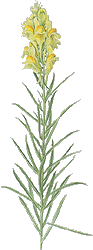

Oczywiście jest to niepełny wykaz chorób. Sposobów leczenia innych schorzeń należy poszukać w literaturze (nie w tej pseudoterapeutycznej) lub u lekarza znającego tajniki akupresury albo u terapeuty zasługującego na zaufanie. Cały czas też apeluję o rozsądek. Jeśli nie jesteśmy pewni tego, co chcemy zrobić, należy zrezygnować z zabiegu. Nie istnieją jeszcze magazyny części zamiennych dla człowieka. To o czym się słyszy i czyta, to tylko nieudolne próby współczesnej medycyny i to eksperymenty, które się jako tako powiodły. Innych ludzkich tragedii nie publikuje się ze względów oczywistych. Jeśli zdecydujemy się na masaże proszę pamiętać, że efekty uzyskamy tylko poprzez systematyczność i cierpliwość. To nie jest leczenie chemią "szybkiego reagowania". Na wszelkie choroby pracujemy miesiącami a nawet latami, a chcemy wyzdrowieć w ciągu jednego dnia. I pamiętajmy o angielskim przysłowiu - "pomóż sobie sam, a Bóg też ci pomoże".

**Dbajmy o stopy**

Należy dbać o higienę całego ciała, a szczególnie trzeba zwrócić uwagę na stopy i zadbać o ich właściwą pielęgnację. Nosić wygodne obuwie. Wszelkie zgrubienia, nagniotki, odciski znajdujące się na stopach blokują receptory i mogą być przyczyną złego samopoczucia, dolegliwości, a nawet poważnych chorób. Kobiety, które noszą obuwie ciasne lub na wysokim obcasie, często narzekają na silne bóle głowy. Ich przyczyną są ściśnięte palce u nóg.

Higiena nóg polega na kapieli stóp w gorącej wodzie z dodatkiem 2 łyżek soli jodobromowej (sól zabłocka, iwonicka lub bocheńska). W takiej wodzie moczymy nogi (do kostek) przez około 20-30 minut przynajmniej raz w tygodniu. Po tym zabiegu spłukujemy je zimną wodą. Należy także 1-2 razy w tygodniu ścierać pumeksem wszelkie zgrubienia, nagniotki i odciski na podeszwie. Wskazane jest też moczenie nóg w wywarze z siana lub słomy owsianej. Bierzemy w tym celu 2 litry wody, wrzucamy do niej 2 garście siana lub słomy owsianej i gotujemy na bardzo małym ogniu przez 2 minuty, a następnie pozostawiamy pod przykryciem na 15 minut. Przecedzamy wywar i moczymy w nim nogi przez 20-30 minut. Na zakończenie należy je opłukać zimną wodą i przetrzeć ręcznikiem zmoczonym w zimnej wodzie.

**Akupresura dla leniwych i zaganianych**

W dzisiejszych czasach ludzie brak dbałości o własne zdrowie próbują tłumaczyć codzienną gonitwą - z domu do pracy, z pracy do domu, jak ten gość biegający z pustą taczką. Czemu pan tak biega z pusta taczką? Terminy są tak napięte, że nie ma czasu załadować, padła odpowiedź. Każdy znajdzie 1001 wytłumaczeń na brak czasu, by zacząć dbać o siebie. Nieuchronnie nadchodzi jednak dzień, gdy zaczniemy robić rachunek błędów, ale zwykle już jest za późno. W artykule o "kręgosłupie" opisałem bardzo prostą, skuteczną i wymagającą tylko chwili czasu gimnastykę. A teraz pora na pseudo akupresurę wymagającą tylko 4 minut dziennie, a która choć w części zastępuje tę prawdziwą. Dlaczego w części? Bo prawdziwa akupresura i czas jej trwania, oprócz pracy fizycznej, angażuje także nasz ośrodek myślowy, odpowiedzialny za uruchomienie wewnętrznej apteki.

Należy zebrać reklamówkę okrągłych kamyków o średnicy od 1 do 3-4 cm (rzeczne otoczaki, kamienie występujące w żwirze, plaże a nawet pola). W domu należy je wypłukać i jeszcze raz obejrzeć, by odrzucić te ostre. Do miski, w której zwykle moczymy nogi, wsypujemy warstwę o grubości 10-15 cm, wlewamy wodę o temperaturze jaką lubimy (możemy dosypać "morskiej" soli kąpielowej, zwykłej soli albo zaparzonych uprzednio ziół), wchodzimy do miski i na stojąco zaczynamy dreptać w miejscu. Zwykle drepcemy około 2 minut, ale można i dłużej, bo tym lepiej. Czynność tą można wykonywać dowolną ilość w ciągu dnia, ale nie mniej niż 2 razy (najlepiej rano i wieczorem). W ten sposób pobudzamy wszystkie receptory, które znajdują się na spodzie stopy i w ten prosty sposób wszystkie plaże świata mamy schowane pod wanną i są dla nas dostępne bez względu na pogodę i porę roku.

**Strefy refleksyjne wewnątrz dłoni**

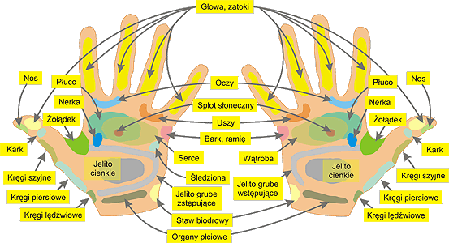
