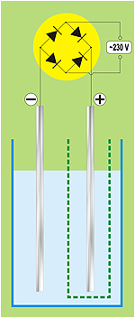

**Woda "żywa", "martwa" i zioła**  
Tamara Marta Karpiuk - Puławy - styczeń 1988

Polskie prawo i jedynie słuszna nauka zmusza do rozpoczęcia sloganem:

**Uwaga. Leczenie nie uznawane przez medycynę naukową. Stosujesz na własną odpowiedzialność.**

Odkrycia dokonano w roku 1985 w Instytucie Złóż Naftowych w Taszkiencie, przez zespół uzbeckich uczonych, wsród których był też Polak dr nauk chemicznych Adam Mariampolski. Odkrycia dokonano przypadkowo, w czasie prac nad innym tematem trwającym ponad 20 lat. Prowadząc badania nad elektrolizą wody znaleziono dwie odmiany wody - kwaśną i alkaliczną. Wodę kwaśną nazwano "martwą", a alkaliczną "żywą". Wodą "kwaśną" podlewano nasiona bawełny - nie rosły. Powtórzono zabieg wodą "żywą" i rośliny zaczęły rosnąć, okazale kwitnąć, a pąki były dorodniejsze od bawełny uprawnej. Rozpoczęto więc prace badawcze. Zastosowano wodę "żywą" w budownictwie rozprowadzając nią cement - nie tężał przez siedem dni, ale lepiej zespalał elementy budowlane nie zmieniając ich właściwości.

Potem zaczęto podlewać zioła. Okazało się, że rosły szybciej, bardziej się krzewiły, były dorodniejsze i odporne na choroby. Robotnicy chętnie pili tę wodę oraz przemywali okaleczenia rąk. Ponieważ woda była zbierana do wielkiej kadzi, a jest tam klimat gorący, więc niektórzy kąpali się w tej wodzie dla ochłody. Wówczas okazało się, że ci którzy chorowali na egzemę szybko powracali do zdrowia. Dla próby dokonano oprysków pola bawełnianego zaatakowanego grzybkiem i po kilku dniach grzybek zniknął. Tajemnicza woda czyniła cuda niezrozumiałe dla uczonych i po kilku eksperymentach zaczęto się nią interesować na poważnie. Obecnie zaczęto eksperymenty z wodą w ośrodkach medycznych. Rezultaty są zadziwiające i być może jest to "woda życia" na ziemi w czasie, gdy chemia nas kaleczy, a tylko niekiedy leczy.

**Trochę danych, nie tylko technicznych**

Urządzenie do "produkcji" wody należy wykonać (najlepiej samemu gdyż jedyne, produkcji litewskiej, dostępne na rynku kosztuje [380,00 zł.](http://kapela.waw.pl/sklep/product_info.php?products_id=47&osCsid=bd57de0581dc6773d5757e2f0e851fcb)) z następujących materiałów:

**•** elektrody ze stali nierdzewnej 190×30×1,5 mm (nie może być miedź, aluminium, stal chromowa),  
**•** woreczek z niefarbowanego brezentu o średnicy około 8 cm i wysokości 14 cm (mieści około 400 ml), można uszyć też woreczek z niefarbowanej bawełny, ale nie polecany gdyż jest za miękki. Wszystkie tkaniny farbowane dadzą wodę zatrutą chemikaliami stosowanymi przy barwieniu,  
**•** naczynie szklane o pojemności 1 litra, wysokie tak, by elektrody zanurzyć w conajmniej 80%  
**•** termometr o zakresie do 100°C,  
**•** prostownik na diodach (U>300 V, I>5A). Ja swego czasu użyłem "BYP 680-300", odstęp między diodami nie może być mniejszy niż 40 mm.

**Woda martwa** - woda "kwaśna", wytwarza się przy anodzie (+), ma odcień złocisty, element Yang, odczyn pH poniżej 4, jest bogata w tlen, ma właściwości dezynfekcyjne, odwadniające, oddziaływuje na limfę.

**Woda żywa** - woda "zasadowa", wytwarza się przy katodzie (-), ma odcień mleczny, element Yin, odczyn pH powyżej 10, na działanie nawadniajace i jest wchłaniana przez tkanki.

Przed przystąpieniem do "produkcji" należy namoczyć brezentowy woreczek. Woreczek wkładamy do szklanego naczynia i wlewamy do niego około 400 ml wody z kranu i do naczynia szklanego około 450 ml. Wkładamy elektrody, tak by jedna z nich znalazła się w brezentowym woreczku. W zależności jaką wodę chcemy wytworzyć - jeśli chcemy wytworzyć wodę "żywą" do woreczka wkładamy anodę (+), jeśli martwą - odwrotnie. Dlatego, że wodę z woreczka brezentowego będziemy zawsze wylewać, gdyż (nie wiem czemu) w jednym cyklu można produkować tylko jeden rodzaj wody. Wkładamy do naczynia termometr.

**Uważaj, masz do czynienia z prądem o napięciu 230 V.**

Włączamy prostownik, zachowując największe środki ostrożności gdyż mamy do czynienia z gołymi elektrodami i czekamy aż temperatura osiągnie 72°C. Wyłączamy prostownik z sieci, wyjmujemy elektrody, wylewamy wodę z brezentowego pojemnika do zlewu a pozostałą w szklanym naczyniu do oznakowanej (woda żywa, woda martwa) butelki. Spotkałem też opracowanie, w którym wodę "martwą" produkuje się w ciągu 7 minut, a "żywą" w ciągu 9 minut. Może to być przydatne dla tych, którzy nie maja termometru ale generalnie produkcja wody winna opierać się o wskazania termometru.

Wodę można podgrzewać, Zachowuje trwałość przez 7 dni a działanie wzmocnione do 7 godzin.

**Zastosowanie**

"Żywa" woda nie jest panaceum na wszystkie schorzenia, ale wiele z nich wyeliminuje w krótkim czasie bez konieczności stosowania leków. Wodę "żywą" i "martwą" należy stosować według poniższych wskazań tylko w razie potrzeby lecz nie można pić jej stale. W celu stosowania wody z ziołami można ja podgrzewać. Sproszkowane zioła należy rozprowadzać ciepłą wodą i stosować okłady. Taki kompres działa szybko i skutecznie, szczególnie w bólach stawów i oczu. Skuteczne działanie wody zaobserwowano w zatruciach lekami.

Pani Katarzyna nie była w stanie chodzić, pobierała leki rónocześnie od trzech lekarzy bez ich wzajemnej konsultacji. Miała opuchnięte całe ciało, niewydolność nerek i usztywnione nogi w stawach. Leczenie trwało 6 tygodni. Obecnie chora chodzi i czuje się dobrze. Zastosowano naprzemienne okłady na kończyny dolne: pierwszy dzień - okłady z wody "martwej", drugi - okłady z wody "żywej", trzeci - okłady z liści kapusty owinięte lnianym płótnem nawilżonym wodą "żywą". I tak przez 6 tygodni. Ponadto, w pierwszym dniu piła 3 razy dziennie po 1/2 szklanki wody "martwej", od drugiego dnia przez kolejne 7 dni po 1/2 szklanki wody "żywej" rano i wieczorem, a w południe zioła (bukwica - 50 g, melisa - 50 g i rzepik - 100 g). Po 7 dniach następowało 7 dni przerwy i znowu 7 dni picia wody "żywej".

Jak każda metoda, tak i ta ma swoich zwolenników i przeciwników i jest to słuszne, ponieważ nie każdemu można pomóc tą drogą. Każdy cierpiący człowiek sam w sobie jest jedyną istotą żyjącą na tym świecie i do każdego trzeba indywidualnie dobrać sposób w jaki chce się pomóc. Niektórym pomagają leki, innym zioła, a jeszcze innym "żywa" woda i dieta. Oczekujemy cudownych uzdrowień od tych, którzy chcą nam pomóc, jakoś nie pamiętając że latami nie dbaliśmy o własne zdrowie. Wiele osób od "żywej" wody oczekuje natychmiastowego działania nie przestrzegając przy tym diety.

**W czasie kuracji wodą "żywą" należy wykluczyć z jadłospisu - wieprzowinę, podroby, sól, alkohol, prawdziwą kawę, słodycze, cukier - wówczas działanie wody będzie silniejsze.**

Woda "żywa" działa oczyszczająco na cały organizm i jest nieprawdą, że wypłukuje mikroelementy z organizmu. Usuwa zbędne trujące substancje, szczególnie dobrze działa na nerki, a jej pozytywne działanie ma odzwieciedlenie w wynikach. Nasiona moczone w "żywej" wodzie szybciej kiełkują, są zdrowe i odporne na choroby. Zioła podlewane wodą "żywą" są aktywniejsze w działaniu. Dobrze byłoby rozpoczynać kurację z ubywaniem księżyca, zgodnie z biologicznym zegarem człowieka. Dlaczego zwracam szczególną uwagę na dietę? Otóż bardzo często słyszę od chorych, że brak czasu nie pozwala na ciepłe posiłki, a to jest błąd, za który płacimy utratą zdrowia. Nasz żołądek całą dobe winien być ciepły. Jeśli nie posiada stałego ciepła zabiera je innym organom. Stajemy się wychłodzeni, mamy zimne ręce i nogi, mamy dreszcze, zakłócenia w krążeniu krwi i w tym momencie nasze ciało zaczyna być chore.

Niekiedy można ogrzać się ziołami. Wiele osób popełnia błąd pijąc rumianek lub mietę. Te zioła na krótko ogrzewają nasz organizm, zioła te należy pić latem nigdy zaś jesienią czy zimą. Do ogrzanie zołądka należy pić rozmaryn, tymianek i majeranek. Można je łączyć z wodą "żywą", co daje dobre efekty. Niektórzy do ogrzania piją źle połączone gatunki herbaty - zawsze do czarnej herbaty należy dodać jaśminowej, gdy występuje duża potliwość ciała należy połączyć herbate zieloną z szałwią lub pokrzywą - daje zdrowie, zmniejsza potliwość a przy okazji leczy nerki.

Pytano mnie dlaczego często mówię o liczbie "7". Otóż odnowa organizmu następuje co 7 lat. Nasz organizm odbudowuje się bardzo powoli i ktoś urodzony w roku 1947 obecnie zaczął 7×7 i podąża do 49 roku życia, a więc jeszcze przez 5 lat może bardzo pomóc swojemu organizmowi dbając o swoje zdrowie. W tym okresie następuje biologiczna odnowa organizmu i od nas zależy zdrowie na dalsze lata. Dlatego nie można uleczyć choroby w trzy dni, która trwa już kilka lat. Woda "żywa" spełnia rolę oczyszczającą, dlatego trzeba wspierać organizm dietą i ziołami. Najlepsze połączenie ziół - 2, 3, 5, 7 i 9 (nie rozumien tego, ale chyba chodzi o ilość łączonych ziół. przyp. aut.). Marzeniem byłoby, gdyby ktoś siłą woli rozpoczął kurację głodówkową 72-godzinną, szczególnie przy chorobach żołądka i wątroby. Organizm potrzebuje 72 godzin na oczyszczenie się z toksyn, a potem powoli używać "żywą" i "martwą" wodę wprowadzając lekkostrawne pożywienie.

**O żołądku**

Przy wrzodach żołądka dobrze jest łączyć sok z surowego ziemniaka z wodą "żywą" zwiększając z dnia na dzień proporcje: **1 dzień** - 1 raz dziennie 1 łyżka soku i 1 łyżka wody "żywej", **2 dzień** - 2 razy dziennie po 1/2 szklanki wody "martwej", **3 dzień** - 2 razy dziennie po 2 łyżki soku i 2 łyżki wody "żywej", **4 dzień** - 2 razy dziennie po 3 łyżki soku i 3 łyżki wody "żywej", i tak dalej do 1 szklanki. Można również łączyć wodę "żywą" z sokiem z surowej kapusty białej. Dotyczy to również chorych na owrzodzenie dwunastnicy. Bardzo zastarzałe owrzodzenia możemy leczyć pijąc sproszkowany korzeń żywokostu (20 g) i kozieradki (50 g), po 1/2 łyzeczki sproszkowanego ziela 2 razy dziennie popijając wodą "żywą". Można łączyć żywokost (20 g) z siemieniem lnianym (50 g).

**O wątrobie**

Jednak najważniejszym organem naszego ciała jest wątroba. Od zdrowej wątroby zależy niemal wszystko, która do odnowy biologicznej potrzebuje 3 lata (wówczas możemy mówić o zdrowej wątrobie). Medycyna Wschodu mówi, że w nagłych wypadkach należy przez 12 dni pić herbatę z natki pietruszki połączoną z wodą "żywą" i pić gotowaną pszenicę z hodowli biodynamicznej. Natkę pietruszki należy gotować 20 minut. Bardzo często pomiędzy godziną 13.oo a 16.oo wątroba potrzebuje "snu" i należy się położyć na kwadrans, by wątroba otrzymała potrzebną ilość krwi do pracy, a po kolacji należy wypić herbatę z majeranku z odrobina miodu. Najczęściej chorą wątrobę mają ludzie agresywni i znerwicowani. Agresja i złość blokują pracę wątroby.

Kobiety, które mają chorą wątrobę mają kłopoty w okresie menstruacji. Oprócz "żywej" wody należy stosować dietę i zioła. Jeśli nie mamy dość sił aby przeprowadzić kurację pietruszką i pszenicą, dobre efekty daje także dieta zbożowa i niekiedy odżywianie białym mięsem. Należy wykluczyć wywary mięsne i wieprzowinę. Zioła leczące wątrobę - sok z mniszka połączony z wodą "żywą", natka pietruszki, szałwia, estragon, rozmaryn, oman wielki, krwawnik, jasnota biała, berberys. Bardzo często "wątrobowicze" podczas pełni księżyca bywają agresywni i nierozważni. Trzeba ten okres przeczekać pijąc zioła.

**O nerkach**

Zadawano mi pytania dlaczego tak dużo mówię o nerkach. Otóż nerki są naszymi oczyma - tak twierdzą radiesteci i nie tylko. Zdrowe nerki, to zdrowe zęby, kościec i włosy. Nerki są odpowiedzialne za odnowę szpiku kostnego i tkanki mózgowej, każda nerka ma inne funkcje do spełnienia. Jeśli czerwieni nam się prawe ucho, to znaczy że lewa nerka jest słaba, jeśli lewe to prawa. Powinniśmy dbać o to, by nigdy nie dopuścić do przemarznięcia nerek. Stany lękowe, szczególnie u kobiet, blokują pracę nerek. Chcąc do leczenia nerek używac wody "żywej" kurację winniśmy rozpocząć pomiędzy pełnią a nowiem księżyca. Będzie to zgodne z biologicznym zegarem, gdyż księżyc wpływa na jakość krwi w nerkach.

Wiadomo, że księżyc powoduje przypływy i odpływy w morzach i oceanach, jest związany z istnieniem człowieka na ziemi. Żyjemy pod wpływem księżyca czy nam się podoba czy nie. Silniej jednak księżyc oddziaływuje na kobiety i jest ona z nim ściśle związana. Mamy cztery fazy księżyca i każda z nich niesie pewien rodzaj energii. Dlatego też leczenie chorób nerek należy z nimi synchronizować. Możnaby pokusić się o porównanie z księżycem swojej daty urodzenia i predyspozycjami do zachorowań. Jesteśmy cząstką natury i chorujemy tak jak żyjemy, od nas zależy nasze zdrowie, a stany lękowe to nie tylko choroby nerek.

Bardzo często pytania dotyczą zastosowania w leczeniu jarzyn. Otóż przy kamicy nerkowej trzeba połączyć sok z zielonych strączków fasoli z wodą "żywą" - 1/2 szklanki soku i 1/2 szklanki wody "żywej", połączyć i pić 2 szklanki dziennie. Również winogrona pobudzają działanie wątroby a leczą nerki. W ciągu dnia należy pić 2 szklanki soku między posiłkami. Oczywiście należy ograniczyć sól lub spożywać kamienną z domieszką mikroelementów. Zapomniany polski orzech laskowy jest cudownym środkiem w niewydolności nerek. Chorobom nerek towarzyszy bardzo często nadmierny zarost, szczególnie u kobiet, wówczas wskazane jest spożywanie orzechów laskowych.

Bardzo często chorobom nerek towarzyszą choroby pęcherza moczowego, w tym przypadku skuteczne jest zastosowanie wody "żywej" i "martwej" ponieważ nerki i pęcherz moczowy tworzą parę. Należałoby powiedzieć, że mamy 5 par organów, a to jest 10 bardzo ważnych, od których zależy nasze zdrowie i siła. Są to pary połączone ze soba energetycznie: \[1\] **nerki** - **pęcherz moczowy**, \[2\] **serce** - **jelito cienkie**, \[3\] **wątroba** - **woreczek żółciowy**, \[4\] **płuca** - **jelito grube**, \[5\] **żołądek** - **śledziona i trzustka**. Wszystkie wzajemnie się uzupełniają i choroba jednego z nich osłabia następny. Byłoby dobrze, znając nasz zegar biologiczny, przestrzegać pewnych wymagań stawianych przez naturę. Gdy mówimy o żołądku musimy pamiętać o związkach między organami. Oznacza to, że choroba z jednego przechodzi na drugi, pokrewny organ. Oznacza to również, że choroby płuc możemy leczyć nie tylko lekami doustnymi, ale również wlewkami do jelita grubego z "martwą" i "żywą" wodą, ponieważ są połączone energetycznie. Mówiąc o nerkach chciałam tez zwrócić uwagę na ciepłe okłady w okolicy nerek.

Wiele osób zadaje pytanie, czy w kuracji wodą "żywą" i "martwą" można również stosować masaż stóp? Oczywiście byłoby dobrze masować nie tylko stopy, bowiem na dłoniach mamy również odpowiednie receptory. Masując, pobudzamy odpowiedniki organów i następuje ich lepsze ukrwienie, a to jest warunkiem ich prawidłowego działania.

**Co i jak leczyć wodą "żywą" i "martwą"**

**Uwaga. Leczenie nie uznawane przez medycynę naukową. Stosujesz na własną odpowiedzialność.**

| 🟩 **Angina** | 🟩 **•** Co 4 godziny płukać gardło "martwą" wodą, po każdym płukaniu pić 1/2 szklanki wody "żywej" w ciągu 4 dni. Gorączka obniża się po jednym dniu a wyleczenie w 3 dniu. |
| --- | --- |
| 🟩 **Choroby kobiece** (zapalenie, swędzenie, upławy) | 🟩 **•** Przez 4 dni, 2 razy dziennie pić po 1/2 szklanki wody "martwej". Podmywać się rano i wieczorem ciepłą wodą "martwą" przez 7 dni. Następnie przez 4 dni pić wodę "żywą" 1/2 szklanki dziennie. |
| 🟩 **Ciśnienie krwi - przywrócenie normalnego** | 🟩 **•** Co 8 godzin przed posiłkiem pić 3/4 szklanki wody "żywej". **•** 2 razy dziennie pić 1/2 szklanki wody "żywej" z 3 łyżkami soku z buraka czerwonego. |
| 🟩 **Depresja, stany lękowe, ból głowy** | 🟩 **•** Sól litu rozprowadzić w 1/2 litra wody "żywej". Pić 2 razy dziennie przez 6 tygodni, 1 łyżeczkę na 20 minut przed posiłkiem. |
| 🟩 **Dziąsła - ropne zapalenie** | 🟩 **•** Co 3 godziny płukać gardło i dziąsła wodą "martwą". Pić 3 razy dziennie po 1/2 szklanki wody "żywej". Choroba ustępuje w ciągu 2-3 dni. |
| 🟩 **Gardło - zapalenie (chrypka)** | 🟩 **•** Co 3 godziny płukać gardło wodą "martwą", pić 2 razy dziennie po 1/2 szklanki wody "żywej". Poprawa następuje po 2 dniach. |
| 🟩 **Głowa - ból przewlekły** | 🟩 **•** Wypić jeden raz 1/2 szklanki wody "martwej" i po 30 minutach 1/2 szklanki wody "żywej". Ból ustępuje po 60 minutach. |
| 🟩 **Gruczoł krokowy - obrzęk** | 🟩 **•** Co 4 godziny w ciągu 9 dni na 30 minut przed posiłkiem pić 1/2 szklanki wody "żywej". Po kilku dniach wydziela się śluz, następuje częste oddawanie moczu, w ciągu 9 dni wyzdrowienie. |
| 🟩 **Grypa** | 🟩 **•** 6 razy dziennie płukać gardło i wnętrze nosa wodą "martwą". Pić 2 razy dziennie po 1/2 szklanki wodę "żywą". Grypa ustępuje w ciągu doby. |
| 🟩 **Hemoroidy** | 🟩 **•** Pęknięcia przemywać przez 2 dni rano i wieczorem wodą "martwą", po wyschnięciu przykładać tampony zwilżone wodą "żywą" co 3 godziny. Pić przez 1 dzień 2 razy po 1/2 szklanki wody "martwej". Ustępuje krwawienie, a po 2-4 dniach następuje zagojenie. |
| 🟩 **Jelita - nieżyt** | 🟩 **•** Zrobić okład na podbrzusze z wody "martwej" o temperaturze 37-40°C. Po 15 minutach obmyć "żywą" wodą. Zabieg można powtarzać. |
| 🟩 **Jelito cienkie - zaburzenia** | 🟩 **•** Płótno zwilżyć ciepłą "żywą" wodą i zrobić okład na 30 minut przed snem, wypić 1/2 szklanki wody "martwej". Okłady można stosować przez 3-4 dni. |
| 🟩 **Kolana opuchnięte** | 🟩 **•** Rano i wieczorem - okłady z wody "martwej". Pić wodę "żywą" 2 razy dziennie po 1/2 szklanki przez 4-7 dni. |
| 🟩 **Korzonki nerwowe - zapalenie** | 🟩 **•** W ciągu 7 dni, 3 razy dziennie, na 20 minut przed posiłkiem pić 3/4 szklanki wody "żywej". Bóle powinny ustąpić już w drugim dniu. |
| 🟩 **Liszaj** | 🟩 **•** Rano obmyć chore miejsca ciepłą "martwą" wodą. Na noc zrobić okłady z wody "żywej". Pić 2 razy dziennie 1/2 szklanki wody "żywej" przez 3-6 dni. Choroba zanika powoli. |
| 🟩 **Nogi - obrzęk** | 🟩 **•** Co 4 godziny pić 1/2 szklanki wody "żywej" przed posiłkiem przez 4 dni. |
| 🟩 **Nogi - potliwość** | 🟩 **•** Przez 15 minut wymoczyć nogi w krochmalu. Po wyschnięciu moczyć nogi przez 20 minut w wodzie "martwej". Przemyć wewnątrz obuwie "martwą" wodą, Zabieg powtarzać co 2 dni do skutku. |
| 🟩 **Oparzenie** | 🟩 **•** Jeżeli są pęcherze - przekłuć, przemyć "martwą" wodą. Po wyschnięciu (po około 10 minutach) zwilżać wodą "żywą" 4-8 razy w ciągu dnia. Po 24 godzinach ustępuje zaczerwienienie i szybko się goi nie pozostawiając blizn. |
| 🟩 **Rana ropiejąca** | 🟩 **•** Ranę obłożyć lnianym płótnem zwilżonym wodą "martwą". Płótna nie odrywać, a zwilżać. Po wyschnięciu obłożyc płótnem zwilżonym wodą "żywą" i po wyschnięciu zwilżać przez 2 dni. Nastepnie zdjąć opatrunek i przemywać tylko "żywą" wodą. Rana goi się w ciągu 2-3 dni. |
| 🟩 **Samopoczucie - polepszenie** | 🟩 **•** Rano i wieczorem pić po 1/2 szklanki wody "żywej" z 1 łyżeczką miodu spadziowego. **•** 2 razy dziennie płukać jamę ustną martwą "wodą", raz dziennie wypić 1/2 szklanki wody "żywej". |
| 🟩 **Skaleczenie** | 🟩 **•** Miejsce skaleczenia przemyć "żywą" wodą i założyć opatrunek. |
| 🟩 **Stawy - ból** | 🟩 **•** Co 4 godziny pić 1/2 szklanki wody "martwej" w ciągu 2-3 dni przed jedzeniem. Ból ustępuje po 2 dniach. |
| 🟩 **Sterylizacja** | 🟩 **•** Przedmioty skażone przemyć wodą "martwą" i osuszyć. Ciało również obmywać wodą "martwą" Można myć ręce i owoce. Woda "martwa" niszczy bakterie. |
| 🟩 **Stopy - zgrubienie skóry** | 🟩 **•** Nogi moczyć w krochmalu około 15-20 minut i osuszyć. Następnie przez 20 minut moczyć w gorącej "martwej" wodzie, pocierając pumeksem zgrubienie. Po kilku kąpielach zgrubienia zostaną usunięte. |
| 🟩 **Szyja - zaziębienie** | 🟩 **•** Lniane płótno zwilżone w ciepłej wodzie "martwej" nałożyć na ciało i okręcić wełnianym szalikiem. Okład zmieniać co 3 godziny. Pić 2 razy dziennie po 1/2 szklanki wody "żywej". Choroba ustępuje w ciągu 2 dni. |
| 🟩 **Trądzik** | 🟩 **•** Przemywać chore miejsca ciepłą wodą "martwą" przed snem. Pić 2 razy dziennie po 1/2 szklanki wody "żywej". Zrewidować odżywianie. Choroba ustępuje po 3-7 dniach. |
| 🟩 **Twarz - higiena** | 🟩 **•** Rano i wieczorem umyć twarz wodą "martwą", a następnie nacierać wacikiem zmoczonym w wodzie "żywej. Cera staje się jasna i znikają przebarwienia. |
| 🟩 **Watroba - zapalenie** | 🟩 **•** Co 3 godziny pić 1/2 szklanki "martwej" wody przez 3 dni. Następnie przez 2 dni pić wodę "żywą" 2 razy dziennie po 1/2 szklanki. |
| 🟩 **Uszy - szum, swędzenie** | 🟩 **•** Waciki zwilżone w ciepłej "żywej" wodzie wkładać do uszu wieczorem. Rano przemywać "martwą" wodą przez 3-4 dni. |
| 🟩 **Zęby - ból** | 🟩 **•** Płukać jamę ustną wodą "martwą około 10 minut. |
| 🟩 **Żylaki** | 🟩 **•** Krwawiące pęknięcia przemyć wodą "martwą". Następnie zmoczyć wodą "żywą" lniane płótno i obłożyć chore miejsca na 3 godziny. Pić 1 raz dziennie 1/2 szklanki wody "martwej" i następnie co 6 godzin 1/2 szklanki wody "żywej". Tak postępować przez 3 dni. Następuje rozszerzenie żył i rany zaczynają się goić. |
| 🟩 **Stany nowotworowe Osłabienie organizmu Niewłaściwe odżywianie Brak mikroelementów** | 🟩 **•** Preparat TP1 rozprowadzić w 1/2 litra wody "żywej", pić 2 razy dziennie łyżeczkę w czasie posiłku przez 6 tygodni. Następnie preparat TP2 rozprowadzić w 1/2 litra wody "żywej", pić 2 razy dziennie łyżeczkę w czasie posiłku przez 6 tygodni. Szczególnie wskazany w stanach pooperacyjnych, nowotworach żołądka i jelit. TP1 i TP2 - [preparaty](http://www.dr.podbielski.pl/index.php?go=news6) dr Tadeusza Podbielskiego. TP1 - cena 11,00 zł i TP2 - cena 12,00 zł. można [kupić](http://www.sklep.podbielski.pl/index.php?categoryID=78&PHPSESSID=b80330464974a85052cfdc758158c3b1). |

**Woda "żywa", "martwa" i zioła**

Żyjemy w czasach, gdy na naszych oczach rodzi się powrót do przyrody i powrót do ziół. Przyroda dawała człowiekowi wszystko co najlepsze, jednak nie zawsze człowiek chciał przyjąć cudowne dary uzdrawiające. Gonił za chemią i naraz zrozumiał, że zawsze będzie wracał do ziół. W ostatnich latach bardzo wiele mówi się o ziołach, ich dobroczynnym działaniu na organizm człowieka. Napisano wiele prac na ten temat i każda z nich zawiera drogocenne wskazówki jak z ziół korzystać. Przecież jesteśmy cząstką przyrody i nie możemy o tym zapomnieć. Tą cząstką są też zioła, które zawsze żyją w zgodzie z nami. Dlatego chciałabym wyjaśnić jak doszło do moich spotkań z ziołami i wodą "żywą", na temat której pracę oddaje tym wszystkim, którzy zechcą pomagać z życzliwością i miłością cierpiącemu człowiekowi.

Wszyscy wiemy, że księżyc ma wpływ na życie naszej Matki-Ziemi i nas wszystkich. Czerwona barwa księżyca daje siłę naszym mięśniom, toń błękitnego nieba - nerwom mózgowym, złote słońce pomaga wątrobie itd. Zioła też rosną zgodnie z fazami księżyca, tak też działają na organizm ludzki. Zioła rosnące nad ziemią mobilizują siły witalne. Gdy księżyc idzie do pełni, wówczas zebrane skuteczniej działają, natomiast wszystkie zioła przeznaczone na korzeń należy sadzić i zbierać, gdy księżyc schodzi od pełni. Astrologowie powiadają, że zioła są pod wpływem planet, które nadają im siły witalne, a na ziemi tym planetom odpowiadają znaki zodiaku zawarte w czterech zywiołach: **Trygon ziemi** - Byk, Panna, Koziorożec - daje impuls sił kosmicznych w korzeń rośliny, **Trygon wody** - Rak, Skorpion, Ryba - daje wzrost liści i łodyg, **Trygon powietrza** - Bliźnięta, Waga, Wodnik - pobudza rozwój kwiatów, **Trygon ognia** - Strzelec, Baran, Lew - intensyfikuje wzrost nasion i owoców.

Dawniej zielarki nazywano czarownicami. Zbierały zioła nawet o północy przy pełni księżyca, wiedziały że choroba prędzej opuści ciało, gdy kurację zaczną z ubywaniem księżyca. Ludowe przekazy dziś znajdują potwierdzenia u naukowców i to są atuty ziół. Nasze mądre babcie bardzo dokładnie układały bukiet wiankowy ziół, aby poświęcić w dzień Matki Bożej Zielnej. Poświęcony wianek cały rok emanuje dobrymi siłami w takim domu. Jemiołę zrywały tak, by nie dotknęła ona ziemi i rok działała na zasadzie odpromiennika zawieszona u sufitu. Zielarki wiedziały, że złamania otwarte dobrze jest obłożyć młodą korą lipową rozgotowaną w słodkiej śmietanie - szybko się goi i zrasta. Dziś na proste zwichnięcia zakłada się gips - szkoda. Niewiele osób zastanawia się, jak należy robić mieszanki ziół. Byłam świadkiem sypania różnych ziół jedno w drugie. Trudno się dziwić, że są tak mało skuteczne. Zioła należy łączyć tak jak rosną w naturze.

Już będąc dzieckiem zastanawiałam się, dlaczego człowiek szuka pomocy u kilku zielarzy. Poznałam staruszkę w Białowieży, która mi wiele o nich opowiedziała, a do Pani - tak ja nazywano - zawiódł mnie mój ojciec, który również uczył mnie wszystkiego o ziołach. Zastanawialiśmy się, dlaczego te same zioła, zebrane w różnych miejscowościach działają różnie. Te wątpliwości pomogła mi wyjaśnić Pani z Białowieży w późniejszych latach. Każdy człowiek rodzi się pod określoną planetą i z przyznanymi mu ziołami na całe życie. To nie znaczy, że powinien chorować. Przyroda zawsze stara się naprawić błąd. Wówczas zaczęłam obserwować chorych, notować datę urodzenia oraz ich ulubione zioła. Okazało się, że człowiek często intuicyjnie lubi lub nie pewne zioła. Moje obserwacje trwają ponad 30 lat, ciągle poznaję coś nowego i czasami trzeba sięgać do ascendentu, aby dokładnie skomponować mieszankę. Dziś już wiem, dlaczego zioła są mniej lub bardziej skuteczne. Nie wszyscy pamiętają o tym, że człowiek jest cząstką przyrody i to nasz błąd.

Byłoby marzeniem robić napar z ziół wodą źródlaną. Dziś o to trudno. Zastanawiałam się nad wodą "żywą", o której opowiadano bajki. Od dzieciństwa odbierałam dotykiem rąk kojące lub zimne prądy idące od ziół. Tą metodą i wahadełkiem opracowałam połączenie ziół z "żywą" wodą wraz z tymi, którzy tę wodę zażywali. Po latach okazało się, że woda taka istnieje. Byłam ciekawa, co wyniknie. Zaczęłam na własny użytek wodą "żywą" podlewać kwiaty - bardzo ładnie rosły. Potem zioła w doniczkach. Jako herbatki używałam tylko ziół. Byłam zaskoczona wynikami. Herbatka z ziół podlewanych wodą "żywą" smakowała lepiej. Mam w domu drzewko figowe, które umierało po owocowaniu i ścięłam. Tak stało około miesiąca. Kiedy podlałam wodą "żywą", po kilku dniach urosły młode pędy, drzewko rośnie bardzo ładnie i tak zaczęła się moja przygoda z wodą "żywą".

Bardzo mało wiem o wzajemnym oddziaływaniu człowiek-zioła-woda "żywa". Mam nadzieję, że woda, źródło życia na Ziemi okaże się dobroczynną dla człowieka. Mogłam połączyć w całość wiadomości o ziołach z człowiekiem. Te opracowanie dotyczy ogólnego stosowania ziół z wodą "żywą" i "martwą", natomiast drugą część opracowałam dla tych, którzy zechcą samodzielnie, metodami rediestezyjnymi sami łączyć zioła według dnia urodzenia z "żywą" i "martwą" wodą. Mam nadzieję, że przyniesie to wiele dobrego dla człowieka. Przecież wiemy, że najwyższe działanie ziół jest wówczas, gdy zioła zostały zebrane zgodnie z kalendarzem biodynamicznym i z tej ziemi, gdzie sami wyrośliśmy i żyjemy. Jesteśmy cząstką tego skrawka ziemi. Pamiętajmy o tym zawsze i wszędzie.

**Uwaga. Leczenie nie uznawane przez medycynę naukową. Stosujesz na własną odpowiedzialność.**

| 🟩 **Angina** | 🟩 **Zioła** - liść orzecha (10 g), majeranek (15 g), tymianek (10 g), nagietek (20 g), eukaliptus, lipa (20 g), szałwia (15 g). **Leczenie** - wypić 1 raz 1/2 szklanki wody "martwej", 3-7 dni płukać gardło 2 razy dziennie jednym z ziół zalanych wodą "martwą". Pić 2 razy dziennie 1/2 szklanki wody "żywej". **Efekty** - w ciągu kilku godzin gorączka obniża się, a choroba ustępuje w ciągu 3-4 dni. Z eukaliptusa można robić inhalacje. |
| --- | --- |
| 🟩 **Anemia** | 🟩 **Zioła** - pokrzywa (20 g), wilżyna (10 g), poziewnik (5 g), tobołki posp. (10 g), świetlik łąkowy (20 g), owoc róży (20 g), ogórecznik (20 g), rzepik (15 g), bukwica (15 g). **Leczenie** - wypić 1 raz 1/2 szklanki wody "martwej", następnie pić napar z ziół "żywą" wodą 2 razy dziennie po 1 szklance. Dodatkowo można 1 raz dziennie zjeść 1 łyżeczkę sproszkowanej kozieradki z miodem. **Efekty** - przed kuracją sprawdzić morfologie krwi, po 7 dniach powtórzyć - wyniki będą lepsze. Można przedłużyć picie ziół do 2 tygodni. |
| 🟩 **Bezsenność** | 🟩 **Zioła** - kolendra (10 g), owoc bzu czarnego (10 g), liść jeżyny (15 g), melisa (10 g), owoc jarzębiny (15 g), liść borówki (5 g). **Leczenie** - przed snem pić 1 szklankę naparu "żywej" wody z ziół przez 2-4 dni. Kuracje można powtarzać. **Efekty** - organizm się wycisza i wraca sen. |
| 🟩 **Biegunka** | 🟩 **Zioła** - zielona herbata (), szyjka rakowa (). **Leczenie** - wypić 1/2 szklanki wody "martwej". Co 7 godzin zażyć 1/2 łyżeczki sproszkowanej herbaty lub szyjki rakowej (do wyboru) popijając 1/2 szklanki ciepłej "żywej" wody. **Efekty** - bóle ustępują, biegunka ustaje. |
| 🟩 **Choroba popromienna** | 🟩 **Zioła** - herbata zielona (15 g), pokrzywa (20 g). **Leczenie** - przez 3 miesiące, 2 razy dziennie pić po 1/2 szklanki naparu wody "żywej" i ziół. Można używać naparu ze zwykłej wody w wypadku braku wody "żywej". **Efekty** - wzmacnia, nie dopuszcza do powstania anemii, wzmacnia siły obronne organizmu. |
| 🟩 **Dziąsła zapalenie** | 🟩 **Zioła** - kolanchola (), propolis (). **Leczenie** - w ciągu dnia płukać jamę ustną 2-6 razy wodą "martwą" a potem roztworem wody "żywej" z propolisem lub kalancholą 1-2 razy. **Efekty** - brak danych. |
| 🟩 **Głowa ból** | 🟩 **Zioła** - lipa (10 g), macierzanka (30 g), bukwica (20 g). **Leczenie** - wypić 1 raz 1/2 szklanki wody "martwej", pić 2 razy dziennie 1/2 szklanki naparu ziół "żywą" wodą od 2 do 3 dni. **Efekty** - po 15-20 minutach ból głowy ustępuje. W razie nawrotu bólu kurację powtórzyć. |
| 🟩 **Hemoroidy** | 🟩 **Zioła** - cebula (), kora dębu (), len (), kozieradka (), perz (), płatki róży (). **Leczenie** - w ciągu 2 dni pić 2 razy dziennie po 1/2 szklanki wody "martwej", następnie 1 raz dziennie 1/2 szklanki wody "żywej". Z naparu "żywą" wodą jednego z ziół robić przymoczki na chore miejsce lub tamponami z wody kilka razy dziennie przez 2-5 dni. **Efekty** - krwawienia ustępują i zagojenie ran następuje w ciągu kilku dni. |
| 🟩 **Menstruacja bolesna** | 🟩 **Zioła** - kora kaliny (15 g), krwawnik (10 g), kwiat orlika (5 g) lub mięta pieprzowa (15 g). **Leczenie** - wypić 1 raz 1/2 szklanki wody "martwej", następnie 1-2 dni przed okresem pić napar z ziół wodą "żywą" 2 razy dziennie po 1/2 szklanki. **Efekty** - kuracje przeprowadzać przez okres 3 miesięcy przed okresem. |
| 🟩 **Moczopędne** | 🟩 **Zioła** - perz (10 g), ogórecznik (20 g), wrzos (10 g), bławatek (10 g), ręcznica (15 g), liść porzeczki czarnej (20 g), fiołek (10 g), liść poziomki (10 g). **Leczenie** - napar z ziół "żywą" wodą" pić 2 razy dziennie po 1 szklance przez 3-4 dni. **Efekty** - oczyszcza nerki. |
| 🟩 **Nerki stan zapalny** | 🟩 **Zioła** - ogórecznik (). **Leczenie** - przez 1 dzień pić 3 razy po 1/2 szklanki wody "martwej" i następnie przez 3-6 dni napar z ogórecznika wodą "żywą" 2 razy dziennie po 1/2 szklanki. **Efekty** - brak danych. |
| 🟩 **Nogi bóle i obrzęki** | 🟩 **Zioła** - podbiał (20 g), storczyk (10 g), rozmaryn (15 g), skrzyp (20 g), ogórecznik (20 g). **Leczenie** - przez 1 dzień pić 2 razy po 1/2 szklanki wody "martwej", następnie 2 razy napar z ziół wodą "żywą" po 1/2 szklanki. Stosować 2-3 dni. **Efekty** - bóle ustępują po drugim dniu kuracji, obrzęki po kilku dniach. |
| 🟩 **Oparzenia** | 🟩 **Zioła** - kopytnik (10 g), podbiał (10 g), babka lancetowata (10 g), liść poziomki (10 g), dziewanna (10 g), mniszek (10 g), lebiodka (20 g). **Leczenie** - chore miejsca przemyć wodą "martwą", potem w ciągu dnia robić okłady z naparu "żywą" wodą" jednego z podanych ziół. Okłady robić wyłącznie lnianym płótnem i po wyschnięciu powtarzać 3-4 razy dziennie. **Efekty** - rany goją się bardzo szybko i nie ma blizn. |
| 🟩 **Rana ropiejąca** | 🟩 **Zioła** - aloes (20 g), żywokost (15 g), kozieradka (10 g), torfowiec (15 g). **Leczenie** - przemyć ranę wodą "martwą", następnie zrobić opatrunek naparem "żywej" wody jednego z ziół. Wyschnięty opatrunek nawilżać wodą "żywą". Robić to 2-3 razy dziennie. **Efekty** - brak danych. |
| 🟩 **Serce arytmia** | 🟩 **Zioła** - melisa (15 g), kwiat głogu (20 g), wrzos (10 g). **Leczenie** - 2 razy dziennie wypić 1/2 szklanki naparu ziół "żywą" wodą przez 6-7 dni. **Efekty** - poprawa bardzo widoczna. Kurację można powtarzać co 2 tygodnie. |
| 🟩 **Skóra liszaje** | 🟩 **Zioła** - żywokost (15 g), kozieradka (10 g), skrzyp (5 g), barwinek (10 g), konopie (20 g), korzeń pokrzywy (10 g), torfowiec (10 g). **Leczenie** - w ciągu 2 dni rano obmywać chore miejsca wodą "martwą", następnie sproszkowane jedno z ziół połączone z wodą "żywą" nałożyć na lniane płótno i 2 razy dziennie robić ciepły okład na 15-20 minut. Stosować 2-7 dni. **Efekty** - po pierwszym dniu ognisko choroby zanika, skóra wraca do zdrowia. |
| 🟩 **Spojówki zapalenie (jeczmień)** | 🟩 **Zioła** - \[1\] świetlik łąkowy (10 g), zielona herbata (10 g), bławatek (10 g), \[2\] kozieradka. **Leczenie** - rano przemyć oczy wodą "martwą", na noc okłady naparu wodą "żywą" jednego z ziół. Jęczmień znika po nałożeniu papki z kozieradki i "żywej" wody. **Efekty** - brak danych. |
| 🟩 **Stawy ból** | 🟩 **Zioła** - liść brzozy (15 g), fiołek trójbarwny (20 g), szałwia (10 g), kwiat głogu (20 g), dziurawiec (10 g). **Leczenie** - w ciągu 2 dni pić 2 razy dziennie po 1/2 szklanki wody "martwej", następnie od 2 do 7 dni pić 2 razy dziennie po 1 szklance naparu ziół wodą żywą. **Efekty** - ciało się rozgrzewa, bóle ustępują. |
| 🟩 **Twarz higiena** | 🟩 **Zioła** - bratek (20 g), lawenda (10 g), macierzanka (20 g), lilia (10 g), ogórecznik (20 g). **Leczenie** - rano i wieczorem po umyciu twarzy i ciała, przemyć ciało i twarz wodą martwą. Po 10 minutach natrzeć ciało a twarz opłukać naparem z "żywej" wody i ziół dowolnie wybranych (można dodatkowo pić napar z macierzanki). **Efekty** - twarz wygładza się i znikają przebarwienia. |
| 🟩 **Upławy białe** | 🟩 **Zioła** - kwiat jasnoty (30 g). **Leczenie** - 1 dzień pić 2 razy 1/2 szklanki wody "martwej", następnie pić 2 razy dziennie 1 szklankę naparu wodą "żywą" przez 3-4 dni. **Efekty** - upławy ustępują w drugim dniu kuracji. |
| 🟩 **Wątroba stan zapalny** | 🟩 **Zioła** - dziurawiec (10 g), rozmaryn (5 g), majeranek (15 g). **Leczenie** - 1 dzień pić 3 razy po 1/2 szklanki wody "martwej" a następnie przez 3-7 dni napar "żywą" wodą z ziół 2 razy dziennie po 1 szklance. **Efekty** - bóle ustępują. |
| 🟩 **Woreczek żółciowy zapalenie** | 🟩 **Zioła** - kora kruszyny (10 g), tasznik (20 g), podróżnik k. (10 g), kocanka (15 g), melisa (10 g), owoc róży (20 g), dziurawiec (10 g). **Leczenie** - zrobić mieszankę z ziół. Pierwszego dnia pić 3 razy dziennie po 1/2 szklanki wody "martwej", następnie przez 3-7 dni napar wodą "żywą" z mieszanki ziół 2 razy dziennie po 1 szklance. **Efekty** - bóle ustępują po dugim dniu kuracji. |
| 🟩 **Zaparcia** | 🟩 **Zioła** - kwiat tarnika (). **Leczenie** - napar z zioła wodą "żywą" pić 2 razy dziennie po 1 szklance. **Efekty** - po kilku dniach zaparcia ustępują. |
| 🟩 **Ząb ból** | 🟩 **Zioła** - tatarak (5 g), kozieradka (5 g), podbiał (5 g). **Leczenie** - najpierw kilkakrotnie przepłukać "martwą" wodą, następnie wodą "żywą" rozprowadzić jedno zioło zmielone na proszek i robić okłady. Kozieradkę można wkładać do wewnątrz do ubytku i może tam być do 3 dni. **Efekty** - kozieradka tworzy naturalną plombę i działa przeciwbólowo w połączeniu z tatarakiem, leczy zapalenie okostnej. |
| 🟩 **Zgaga** | 🟩 **Zioła** - tatarak (20 g), mięta pieprzowa (10 g), krwawnik (20 g). **Leczenie** - rano i wieczorem przed posiłkiem pić napar "żywej" wody z ziół po 1/2 szklanki przez 2-3 dni. **Efekty** - objawy ustępują po 1-2 godzinach. |
| 🟩 **Żylaki** | 🟩 **Zioła** - mech leśny (30 g), rumianek (20 g), igliwie sosny (30 g), \[Cz. Klimuszko\]. **Leczenie** - chore miejsce przemyć wodą "martwą", następnie lniane płótno zmoczyć w naparze "żywej" wody i ziół i zrobić ciepły okład na 3-4 godziny 2 razy dziennie. Pić "żywą" wodę 2 razy dziennie po 1/2 szklanki przez 3-7 dni. **Efekty** - bóle ustępują, rany goją się szybko. Kurację można przedłużyć. |
| 🟩 **Porażenie mózgowe dzieci** | 🟩 **Zestaw I** - poziewnik (15 g), pokrzywa (100 g), bukwica (20 g), świetlik łąkowy (10 g), ogórecznik (20 g), rdest (15 g), wrzos (10 g), liść poziomki (30 g), melisa (30 g). **Zestaw II** - tymianek (10 g), kwiat tarniny (5 g), rzepik (15 g), owoc róży (25 g), serdecznik (10 g), kozłek k. (15 g), krwawnik (10 g). **Zestaw III (przyprawy)** - kminek, majeranek, lubczyk, magnez, wapń, żelazo, cynk. **Zestaw IV (nalewka)** - korzeń żywokostu (100 g), korzeń podróżnika (100 g), 1/2 litra spirytusu, 1/2 litra wódki żytniej. **Leczenie** - Przede wszystkim należy wyłączyć z jadłospisu: wieprzowinę, czekoladę, cukier, wywary na kości i wędliny. Trzeba podawać jarzyny gotowane, kaszę jęczmienną, kaszę gryczaną, owies, pszenicę, proso - pod różnymi postaciami. Zmielone kasze na mąkę służą do sporządzania ciast i naleśników. Podawać także nasiona strączkowe mielone. Jeśli podajemy mięso, to czyste i bez kości (indyk, zając, baranina, ryby). Jajko 1-2 na tydzień. Kapiele w drożdżach, zioła podawać z wodą "żywą" lub bez. Zestaw I podawać rano, zestaw II na noc. Zestaw III w różnych ilościach dodawać do potraw (likwidują zaparcia i dostarczają mikroelementów). Nalewkę (zestaw IV) po kąpieli wcierać delikatnie w kręgosłup. **Efekty** - dzieci z porażeniem mózgowym wymagają osobliwej pielęgnacji. Aby przywrócić zdrowie dziecku, trzeba cierpliwie i bardzo dokładnie wykonywać zalecenia z opisu. Pierwsze oznaki poprawy można zaobserwować po 6 tygodniach. Dzieci, które mają ataki drgawkowe powoli je tracą. Dzieci starsze trudniej prowadzić, a leczenie trwa od 1 do 3 lat. |
