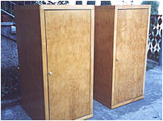
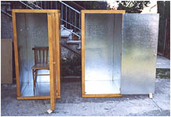
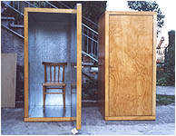

**ORGON - OCEAN ENERGII KOSMICZNEJ**

**Wszystkie wielkie prawdy zaczynają jako bluźnierstwa - George Bernard Shaw**

---

"Podręcznik akumulatora orgonu" James DeMeo (obszerne fragmenty). Prace badawcze dotyczące życiowej energii oraz osiągnięć dr. Wilhelma Reich'a prowadzone są przez James'a DeMeo od 25 lat. Obecnie ich wynikiem są: Bibliografia Biofizyki Orgonu oraz 20 opublikowanych artykułów, kompendiów i akademickich rozpraw, w których w bardzo wymagający sposób poddaje analizie pogląd Reich'a. DeMeo studiował nauki o Ziemi, środowisku i atmosferze na Uniwersytecie Floryda i Uniwersytecie Kansas, gdzie otrzymał stopień naukowy doktora filozofii (PhD). Pracował w Stanowym Uniwersytecie Illinois na wydziale Geografii oraz w Uniwersytecie Miami, jest założycielem Laboratorium Badań Biofizyki Orgonu (Orgone Biophysical Reserch Laboratory) i wydawcą magazynu Pulse of the Planet.

---

**Jeśli masz zamiar tylko "prześlizgnąć się" przez artykuł, to daruj sobie, bo szkoda Twojego cennego czasu. Jeśli zaczniesz czytać, czyń to z uwagą i staraj się zrozumieć co czytasz, a wtedy z pewnością dojdzie do Ciebie niesamowitość tego odkrycia. Odkryjesz "pokrewieństwo" myśli Reich'a z teorią Szypowa, zapomnianą medycyną i radiestezją. To jest być może odpowiedź na gwałtowne zmiany klimatyczne, przypisywane niesłusznie efektowi cieplarnianemu.**

---

**•** **Zaświadczamy i potwierdzamy odkrycie energii orgonu jako jedno z wielu największych odkryć w historii ludzkości** - z listu do Amerykańskiego Związku Lekarzy podpisanego przez siedemnastu lekarzy medycyny w 1949 roku.

**•** **Akumulator orgonu jest jednym z najważniejszych z pojedynczych odkryć w historii medycyny, niezaprzeczalnie** - Theodore P Wolfe, M. D., z biuletynu pod oryginalnym tytułem: "Emotional Plague Versus Orgone Biophysics, 1948".

**•** **Stało się oczywiste, że odkrycie energii orgonu i jego medycznych zastosowań w postaci akumulatora, wyrzutnika orgonu, orgonowych bionów ziemskich, wody orgonowej otwiera obfitość nowych możliwości leczenia i ukazuje zdumiewające nowe perspektywy** - Wilchelm Reich, M. D. z biuletynu: "Biopatologia nowotworów" Discovery of Orgone, Volume 2), 1948.

**•** **Cóż możemy powiedzieć o wiodących filozofach, którym tysiąckrotnie oferowałem moją chęć i zaangażowanie do ukazania moich odkryć, którzy to z uporem leniwego węża najedzonego do syta nigdy nie raczyli nawet spojrzeć na planety, księżyc, czy teleskop? Dla takich ludzi filozofia jest pewnym rodzajem książki... gdzie prawda jest odkrywana nie we Wszechświecie czy też Naturze lecz (używam ich własnych sformułowań) poprzez zestawienie tekstu** - wypowiedź Galileo Galilei, włoskiego astronoma w 1600 roku, który udowodnił, że Ziemia przemieszcza się po nieboskłonie, na krótko przed oskarżeniem i torturowaniem przez Kościół Katolicki.

**•** **energia orgonu nie istnieje** - Sędzia John D. Clifford, z 1954 roku Sąd Stanów Zjednoczonych, w orzeczeniu którego wszystkie biuletyny i książki Doktora Reich'a zostały zniszczone przez spalenie w komorze; Reich zgodnie z wyrokiem został wysłany do Więzienia Federalnego, gdzie wkrótce zmarł.

**PRZEDMOWA EWY REICH**

**D**

opiero teraz, 45 lat po śmierci Wilhelma Reich'a w 1957 roku ludzie mogą rozpocząć badania i studia z zakresu orgonomii jak każdego innego rodzaju wiedzy przy pomocy i wykorzystaniu Podręcznika Budowy Akumulatora Orgonu. W podręczniku tym w zwięzły i skondensowany sposób podana jest duża dawka informacji, oraz prostych odkrywczych doświadczeń przydatnych każdemu, kto interesuje się kosmicznym strumieniem energii życia. W książce zaprezentowana została naukowa definicja energii orgonowej; pokazano historię jak kolejne eksperymenty, odkrycia, obserwacje i teoretyczne intuicyjne rozważania Reich'a doprowadziły do praktycznego zastosowania akumulatora; opisano zasady konstrukcji i doświadczalnego użycia akumulatora, ze szczegółami danych na temat potrzebnych materiałów, warstw i rozmiarów, a także zamieszczono bardzo użyteczną listę literatury pomocniczej i dodatkowej.

Profesor J. DeMeo zaprezentował gruntowną wiedzę w temacie, który jak na razie jest zakazany i pomijany w kręgach akademickich dwudziestego wieku z wyjątkiem pionierskich kursów w tej dziedzinie w Nowym Jorku i Berlinie. Wilhelm Reich powiedział, że pomimo tego, że życiowa energia była znana od tysięcy lat, jemu udało sieją konkretnie i praktycznie udostępnić, a era jej zastosowań właśnie się rozpoczęła. Podręcznik ten jest pierwszym drukowanym materiałem w ciągu ostatnich lat zajmującym się szczególnie tym, jak koncentrować energię życia z ziemskiej atmosfery. Jest użyteczny dla laboratoryjnych kursów zajmujących się życiową energią kosmiczną. Materiał tu zawarty może być zrozumiały przez postępowe szkoły wyższe oraz inne kręgi szkolne i naukowe. Myślę, że spełniają się moje, trwające pięćdziesiąt lat oczekiwania, iż informacje o życiowej energii zostaną włączone do grona nauk, które wszyscy ludzie na Ziemi powinni posiąść w czasie podstawowej edukacji szkolnej.

Dziękuję Ci James DeMeo. Eva Reich, M. D. Berlin Zachodni, Marzec 1989

**PRZEDMOWA JAMES'A DEMEO**

**M**

oje doświadczenie z umierającymi na raka członkami rodziny nie jest czymś niezwykłym, ponieważ ta niszcząca choroba działa obecnie na poziomie epidemii. Współczesne statystyki podają, że "wojna z rakiem" została przegrana i pomimo wszystkich radykalnych metod operacyjnych, chemikaliów i naświetlań, dzisiaj pacjenci nie przeżywają dłużej ani częściej niż to było w latach pięćdziesiątych. W rzeczywistości ta niszcząca siła wylała się na młode pokolenie i młodsze grupy wiekowe, tam gdzie kiedyś było to rzadkością. Nie ma żadnych naukowych dowodów, aby podtrzymywać twierdzenie, że operacje, naświetlania i chemioterapia są skutecznymi metodami walki z rakiem oraz, że tradycyjna medycyna robi cokolwiek skutecznego w zakresie profilaktyki i zapobiegania raka. Te gorzkie fakty powodują wiele oporu, w sytuacji, gdy ktoś zaczyna studiować różne alternatywne, nieinwazyjne i nie toksyczne metody leczenia raka. Choć dyskredytowane przez oficjalną medycynę i określane "znachorstwem", okazują się być sensowne, a nawet w znacznym stopniu skuteczne. Ich obrońcy i ci, którzy podjęli się wysiłku korzystania z nich niejednokrotnie musieli brać na siebie wielkie ryzyko, aby udowodnić to, w co wierzyli i że metody te są bezpieczne i przynoszą konkretne i pozytywne skutki dla chorych ludzi.

Zorganizowane grupy medyczne wraz z kręgami farmaceutycznej finansjery nie dbały o poważne przyglądnięcie się tym technikom. W zamian, owe techniki były w nieuzasadniony sposób atakowane, prowadzone były "pseudo" dochodzenia ze z góry zaplanowanymi skutkami; na podstawie sądowych nakazów kliniki były w brutalny sposób zamykane przez specjalne siły policyjne, a medyczne zapisy i protokoły badań były konfiskowane, wydawane były również wyroki skazujące na więzienia, a nawet palono książki. Widać więc, że ponad sądami i legalnym systemem prawnym, zostało popełnione przez wielkie organizacje medyczne i odpowiednią rządową biurokrację olbrzymie oszustwo w stosunku do narodu amerykańskiego. W tym krótkim Podręczniku nie jestem w stanie podać historii tych antynaukowych i nieetycznych prześladowań, dlatego kilka artykułów i książek na ten temat wymienionych jest w bibliografii.

Aby wyrazić się jasno, główna przyczyna niepowodzeń współczesnej medycyny w walce z wyniszczającymi chorobami leży w tym, że organizacje medyczne używają policyjnych taktyk do tłumienia nowych, ważnych odkryć i niekonwencjonalnych metod, nie bacząc na jakiekolwiek istniejące naukowe dowody. W rzeczywistości najlepiej udokumentowana i udowodniona niekonwencjonalna metoda terapeutyczna jest przedmiotem najsilniejszych ataków. Wiele, wiele obiecujących niekonwencjonalnych technik terapeutycznych było latami tłumionych i atakowanych przez zupełnie bezprawną zmowę motywowaną wyłącznie względami ekonomicznymi, interesem lekarzy, producentów lekarstw, uprzedzonych pracowników ośrodków akademickich, purytańskiej biurokracji rządowej oraz sędziów. W tym procesie prawda była straszliwie deptana, a naukowe metody pomijane.

Najwyraźniejszym i mówiącym samym za siebie przykładem jak owe siły starają się uśmiercać nowe odkrycia i ich odkrywców jest dr Wilhelm Reich i jego orgonowy akumulator. Reich był jednym z najmłodszych współpracowników profesora Freud'a we wczesnych badaniach psychoanalitycznych we Wiedniu i w Berlinie. Jednak jego pomysły były zbyt rewolucyjne dla starszych naukowców. Usilnie argumentował, że ludzka niedola, nędza i psychiczne choroby w głównej części są rezultatem stanu socjalnego społeczeństwa, który mógłby być zmieniony, aby zapobiegać neurozom. Naciskał na reformy prawa dotyczącego zapobieganiu znęcania się nad dziećmi oraz ciężkiego położenia ekonomicznego kobiet. Stworzył realny ruch socjalny i polityczny w przed hitlerowskich Niemczech, który pragnął zmienić prawo zabraniające rozwodów, dostępu do antykoncepcji dla młodych, nie pozostających w związkach małżeńskich ludzi, i uwolnienia ich do zdrowego seksualnego współżycia oraz do rozluźnienia ojcowskiej mocy i dominacji nad rodzinami.

Pisał o tym bardzo dużo w latach 20-tych i 30-tych, i obnażał korzenie ruchu nazistowskiego w wymagającej posłuszeństwa, patriarchalnej i negatywnie do seksu nastawionej strukturze niemieckiej rodziny. Z powodu swoich pism na temat genitaliów i jego antyfaszystowskiej działalności został wydalony z wąskiego kręgu uczniów Freuda, podobnie jak usunięto go z Międzynarodowego Stowarzyszenia Psychoanalityków. Niemiecka psychoanaliza kierowała się w tym czasie w stronę nazizmu a niektórzy psychoanalitycy tak jak np. Carl Jung, zostali nawet rzecznikami i apologetami Narodowego Socjalizmu. Reich został w latach 30- tych wciągnięty na listę skazanych na śmierć zarówno po hitlerowskiej jak i stalinowskiej stronie i musiał uciekać do Skandynawii, a później do Stanów Zjednoczonych. Jego pisma zostały skazane na spalenie zarówno w Niemczech jak i w Związku Radzieckim.

W czasie, gdy Reich przybył do Stanów Zjednoczonych w 1939 roku, miał już za sobą sporo odkryć naukowych i szybko pozyskał grupę młodych, entuzjastycznych naukowców, którzy towarzyszyli mu w pracy. Amerykański okres poszukiwań, który trwał do jego śmierci w 1957 był w zasadzie owocny, z wyjątkiem okresu, gdy wymierzono przeciwko niemu procesy sądowe. W tym czasie Reich doświadczalnie wyjaśnił i umożliwił praktyczne wykorzystanie biologicznej i atmosferycznej energii życiowej, którą nazwał energią orgonową (orgonu). Energia orgonowa, była rzeczywistą, fizyczną i nieograniczoną formą energii. Pobudzała ona żywe stworzenia jak również występowała w postaci wolnej w atmosferze. Mogła być akumulowana w specjalnych pojemnikach, gdzie była obserwowana, odczuwana i mierzona.

Doświadczenia z energią orgonową wzbudziły straszliwy krytycyzm w kręgach medycznych, kampanię oszczerstw w prasie, potęgowaną przez Stanową Administrację Żywności i Leków (FDA). Usiłując powstrzymać prace Reicha FDA nigdy nie podjęła się powtórzenia jego doświadczeń i zbadania ich poprawności. Zamiast tego biurokraci z FDA polegali na plotkach, pogłoskach ignorując dostępne dowody zawarte w publikacjach. Ubezpieczali się świadectwami "ekspertów", którzy nie byli dobrze zaznajomieni, ani zainteresowani rzeczywistymi faktami naukowymi. Wiele zasad naukowych i moralnych zostało pogwałconych, kiedy oficjalnie przedstawiciele rządu oraz wielu psychiatrów i fizyków zaczęło szukać sposobu na zakończenie działalności Reicha.

Dziś znamy znacznie więcej szczegółów na temat wewnętrznych działań FDA dotyczących Reicha, podanych przez naukowe przeglądy FDA dzięki wykorzystaniu Aktu o Wolności Informacji. Znajdują się one w bibliografii. Początkowo Reich zaproponował badaczom FDA współpracę w dziedzinie orgonowej energii, odmówili mu jednak. FDA została też ostrzeżona przed nim przez różnych wysoko postawionych ludzi z kręgów medycznych. Reich był świadomy tych nieetycznych działań, a wielu z jego współpracowników zostało w sposób profesjonalny oczernionych przez kłamstwa FDA. Nigdy, ani rządowe ani prywatne, naukowe czy medyczne kręgi nie odniosły się konstruktywnie do omawianego problemu. Te ataki doprowadzały Reicha do furii. Tak było, gdy FDA ostatecznie szukało powodu do wniesienia sprawy sądowej przeciwko jego działalności.

Nie zgodził się na wystąpienie w sądzie, jak to określił "Jako oskarżony w sprawach dotyczących podstawowych naturalnych poszukiwań naukowych". Napisał do sędziego uzasadnienie - Response. Jego odmowa wystąpienia w sądzie w obronie wartości swoich badań nad orgonem spowodowała prawną reakcję, taką jaka zwykle towarzyszy społeczeństwom despotycznym. Jest to jedyny przypadek w historii Ameryki, kiedy FDA uzyskało pomoc od Sądu Federalnego, który ogłosił werdykt wykluczający istnienie energii orgonowej. Sąd ogłosił wewnątrzstanowy zakaz wwozu książek, w których występuje słowo "orgon". Dotyczyło to również książek, które słowo "orgon" zawierało tylko we wstępie lub przypisach. Co więcej wszystkie naukowe wydania, w których dyskutowany był problem energii orgonowej w szczegółach zostały zniszczone, a urządzenia używające tej energii rozebrane lub zniszczone.

Zabronione do odwołania wszystkie odnośniki do energii orgonowej: The discovery ofthe Orgon, Vol. 1 The Funcion ofthe Orgon, Vol. 2 The Cancer Biopathy, The Sexual Revolution, Ether, God and Devil, Cosmic Superimposition, Listen, Little Man, The Mass Psychology of Fascism, Character Analysis, The Murderof Christ People in Trouble,  
Zabronione lub przeznaczone do zniszczenia: The orgon Energy Accumulator, Its Scientific and Medical Use, The Oranur Eocperiment, The Orgone Energy Bulletin, The Orgone Energy Emergency Bulletin, International Journal of Sex-Economy and Orgon Research, Internationale Zeitschrift fur Orgonomie, Annals ofthe Orgone Institiute.  
(na podstawie wyroku #1056, 19 marzec 1954 US District Court, Portland Maine, sędzia John D. Clifford, Jr).

W latach 50-tych i na początku 60-tych książki Reicha i jego raporty badawcze były okresowo śledzone przez agentów FDA i Federalnych komendantów, i palone w piecach do śmieci w Maine i Nowym Yorku. Żadna z naukowych czy profesjonalnych organizacji, dziennikarzy, czy stowarzyszeń pisarzy nie sprzeciwiła się paleniu książek i nie zaoferowała pomocy Reichowi, którego laboratorium zostało najechane przez agentów FDA niszczących aparaturę siekierami. W dodatku do powyższych działań sąd nakazał Reichowi ograniczenie "rozpowszechniania informacji" na temat energii orgonowej skutecznie cenzurując jego pisma mówiące na ten temat. Kilka lat później został oskarżony za obrazę sądu w momencie gdy jego asystent złamał sądowy zakaz, w czasie, gdy Reich był ponad tysiąc kilometrów dalej, zaangażowany w prace dotyczące orgonu na otwartej przestrzeni na pustyni Arizona.

Pomimo, że odwoływał się wszystkimi dostępnymi metodami do Sądu Najwyższego, sprawę przegrał i został wtrącony do Federalnego Więzienia Penitencjarnego w Lewisburgu, gdzie zmarł w 1957. Jego śmierć nastąpiła na dwa tygodnie przed warunkowym zwolnieniem, w czasie, gdy z radością oczekiwał wyjścia na wolność. Planował wraz ze swoją nową żoną osiedlenie się na stałe w Szwajcarii. Cokolwiek możemy myśleć na temat odzewu Reicha na sądowe wyzwanie, zasady, na których się opierał były bardzo ważne i sięgają wstecz aż do Galileusza potraktowanego ogniem przez Kościół Katolicki. Lekcja jaka płynie z czasów Galileusza jest taka, że żaden sąd, trybunał, religijna czy naukowa organizacja na Ziemi nie ma zdolności do powiedzenia na podstawie tekstowych porównań, czy konserwatywnych twierdzeń; co jest, a co nie jest Prawem Naturalnym.

Wyniki doświadczeń nie mogą być osądzane przez tych, którzy nigdy ich nie otrzymali, a niepotwierdzone badaniami opinie naukowców nie są więcej warte niż nie poparte badaniami kogokolwiek innego, nawet członka Amerykańskiego Stowarzyszenia Lekarzy, Narodowej Akademii Naukowej, czy jakiegokolwiek klubu państwowego odwiedzanego przez prezydenta. Galileusz namawiał swoich krytyków, aby "zajrzeli przez teleskop", aby zweryfikowali jego obserwacje w bezpośredni i prosty sposób. Lecz odmawiano mu tego i szyderczo wyśmiewano powołując się na zasady moralne. W ten sam sposób postępowali przeciwnicy Reicha, nieugięcie odmawiając powtórzenia jego doświadczeń, a w większości przypadków odmawiając nawet przejrzenia opublikowanych dowodów. Dziś po ponad 40-tu latach od śmierci Reicha, jego najgłośniejsi krytycy nadal trwają w tym samym antynaukowym nastawieniu i potępiają to, czego osobiście nie przeczytali, ani nie zbadali.

Bazując na tych faktach historycznych jasne jest, że FDA i sądy, ciała akademickie i rządowe agencje wszystkich typów na zawsze zrzekły się wszelkich praw do powiedzenia czegokolwiek na temat tego, co przeciętny obywatel może (lub nie) zrobić z orgonowym akumulatorem. Odkrycie orgonu jest znacznie bardziej bezpiecznym wynalazkiem w rękach zwykłych obywateli, niż w rękach różnych polityków, naukowców i medycznych organizacji. Ten Podręcznik nie jest w pierwszym rzędzie skierowany do kręgów akademickich, czy medycznych. Sprawa dr Wilhelma Reicha i jego akumulator energii orgonowej, zostaje przekazana bezpośrednio do opinii publicznej. Podobnie jak słońce, powietrze i woda, orgonowa energia jest częścią natury i powinna być dostępna dla wszystkich za darmo i bez żadnych ograniczeń. Akumulator orgonu jako wynalazek należy teraz do dziedzictwa ludzkości i nie może być opatentowany, ani zdominowany przez pojedyncze osoby czy korporacje. Jego budowa, posiadanie i używanie są całkowicie legalne.

O ile przyrządy takie jak akumulator, koc, czy małe emitery orgonu winny być ogólnodostępne i dozwolone do indywidualnej produkcji i stosowania, o tyle działa orgonowe winny mieć umocowanie prawne i podlegać ścisłej kontroli społeczności a nawet państwowej czy w końcu światowej. Wyobraźmy sobie, że w jednej wsi czy dzielnicy, co druga rodzina posiada działo orgonowe "na potrzeby własne". Można sobie wyobrazić działanie kilku dział w konflikcie interesów - jeden chce słoneczną pogodę, a inny deszczu, a jeszcze inny chce zrobić "pogodowego psikusa" sąsiadowi. Czy można wyobrazić sobie większy chaos pogodowy i to na dużym obszarze? Reich wykazał, że działo orgonowe, w zależności od wielkości, obejmuje swym zasięgiem duże i bardzo duże obszary terenu i dlatego może zostać zastosowane jako swego rodzaju uzbrojenie militarne. (przyp. mój)

Oczywiście wraz z tymi prawami przychodzi olbrzymia odpowiedzialność, ponieważ poprawne wykorzystanie i używanie akumulatora nakłada na posiadacza wymagania społeczne związane z jego otoczeniem naturalnym. Kosmiczny ocean energii orgonowej, podobnie jak powietrze, jedzenie i woda jest zanieczyszczany i zatruwany. Konieczne są, więc szybkie działania zainteresowanych osób, aby życie na Ziemi zostało utrzymane. Ten Podręcznik da podstawowy przegląd spraw o energii orgonowej, akumulatorze, oraz konstrukcji i bezpiecznym używaniu urządzeń gromadzących energię orgonu. Większość szczegółowych naukowych danych czytelnik może uzyskać przeglądając drukowane materiały znajdujące się na końcu książki w bibliografii i rozdziale informacyjnym.

W trzy lata po śmierci dr Reicha powiernicy jego majątku zorganizowali ponowne wydanie jego prac. Dziś większość jego książek została wznowiona. Są dostępne w bibliotekach i innych źródłach. Grupa współpracowników Reicha utworzyła również Amerykańską Szkołę Orgonomii. W 1967 roku zostało opublikowane pierwsze wydanie Journal of Orgonomy. Od tego czasu zainteresowanie jego pracami stopniowo wzrasta i wielu nowych studentów zweryfikowało odkrycia w dziedzinie energii orgonowej i akumulatora. Istnieją obecnie szkolne kursy dotyczące życia Reicha i jego prac, był on również przedmiotem wielu wywiadów, biografii i filmów. Młodsza generacja naukowców i zdrowi praktycy ponownie odkrywają Reicha, powstały również nowe pisma dotyczące energii orgonowej w USA, Niemczech, Francji, Włoszech, Anglii, Kanadzie i Japonii. Jedno z ważniejszych studiów na temat akumulatora pochodzące z Niemiec jest zawarte w skrócie w Dodatku. Wszelkie wysiłki skierowane na unicestwienie energii orgonowej nie powiodły się.

**BIOFIZYKA ENERGII ORGONU**

**Czym jest Energia Orgonu?**

**E**

nergia Orgonu jest kosmiczną życiową energią, fundamentalną stwórczą siłą znaną ludzkości od dawna zwłaszcza przez osoby żyjące w kontakcie z naturą, określana wielokrotnie poprzez różne spekulacje naturalistycznych badaczy, lecz teraz została fizycznie wydzielona i zademonstrowana. Orgon został odkryty przez dr Wilhelma Reicha, który zidentyfikował wiele z jego podstawowych własności. Dla przykładu energia orgonowa promieniuje ze wszystkich ożywionych i nieożywionych substancji. Może również z łatwością, choć z różną prędkością, przenikać wszystkie formy materii. Wszystkie materiały oddziaływują z orgonowa energią przez przyciąganie i pochłanianie jej, lub odpychanie i odbijanie. Orgon może być uwidoczniony, zmierzony, sfotografowany i fizycznie odczuty. Jest rzeczywistą, fizyczną energią, a nie jakąś metaforą czy hipotetyczną siłą.

Orgon występuje również w postaci wolnej w atmosferze i w kosmicznej próżni. Jest pobudliwy, ściśliwy, pulsujący spontanicznie, można go rozprzestrzeniać i kurczyć. Orgon wypełnia i ładuje wnętrze danego środowiska, lub też wnętrze danej substancji, ciągle się przemienia w czasie, zazwyczaj w cykliczny sposób. Orgon jest bardzo silnie przyciągany przez żyjące organizmy, materię ożywioną, wodę i samego siebie. Energia orgonowa może normalnie strumieniowo lub swobodnie przelewać się z jednego miejsca na inne w atmosferze, lecz zazwyczaj zachowuje kierunek przepływu z zachodu na wschód, poruszając się z Ziemią, która obraca się nieznacznie szybciej od niej. Jest wszechobecnym medium, kosmicznym oceanem dynamicznej, poruszającej się energii, będącej we wzajemnej łączności z całym fizycznym wszechświatem; wszystkimi żyjącymi stworzeniami, całym systemem pogody i planetami reagującymi na jego pulsacje i przemieszczanie.

Orgon jest powiązany i pokrewny, lecz całkowicie odmienny, od innych form energii. Może na przykład wpłynąć na ładunek magnetyczny ferromagnetycznych przewodników, nie będąc sam magnetycznym ładunkiem. Podobnie może wywołać ładunek elektrostatyczny w izolatorach, pomimo, że sam nie posiada w pełni natury elektrostatycznej. Reaguje w bardzo gwałtowny (zakłócony) sposób w obecności materiałów radioaktywnych oraz "surowego i twardego" elektromagnetyzmu, wygląda to podobnie do podrażnionej protoplazmy. Orgon może być rejestrowany w specjalnie do tego celu zmodyfikowanych licznikach Geigera. Jest również ośrodkiem (medium), poprzez który zakłócenia elektromagnetyczne są przenoszone, w sposób bardziej określony przez starszą koncepcję eteru, pomimo że sam nie posiada elektromagnetycznej natury.

Strumienie orgonowej energii wewnątrz atmosfery ziemskiej wywołują zmiany we wzorcach cyrkulacji powietrza; funkcjonowanie atmosferycznego orgonu jest podstawą kształtowania się (budowy) potencjalnych burz i sztormów, może on wpływać na temperaturę atmosfery, ciśnienie, i wilgotność. Kosmiczna energia orgonu wydaje się również czynnikiem biorącym udział w "pracy" przestrzeni kosmicznej, wpływając na grawitację oraz zjawiska słoneczne. Ciągle jednak, całkowicie wolna masa orgonowej energii nie jest żadnym ze znanych nam dotychczas fizyczno-mechanicznych czynników, ani ich wypadkową. Właściwości orgonowej energii wywodzą się bardziej z niej samej (jej własnej autonomicznej zasady istnienia), coś bardziej na zasadzie dawnych koncepcji witalnej siły życiowej, lub elan vital, aczkolwiek inaczej niż w dawnych tezach występuje ona w postaci wolnej w olbrzymich ilościach uwolnionych w atmosferze i kosmosie. Jest to przede wszystkim pierwotna kosmiczna życiowa energia, a wszystkie inne formy energii pozostają w stosunku do niej jako wtórne w swej naturze.

W świecie ożywionym energia orgonowa jest podstawą głównych procesów życiowych; pulsowania, przepływu, a odpowiedni poziom ładunku biologicznego orgonu determinuje ruch, działanie oraz zachowania protoplazmy i tkanek, na tyle aktywnie mocno, na ile duże jest zjawisko "bioelektryczne". Emocje są wynikiem odpływu i przypływu, ładowania i rozładowywania się orgonu podczas przepływu przez błony każdego organizmu, podobnie jak pogoda jest wynikiem odpływania i przypływania, ładowania i rozładowywania się orgonu w atmosferze. Zarówno organizm jak i pogoda odpowiadają na dominujący charakter i stan życiowej energii w danej chwili. Funkcjonowanie energii orgonu wydaje się występować w całym stworzeniu, w mikrobach, zwierzętach, chmurach burzowych, huraganach i galaktykach. Energia orgonowa nie tylko pobudza i ożywia świat naturalny; jesteśmy zanurzeni w morzu tej energii, bardziej niż ryba zanurzona jest w wodzie. Co więcej, jest to medium (ośrodek); który przesyła emocje i umożliwia postrzeganie, poprzez który, jesteśmy połączeni z kosmosem, który spokrewnia nas ze wszystkim co żyje.

**Odkrycie Energii Orgonu przez Wilhelma Reicha  
oraz wynalezienie Akumulatora Orgonu**

**P**

oczątkowe prace Reicha na temat biologicznej energii rozpoczęły się w 1920 roku, gdy był studentem Zygmunta Freuda, twórcy psychoanalizy. Wczesne teorie Freuda dotyczące ludzkiego zachowania brały pod uwagę, na zasadach metaforycznych, istnienie energii działania, którą nazwał libido. Kiedy Freud i inni psychoanalitycy pomału zarzucali używanie tego terminu Reich odkrył go jako bardzo użyteczną koncepcję i kontynuował sporządzanie ewidencji spostrzeżeń przejawiania się tej siły, która jest podstawą ludzkich emocji, zachowań i seksualizmu.

Obszerne badania kliniczne doprowadziły Reicha do obserwacji wegetatywnych strumieni lub prądów energii emocjonalnej, które występują w zdrowym ciele w stanach głębokiego relaksu, jako następstwo silnego rozluźnienia emocji lub też po bardzo zadowalającym orgazmie genitalnym. Wolna, nieskrępowana ekspresja emocji i naturalne seksualne podniecenie oraz satysfakcja podczas orgazmu były identyfikowane przez Reicha jako wyraz nie powstrzymywanego ruchu energii w ciele. Jeżeli ktoś doświadcza silnego bólu pochodzącego, np. z dziecięcych urazów, a emocje są powstrzymywane na zasadzie; "taki duży chłopczyk i płacze", "dobra dziewczynka, nie złość się", bądź wtedy kiedy następuje długi seksualny przestój, czy też aktywność seksualna jest wzbraniana, cały system nerwowy i mięśniowy bierze udział w procesie tłumienia emocji. Takiemu "powstrzymywaniu" uczuć towarzyszy również większy lub mniejszy niepokój związany z zatrzymywanymi emocjami, lub nawet potencjalnie mogącymi nastąpić przyjemnymi sytuacjami, i to może spowodować pobudzenie powstrzymywanych i przykrych uczuć. Reich zaobserwował, że jeżeli ten rodzaj negatywnej reakcji do uczuć i przyjemności stanie się chroniczny, to taka osoba doświadcza ciągłego usztywnienia i braku czucia pewnych rejonów ciała, wraz z ograniczeniem oddychania i pełnego kontaktu z otoczeniem.

Chroniczne nerwowo-mięśniowe uzbrojenie, jak nazwał ten stan Reich, nie jest stanem naturalnym i występuje w różnym nasileniu w stosunku do przebytego bólu bądź urazu. Kiedy takie uzbrojenie jest stanem ciągłym na zasadzie obranej drogi życia, będzie niszczyło indywidualne, naturalne, biologiczne funkcjonowanie organizmu i wpływało na jego zachowanie nawet w sytuacjach, gdzie nie zaistnieje kolejny ból i uraz. Uzbrojenie takie spowoduje zachowania odrzucające przyjemność i nastawienie na cenzurowanie swoich emocji. Głęboko zakodowane groźby i presja odpowiadająca sztywnym formom życia społecznego, zazwyczaj uniemożliwia jednostce emocjonalne zdrowie i podjęcie skutecznych kroków zmierzających do zmiany sytuacji. Mnóstwo wczesnych pism Reicha koncentruje się na socjalnych, seksualnych i emocjonalnych sprawach.

Reich również dowodził, że seksualny (heteroseksualny) orgazm, gra główną rolę jako centralny regulator cyklicznego rozładowywania zakumulowanego bioenergetycznego napięcia u osoby. Im bardziej intensywne jest rozładowanie płciowe, tym większe zadowolenie, spełnienie i relaks odczuwa po nim dana osoba. Kiedy odczuwana jest chroniczna frustracja w popędzie seksualnym i innych uczuciach, bo są one tamowane bądź represjonowane, olbrzymie napięcie wewnętrzne może wzrosnąć do punktu wybuchu i mogą wystąpić neurotyczne lub nawet sadystyczne pragnienia. Reich odkrył terapeutyczne techniki do uwalniania tamowanych energii emocjonalnych swoich pacjentów. Prowadziły one do uwolnienia zablokowanych przez długi czas uczuć oraz większej satysfakcji z życia, w szczególności w wyniku naturalnego rozładowania emocjonalnego. Czym bardziej pacjenci, w wyniku podjętej terapii, byli zdrowi seksualnie w wyniku prawidłowego życia płciowego ilość tamowanych emocji i napięcie seksualne malało, a neurotyczne symptomy zanikały. Niektóre z wczesnych przyczynków Reicha do teorii i praktyki psychoanalizy były dobrze przyjmowane. Jednak później, gdy skoncentrował się na konsekwencjach znęcania się nad dziećmi oraz tłumieniu uczuć seksualnych, bardziej konserwatywni psychoanalitycy krytykowali go.

Ostatecznie Reich porzucił psychoanalizę. Swoją pracę oznaczył nowym terminem jako Sex Economy (ekonomia seksualizmu). Początkowe obserwacje Reicha dotyczące ludzkich zachowań, emocji, orgazmu i wegetatywnych strumieni doznań zdecydowanie wskazywały na rzeczywistą, namacalną naturę emocjonalnej energii. Do potwierdzania tego punktu widzenia używał później bardzo czułego miliwoltomierza mierzącego poziom bioelektrycznej energii i jej emocjonalnych pochodnych. Był jednak przekonany, że bardzo niski poziom obserwowanej bioelektrycznej aktywności nie może w pełni wyjaśnić potężnych energetycznych mocy obserwowanych w zachowaniu człowieka. Bywało tak w szczególności w odniesieniu do chronicznych głębokich zahamowań psychicznych w przypadku katatonii oraz innych całkowicie zamykających się w sobie (mentalnie) pacjentów. Kiedy ich zablokowane uczucia zostają ostatecznie uwolnione, pacjenci ci mogą doświadczać gwałtownego wylania smutku czy też wściekłości. Później mogą również doświadczać dramatycznego odprężenia muskulatury, spontanicznego pogłębienia oddechu i powrotu do bardziej przytomnego kontaktu.

W tych przypadkach energia emocjonalna pacjentów była powstrzymywana i związana aż do chwili jej ostatecznego uwolnienia poprzez specjalne techniki kliniczne. Te obserwacje wybuchów energii oraz jej uwolnienia zostały wzbogacone przez równoległe obserwacje zjawiska rozładowania emocjonalnego podczas orgazmu płciowego. Bazując na powyższych rodzajach obserwacji było postawienie dokładnych pytań: skąd i w jaki sposób organizmy zdobywają tą energię i jaka jest jej rzeczywista natura? Odpowiedź na to stała się absolutną koniecznością. W tym właśnie momencie swoich badań, w związku z dochodzeniem Hitlera do władzy Reich był zmuszony uciekać z Niemiec do Skandynawii. W Norwegii Reich poszukiwał sposobu na potwierdzenie swojej koncepcji funkcjonowania człowieka. Uczucia przyjemności, jak obserwował, wywoływały wzrost bioelektrycznego ładunku na powierzchni skóry, podczas gdy niepokojowi i bojaźni towarzyszył spadek tego samego zewnętrznego napięcia bioelektrycznego. Osoba o głębokim oddechu i rozluźnionej postawie dawała wyraźniejsze wychylenia miliwoltomierza niż osoba "ściągnięta", zlękniona, ostro "uzbrojona", której historia życiowa zawierała bolesne przeżycia, znęcanie się, emocjonalne prześladowania i brak satysfakcji seksualnej.

Kiedy dziecko dojrzewa do dorosłości i staje się osobą skłonną i zależną od szukania przyjemności lub ich unikającą (poszukującą sytuacji bolesnych), napięcie skóry i inne psychologiczne pomiary przyjmują odpowiednio wysoki lub niski poziom ładunku elektrycznego. Odczuwane ruchy psychiczne organizmu oraz ładunku energetycznego w kierunku "do" lub "od" świata zdarzeń są rezultatem historii życia osoby. Życie w sposób naturalny zmierza do przyjemności, ale wycofywanie się z życia i kurczenie się emocjonalne prowadzi do bólu. Chroniczne bolesne doświadczenia mogą ewentualnie "uzbroić" (zesztywnić) organizm i mogą spowodować trudności w osiąganiu "pełni życia" prowadząc do świata bólu. Na podstawie tych głównych obserwacji Reich stawiał tezę, że podobne procesy mogą być powtarzane w świecie organizmów niższych jak węży, dżdżownic, a nawet mikroskopijnych ameb. Reich wiedział, że ameba nie ma systemu nerwowego, czy mózgu, podobnego do wyższych organizmów, niemniej jednak rozszerza się lub kurczy się zależnie od warunków otoczenia w podobny sposób jak wyższe zwierzęta.

Wierzył w to, że wiele spośród funkcji przypisywanych mózgowi było w rzeczywistości reakcją całego organizmu włączając w to udział autonomicznego systemu nerwowego, lecz przede wszystkim będącymi rezultatem działania sił energetycznych, które zostały udokumentowane przez niego w czasie badań klinicznych i laboratoryjnych. Te prądy biologicznej energii, jak dowodził, funkcjonują tak samo we wszystkich żyjących organizmach. Usiłował, więc zbadać ten pomysł mierząc miliwoltomierzem stany rozszerzania i kurczenia się ameby. Reich udał się do Instytutu Uniwersytetu Mikrobiologii w Oslo i poprosił o przekazanie mu kultur ameby. Tam też wytłumaczono mu, że tego rodzaju proste organizmy nigdy nie były otrzymywane w specjalnych uprawach, ponieważ można je uprawiać (wyhodować) bezpośrednio z naparów trawy i mchów. Reich był całkowicie świadomy teorii powstawania zarazków w powietrzu, lecz był zdziwiony słysząc to, jako że teoria ta nie była używana do wyjaśniania powstawania bardziej skomplikowanych mikrobów, jak ameby. Te bardziej skomplikowane mikroby nie mogły być wyhodowane na przykład z powietrza. Więc Reich wykonał napary z mchu i trawy, lecz także dokonywał bardzo uważnych mikroskopowych obserwacji całości procesu za pomocą, którego miał otrzymać ameby.

Nie zaobserwował wzrastających zarodników na liściach traw jako nowe ameby. Zamiast tego zauważył, że trawa i mech same rozkładają się i dzielą się na małe niebiesko-zielone pęcherzyki. Maleńkie pęcherzyki, po okresie kilku dni, rozwijały się i grupowały razem; po czym formowała się nowa błona wokół grupki. Grupa małych pęcherzyków kręciła się i pulsowała wewnątrz błony przez pewien czas i wreszcie cała rzecz usamodzielniała się i przeistaczała się w nową amebę. Co więcej Reich zaobserwował, że wiele materiałów, zarówno organicznych jak i nieorganicznych tworzy, kiedy umożliwi się im rozkład i wzrost w warunkach sterylnego roztworu, małe niebiesko-zielone pęcherzyki. Ta obserwacja została przyjęta przez akademickich mikrobiologów ze sceptycyzmem, więc Reich wykonał i dostarczył im serię precyzyjnych testów, aby odpowiedzieć na wszystkie ich zastrzeżenia i w bardziej przejrzysty sposób zademonstrować ów obserwowalny proces.

Cała ta specjalna procedura zawierała w sobie długotrwały proces klarowania roztworu tej pożywki, jak ogrzewanie nad ogniem, w celu wyżarzenia części materiałów włożonych do sterylnego roztworu tej pożywki. Jego procedury kontrolne i obserwacje w tej sprawie zostały powtórzone i potwierdzone przez innych współczesnych naukowców i przedstawione Francuskiej Akademii Nauk w 1938 roku. Lecz za mało usatysfakcjonowało to wielu jego krytyków, którzy bezwstydnie odrzucili możliwość powtórzenia eksperymentów, i równocześnie zaatakowali go w norweskiej prasie. Reich używał bardzo dużych powiększeń około 3500-4000 razy, lecz nie używał zwykle wykorzystywanych w badaniach mikrobiologicznych typowych odczynników i procedur, które zabijały życie w tych specjalnych preparatach. Te fakty spowodowały, że przygotowania Reicha byty bardzo różne od tych, przeprowadzanych przez zwykłych mikrobiologów, którzy aż po dziś dzień zabijają i plamią preparaty z "namaszczeniem" i nie widzą wielkiej wartości w obserwacji żywych mikrobów w świetle mikroskopu powiększającego ponad 1000 razy. Dla przykładu, standardowe obrazy z mikroskopów elektronowych nie mogą być wykonane z żywych okazów i próbek.

Reich nadał nową nazwę niezwykłym mikroskopijnym pęcherzykom, które odkrył - "BION". Biony podobnego rozmiaru, kształtu i ruchliwości występowały w świetle mikroskopu, gdy różnego rodzaju materiały były poddawane powolnemu procesowi rozkładu i puchnięcia, lub wtedy, gdy substancja była podgrzewana do stanu rozżarzenia, a następnie zanurzona w sterylnym roztworze pożywki. Gotowanie, klarowanie, czy ogrzewanie próbek do rozżarzenia nie eliminowało bionów z tych upraw (kultur), a nawet uwalniało je w jeszcze większej ilości. Reich badał również pod mikroskopem procesy rozkładu i gnicia artykułów żywnościowych i zaobserwował działanie podobnego bionowego procesu. Biony ukazywały się w kolorze niebieskim i był obserwowany również w podobnym kolorze efekt promieniowania (radiacji). To właśnie podczas tych mikroskopowych badań bionów Reich po raz pierwszy odkrył promieniowanie orgonu, a później, zasady działania akumulatora energii orgonu. Podobnie jak jego odkrycia dotyczące zachowań człowieka, doświadczenia Reicha nad bionami są bardzo złożone i rozległe, aby je w pełni tutaj przedstawić, należy zwrócić uwagę na to, że odbiły się szerokim echem w różnych kręgach naukowych na całym świecie.

Współczesna klasyczna mikrobiologia dokonała odkryć potwierdzających podobne małe pęcherzyki, jednak pierwszeństwo Reicha musi być mu przyznane. Jego odkrycie bionów spowodowało rozwiązanie dwóch równoległych zagadek; pochodzenia pierwotniaków (protozoa) z rozkładających się martwych tkanek roślinnych w naturalnych warunkach, oraz pochodzenia komórek rakowych z energetycznie (emocjonalnie) martwych tkanek ludzkiego ciała. Reich zaobserwował podobne procesy zachodzące w martwej trawie i pozbawionych energii tkankach zwierzęcych: rozpadanie się na biony, po czym następowała spontaniczna reorganizacja bionów w formy pierwotniaków. W obu przypadkach próbek ziemi i tkanek, Reich argumentował, że proces ten jest inicjowany przez utratą ładunku energii życiowej, po której następuje gnicie i rozpad.

Jeden szczególny rodzaj próbki bionowej, z sypkiego plażowego piasku, podgrzany do stanu żarzenia a następnie zanurzony w sterylnym roztworze pożywki, zaowocował niezwykle silnym zjawiskiem promieniowania energii. Pracownicy laboratorium odkryli związki między zbyt długim obserwowaniem próbek, a podrażnieniem skóry, które występowało w miejscach gdzie było przyłożone bionowe środowisko do skóry na pewien czas. Pracując przez wiele godzin w laboratorium Reich zaobserwował ciemną opaleniznę, która powstała przez ubranie w środku zimy. Promieniowanie bionów wywoływało magnetyczne ładunki w metalach znajdujących się w pobliżu, czy też stalowych częściach, pojawiał się także statyczny ładunek na materiałach diamagnetycznych (izolatorach) takich jak gumowe rękawiczki. Film do aparatu przechowywany w sąsiednim laboratoryjnym metalowym pomieszczeniu uległ spontanicznemu zamgleniu.

Reich odkrył, że czymkolwiek owo bioniczne promieniowanie by nie było, zostawało silnie przyciągane przez metale, i natychmiast silnie odbijane i rozpraszane do otaczającego go powietrza. A organiczne materiały absorbowały to promieniowanie i zatrzymywały go (w sobie). Próby zidentyfikowania tego nowego promieniowania przy pomocy tradycyjnych detektorów promieniowania nuklearnego czy elektromagnetycznego nie powiodły się. Reich zauważył również, że powietrze w pomieszczeniach, w których znajdują się pewne szczególne bionowe hodowle stało się w pewien sposób "ciężkie" jakby mocno "naładowane". Kiedy obserwował to powietrze w zupełnej ciemności lub w nocy widoczna była błyskotliwa i jarząca się pulsująca energia. Usiłował zgromadzić tą promieniującą z hodowli bionowych energię wewnątrz sferycznych pojemników otoczonych płaszczem z czystego połyskującego metalu, o którym sądził, że będzie odbijał i utrzymywał promieniowanie wewnątrz.

Jak oczekiwał, metalowy płaszcz zatrzymywał i wzmacniał efekt bionowego promieniowania wewnątrz. Jednak, ku jego zaskoczeniu, odkrył, że bionowe promieniowanie istnieje wewnątrz eksperymentalnego metalowego pojemnika nawet po usunięciu bionowych hodowli ze środka. W rzeczywistości nie było nic, co mogło spowodować usunięcie obserwowanego promieniowania. Wydawało się, że specjalny wykonany w całości z metalu pojemnik był w stanie przyciągać tą samą formę promieniowania, która była obserwowana w przypadku hodowli bionowych, po prostu tylko z powietrza. Reich był przekonany, że ów specjalny pojemnik przechwytuje swobodną atmosferyczną formę tej samej energii, jaka pochodziła od organizmów ożywionych. Nazwał nowo odkrytą formę energii orgonem, wymyślił także sposoby wzmacniania efektu gromadzenia się tej energii w pojemniku, głównie poprzez zwielokrotnienie ilości powłok z metalu i materiałów organicznych. Cały proces kumulacji tej energii był całkowicie pasywny w tym sensie, że nie brały udziału w nim; promieniowanie elektryczne, elektromagnetyczne, magnetyczne czy jądrowe. Dlatego też ten specjalny pojemnik został nazwany akumulatorem energii orgonu.

Pełny krąg klinicznych odkryć dr Reicha, jego doświadczeń z bioelektrycznością, bionami, biogenezą i pochodzeniem komórek rakowych, oraz jego odkryć energii orgonu i akumulatora energii orgonu nie mogą być tutaj zaprezentowane z powodu obszerności tych materiałów, ale kilka powyższych zagadnień zostanie podsumowanych. Akumulator orgonu został wynaleziony i zastosowany ze względu na szczególnie pozytywne działanie wpływające na uprawy i hodowlę zwierząt wystawionych bezpośrednio na działanie skoncentrowanej życiowej mocy w nim zawartej. Została odkryta i udokumentowana również olbrzymia ilość jakościowych efektów działania na fizyczne właściwości powietrza jak i innych materiałów pobudzanych (ładowanych) wewnątrz akumulatora. Reich wraz ze współpracownikami opublikował mnóstwo artykułów badawczych na temat akumulatora energii orgonu, jego niezwykłych właściwości, i zdecydowanie pozytywnych oddziaływań biomedycznych. Te efekty były potwierdzane wielokrotnie, a tradycja badań biofizyki orgonu jest kontynuowana do dziś. Krótko mówiąc możemy rozpoznać kilka znanych właściwości energii orgonu oraz efektów wywoływanych przez akumulator orgonu jak niżej:

**Własności energii orgonu:**

**•** wszechobecna, wypełnia wszelkie przestrzenie,  
**•** występuje masowo i swobodnie; kosmiczna i pierwotna (podstawowa) w swej naturze,  
**•** penetruje wszelkiego rodzaju materię; z różnym stopniem prędkości (pulsacji),  
**•** pulsuje spontanicznie, ulega rozszerzaniu i zagęszczaniu (kurczeniu), przepływa w sposób charakterystyczny dla fal wirujących (pulsujący wir),  
**•** możliwa do bezpośredniej obserwacji i mierzenia,  
**•** posiada negatywną (ujemną) entropię,  
**•** bardzo silnie pokrewna do wody; pochłaniana i przyciągana przez wodę,  
**•** akumulowana w sposób naturalny przez żywe organizmy; przez pożywienie, wodę, oddech i poprzez skórę,  
**•** może występować wspólne pobudzenie i przyciąganie (silna reakcja) oddzielnych strumieni energii orgonu, lub też oddzielnych systemów pobudzonych (ładowanych) przez orgon,  
**•** pobudliwa poprzez inne drugorzędne energie (jądrową, elektryczną, elektromagnetyczną, iskrzenie elektryczne, tarcie).

**Fizyczne efekty silnego naładowania argonem:**

**•** lekko podwyższona temperatura powietrza w stosunku do otoczenia porównywalnego bez silnego naładowania,  
**•** wyższy potencjał elektrostatyczny, ze zmniejszoną zdolnością do elektroskopowego rozładowywania - w porównaniu z takim samym otoczeniem nie naładowanym,  
**•** wyższa wilgotność i niższy stopień parowania - w stosunku do otoczenia porównywalnego,  
**•** tłumienie jonizacyjnych efektów w napełnionej gazem rurze Geigera-Müllera,  
**•** wzrost efektu jonizacji wewnątrz (bez gazowej) rury próżniowej (o podciśnieniu 0,5µ Hg lub niższym),  
**•** zdolność do powstrzymywania i absorbowania elektromagnetyzmu.

**Biologiczne efekty silnego naładowania orgonem:**

**•** ogólny wagatoniczny stan, emanujący na cały organizm, (stan wagatoniczny - poczucie pełnego spokoju z równoczesnym odczuciem pełni energii),  
**•** wrażenie delikatnego swędzenia i ciepła na powierzchni skóry,  
**•** podwyższona temperatura wewnętrzna i skóry, wypieki (rumieńce),  
**•** zrównoważenie (uregulowanie) ciśnienia krwi i tempa pulsu,  
**•** zwiększona perystaltyka organów wewnętrznych i głębsze oddychanie,  
**•** zwiększone kiełkowanie, pączkowanie, ukwiecenie, oraz owocowanie upraw,  
**•** zwiększona szybkość regeneracji tkanek, leczenia zranień, jak zostało wykazane na podstawie badań nad zwierzętami oraz klinicznych prób z ludźmi,  
**•** zwiększenie wytrzymałości, naładowania, integralności tkanek oraz odporności organizmu,  
**•** wyższy poziom energetyczny organizmu, podwyższona aktywność i żywotność.

**Obiektywne sposoby demonstracji energii orgonu**

**W**

ciągu wielu lat zostało opracowanych sporo metod dokumentowania, mierzenia, obiektywnego demonstrowania energii orgonu. Poniżej znajduje się spora lista opisanych w skrócie technik. Niemniej czytelnik, który byłby nimi szczegółowo zainteresowany proszony jest o bezpośrednie zwrócenie się do odpowiedniej literatury po szczegóły.

**Pola Bioelektryczne:** Reich zidentyfikował różnorodne bioelektryczne zjawiska, które jak sądził, demonstrowały mocniejsze prądy energii działające w ciele. Małe, miliwoltowe prądy "bioelektryczności", jak utrzymywał, były tylko drobnymi częściami tej większej energii obecnej i działającej w ciele. Identyfikował ją jako zarówno emocjonalną jak i seksualną w swej naturze, a która później została ostatecznie zidentyfikowana jako energia orgonu.

**Efekt Promieniowania z Upraw (Kultur) Bionowych:** Pewne szczególne uprawy bionowe wyhodowane na piasku emitowały silne promieniowanie, które mogło być odczuwalne i widoczne w ciemności. To promieniowanie nie było rejestrowane przez przyrządy służące do wykrywania promieniowania jądrowego czy elektromagnetycznego. Co więcej, to promieniowanie było w stanie zaćmić taśmy filmowe, wywołać statyczny ładunek na izolatorach i magnetyczny ładunek w metalowych elementach wyposażenia laboratorium.

**Obserwacje Atmosferyczne oraz obserwację w Ciemni - ORGONOSKOP:** Reich zaobserwował i podzielił różnorodne zjawiska, które mogły być widoczne w otwartej przestrzeni zaciemnionych pomieszczeń gołymi oczami przyzwyczajonymi do tych warunków. Były obserwowane błyskotliwe, podobne do mgły formy, oraz tańczące, świecące drobne punkty. Aby wykazać ich realność zostały wymyślone różnorodne techniki demonstrowania, a nawet wynaleziono nowe przyrządy służące do tego celu. Jeden z nich, to ORGONOSKOP zbudowany z pustych rur, obiektywów i fluorescencyjnego ekranu do powiększania różnych subiektywnych zjawisk świetlnych. Skonstruowano również olbrzymi akumulator orgonu (wielkości pokoju), a doświadczenia w nim przeprowadzone wzmocniły i wyjaśniły wiele zjawisk. Zidentyfikowano, więc i określono specjalną jednostkę orgonu, której prawa działania zmieniały się zgodnie z kosmicznymi i atmosferycznymi czynnikami. Te mikroskopijne cząsteczki były również obserwowane w świetle dziennym gołym okiem przez większość osób oglądających to zjawisko. Zaobserwowano również, że Ziemia, podobnie jak indywidualne istoty żywe, posiada swój "orgonowy płaszcz" lub pole orgonowe.

**Zdjęcia rentgenowskie:** Reich zaobserwował rentgenowskie "duchy" zjawiska (spontaniczne, niewyjaśnione zamglenia klisz rengenowskich), które mogły być wyjaśniane jako efekty działania promieniowania orgonu lub energii życiowej. Opublikował kilka zdjęć, na których "duchy" były wywołane celowo przez pobudzenie energii orgonu promieniowaniem rentgenowskim.

**Zdjęcia promieniowania Orgonu:** Reich zaobserwował, że wytwarzane przez niego specjalne "promieniujące" uprawy bionowe mogły powodować zamglenie klisz fotograficznych zamkniętych w metalowych pojemnikach trzymanych w pobliżu. Promieniujące hodowle bionowe uprawiane na talerzu ustawione pod kliszą były w stanie wywołać na niej obraz hodowli wraz z jej zawartością. Ostatnio Thelma Moss z UCLA wykazała, że zdjęcia pól energii życiowej mogą być wykonywane bez elektrycznego pobudzania (tak samo jak zdjęcia wg. techniki Kirliana) bez wzmacniania pól energetycznych; przez położenie na kilka dni żyjących obiektów na kliszy wewnątrz zaciemnionego akumulatora orgonu, co w prawidłowych warunkach powoduje pozostawienie obrazu.

**Miernik pól energii Orgonu:** Reich zaadaptował urządzenie do mierzenia siły pól energii orgonu. Przy pomocy cewek Tesli i specjalnego akumulatora zbudowanego z metalowych płyt, urządzenie było w stanie mierzyć różnice między poziomem energii ludzi lub przedmiotów.

**Urządzenie do demonstracji pulsacji energii orgonu:** Reich pokazywał, że pulsacja energii orgonu wielkiej metalowej kuli jest zdolna przejść na małe metalowe kule lub organiczne wahadełko zawieszone w pobliżu.

**Różnica temperatur w akumulatorze (T0\-T)** : Akumulator poprzez mocne ładowanie, w czasie słonecznych i jasnych dni, gdy ładunek energetyczny powierzchni Ziemi jest duży, wywoływał nieco wyższą temperaturę w swoim wnętrzu niż w najbliższym otoczeniu lub identycznym naczyniu kontrolnym. Efekt ten znikał w czasie sztormów, pogody deszczowej, kiedy ładunek orgonu powierzchni Ziemi jest słaby, (ale za to silny w atmosferze). Wyniki tych doświadczeń z temperaturą były wykonywane wielokrotnie celem sprawdzenia, ponieważ wykazują, że energia orgonu funkcjonuje przeciwnie do drugiej zasady termodynamiki (ujemna entropia).

**Elektrostatyczny efekt pracy akumulatora:** Elektroskop trzymany w środku akumulatora orgonu traci swój ładunek znacznie wolniej niż identyczny elektroskop w wolnej przestrzeni czy w kontrolnej komorze nie ładowanej orgonem. Częściowo naładowany lub całkowicie rozładowany elektroskop włożony do akumulatora orgonu ładował się jakby spontanicznie sam. Podobnie jak zjawiska temperaturowe, elektrostatyczne efekty znikają podczas pogody deszczowej i burz, gdy ładunek orgonowy powierzchni Ziemi jest słaby.

**Wzmacnianie i tłumienie jonizacji wewnątrz akumulatora:** Liczniki ładunku i tuby Geigera-Müllera znajdujące się wewnątrz bardzo silnie naładowanego akumulatora przez kilka tygodni czy miesięcy, wydawały się być "martwe" przez pewien czas, lub czasami wykazywały jakieś słabe i nieregularne zliczenia, ale mogło to być spowodowane błędami odczytu pochodzącymi z promieniowania tła. Reich skonstruował próżniowe rury, które nazwał vacor tubes (podobne w swojej konstrukcji do licznika GM, ale opróżnione znacznie poniżej poziomu, w którym mogłaby wystąpić jonizacja). Zostały one podłączone do detektora promieniowania radioaktywnego i początkowo nie odnotowywały żadnych zliczeń. Następnie po bardzo silnym naładowaniu ich w akumulatorze orgonu przez okres kilku tygodni czy miesięcy te same próżniowe rury "vacor tubes" zaczęły wykazywać bardzo duże ilości zliczeń na minutę pochodzących z tła, nawet przy bardzo niskim napięciu pobudzenia (zasilania w układzie GM). Wyniki tych doświadczeń stoją w sprzeczności z klasyczną interpretacją zjawiska jonizacji wewnątrz licznika GM, a nawet z klasyczną interpretacją zjawiska radioaktywnego rozkładu.

**Zjawisko parowania wody i wilgotności w akumulatorze (EV0\-EV):** Współczesne badania wykazują, że akumulator ma zdolność wytwarzania wewnątrz nieco wyższej wilgotności niż w otoczeniu, co powoduje zahamowanie parowania wody z otwartych naczyń trzymanych w jego wnętrzu. Podobnie jak w przypadku innych zjawisk w akumulatorze ten efekt zanika przy deszczowej pogodzie.

**Atmosferyczna pulsacja orgonowej energii i jei przeciwny potencjał:** Bazując na obserwacjach zjawisk termicznych, elektrostatycznych i jonizacyjnych i ich charakterystyk w akumulatorze orgonu Reich zidentyfikował prawa i wzorce energetycznych cykli funkcjonujących w atmosferze i na powierzchni Ziemi. Te obserwacje poprowadziły dalej do odkrycia przeciwnego potencjału pracy wykonywanej przez energię orgonową, będącego zaprzeczeniem zasad termodynamiki, co wyjaśniło, dlaczego naturalne systemy orgonowe (jak organizmy, system pogodowy, planety) utrzymują wyższą koncentrację energii niż otaczające je środowisko. Z dwóch systemów orgonicznych silniejszy będzie "wysysał" energię ze słabszego, aż do jego całkowitego wyczerpania lub osiągnięcia pewnej maksymalnej pojemności własnej. Później może nastąpić rozładowanie. W czasie słonecznej, jasnej pogody ładunek orgonowy powierzchni Ziemi jest silny i gdy jest stabilny lub jest w fazie wzrostu uniemożliwia jakikolwiek widoczny wzrost zachmurzenia. Jeżeli burze i deszczowa pogoda dominują ładunek orgonowy powierzchni Ziemi jest słaby, podczas gdy ładunek atmosferyczny jest wysoki. Ta utrata ładunku orgonowego powierzchni Ziemi powoduje zwolnienie aktywności żyjących stworzeń, a działanie akumulatora w tym czasie jest osłabione.

**Miliwoltomierz:** Prawie wszystkie przedmioty i organizmy wraz z otaczającym je środowiskiem, włączając w to powietrze, wodę i samą Ziemię, posiadają ładunek, który zwiększa się i zmniejsza w cykliczny czy pulsujący sposób, w rytmie kosmicznych jak i meteorologicznych czynników. W istotach żywych wyższy potencjał wywołuje okresy większej aktywności fizycznej i emocjonalnej, podczas gdy niski potencjał wyznacza okresy mniejszej aktywności. W naturze, wysoki potencjał atmosferyczny oznacza okresy zachmurzeń z silnymi burzami, podczas gdy wysoki potencjał Ziemi powoduje warunki bezchmurne. Maleńkie prądy są znakomitymi prognostykami biologicznych procesów zachodzących w otoczeniu, ale same w sobie są zbyt słabe, aby były czynnikami wywołującymi je. Reich oraz inni badacze, którzy zajmowali się tymi małymi potencjałami napięć (np. H. S. Burr) postrzegali je jako przejawy większych, wszechobecnych naturalnych zjawisk, które energetycznie łączyły razem Słońce, Księżyc, Ziemię, system pogodowy i wszystkie żyjące stworzenia.

**Badania w Podnoszeniu Wzrastania Roślin i Upraw:** Sadzonki, ziarna i rośliny pobudzone w akumulatorze dawały większy stopień wzrostu plonów i owocowania. Jest to jeden z silniej przemawiających i szeroko powtarzany eksperyment z akumulatorem orgonu. W swoich własnych doświadczeniach widziałem sześciokrotne zwiększenie długości kiełków fasoli mung wewnątrz akumulatora orgonu w stosunku do kontrolnej grupy kiełków. Stopień kiełkowania, wzrostu, pączkowania, ukwiecenia i owocowania może być zwiększony przez naładowanie ziaren w akumulatorze. Nasiona mogą rosnąć bezpośrednio w akumulatorze lub być tam ładowane przez kilka godzin, dni czy tygodni przed wysianiem. Wzrost wydajności może być również osiągnięty przez ładowanie samej wody i następnie podlewanie nią upraw na zewnątrz.

**Badania nad zwierzętami:** Przeprowadzono kontrolowane badania skutków bezpośredniego promieniowania energii orgonu z akumulatora orgonu na myszach; osobnikach zranionych oraz mających zmiany nowotworowe. Badanie te potwierdziły wcześniejsze przypuszczenia Reicha, że tkanki z większym ładunkiem energetycznym orgonu goją się szybciej, a wzrost raka jest zwolniony lub zatrzymany w stosunku do porównywalnych tkanek energetycznie osłabionych. Te odkrycia unieważniły wiele aspektów teorii dotyczących DNA na temat odróżniania komórek, które pokazały, że są bardziej pod bezpośrednim ustrojowym wpływem życiowych pól energii własnego organizmu.

**Badania nad ludźmi:** Oprócz klinicznych badań przeprowadzonych przez Reicha i jego współpracowników wiatach 40-tych i 50-tych, bardzo niewiele uczyniono w USA nad zbadaniem bioenergetycznych wpływów akumulatora na ludzi. Wszystkie badania nad tym tematem zostały zatrzymane przez policję medyczną w 1950 roku. Niemniej ostatnie badania w Niemczech potwierdziły te wpływy. Generalnie osoby siedzące wewnątrz akumulatora, będą odnosiły różne wrażenia - ciepła, zarumienienia, a czasami uczucia swędzenia na powierzchni skóry, temperatura ich ciała będzie wzrastała, występowały będą rumieńce, podczas gdy ciśnienie krwi i tętno będą się normalizowały do wartości średniej i optymalnej, bez względu na to, czy pierwotnie były zbyt wysokie czy niskie. Prawidłowo używany akumulator ma wyraźny wagatoniczny i ożywiający wpływ.

**Okrycie niezwykłej energii przez innych uczonych**

**B**

adania wielu naukowców-naturalistów pokazały przez lata obserwacji i doświadczeń istnienie i działanie w naturalnym świecie zasad energetycznych podobnych do energii orgonu. Najwcześniejsza chińska medycyna uznawała istnienie takiej siły, a tradycyjna akupunktura opierała się na takich energetycznych zasadach istniejących w ciele ludzkim. Punkty akupunktury nie pokrywają się z zakończeniami nerwów, a najlepsi akupunkturzyści nie korzystają z "zachodnich" modeli fizjologicznych do wyjaśnienia skutków jej działania. Nie przyjmując istnienia życiowej energii, "zachodnia" medycyna nie potrafi wyjaśnić skutków akupunktury i sprzeciwiła się jej stosowania w Stanach Zjednoczonych. Akupunktura działa również na zwierzęta obalając tym samym zaistnienie efektu "placebo". Starożytne teksty z Indii również odnoszą się do energii życiowej zwanej tam Prana, a nawet podają mapy punktów Nila (podobne do punktów akupunktury) na słoniach.

Teksty pochodzące ze starożytnych Chin i Indii mówią o energii, która jest nabierana poprzez oddech i przepływa przez ciało poprzez wielorakie meridiany. Zdrowie jest uwarunkowane przez swobodny niehamowany przepływ tej energii, podczas gdy choroba występuje wtedy, gdy blokowany jest swobodny przepływ energii witalnej. Jest to bardzo zbliżone do idei energii orgonu, pomimo, że Azjaci mówią niewiele na temat swobodnego wyrażania emocji i właśnie to oni również zalecali świadomą kontrolę emocji i seksualnych uczuć (powstrzymywanie orgazmu). W przeciwieństwie do nich Reich taką nieustanną samokontrolę i chroniczne ograniczanie się uznawał za podstawową przyczynę blokowania i tłumienia energii życiowej.

W tradycji zachodniej "witaliści" osiemnastego i dziewiętnastego wieku również dyskutowali o istnieniu biologicznej energii lub życiowej siły, która była nazywana magnetyzmem zwierzęcym, siłą psychiczną, siłą odyniczną (od germańskiego boga Odyna), elan vital (wg. Bergsona "pęd życia"). W rzeczywistości Mesmer mówił o magnetyzmie zwierzęcym jako o atmosferycznym fluidzie, który otaczał, elektryzował i ożywiał istoty żyjące i mógł być przekazywany przez terapeutów na odległość. Mesmer był nauczycielem Charcofa, który był z kolei, nauczycielem Frued'a, pierwszego mentora Reicha. Reich studiował również z innymi witalistami jak Kammerer i Bergson. Ostatecznie jednak tradycja witalistyczna pozostała uporczywie przemilczanym punktem widzenia w biologii.

Współcześnie Reich zaliczał również Harloda S. Burr'iego z Uniwersytetu w Yale do naukowców, którzy popierają zasadę witalnej czy dynamicznej energii w naturze. Burr dowodził istnienia ogromnych ilości energii w postaci elektrodynamicznych pól działających w naturze wpływających na pogodę i istoty żywe. Z kolei biolog Rupert Sheldrake w podobny sposób doszedł do odkrycia teorii pól morfogenetyczych, co też wywodzi się z tej tradycji. Zarówno prace Burr'a, jak i teoria Sheldrake'a dostarczyły dynamicznego i energetycznego wyjaśnienia naszego naturalnego dziedzictwa, usuwając na bok teorię biochemiczną DNA. Ostatnio, wydawcy akademickiego pisma New Scientist nazwali książkę Sheldrake'a "najlepszym kandydatem do spalenia", jakiego ostatnio widzieli.

Chirurg Robert O. Becker rozwinął te podstawowe zasady w najbardziej zadziwiający sposób. Jego wczesne badania doprowadziły do odkrycia klasy urządzeń służących do elektrycznego pobudzania leczonych kości i usuwania bólu. A późniejsze prace ujęły te zasady i doprowadziły do takiego rozwoju, że potrafił sztucznie pobudzać proces odtwarzania amputowanych kończyn myszy, w sposób podobny do tego jak salamandra czy pająk odtwarzają utracone kończyny. Ten sposób odrastania kończyn jest w naturze ograniczony wyłącznie do organizmów mniej skomplikowanych i generalnie nie istnieje wśród ssaków takich jak myszy, króliki czy ludzie. Odrastanie amputowanych kończyn nigdy wcześniej nie było demonstrowane u myszy czy u jakiegokolwiek innego ssaka.

Prace Beckera zadały dotkliwy cios i zachwiały biochemiczną teorią ujmującą zasady funkcjonowania komórek i DNA jak i teorii mówiącej, że bioelektryczne pola istot są nic nieznaczącym "produktem ubocznym" chemicznego metabolizmu, podobnie jak elektryczne pole otaczające pracujący silnik. Prace te udowodniły, że energetyczne pola zwierząt były pierwotnymi przyczynami wzrostu i gojenia, tak jak w przypadku prac Reicha. Becker przygotowywał się do powtórzenia doświadczeń odrastania kończyn na ludziach, gdy biomedyczne środowiska zareagowały z silnym oburzeniem sprzeciwiając mu się, następnie poprzez prowokacje i oszczerstwa doprowadziły do zakończenia jego poszukiwań i ostatecznie do zamknięcia prowadzonego przez niego laboratorium.

Następnym witalistą naszej ery jest Bjorn Nordenstrom, dyrektor Karolińskiego Instytutu Radiologicznego w Szwecji. Nordenstrom, podobnie jak Reich, badał zjawisko pojawiania się pewnych form "duchów" przy badaniu promieniowania rentgenowskiego, tj. spontanicznego powstawania mglistych śladów na kliszach rentgenowskich. Pojawiały się jako smugi, podobne do dymu z papierosa albo jako formy zbliżone do kół na zdjęciach rentgenowskich pacjentów, a czasami były nawet widoczne na ekranach urządzeń do rentgenowskiego prześwietlania bagaży pasażerów na lotniskach. Pojawienia się ich nie można było przewidzieć i większość radiologów uważało je za utrapienie. Niemniej Nordenstrom badał je i obserwował wyraźne wzory w połączeniu z bioelektrycznymi polami pacjentów. Podobnie jak Reich również odkrył i zmierzył prądy bioelektryczne ciała. Jego skrupulatne poszukiwania zostały zawarte w książce pod tytułem: "Zamknięte biologiczne obwody elektryczne: kliniczne, doświadczalne i teoretyczne dowody istnienia dodatkowego obwodu cyrkulacyjnego." Po silnej kampanii reklamowej w medycznej prasie USA, sprzedał mniej niż 200 egzemplarzy tej książki, dowodząc tym pogardy głównego nurtu doktorów dla jakichkolwiek nowych odkryć, które wspierałyby zasadę życiowej energii, nawet o czysto bioelektrycznej naturze. Nie mogąc znaleźć poparcia dla swoich badań na zachodzie, Nordendstrom ostatnio przeprowadził się do Chin, aby kontynuować swoje kliniczne poszukiwania.

Inni naukowcy, biolodzy wnioskowali o istnieniu takiej życiowej siły na podstawie swoich doświadczeń. Z chwilą, gdy dostarczali dowodów potwierdzających swoje tezy, byli bardzo ostro atakowani. Na przykład, francuski naukowiec Louis Kenrran, poświęcił lata na odkrycie bardzo efektownych i prostych doświadczeń demonstrujących, że podstawowe chemiczne pierwiastki byty przemieniane (transmutowane) przez żywe stworzenia. Dla przykładu kury karmione dietą pozbawioną wapna nie składały "miękkich i kruchych" jajek, aż do chwili, gdy z diety został wyłączony krzem. Gdy w diecie zabrakło krzemu, składały "miękkie i kruche" jajka bez względu na to jak dużo wapna podawano w pożywieniu. Podobne zjawisko występowało w przypadku laboratoryjnych myszy, których proces gojenia się złamanych kości przebiegał bardzo szybko, gdy w diecie znajdowało się dużo organicznego krzemu, ale nie tak szybko w przypadku zmniejszenia jego ilości, a podania więcej wapna.

Te doświadczenia zdecydowanie świadczą o tym, że krzem z diety był przetwarzany na wapno wewnątrz organizmu zwierząt. Kervran doświadczalnie wykazał kilka innych tego typu transmutacji, które zostały potwierdzone przez innych naukowców w Japonii oraz Europie. Doszedł do wniosku, że musi tutaj występować jakaś nieznana biologiczna energia, która powoduje przeprowadzanie tych transmutacji. Kiedy jednak napisał do najbardziej znanych amerykańskich badaczy o pomoc w zdobyciu wyposażenia pracowni dla ważnych doświadczeń, został niegrzecznie poinstruowany, aby "przeczytał sobie uwagi wstępne w podręczniku do biologii". W Stanach Zjednoczonych Kenran jest bardziej znany wśród lekarzy homeopatów i farmerów niż wśród uniwersyteckich profesorów. Jeżeli jednak Kervran ma rację - a eksperymentalne dowody wykazują, że ma rację - to podręczniki do biochemii powinny być poprawione. Jak to wskazał Kervran biologia i biochemia są dwoma zupełnie odrębnymi dziedzinami i nie powinny być ze sobą mieszane.

Biologia jest zainteresowana rozpatrywaniem obserwowalnych zjawisk, podczas gdy biochemia próbuje wyjaśniać obserwowane fakty przy pomocy chemicznej teorii, która zakłada elementarną niezmienność. I te właśnie podstawowe założenia są błędem i częścią kłamstwa. Inny francuski uczony Jacques Benveniste demonstrował, jakie zasady energetyczne działają w homeopatycznych roztworach. Jego eksperymentalne prace zostały z powodzeniem powtórzone przez niezależne laboratoria w innych krajach, aby usatysfakcjonować krytyków, ale to nie wystarczyło. Za robienie swoich odkryć, które dały później wsparcie wielu homeopatycznym fizykom (często prześladowanym i więzionym w USA) naukowy magazyn Natura stworzył "uderzeniową drużynę" fałszywych badaczy, demaskujących (wg. nich) tzw. magików, kontrowersyjnych wydawców, i badaczy laboratoryjnych pod pozorem oceny ich laboratoryjnych procedur.

"Gliniarze" pisma naukowego Natura narobili zamieszania wokół laboratorium Benvenista, zniechęcili jego pracowników przez zakrzyczenie oraz przez podłożenie spreparowanych dowodów, po czym ostatecznie nakazali go opuścić. Natura konsekwentnie starała się obsmarowywać Benvenistę w swoich wydaniach, ale nigdy faktycznie nie obaliła jego pracy poprzez odpowiedź doświadczalną. Taka jest osnowa i fala intryg w tradycyjnej nauce akademickiej począwszy od lat 80-tych. W badaniach naukowych atmosfery, tradycja dynamicznych sił, które mają wpływ na całe regiony była zachowywana przez pewien czas, przez starszych meteorologów, którzy korzystali raczej z teorii prądów powietrznych niż teorii frontów do przewidywania pogody. Teoria prądów powietrznych w sposób bardziej spójny koncentrowała się na prądowych ruchach powietrza (jak się je dziś nazywa silnymi prądami - jet streams). Dla przykładu, gdy patrzy się na dynamiczne obrazy chmur z satelity nie widzi się frontów, lecz strumieniowe ruchy chmur.

Reich niezależnie odkrył podstawową konfigurację tych prądów, na wiele lat przed tym, zanim pierwszy satelita został zainstalowany. Charles G. Abbot, szef Smithsonian Astrophysical Observatory w 50-tych latach używał podobnej koncepcji energetycznej do przewidywania pogody na miesiące wcześniej. Został jednak zignorowany a sposób uznany za niedorzeczny z powodu niesamowitej ich dokładności. Irving Langmuir, jeden z inicjatorów techniki obsiewania chmur, kiedyś demonstrował tą technikę w Nowym Meksyku i spuścił ulewne deszcze na całe terytorium Ohio. Ostrzegał zawsze swoich współpracowników o takim niebezpieczeństwie. Obsiewanie chmur, opłacane w milionach federalnych dolarów, funkcjonuje dzisiaj tak, jak gdyby prace Langmuir'a nigdy nie miały miejsca i całkowicie odmawia się odpowiedzi na te doświadczenia. Odrzucają istnienie daleko idących groźnych efektów obsiewana chmur na wielkich przestrzeniach, wiedząc o tym, że jeżeli stanie się to wiadome opinii publicznej będą musieli zaprzestać tego procederu.

Między fizykami, idea występowania energii w przestrzeni została ucieleśniona w postaci eteru, która to koncepcja sięga setki lat wstecz. Teolog i fizyk Izaak Newton zdecydowanie utrzymywał, że musi istnieć statyczny eter, aby oddzielał ziemskie stworzenie od bezpośredniego wpływu i porządku nieba. Taką rolę eteru sugerował Newton, przynależną tylko do antropomorficznego Boga, (w którego w tamtym czasie wiara była wymagana tak, że niewierzących bezwzględnie torturowano i palono na stosach). Przez lata martwy, nieruchomy eter nie został nigdy odkryty. Niemniej dynamiczny eter został obiektywnie zademonstrowany przez Daytona Millera. Miller również wyjaśnił, dlaczego pierwsze próby zmierzenia eteru nie udały się. Po pierwsze, zaobserwował, że eter jest naładowany przy powierzchni Ziemi i porusza się szybciej na większych wysokościach niż w dole.

Pierwsze próby pomiarów miały miejsce wyłącznie na małych wysokościach, w ciężkich kamiennych budynkach czy suterenach. Po drugie, dynamiczny eter jest odbijany przez metale, a pierwsze próby były przeprowadzane przy pomocy instrumentów, które zazwyczaj najważniejsze swoje elementy miały schowane w metalowych obudowach. Miller odkrył, że przeprowadzanie doświadczeń nad dryfującym eterem na szczycie góry, wewnątrz konstrukcyjnie słabego budynku, bez metali i gęstych materiałów w oknach sprawia, że eter może być wykryty i zmierzony. W ciągu 30 lat swoich badań przeprowadził ponad 200 tysięcy oddzielnych pomiarów. Kontrastem do tego są sławne doświadczenia Michelson'a- Morley'a, pomiary były przeprowadzone w czasie czterech godzin a całość doświadczenia nie zajęła więcej niż dwa dni w 1887 roku.

Doświadczenie Michelson'a-Morley'a jest szeroko i błędnie przytaczane jako dowód całkowitego niepowodzenia wykrycia eteru. Stanowiło również podstawę do zarzucenia teorii eteru na korzyść teorii "pustej przestrzeni" i dynamiki cząsteczkowej. Intensywne prace Millera w poszukiwaniu eteru nigdy za jego życia nie zostały odparte, ale były pogardliwie porównywane do "poszukiwania wiecznego ruchu". Po jego śmierci zwolennicy teorii pustej przestrzeni odetchnęli z wielką ulgą. Dziś, każdy podręcznik do fizyki zaczyna się od kłamstwa, że "eter nigdy nie został odkryty i zmierzony". Należy zwrócić uwagę na fakt, że teorie relatywnej i kwantowej dynamiki, plus rozszerzającego się wszechświata i teorii "wielkiego wybuchu" (big bang) zostały kompletnie zdruzgotane przez odkrycie energii w przestrzeni i wielu fizyków, którzy trzymają się religijnie swoich teorii, odmawiają nawet spojrzenia na tego typu dowody.

Co gorsza, dyscyplina fizyki stała się szybko wzrastającym przemysłem skierowanym na cele militarne, z wielobilionowymi nakładami w dolarach na podtrzymanie mocy atomowych i wytwarzanie bomb, badanie cząstek w akceleratorach i finansowanie eksperymentów typu "gwiezdne wojny". Te poszukiwania i działania tak naprawdę nie przyniosły żadnych rzeczywistych owoców dla ludzkości, lecz stały się samonapędzającym "przemysłem badawczym" z multibilionowymi nakładami finansowymi, który, podobnie jak przemysł medyczno-faramceutyczny jest zagrożony do spodu tymi odkryciami pierwotnej, kosmicznej życiowej energii. Niestety społeczność fizyków reaguje na te nowe odkrycia z taką samą arogancją i złośliwością, która charakteryzuje również reakcje środowiska medycznego na kosmiczną życiową energię. Na przykład następcy Einsteina bywali ostatnio oskarżani w prasie amerykańskiej na zasadzie "uderzenia w plecy" i objęci zostali złośliwymi zakazami i cenzurą. Dopiero pojawiający się nowy magazyn "Etyka Naukowa - Scientific Ethics", przez pewien krótki czas zaczął w końcu ujawniać te brudne poczynania.

Bardzo interesujący w pracach Reicha jest fakt, że dynamiczny eter Millera był bardziej aktywny na wyższych poziomach oraz, że byt odbijany przez metale. Zdolność do odbijania się od metali i zwiększona aktywność na dużych wysokościach była podstawową własnością energii orgonu, która całkowicie niezależnie została odkryta przez Reicha. Orgon również wypełniał wiele innych podstawowych własności eteru. Będąc wszechobecny, dostępny w dowolnych ilościach stawał się ośrodkiem przy pomocy, którego można było przenosić wzbudzenie elektromagnetyczne. Poza tym orgon spontanicznie pulsuje, nakłada się i bezpośrednio bierze udział w tworzeniu się zarówno materii jak i życia. Ale nawet bez używania słowa tabu "eter", czy też jeszcze bardziej nieestetycznego słowa "orgon", inna grupa fizyków wykryła, czy też wywnioskowała, że istnieją dynamiczne energetyczne prądy działające w głębokiej przestrzeni kosmicznej.

Amerykański astrofizyk Halton Arp zrobił tak wiele zdjęć pomostów energetyczno-materialnych pomiędzy obiektami w głębokiej przestrzeni kosmicznej, w miejscach gdzie takich pomostów energetyczno-materialnych być nie powinno, że ostatecznie zabroniono mu dostępu do wielkiego amerykańskiego teleskopu. Jego proste zdjęcia obaliły teorię pustej przestrzeni, rozszerzającego się wszechświata i teorii "wielkiego wybuchu" przy pomocy prostego kliknięcia migawki aparatu. Tak wielka była nienawiść do jego pracy, że ostatecznie musiał wyjechać do Niemiec, aby kontynuować badania. Następny sławny fizyk Hannes Alfven, również był głęboko oskarżany przez współczesnych mu naukowców za sugerowanie, podobnie jak Reich, że przestrzeń jest wypełniona strumieniami prądów plazmatycznej energii. Po dziś badacze przestrzeni kosmicznej odmawiają wysłania satelity w miejsca przez niego wskazane, ponieważ mogliby tym potwierdzić teorię, że przestrzeń jest bogata energetycznie. Faktycznie fizyka jest dzisiaj w stanie zamieszania i desperacko usiłuje dostarczyć nowych dowodów na nieobecność i nieistnienie energii w przestrzeni, aby utrzymać teorię "wielkiego wybuchu", relatywistycznej i kwantowej dynamiki, i konieczność milionowych nakładów dolarów, które wspierają prace badawcze i religię "pustej przestrzeni", i ich instytucjonalnych popleczników.

Wiele z powyższych finansowanych idei badawczych, nie dokonało żadnych odkryć do dzisiaj na temat związków plam słonecznych z pogodą. Dziennikarze pism naukowych do dziś rutynowo utrzymują fałszywe przekonanie, że nie zostały odkryte żadne związki pomiędzy ziemią a powierzchnią słoneczną, podobnie jak podręczniki do fizyki ciągle trwają przy fałszywym twierdzeniu, że "eter nigdy nie został odkryty". Prawdą jest to, że związki te nie mogą być prawdziwe, ani mieć żadnego sensu z punktu widzenia fizycznych teorii "pustej przestrzeni". Wymagają one ośrodka medialnego zarówno w atmosferze jak i w przestrzeni międzyplanetarnej, poprzez który wzbudzenia i wpływy mogą być przenoszone niezależnie od warunków termicznych czy zjawisk ciśnieniowych, siły, która rozchodzi się w powietrzu szybciej niż prądy powietrzne i równie szybko może rozprzestrzeniać swe wpływy poprzez odległe przestrzenie kosmiczne. Ponownie orgon Reicha doskonale pasuje do tych opisów.

Wykonano też inne badania, które pokazały, że istoty żyjące oraz stan fizyko-chemiczny wody są wrażliwe na pogodę i czynniki kosmiczne w sposób niemożliwy do wytłumaczenia przy pomocy prostych mechanicznych zjawisk, takich jak światło, temperatura, wilgotność czy ciśnienie. Frank Brown z Northwestern Unieversity poświęcił dziesięciolecia na wykazanie, że biologiczny zegar istot żywych jest wrażliwy na cykl księżycowy oraz inne siły kosmiczne. Nikt za jego życia nie był w stanie obalić jego teorii, lecz dziś, po jego śmierci, odkrycia te są powszechnie ignorowane. Podobnie ma się rzecz z badaniami włoskiego chemika Giorgio Piccardi, który wykazał, że fizyko-chemiczne właściwości wody zmieniają się w zależności od magnetyzmu, plam słonecznych oraz innych kosmicznych zjawisk. Jego prace podsyciły w Europie zainteresowania badaniami nad magnetycznymi wpływami na wodę i doprowadziły do nowych metod redukowania osadów w kotłach przemysłowych i domowych.

Magnetyzm właściwie zastosowany może zmienić właściwości rozpuszczalności wody, umożliwiając rozpuszczanie substancji w roztworach, których stężenie staje się wyższe niż normalne w danej temperaturze. W USA te badania były przyjmowane z drwiną, jako że każdy podręcznik do fizyki mówi, że magnetyzm nie ma wpływu na własności wody. Również większość chemicznych laboratoriów używa magnetyzujących urządzeń do mieszania swoich chemicznych roztworów, zamiast starego typu "ręcznych" szklanych prętów; te narzędzia do magnetycznego pobudzania powinny, jeżeli Piccardi ma rację (a ma), zmienić chemię i spowodować przyspieszenie ilościowe oraz krzywe miareczkowania chemicznych reakcji przeprowadzanych w polu magnetycznym. Tak, więc, nowe odkrycia są w USA ignorowane, podczas, gdy za granicą nowe urządzenia oparte na nich wchodzą na rynek. Podobnie systemy domowego magnetyzowania wody są dziś powszechne w Europie, zastępując w wielu przypadkach jonowe urządzenia do zmiękczania wody, ze wszystkimi ich torebkami i workami soli.

W tym czasie w USA przemysł zajmujący się zmiękczaniem wody, w zmowie z dogmatycznymi środowiskami akademickimi i politykami wprowadził w kilku stanach zakaz prawa sprzedaży urządzeń do magnetycznego zmiękczania wody. Prace Piccarda daleko wykraczały poza proste magnetyzowanie wody. W pewnym momencie badań przystąpił do wyizolowania nieznanej kosmicznej energii, która wpływała na jego chemiczne doświadczenia w sposób zbliżony do działania silnych pól magnetycznych. Aby usunąć wpływy nieznanego promieniowania, które miało związek z plamami słonecznymi, skonstruował rodzaj magnetycznej osłony wokół swoich doświadczeń w formie zamkniętego, uziemionego, metalowego pojemnika. Następnie w celu ustabilizowania temperatury wewnątrz metalowego pojemnika, wykonał wełniany płaszcz i owinął go wokół niego. Ku jego zdziwieniu metalowe pudło nie tylko nie ograniczyło wpływów kosmicznych zjawisk, ale jeszcze je wzmocniło. Wraz ze współpracownikami poświęcił dziesięciolecia na przeprowadzaniu chemicznych doświadczeń wewnątrz podobnych pojemników, które dokładnie przypominają konstrukcję orgonowego akumulatora Reicha.

Te niezależne potwierdzenia zasad działania akumulatora orgonu przez Piccarda zostały również, choć nie w bezpośredni sposób, potwierdzone przez biologa Browna. Brown zaobserwował fakt, że hermetycznie zamknięte, metalowe pojemniki, przy stałej temperaturze, ciśnieniu i z niewielką wilgotnością wewnątrz, nie ograniczają kosmicznych wpływów na zegar biologiczny próbek żywych organizmów w nich zawartych, ale przeciwnie, umożliwiają lepszą ich obserwację, a nawet dodają pewien niezwykły wymiar do ich zachowań. Na przykład wewnątrz tych metalowych pojemników metabolizm ziemniaków przechodził cykl, podobny w parametrach pomiaru do księżycowego, słonecznego i galaktycznego. Ponadto metabolizm ziemniaków wykazywał powiązanie z lokalną pogodą, ale jednak nie z pogodą dzisiejszą! Ale z pogodą o dwa dni do przodu! Wewnątrz zamkniętych pojemników pobudzone ziemniaki reagowały na zewnętrzne czynniki energetyczne z otoczenia, które również związane były z przyszłymi zdarzeniami atmosferycznymi.

Powyżej jest przedstawione zaledwie kilka rodzajów dowodów na istnienie zasad energetycznych podobnych lub identycznych z zasadami działania orgonu. W wielu przypadkach przedstawieni wyżej badacze nie znali prac Reich'a. W kilku z tych przypadków nienawidzili odwagi Reich'a, i z trudem tolerowali wymienianie jego nazwiska przez studentów. I jeszcze, fakty mocno przemawiające za potwierdzeniem podobieństwa do orgonowej energii Reich'a. Musi również zostać ostatecznie powiedziane, że odkrycie energii orgonu przez Reich'a było znacznie bardziej spójne, wyczerpujące i namacalne niż którakolwiek z powyżej wymienionych koncepcji. Dodatkowo do tego, energia orgonu została sklasyfikowana, sfotografowana i zmierzona, orgon może być widzialny, odczuwalny i jak już w tej książce zaznaczono, akumulowany w specjalnych doświadczalnych pojemnikach.

Dodatkowy komentarz należy się odnośnie reakcji środowisk naukowych i akademickich na te nowe odkrycia. Czytelnik zauważył, że większość, jeśli nie wszystkie, z tych badań, były gorliwie atakowane, izolowane lub ignorowane z powodu ich dokonania, bez względu na ich referencje, opinie, czy też ilość przedstawionych dowodów. Te emocjonalne reakcje, ucieczka od nowych pomysłów czy atakowanie wprowadzających zamieszanie nowych idei, zostały przez Reicha wyjaśnione jako efekty emocjonalnego zaburzenia, które nazwał emocjonalną plagą. Praktycznie wszyscy naukowcy, którzy zweryfikowali część tych powszechnych zasad naturalnej energii byli atakowani przez szczególną postać emocjonalnej plagi, która budowała swoją reputację nie na pracy badawczej, lecz na politycznej mocy i ilości skalpów, które udało im się zdobyć.

Plotka, obmowa, polityczna taktyka, ukradkowe ataki, a nawet manipulacje sądów czy policji są standardowymi sposobami działania tej plagi. Ich ukrytym celem, podobnie jak Wielkiej Inkwizycji, jest zabić szkodliwe nowe odkrycia oraz mężczyzn i kobiety, którzy ich dokonują. Historia nauki jest wypełniona dowodami takiego rodzaju zachowania. Zachęcamy czytelnika do przejrzenia dyskusji Reich'a na temat emocjonalnej plagi pod oryginalnymi tytułami Character Analysys (3rd, Ed) People in Trouble, oraz The Murder of Christ, ponieważ to ciągle stanowi główną przeszkodę na drodze społecznego rozwoju ludzkości i naukowych poszukiwań.

**BEZPIECZNE KORZYSTANIE Z AKUMULATORA ORGONU**

**Główne zasady konstrukcji Akumulatora Energii Orgonu**

**•** **Wewnętrzna część wszystkich akumulatorów** musi być zbudowana z czystego i odsłoniętego metalu. Farby i lakiery, różnego rodzaju "naloty" lub innego rodzaju pokrycia będą przeszkadzać w akumulacji energii. Wyjątkiem jest metal galwanizowany cynkiem.

**•** **Zewnętrzna część wszystkich akumulatorów** musi być zrobiona generalnie z przyciągających bądź pochłaniających orgon naturalnych substancji organicznych lub substancji niemetalicznych.

**•** **Części akumulatora metalowe oraz organiczne-niemetaliczne** mają być kładzione na siebie naprzemiennie wielowarstwowo jako ściany akumulatora celem zwiększenia efektu akumulacji energii w akumulatorze. Im więcej warstw, tym większa moc akumulatora, mimo, że nie ma prostej zależności podwajania mocy akumulatora wraz z podwajaniem ilości warstw. Przykładowo trójwarstwowy akumulator ma około 70% mocy akumulatora 10-cio warstwowego (jedna "warstwa" oznacza jedną powierzchnię metalową i jedną organiczną-niemetaliczną). W celu osiągnięcia większego ładunku, akumulatory różnych rozmiarów mogą być też umieszczane jeden wewnątrz drugiego. Pierwsze dwa punkty muszą być bardzo rygorystycznie przestrzegane. W przypadku wielowarstwowych akumulatorów, w celu uzyskania dodatkowej pojemności akumulacyjnej można wielokrotnie podwajać ilość warstw zewnętrznych organicznych i wewnętrznych metalowych.

**•** **Najczęściej popełnianym błędem** ludzi starających się powtarzać doświadczenia z akumulatorem orgonowym Reicha jest użycie niewłaściwych materiałów do budowy akumulatora. W urządzeniach używanych do doświadczeń z materią ożywioną, a w szczególności z ludźmi, nie wolno używać metali takich jak miedź, aluminium i innych nieżelaznych materiałów (jako warstwa wewnętrzna) z powodu generowania poprzez te substancje toksycznych efektów orgonowych. Podobnie, użycie do budowy poliuretanowych pianek miękkich lub sztywnych, innych nowych substancji typu izolacyjnego lub uszczelniającego o niepotwierdzonych właściwościach do akumulacji orgonu, nie gwarantuje dobrych wpływów na organizmy żywe badane w akumulatorze. Wszystkie rodzaje materiałów impregnowanych przy pomocy formaldehydów, a także produkowane z wysokotoksycznych klejów lub żywic nie powinny być używane do budowy akumulatora.

Poniższa tabelka zawiera nazwy materiałów potrzebnych do budowy akumulatora uznanych jako dobre i złe.

| **MATERIAŁY NIEMETALICZNE** |   |
| --- | --- |
| 🟩 **DOBRE** | 🟥 **SŁABE LUB TOKSYCZNE** |
| czysta wełna, surowa bawełna, akryl (polimetakrylan metylu), plastik w postaci styrenu, celotex (sprasowana wełna mineralna), panele z korka naturalnego, wełna szklana (wata szklana), włókno szklane (panele), wełna mineralna, wosk pszczeli, parafina, gleba (ziemia), woda. | drewno, sklejka drewniana, poliuretanowe płyty prasowane (bardzo twarde), organiczne materiały zawierające formaldehydy, azbest i inne toksyczne chemikalia. |
| **METALE** |   |
| 🟩 **DOBRE** | 🟥 **SŁABE LUB TOKSYCZNE** |
| stal (arkusze, blachy), żelazo stal galwanizowana, wełna stalowa, stal nierdzewna, blacha ocynkowana, pewne stopy. | aluminium (arkusze, blachy), ołów, miedź. |

Były podejmowane próby budowy akumulatora wykonanego jako pudło metalowe zakopanego w żyznej czarnej glebie wolnej od herbicydów i pestycydów. Konstrukcje te przypominały podziemne piwnice lub kopce grobowe. Dlatego też niektórzy autorzy zaznajomieni ze starożytnymi archeologicznymi miejscami spekulowali na temat znajomości wykorzystania życiowej energii w starożytności. Pewne szczególne konstrukcje piwnic ze starożytności czy inne podobne konstrukcje miały charakterystyczne warstwy złożone z gliny lub kamieni o wysokim stopniu zawartości żelaza, pokryte były z zewnątrz innymi warstwami ziemi obfitującymi w związki organiczne lub torf.

Szczególnie mocne akumulatory mogą być wykonane z wosku pszczelego lub parafiny lub innego dielektrycznego materiału jako warstwy niemetalowej, zewnętrznej. Materiały takie mogą okazać się bardzo drogie w przypadku dużych akumulatorów, poza tym są kruche. Dlatego jako pokrycie zewnętrzne akumulatora można dodatkowo użyć czystego szelaku. Było to stosowane przez wielu i wydaje się, że szelak nie szkodzi w akumulowaniu energii i podnoszeniu jakości tej energii. Jednakże nie można szelaku stosować do powierzchni wewnętrznych.

Doświadczenia wykazały, że kształt akumulatorów jest znacznie mniej ważnym czynnikiem niż materiały, z których są zbudowane. Jednak akumulatory wykonane w kształcie stożków, piramid, czy czworościanów dawały niekiedy niemożliwe do wyjaśnienia negatywne efekty dla organizmów żywych. Dopóki nie testuje się akumulatorów w dziedzinie takich efektów, należy je budować o kształtach prostokątnych, sześciennych lub cylindrycznych. Daje to najlepsze wyniki i jest również łatwiejsze do wykonania.

Przy okazji zdarzenie z pobytu autora w Egipcie: " Po wejściu do Wielkiej Piramidy Cheopsa zostałem "uderzony" przez bardzo silną duszność tak, że nie mogłem złapać oddechu. Kiedy mi ulżyło miałem wrażenie wylania wiadra wody na głowę i ramiona. Później słyszałem relacje na temat identycznych zdarzeń w innych grupach turystów, podobnie dotkniętych przez to zjawisko, tak aż niektórzy nawet mdleli i musieli być reanimowani na zewnątrz. Nie mogę stwierdzić, czy był to skutek złej wentylacji czy nie, niemniej w moim przypadku byłem jedną z 8 osób, którą dotknął ten negatywny efekt. Biorąc pod uwagę moje obserwacje związane z "ogłuszaniem" czy uśmiercaniem sadzonek wewnątrz stożkowych i piramidalnych akumulatorów, wydaje się możliwe, że jest to skutek toksycznej akumulacji lub nadmiernego naładowania. Należy więc przeprowadzić znacznie więcej badań nad stwierdzeniem wpływu kształtu na jakość i ilość akumulowanej energii, podobnie jak korzystania z akumulatora w środowisku o dużej stagnacji energetycznej takim jak pustynie.

Narożniki nie muszą być bardzo precyzyjnie wykonywane, jak również poszczególne warstwy nie muszą być silnie dociśnięte czy precyzyjnie dopasowane, jakkolwiek należy to jak najschludniej i najstaranniej wykonywać dbając o czystość powłok wewnętrznych. W kilku przypadkach widziałem metalowe pudła luźno owinięte warstwami stalowej wełny, bawełny, filcem lub wełną. Niektórzy używali cienkich puszek metalowych (po konserwach), służących do "przechowywania żywności" owiniętych plastikiem umieszczonych wewnątrz większych, owiniętych również plastikiem. Te puszki były umieszczone jedna w drugiej, aby osiągnąć działanie cztero lub pięciowarstwowego akumulatora do doładowania nasion lub do innych celów. Tak więc, urządzenia te nie wyglądały szczególnie naukowo niemniej działały skutecznie.

Akumulatory powinny być przechowywane w miejscach, gdzie jest dostęp świeżego powietrza. Kiedy akumulator nie jest używany, drzwi lub przykrywka powinny być częściowo otwarte. Wnętrze powinno być utrzymywane w czystości i świeżości przez włożenie otwartego naczynia z wodą. Od czasu do czasu należy środek i część zewnętrzną przecierać szmatką.

Duże akumulatory przeznaczone do używania przez ludzi czy też zwierzęta hodowlane powinny być przechowywane na zewnątrz pod zadaszeniami, aby uchronić je od deszczu. Korzystnie jest gdy pracy akumulatora towarzyszy dobra cyrkulacja powietrza i słoneczna pogoda. Wydaje się więc, że najlepszym miejscem do badań akumulatora może być wnętrze drewnianej stodoły na wsi, z dala od wszelkich elektrycznych linii przesyłowych urządzeń elektromagnetycznych oraz urządzeń nuklearnych. Te odkrycia dotyczące najlepszych warunków dla badań energii życiowej są w pełni zgodne z najnowszymi badaniami tzw. "ekologii domowej", gdzie środowisko domowe jest szczegółowo badane w związku z toksycznym działaniem na jego mieszkańców.

Akumulator nie będzie osiągał wysokiego stopnia naładowania podczas mokrej deszczowej pogody. W takie dni potencjał orgonowy powierzchni Ziemi jest bardzo niski, bo jego większość jest zbierana w chmurach burzowych i jeszcze wyżej. Najsilniejsze naładowanie akumulatora jest osiągane w czasie czystej, słonecznej pogody, kiedy ładunek orgonu zgromadzony na powierzchni Ziemi jest dosyć znaczny.

Akumulator orgonu używany na dużych wysokościach ma tendencje do większego naładowania niż na niższych, jednakże czasami niskie położenie może zaowocować wyższym ładunkiem niż wysokie, ponieważ niższa wilgotność atmosfery umożliwia większe naładowanie akumulatora niż duża. Okresy o dużej ilości plam i wybuchów na Słońcu zbiegają się z okresami wysokiego ładowania się akumulatora. Ustawienie się Ziemi, Słońca i Księżyca w jednej linii oraz okresy pełni i nowiu, powodują powstawanie większego naładowania atmosfery i wnętrza akumulatora.

Jeżeli przeprowadzany jest eksperyment kontrolowany z akumulatorem, to nie należy stawiać żadnych urządzeń tuż obok niego. Trzeba pamiętać, że akumulator posiada pole energetyczne, które częściowo wpływa na otaczające go przedmioty w sposób podobny jak na te włożone do środka. Z drugiej strony pola elektryczne lub elektromagnetyczne różnych innych urządzeń mogą również przeszkadzać lub wywoływać nieznane efekty z energią akumulatora i w związku z tym należy być podwójnie ostrożnym w tej dziedzinie. Jest to więc istotna informacja dla badaczy.

Nie należy używać żadnych urządzeń domowych przyłączonych do gniazda zasilania prądem zmiennym ani wewnątrz ani w pobliżu akumulatora. W tym też komputerów przenośnych, telewizorów, ani innych urządzeń silnie wydzielających promieniowanie. Będzie to zakłócać akumulację energii wewnętrznej. Wewnętrzne metalowe płyty akumulatora również mogą przewodzić prąd i może to spowodować zagrożenie porażeniami elektrycznymi. W przypadku korzystania z akumulatorów, w których umieszcza się człowieka, należy używać, jeżeli jest to konieczne, lampek zasilanych z baterii lub też umieścić silne źródło światła poza otwartymi drzwiami akumulatora. Używanie odbiorników radiowych nie wykazuje szkodliwego wpływu na akumulację orgonu.

W przypadku akumulatorów eksperymentalnych, należy pamiętać, że każda substancja organiczna czy materiał zawierający wilgoć włożony do środka będzie pochłaniał orgon. Nie należy, więc niepotrzebnie przetrzymywać ich wewnątrz akumulatora dłużej niż to jest potrzebne.

W przypadku akumulatorów o rozmiarach człowieka, zaleca się go tak konstruować, aby ściany boczne (wewnętrzne) znajdowały się w odległości 5-10 cm od powierzchni skóry. W czasie przebywania w środku najlepiej jest się całkowicie lub częściowo rozebrać, gdyż ciężkie ubrania będą pochłaniać promieniowanie orgonu. Drewniany stołek czy ława może być używana wewnątrz, ponieważ drewno jest słabym absorbentem orgonu. Metalowe stołki są najlepsze, niemniej ich metalowa i zimna powierzchnia może być nieprzyjemna w użyciu.

**UWAGA:** Niekontrolowane i nierozsądne, za częste lub za długie używanie akumulatora, może spowodować symptomy przeładowania takie jak: ucisk w głowie, lekkie mdłości, stan ogólnego złego samopoczucia (wrażenie choroby) lub zawrotu głowy. W takich przypadkach należy natychmiast opuścić akumulator i odpocząć na świeżym powietrzu. Symptomy miną po kilku minutach. Reich ostrzegał osoby, które wcześniej przeszły przypadki przeładowania, aby używały akumulatora bardzo uważnie i przez krótkie okresy. Takie regularne i długie przeładowania mogą powodować: nadciśnienie, zaostrzenie chorób serca, guzy mózgu, arteriosklerozę (miażdżycę), jaskrę, epilepsję, ciężką otyłość, apopleksję, zapalenie skóry oraz zapalenie spojówek.

Pytanie dotyczące tego, "jaka ilość jest wystarczająca" ma związek z osobistą energią człowieka, jest przede wszystkim określona subiektywnie i różna dla każdego indywidualnie. Nikt nigdy nie mówi ci, ile musisz wypić wody, aby ugasić pragnienie. Ta sama zasada dotyczy korzystania z akumulatora. Kiedy osiągniesz uczucie, że "to wystarczy" - wyjdź. W przypadku większości ludzi, moment ten jest osiągnięty po chwili, gdy ich osobiste pole energii delikatnie "świeci" lub rumieni się ciepłym pobudzeniem na powierzchni skóry lub po rozpoczęciu pocenia się. Jeżeli nie jesteś przekonany o wystąpieniu tych uczuć, to należy być cierpliwym, bo jak w przypadku wielu ludzi, czasem potrzeba kilku sesji zanim zaczną rzeczywiście odczuwać te energetyczne efekty. Dobrą zasadą jest wyznaczenie czasu przebywania wewnątrz akumulatora na nie więcej niż 30-45 minut. Niemniej, może być używany więcej niż raz dziennie. Nie należy natomiast przesiadywać w nim dłużej niż określone wyżej ogólnie przedziały czasu.

Jakościowy stan orgonu, jak i bezwzględna wartość naładowania stale różnią się w różnych miejscach na Ziemi. Stany pogodowe powodują różną zdolność ładowania akumulatora. Również toksyczne środowisko (ORANUR i DOR) może czasowo lub trwale zanieczyścić akumulator i spowodować, że jego używanie stanie się niebezpieczne. Tak więc, eksperymentalne korzystanie z akumulatora wymaga od użytkownika sprawdzania stanów pogody i badania wpływów otoczenia.

**Ostrzeżenia i niebezpieczeństwa: powstawanie i wpływ ORANUR'u i DOR'u**

**P**

owszechnym problemem w korzystaniu akumulatora orgonu jest trudność w znalezieniu czystego energetycznie środowiska, w którym można go używać. Orgon znajdujący się w atmosferze jest bardzo wrażliwy na pewnego rodzaju wpływy, zakłócenia i wstrząsy. Bardziej na wzór żywej plazmy energia orgonu może być pobudzana lub podrażniana przez szczególne wpływy otoczenia i może zostać obrócona w środowisko toksyczne. Jeżeli energia atmosferyczna w twoim domu lub sąsiedztwie została w jakiś sposób skażona, zdecydowanie odradza się używania akumulatora lub bardzo uważnego i ostrożnego używania go, jako, że będzie bardzo trudno akumulować cokolwiek oprócz toksycznego ładunku.

Dla przykładu, akumulatory orgonu przeznaczone do badań biologicznych lub działania na ludziach, nigdy nie powinny być trzymane w pomieszczeniach wraz z urządzeniami "drażniącymi" orgon takimi jak - światła fluorescencyjne (jarzeniówki), telewizory, komputery i mikrokomputery, urządzenia lampowe o promieniowaniu katodowym, kuchenki mikrofalowe oraz inne piece elektryczne typu indukcyjnego, koce elektryczne (nawet, gdy są wyłączone a przewody zasilające włożone są do gniazda), diatermie i urządzenia rentgenowskie, iskrzące silniki elektryczne, urządzenia indukcyjne, cewki, inne elektromagnetyczne urządzenia, urządzenia jonizujące np. typu radioaktywne detektory dymu, zegarki elektroniczne, inne urządzenia zawierające radioaktywne lub świecące w ciemności materiały (ale fotoluminescencyjne, które pracują na zasadzie absorpcji światła dziennego są nieszkodliwe), inne wszelkiego rodzaju rozszczepialne materiały i silne chemicznie opary.

Akumulatory orgonu nie powinny być używane nawet w tym samym budynku, w którym pracują lub były ostatnio używane wyżej wymienione urządzenia. Doświadczenia Reicha, a także współcześnie przeprowadzone w klinikach w Niemczech wykazały, że sprzęt rentgenowski skutecznie niszczy dobre oddziaływanie promieniowania orgonu. Co więcej występują stałe skutki działania szkodliwych energii nawet po wyłączeniu powodujących je urządzeń i usunięciu ich z budynku. Akumulator orgonu nie powinien więc być używany w bliskim sąsiedztwie miejsc, gdzie funkcjonują (znajdują się) następujące urządzenia - radarowe systemy lotnicze, wieże przekaźnikowe telefonii komórkowej lub retransmisji krótkofalowej, linie wysokiego napięcia, stacje nadawcze transmisji na falach każdej modulacji AM, FM (radiowe i telewizyjne), atomowe elektrownie, rejony skażone energią nuklearną, składowiska materiałów wyszczególnionych w tym opracowaniu jako niekorzystnie wpływające na orgon, instalacje militarne gdzie składowane są głowice nuklearne lub atomowe poligony.

Reich oraz inni jego współpracownicy ostrzegali przed tymi urządzeniami w latach 40-tych oraz 50-tych, ale dopiero dziś pojawiły się epidemiologiczne badania potwierdzające ich negatywne skutki. Problem leży w tym, że proste wykazanie nie istnienia związku pomiędzy dwoma zdarzeniami końcowymi nie dowodzi, że są bez wpływu na siebie. Tak więc, chcąc być uczciwym należy ukazać lub zademonstrować rodzaj danego mechanizmu i obiektywnie krok po kroku wpływ na siebie w czasie danych zjawisk zanim ukaże się ostateczny skutek pierwotnej przyczyny. Jest to bardzo mądra droga, lecz jest jeszcze niestety niechętnie i rzadko stosowana przez współczesne metody naukowe. Klasyczne teorie są niespotykanie rzadko podatne na uzasadnioną krytyczną analizę na podstawie ich błędów używając konkretnych kryteriów jak wirusy lub nieprawidłowe geny itp.

Kiedy z kolei nieklasyczne teorie są odrzucane, natychmiast odmawia się funduszy i represjonuje się je z powodu jakiejkolwiek słabości jakie by nie były w stosunku do teorii klasycznych. Przemysłowi truciciele mogą również w związku z tym podnosić takie same argumenty unikając odpowiedzialności za zniszczenia środowiska jakie powodują. Powracając do kwestii energetycznych, zgodnie z najlepszymi kalkulacjami współczesnych fizyków, niski stopień promieniowania nie może mieć niszczącego skutku dla żywych systemów. Energia przejawiająca się niskim poziomem promieniowania, wykrywanym przez konwencjonalne mierniki promieniowania nie jest wystarczająca, aby spowodować znaczące zniszczenia. A jednak zniszczenia zdarzają się.

Kładę szczególny nacisk na sprawę "konwencjonalnych mierników promieniowania" ponieważ głównym błędnym mniemaniem fizyków jest to, że jeżeli mierniki te nie mierzą zaburzeń środowiska, to takie zaburzenia nie występują. Błąd leży tutaj w fałszywym oczekiwaniu, że mierniki energii wykrywają 100% każdego zaburzenia. To nieuzasadnione oczekiwanie jest poddawane w wątpliwość, pomimo że epidemiologiczne i biologiczne dowody pokazują, że skutek taki istnieje. Współczesna nauka ma tak wielki brak zaufania do ciała, że zwykli ludzie, którzy chorują z powodu nowoczesnych urządzeń emitujących energię są traktowani podejrzliwie lub nie wierzy się im wcale. Jest więc sprawą jasną, że odkrycie przez Reicha energii orgonowej dostarcza wyjaśnienia, że ta życiowa energia (i zaburzenia w niej) nie mogą być wykryte przez zwykłe atomowe i elektromagnetyczne mierniki. Należy więc zmodyfikować lub wykorzystać całkiem nowe urządzenia, aby wykryć ten rodzaj promieniowania.

Orgon jest wspólnym (kontinuum) środowiskiem energetycznym, które stanowi połączenie między naruszającymi równowagę urządzeniami (jak elektrownie atomowe, radio i telekomunikacyjne wieże przekaźnikowe, światło fluorescencyjne, odbiorniki telewizyjne itd.) a żyjącymi istotami, na które te pierwsze mają wpływ. Jeżeli więc lokalnie pole energii orgonu jest zachwiane i wstrząsane przez te urządzenia, to równocześnie pole energetyczne osoby w tym środowisku staje się zakłócone. Współczesna fizyka uznaje, że wszystkie atomowe bomby, reaktory i tym podobne urządzenia emitują, niemożliwe do zekranowania, niewykrywalne, cząsteczki teoretycznie zwane neutrinami, w ogromnych ilościach. Te neutrina wyzwalane z tego typu urządzeń przenikają wszelkiego rodzaju ekrany i organizmy na ogromne odległości wokoło. Teoretycznie nie wyrządzają żadnej szkody, ale jest to tylko czysto teoretyczne założenie.

Obserwacje faktów, zgodnie z najlepszymi teoriami klasycznej fizyki mówią że: znacząca część energii reaktora z jego "serca" jest tracona przez ciężkie zbrojenia i ekrany wprost do otoczenia, w sposób, który nie może być wykryty przy pomocy tradycyjnych detektorów promieniowania. Z perspektywy odkryć Reicha, można stwierdzić, że energia tracona w reaktorze nie zostaje rozładowana jako cząsteczka, ale przedostaje się z powrotem do kosmicznego kontinuum energii orgonowej, powodując silne przeładowanie i pobudzenie tego ośrodka. Dana orgonowi zdolność do przenikania wszelkiej materii powoduje, że zakłócenia te są szybko przekazywane na zewnątrz poprzez powłoki reaktora na istoty żyjące i otaczającą reaktor przestrzeń w tym pogodę.

Podobnie ma się sprawa z problemem chorób wywołanych przez słabe pola elektromagnetyczne. Tak samo jak radiacja nie powinny ich wywoływać a jednak powodują choroby u ludzi. Teoretyczny problem polega na tym, że fizycy twierdzą, że fale elektromagnetyczne są transmitowane poprzez całą Ziemię i dookoła niej bez jakiegoś konkretnego medium tej transmisji. Jest to sytuacja podobna do kogoś zajmującego się badaniem fal akustycznych, czy wodnych, ale odrzucającego jednocześnie istnienie powietrza czy też wody. Lecz promieniowanie jądrowe i fale elektromagnetyczne "cząsteczkowo-falowe" potrzebują również w swej naturze medium (ośrodka), w którym mogą się rozchodzić. Wielki mit współczesnej fizyki jest taki, że to medium nigdy nie zostało odkryte i to błędne mniemanie zostało już dyskutowane w poprzednich rozdziałach.

Jądrowe i elektromagnetyczne przyrządy oraz zakłady przemysłowe mają niszczące działanie na zdrowie ich pracowników i ludzi mieszkających w okolicy, bez względu na to czy ktoś akceptuje czy nie bioenergetyczny punkt widzenia nakreślony tutaj. W zasadzie zagrożenie zdrowia jest nierównomiernie rozłożone w danej populacji. Szczególnie ludzie o bardzo wysokiej lub bardzo niskiej energii własnej, bardzo młodzi lub starzy są bardziej wrażliwi na to szkodliwe promieniowanie i będą reagować na niego szybciej i silniej. Można podać kilka przykładów takich reakcji. Znałem sekretarkę, która nie mogła się przesiąść z tradycyjnej maszyny do pisania do pisania na komputerze. Za każdym razem, gdy zasiadała przed komputerem odczuwała metaliczny smak w ustach i dostawała mdłości. Trwało to przez wiele tygodni, po każdorazowym pojawieniu się przed komputerem. Szef i koledzy z pracy sądzili, że jest szalona, ale ona była po prostu bardziej wrażliwa niż oni.

W innym przypadku spotkałem człowieka, który mieszkał 1,5 km od wielkiej stacji nadawczej, która podrażniała całą okolicę silnymi dawkami tzw. fal elektromagnetycznych krótkich. Do momentu, kiedy zdał sobie sprawę z niebezpieczeństwa jego dzieci dostały białaczki i musiał się przeprowadzić w inne miejsce. Zwykle lekarze, którzy są konfrontowani z takimi symptomami nie stawiają swoich diagnoz na podstawie analizy ekologicznej domów pacjentów czy też ich otoczenia. W poniższym rozdziale podaję kilka rzeczy, które można zrobić aby zabezpieczyć się i akumulatory przed ryzykiem negatywnych wpływów środowiska.

Obserwacje Reich'a dotyczące negatywnych wpływów wymienianych przyrządów i urządzeń nie mogą być wyjaśnione zgodnie z klasycznymi teoriami fizycznymi i biologicznymi, ale zostały potwierdzone w większym lub mniejszym stopniu. Różnorodne elektromagnetyczne, jądrowe urządzenia i materiały wymieniane wyżej są znane z podrażniającego wpływu na orgonową energię, wprowadzając ją w dziki, szalony stan, który został przez Reich'a zdefiniowany jako efekt "ORANUR". Oranur został wykryty przypadkowo, gdy do silnie naładowanego akumulatora orgonu została wstawiona mała próbka materiału radioaktywnego. Reich w swoim laboratorium we wsi Maine posiadał kilka dużych 20-warstwowych akumulatorów wewnątrz jeszcze większego wielkości pokoju. Kiedy radioaktywna próbka została wprowadzona do tego silnie naładowanego środowiska pole energii orgonowej zostało, w całym górzystym regionie gdzie znajdowało się laboratorium, wprowadzone w stan takiego poruszenia, które łatwo było widoczne i odczuwalne. Pracownicy laboratorium pochorowali się, a doświadczalne myszy trzymane w sąsiednim budynku wyginęły w dużych ilościach.

Reich odkrył, że efekt oranur'u trwał jeszcze długo po usunięciu materiałów radioaktywnych z laboratoryjnych akumulatorów, powodując że wszystkie urządzenia badawcze pozostały bezużyteczne na wiele lat. Przy tak silnym wystąpieniu i pobudzeniu efektu "oranur" energia orgonu została jakby "zdemobilizowana" i stała się "martwa". Reich nazwał ten śmiercionośny stan energii jako "dor", co było skrótem od deadly orgone - śmiertelny orgon. Pokój naładowany DOR'em zdawał się być nie do wytrzymania, duszny i trudno było złapać oddech po wyjściu z niego. Odczuwalne było także stałe odwodnienie organizmu, w związku z silnie pochłaniającą wodę naturą DOR'u. U niektórych wystąpił obrzęk.

Został też zidentyfikowany przez Reicha i jego współpracowników pewien szczególny rodzaj choroby pochodzącej od działania DOR'u. Organizm reagował silnym letargiem, emocjonalnym brakiem kontaktu, bezsilnością. Te efekty były całkowicie namacalne, postrzegalne i zmierzalne. Zdobyto olbrzymią ilość wiedzy na temat atmosferycznej energii życiowej od czasu tego doświadczenia, a w 1951 roku praca Reicha zatytułowana "Eksperyment ORANUR" opisywała te dramatyczne wydarzenia. Reich zdefiniował później wiele źródeł powstawania miękkiego i ostrego oranur'u, które mogą zakłócać energię orgonową w biurach, budynkach, okolicy a nawet regionie.

W większości domów najbardziej powszechnymi źródłami drażniącymi orgon są: odbiorniki telewizyjne, kuchenki mikrofalowe, wszelkiego rodzaju światła fluorescencyjne (wiele z nich zmniejszyło już ten efekt, ale nie usuwa problemu całkowicie). Fluorescencyjne światła używane do upraw wytwarzają rośliny "hiperaktywne" z wielkimi ponad miarę liśćmi, tak że ogłupia to ludzi, którzy myślą, że światło to jest "dobre". Pewne badania wykazały, że ludzie w depresji mogą być pobudzeni przez naświetlanie światłem fluorescencyjnym, w efekcie poprzez intensywne pobudzenie metabolizmu. Przykładami są zimowe emocjonalne depresje, depresje nowonarodzonych niemowląt, a nawet "zdepresjonowani" pracownicy biur, oni wszyscy są właśnie pobudzam do chwilowej aktywności pod wpływem fluorescencyjnego oranur'u. W większości przypadków pobudzenie to wynika z białego koloru światła i częstotliwości, ponieważ to także ma wpływ. Lecz problem fluoroscencyjnego oranur'u nie jest zazwyczaj w ogóle brany pod uwagę jako czynnik rzeczywiście istniejący.

Oranur jest wytwarzany przez wszelkiego rodzaju światła fluorescencyjne, odbiorniki telewizyjne i kuchenki mikrofalowe. Może to być zmierzone obiektywnie poprzez pomiar zakłóconego elektrycznego potencjału roślin wystawionych na bezpośrednie działanie tych urządzeń, poprzez użycie licznika Geigera przystosowanego do pomiaru orgonu, przez wykonanie długotrwałych pomiarów w funkcjonowaniu akumulatora i poprzez obserwacje zaburzeń występujących przy pojawianiu się efektu oranur'u i dor'u. Atmosferyczne zaburzenie energetyczne spowodowane przez lampę fluorescencyjną (typu świetlówka), zmierzone poprzez pomiar pola bioelektrycznego Filodendrona przez bardzo czuły miliwoltomierz. Podobne zaburzenie pochodzące od pracującego telewizora. W obu przypadkach nie ma emisji światła od przyrządu pomiarowego, który został specjalnie zaekranowany.

W pobliżu radiowych i telewizyjnych stacji nadawczych, czy też wież przekaźnikowych telefonii komórkowej, radarów lotniczych, wzrasta ryzyko produkcji oranur'u. Kuchenki mikrofalowe, telewizory emitują też do ich lokalnego środowiska relatywnie wysoki stopień promieniowania. Także urządzenia takie jak: wszelkiego rodzaju piloty sterujące bramy, oświetlenie działające na podczerwień lub w pewnych pasmach mikrofal, wszelkiego rodzaju bramki radarowe i mikrofalowe zapobiegające drobnym kradzieżom w sklepach, kontroli na lotniskach, czujki radarowe oraz radary policyjne. Szczególnie niebezpieczne są dla osób ich obsługujących przesiadujących w ich pobliżu dzień po dniu. Prawdziwe ryzyko szkodliwości takich sytuacji jest po prostu nieznane. Działanie kuchenki mikrofalowej lub telewizora pozwala wystawić "przeciętnego" człowieka na "przeciętną" dawkę promieniowania, która jest irracjonalnie uznawana jako nieszkodliwa. Dopóki więcej na ten temat nie wiemy, powinniśmy być absolutnie podwójnie przezorni i ostrożni. Nie siadaj do akumulatora w pobliżu wyżej wymienionych urządzeń.

Podobnie w elektrowniach jądrowych (a raczej ekologicznych śmietniskach), w których chłodzona jest woda, przedostają się do niej znaczące ilości zmierzalnego promieniowania radioaktywnego, a także do powietrza ciągle przepływającego poprzez urządzenia elektrowni. Tak więc, na marginesie pozostaje fakt, że miejscowa ludność oddycha oraz pije te szkodliwe substancje, które również pozostają w łańcuchu pokarmowym i to jest właśnie problem oranur'u i do'ru. Oba te zjawiska są powodowane przez elektrownie jądrowe, i atmosferyczna energia w tych rejonach będzie podrażniona (pobudzona) z jednego stanu jakościowego do innego przeważającego na tym obszarze. Wrażliwi ludzie mogą dosłownie odczuwać różnicę w regionach gdzie czasowo pracowały reaktory nuklearne, a uważne obserwacje zjawisk atmosferycznych mogą ujawnić zmiany we wzorcach pogodowych.

Podziemne próbne wybuchy nuklearne są najgroźniejsze, ponieważ bardzo poważnie wprowadzają w stan szoku i poruszenia energię orgonową na całej planecie. Kilka powyższych przykładów ostatecznie sugeruje, że skrajne stany pogodowe takie jak susze czy gwałtowne burze oraz pewne symptomy epidemii grypy mogą być powodowane przez podziemne próby nuklearne, wskutek których całe pole energetyczne Ziemi zostaje zaburzone. Niektóre dowody obecnie badane wskazują, że powstają zaburzenia ruchu obrotowego Ziemi, oraz przegrzewanie górnych warstw atmosfery, z powodu próbnych podziemnych wybuchów jądrowych. Ten rodzaj efektów nie ma sensu z punktu widzenia klasycznej biologii i fizyki, które negują istnienie zasad energii życiowej i zakładają, że przestrzeń jest "pusta". Z punktu widzenia biofizyki orgonu te wspólne powiązania zjawisk i oddziaływania mają sens.

Z punktu widzenia biofizyki efekty oddziaływania oranur'u mogą się przejawiać u osób wrażliwych jako podenerwowanie, podniecenie, wrażenie gorąca czy gorączki. Gdy występuje oranur, niektóre osoby mogą odczuwać stałe pobudzenie, inne łagodne "wyciszenie się", podczas gdy wśród innych mogą występować wybuchy gniewu. Ostry oranur zawsze działa na słabe strony osób i wydaje się, że ma tendencje do uaktywniania ukrytych symptomów chorób. Na dłoniach mogą pojawiać się plamy mające charakter wysypki, lub może wystąpić bezsenność. Mogą pojawić się też trudności z utrzymaniem koncentracji uwagi do jakiejkolwiek pracy. Atmosferycznym przejawem występowania oranur'u jest przeładowanie atmosfery. Niebo charakteryzuje się wtedy silnym niebieskim kolorem, podczas gdy na horyzoncie występują zamglenia. Chmury nie mogą się koncentrować i budować na wskutek występowania oranur'u, częściowo na wskutek wysokiego naładowania i pobudzenia atmosfery, która w takim stanie nie może się zacząć "skupiać", a występowanie pewnego wysokiego ładunku przeładowania w chmurach powoduje, że punkt skupienia nie może zostać przekroczony do ich tworzenia się.

Wiatry podczas wysokiego oranur'u są porywcze i gwałtowne tak jakby były poirytowane i gwałtownie poruszone. Nadchodzące nawałnice deszczu zazwyczaj rozpraszają się lub zawracają podchodząc do regionów o silnym efekcie "oranur". W tych miejscach atmosfera jest "napięta" i "ciężka" ukazując generalnie wszystkie cechy przeładowania. Deszcze zanikają, szczególnie, gdy oranur jest zastępowany przez wytłumione, pozbawione życia (eteru) warunki śmiercionośnego dor'u. Dor również wyraża się w atmosferze na swój sposób i jeżeli jest wystarczająco rozpowszechniony towarzyszą mu susze i pustynne warunki. Występuje w pejzażu jako stalowoszare zamglenie, które ogranicza widoczność, powoduje, że światło słoneczne jest parzące lub piekące, wywołuje kwaśność deszczy lub całkowicie blokuje opady deszczu.

Chmury stają się postrzępione, upodabniają się do lekko zabrudzonej poszatkowanej wełny i nigdy nie rozrastają się ponad pewien niewielki kształt. Czasami pojawiają się niezwykłe małe chmurki w kolorze ciemno-szarym, które w przeciwieństwie do innych chmur występujących w tym rejonie, zachowują swą barwę nawet bezpośrednio oświetlane przez światło słoneczne. Zostały one nazwane przez Reicha chmurami DOR. Zwykle formują się i przekształcają nad pewnymi szczególnymi miejscami nad lądem, jakby energetycznie związane były z tym miejscem. Podczas gdy oranur i dor istnieją wspólnie w danym regionie jedna cecha generalnie przeważa ponad innymi. Jest to energetyczny fenomen, że oranur i dor nie mogą być "przepędzone" przez wiatry, a jedynie silne sztormy mogą je unicestwić i oczyścić rejon ich występowania. W skrajnie silnych warunkach dor'u i oranur'u burze deszczowe są powstrzymywane i zawracane, daje to podłoże w tym rejonie do długotrwałych susz.

Miejsca, w których położone są pustynie generalnie są naładowane dużą ilością dor'u, szczególnie w niższych rejonach topograficznych. Obszary z licznymi siłowniami atomowymi, przetwarzającymi lub składującymi odpady mają tendencję do wysokiego naładowania zarówno oranur'em jak i dor'em. Występują na tych obszarach powtarzające się okresy susz, spowodowane tym, że energia życiowa rzadko występuje tam w stanie naturalnym i jest okresowo nadmiernie pobudzana i uśmiercana. Dla odróżnienia porównajmy powyższy opis warunków panujących w sytuacji występowania dużych ilości śmiercionośnego dor'u i oranur'u z tymi, które panują tam, gdzie dostępny jest rześki i pulsujący orgon. Jeżeli nad określonym terenem utrzymuje się orgonowe kontinuum to powoduje ono stan zdrowej i żywej atmosferycznej pulsacji i stałych cykli deszczu i słonecznej pogody. Atmosfera jest czysta i przeźroczysta, rześka, nie występują żadne widoczne zamglenia. Kontrast między chmurami a niebem jest wyraźny aż po horyzont. Otwarte niebo ma głęboki niebieski kolor, a brzegi chmur są wyraźne i dobrze widoczne. Chmury utrzymują okrągły kształt podobny do główki kalafiora i budują się w pionie bez skłonności do "wylewania się" na boki, czy zapadania. Odległe góry pozostają w niebieskawym lub purpurowym odcieniu. Wegetacja roślin jest bujna i świeża, pełna życia. Ptaki są bardzo aktywne i wzbijają się wysoko, życie innych zwierząt jest równie aktywne. Słońce grzeje, ale nie przypieka.

Generalnie podczas dobrej czystej pogody jest subiektywne odczucie "wielkiej ekspansji przestrzennej" obfitości energii, łatwości w kontaktowaniu się i wewnętrznej "otwartości". Oddychanie jest tak łatwe, że wydaje się, iż powietrze samo pcha się do płuc. Większość ludzi czuje się nadzwyczajnie, pełna życia i bardziej wypoczęta niż zazwyczaj. Wszystko co żyje wznosi się ku górze, jakby na przekór sile grawitacji, jest to przejaw wzrostu, delikatne popychanie kreatywnej natury siły i energii życia. W czasie faz deszczu ludzie mogą odczuwać mniejszą żywotność czy nawet senność, lecz ciągle będą się czuć zadowalająco i swobodnie. W atmosferze orgonu deszcze występują cyklicznie. Większość starszych osób jest przeświadczona, że ten rodzaj atmosfery powstaje bardzo rzadko i była obserwowana częściej dawniej niż dzisiaj. Mglista i stagnacyjna jakościowo dor'owa atmosfera staje się normą, do tego stopnia, że młodzi ludzie szczególnie w wielkich zanieczyszczonych miastach w ogóle nie wiedzą czym jest prawdziwy rześki i pełen wigoru dzień. Dla przykładu starzy piloci "liniowi" pamiętają czasy kiedy dor'owa mgła występowała tylko w nielicznych przemysłowych rejonach północno-wschodnich USA. Jednak dzisiaj, dor'owa mgła może być obserwowana od wybrzeża do wybrzeża, a nawet w znacznej odległości w głąb morza.

Podobnie, wraz ze stale postępującym zanikiem i pustoszeniem lasów co ma charakter ogólnoświatowy, warunki dor'owych pustyni zaczynają się rozpościerać na tereny gdzie była duża wilgotność i bujna wegetacja. Na obszarach o większej wilgotności, gdzie atmosfera robi się coraz bardziej dor'owa regularne ulewy zastępowane są przez mgliste, kwaśne mżawki. Przyrodnicy donoszą, że niebieska orgonowa poświata nad górami znikła na około dwa lata przed początkiem masowego wymierania drzewostanu, zjawisku któremu z kolei towarzyszy mgliste zastygłe jakby nieświeże powietrze. I rzeczywiście niebieska poświata oceanów, rzek, lasów i atmosfery zanika w miejscach o naruszonej równowadze, zapowiadając nadchodzącą zapaść całego systemu ekologicznego. Właśnie w chwili, gdy orgon został odkryty i udokumentowany, jest on niszczony, zabijany i usuwany z naszej egzystencji.

Aby opisać energetyczny stan oranur'u i dor'u Reich zwykle używał przykładu dzikiego zwierzęcia zamkniętego w klatce. W pierwszej chwili będzie reagowało z furią starając się przełamać ograniczenia zamknięcia. Później, zwierze wyczerpie się i stanie się ospałe i obojętne. Taka reakcja, obserwowana przez wszystkich pracowników ogrodów zoologicznych na całym świecie została potwierdzona przez Johna Ott'a w jego pracy "Zdrowie i Światło" (Health and light). Ott pokazał, że laboratoryjna mysz wystawiona na pobudzające promieniowanie z odbiornika TV najpierw staje się nadpobudliwa, następnie, ta sama mysz stawała się obojętna i ospała, ostatecznie stając się ofiarą niszczących chorób. Ott podał wiele przykładów agresywnych zachowań wśród zwierząt hodowlanych jak norki, czy ryby akwariowe, które to zachowania zanikały po usunięciu wytwarzającego oranur światła fluorescencyjnego.

Ta sama zasada funkcjonowała w przypadku uczniów w klasach oświetlanych tymże rodzajem oświetlenia. Niektórzy nauczyciele odkryli, że zakłócające spokój zachowania można w łatwy sposób wyeliminować przez wyłączenie fluorescencyjnego światła. Takie same reakcje mogłem obserwować u dzieci, które spędzały nadmierną ilość czasu "oglądając" telewizję. W czasie początkowych faz "naświetlania" dzieci przez telewizję, zazwyczaj jest niewielkie zainteresowanie tematami audycji. Raczej dzieci są zainteresowane, aby telewizor był włączony, przy czym bardzo często są zajęte innymi rzeczami siedząc przed nim. Można to dziwne zachowanie zaobserwować czasami w życiu całych rodzin, które spędzają wieczory czy weekendy kręcąc się wokół wielkiego kolorowego telewizora. Wydaje się, że nikogo to nie obchodzi jaki jest obecnie program, dopóki telewizor jest włączony. Podobnie jak karmiona kokainą mysz laboratoryjna, dzieci i dorośli mogą uzależnić się od wytwarzającego oranur działania telewizora. Później podobnie jak myszy Ott'a, mogą wejść w stan obojętności, pewnego rodzaju letargu, ospałości, niechęci do ruchu, co można porównać do nałogowej gnuśności mogącej zapoczątkować niszczący proces chorobowy.

Oczywiście bierze tutaj również udział czynnik emocjonalny, gdzie emocjonalnie ograniczone dzieci i dorośli używają telewizora jako ucieczki od nieszczęśliwej rodzinnej czy socjalnej sytuacji. Lecz przywołajmy tutaj odkrycia Reicha, który określił, że orgon jest energią emocjonalną (psychiczną). Tak więc, efekt nałogowego oglądania telewizji jest więcej niż tylko "poznawczą ucieczką", jest wyraźnym bioenergetycznym efektem. Ta bioenergetyczna forma elektromagnetyczno-oranur'owego uzależnienia najlepiej daje się zaobserwować, gdy ktoś chce wyłączyć telewizor. Pobudzone lub ospałe dzieci, kąpiące się w promieniowaniu telewizyjnym, ale niewielką uwagę poświęcające programowi, mogą nagle głośno sprzeciwić się, gdy ktoś chce wyłączyć telewizor. Nawet dorośli cierpiący na ten syndrom będą niezadowoleni z myśli o wyłączeniu aparatu, co zmusza ich, jak powinno, do wyjścia z łagodnego katatonicznego stanu w kierunku bardziej bezpośrednich (bioenergetycznych) kontaktów z innymi ludźmi.

Oczywiście, zawartość programów też gra pewną rolę, w tym, im bardziej okrutne, pełne przemocy czy seksu, im bardziej dotykają zakazanych pragnień i tłumionych złości w naszym społeczeństwie tym bardziej potęgują syndrom oranur'owego uzależnienia. Ludzie z tej większościowej grupy telewidzów rzadko oglądają programy edukacyjne. Następne sytuacje z tej kategorii, to są dzieci w salonach gier, gdy kończy się opłacony czas i zmuszeni są je opuścić. Mogą wtedy nastąpić wybuchy złości czy nerwowości. Ott wykazał, że telewizor czy fluorescencyjne światło w szczególności, zawsze powodują nadpobudliwość dzieci. Podobne obserwacje poczynili współcześni badacze, stwierdzając zaburzenia, występowanie izolacji społecznej i emocjonalnego ograniczenia u dzieci uzależnionych od komputerów. Niektóre z tych dzieci, przez stałe narażanie się na promieniowanie komputerowe dostały katarakty. Wydaje się również, że białaczka może być uznana jako choroba towarzysząca zaburzeniom technologicznym. Natężenie oranur'u w komputerowych salach szkolnych oraz klubach gier jest tak wysokie, że może być łatwo wyczuwalne.

Wystawy telewizorów w supermarketach, gdzie również występują światła fluorescencyjne narażają przypadkowych przechodniów na gęsty oranur. Widziałem oczywisty przykład uzależnienia od telewizyjnego promieniowania trzech nadpobudliwych dzieci, które spędzały wiele godzin dziennie przed telewizorem, nie zwracając wielkiej uwagi na zawartość programową. W chwili, gdy dzieci powracały ze szkoły telewizor musiał być włączony. Kiedy telewizor został ostatecznie wyłączony (zdesperowana matka odcięła przewód zasilający aby pokonać sprytne dzieci) protest przerodził się w wycie i bolesny zawód oraz czas emocjonalnych przekonywań. Niemniej po tygodniu, nastąpiło uspokojenie i dzieci zaczęły rozwijać nowe formy aktywności, relacji przyjacielskich i ich nadpobudliwość znikła całkowicie. Kobieta pozbyła się dużego kolorowego telewizora i nabyła mały czarno-biały telewizor. Nawet, jeśli później dzieci mogły oglądać czarno-biały telewizor ile tylko zapragnęły, nie powróciły już do tej samej "pułapki" i syndrom hiperaktywnej nadpobudliwości już nie nastąpił.

W takich przypadkach, gdy system energetyczny człowieka uzależni się od elektromagnetyczno-oranur'owego pobudzenia, wymagane jest podjęcie wyraźnego i świadomego wysiłku w celu pokonania go. W przypadku pracy z akumulatorem orgonowym w środowisku zawierającym dor lub oranur, powyższe uwagi stają się jeszcze ważniejsze, ponieważ akumulator będzie wzmacniał prawie każde warunki energetyczne obecne w danym środowisku. Jeśli efekt dor'u i oranur'u występuje, to w akumulatorze te tendencje zostaną wzmocnione, przekazując toksyczne, przeciwne energii życia cechy do skumulowanego ładunku. Czasami efekty oranur'u i dor'u są obecne jednocześnie w tak szerokim zakresie, że nie można na nie wpłynąć przez proste zmiany ustawienia sprzętów we własnym domu. Tak przeważnie jest w przypadkach wielkich zanieczyszczonych miast a w szczególności rejonów, w pobliżu których znajdują się elektrownie jądrowe. W wypadku elektrowni jądrowych dystans około 50-80 km jest minimalny dla bezpieczeństwa odnośnie obu powyższych negatywnych biologicznych efektów emitowania tychże niskich radiacji przy korzystaniu z akumulatora.

Podobnie, jeśli znajdujesz się w odległości kilku kilometrów od linii przesyłowych wysokiego napięcia lub stacji retransmisyjnych telefonii lub radiowo-telewizyjnych korzystanie z akumulatora jest niewskazane. Podobnie nie należy korzystać z akumulatora w rejonach gdzie zaistniał jakiś "wypadek" z elektrownią atomową lub innymi przedmiotami radioaktywnymi lub był obecny opad radioaktywny.

Jeszcze jeden ostatni zestaw czynników. Akumulatory nie powinny być nigdy używane wewnątrz domków kempingowych czy też domów gdzie użyto paneli aluminiowych jakiegokolwiek rodzaju wewnętrznych bądź zewnętrznych do wykańczania ścian. Aluminium negatywnie współpracuje z energią orgonu, i jest bardzo niekorzystne przebywanie lub mieszkanie w takich pomieszczeniach nawet, jeśli tam nie używa się akumulatora. Drewniane domy są bezpieczne i nie ma problemu przebywania w nich. Należy też zwrócić uwagę na to, że niektóre izolacje budynków w postaci wat szklanych są również zrobione na podłożu aluminiowym. Taka postać aluminium również działa jak aluminiowy siding (ściany zewnętrzne) i zamienia cały dom w aluminiowy akumulator. Także, domy z metalowymi dachami lub z metalowymi elementami ścian zamiast drewnianych, działają jak wielkie akumulatory. Przebywam czasami na krótko w budynkach o takiej konstrukcji i nawet bez obecności akumulatora posiadają one bardzo wysoki ładunek. Może to zaburzać sen u niektórych osób i prowadzić do wzmocnienia efektu oranur'u, jeśli używa się tam świateł fluorescencyjnych lub kuchenek mikrofalowych lub telewizora.

Nowszej generacji domy projektowane z myślą o oszczędności energii często nie mają właściwej wentylacji, co powoduje, że energetyczna sytuacja staje się gorsza. Jedni nie zechcą żyć w akumulatorach, a większość wrażliwych osób może być doprowadzona do wysokiej pobudliwości i znerwicowania przez nadmiar ładunku spontanicznie zbierający się w takich konstrukcjach. Naucz się rozróżniać i rozpoznawać dor i oranur tak, że jeżeli uczucie wewnątrz budynku jest stale zaburzone lub "ciężkie", możesz łatwo podjąć działania i niezbędne środki, aby wyeliminować te wpływy. Przewietrz pomieszczenie i upewnij się, że TV, światła fluorescencyjne i tym podobne urządzenia nie są używane w pokojach obok, na piętrach powyżej i poniżej. Jeśli akumulator znajduje się już w takim środowisku, przewietrz go, oraz naucz się sposobu wodnego oczyszczania. Postępuj również zgodnie z punktami i radami zawartymi w rozdziale "Oczyszczanie własnego środowiska bioenergetycznego".

Subiektywnym odczuciem pozytywnym w akumulatorze jest podwyższona ciepłota, odczucie komfortu i stanu relaksacji. Jest więc bardzo istotne, aby poznać swoje własne środowisko energetyczne, aby właściwie odczuwać swoje ciało i subtelne sensacje organów. Jest sprawą oczywistą, że czynniki związane z tak zwanym "cywilizowanym" życiem często mają różnorodne negatywne wpływy zarówno na sferę pól energii orgonowej Ziemi jak i naszych domów i nas samych. Cokolwiek pobudza i zakłóca atmosferyczne pola energii orgonu Ziemi, czy twojego domu, będzie również miało fatalny wpływ na naszą własną energię życiową. Następny rozdział skoncentrowany jest bezpośrednio na tym, co można zrobić, aby złagodzić lub usunąć te toksyczne działania.

**Oczyszczanie własnego środowiska bioenergetycznego**

**P**

oprzedni rozdział wskazywał na niektóre potencjalne problemy mogące wystąpić w czasie pracy akumulatora orgonu, jak i przebywania (życia) w środowisku energetycznie zaburzonym. Poniższe punkty pozwolą na stworzenie życiodajnego środowiska, w którym orgonowy akumulator będzie mógł osiągać maksymalne poziomy naładowania energetycznie łagodnej o obszernym spektrum energii. Jeśli czytelnik podejmie możliwie jak najwięcej z kroków i porad tutaj zawartych, nie będzie to tylko ochrona akumulatora, lecz także ochrona osobista i całej rodziny bez względu na to czy akumulator zostanie zbudowany czy nie.

**"Drewniana Stodoła".** Najlepszym ze wszystkich możliwych środowisk w jakim można by umieścić akumulator jest sucha podłoga wielkiej, przewiewnej stodoły na wsi. Większość ludzi nie posiada takich stodół, ale często mają obudowane zewnętrzne werandy, które spełniają te podstawowe kryteria. Najważniejsze co trzeba zrobić to zbliżyć się do warunków "drewnianej stodoły" najbardziej jak to możliwe. "Drewniana stodoła" ze wszystkimi jej cechami powinna znajdować się w idealnym przypadku pośród otwartych przestrzeni pól i lasów i co najmniej 50-80 km od elektrowni jądrowych, około 8-10 km od głównych linii transmisyjnych wysokiego napięcia. Nie powinna się również znajdować na "drodze" przekaźników teletransmisyjnych telefonii i radiokomunikacyjnych i nie bliżej niż 8-10 km od stacji nadawczych radiowo-telewizyjnych. Najlepiej jest, gdy mamy do dyspozycji otwarte, przewiewne, pomieszczenia z dobrą cyrkulacją powietrza i dobrym nasłonecznieniem, ale dobrze chronione od deszczu i silnych wiatrów. W pomieszczeniu tym, o czym należy ciągle pamiętać nie powinno być odbiorników TV, świateł fluorescencyjnych, kuchenek mikrofalowych, radioaktywnych detektorów dymu lub innych. Może być kilka gniazdek elektrycznych i żarówek zwykłego typu podwieszonych przy suficie, czym mniej tym lepiej.

**Uprawy, fontanny i wodospady.** Można zwiększyć zawartość życiowo-pozytywnej energii w pomieszczeniach przez umieszczanie w nich tak wielu roślin ile jest to możliwe przy zapewnieniu im optymalnej wentylacji. Zielone rośliny łagodzą skutki obecności oranur'u oraz dor'u, dodatkowo nasycają tlenem powietrze. Ta sama reguła dotyczy spadających kaskad wody. Większość ludzi odczuwa te przyjemne odprężające efekty, dlatego też coraz częściej buduje się domowe ogródki z fontannami i wodospadami w dużych i małych pomieszczeniach, stanowiących również element estetyczny.

**Bezpośrednie czyszczenie wodą.** Jeśli twoje środowisko jest zanieczyszczone lub powietrze jest bardzo suche ma charakter pustynny należy rutynowo czyścić akumulator wodą poprzez przecieranie zewnętrznych i wewnętrznych ścian wilgotną szmatką. Dodatkowo można umieścić miskę z wodą w jego wnętrzu, gdy nie jest używany, aby usunąć z niego wszelką zastałą energię.

**Materiały budowlane.** Obecnie jest już dostępna w prosty sposób bogata literatura umożliwiająca wybór nietoksycznych materiałów budowlanych. Z bioenergetycznego punktu widzenia generalnie istnieje obawa o egzystencje i mieszkanie w takich konstrukcjach i o budowanie w nich akumulatorów a chodzi tutaj o budynki, domki i przyczepy kempingowe wykonane częściowo lub w całości z elementów aluminiowych lub całkowicie stalowych. Aluminiowe ozdobne płyty elewacji zewnętrznych powodują, że z budynku robi się aluminiowy akumulator argonu, który jest znany ze swoich bardzo toksycznych wpływów. Z kolei pewne budowle, ściany lub inne elementy elewacji wykonane w większości lub części ze stali w przypadku nowoczesnych architektonicznych konstrukcji, mogą powodować efekt akumulacji orgonu. Taka sytuacja, w przypadku gdy chcemy korzystać okresowo z akumulatora orgonu, nie jest korzystna przy ciągłym zamieszkiwaniu (efekt przeładowania). Należy pamiętać tutaj o najlepszym wzorcu, jakim jest "wiejska drewniana stodoła".

**Oświetlenie.** Jak wielokrotnie wspomniano wszelkie światła fluorescencyjne i ich cały najnowocześniejszy asortyment o całym spektrum różnego rodzaju świateł nie są polecane, ponieważ mają pobudzający elektromagnetyczny wpływ, a najbardziej wysokonapięciowe lampy katodowe wszelkiego typu. One to drażnią, przeszkadzają i negatywnie pobudzają orgonowe kontinuum energetyczne. Żadne z tych oświetleniowych osprzętów lub fluorescencyjne tuby (świetlówki) nawet z ekranem katodowym nie eliminują powstawania efektu oranur'u. Najlepszym typem oświetlenia jest po prostu żarówka ze standardową nie matową bańką, w której po prostu widać włókno poprzez przeźroczystą bańkę. Takie właśnie żarówki najbardziej przypominają światło słoneczne i nie powodują powstawania oranur'u.

**Gotowanie.** Jeśli chodzi o gotowanie. Kuchenki mikrofalowe i takież piekarniki są niepolecane. Pracują, bowiem na zasadzie elektromagnetycznie wzbudzonych prądów wirowych. Pomimo, że kuchenki te posiadają rządowe certyfikaty jako "bezpieczne", standardy jakie były brane pod uwagę jako kryterium bezpieczeństwa, są daleko przestarzałe, a między rządem a producentami istnieje zmowa. Z kolei piece, piekarniki i opiekacze wykorzystujące efekt rezystancji elektrycznej (ze spiralą grzewczą) jako element grzewczy są bezpieczniejsze aczkolwiek wytwarzają one zakłócenia elektromagnetyczne w zakresie najniższych częstotliwości tzw. ELF (elekctric low frequency). Następną wadą urządzeń posługujących się elektryczną rezystancją do ogrzewania jest to, że nie są one energooszczędne. Z biologicznego i energetyczno-oszczędnościowego punktu widzenia najkorzystniej jest używać bezpilotowych, zapalanych iskrowo kuchenek i piekarników gazowych.

**Telewizja.** Najbardziej szkodliwe są duże kolorowe telewizory. Mają one trzy katodowe elektronowe działa CRT (cathode ray tube) i działają przy relatywnie wysokim napięciu. Zatem tego typu telewizory emitują szerokie spektrum szkodliwego promieniowania włączając ELF, miękkie promieniowanie rentgenowskie, częstotliwości radiowe oraz pulsujące pola magnetyczne. Mogą one bardzo szybko podnieść poziom dor'u i oranur'u w pomieszczeniu i w całym domu. Jako lepsze z bioenergetycznego punktu widzenia są ekrany ciekłokrystaliczne, które nie mają lampy katodowej, aczkolwiek ciągle i te urządzenia wprowadzają zakłócenia w orgonie i nie powinno się ich używać w pobliżu akumulatora. Jeśli nie ma możliwości uniknięcia oglądania telewizji należy go zastąpić małym biało-czarnym odbiornikiem TV, który ma tylko jedno działo elektronowe i to pracujące ze znacznie niższym napięciem. Można też podjąć bardziej radykalne kroki tj. drastycznie ograniczyć lub całkowicie zaprzestać oglądania telewizji.

Kiedy byłem profesorem uniwersyteckim pierwszym zadaniem jakie dawałem moim studentom aby rozszerzyć ich horyzonty i oczyścić umysły ze śmieci było, aby poszli i zdobyli wielką masywną cegłę. Następnym zadaniem było, aby rzucić tą cegłą w telewizor. Oczywiście żaden student tego nie zrobił, ale istotą tej drastycznej sugestii było, aby lepiej poczytać książkę, spotkać się i porozmawiać z przyjaciółmi, rodziną, by w sposób bardziej bezpośredni doświadczać życia niż stać się "telemaniakiem", czy też nasiąkać promieniowaniem rentgenowskim i propagandą siedząc przed telewizyjną wyrzutnią elektronów.

**Komputery.** Odnośnie komputerów, są one często o wiele gorsze od telewizorów z tej przyczyny, że pracownik siedzi całkiem blisko i spędza przed nim o wiele więcej czasu. Podobnie jak telewizory, monitory wykorzystują tę samą technologię dział katodowych w powstawaniu obrazu i wytwarzają ELF, częstotliwości wyższe radiowe, miękkie promieniowanie rentgenowskie i pulsacyjne pola magnetyczne. Częste używanie komputera przez kobiety może być więc powiązane z patologicznymi ciążami a nawet poronieniami. Jeżeli się pracuje często na komputerze, to najlepszym rozwiązaniem jest używanie monitora do wyświetlania informacji niepracującego w oparciu o technologię katodową. Są to najnowsze technologie, głównie wykorzystywane w laptopach, czyli przenośnych komputerach z monitorem ciekłokrystalicznym. Nie wywołują one, związanych z techniką katodową, podrażnień oczu i bólów głowy.

Następną nową, inną niż poprzednie są ekrany plazmowe. Zużywają one jednak więcej energii niż ciekłokrystaliczne, a zatem zasilacze mogą wywoływać więcej zakłóceń bioenergetycznych. Oprócz monitorów, wewnętrzne elektroniczne obwody komputerów wywołują wiele zakłóceń i wytwarzają oranur. Z tego powodu najlepszą alternatywą jest używanie komputerów przenośnych zasilanych akumulatorami lub prądem stałym. Tego rodzaju komputery nie są bezpośrednio podłączone do sieci prądu przemiennego o częstotliwości 50 Hz i nie posiadają wewnętrznego transformatora lub innego przetwornika, co zawsze powoduje wytwarzanie ELF (niskich częstotliwości elektromagnetycznych). W połączeniu z ciekłokrystalicznym monitorem są to prawdopodobnie najbezpieczniejsze komputery na rynku a w dodatku wykorzystują niewielką ilość energii.

Jeśli pracuje się przy monitorze "katodowym" należy rozważyć poważnie zakup licznika natężenia pola "Gaussmeter" i zbadać siłę energetycznych zakłóceń, na które jesteś narażony. W moim mniemaniu, każda ilość promieniowania powyżej 1 miligaus lub 1 kilowolt/metr kwadratowy jest zbyt wysoka, aby narażać się chronicznie przez dłuższy czas na nie a zwłaszcza przez pracujące w ten sposób kobiety w ciąży. Należy zaznaczyć, że obecnie znajduje się na rynku parę urządzeń neutralizujących, które prawdopodobnie chronią przed promieniowaniem katodowym. Lecz jeśli nie redukują w sposób mierzalny tego pola, co można potwierdzić miernikiem, to wniosek z tego, że nie dają żadnej ochrony. Na podstawie powyższych uwag nie powinno się używać jakichkolwiek komputerów w pobliżu pracującego akumulatora orgonu.

**Koce i grzejniki elektryczne.** Jeśli chodzi o elektryczne koce ich działanie jest związane ze zwiększoną ilością samoistnych poronień wśród ciężarnych kobiet. Nawet, jeżeli jest wyłączony a tylko wetknięty jest przewód zasilający do gniazdka sieci elektrycznej emituje on silne pola elektryczne typu ELF, które mogą mieć szkodliwe działanie. Zaleca się, aby się ich pozbyć i wrócić do koców wełnianych, puchowych kołder czy też ciężkich narzut. Koce elektryczne nie powinny być NIGDY używane razem z kocami orgonowymi czy wewnątrz akumulatora. Ze względu na szczególne interferencje przewodów elektrycznych z orgonem uwaga ta dotyczy również przenośnych grzejników elektrycznych każdego typu, w których elementem grzewczym jest spirala.

**Radiowe i telewizyjne wieże nadawcze oraz linie przesyłowe wysokiego napięcia.** Ryzyko natężenia zakłócania środowiska przez wyżej wymienione urządzenia zostało zaledwie w małym stopniu udokumentowane. Nie należy się dziwić, że lokalne stacje (zakłady) energetyczne czy nawet grupy ochrony środowiska mają bardzo niewiele informacji na ten temat. Należy samemu zdobyć wiedzę i informacje oraz dokonać rzetelnej oceny na podstawie swojego miejsca zamieszkania (miejsca pracy akumulatora) w stosunku do położenia wymienionych urządzeń. Na podstawie moich osobistych badań odległość około 8-10 km jest bezpiecznym dystansem zarówno od linii transmisyjnych wysokiego napięcia jak i radiowych lub telewizyjnych stacji nadawczych. Niemniej w niektórych szczególnych przypadkach, istnieją olbrzymie systemy nadawcze takie jak wojskowe systemy globalnej komunikacji, które mogą emitować znaczące ilości promieniowania w określony region i wtedy trzeba dokonać szczególnych niezależnych badań, aby określić ich szacunkowy wpływ na środowisko.

**Mikrofalowa emisia fal pochodząca z wież radarowych i telefonicznych przekaźników telefonii komórkowej.** Wiele kontrowersji narosło wokół biologicznych wpływów promieniowania mikrofalowego na człowieka. Promieniowanie to znajduje coraz większe zastosowanie w życiu codziennym człowieka. Oprócz kuchenek mikrofalowych, fale te są używane w przemyśle do sterownia komputerów do technologicznej obróbki materiałów oraz w systemach radarowych policji, lotnictwa czy też meteorologii, w telefonii komórkowej. Na granicy mikrofal w zakresie podczerwieni pracują czujki ruchu oraz urządzenia do automatycznego otwierania drzwi. Akumulator orgonu nigdy nie powinien znaleźć się w pobliżu tego typu urządzeń.

**Wykrywacze dymu (czujki izotopowe).** Większość z pośród tanich detektorów dymu używa jako źródła jonizacji niewielkich ilości radioaktywnych odpadów. Urządzenia te, jakkolwiek dobrze i skutecznie pracujące nie powinny być używane w pomieszczeniach gdzie znajduje się akumulator ani tam gdzie żyją i śpią ludzie. Radioaktywne podrażnianie orgonu wytwarza oranur i może niespodzianie pobudzić energię wewnątrz pokoju bądź małego pomieszczenia. Jako skuteczny zamiennik powyższych negatywnie jonizujących o szkodliwej radiacji czujników można zastosować kilka dobrych detektorów pracujących na bazie fotoelektrycznej i termoelektrycznej. Fotoelektryczne detektory również posiadają wszelkie potrzebne certyfikaty przeciwpożarowe a parametrami nawet przewyższają detektory izotopowe.

**Urządzenia Atomowo-Jądrowe.** Jeżeli czytelnik mieszka w pobliżu atomowych elektrowni lub składów odpadów materiałów rozszczepialnych, dobrze byłoby przeprowadzić własną ocenę bezpieczeństwa dla siebie i rodziny. Należy zdobyć informacje na temat tych urządzeń od lokalnych grup ochrony środowiska. Zazwyczaj w każdym takim miejscu jest jedna lub dwie takie grupy starające się dążyć do czystości środowiska lub zamknięcia elektrowni bądź urządzeń atomowych. Te społeczne grupy są najlepiej poinformowane o zagrożeniu dla zdrowia przez każde atomowe urządzenie. Aczkolwiek nie zmienia to faktu, aby nie mieszkać i nie pracować na obszarze poniżej 50 km a najlepiej około 80-100 km od wszelakich przemysłowych urządzeń atomowych. Akumulator nie powinien być w ogóle używany w pobliżu jądrowych urządzeń.

**Proste detektory promieniowania.** Większość mierników pól elektromagnetycznych czy jądrowej jonizacji jest bardzo drogich, a wiele tanich nie wystarcza do pomiaru tak małych wartości pól jakie występują w domu czy środowisku człowieka. W celu szybkiego i pobieżnego rozeznania, można skorzystać z poniżej wymienionych prostych i niedrogich urządzeń. Po przeprowadzeniu przybliżonych pomiarów przy pomocy tych mierników, aby lepiej rozeznać się w rzeczywistej naturze tego na co jest narażony mieszkaniec danego rejonu, można starać się o przeprowadzenie szczegółowych pomiarów przez lokalny Odział Ochrony Środowiska aby określić dokładną wartość promieniowania, na które jesteśmy narażeni.

**Mikrofale:** Jednym ze sposobów ocenienia mocniejszej emisji mikrofal w najbliższym otoczeniu jest zdobycie miernika do kuchenek mikrofalowych lub radaru do pomiaru prędkości pojazdów. Skalę na tych urządzeniach zazwyczaj pełnią lampki - zielona oznacza strefę "bezpieczną" a czerwona "niebezpieczną". W rzeczywistości, jeśli tani miernik do kuchenek mikrofalowych wykrywa nawet niewiele, a policyjny radar "ćwierka" podczas badania w domu, to prawdopodobnie jesteśmy wystawieni na niebezpieczne promieniowanie mikrofalowe. Jeżeli jest rejestrowane promieniowanie również poza budynkiem, twój rejon dostaje dawkę promieniowania od kogoś z sąsiedztwa. Proste radary samochodowe pracują na częstotliwościach wspólnych z radarami lotniczymi (systemami kontroli lotów), urządzeniami automatycznego otwierania drzwi i mikrofalowej telekomunikacji, którą można łatwo zaobserwować poruszając się po mieście. Używając takich tanich radarów można zlokalizować i stwierdzić istnienie promieniowania w najbliższym sąsiedztwie, lecz nie można dokonać rzeczywistych i dokładnych pomiarów ilościowych. Wspólna dawka promieniowania potrzebna do aktywacji tych urządzeń jest znacząca i nie powinna być lekceważona.

W jednym z mieszkań, w którym mieszkałem, mój radar "ćwierkał" za każdym razem, gdy parkowałem samochód w jednym konkretnym kierunku. Detektor dawał takie wskazania jakby znajdował się około 100 metrów od działającego policyjnego radaru. Aktywność tego sygnału wzrastała wraz z podnoszeniem się ponad ulicę i później odkryłem, że budynek mojego mieszkania znajduje się na linii mikrofalowego strumienia telekomunikacyjnego, który był przesyłany między dwoma przekaźnikami. Wieże przekaźnikowe znajdowały się nawet na dość dużym dystansie, ale strumień energii pomiędzy nimi przechodził tuż ponad naszymi głowami. Ludzie mieszkający wyżej od nas dostawali znaczące dawki promieniowania w swoich domach i pobudzenie oranurowe było na tych wyższych piętrach całkiem widoczne. Innym razem, gdy jeździłem po miastach czy okolicach w pobliżu wojskowego sprzętu radarowego i lotnisk, mój radar odzywał się nieustannie. Żadne policyjne radary nie były używane a ludzie mieszkający tam byli nieustannie narażeni na kąpiel w mikrofalowej energii pochodzącej z tych urządzeń.

**Pola elektryczne.** Składowa fal elektromagnetycznych niskiej częstotliwości może być wykryta przy pomocy taniego radioodbiornika posiadającego fale AM nastawionego na skali w "okolicy" powyżej 1600 kHz. Przy tym ustawieniu radio nie będzie odbierało żadnych stacji nadawczych, lecz tylko i wyłącznie zakłócenia (tło radiowe). Dla potwierdzenia można "podkręcić" radio do pełnej głośności i usłyszeć tylko niewielki szum pochodzący w większości od pracy odbiornika. Jednakże, jeśli przejdziemy z tak ustawionym radiem do; gniazdek elektrycznych lub kabli zasilających urządzenia domowe, włączników oświetlenia zwykłego lub fluoroscencyjnego, pracujących komputerów, linii telefonicznych, telefonów komórkowych, telewizorów, poziom zakłóceń słyszanych w głośniku dramatycznie wzrasta ponad szum spoczynkowy radia. Tak, więc podręczne radio staje się czułe na silne elektryczne pola w niskim paśmie częstotliwości i daje wyraźny sygnał dźwiękowy, gdy jest na nie narażone. Obchodząc, więc dom z tak ustawionym radiem i przysuwając go do różnych urządzeń, nawet do ścian jeśli istnieje podejrzenie, że są wykonane z toksycznych materiałów zakłócających fale radiowe, można zlokalizować bezpieczne i niebezpieczne miejsca w budynku.

Należy zastosować najtańsze radio tego typu z plastikową obudową bez anteny zewnętrznej w cenie około 20 do 30 zł. Pola magnetyczne. Składowa magnetyczna pola elektromagnetycznego jest potencjalnie równie szkodliwa, i może być wykryta za pomocą magnetyczno-akustycznej przystawki lub wzmacniacza. Bywają w użyciu takie przystawki do telefonów tzw. mini-wzmacniacze umożliwiające po przyłączeniu zamianę pracy telefonu na "głośnomówiący", są to urządzenia bardzo tanie i proste zasilane z własnej baterii. W sytuacji, gdy jej nie sprzężymy z telefonem i ustawimy na maksymalną głośność wtedy przystawka staje się czuła na błądzące pola magnetyczne z różnych urządzeń domowych. Szum zakłóceń wzrasta, gdy przybliża się urządzenie do źródeł pól magnetycznych i wzmacniacz daje wyraźny wzrost sygnału dźwiękowego. Należy poszukiwać nim wzmożonego natężenia pól podobnie jak odbiornikiem AM. Nie należy ustawiać dziecięcego lub swojego łóżka w pobliżu tych szkodliwych miejsc.

**Promieniowanie jądrowe.** Nie ma tanich ani prostych metod wykrywania tego rodzaju promieniowania na niskim poziomie radiacji. Większość liczników Geigera nie ma możliwości wykazywania słabego promieniowania na niskim poziomie pochodzącym z monitorów komputerowych lub odbiorników TV. Podobnie, promieniowanie jądrowe pochodzące z elektrowni jądrowych lub składów materiałów rozszczepialnych jest głównie rozrzedzone lecz ciągle niebezpieczne przez zmieszanie go z powietrzem i dużą ilością wody. Skomplikowane metody długotrwałego badania, zbieranie próbek wody i powietrza wymaga odpowiedniego oprzyrządowania. Z kolei skierowanie licznika Geigera na telewizor lub ekran komputera, próbkę wody czy powietrza rzadko wykryje cokolwiek i jest w zasadzie bezużyteczną procedurą. Podobnie tanie dozymetry są przeznaczone do pomiarów wysokich poziomów promieniowania i nie są w stanie rejestrować słabych efektów promieniowania. Niemniej jednak pomimo tego widywałem profesorów fizyki, którzy przy pomocy liczników Geigera dokonywali pomiarów natężenia promieniowania gamma naprzeciw odbiornika telewizyjnego, ogłaszając, że jest on całkowicie bezpieczny. Oczywiście jest to pozbawione sensu.

**Działalność w obrębie własnego środowiska.** Z powyższych przykładów wynika, że można wiele zrobić dla wyeliminowania szkodliwych zakłóceń energetycznych we własnym domu. Walka z tymi wpływami na zewnątrz w najbliższym sąsiedztwie wymaga wspólnych, skoncentrowanych akcji społecznych i poświęcenia nieco ze swojego czasu na wspólne działanie z ludźmi o identycznych poglądach. Może również okazać się, że należy w wielu wypadkach dokształcić siebie i innych w tych zagadnieniach, aby osiągnąć drobne efekty. Wymaga to wielokrotnie czasu. Ciągle jest też mitem, że niemożliwa jest skuteczna walka z władzą lub rzucenie wyzwania lokalnemu lobby przemysłowemu. Podejmij odpowiedzialność i "weź byka za rogi". Jedno jest pewne problemy związane z radioaktywnym i elektromagnetycznym skażeniem a w konsekwencji powstawanie dor'u i oranur'u będą się zwiększać i pogarszać stan i jakość naszego środowiska naturalnego. Dlatego też, aby zacząć należy skontaktować się z lokalnymi grupami ochrony środowiska i rozpocząć z nimi współpracę. Zapewne wiele informacji można znaleźć w biurach i urzędach lokalnych władz na temat struktury grup ochrony środowiska.

**Zestawy ściągające energię (wysączarka), Biony wodne, Paki Bionowe**

**Z**

a każdym razem, gdy bierzemy kąpiel, lub moczymy sobie nogi, odczuwamy pewien stopień zrelaksowania z powodu zdolności wody do absorbowania energii. Reich zaobserwował, że woda ma bardzo silne właściwości ściągania (przyciągania) energii orgonowej. Kiedy zamoczymy ciało w gorącej wodzie wtedy wewnętrzny ładunek orgonowy i bioenergetyczne napięcia redukują się i wypoczywamy. Działanie to może być częściowo wytłumaczone przez termiczne ogrzanie ciała, lecz inne czynniki też występują w oczywisty sposób. Gdy zanurzamy się w wodzie nasz energetyczny potencjał maleje, podczas gdy potencjał wody rośnie. Dosłownie oddajemy energię do wody i odpoczywamy, podobnie do balonu, który wypuścił nieco powietrza.

Energetyczna absorbcja czy też efekt ściągania energii przez wodę może zmienić charakter na sposób łączący dwa efekty ściąganie i energetyzowanie, poprzez użycie rozpuszczalnych kryształów, takich jak gorzka sól, która zwiększa potencjał energetyczny wody przyczyniając się do jej jeszcze bardziej przyciągających i mobilizujących energię własności. Podobny energetyzujący i ściągający efekt daje kąpiel w wannie z wodą zawierającą pół kilograma soli morskiej i pół kilograma sody do pieczenia (oczyszczona). Tak przygotowana 20-to minutowa kąpiel może być wykorzystana do zredukowania napięcia i przeładowania lub też ściągnięcia szkodliwego ładunku energii. Kąpiele mineralne w różnorodnych naturalnych źródłach, gdzie obserwowane są lecznicze właściwości wody wydają się bazować na tej samej zasadzie. Mnóstwo miejscowości uzdrowiskowych zostało wybudowanych w miejscach gdzie są źródła gorących lub innych wód mineralnych czy też ziemnych minerałów (błota, glinki, popioły) występujących w naturze. Chorzy korzystając z tych kąpieli są zrelaksowani, odczuwają dużą ulgę, a także przypływ sił witalnych oraz czują się wyleczeni z ich chronicznych przypadłości.

Ta tradycja leczenia wodą jest bardziej popularna w Europie, a z kolei w USA te nieinwazyjne nie agresywne oraz naturalne metody leczenia traktowane są wrogo. Często praktyki takie zapoczątkowane przez prywatne kliniki oraz sanatoria umiejscowione u źródeł wód mineralnych kończą się sprawami sądowymi prześladowaniami a nawet więzieniem, uniemożliwiając zdrową konkurencję ze szpitalami. Prace Reicha dają podstawowe wyjaśnienie skutków działania wód naturalnych i kąpieli błotnych. Reich odkrył energię życiową (energię orgonu) podczas doświadczeń wykazujących, że mogą być otrzymane mikroskopijne promieniujące pęcherzyki z różnorodnych ulegających "rozpadowi" organicznych i nieorganicznych materiałów. Glina, ziemia, piasek morski, gleba skalista oraz opiłki żelaza (spośród materiałów nieorganicznych) są tymi, którym jeśli pozwolimy "lasować" się w wodzie lub w sterylnych pożywkach roztworów do rozwoju mikroorganizmów, dają możliwość formowania i wzrostu małych promieniujących pęcherzyków, które zostały nazwane bionami.

W pewnej szczególnej odmianie piasku ze skandynawskich wybrzeży formowały się pęcherzyki szczególnie silne, niebieskie i promieniujące. Niebieskie biony z tych preparatów rozwijały w sobie tak silne promieniowanie, że były w stanie napromieniować ludzi i przedmioty. Przez pewien czas Reich eksperymentalnie używał tych energetycznych roztworów bionów do leczenia różnych symptomów chorobowych. Bionowe roztwory były także wstrzykiwane doświadczalnym zwierzętom, które były sparaliżowane wskutek patogennych bakterii czy też komórek rakowych. Później wykonywano z bionów maści lecznicze lub specjalne pakiety bionowe, które były tak wykonane, aby energia bezpośrednio się z nich wydzielająca z rozkładających się substancji napromieniowywała ciało. Po odkryciu akumulatora energii orgonowej, który pobierał swój ładunek bezpośrednio z atmosfery, Reich zaprzestał eksperymentowania nad pakietami bionowymi oraz ich wykonywania do celów leczniczych. Niemniej jednak wiele lat później, w związku z energetycznym i chemicznym zanieczyszczeniem atmosfery i w konsekwencji z zanieczyszczeniem koncentrowanej i otrzymywanej energii w akumulatorze prace nad pakietami bionowymi zostały odnowione.

Na podstawie różnorodnych badań została odkryta bardzo prosta recepta na bionowe pakiety. Bionowy pakiet może być wykonany z nadbrzeżnego piasku, lub ziemi czy też glinki o znanych leczniczych właściwościach. Należy wziąć bądź uszyć kawałek worka z grubego płótna lub innego materiału długości około 15-25 cm i średnicy około 10 cm. Nałożyć do niego glinki, piasku morskiego, bądź innego minerału leczniczego. Następnie go związać bądź zeszyć tak, aby substancja nie mogła wydostawać się na zewnątrz. Tak przygotowany pakiet bionowy należy zanurzyć i gotować w wodzie lub szybkowarze około 15 minut. Po tym należy owinąć go w woskowy papier lub plastik, co umożliwi jego wielokrotne i wygodne zamrażanie w zamrażarce. Przy pierwszym korzystaniu z bionowego pakietu proces gotowania i zamrażania należy powtórzyć wielokrotnie. Nie powinno się gotować w kuchence mikrofalowej.

Pakiet nadaje się do użycia po którymś z kolei gotowaniu, po ostudzeniu i ocieknięciu wody. Wtedy można przyłożyć pakiet do ciała, zabezpieczając się ewentualnie kolejną warstwa z ubrania, jeżeli jest zbyt gorący. Kiedy wskutek gotowania i zamrażania np. piasek zaczyna się "rozkładać" tworzą się mikroskopijne promieniujące niebieskie biony. Promieniowanie z tych pakietów powinno trwać jeszcze nawet po wystygnięciu i może być zregenerowane po wyschnięciu przez powtórne gotowanie. Orgonowe promieniowanie może być otrzymywane przy pomocy takich naturalnych substancji nawet w bardzo zanieczyszczonym (dor'owym) środowisku atmosferycznym, tam gdzie korzystanie z orgonowego koca czy akumulatora nie jest wskazane. Ten efekt został odkryty przez Reicha we wczesnym okresie badań i zarówno istnienie jak i zachowanie się bionów zostało potwierdzone przez wielu innych naukowców.

Przed nadejściem modnej ery tabletek, specjaliści od leczenia używali specjalnych rodzajów podgrzewanych glinek, pakietów lub plastrów piasku, które usuwały bóle, goiły rany i leczyły infekcje. Wiele z tych gorących okładów i plastrów zostało przejętych od naturalnych uzdrowicieli, którzy wiedzieli, które błota lub zioła dają najlepsze efekty. Autor nie wie czy tego rodzaju pakiety i okłady są nadal jeszcze powszechnie dostępne. Jest wiele plastikowych i gumowych plastrów rozgrzewających oraz urządzeń do miejscowego rozgrzania dostępnych w aptekach, lecz wszystkie one oparte są tylko i jedynie na zjawisku ogrzewania ciała. Jednak w różnych sanatoriach i uzdrowiskach gdzie ludzie korzystają z kąpieli leczniczych zanurzając się w glinkach, błotach i innych leczniczych substancjach mineralnych, wykorzystywana jest zasada promieniowania życiowej energii uwalnianej w procesie bionowego rozpadu naturalnych substancji ziemi. Ludzie przebywający w takich ośrodkach wiedzieliby gdzie znaleźć najlepszy materiał do produkcji własnych pakietów bionowych. Podobny proces bionowy mógłby również zafunkcjonować dla ratowania ginących lasów poprzez nawożenie skalnym pyłem tak jak "maseczki twarzowe" lub okłady z glinki regenerują twarz poprzez uelastycznienie zwiotczałej skóry.

Innym sposobem oczyszczenia energetycznej atmosfery wewnątrz domu lub mieszkania jest użycie rurek ściągających i pojemników ściągających (wysączarek dor'u). Tak jak akumulator urządzenia te są bardzo proste konstrukcyjnie i są to pasywne instrumenty działające na czystych zasadach energetycznych. Rurki ściągające są to obustronnie otwarte metalowe rury o średnicy 3/4 lub 1 cala wykonane z galwanizowanej stali (wykorzystywane do produkcji estetycznych barierek), przycięte do długości około 55 cm. Pojemnik ściągający to po prostu plastikowe lub metalowe wiaderko lub donica. Pojemnik ten musi być umiejscowiony na jakimkolwiek odpływie np. na zlewozmywaku i woda w nim musi spokojnie i swobodnie przepływać oraz wylewać się na zewnątrz. Rurki ściągające muszą być do połowy zanurzone w pojemniku z wodą i skierowane w te części domu lub pomieszczenia, które wymagają energetycznego oczyszczenia. Podczas gdy woda swobodnie krąży w wiadrze toksyczne (szkodliwe) formy energii orgonowej są wchłaniane przez wodę z pokoju i prawdopodobnie pomieszczeń sąsiednich również.

DOR wydaje się być skrajnie spragniony wody i zostanie usunięty z pokoju zakładając, że kolejne jego ilości nie są kreowane na nowo. W miarę jak urządzenie będzie obniżało poziom energii w pokoju, zmniejszając pobudzenie oraz przeładowanie, również będzie zmniejszała się ilość ORANUR'u. Po pewnym czasie pracy i obecności tego systemu w pomieszczeniu można przyłożyć rękę do końcówki rurki i fizycznie stwierdzić jego działanie poprzez odczucie lekkiego mrowienia i chłodnego powiewu charakterystycznego dla zjawiska "morskiej bryzy". Zaleca się, aby rurki nie były skierowane na miejsca dłuższego przebywania i odpoczynku ludzi; również nie powinny być skierowane na różne części ciała dłużej niż kilka sekund. Z kolei mogą być ustawione na stałe w biurach i miejscach pracy w celu likwidowania przeładowania energetycznego, czyli zmniejszania natężenia pobudzonego orgonu - oranur'u. W niektórych przypadkach widziałem takie systemy do obniżania zawartości oranur'u ustawione w pomieszczeniach, gdzie pracują komputery.

W przypadkach, gdy zlew czy jakikolwiek odpływ nie znajdują się w pobliżu miejsc, z których lekkim strumieniem wody ma być odsączana szkodliwa energia, można użyć znacznej długości stalowych pustych w środku rurek giętkich używanych często do kładzenia przewodów elektrycznych w tynku. Rurki takie zwiększą możliwości odsączania szkodliwej energii z odległych pomieszczeń do jednej umywalki czy też wanny wypełnionej wolno przelewającą się wodą. Należy umieścić otwarte części rurek w pomieszczeniach i w kierunku, z którego ma być ściągana szkodliwa energia. Rurki, o których mowa można zazwyczaj kupić w sklepach z elektrycznymi akcesoriami budowlanymi lub w sklepach metalowych. Nie należy używać do tego celu rurek aluminiowych i nie wolno wprowadzać żadnych przewodów do środka. Bardzo istotne jest, aby woda "uziemiająca" była czysta i cyrkulowała poprzez ciągły ruch. Musi być stale odświeżana nawet cienką strużką bieżącej wody. Wiadro, zlew lub brodzik musi być używany jako wypełniony wodą element przelewowy (poprzez swą masę jako element ściągający).

Rurki powinny być wykonane ze stali galwanizowanej lub stali nierdzewnej, pomimo, że galwanizowane są tańsze i łatwiejsze do zastosowania poprzez przycięcie itd. Bardzo dobre do tych celów są elementy srebrne lub posrebrzane, ale jest to oczywiście kosztowne. "Pracujące" rurki ściągające muszą być obustronnie otwarte, czyste bez pyłu czy brudu wewnątrz! Zawsze jeden koniec rurki musi być zanurzony w wodzie i wymaganych jest używanie kilku rurek jednocześnie. Dla wzmocnienia efektów tego procesu mogą mieć na zewnątrz plastikową powłokę (z materiałów przyciągających orgon). Zasada działania wysysających rurek i wiadra jest oparta na odkryciu Reicha, że woda ma zdolność do bardzo silnego przyciągania i absorbowania energii orgonu, a puste rury mają zdolność do ogniskowania i wzmacniania ściągającego działania wody z pewnych odległości.

Na pewnym etapie tych badań Reich odkrył urządzenie, które nazwał medical dorbuster, które było eksperymentalnie używane na pacjentach w celu zdjęcia przeładowania dor'em z ich ciała. Większe urządzenia tego typu, nazwane cloudbusters bazujące na powyżej opisanych zasadach, były używane do usuwania zakumulowanego dor'u i oranur'u z atmosfery, celem odtworzenia pierwotnej świeżości i uzyskania opadów deszczu w rejonach bardzo długotrwałych i uciążliwych susz. Oba urządzenia stanowiły w pewnych sytuacjach zagrożenie dla zdrowia ludzi, którzy z nimi eksperymentowali i dlatego nie są one szczegółowo dyskutowane tutaj. Niemniej olbrzymia część pracy Reich'a poświęcona została przestudiowaniu działania tych urządzeń. Dla przykładu, autor był zaangażowany w prace z cloudbusterem przez ponad dziesięć lat i wykorzystał te przyrządy do zatrzymania kilku poważnych susz. Inne doświadczenia jasno udowodniły ich zdolność do gromadzenia chmur i wywoływania deszczy na pustyniach.

Cloudbuster stanowi wielki przełom w badaniach środowiska naturalnego, podobnie jak akumulator w badaniach zdrowia człowieka. Brak miejsca nie pozwala na omówienie tych niezwykłych urządzeń, lecz czytelnik zainteresowany tymi problemami może uzyskać więcej informacji na ten temat kontaktując się z autorem w Orgone Biophysical Research Laboratory. Jeżeli urządzenie wysączające toksyczne energie będzie funkcjonować przez kilka godzin dziennie lub kilka dni, to w pomieszczeniu da się odczuć miękką, delikatną atmosferę, lekko słodkawy zapach; duszna i ciężka atmosfera całkowicie zamknie. Metalowe rurki wzmacniają naturalny efekt wchłaniających własności wody, uziemiając stare i toksyczne formy energii orgonowej, zmieniając jej charakter z negatywnej na pozytywną dla życia i otoczenia.

**Fizjologiczne i biomedyczne efekty działania akumulatora**

**K**

orzystne będzie przejrzenie biologicznych skutków działania akumulatora orgonu, przekazanych przez różne osoby posiadające działające urządzenia i znające jego możliwości. Rozdział ten nie powinien być traktowany jako pełne i wyczerpujące przedstawienie odkryć Reich'a dotyczących skutków działania akumulatora orgonu na nowotwory, w biopatologii i w biologii. Jest to tylko szkicowe przedstawienie tematu w celu zbliżenia czytelnika do tego, czego powinien się spodziewać i czego szukać, jeżeli akumulator zacznie być używany w leczeniu. Odkrycie energii orgnowej i akumulatora zostało po raz pierwszy ogłoszone przez Reich'a w 1942 roku (Volume 1) w International Journal of Sex-Economy and Orgone Research, w rozdziale "Budowa promieniujących przestrzeni zamkniętych".

W piśmie tym koncentrowano się również nad emocjonalno-psychicznymi aspektami chorób nowotworowych i relacjami między nowotworem, a emocjonalną rezygnacją, seksualnym pragnieniem, a chronicznym niedoborem energii. Reich opublikował odkrycia spontanicznej organizacji komórek rakowych z rozpadających się własnych tkanek pacjenta. Dodatkowe informacje zostały opublikowane później w artykułach o powstawaniu nowotworów pod oryginalnymi tytułami: Cancer Biopathy, Orgone Energy Bulletin oraz Orgonomic Diagnosis of Cancer Biopathy. Odkrycia Reich'a zostały potwierdzone przez innych, którzy opublikowali swoje prace w jego czasopiśmie. Jednak Reich nigdy nie traktował akumulatora jako prostego lekarstwa na raka i wyraźnie mówił o tym przy różnych okazjach. Niemniej przypisuje sobie prawo do następujących odkryć, że:

**•** rak jest systemową destrukcją a nie po prostu guzem,  
**•** patologia rakowa zaczyna się wcześnie w życiu i większość jej elementów wywodzi się z bolesnych przeżyć wczesnego dzieciństwa, co w konsekwencji blokuje oddech i powoduje blokady emocjonalne; a później w okresie dojrzewania i w wieku dojrzałym jednostka ma wiele trudności w ustabilizowaniu życia w szczęściu i miłości, ostatecznie rezygnuje z przyjemności seksualnych i radości życia,  
**•** pacjenci z nowotworem mają znaczące bioenergetyczne napięcia nerwowo-mięśniowe, które ograniczają krążenie krwi i dotlenienie pewnych szczególnych obszarów ciała, i w tym co należy zaznaczyć również w rejonie organów seksualnych,  
**•** pacjenci z nowotworem cierpią na chroniczne braki i stopniowe uszczuplanie zapasów bioenergetycznego ładunku tkanek ciała,  
**•** na krótko przed początkiem rozwoju guza, osoby doświadczają bardzo silnego emocjonalnego zdarzenia np. utrata bardzo bliskiej osoby,  
**•** komórki rakowe mają swój początek w procesach bionowych, wzrastają z powstających z rozpadu energetycznie słabych tkanek własnych pacjenta,  
**•** specyficzne bakcyle pałeczki T znajdowane są w tkankach i krwi chorych na raka w obfitych ilościach; pałeczki T dają się hodować i wszczepione myszom powodują u nich powstawanie raka,  
**•** zastosowanie akumulatora nie powoduje gwałtownego cofnięcia się zaawansowanych stanów choroby nowotworowej; ale w ograniczonym stopniu, może spowodować pozytywną stymulację organizmu, naładowanie bioenergetyczne systemu, regenerację tkanek, pobudzenie organizmu do życiowej ekspansji i nawet do unicestwienia raka w każdej jego postaci.

Pomimo, że ostatni punkt brzmi jak lekarstwo na raka, Reich był ostrożny w tym względzie. Miał jednak bardzo optymistyczne nastawienie. W przypadkach historii chorób podawanych w swych publikacjach, podkreślał raczej niepowodzenia niż sukcesy. Stale dokonywał uważnej oceny stanu krwi pacjentów i odkrył również nowy bioenergetyczny test krwi, pozwalający zidentyfikować tendencje prorakowe. Zaobserwował również, że delikatne wagotoniczne, parasympatyczne pobudzenie wywołane przez akumulator zwykle pogłębia oddech pacjenta i umożliwia ujawnienie długo ukrywanych uczuć. Reich pracował również z pacjentami nad ich cechami charakteru, tak, aby przezwyciężyć ich emocjonalne i oddechowe bariery oraz seksualny zastój towarzyszący nowotworowi. Silnie naładowana krew energią życiową z akumulatora rozprowadza ją w całym ciele, do każdego organu i tkanki, co powoduje uwolnienie blokad i zahamowań emocjonalnych.

Było oczywiste, że akumulator może ponownie naładować organizm i nawet, w ograniczony sposób, pomaga przezwyciężyć wiele drugorzędnych komplikacji i zaburzeń. Zwykle u ludzi występowało odnowienie działania funkcji organów wcześniej nieczynnych i wzrost energii w ciągu kilku lat, a czasami nawet całkowitym cofnięciem się symptomów chorobowych. Lecz bardzo często, w opublikowanych przypadkach następował nawrót. W niektórych przypadkach było widoczne, że guz u pacjenta zaczął się rozpadać, byli oni jednak pozbawieni sił przez toksyczne związki powstające w wyniku rozpadu raka i umierali z powodu drugorzędnych komplikacji jak niewydolność nerek czy wątroby. Jest to szczególny problem występujący w przypadkach rozpadu guzów głęboko wewnątrz organizmu i nie ma możliwości łatwego usunięcia toksycznych związków powstałych z rozpadu guza.

W pewnych przypadkach, gdy bioenergetyczny poziom pacjentów został naładowany przy pomocy akumulatora, zaczęli odczuwać wzbieranie głęboko ukrytych uczuć, z którymi nie zawsze chcieli mieć do czynienia. Często, kiedy zaczynają odkrywać te uczucia, odczuwają bóle w okolicach narządów płciowych lub ud związanych z ich seksualnym zastojem. Reich odkrył, że niemal wszyscy jego pacjenci z nowotworem nie mieli stosunków seksualnych przez wiele lat, byli dotknięci brakiem lub zdradą w miłości, żyli w przymusowych małżeństwach lub byli bardzo głęboko religijni. W tych przypadkach przezwyciężanie barier w życiu płciowym, blokad emocjonalnych i odbudowanie ich pragnienia do kochania było kluczem do cofnięcia objawów. Niektórzy pacjenci, gdy te emocjonalne problemy ujawniły się, odmówili dalszego korzystania z akumulatora, pomimo że widoczne było znaczne cofnięcie się nowotworu i wystąpiło odbudowanie funkcji organizmu.

Z tych powodów i również, aby podkreślić swoje zainteresowanie sprawami zapobiegania nowotworom, Reich skoncentrował się na centralnej roli, jaką emocjonalna i seksualna rezygnacja odgrywa w historii życia pacjentów chorych na raka. Tam, gdzie ta rezygnacja z życia i uczuć mogła być przezwyciężona, Reich zauważył, że prognozy wyleczenia były lepsze niż w przypadkach, gdy ta rezygnacja pozostała. Ten czynnik zdaje się wyjaśniać powszechnie znaną obserwację, że pacjenci, którzy zostali emocjonalnie pobudzeni, którzy nauczyli się wyrażać smutek, złość, przerażenie i którzy odzyskali pragnienie kochania, mają znacznie lepsze prognozy wyleczenia. Podane przez Reicha odkrycia na temat udziału emocji w powstawaniu raka, pobudzają do następujących pytań - Jakie skutki na emocjonalną i płciową rezygnację spowoduje radykalna operacja usunięcia nowotworu, w wyniku, której zostają naruszone organy płciowe pacjenta lub jego zdolności do współżycia płciowego? Lub podobnie, co dzieje się w sferze emocjonalnej, gdy ciało zostanie tak zaatakowane, wskutek chemicznych i radiologicznych działań, że nastąpi widoczna deformacja ciała i gdy normalne funkcjonowanie organizmu takie jak jedzenie, wydalanie, pobudzenie seksualne nie będą już więcej możliwe?

Takie okrutne potraktowanie przez niszczącą chorobę z pewnością może tylko zwiększyć efekt emocjonalnej rezygnacji i seksualnego zastoju, co w efekcie sprzyja degeneracji i zwiększa prawdopodobieństwo nawrotu choroby. W tym kontekście nie dziwi też, że liczne operacje i chemiczne toksyczne środki zalecane przez onkologów nie przynoszą współcześnie większych korzyści niż w latach 30-tych i 50-tych. Oczywiście lepsza znajomość niekonwencjonalnych metod leczenia, które są w USA zabronione, (lecz nie w Europie, Kanadzie, czy Meksyku) może pomóc znacznie więcej. Proponuje się pacjentom naturalne jedzenie, ziołowe środki, które pobudzają i odtruwają organizm w sposób podobny do bionowych kąpieli czy bionowych pakietów omawianych wcześniej. Reich dokonał wielu odkryć w dziedzinie życiowej energii, poświęcił niestety niewiele czasu na badanie metod odtruwania. W The Cancer Biopathy pokazał, przy pomocy specjalnego, fluorofotometru, że miód ma około 8-mio krotnie większy ładunek niż rafinowany cukier, a nie pasteryzowane mleko dwukrotnie większe niż pasteryzowane.

Wniosek jest taki, że naturalne jedzenie jest bardziej naładowane życiową energią niż syntetyczna, odwitaminizowana i rafinowana żywność. Leczenie odkryte, przez Gersona, Livingstona i innych wydają się niezależnie potwierdzać te różnice w wartościach odżywczych przez eksperymentalne badania i są w sposób widoczny bardziej zaawansowane niż odkrycia Reicha dotyczące efektów stosowania diety czy odtruwania organizmu. Ci praktycy używają również ziół lub środków spożywczych, które posiadają najbardziej bioenergetyczne składniki.

Bez umniejszania czegokolwiek alternatywnym metodom leczenia, odkrycia Reicha są bardziej przejrzyste pod względem naukowego uzasadnienia pochodzenia choroby nowotworowej i komórek nowotworowych. Jego rozważania na temat emocjonalnych przyczyn raka zostały niezależnie potwierdzone i powinny być stosowane w przeprowadzeniu skutecznego emocjonalnego pobudzania pacjentów. Odkrycia Reicha są również zgodne z wieloma teoriami pochodzenia raka szukającymi źródeł w niewłaściwym odżywianiu, zanieczyszczeniu środowiska i kwestii tzw. poziomu energetycznego każdej osoby. Ten mierzalny, indywidualny poziom energii wydaje się być funkcjonalnie zbieżny z klasycznymi teoriami odporności na choroby czy też w immunologii i jest kluczem do zrozumienia, dlaczego jeden człowiek choruje, a drugi nie, mimo że znajdują się w podobnych warunkach pod względem szkodliwości czy wpływów tradycyjnych sposobów odżywiania.

Czynniki socjalne i emocjonalne, zarówno jak dziedziczne, mają olbrzymi wpływ na poziom energii czy też ładunku tkanek. Podobnie jak odkrycie wirusowo-bakteryjnego pleomorfizmu (zdolności mikrobów do zmieniania form: wirusów w bakterie i na odwrót), niezależne obserwacje i badania pałeczek T i ponowne odkrycie bionów przez różnych badaczy biogenezy, wszystkie one potwierdzają zasadę bionowej, samotworzącej się natury komórek raka. Tak więc następujący fakt nie może być już silniej podkreślony, niż przyczyny działania, proces rozwoju i ważne efekty nietoksycznych sposobów leczenia raka znane były od ponad 40 lat! Trudności nie powstały z przyczyn naukowych, lecz z powodu skorumpowanych polityków i prześladowań przez sądy i policję, nasyłanych przez ortodoksyjne środowiska medyczne.

Pomimo wielu różnorodnych przeciwności, zostało zebranych wiele bardzo jasnych i pozytywnych dowodów na skuteczny wpływ działania akumulatora orgonu na różne symptomy chorobowe. Został odnotowany fakt bardzo skutecznego przynoszenia ulgi w bólach i nieoczekiwanie szybkie dochodzenie do zdrowia w przypadkach rozległych oparzeń. Podobnie było widoczne bardzo istotne zmniejszenie bólu przy zastosowaniu akumulatora orgonu w przypadkach guzów nowotworowych czy artretyzmu. Oprócz Reicha, wielu innych naukowców współpracujących z nim w tych badaniach wydawało otwarte publikacje na temat leczenia raka przy pomocy akumulatora. Publikacje te wyrażały się obiecująco na temat tego rodzaju terapii. Całkowite wyleczenia raka były rzadkie, ale ludzie zawsze doświadczali ulgi w bólu czy innych symptomach wraz z wydłużeniem życia z kilku miesięcy, do co najmniej kilku lat zawsze powyżej tradycyjnych prognoz.

Przystąpiono również do leczenia innych schorzeń jak cukrzyca, artretyzm, gruźlica, reumatyzm, gorączka reumatyczna, anemia, wrzody, afty, ischias. W tych wszystkich przypadkach wskazywane było pozytywne działanie promieniowania orgonu. Reich pisał także o obiecujących wynikach terapii w leczeniu białaczki. W wydanych przez niego magazynach dyskutował również sprawy dodatkowych korzyści płynących z działania orgonu jako formy wzrostu odporności na grypy i przeziębienia, usuwania schorzeń skóry, ogólnego wzrostu "vigoru" i poziomu energii życiowej w organizmie.

Z moich informacji wynika, że od czasu śmierci Reicha w więzieniu, nie prowadzono w USA żadnych badań z zastosowaniem akumulatora orgonu do leczenia chorób. Badano tylko zwierzęta, a głównie myszy z nowotworami i skaleczeniami. Te laboratoryjne próby z myszami potwierdzają pozytywny wpływ orgonu na leczenia ran oraz jego antyrakowe właściwości. Więcej współczesnych badań na ludziach miało miejsce w Niemczech i dla wielu niemieckich lekarzy zalecanie akumulatora jest normalną procedurą leczenia. Kilku niemieckich fizyków powiedziało mi, że somatyczne efekty wykorzystania akumulatora orgonu są znacznie mocniejsze w leczeniu raka niż inne konwencjonalne lub naturalne metody, z których korzysta się do dzisiaj. Oni też przekazali mi następujące wnioski i doświadczenia wykorzystania akumulatora w praktyce:

**•** Usuwany jest ból, pobudzany jest apetyt, pacjenci stają się bardziej żwawi i aktywni często opuszczając szpitalne łóżka, czy nawet sam szpital, aby podjąć na nowo interesującą ich działalność.  
**•** Obraz krwi oczyszcza się, ukazując czerwone ciałka krwi z mocniejszym ładunkiem energetycznym, zmniejsza się ilość pałeczek T.  
**•** Guzy przestają wzrastać, i w wielu przypadkach gwałtownie zmniejszają się.  
**•** W sytuacjach, gdy na pacjentach widać zewnętrzne objawy klasycznych "kuracji" antyrakowych, w których systematycznie obniża się poziom energii, którego obrazem jest wyczerpanie, wielokrotnie bez możliwości zrekompensowania go kiedykolwiek, leczenie akumulatorem nie dotyka emocjonalnie osobowości pacjenta. Podczas gdy akumulator zazwyczaj jest w stanie wydłużyć życie pacjenta o miesiące czy nawet lata, pacjenci generalnie doświadczają w pewnym momencie nawrotu z nagłym powrotem symptomów i szybką, mniej bolesną śmiercią.  
**•** Niemieccy lekarze stwierdzili, że wielu pacjentów chorych na raka nie miało w pełni rozwiniętych cech choroby nowotworowej, jak to opisywał Reich w latach 40-tych.

W szczególności wielu młodych ludzi i dzieci przychodziło do nich z guzami nowotworami, bardzo złym obrazem krwi oraz znacznie obniżonym poziomem energetycznym, lecz nie mieli oni całkowitego zastoju w życiu płciowym, czy też emocjonalnej rezygnacji typowej dla starszych pacjentów. Ten stan ich zdrowia przypisywali wcześniejszemu narażaniu ich na zatrute środowisko, zanieczyszczenia oraz stałe obniżanie się wartości witalno-naturalnych współczesnego pożywienia. Obserwacje też sugerują, że pod wpływem środowiskowego i dietetycznego stresu, słabsze energetycznie osoby są skłonne do doświadczania rozpadu tkanek i powstawania nowotworów, podczas gdy jednostki mocne energetycznie - nie. W takich przypadkach akumulator orgonu dawał wspaniałe rezultaty z bardzo dobrymi prognozami długotrwałego wyleczenia.

Inni niemieccy uczeni ocenili również somatyczne efekty orgonowego akumulatora. Próba na zasadzie jednego prawdziwego i jednego kontrolnego akumulatora orgonu była wykonana na dobrowolnych pacjentach w Niemczech, a jej wyniki opublikowano przez Uniwersytet w Marburgu pod tytułem "Pshycho-Physiological Effects ofthe Reich Orgon Energy Accumulatore". Opierając się na tego typu opublikowanych odkryciach, ponownie możemy podsumować ogólnie biologiczne skutki działania silnego ładunku orgonu:

**•** ogólne działanie wagotoniczne, rozległy wpływ na cały system,  
**•** wrażenie mrowienia i ciepła na powierzchni skóry,  
**•** zwiększona ciepłota wewnętrzna i powierzchni skóry, rumieńce, wypieki,  
**•** wyregulowanie ciśnienia oraz pulsu krwi,  
**•** zwiększona perystaltyka, głębszy oddech,  
**•** zwiększone kiełkowanie, ukwiecenie oraz owocowanie upraw roślin,  
**•** zwiększone tempo wzrostu i samoregeneracji tkanek, wykazane przez doświadczenia na zwierzętach i na próbach klinicznych z ludźmi,  
**•** zwiększona moc pola (naładowania), integralności i odporności tkanek,  
**•** większy poziom energii, aktywności i żywotności.

Biorąc pod uwagę te fakty, nie jest już zaskoczeniem, że akumulator może stymulować cofanie się symptomów, które są związane z niskim poziomem energetycznym tkanek, krwi, czy też chronicznej nadpobudliwości sympatycznego układu nerwowego. Niemniej występują również problemy zdrowotne związane z przeładowaniem i w takich przypadkach korzystanie z akumulatora nie jest zalecane lub zalecane z wielką ostrożnością, jak to już wcześniej wspomniano. Reich wielokrotnie ostrzegał osoby z nadciśnieniem, niewydolnością serca, guzami mózgu, arteriosklerozą, jaskrą, epilepsją, ciężkimi obsesjami, apopleksją, zapaleniem skóry lub zapaleniem spojówek, aby w związku z zagrożeniem przeładowania tych przypadków, nie używały akumulatora lub używały go bardzo ostrożnie stosując krótkie okresy naświetlań.

Nie wszyscy ludzie cierpią na niedostatek energii czy nawet na niski poziom energii. Bardzo często ludzie cierpią z powodu hamowania lub powstrzymywania emocjonalnej energii, którą już mają. W niektórych przypadkach dodatkowa energia pochodząca z akumulatora może dać osobie po prostu więcej energii do zahamowania. Powinno się rozpoznać taki fakt i zrozumieć, że regularne korzystanie z akumulatora nie jest dla wszystkich, ani nie jest złotym środkiem leczniczym.

**Osobiste obserwacje pracy akumulatora**

**W**

e wczesnych latach 70-tych spotkałem młodą kobietę, która miała naświetlane akumulatorem cysty jajników. Lekarz zalecał jej operację, ale ona nie posiadała ubezpieczenia, czy też wystarczającej ilości pieniędzy i zdecydowała zamiast operacji poddać się naświetlaniu przez akumulator. Używała dużego, trzy warstwowego akumulatora, w którym mogła usiąść i przebywała w nim po 45 minut dziennie przez trzy tygodnie. W połowie trzeciego tygodnia zaszło silne krwawienie z dróg rodnych, które było efektem rozpadającego się guza, wylewającego się przez otwór macicy. W czasie całego procesu naświetlania czuła się całkowicie zdrowo, z wyjątkiem krótkiego okresu upływu krwi. W krótki czas później poszła do lekarza i nie był on w stanie znaleźć żadnego śladu guza. Powiadomiony o sposobie leczenia nie wykazał żadnego zainteresowania.

Mniej więcej w tym samym czasie zbudowałem mały, lecz silny akumulator, mieszkałem około 13 km od dwóch elektrowni atomowych Turkey Point, w południowej Florydzie. Doradzano mi, abym nie budował akumulatora w tak bliskiej odległości od urządzeń atomowych, przeczytałem również opis Reicha dotyczący oranur'u. Ciągle pamiętam, jak myślałem sobie: "to tylko mały akumulator i nie może narobić wiele szkody." Akumulator zostawiłem w garażu razem z dużą ilością metalowych urządzeń i przedmiotów, takich jak pralko-suszarka do ubrań, lodówka, szafki na akta. Po tygodniu cały garaż był tak silnie naładowany, że nie można było w nim długo wytrzymać. Wyczuwalne było pobudzenie i przeładowanie, a zostało ono sprowokowane i wzmocnione przez elektrownie jądrowe i zaczęło się rozszerzać na dom i całą okolicę. Czuło się to jak subtelny rezonans i wibrację powietrza. Doskonale przypominam sobie to zjawisko, które było jeszcze wyraźniejsze w nocy, kiedy cichły wiatry i miejski hałas zanikał. W międzyczasie kwiaty domowe zaczęły ginąć i ilość białych ciałek we krwi u domowników zaczęła rosnąć.

Mały licznik Geigera zaczął zliczać nierównomierne i nagle rosnące promieniowanie "tła". Z odrobiną paniki rozebrałem akumulator i usunąłem inne metalowe przedmioty z garażu. Wstawiłem w to miejsce wysączarkę w postaci rurek ściągających i zakłócenia zaczęły stopniowo się uspokajać. Niemniej obecność atomowych elektrowni ciągle nas martwiła i postanowiliśmy się przeprowadzić na inne miejsce. W kilka lat później zbudowałem bardzo silny 10-warstwowy akumulator z małą wyrzutnią (emiterem) orgonu (w postaci lejka) tak jak opisane jest w następnym rozdziale, Któregoś dnia robiłem coś na zewnątrz i nagle stanąłem boso na zostawionym przez nieuwagę rozgrzanym po lutowaniu żelazie. Skóra została dość mocno naruszona i bardzo to było bolesne. Na szczęście akumulator i lejek orgonowy był w pobliżu tak, że przyłożyłem sparzoną nogę do niego. W ciągu sekund odczułem ulgę i w ciągu kilku następnych minut ból ustąpił całkowicie. Bez jakichkolwiek problemów mogłem oczyścić oparzenie, które spowodowało oderwanie się kilku warstw skóry. Rana zagoiła się bardzo szybko i dzięki temu nauczyłem się i doświadczyłem, że jednym z najważniejszych skutków działania akumulatora jest usuwanie bólu i szybkie gojenie się ran.

Po skonstruowaniu akumulatora wystarczająco dużego, aby w nim siedzieć, mogłem potwierdzić wiele subiektywnych i obiektywnych efektów, które były pierwotnie obserwowane przez Reicha. Rzeczywiście akumulator powodował odczuwanie większego wigoru i ciepła z rumieńcami na skórze. Nigdy więcej nie miałem problemów z grypą czy przeziębieniami, jak to było wcześniej. Nigdy nie byłem poważnie chory, tak, że nie mam jakichś szczególnie ważnych osobistych raportów o uzdrowieniu. Ostatecznie zaprzestałem regularnego przesiadywania w akumulatorze, kiedy po prostu przestałem odczuwać taką potrzebę. O wiele częściej używałem orgonowych koców. Są wygodniejsze do przechowywania, wystarczy powiesić je w przewiewnym miejscu, łatwo i szybko można odnowić ich własności. Najbardziej zadziwiającą własnością koców orgonowych jest to, że mają zdolność do zapobiegania przeziębieniom głowy lub do powstrzymywania przechodzenia tych przeziębień na klatkę piersiową.

Przed odkryciem akumulatora i koca wszystkie moje przeziębienia czy grypy rozszerzały się dalej na gardło i klatkę piersiową. Odkąd zacząłem używać koca przestałem chorować na przeziębienia głowy, a kiedy już chorowałem moje leczenie ograniczało się po prostu do odpoczywania z kocem na piersiach i gardle. Przez lata wielokrotnie miałem wiele różnych drobnych skaleczeń i oparzeń oraz uszkodzeń palców stopy o nogi stołowe (ciągle chodzę bardzo wiele boso), z których mnóstwo było leczone wyrzutnikiem lejkowym lub kocem orgonowym, uzyskałem w tych przypadkach ogromną ulgę w bólu oraz znakomite przyspieszenie leczenia.

Tylko w jednym przypadku akumulator nie pomógł mi w problemach zdrowotnych. Zostałem ugryziony przez jadowitego pająka, którego jad zatruł skórę na mojej łydce w promieniu około 10 cm. Nic nie wiedząc o niebezpieczeństwie ugryzienia tego pająka po prostu zacząłem leczyć skórę w miejscu ugryzienia w momencie, gdy już stała się purpurowa i zdrętwiała. Przesiadując w dużym akumulatorze kilka razy dziennie, leczyłem ranę przy pomocy promiennika lejkowego orgonu. Działania te nie przyniosły odnowienia czucia i zmiany koloru i ostatecznie cała skóra sczerniała i stwardniała odpadając od ciała, pozostawiając mnie z otwartą raną przez wiele tygodni. Pozostałe zakażenie krwi leczyłem antybiotykami, przy czym kulałem przez wiele tygodni. Ostatecznie rana zagoiła się i dziś nie mam z nią żadnych problemów. Przegląd literatury medycznej na temat ukąszeń tego typu pająka wskazuje, że bez sterydowych zastrzyków dozowanych bezpośrednio w miejsce ugryzienia i to w krótkim czasie po ukąszeniu, nie ma się szans przeżycia.

Często przyjaciele, którzy wiedzieli o moim akumulatorze, pytali czy ktoś z ich znajomych mógłby skorzystać z niego. W jednym z takich przypadków 19 letnia kobieta miała niezłośliwy nowotwór piersi o wielkości około 2,5 cm. Guz rozwinął się po raz pierwszy, gdy zaszła w niepożądaną ciążę jako panna kilka lat wcześniej. Jej rodzice traktowali ją z tego powodu bardzo źle i obrzucali ją wyzwiskami. Ciąża została donoszona, ale emocjonalne znęcanie się, przez które przeszła spowodowało poważną zapaść energetyczną i rozwój nowotworowego guza. Nie powiedziała swoim rodzicom o chorobie i odmawiała odwiedzenia lekarza, bojąc się utraty piersi. Leczyła raka dietami wegetariańskimi przez kilka lat, lecz guz ani nie rozwinął się ani odrobinę się nie zmniejszył. Po przedyskutowaniu sprawy, rozpoczęliśmy leczenie w ten sposób, że siedziała wewnątrz akumulatora 45 minut dziennie z dużym promiennikiem przyłożonym do piersi. Po trzech sesjach rak zaczął dzielić się i rozpadać na mniejsze części. W tym momencie zaniepokoiła się, była poruszona efektem akumulatora, zdenerwowana i ostatecznie odmówiła dalszego leczenia w nim kiedykolwiek więcej. Złe traktowanie, którego doświadczyła w czasie ciąży i negatywne uczucia z tamtego okresu ujawniły się podczas naświetlania w akumulatorze orgonu.

Kobieta ta była również studentką biologii i zdesperowana swoją sytuacją, postanowiła, że wypróbuje akumulator, aby "ucieszyć" zmartwionych przyjaciół. Fakt, że akumulator zdawał się działać, podczas, gdy nic innego nie było skuteczne, wywołał w niej intelektualny zamęt i to już było dla niej za dużo. Nigdy więcej nie chciała już leczenia akumulatorem, lecz jej przyjaciele donieśli mi wkrótce, że jej guz niemal całkowicie zniknął. Ważne jest tutaj nadmienić, zgodnie z obserwacjami Reicha, że pomimo emocjonalnych elementów leżących u podstaw rakowej patologii, (które w oczywisty sposób miały tutaj swój udział), niektóre rodzaje guzów, takie jak piersi czy skóry, mogą być skutecznie leczone energią orgonu.

W innym przypadku 23 letnia kobieta cierpiąca na opryszczkę narządów płciowych leczona była przez wiele lat metodami tradycyjnymi, bez jakiejkolwiek ulgi w bólu przez utrzymujące się przypadłości chorobowe narządów płciowych, została tylko raz posadzona w akumulatorze orgonu ze specjalnym promiennikiem dopochwowym. W ciągu kilku dni opryszczka zaczęła usychać a narządy zdrowieć uwalniając ją od wszelkich chorobowych symptomów, po raz pierwszy od wielu lat. Była wolna od tej choroby, przez co najmniej kilkanaście następnych lat.

Znam również kilka przypadków, gdzie leczenie odbywało się przy pomocy koców orgonowych zamiast dużych akumulatorów. Pewna starsza kobieta otrzymała orgonowy koc, ażeby przynosić sobie pomoc w leczeniu artretyzmu. Stosując go, odczuła, że przynosił jej dużą ulgę od niewygody i bólu, mogła też nieco więcej poruszać kończynami w chorych miejscach. Niestety po tym zaczęła używać elektrycznego koca, co po długotrwałym używaniu spowodowało nasilenie się symptomów aż do powrotu do poprzedniego stanu. Niezadowolona nie chciała mieć już nic wspólnego z orgonowym kocem.

W innym przypadku młoda kobieta leczyła swoje dziecko, która miało stałą lekką gorączkę i przeziębienie, w ten sposób, że kładła dziecko w łóżeczku na kocu i pozostawiała na około 15-20 minut dziennie. Kiedy wracała temperatura dziecka sięgała około 38°C. Szybko usuwała koc i spacerowała z dzieckiem po pokoju. Temperatura dziecka wkrótce wracała do normy, a symptomy przeziębienia zanikały. Reich odnotował fakt, że promieniowanie orgonu podnosi temperaturę ciała nawet u dorosłych przyspieszając proces leczenia. Małe dzieci leczone na jakąkolwiek chorobę przy pomocy akumulatora lub koca powinny być bardzo uważnie obserwowane. Małe dziecko nie czuje się wewnątrz akumulatora dobrze; jeżeli jednak pójdzie z nim matka, aby je czymś zająć, terapia będzie równie skuteczna.

Pewien starszy mężczyzna chory na zwłóknienie płuc spowodowane długotrwałym paleniem oraz emocjonalną blokadą (stresem) utrzymującą się w klatce piersiowej, był bliski śmierci, jak przewidywali lekarze miał umrzeć w ciągu kilku tygodni. Był poddany kuracji tlenowej, z trudnością mógł wypowiedzieć kilka słów czy przespacerować się dalej z powodu braku normalnego oddychania. Zaczął używać dużego orgonowego akumulatora oraz koca i w ciągu kilku tygodni wstał z łóżka, wrócił do dawnych zajęć i był w stanie obsługiwać swoją małą łódkę rybacką. Opowiadał, że mógł swobodnie oddychać jedynie wewnątrz akumulatora lub z kocem na klatce piersiowej. Dzięki terapii orgonowej wiele z jego symptomów zostało złagodzonych i był później aktywny przez wiele miesięcy. Niestety jego stan pogorszył się, gdy został wzięty przez lekarzy na kurację farmakologiczną. Wkrótce potem zmarł. Ponownie, nie został dokonany cud, ale śmiertelny stan został złagodzony i dano mu dodatkowe 6 miesięcy życia.

Korespondowałem z farmerem, który miał krowę z głęboką, nie gojącą się zainfekowaną raną na boku. Weterynarze próbowali wszelkich możliwych sposobów, ale nic nie działało i zwierzę było u kresu wytrzymałości. Po wypróbowaniu wszystkiego farmer zrobił czterowarstwowy orgonowy koc i przytwierdził go dookoła rany zwierzęcia silną taśmą. Pozostawił krowę z przyklejonym kocem, nie spodziewając się poprawy, a raczej oczekując przykrej śmierci zwierzęcia. Jednak po kilku dniach koc odpadł ukazując wielki strup wzdłuż rany. Leczył ją jeszcze kilkakrotnie nowymi kocami i dziś trudno jest doszukać śladów po ranie.

Znałem też rolnika, u którego został zdiagnozowany szybko postępujący rak wątroby. Zrobił akumulator z dwóch metalowych beczek po oleju usuwając górne i dolne dno i spawając dwie takie beczki ze sobą (górę z dołem). Następnie owinął tak skonstruowaną rurę, stalową wełną oraz watą szklaną. Kładąc ją na boku mógł w niej leżeć swobodnie. "Doktorze DeMeo - powiedział -nie zastosowałem się do pańskiego zalecenia, aby nie przebywać w akumulatorze dłużej niż 30-45 minut. Kiedy w środku zasnąłem, zdarzało się, że byłem tam nawet przez 7 godzin". Nie wiedziałem, co zrobić z tym facetem, ale gdy go spotkałem był taki słaby i powolny, że przeładowanie energetyczne mu nie groziło. Ciągle żył, gdy minął rok dawany mu w prognozach lekarskich.

Po roku od naszego spotkania dostałem od niego list, w którym pisał, że chce wziąć udział w jednym z moich warsztatów (seminariów). Kiedy go w końcu spotkałem byłem całkowicie zaskoczony jego stanem. Przybrał około 15 kilogramów na wadze, twarz miał rumianą, opaloną i dosłownie tryskał energią. Czasami robił się czerwony na twarzy jakby miał zaraz wybuchnąć i kiedy zaczął mówić z trudnością można go było powstrzymać. W charakterystyczny sposób przeszedł ze stanu niedoboru energii do przeładowania energetycznego. Zwróciłem mu uwagę na to niebezpieczeństwo, po czym ograniczył akumulatorowe sesje. Lecz jego historia nie kończy się w tym miejscu. Prawdopodobnie poszedł do lekarza, który zobaczył zmianę i nie mógł znaleźć żadnego śladu raka wątroby.

Lekarz był naprawdę wściekły na niego i zmusił go do pójścia do szpitala po "cudowne tabletki". Opowiedział lekarzowi o akumulatorze, ale lekarz w to nie uwierzył. Ponieważ było to małe miasteczko na środkowym wschodzie fakt, że farmer uniknął śmierci przewidzianej przez najbardziej uznanych lekarzy z wielkiego miasta stał się przyczyną powszechnego zainteresowania i dyskusji. Niedawno mówiono mi, że są braki stalowych beczek, stalowej wełny i waty szklanej w tym miasteczku, ponieważ przyjaciele i sąsiedzi farmera są zajęci budowaniem swoich własnych akumulatorów.

**Kilka prostych i nie koniecznie prostych doświadczeń z akumulatorem orgonu**

**K**

iedy akumulator zostanie już skonstruowany czytelnik może sprawdzić jego działanie przeprowadzając kilka prostych doświadczeń. Z powodów wcześniej wspomnianych należy badać stan otoczenia.

**Potwierdzenie wrażeń subiektywnych:** Jeżeli jesteś typem osoby pracującej przeważnie przy pomocy rąk, zrelaksowanej, o głębokim oddechu, będziesz prawdopodobnie w stanie potwierdzić następujące efekty. Przyłóż dłoń do wewnętrznej części akumulatora na około 3 cm od metalowej ściany. Powinieneś odczuwać ciepłe, promieniujące wrażenie przenikania lub lekkie uczucie mrowienia. Efekt ten może być potwierdzony przy pomocy metalowego "wyrzutnika-emitera", który może skierować ładunek z akumulatora w żądanym kierunku. Lub też tzw. "rurki promieniującej", która jest probówką laboratoryjną wypełnioną wewnątrz stalową wełną i naładowaną wewnątrz akumulatora. Trzymanie wyrzutnika lub rurki blisko dłoni, lub przykładając je do górnej wargi, do splotu słonecznego, lub do innej wrażliwej części ciała, generalnie powinno dostarczyć wyraźnego wrażenia obecności energii. Doświadczenia należy przeprowadzić w suchy, słoneczny dzień, gdy orgonowy ładunek ziemi jest duży. W dni mokre i deszczowe efekt będzie minimalny lub w ogóle nieobecny. Ludzie o płytkim oddechu, pracujący więcej umysłowo niż fizycznie oraz ci, którzy noszą w sobie emocjonalne napięcia mogą potrzebować więcej czasu czy wysiłku, aby ten efekt został odczuty. Jedna generalna zasada: jeżeli nie jesteś w stanie odebrać (wyczuć) negatywnych zaburzeń pochodzących z telwizora, wyświetlaczy komputerowych, lub fluorescencyjnych świateł, jest więc oczywiste, że nie będziesz w stanie czuć od razu subtelnego oddziaływania orgonu.

**Obserwacje w ciemnym pomieszczeniu:** Wiele osób pamięta z dzieciństwa zdolność widzenia w ciemnym pokoju różnorodnych luminescencyjnych zjawisk jak mgliste kształty (cienie) czy tańczące kropki. Reich odkrył i udowodnił, że zjawiska te są rzeczywiste i nie pochodzą z wyobraźni, ani nie są zlokalizowane tylko "w oku". W celu zidentyfikowania tych zjawisk należy mieć wrażliwość ich spostrzegania w celu rozróżnienia subtelnych energetycznych efektów od zjawisk pochodzących z zaburzeń czy "pływań" w i na powierzchni oka. Reich wykrył mgliste formy energii oraz "kropkowe" czy "punktowe" formy, które są wyrazami jej większego wzbudzenia. Znane są od 1700 roku do dziś relacje wrażliwych ludzi, którzy w mroku lub półmroku widzą poświatę (promieniujące pole) wokół ciała ludzkiego i innych obiektów. Ludzie wrażliwi widzieli nawet pola energetyczne wokół magnesów czy słabo naładowanych przewodników elektrycznych. Energetyczne zjawiska wewnątrz akumulatora również mogą być zaobserwowane bezpośrednio. Aby zobaczyć te zjawiska należy jedynie przystosować oko do obserwacji przez około 30 minut w zupełnej ciemności. Aby przygotować rzeczywistą naukową podstawę takich badań zaleca się aby czytelnik sięgnął do książki Reicha The Cancer Biopathy.

**Obserwacja nieba w ciągu dnia.** Zjawiska tańczących punktów czy argonowych jednostek energii mogą być obserwowane w ciągu dnia, najlepiej widoczne są na jednolitym tle gęsto pokrytego chmurami lub zupełnie czystego nieba. Często drzewa objawiają takie jaśniejące promieniowanie energii w kierunku nieba lub też przyciągają ją do siebie w sposób bardzo podobny do tego jak malował Van Gogh na obrazach. Osoba prowadząca te obserwacje musi być zrelaksowana i musi "rozluźnić" oko w taki sposób, aby patrząc w otwartą przestrzeń objąć jednocześnie przestrzeń między sobą a nieskończonością. Obserwowanie nieba poprzez otwartą i pustą, metalową, plastikową lub kartonową rurkę ułatwia dostrzeżenie tych zjawisk. Zjawiska te najczęściej pojawiają się przy patrzeniu przez plastikowe okienka o charakterze wywietrzników, świetlików, czy plastikowe luki wysoko latających samolotów odrzutowych. Pamiętajmy, że niektóre z tych zjawisk, będą widoczne gołym okiem, ale wiele z nich nie. Relacje Reicha na temat tych subiektywnych zjawisk bardzo wiele mówią (doświadczalne wykonywanie fotografii w podczerwieni począwszy od 1958 roku. przyp. tłum). Wygląd promieniujących jednostek orgonu pulsujących i przypadkowo poruszających się poprzez powietrze, o czasie pulsacyjnego (widzialnego) rozbłysku około 1 sekundy.

**Doświadczenia z przyspieszeniem wzrostu upraw ogrodowych:** Pozytywne dla życia skutki działania akumulatora orgonowego mogą być również widoczne przez "naświetlanie" nim i pobudzanie nasion roślin, które w konsekwencji przynosi zwiększony ich wzrost i wydajność po wysianiu. Można posłużyć się prostym doświadczeniem. Należy rozdzielić wszystkie nasiona przeznaczone do wysiania na dwie grupy i oznaczyć jako A i B. Umieścić nasiona grupy A w akumulatorze na dzień lub dwa (do jednego tygodnia) przed wysianiem. Nasiona grupy B trzymać z dala od akumulatora, lecz w zbliżonych warunkach pod względem wilgotności, temperatury i naświetlenia. Trzymać je można w plastikowych lub papierowych woreczkach. Należy zwrócić uwagę, aby żadna z grup nasion nie znalazła się w pobliżu telewizora, świateł fluorescencyjnych, kuchni mikrofalowych, komputerów lub innych produkujących oranur urządzeń. Po naładowaniu zasiać nasiona oddzielnie w grupach w sposób, który umożliwi identyfikację każdej grupy. Należy obserwować mierzyć i kontrolować wzrost obu grup przez sporządzanie adnotacji i wykonywanie dokumentacji fotograficznej. Liczyć lub mierzyć plon z każdej grupy nasion.

Grupa nasion po "naświetlaniu" w akumulatorze będzie wykazywać znacznie szybszy wzrost i większą wysokość. Kontrolowane badania w rolnych gospodarstwach ekologicznych, a w szczególności wykonane w Jutta Espanca w Portugalii pokazały bardzo istotne pozytywne skutki naświetlania orgonowego. Rolnicy z Espanca odkryli, że najlepsze skutki daje ładowanie w ciągu jednego dnia a nawet kilku godzin, lecz musi to być wykonywane wyłącznie w bardzo przejrzysty, jasny, słoneczny dzień, kiedy orgonowy ładunek powierzchni Ziemi i akumulatora jest absolutnie mocny i żywotny. W innym przypadku ładowanie może wymagać nieco dłuższego okresu czasu. Należy pamiętać o tym, że ziarna mogą zostać przeładowane; próba ładowania przez okres 30 dni lub dłuższy najczęściej powodowała, że różnice między wzrostem nasion "ładowanych" i zwykłych nie były bardzo widoczne, a nawet ich wzrost został zahamowany.

**Orgonowe "ładowanie" upraw doniczkowych.** Może to być wykonane przez ładowanie nasion przed wysianiem lub przez naładowanie ziemi czy wody przed jej użyciem. Można również zbudować "akumulator puszkowy z oplotem" przy pomocy metalowej puszki o usuniętym wieczku i dnie, owiniętej na zewnątrz kilkoma warstwami plastiku i stalowej wełny. Należy być pewnym, że ta warstwa zewnętrznego oplotu jest przyzwoicie gruba. Nie wolno używać materiałów aluminiowych. Wełnę pozostawić w puszystym stanie - nie ściskać jej.

**Doświadczenia domowe z kiełkującymi nasionami.** Korzystny wpływ akumulatora orgonowego może być również obserwowany na podniesienie wydajności kiełkowania nasion w domu. Należy trzymać jedno naczynie z kiełkującymi nasionami w zaciemnionym miejscu z dala od akumulatora oraz drugie wewnątrz ciemnego akumulatora. Należy zapewnić obu grupom wschodzących nasion, aby temperatura, wilgotność, przewiew świeżego powietrza i naświetlenie były jednakowe i należy je przechowywać z dala od urządzeń wytwarzających oranur. Należy zmierzyć ilość nasion w obu pojemnikach oraz zapewnić jednakową ilość wody obu plantacjom. Obserwować i notować każde późniejsze różnice we wzroście i smaku. Grupa pochodząca z naświetlania w akumulatorze powinna mieć szybszy wzrost i większy plon.

**Doświadczenie laboratoryjne z kiełkującymi nasionami.** Na dwóch niedużych płaskich szklanych talerzach lub dwóch płaskich laboratoryjnych naczyniach do upraw o średnicy 10 cm i 2,5 cm wysokości, należy umieścić 20-30 suchych ziaren fasoli "mung" tak, aby utworzyły pojedynczą warstwę na dnie talerza. Do każdego naczynia nalać odmierzoną, jednakową ilość wody, tak aby przykryła ziarna fasoli do połowy. Górna część ziaren powinna być w powietrzu, podczas gdy dolna zanurzona w wodzie. Następnie jeden talerz należy umieścić w akumulatorze a drugi w drewnianym lub kartonowym pudle o podobnych rozmiarach - bez części metalowych. Przykryć akumulator i pojemnik kontrolny czarną plastikową folią w celu zabezpieczenia przed wpływami światła. Umieścić naczynie kontrolne w dobrze wentylowanym miejscu i z dala od bezpośredniego światła słonecznego. Pojemniki powinny się znajdować w maksymalnie zbliżonych warunkach temperatury i naświetlenia, lecz nie bliżej od siebie niż 1 metr.

Ponownie przypominam, że żadne z urządzeń wytwarzających oranur nie powinno znajdować się w pobliżu. Każdego dnia należy otwierać pojemniki i uzupełniać wodą do poziomu poprzedniego tak, aby ziarna były stale zanurzone do połowy. Jeżeli jedna z upraw zacznie wzrastać szybciej, będzie potrzebować większej ilości wody i należy jej dostarczyć wg. zapotrzebowania. Jeżeli jedna z upraw urośnie na wysokość do około 8-10cm należy odnotowywać uwagi o tempie kiełkowania, długości i wagi kiełków, ogólnego wyglądu i innych cech. Ciągle trzeba porównywać obie grupy. Grupa nasion rosnąca w akumulatorze powinna wzrastać (kiełkować) szybciej i być większa w efekcie końcowym eksperymentu.

**"Pasywne" fotografowanie energii życiowej.** Pola energii orgonowej mogą być fotografowane w sposób podobny do zdjęć Kirliana z tym, że nie jest potrzebna do tego energia elektryczna. Podany niżej sposób fotografowania pól energii został opracowany przez Thelmę Moss, która była pionierką w dziedzinie technik elektrofotografii pól energetycznych. Według opisu dr Moss potrzebne będzie zarówno zaciemnione pomieszczenie jak i laboratorium fotograficzne lub dostęp do sklepu fotograficznego, który może podjąć się wywoływania i druku pojedynczych kart papieru fotograficznego. Po pierwsze należy uzyskać papier fotograficzny kolorowy lub czarno-biały o średniej czułości. Zgodnie z zasadami fotografii chemicznej paczkę należy otwierać wyłącznie w ciemności. Potrzebny będzie również osobny bardzo szczelny pojemnik fotograficzny, w którym będzie można przeprowadzić doświadczenia. Będąc w ciemnym pomieszczeniu należy otworzyć paczkę z papierem fotograficznym i umieścić jedną kartkę na dnie pustego pojemnika fotograficznego. Na kartce papieru położyć liść, kwiat, kawałek owocu, kiełkujące ziarno, magnes lub inny żywy organizm, czy inny naładowany energetycznie przedmiot.

Zamknąć pudełko i owinąć w orgonowy koc lub włożyć do silnie naładowanego akumulatora. Należy zabezpieczyć wnętrze eksperymentu (papier fotograficzny i obiekt eksperymentu) przed jakąkolwiek możliwością naświetlenia z zewnątrz! W wypadku zastosowania koca orgonowego owinąć dodatkowo pudełko eksperymentalne w czarną folię plastikową. Odczekać dzień lub dwa, a nawet do tygodnia i wywołać zdjęcie. Powinny być widoczne na papierze ślady naświetlenia energią, która wypromieniowała z przedmiotu używanego do doświadczenia. Można próbować różnego czasu naświetlania orgonem; należy pamiętać o tym, że w czasie deszczowej pogody orgonowy ładunek jest słabszy i może być wymagane dłuższe naświetlanie przedmiotu. Trzeba prowadzić zapisy stanu pogody. Zdjęcia te powinny być podobne do otrzymywanych metodą Kirliana, z wyjątkiem tego, że do ich uzyskania nie wykorzystuje się pół elektrycznych. Zdjęcia te są w 100% zdjęciami energii życiowej, uwydatnionej przez orgon (doładowanie akumulatorem) i bezpośrednio naświetlanej na papierze fotograficznym.

**Efekt różnicy temperatur wywołany przez akumulator.** Reich demonstrował fakt, że ciepło odczuwalne wewnątrz akumulatora w postaci "promieniującej energii przy ściankach" ma jeden obiektywny aspekt, który może być zmierzony fizycznie przy pomocy czułego termometru. Szczelny akumulator może podnieść temperaturę powietrza zawartego wewnątrz o kilka dziesiątych stopnia a nawet do kilku stopni. Ten wzrost temperatury powoduje, że wnętrze akumulatora jest nieco cieplejsze niż temperatura otaczającego powietrza lub temperatura powietrza wewnątrz termicznie zrównoważonego, kontrolnego identycznego pojemnika, do którego budowy nie użyto materiałów metalowych.

**Eksperyment "T0\-T".** Akumulator orgonu z prawej i pojemnik (kontrolny) z lewej mają być skonstruowane najdokładniej jak to możliwe co do szczelności oraz warunków otrzymywania energii orgonu. Powierzchnie wewnętrzne i zewnętrzne zarówno w pojemniku kontrolnym jak i akumulatorze powinny mieć wymiary identyczne. Chociaż w pojemniku kontrolnym nie może występować powierzchnia wewnętrzna w postaci arkuszów z blachy oraz wełna metalowa w części izolacyjnej. Elementy te należy zastąpić arkuszami z plastiku albo dowolnych żywic kompozytowych oraz innymi materiałami izolacyjnymi (nie zawierającymi metalu), tak aby warunki termiczne obu pojemników były maksymalnie zbliżone. Należy również stworzyć identyczne warunki otoczenia obu pojemników.

To doświadczenie zwane "T0\-T" (temperatura orgonu minus temperatura kontrolna) było przez Reicha traktowane jako dowód na istnienie energii orgonowej i zaprzeczenie drugiej zasady termodynamiki. Kiedy Albert Einstein powtórzył doświadczenie nazwał go "bombą w fizyce". Fascynująca broszura "The Einstein Affair" ukazuje korespondencję między Reichem i Ensteinem na ten temat. Ostateczne rozstrzygnięcie wątpliwości wymaga wykonania doświadczenia "T0\-T" czyli zbudowania akumulatora termicznie zaizolowanego oraz kontrolnego pojemnika, również zaizolowanego termicznie wg instrukcji podanej powyżej, a następnie bardzo dokładnego notowania zmian pogody, wskazań termometrów o czułości poniżej 0,1°C oraz prowadzenia długich, systematycznych i żmudnych pomiarów. Jest to dziedzina nauki dojrzała do badań i odkrywczych poszukiwań, więc bardzo zdecydowanie zachęcam eksperymentatorów do szczegółowego przyjrzenia się temu efektowi.

**Elektrostatyczne skutki działania akumulatora.** Należy zdobyć lub zbudować samemu prosty, aluminiowy lub pozłacany, listkowy elektroskop. Jeżeli czytelnik nie wie, co to jest, to odpowiednią wiedzę na ten temat można znaleźć w każdej bibliotece, encyklopedii, książkach do fizyki. Elektroskop należy wyskalować w zakresie od 0-90° skali, aby stopień jego wychylenia mógł być właściwie zmierzony. Przy pocieraniu włosów plastikową pałką lub grzebieniem gromadzi się pewien elektrostatyczny ładunek, który może być następnie przekazany na elektroskop. Przy pomocy stopera lub zegarka z sekundnikiem, należy wyznaczyć jak długo elektroskop rozładowuje w powietrze swój ładunek, przez obserwację zmniejszającego się kąta wychylenia. Można na przykład określić ile czasu potrzeba na rozładowanie się elektroskopu z wychylenia 50° do 30°. W takim razie elektroskop powinien zostać naładowany do wartości większej niż 50°. Następnie należy odczekać aż osiągnie 50° i od tej chwili odliczać ilość sekund aż do chwili osiągnięcia kąta 30°. Czas, który upłynął zwany jest elektroskopową prędkością rozładowania.

Podczas słonecznych dni prędkość rozładowania będzie wolna, podczas gdy w deszczowe może być tak szybka, że nie będzie można jej nawet zmierzyć. Jeżeli pomiarów prędkości rozładowania dokonujemy wewnątrz akumulatora orgonu, to okazuje się, że jest ona znacznie wolniejsza, niż w otaczającym go powietrzu. Różnica między prędkością rozładowania elektroskopu w akumulatorze orgonu, a prędkością rozładowania w otwartym powietrzu nazywamy elektroskopowym wskaźnikiem rozładowania. Zróżnicowanie będzie większe w czasie dni słonecznych i minimalne lub nawet zerowe w czasie dni deszczowych. W sporadycznych przypadkach elektroskop, który jest słabo naładowany lub nawet rozładowany całkowicie "nasiąknie" wewnątrz akumulatora - spontanicznie ładując się do wyższego poziomu. Wszystkie te efekty znikają w dni deszczowe i pochmurne.

**Ograniczenie parowania wewnątrz akumulatora.** Doświadczenie to wymaga użycia wagi o dokładności do 1 grama oraz akumulatora orgonu i kontrolnego pojemnika o izolowanych termicznie ścianach o podobnych rozmiarach jak akumulator. Do wnętrza pojemnika kontrolnego nie należy stosować materiałów pochłaniających wilgoć; powinno się wykorzystać materiały niemetalowe i wodoszczelne jak plastik, emalia czy lakier. Umyć, wysuszyć i zważyć dokładnie dwa szklane półmiski o identycznych rozmiarach (około 10 cm średnicy i 2,5 cm wysokości). Następnie do każdego naczynia nalać identyczną ilość wody mniej więcej do połowy i ponownie zważyć wyliczając dokładnie ilość nalanej wody. Umieścić jedno naczynie wewnątrz akumulatora orgonu podkładając pod niego drewnianą cienką deskę tak, aby dno naczynia nie dotykało bezpośrednio metalowego wnętrza akumulatora. Pokrywa akumulatora powinna być zamknięta tak, aby przez pozostawioną szczelinę powietrze mogło się wymieniać. Aczkolwiek akumulator orgonu nie powinien być umieszczony w miejscu nasłonecznionym czy przewiewnym.

Umieścić drugie naczynie w kontrolnym pojemniku, również na drewnianej podkładce, na identycznych zasadach, pozostawiając szczelinę w pokrywce. Naczynie drugie nie powinno stać bliżej niż jeden metr od akumulatora orgonu i powinno mieć warunki otoczenia (temperatura, przewiew) zbliżone do warunków panujących wokół akumulatora. Można również owinąć akumulator i pojemnik kontrolny czarnym plastikiem w celu zapewnienia jednakowych warunków oświetlenia. W pojemniku kontrolnym proces wyparowania wody przebiega dość szybko, ubytki wody są nawet do kilku gramów dziennie w porównaniu z akumulatorem orgonu. W dni wilgotne lub w czasie deszczów i burz efekt lądowania w akumulatorze zanika na powierzchni Ziemi i zostaje przeniesiony do góry do chmur burzowych. Dysproporcje w regularności mogą również wystąpić w związku z pojawieniem się promieniowania radioaktywnego w obrębie laboratorium lub miejsca doświadczenia co może spowodować, że akumulator orgonu na jakiś czas pozostanie "martwy".

Odczekać dokładnie 24 godziny i wyjąć ostrożnie naczynia, uważając, aby nic się nie wylało. Dokładnie zważyć obydwa naczynia i obliczyć ubytek wody. Należy wykonywać te pomiary raz dziennie, najlepiej wieczorem tak, aby można było dokładnie określić ilość wody, która wyparowała w pojemniku kontrolnym i akumulatorze. Powinno wyjść na jaw, że parowanie w pojemniku kontrolnym jest szybsze w dni słoneczne, podczas gdy w tym czasie w akumulatorze jest hamowane. W czasie dni deszczowych, gdy akumulator prawie nie uzyskuje ładunku parowanie z obu naczyń jest jednakowe. Należy odjąć ilość wody, która wyparowała w akumulatorze i pojemniku kontrolnym. Ta ilość zwana EV0\-EV będzie ujawniała ilościową jakość energii orgonowego ładunku w atmosferze i akumulatorze. Wartość parowania w różnych dniach jest znacznie mniej interesująca niż dynamiczny sposób, w jaki różnica parowania zwiększa się i zmniejsza zgodnie z naładowaniem powierzchni Ziemi energią, orgonu.

**Pytania i odpowiedzi**

**Jeżeli energia orgonu istnieje, to dlaczego nie słyszymy o niej od naukowców pracujących na uniwersytetach?**

Naukowcy pracujący na uniwersytetach i w badawczych instytutach są zaangażowani w weryfikację odkryć takich jak biony, akumulator orgonowy, cloudbuster czy bioelektryczne aspekty życia, które rozpoczął Reich. Na przykład dr James DeMeo, autor niniejszego podręcznika, badał wpływy odkryć Reicha na pogodę, gdy był studentem ostatniego roku i instruktorem na Uniwersytecie w Kansas. Kontynuował te badania jako członek zespołu na Uniwersytecie Stanowym Illinois i na Uniwersytecie Miami. Munschenich oraz Gebauer z Uniwersytetu w Marburgu (Niemcy) ostatnio wykonali serię badań na temat biofizycznych i fizjologicznych skutków oddziaływania akumulatora na człowieka. Także byli inni uczeni interesujący się pracami Reicha w Harward University, Temple University. Również wielu innych badaczy często potwierdzało odkrycia Reicha. Kursy i warsztaty poświęcone jego pracy i odkryciom są obecnie prowadzone na kilku colleg'ach i uniwersytetach w USA. Pomimo tego jednak historia naszej nauki pokazuje, że wielkie instytucje nie przyjmują łatwo innowacyjnych odkryć, które mogą wymusić radykalne zmiany w głównych teoriach naukowych.

**Czy akumulator może być używany w czasie deszczowej pory?**

Korzystanie z akumulatora w czasie deszczowej pogody z pewnością nie będzie szkodliwe, lecz jego działanie jest mniej skuteczne, ponieważ ładunek w takich warunkach jest znacznie mniejszy lub nawet nieobecny. Najkorzystniejsze jest używanie go w czasie czystej, słonecznej pogody, kiedy atmosferyczny orgon jest silnie obudzony i ekspansywny, a ładunek powierzchni Ziemi jest wysoki.

**Czy akumulatory orgonu są łatwe do skonstruowania? Czy nie powstają czasami przypadkowo?**

Większość konstruowanych przypadkowo "akumulatorów" jest zrobiona bezwiednie. Przykładowo domy, czy też przyczepy kempingowe obłożone zewnętrznymi metalowymi powłokami panelowymi zwanymi "siddingiem" kumulują energię, a w przypadku paneli aluminiowych bardzo toksyczną energię. Tak więc ORANUR i inne toksyczne efekty pojawiają się w takich miejscach natychmiastowo i wzmocnione są pełną gamą nowoczesnych urządzeń zakłócających kontinuum orgonu poprzez emisję fal elektromagnetycznych jak telewizory, kuchenki mikrofalowe, światła fluorescencyjne, telefony komórkowe. Te toksyczne efekty rozprzestrzeniają się daleko poza te miejsca. Studia epidemiologiczne (zdrowotne), które usystematyzowałyby generalnie wszystkie obserwacje w związku z toksycznością tych miejsc prawdopodobnie nie będą nigdy przeprowadzone.

**Mam starą styropianową chłodziarkę do napojów. Czy mogę ją obłożyć aluminiową folią i zrobić akumulator?**

Owszem, można, lecz nie należy się spodziewać trwałych rezultatów, jeżeli nie weźmie się pod uwagę wszystkich zamieszczonych w niniejszym podręczniku uwag i ostrzeżeń. Styropian i aluminium są materiałami kumulującymi negatywną energię. Jeżeli przeprowadzasz doświadczenia biologiczne możesz osiągać wyłącznie efekty negatywne. Dla naukowców i badaczy interesujących się energią orgonową, takie czynniki są najważniejsze i nie mogą być ignorowane.

**Mój akumulator osiągał bardzo dobry ładunek przez pierwsze miesiące po zrobieniu, lecz obecnie już nie. Co to może być?**

Zwykle tak jest, gdy akumulator zostanie zanieczyszczony dor'em. Niektórzy badacze zauważyli to zjawisko, akumulator na pewien czas "zamiera", w związku, z czym wystawiony musi być na zewnątrz (ochroniony przed deszczem, lecz na świeżym powietrzu) z otwartymi drzwiczkami czy klapą tak, aby powietrze mogło swobodnie przez niego przepływać. Można też taki "martwy" akumulator odnowić całkowicie nieco szybciej, wycierając go wewnątrz i z zewnątrz, wilgotną szmatką raz na tydzień lub częściej. Należy trzymać wiadro z wodą lub pojemnik z wodą i rurkami wysączającymi (jak opisano w jednym z wcześniejszych rozdziałów) wewnątrz akumulatora, gdy nie jest używany. Wodę należy wymieniać codziennie. Należy również upewnić się, że akumulator nie stoi w pobliżu wcześniej opisanych urządzeń produkujących oranur. Można również naładować akumulator ustawiając go bezpośrednio w świetle słonecznym przez kilka dni. Te kroki powinny wyeliminować tendencje dor'owe i odnowić zdolności do ładowania akumulatora.

**Słyszałem, że przebywanie w akumulatorze wpływa na zwiększenie aktywności seksualnej. Czy to prawda?**

Jest to najbardziej fałszywa pogłoska rozsiewana przez wrogów Reicha, którzy pisali w latach 40- tych i 50-tych artykuły, opisując go jako lunatyka, a akumulator jako "skrzynkę seksu" (sex box) , wkładali w usta Reicha fałszywe słowa na temat możliwości odnowienia potencji seksualnej przez akumulator. Aczkolwiek Reich nie miał o to pretensji, ponieważ stale podkreślał emocjonalny i psychologiczny charakter seksualnych problemów, które nie mogą być nieporuszone przy stosowaniu akumulatora orgonu.

**Czy akumulator energii argonowej jest urządzeniem legalnym? Czy mogę popaść w kolizję z prawem, jeżeli zbuduję i będę używał takiego akumulatora?**

Nie ma żadnych prawnych ograniczeń dotyczących energii orgonu lub akumulatora orgonowego. Można budować, posiadać i używać akumulatora czy koca orgonowego w domu lub gdziekolwiek indziej. Może być również legalnie używany do samoleczenia wszelkich dolegliwości związanych ze zdrowiem, podobnie jak można sobie zrobić znakomitą zupę, kupić witaminy, brać błotne kąpiele bez pytania lekarzy czy policji. Trzeba zrozumieć jednak, że pewne siły wewnątrz niektórych medycznych środowisk, przemysłu farmaceutycznego i rządów bardzo starają się i pracują nad tym, aby te urządzenia uczynić nielegalnymi. Jeżeli ktoś jest zainteresowany swoją wolnością osobistą również w dziedzinie zachowania zdrowia takimi metodami, powinien starać kontaktować się z organizacjami, które z kolei pracują nad zachowaniem lub rozszerzeniem tej wolności. Ceną wolności jest zachowanie wiecznej czujności.

**PLANY URZĄDZEŃ AKUMULUJĄCYCH ORGON**

**Budowa dwuwarstwowego koca orgonowego**

**O**

rgonowy koc jest najprostszą konstrukcją ze wszystkich urządzeń akumulujących orgon. Może być wykonany w dowolnym rozmiarze i bardzo łatwo przenoszony. Można używać małych koców w czasie odpoczynku lub dużymi przykrywać osoby leżące nieruchomo (czy też kłaść pod nie). Podobnie jak akumulator, orgonowe koce nie są przeznaczone do używania przez dłuższy czas, tak, więc należy go używać, jeżeli jest taka potrzeba. Z mojego doświadczenia wiem, że ludzie, nawet w czasie snu, zrzucają niewygodny koc, podobnie jak to ma miejsce ze zwykłymi kocami. Kolejne punkty pokażą, w jaki sposób zrobić koc na energię orgonową:

**•** zdobyć wystarczającą ilość 100% naturalnej wełny (najlepiej w postaci 3 kawałków zintegrowanego materiału) na koc o wymiarach 1,5×2 m, lub akrylowego filcu, oraz zwoje stalowej bardzo drobnej (o jak najdrobniejszych "oczkach") wełny,

**•** położyć kawałek 1,5×2 m 100% naturalnej wełny na płaskiej powierzchni. Przykryć te powierzchnię warstwą stalowej wełny. Rozszczepić włókna tak, aby warstwa nie była zbyt gruba lub zbyt cienka. Warstwa spodnia kawałka naturalnej wełny powinna nieco prześwitywać przez położoną wełnę stalową,

**•** na to znów położyć warstwę wełny naturalnej,

**•** ponownie przykryć ją warstwą wełny stalowej,

**•** zakończyć te warstwy następną warstwą 1,5×2 m drugim kawałkiem wełny naturalnej. Powinno to wyglądać jak kanapka złożona z trzech warstw wełny naturalnej o wymiarach 1,5×2 m oraz dwóch warstw wełny stalowej,

**•** obciąć i zeszyć brzegi ewentualnie przeszyć koc na całej długości i szerokości celem nie przemieszczania się wełny stalowej wewnątrz lub według własnego uznania, gustu i umiejętności. Sposób rozłożenia wełny metalowej na kawałku 1,5×2 m wełny naturalnej. Praktycznie do układania wełny stalowej powinna być użyta maska, aby uniknąć wdychania ewentualnych drobnych opiłków stalowych. Wszystko zeszyć razem, tak, aby się nie rozlatywało w czasie użytkowania. Można użyć kilku guzików tapicerskich na całej powierzchni, aby wewnętrzne warstwy się nie przesuwały (przepikować).

**•** koc trzymać i używać w podobnych warunkach i zgodnie z zaleceniami używania akumulatora orgonu, z dala od odbiorników telewizyjnych, kuchenek mikrofalowych, świateł fluorescencyjnych i innych elektromagnetycznych i radioaktywnych elementów. Nigdy nie należy używać koca elektrycznego razem z orgonowym! Koc może być przechowywany na świeżym powietrzu, pod przykryciem lub nawet w akumulatorze orgonowym w celu uzyskania większego ładunku.

**•** koca nigdy nie należy prać, ani czyścić na sucho w pralni chemicznej, ponieważ stalowa wełna zardzewieje! Może być czyszczony przy pomocy lekko wilgotnej gąbki.

Reich zrobił kiedyś bardzo ciężki orgonowy koc z galwanizowanej stalowej siatki drucianej, przekładanej warstwami wełny i wełny stalowej. Pomimo, że funkcjonował bardzo dobrze, był bardzo niewygodny w użyciu. Nie wydaje się, aby był bardziej skuteczny niż prosty koc, którego przykład konstrukcji podano wyżej. Uwaga: w Polsce do wytworzenia "koca orgonowego" można użyć normalnego koca najlepiej ze 100% wełny w trzech kawałkach jak wyżej lub utkać samemu gęsty pled z oryginalnej czystej wełny owczej, oraz zakupić np. od producenta metalowych "myjek" do garnków (siateczek) zwoje bardzo drobnej siatki metalowej, która jest mechanicznie bezpieczna i użyć jej jako warstwy wełny metalowej, a najlepiej użyć oryginalnej bardzo drobnej wełny metalowej produkcji niemieckiej o nazwie "Wełna stalowa Rakso BEST".

**Budowa pięciowarstwowego ogrodowego akumulatora orgonu  
typu "pojemnik na kawę" do nasion**

**M**

ożna skonstruować prosty akumulator do naświetlania nasion z czystej puszki po produktach spożywczych (np. pojemnik stalowy po kawie lub puszki wykonywane z czystej stali, które można nabyć w hipermarketach do użytku kuchennego i stalowej wełny lub najdrobniejszej siatki stalowej).

**•** opróżnić puszkę czy inny stalowy (nie aluminiowy!) pojemnik, oczyścić, usunąć wszelkie nalepki i wysuszyć dokładnie. Zabezpieczyć ostre brzegi pozostałe po obcięciu dna i góry puszki. Rozmiar puszki należy dostosować do ilości nasion, które mają być naświetlane w akumulatorze.

**•** zakupić kilka metrów 100% wełny lub akrylowego filcu lub koca wełnianego. Będzie potrzeba tyle materiału, aby owinąć puszkę pięciokrotnie oraz po 5 części na górną i dolną przykrywę.

**•** zakupić dobrej jakości wełnę stalową (np. RAKSO). Potrzebna będzie taka ilość wełny, aby wystarczyło na pokrycie całej powierzchni materiału, czyli koca wełnianego do pięciokrotnego owinięcia puszki. Rozwinąć według potrzeby i rozszczepić włókna wełny proporcjonalnie jak opisano w poprzednim rozdziale.

**•** przyciąć materiał w postaci długiego pasma o szerokości puszki. Długość pasma powinna być równa około 6-krotnemu obwodowi puszki. Jeżeli nie ma tak długiego materiału, zszyć kilka kawałków razem.

**•** rozłożyć pasek materiału na płaskiej powierzchni i rozciągnąć na nim pasma stalowej wełny. Położyć puszkę na jednym brzegu i zawinąć ją w tak przygotowany materiał. Puszkę należy owinąć około 5 do 6 razy, lub więcej. Dołożyć jeszcze jeden kawałek materiału (samego koca) na zewnątrz i zszyć lub skleić taśmą tak, aby całość się nie rozwinęła.

**•** zmierzyć średnicę owiniętej materiałem puszki i wyciąć z materiału 10 kół o tej średnicy uzyskanej po owinięciu; 5 kół na górę i 5 na spód akumulatora.

**•** przełożyć na zmianę koła z materiału metalową wełną tak, aby otrzymać cztery warstwy wełny między czterema warstwami materiału. Wykonać dwa niezależne plastry warstwowe; na górę i pod spód puszki.

**•** aby usztywnić górną przykrywkę należy wygładzić ostre krawędzie z metalowego krążka wyciętego z puszki i wybić gwoździem w środku otwory w odległości około 2-3 cm od siebie. Przy pomocy twardej igły tapicerskiej oraz wykorzystując grubą nić np. dratwę lub elastyczny drut przebić i przeszyć jeden z wielowarstwowych krążków przez środek i przez otwory w metalowym krążku z puszki. Przymocować mocno metalowy krążek do pozostałych. Krążki z materiału powinny mieć o około 5cm większą średnicę niż metalowy krążek usztywniający.

**•** grubym szpagatem (dratwą), luźno zeszyć (aby nie zdeformować grubości warstw) brzegi wielowarstwowego krążka (tego z metalowym dnem). Również luźno zszyć brzegi krążków przeznaczonych do dolnej części, a następnie przyszyć do wystającego materiału owiniętej puszki. Z wyjątkiem części górnej przeznaczonej do otwierania całość powinna zostać zabezpieczona jak niżej,

**•** wyszukać duży, cylindryczny, niemetalowy pojemnik, w którym można zmieścić cały wykonany przez nas akumulator. Można również taki pojemnik skonstruować samemu. Ogólnie ważne jest, aby był szczelny, aby wszelkie otwarte końce materiału, z których wychodzą kawałki wełny stalowej nie były narażone na wywlekanie pasemek czy wilgoć, przez co może rdzewieć i haczyć podczas użytkowania np. na werandzie lub ogrodzie,

Przeglądnąć rozdział "proste doświadczenia" o naświetlaniu nasion oraz inne koncepcje użycia akumulatora orgonu. Jako zamiennik tak skonstruowanego akumulatora doświadczenia z nasionami można wykonywać w dowolnym pojemniku metalowym (stalowym) np. pudełko po kawie lub ciastkach, które zostało owinięte kocem orgonowym lub też trzymanym wewnątrz innego dużego orgonowego akumulatora. Po prostu należy zdawać sobie sprawę z tego, że im większa jest ilość kolejnych warstw oraz większa ilość materiału zużytego do budowy warstw, tym większy będzie ładunek akumulatora. W laboratorium autora, na przykład, mały 5-cio warstwowy akumulator z puszki jest trzymany wewnątrz 10-cio warstwowego akumulatora, który z kolei jest przechowywany wewnątrz dużego akumulatora 3 warstwowego. Jest to w sumie 18 warstw, co daje łatwo wyczuwalne naładowanie.

**Budowa 10-warstwowego akumulatora energii orgonu**

Bardzo silny akumulator dziesięcio-warstwowy o pojemności około 0,03m3, może być wykonany według punktów jak poniżej:

**•** wyciąć sześć płyt z galwanizowanej stalowej blachy (o maksymalnie wyszlifowanych powierzchniach a zwłaszcza tej, która będzie wykorzystana do wewnątrz!) o grubości zapewniającej dobrą sztywność blachy przy rozmiarach 0,3×0,3 m a najlepiej o grubości 0,5 mm. Przy pomocy silnej taśmy, przyklejanej tylko na zewnątrz płyt, uformować metalowy sześcian. Górna część sześcianu ma zostać otwarta i niezaklejana. Wnętrze tego metalowego sześcianu powinno pozostać w doskonałej czystości bez jakichkolwiek nalotów, śladów taśmy lub czegokolwiek innego.

**•** do budowy należy używać bardzo dobrej jakości stalowej wełny lub jak najdrobniejszej siatki metalowej i mocnego przeźroczystego materiału jakim może być (w USA) akrylowa folia (pleksa) używana do ochrony dywanów przed zużyciem (produkowana jako bieżnik), która po jednej stronie posiada wiele rzędów wypustek działających antypoślizgowo przy zastosowaniu do dywanów, a w naszym wypadku będą dobrze służyć do utrzymania proporcjonalnego rozłożenia siatki metalowej na ścianach bocznych akumulatora, oraz płyt celotexowych (płyty perforowane do sufitów podwieszanych oryginalnej produkcji), które będą użyte jako ściany zewnętrzne oraz narożników (kątowników) drewnianych do zespolenia całej konstrukcji. Zewnętrzne płyty mogą być dodatkowo pokryte woskiem pszczelim celem zwiększenia mocy akumulatora orgonu. (W Polsce zamiast folii sugerowanej przez autora można użyć 1-3 mm folii z oryginalnego pleksiglasu! (pleksa) sprzedawanej w zwiniętych arkuszach (najnowsze materiały tego typu jak poliwęglany nie są elastyczne oraz są toksyczne z punktu widzenia akumulacji orgonu). Podtrzymanie wełny metalowej na ścianach bocznych należy rozwiązać w inny sposób nie niszcząc powłok pleksy oraz nie używając toksycznych klejów,

**•** dziesięć ułożonych na przemian warstw folii (pleksiglasowej) i stalowej wełny powinno mieć w przybliżeniu około 4,5-5 cm grubości w zależności od grubości pleksy oraz rozłożenia wełny stalowej. Zewnętrzną obudowę z celotexu należy ukształtować w sześcian, który ma pomieścić wewnątrz inny sześcian o rozmiarach 30×30×30 cm (z metalowych arkuszy). Aby zainstalować taki sześcian wewnątrz oraz zmieścić na wszystkich ścianach wymienione wyżej warstwy należy wyciąć z celotexu płyty o następujących wymiarach: Górna pokrywa: 42×42 cm; Spód: 42×42 cm; dwa boki: 42×40 cm; i dwa boki: 40×40 cm,

**•** przy pomocy małych gwoździków i kleju, z pięciu płyt celotexu należy złożyć sześcian i podobnie jak w przypadku metalowego pojemnika nie przyklejać górnej płyty. Dodać dodatkowe ilości kleju (stolarskiego kazeinowego lub kostnego) na miejsca styku i odczekać aż do wyschnięcia przed następnym krokiem,

**•** przyciąć do odpowiednich rozmiarów kątowniki drewniane do zabezpieczenia zewnętrznych złącz sześcianu (celotexu). Przybić i przylepić je na narożniki celem dodatkowego wzmocnienia akumulatora,

**•** wyciąć 20 kwadratów z pleksy (lub bieżnika akrylowego) o wymiarach 40×40 cm, dziesięć z nich odłożyć na razie na bok do wykorzystania na późniejszym etapie budowy. Kolejno układać warstwy pojedynczo na dnie przygotowanego wcześniej sześcianu i przekładać je pasmami stalowej wełny. Po zakończeniu ostatnia wierzchnia pleksowa płyta powinna być również pokryta stalową wełną,

**•** włożyć sześcian z galwanizowanej stali do wnętrza celotexowego pudełka czyli na warstwę ułożonych 10-ciu przekładek pleksy i wełny stalowej. Jeżeli sześciany zostały zrobione poprawnie to sześcian ze stali galwanizowanej powinien znajdować się około 4,5-5 cm poniżej brzegu sześcianu celotexowego i będą miały po 5 cm odstępu między ścianami.

**•** wyciąć 20 sztuk prostokątów z pleksigalsu o wymiarach 30×40 cm oraz 20 sztuk pleksy 30×30 cm, będą one służyć do wypełnienia wolnej przestrzeni między dwoma sześcianami. Przełożyć każdy plastikowy prostokąt stalową wełną składając je w 10 warstwowe pęki. Należy układać warstwy na płaskiej powierzchni, po czym wyłożyć je ostrożnie między ściany sześcianu z celotexu i sześcianu metalowego.

**•** dwie większe warstwy 40×30 cm włożyć po przeciwnych stronach. Zewnętrzna warstwa plastiku powinna przylegać od zewnątrz do ściany metalowego sześcianu, podczas gdy warstwa stalowej wełny - od wewnątrz do ściany celotexowego sześcianu. Górne krawędzie warstw powinny być równo z krawędzią metalowego sześcianu, czyli około 4,5-5 cm poniżej celotexowego sześcianu,

**•** umieścić dwie ostatnie warstwy 30×30 cm w wolnych przestrzeniach między sześcianami w sposób opisany powyżej,

**•** pozostające 10 kwadratów 40×40 cm przełożyć stalową wełną ułożyć w stos i odłożyć na bok. Inaczej niż w poprzednich 10-cio warstwowych stosach nie pokrywać ostatniej plastikowej warstwy stalową wełną.

**•** w ostatniej z metalowych kwadratowych płyt (z punktu pierwszego) wywiercić otwory w narożnikach około 1,5 cm od każdego rogu. Otwory powinny być wystarczająco duże, aby mogły zmieścić długą lecz cienką śrubę,

**•** należy przygotować stół montażowy, kawał drewnianej deski lub inną powierzchnię do pracy. Ułożyć na ostatniej płycie celotexu pakiet złożony z przekładek pleksi i wełny stalowej (10 warstw) i ułożyć go pośrodku płyty, która powinna wystawać około 1 cm poza warstwy. Teraz ułożyć metalową galwanizowaną płytę z otworami na samej górze na środku. Ostatnia plastikowa warstwa powinna wystawać około 4,5-5 cm poza metalowy kwadrat. W celu chwilowego przytrzymania całości zakleić brzegi grubą taśmą klejącą,

**•** używając ostrego szpikulca przebić otwory w warstwach i celotexie, przyjmując otwory wywiercone w metalowej płycie jako wyznaczone miejsca. Nie stosować wiertarki, ponieważ stalowa wełna może owinąć się dookoła wiertła,

**•** przy pomocy cienkich śrub z dużymi podkładkami przymocować metalową płytę wraz z warstwami do płyty celotexowej. Śruby nie powinny być dużo dłuższe, niż to jest konieczne tak, aby końce nie wystawały znacznie. Śrub nie należy dociągać mocno, aby konstrukcja mogła się łatwo dopasowywać przy nakładaniu wieka. Wtedy powinno to dobrze leżeć na metalowym sześcianie. Po nałożeniu wieka metalowa płaszczyzna powinna być zwrócona do wnętrza akumulatora.

**•** dla wygodnego transportu akumulatora należy dobrze przykleić dwie długie drewniane deski (sklejki) do ścian zewnętrznych sześcianu, w pobliżu górnej krawędzi. Po wyschnięciu przykręcić do nich metalowe lub drewniane uchwyty. Uchwyt powinien też znajdować się na wieku akumulatora, przymocowany w ten sam sposób. Sam celotex jest zbyt delikatny, aby mógł wytrzymać nacisk śrub lub gwoździ. W ten sam sposób można zainstalować ewentualnie zawiasy do wieczka. Lecz nie jest to konieczne.

**•** aby wzmocnić skuteczność ładowania akumulatora można zewnętrzną stronę celotexowego sześcianu pokryć roztopionym woskiem pszczelim lub parafiną (nie jest to konieczne), lecz w każdym przypadku powinien być on pokryty kilkoma ochronnymi warstwami naturalnego szelaku (naturalnego lakieru organicznego),

**•** aby wzmocnić skuteczność ładowania, najlepiej jest trzymać go na podłodze większego akumulatora, przeznaczonego np. do naświetlania ludzi (opisanego w dalszej kolejności), pod umieszczoną tam ławką do siedzenia. W każdym przypadku należy zapewnić akumulatorowi czyste i nieskażone środowisko, zgodnie z uwagami zawartymi w poprzednich rozdziałach. Pozostawić wieko otwarte (podparte), gdy akumulator nie jest używany, przechowywać go w suchym, czystym miejscu wolnym od elektromagnetycznego "smogu" i zagrożenia atomowym skażeniem.

Uwaga: czym większa moc akumulatorów orgonu tym bardziej obowiązują bezwzględne ostrzeżenia dotyczące rodzaju użytych materiałów, ich miejsc budowy i pracy a szczególnie w przypadku oddziaływania na człowieka, środowisko musi być bezwzględnie czyste.

**Budowa stożkowego emitera orgonu**

**E**

miter stożkowy jest podobny do innych akumulujących urządzeń, lecz ma otwarty jeden koniec, co umożliwia ukierunkowane zewnętrzne napromieniowywanie przedmiotów. Zwykle jest podłączany do większego akumulatora, co nie jest jednak konieczne.

**•** W sklepie z artykułami zaopatrzenia rolnego lub z częściami samochodowymi należy kupić galwanizowany stalowy lejek z zakończeniem na końcu stożka o długości około 15 cm. Sklepy samochodowe posiadają także łatwo zginane metalowe węże zazwyczaj dołączone do tychże lejków, które mogą być przydatne do późniejszego przyłączania do akumulatora.

**•** Pokryć zewnętrzną metalową warstwę lejka roztopionym woskiem pszczelim i okręcić to czarną taśmą do izolacji elektrycznych pozostawiając wewnętrzną część lejka całkowicie odkrytą i czystą.

**•** Jeżeli jest taka potrzeba mniejszy koniec lejka może być przyłączony do pustego metalowego giętkiego przewodu (typu spiroflex) lub innego metalowego (typu peszel do prowadzenia instalacji elektrycznej w ścianach), najistotniejsze jest to aby były to przewody z galwanizowanej stali (nigdy aluminium!), i w miarę średnicami pasowały do końcówki lejka. Drugi koniec tego metalowego przewodu należy wówczas włożyć do akumulatora skrzynkowego (np. opisanego powyżej) przez otwór w bocznej ściance lub wieku. Zewnętrzną część giętkiej rurki metalowej należy pokryć plastikową taśmą izolacyjną na całej długości.

Tak wykonany emiter poza emisją orgonu ze skrzyni będzie również "wciągał" orgon wzdłuż węża do jego wnętrza zwiększając promieniującą moc z końcówki lejka. Można również, w celu utrzymywania stałego naładowania, gdy nie używamy emitera stożkowego, przechowywać lejek wraz z metalowym wężem wewnątrz skrzynkowego akumulatora orgonu.

**Budowa rurkowego emitera orgonu**

**J**

est to bardzo proste urządzenie służące najlepiej do demonstracji subiektywnego odbioru wrażeń emitowanego orgonu oraz do napromieniowywania energią orgonową ograniczonych rejonów ciała lub wgłębień ciała. Wystarczy po prostu przechowywać orgonową rurkę w akumulatorze skrzynkowym, aby była stale naładowana i wyciągać ją tylko do naświetlań. Większość ludzi, gdy są zrelaksowani, po przyłożeniu rurki do dłoni, splotu słonecznego, górnej wargi odczuwa delikatny strumień promieniowania energii orgonowej.

**•** Zakupić pyrexową (szkło borowo-krzemowe) typową probówkę laboratoryjną o średnicy około 2-3 cm i długości 15-20 cm lub podobną do użytku medycznego.

**•** Wypełnić ją całkowicie stalową wełną bardzo dobrej jakości (jak najdrobniejszą). Ubić ją do umiarkowanej twardości (tak, aby wykazywała pewną sprężystość).

**•** Zatkać otwarty koniec probówki gumowym korkiem i zakleić wokoło to miejsce taśmą do izolacji elektrycznych.

**•** Umieścić szklany emiter wewnątrz małego akumulatora skrzynkowego na kilka dni lub tygodni przed użyciem. Przechowywać w akumulatorze, również między kolejnymi sesjami naświetlań.

**•** Jeżeli emitera-rurki używamy do naświetlania gardła lub innych jam w ciele i jeśli w jakiś sposób zostanie ona zabrudzona należy wytrzeć szkło rurki alkoholem izopropylowym. Zawsze przed ponownym włożeniem do akumulatora emiter rurkowy powinien być wyczyszczony alkoholem i osuszony.

**Budowa dużego 3-warstwowego akumulatora orgonu wielkości człowieka**

**T**

en akumulator jest wystarczająco duży, aby w nim usiąść. Zbudowany jest z 6 dużych prostokątnych ścian. Każda ściana zrobiona jest z drewnianej ramy, galwanizowanej stalowej blachy o grubości 0,5 mm, wełny stalowej, włókna szklanego (waty szklanej), oraz celotexu (oryginalnych płyt stosowanych do sufitów podwieszanych). Wszystkie te elementy muszą być bez aluminium bądź jego dodatków. Z jednej strony drewnianej ramy znajduje się płyta metalowa a z drugiej celotex. Wewnątrz znajdują się trzy warstwy włókna szklanego, stalowej wełny układanych na zmianę. (ostrzegam, że opis czyta się tak jak widzenie Ezechiela i ktoś, kto nie ma pojęcia o konstrukcji, nic z tego nie zrozumie. przyp. mój)

**A)** Przede wszystkim trzeba wyliczyć sobie rozmiary ścian akumulatora tak, aby pasowały do osobistych potrzeb użytkownika. Dodać ilość materiału niezbędną do "założenia" ścian na siebie. Ściany boczne i ściana przeznaczona na tył powinny pasować "na stojąco" rozmiarami "do wewnątrz" ściany górnej i dolnej. Ściana tylnia powinna wsuwać się między ściany boczne. Ściana przednia (drzwi) powinna również wsuwać się między ściany boczne tak, aby zamknięcie było skuteczne. Wydaje się, że taki układ jest najbardziej skuteczny i prosty ze wszystkich możliwych. Rozmiary podane dla akumulatora poniżej są dostosowane dla osób o różnych wysokościach, lecz przeciętnej wadze. W miarę jak zwiększa się odległość ciała od metalowych ścian, skuteczność działania akumulatora maleje. Wymiary powinny, więc być bardzo starannie dobrane, aby wychodziły naprzeciw osobistym potrzebom użytkownika. W dodatku jest przewidziane 1cm więcej na szerokości akumulatora (tj. 0,5 cm z każdej strony), żeby drzwi zamykały się i otwierały łatwo. Rozmiary proponowanych akumulatorów (wymiary w cm):

|   | **Akumulator duży** | **Akumulator średni** | **Akumulator mały** |
| --- | --- | --- | --- |
| **Ściana górna i dolna** | 76×90 | 68×83 | 60×72 |
| **Ściana lewa i prawa** | 90×150 | 83×140 | 72×130 |
| **Ściana tylna** | 65×150 | 57×140 | 49×130 |
| **Drzwi** | 65×135 | 57×125 | 49×115 |
|   | **Wymiary wewnętrzne** |   |   |
| **Wysokość** | 150 | 140 | 130 |
| **Szerokość** | 65 | 57 | 49 |
| **Głębokość** | 79 | 72 | 61 |

Najkorzystniejsze wymiary dla użytkownika:

Wysokość = wysokość wyprostowanej postaci siedzącej na krześle + około 8cm;  
Szerokość = szerokość ramion + około 10cm (po 5 cm z każdej strony maksymalnie);  
Głębokość = odległość od kolan do pleców siedzącej postaci + około 8 cm (po 4 cm z przodu i z tyłu).

**B)** podobnie jak się wykonuje ramy do obrazów tak, aby zewnętrzne rozmiary pokrywały się z wyliczonymi \[tzn. szerokość całkowita ściany zawiera; 1,5 cm szerokość płyty do sufitu podwieszanego H - 4 cm rama (w środku ramy mają być po trzy czyli razem sześć warstw na przemian wełny szklanej i wełny metalowej czyli 4cm: 6 = około 6,5 mm na każdą warstwę)\]. Zbić i skleić wszystkie miejsca łączeń ram sosnowych.

**C)** Złożyć wszystkie ramy tak jak mają być w gotowym akumulatorze, należy sprawdzić czy wszystkie elementy zostały prawidłowo wymierzone i przycięte. Jeżeli powstały jakiekolwiek nieprawidłowości, to teraz jest czas na korekty, zanim podjęte zostaną dalsze, znacznie bardziej kosztowne prace nad wypełnieniem ram warstwami oraz obudowaniem ich celotexem i blachą. Sposób zestawienia drewnianych ram akumulatora.

**D)** Wyciąć z celotexu o grubości 1,5cm panele o takich wymiarach, aby drewniane ramy zostały dokładnie przez nie przykryte. Na dolną ścianę należy wyciąć płyty ze sklejki (tylko na dolną ścianę razem dwie sztuki) o grubości 5-6 mm.

**E)** Wyciąć z gęstego włókna szklanego maty grubości około 6,5 mm i rozmiarach umożliwiających ułożenie wewnątrz każdej z ram tj. około 4 cm węższe niż szerokość każdej ramy. Należy używać rękawiczek i masek dla własnej ochrony. Unikać zgrubień i dziur. Można również wykorzystać zamiennie wełnę naturalną 100%, bawełnę lub filc akrylowy, lecz przy dużym akumulatorze, takim jak ten, koszty takich materiałów znacznie rosną, a ładunek uzyskiwanego orgonu nie będzie istotnie większy. Te materiały mogą dać inne "wrażenie czucia" orgonu wewnątrz akumulatora i jeżeli jest to ważne dla użytkownika, można koszty dostosować do tych potrzeb.

**F)** Rozwinąć rolki bardzo drobnej wełny stalowej o grubości około 5-6,5 mm i położyć ją na przemian z watą szklaną po trzy warstwy wewnątrz każdej ramy. Położyć ją w postaci puszystej, nie ubijać. Czasami można dostać wełnę stalową w postaci dużych rolek i jeżeli uda się taką nabyć, znacznie przyspiesza to budowę akumulatora orgonu. W Polsce jest już do nabycia drobna wełna metalowa.

**G)** Powtórzyć punkty E) i F) nakładając kolejne warstwy włókna szklanego na wełnę stalową.

**H)** Ponownie powtórzyć E) i F) kładąc warstwę włókna szklanego na stalową wełnę i znów warstwę stalowej wełny na samą górę.

**I)** W tym momencie w każdej z otwartych ram powinny znajdować się trzy warstwy naprzemiennie ułożonych stalowej wełny i włókna szklanego. Ostatnia warstwa powinna być ze stalowej wełny. Ściany powinny być całkowicie wypełnione. Mogą wymagać ewentualnie lekkiego ubicia przed położeniem ostatniej płaszczyzny z galwanizowanej stali. Jeżeli do wypełniania rani zostały użyte inne materiały niezawierające metali, inne niż włókno szklane i jeżeli zostały one położone luźno wewnątrz ram, może okazać się, że będą trudności ze zwijaniem się materiałów (opadaniem w dół) po ostatecznym złożeniu ram i postawieniu ich w pozycji pionowej. Gdyby tak miało się stać, to właśnie teraz jest właściwy moment, aby zapobiec tym kłopotom. W ciepłych, tropikalnych klimatach: Sugeruje się aby wykonać drzwi z przerwami po 7,5 cm od góry i od dołu (o 15 cm krótsze). Można zastosować drobną siatkę metalową w tych przerwach celem ochrony przed insektami. W chłodniejszym lub zimnym klimacie: Najlepiej zbudować pełnowymiarowe drzwi z małym okienkiem. Należy przyciąć po kilka milimetrów mniej na szerokości i wysokości celem łatwego dopasowania drzwi. Należy wyciąć też małe okienko w drzwiach (w celoteksie oraz metalowej powłoce) około 15×15 cm na wysokości twarzy osoby siedzącej. Następnie obudować to okienko kątownikami drewnianymi 2,5×5 cm. Wykończyć konstrukcję zgodnie z ogólnymi zaleceniami w tym rozdziale. Zaleca się, aby użyć zawiasy z wyciąganymi szpilkami celem łatwego zakładania i zdejmowania drzwi według potrzeb. Wyposażyć drzwi w haczyk i oczko lub prosty zamek do ich zamykania.

**J)** Ze stalowej blachy wyciąć płyty, które pokryją dokładnie otwarte ściany wraz z drewnianymi ramami. Płyty należy wyciąć z blachy najlepiej o grubości 0,5 mm, którą można ciąć ręczną piłką, a równocześnie taka grubość blachy stanowi strukturalne wzmocnienie dla całej konstrukcji akumulatora. Na dolną powierzchnię (podłogę) należy dodatkowo pod metalową płytę położyć sklejkę, w celu dodatkowego wzmocnienia tego elementu. Przed przybiciem wywiercić można dziurki w blasze celem łatwiejszego montażu, można też zastosować metalowe wkręty. Po przybiciu należy wszystkie ostre części blachy wygładzić pilnikiem lub papierem ściernym lub poobcinać naroża blachy nożycami do metalu. Niektórzy do zewnętrznej obudowy akumulatora używali drobnej siatki metalowej używanej do ramowych osłon okiennych przed insektami. Obniża to koszty budowy i może być przymocowane szybko do ram drewnianych za pomocą zszywek tapicerskich. Wtedy stalową wełnę widać pod powłoką tej siatki poprzez "oczka".

**K)** Połączyć ściany ze sobą. Należy to najlepiej rozpocząć od przymocowania jednej z bocznych ścian do "podłogi" przy pomocy metalowego kątownika w kształcie litery "E", należy takiego elementu użyć na wszystkich łączeniach z przodu i z tyłu ściany. Do łączenia używać wkrętów metalowych tak, aby akumulator w całości mógł być przenoszony. Umocować drugą boczną ścianę w podobny sposób, a następnie tylną. Ściana tylna musi być umocowana niezależnie przy pomocy małych metalowych płaskowników umieszczonych między drewnianymi ramami podstawy i ściany bocznej. Dodać ścianę górna i przymocować ją do ścian bocznych i tylniej ściany w podobny sposób. Teraz akumulator powinien być całkiem mocny. kątownik "L" ze sposobem jego montażu są pokazane na rysunku.

**L)** Uważnie zaznaczyć i wywiercić otwory na zawiasy w drzwiach i ścianie bocznej. Umocować drzwi do boku ściany. Zapewnić centralne położenie drzwi tak, aby zostawić na górze i dole odpowiedniej wielkości przestrzeń, jako otwory wentylacyjne (w przypadku drzwi opisanych do gorącego klimatu) lub dla ich swobodnego zamykania i otwierania (w przypadku drzwi pełnych z okienkiem) . Należy przymocować i zastosować zawiasy z wyjmowanymi szpilkami, przez co będzie można z łatwością wyjąć drzwi w przypadku przenoszenia akumulatora na inne miejsce. Po przymocowaniu drzwi do boku, powinny one otwierać się z łatwością, zamykać dobrze i bez przeszkód.

**M)** Od wewnątrz, po przeciwnej stronie niż zawiasy, należy umocować haczyk z oczkiem lub prosty zamek, za pomocą, którego osoba siedząca w środku będzie się mogła zamknąć. Ostatecznie pokryć zewnętrzną powierzchnię celotex'u kilkoma warstwami żywicy naturalnej lub lakieru zwanego szelakiem, w celu zabezpieczenia płyt zewnętrznych z celotexu przed wilgocią i wzmocnienia skuteczności akumulacyjnej urządzenia.

**N)** Akumulator jest gotowy, brakuje tylko miejsca do siedzenia. Powinno być ono takie, aby pod spodem można było umieścić inny akumulator (opisany wcześniej). W tym celu można zbudować specjalną drewnianą ławę. Drewno jest dobrym materiałem, ponieważ nie pochłania w znaczącym stopniu orgonu i przy dotknięciu nie jest zimne. Nie należy jednak używać drewna nasączonego lub malowanego formaldehydowymi środkami impregnującymi (jest to szkodliwe). Również mogą być używane krzesła metalowe, niemniej są zimne w dotyku i dobrze jest pokryć je warstwą tkaniny.

Dwa bliźniacze akumulatory orgonowe wykonane samodzielnie przez Pana Jerzego z Jelcza-Laskowic koło Wrocławia.

---

"Jeden z egzemplarzy wypożyczony został trzy miesiące temu przez człowieka z zaawansowanym rakiem, któremu lekarze nie dawali już szans na przeżycie. Przesiadywał w "pudle" po kilka godzin dziennie, zaczął normalnie jeść i spać a obecnie funkcjonuje jako zdrowy człowiek. Tak więc byłoby to potwierdzenie pozytywnego działania urządzenia." (z listu p. Jerzego)

**O)** Można również zrobić dodatkowy panel na pierś lub orgonową poduszkę do używania wewnątrz akumulatora. Odległość od piersi siedzącego człowieka do metalowej płyty z przodu akumulatora jest duża, co ogranicza jego działanie. Można, więc zrobić dodatkowy mały panel akumulatorowy, konstrukcyjnie podobny do tego, z czego zrobione są ściany i używać go wewnątrz dużego akumulatora, aby promieniowanie orgonu zbliżyć do organów klatki piersiowej. Najłatwiej jest wykonać "poduszkę" ze zwiniętej wełny, bawełny czy akrylowego filcu, zwiniętych w rolkę razem z taką samą ilością stalowej wełny. Po prostu należy położyć dwie warstwy; wełnę metalową a na to o tym samym wymiarze warstwę (wełny 100%, bawełny lub filcu akrylowego) i zwinąć to w rolkę, tak, aby zewnętrzna warstwa była z wełny stalowej. Całość włożyć do delikatnej bawełnianej poszewki (w kształcie poduszki). Poszewka bawełniana powinna być wystarczająco duża, aby swobodnie można było włożyć rolkę zwiniętych warstw materiałów. Trzymając, w czasie pobytu wewnątrz akumulatora taką poduszkę przy klatce piersiowej, naświetla się te części ciała z przodu, które nie są dobrze napromieniowane przez ściany akumulatora. Należy pozostawić poduszkę wewnątrz akumulatora, aby była stale naładowana. Można jej również używać poza akumulatorem w sposób podobny do orgonowego koca i z takimi samymi rezultatami.

Nie należy przyłączać żadnych elektrycznych urządzeń do akumulatora. Należy postępować zgodnie z uwagami zawartymi w poprzednich rozdziałach. Można czytać jakąś literaturę w czasie pobytu w środku, lecz oświetlać należy silnym światłem z zewnątrz (strumień światła z tradycyjnej żarówki), lub wewnątrz zamkniętego akumulatora - lampką zasilaną z baterii (prąd stały). Ponownie stosować się do następujących uwag, aby nie używać w pobliżu lub w tym samym pomieszczeniu, co akumulator: żadnych świateł fluorescencyjnych, telewizorów, koców czy też poduszek elektrycznych, czy jakichkolwiek innych urządzeń emitujących fale elektromagnetyczne w tym telefonów komórkowych. Wewnątrz akumulatora użycie tych urządzeń jest zabronione!

**DODATEK**

**Psycho-fizjologiczne skutki działania akumulatora orgonowego Reich'a**

Niezależny artykuł autorstwa; Stefan Muschenich, doktor psychologii i Rainer Gebauer, doktor psychologii. Elaborat, Uniwersytet w Marburgu, Niemcy Zachodnie, 1986

**N**

iniejsza rozprawa zawiera doświadczalne badania w dziedzinie psycho-fizjologicznych zmian zachodzących u osób poddanych dobrowolnie testom w orgonowym akumulatorze Reicha, przeprowadzonych na Uniwersytecie w Marburgu w Zachodnich Niemczech. Podążając za klinicznymi obserwacjami i własnymi dalszymi pracami w dziedzinie biologicznych i fizycznych pól, fizyk i psychoterapeuta pochodzenia austriackiego Wilhelm Reich postulował istnienie specyficznej bioenergii przejawiającej się w organizmach żywych i nazwał ją orgonem. Ta hipoteza została oparta na bardzo intensywnych badaniach prowadzonych w latach 1934-57 na Uniwersytecie w Oslo i Nowym Yorku oraz we własnym laboratorium. Krokami prowadzącymi do tego odkrycia były z jednej strony doświadczenia prowadzone nad endosomatycznymi zmianami potencjału skóry pod wpływem pewnych szczególnych stymulacji, z drugiej opis struktur podobnych do pęcherzyków (bionów), przenoszących energię, które pojawiały się podczas mikroskopowych obserwacji rozkładających się biologicznych preparatów oraz badań nad niewyjaśnionym dotąd fenomenem energii atmosferycznej, która częściowo odgrywa bardzo ważną rolę w kształtowaniu się warunków atmosferycznych.

Ostatecznie Reich ogłosił, że orgon jest uniwersalnie występującą (istniejącą) energią i przypisał jej specyficzne psychofizjologiczne oddziaływanie na ludzki organizm. Około 1940 roku Reich opublikował plany konstrukcyjne przyrządu, który mógł gromadzić tą energię w swoim wnętrzu. Postulował, że spędzenie pewnego okresu czasu w akumulatorze orgonowym (zwanym dalej ORAC) powoduje pewne psychiczne i somatyczne reakcje. W późniejszym czasie używał akumulatora z przeznaczeniem do leczenia wielu objawów chorobowych. Akumulator orgonowy może być opisany jako skrzynia lub zamknięte pomieszczenie, którego wszystkie ściany zawierają pewną liczbę układanych naprzemiennie warstw materiałów organicznych (na zewnątrz) i metalowych (od wewnątrz).

W części teoretycznej rozprawy przedyskutujemy na początku pewną liczbę publikacji różnych naukowców, którzy zmagali się z fizycznymi aspektami atmosfery wewnątrz urządzenia. Szczególnie interesujące w tym kontekście będą: zjawisko stałego wzrostu temperatury wewnątrz urządzenia (efekty "T0\-T"), obserwacja przedłużonego efektu rozładowania elektrostatycznego, procesy związane ze zmianami wilgotności powietrza oraz prędkości parowania wody. Co więcej, zostaną wymienione pewne medyczne przypadki, które pokazują efekty działania akumulatora orgonowego, które przyczyniają się do uzdrowienia podczas leczenia różnych chorób. Wymienione powyżej tematy tej rozprawy będą omówione w ścisłym związku z pracami badawczymi i koncepcjami Reicha. Ostatecznie czyniąc w ten sposób, omówiliśmy krytycznie naukową wartość przedstawionych tutaj teorii.

Głównym wysiłkiem i staraniem naszych badań było zbadanie psychofizjologicznych skutków, które są związane z pobytem w orgonowym akumulatorze. Reich twierdził, że podczas przebywania określonego czasu w akumulatorze orgonu temperatura ciała rośnie jak również ogólna aktywność wagotoniczna. Biorąc więc pod uwagę zawartość publikacji na temat orgonu i rezultaty naszych własnych pilotowych badań, zdecydowaliśmy się na odkrycie podczas badań systematycznych związków zmian temperatury powierzchni ciała, temperatury skóry, oraz pracy serca (EKG) w stosunku do faktu przebywania w akumulatorze. O ile nam wiadomo, ostatnie dwa wymienione parametry nie były nigdy wcześniej badane w naukowy sposób.

Przeprowadziliśmy długotrwałe badania z 15 ochotnikami, z których każdy przeszedł przez serie eksperymentalnych sesji o łącznym czasie 20 godzin przebywania w akumulatorze. Wspomniane wyżej zmiany fizjologiczne były w czasie tych sesji stale rejestrowane przy pomocy przyrządów elektronicznych. Dziesięć osób odbyło po dziesięć trzydziesto minutowych sesji w 8-warstwowym akumulatorze, zbudowanym dokładnie według planów Reicha. Oprócz tego te same dziesięć osób było poddane 10 razy po 30 minut wpływowi niemal identycznego kontrolnego pomieszczenia, zbudowanego dokładnie jak akumulator, (co do wielkości, kształtu i własności izolacyjnych) z tą różnicą, że ściany były wypełnione materiałami organicznymi, ale bez metalu w środku.

Pięć dodatkowych osób podczas doświadczeń (20 sesji) przebywało w tym samym pomieszczeniu; trzy osoby używały orgonowego akumulatora za każdym razem, podczas gdy dwie osoby wyłącznie przebywały w pomieszczeniu kontrolnym. Przed przystąpieniem do doświadczeń wszyscy uczestnicy przez 15 minut siedzieli w wygodnych fotelach i relaksowali się. W ten sposób chcieliśmy ustanowić standardowy psychofizjologiczny poziom początkowy. Również w tym czasie wykonywane były pomiary fizjologiczne.

Po pierwsze, dzięki tym badaniom stało się możliwe porównanie między fizjologicznymi reakcjami zachodzącymi wewnątrz akumulatora orgonu i identycznego kontrolnego pomieszczenia. Po drugie, można było dokonać porównania między danymi zarejestrowanymi w czasie przebywania w jednym z wyżej wymienionych pomieszczeń, a standardem psychofizjologicznym zmierzonym w okresie relaksu przed doświadczeniem. Całe przedsięwzięcie było prowadzone jako tzw. "dwudrożne niezależne badanie porównawcze" tzn. ani uczestnicy doświadczenia, (którzy zostali wybrani w sposób losowy), ani osoby udzielające instrukcji i przeprowadzające pomiary fizjologiczne, nie wiedziały nic na temat doświadczenia, w którym brały udział.

Wygląd przedmiotów, położenie pomieszczeń i kolejność, w jakich były wykorzystywane te dwa urządzenia i inne doświadczalne przedmioty były podobne. Aby zestawić ze sobą wymienione wcześniej przypadki medyczne, wzięliśmy pod uwagę ewentualne psychologiczne źródła błędów i efekty wywołane założonymi wcześniej oczekiwaniami. Ponieważ chcieliśmy kontrolować również te fakty, po każdej sesji wszystkie osoby wypełniały kwestionariusze dotyczące ich psychofizjologicznych odczuć (wrażeń) i nastrojów podczas przebywania w pomieszczeniach badawczych. Badania lekarskie oraz fakt, że osoby biorące udział nie wiedziały nic na temat doświadczenia, były po to, aby wyeliminować zafałszowania spowodowane przez sugestię (np. spowodowane manipulacjami prowadzących badania) lub czynniki autosugestii. W ten sposób oceniliśmy potencjalne możliwości zmian fizjologicznych. Dodatkowo rejestrowaliśmy EKG, informacje o stanie psychicznym i stanie emocjonalnego pobudzenia osób poddanych doświadczeniu. Ponadto stale były mierzone warunki atmosferyczne i fizyczne, które miały być skorelowane z danym psychofizjologicznymi.

Badania dały następujące rezultaty: wszystkie (sformułowane a priori) hipotezy, które zakładały, że nie ma żadnych większych psychofizjologicznych różnic między okresami pobytu w fotelu w czasie odpoczynku, pobytu w orgonowym akumulatorze czy kontrolnym pomieszczeniu, mogły zostać odrzucone na statystycznie znaczącym poziomie 1%. Oznacza to, że można przyjąć założenie z prawdopodobieństwem 99%, że w przypadku porównywania danych wstępnego stanu standardowego (w czasie relaksowania się) z danymi pochodzącymi z okresu pobytu w akumulatorze, występują znacznie większe różnice w stosunku do tych samych danych pobranych we wstępnym stanie standardowym i pomieszczeniu kontrolnym (imitacja akumulatora orgonu).

Obie zmienne (krzywe na wykresie) temperatury ciała pokazują wyraźny wzrost (rozdział temperatur) podczas sesji w akumulatorze. Jest to zgodne z twierdzeniami Reicha - leczenie przy pomocy akumulatora orgonowego powoduje wzrost temperatury ciała i parasympatycznej aktywacji. Wyjaśnienie tempa uderzeń serca jest bardziej skomplikowane. Podczas pobytu w akumulatorze nastąpił wyraźny wzrost tempa pracy serca, choć oczekiwania były odmienne. Sądzono, że w akumulatorze nastąpi spadek. Być może jest to spowodowane tym, że badania EKG są obarczone relatywnie dużym błędem statystycznym, oraz wykazują wysoki stopień wrażliwości na gwałtowne wpływy zewnętrzne, oraz chwilowe stany psychiczne. Natomiast bardziej stabilna, niż pomiary innych wartości, okazała się temperatura ciała.

Dalszy przebieg doświadczenia wykazał, jak zjawisko możliwego wagotonicznego efektu mierzalnego przez EKG mogło być nałożone przez efekt stresu związanego z nowym poznaniem, ogólną nerwowością czy po prostu niepokojem osoby badanej. **A więc ostatecznie możemy postawić hipotezę, że zmiany wegetatywne podczas sesji w akumulatorze orgonu zostały zdecydowanie potwierdzone przez wyniki naszych badań.** Wyniki obserwacji pierwszych 10 badanych w zestawieniu z grupą kontrolną 5-ciu osób, które używały tylko akumulatora bądź tylko atrapy, potwierdziły założenia wstępne dotyczące oddziaływania akumulatora na układ wegetatywny człowieka. Jednak liczba tych ostatnich badań była zbyt mała, aby była znacząca statystycznie dla wyniku całych badań.

Jeszcze kilka dalszych interesujących efektów jest godnych wymienienia: jedna osoba wydawała się być "oporna" na działanie orgonu, podczas gdy inne były niezwykle wrażliwe. Taki wniosek potwierdzały nie tylko obiektywne wyniki fizjologicznych skutków, lecz również odczuć subiektywnych (wyrażonych w kwestionariuszu) u tych osób. Jednakże "oporną na ORAC" była tylko jedyna osoba, która twierdziła, że lepiej czuła się w pomieszczeniu kontrolnym (atrapie), niż w akumulatorze. Wszyscy pozostali wskazywali na akumulator jako miejsce lepszego samopoczucia. Ogólnie można stwierdzić, że odpowiedzi z kwestionariuszy odpowiadały zarejestrowanym zmianom fizjologicznym. W akumulatorze badane osoby odczuwały więcej wrażeń ciepła, ukłuć czy swędzenia powierzchni skóry, mieli również więcej poznawczych i przyjemnych skojarzeń.

W naszych badaniach został potwierdzony związek między zmianami psychofizjologicznymi a procesami meteorologicznymi i fizycznymi. Podczas późnowiosennych i wczesnoletnich miesięcy somatyczne reakcje były silniejsze niż w okresach zimniejszych. Jednak szczególnie zewnętrzne ciśnienie atmosferyczne okazało się całkiem konkretnym czynnikiem wzorcowo wpływającym na fizjologiczne reakcje w akumulatorze. Zjawisko stałego dodatniego efektu "T0\-T" zostało statystycznie potwierdzone. Zebrane pomiary meteorologiczne w tym temperatury pewnie wykazały, że temperatura wewnątrz akumulatora różni się od zanotowanej na poziomie około 1% (jest wyższa) niż w pomieszczeniu kontrolnym.

W podsumowaniu można stwierdzić, że otrzymane przez nas wyniki badań, dają potwierdzenie wcześniejszych założeń Reicha, o fizycznych właściwościach akumulatora orgonowego i jego psychofizjologicznym działaniu na ludzki organizm. Różnorodne inne badania metodami niekonwencjonalnymi, naturalnymi lub długotrwałymi doświadczeniami mogą ostatecznie określić czy dotąd nieznana biofizyczna energia (orgon) jest przyczyną opisanych wyżej zjawisk. Ponadto bardziej intensywne studia mogą wyjaśnić również inne efekty tego zjawiska.

---

**D**

rugie wydanie "Podręcznika Budowy Akumulatora Orgonu" ukazało się w 1989 r. Książka ta sprzedaje się powoli aczkolwiek systematycznie, będąc jedyną tego typu książką na ten ważny temat i propagującą niedostępne wiadomości o dokonaniach Reich'a wśród nowych pokoleń na świecie. Obecnie jest tłumaczona na grecki, niemiecki, szwedzki, portugalski japoński, a edycja w języku francuskim jest obecnie w przygotowaniu. Wraz z rozchodzeniem się tej nowej wiedzy pojawiły się żywe kontakty z różnymi naukowcami, eksperymentatorami z różnych stron świata, którzy wskazali na konieczność dodatkowych wyjaśnień do podręcznika.

**Wyjaśnienia Dotyczące Materiałów do Budowy Akumulatora Orgonu**

Od 1940 r., gdy Reich po raz pierwszy opublikował swe odkrycia dotyczące akumulatora orgonu, zarówno on sam jak i inni (również ja sam) polecaliśmy celotex do budowy zewnętrznej, niemetalicznej warstwy. Jednak "celotex" jest nazwą firmy Celotex i dziś już nie oznacza żadnego szczególnego produktu. Początkowo Celotex produkował wyłącznie oparte na materiałach organicznych dźwiękoszczelne materiały, które były formowane z mielonych i sproszkowanych szypułek trzciny cukrowej i innych resztek z plantacji roślinnych. Taki mielony organiczny materiał jest mieszany z łącznikiem i klejem, prasowany w płaskie płyty i po wysuszeniu malowany jednostronnie na biało (są to płyty do sufitów podwieszanych, które można stosować do budowy ORAK). Takie dźwiękoszczelne materiały są nadal dostępne z wielu innych źródeł, lecz termin "celotex" stracił swoje pierwotne znaczenie. Obecnie firma Celotex produkuje wiele sztywnych paneli izolacyjnych, które są całkowicie nie do przyjęcia (toksyczne) do budowy akumulatorów, jak np. folie aluminiowe czy płyty z pianek lub poliwęglany.

Innym znakomitym materiałem na zewnętrzne ściany akumulatora jest tzw. "Medite" produkowany przez Medite Corporation. Medite (lub podobny do niego materiał innego producenta) jest również wytwarzany z celulozowych roślin lub materiałów drewnianych, rozdrabnianych na bardzo drobne części, mieszane ze środkami wiążącymi i klejem, a następnie prasowane w płaskie płyty. Jest to cienki i twardy materiał, nie taki jak płyty dźwiękoszczelne celotex, a zatem znacznie bardziej trwały. Można go również zamówić w specjalnym składzie materiałów jako "formaldehyde - free composition" - mieszanina wolna od formaldehydów. Bez względu na to, czy używany jest oryginalny Celotex czy też Medite, usilnie zaleca się, aby położyć sztywną zewnętrzną warstwę z naturalnego (oryginalnego) szelaku (lakieru organicznego), aby zapewnić odporność na wodę i dołożyć tym samym jeszcze jedną warstwę przyciągającą orgon.

Można również dostać (w Polsce dość łatwo) prasowaną lub gręplowaną wełnę owczą, jako substytut (budowlanej) waty szklanej normalnie używanej do wypełniania wewnętrznych paneli akumulatora. Najbardziej nadaje się wełna po pierwotnym procesie, czesania, oczyszczania w postaci przędzy. Najlepiej zastosować najprościej splecioną wełnę (ścieg maszynowy lub ręczny) w postaci tkaniny, co ułatwi docinanie na wymiar i układanie w panele. Tak przygotowana wełna nie ma szkodliwego pyłu tak jak wełna szklana oraz jest całkowicie bezpieczna z punktu widzenia akumulacji orgonu.

Najnowsze badania biomedyczne wykazują, że wata szklana w momencie układania jest bardziej toksyczna poprzez oddech i dotyk niż początkowo przypuszczano, znacznie lepiej, więc jest korzystać z bardziej naturalnej prasowanej lub splecionej w tkaninę surowej wełny owczej. Wata szklana i niektóre rodzaje plastików może być ciągle używana w celu wykonania szczególnie mocnych akumulatorów, lecz wełna jest znacznie łatwiejsza i wygodniejsza do obróbki. Można również dodać następujące uwagi na temat tego, dlaczego jedne materiały są lepsze na zewnętrzne warstwy niemetaliczne, podczas gdy inne nie. Generalnie, materiały o wysokiej stałej dielektrycznej (jak wełna owcza wraz z jej naturalnymi składnikami w postaci drobin tłuszczu, niektóre plastiki, akryl, wata szklana, szelak, wosk pszczeli itd.), są dobrymi absorbentami orgonu. Zostałem również powiadomiony przez pewnych chemików, że są petrochemiczne syntetyki, które dobrze absorbują orgon (akryle, styreny) zawierające w molekularnej strukturze duże ilości cząstek tlenu i wody. Czy te wstępne twierdzenia są rzeczywiście prawdziwe dla różnorodnych innych materiałów dopiero się okaże, lecz jest to przedmiot badań w przyszłości godny wspomnienia w tej chwili. Jeśli chodzi o inne uwagi poczynione w książce dotyczące właściwych i niewłaściwych materiałów do budowy akumulatora, okaże się to w czasie a na razie należy stosować się tylko do powyższych zaleceń.

**Ostrzegawcza Notatka o Nowych "Bezprzewodowych" Elektromagnetycznych Gadżetach (telefony GSM)**

Mając na uwadze bezpieczne użytkowanie akumulatora orgonu, musimy dodać następujące uwagi: W ostatnim czasie gwałtownie wzrosła ilość nowych bezprzewodowych urządzeń telekomunikacyjnych w tzw. nowej technologii, które aktywnie emitują potencjalnie szkodliwą radiację elektromagnetyczną takich jak: telefony komórkowe, stacje przekaźnikowe telefonii komórkowej i innych rodzajów łączności i emisji bezprzewodowej (najczęściej zlokalizowane w mocno zaludnionych terenach). Urządzenia te (stacje) emitują mikrofale na potencjalnie toksycznym poziomie tak samo jak wszelkie aparaty do zdalnego (bezprzewodowego) sterowania urządzeniami używające pewne częstotliwości fal podczerwonych, w tym również masowo używane skanery do wyceny produktów, tworzenia statystyk itd... oraz wszelkie inne urządzenia bezprzewodowe.

We wszystkich tych przypadkach, akumulator orgonu nie może być zlokalizowany w pobliżu żadnego z takich urządzeń, tak samo jak żadna ludzka istota, która pragnie normalnie żyć, pracować i spać nie powinna się znaleźć w takich warunkach kiedykolwiek. Nowe urządzenia elektromagnetyczne powinny być weryfikowane jako bezpieczne w wypadku użytkowania urządzeń kumulujących orgon, jeżeli nie zostało to potwierdzone inaczej. Z drugiej strony różne pasywne czujniki podczerwieni (takie, jakich używa się przy halogenach (lampach zapalanych automatycznie) nie stanowią problemu.

**Nowe Publikacje i Studia Badawcze na temat Ludzkiego Bio-Efektu w Akumulatorze Energii Orgonu**

W ostatnich latach wiodący wydawcy w Niemczech wykazywali wzrastające zainteresowanie pracami Wilhelma Reicha oraz przedmiotem jego odkryć naukowych (zainteresowanie niepodzielane w ogóle przez wiodących wydawców amerykańskich). Niektóre przykłady tego zainteresowania zamieszczono poniżej. Dodatek w niniejszej książce prezentuje rozszerzone informacje na temat pierwszego (dwudrożnego niezależnego badania porównawczego) doświadczenia na temat psychofizjologicznych skutków oddziaływania akumulatora orgonowego Reicha na człowieka, wykonanego przez Stefana Muschenich i Rainer Gebauer, jakie zostało wykonane na Uniwersytecie Marburgu w Niemczech w 1986 roku. Dr Muschenich napisał również kolejną poważną rozprawę na ten sam temat w formie pracy doktorskiej, która została w wydana w języku niemieckim (pod oryginalnym tytułem) - Stefan Muschenich, Der Gesundheitsbegriff im Werk des Arztes Wilhelm Reich (Koncepcja leczenia zawarta w pracach Doktora Wilhelma Reicha), Doktorarbeit am Fachbereich Humanmedizin der Philipps-Universitat Marburg, Yerlag Gorich & Weiershauser, Marburg 1995, 424 stron. ISBN 3- 922906-54-0.

W ciągu ostatnich lat, były podejmowane podobne "dwudrożne niezależne badania porównawcze" na Uniwersytecie w Wiedniu przez Guntera Hebenstreita i dały one podobne pozytywne wyniki. Badania Hebenstreita, podobnie jak Muschenicha i Gebauera, wykorzystywały akumulator Reicha oraz atrapy wyglądającej tak samo jak akumulator, oraz krzesła do relaksacji, gdzie testowana osoba była oceniana zarówno przed jak i po pobycie w akumulatorze lub atrapie. Poinformowano mnie, że otrzymano pozytywne wyniki. Niestety, nie posiadamy żadnej drukowanej dokumentacji, lecz możemy podać dokładne cytaty dla tych, którzy mogą zdobyć i przeczytać oryginalną niemieckojęzyczną publikację - Gunter Hebenstreit, Der Orgonakkumulator Nach Wilhelm Reich. Eine Experimentelle Untersuchung żur Spannungs-Ladungs-Formel, Diplomarbeit żur Erlangung des Magistergrades der Philosophie an der Grung- und Integrativwissenschaftlichen Fakultat der Universitat Wien, 1995.

Inna ważna publikacja w języku niemieckim była wydana w 1998 roku, zawierała dokumentację prac badawczych 40 różnych profesjonalnych naukowców, i dotyczyła odkryć Reicha w dziedzinie socjologicznej i biofizycznej, włączając w to również sprawę bionów, energii orgonowej, i akumulatora orgonowego - James DeMeo & Bernd Senf, Editors, Nach Reich: Neue Forschungen zur Orgonomie: Sexualokonomie, Die Entdeckung Der Orgonenergie (Według Reich'a: Nowe Badania w Orgonomii: Ekonomia Sexualizmu, Odkrycie Energii Orgonu), Zweitausendeins Yerlag, Frankfurt, 1998. 898 pp. ISBN 3-86150-239-9.

Informacja o Orgonowym Biofizycznym Laboratorium Naukowo-Doświadczalnym (OBRL) i Centrum w Greensprings Orgonowe Biofizyczne Laboratorium Badawcze jest placówką badawczą niedochodową założoną w formie fundacji 1978 roku. Przez wszystkie te lata OBLB wspierało różne laboratoria oraz zespoły badawcze w lektury edukacyjne oraz w seminaria zarówno na terenie USA jak i za oceanem, koncentrując się przede wszystkim na tematyce ekonomii seksuaulizmu oraz na orgonowych biofizycznych odkryciach ostatniego wielkiego naturalistycznego badacza, jakim był Wilhelm Reich. OBLB wydaje również okresowo swoje czasopismo "Puls Planety (Pulse of the Planet)". Fundator i dyrektor OBLB James DeMeo, ma ponad 25-cioletnie doświadczenie w rozszyfrowywaniu poszerzonych ekstra-oryginalnych odkryć doktora Reich'a zarówno w dziedzinie socjalnej jak i nauki naturalnej. Na początku 1995 roku zostało założone Centrum Greensprings, w gęsto zalesionym obszarze w wiejsko-rolniczej części stanu Oregon, aby umożliwić lepsze wsparcie w kontynuowaniu publicznego poszerzania tej wiedzy, jak również, aby pogłębić studia na temat funkcjonowania energii orgonu w naturze.

W 1998 roku w zachodniej części Greensprings została zakończona konstrukcja pierwszego Pomieszczenia Orgonowego (Ciemni Energii Orgonu) celem uzyskania podwyższonego ładunku energii orgonu, aby mógł być bezpośrednio obserwowalny, jak również doktor DeMeo opublikował długo oczekiwaną książkę, "Saharasia". Centrum Greensprings prowadzi, więc edukacyjne programy, wydaje publikacje, sprzyja szczególnie łatwości w zrozumieniu i prowadzeniu badań. Znakomici naukowcy w dziedzinie orgonomii są zapraszani każdego roku, aby podzielić się swoją wiedzą i doświadczeniem wśród studentów oraz profesjonalnych badaczy z całego świata. Coroczne seminaria są prowadzone w zakresie tematyki: Bionów, Specjalnych Testów Krwi Reich'a, Energii Akumulatora Orgonu oraz w zakresie Specjalnie Ukierunkowanej Tematyki. Email: demeo@mind.net; Strony internetowe OBLB (oryginalny skrót OBRL): www.orgonelab.org

**Polecam strony internetowe**

[daro home page](http://www.daro.it.pl/reich.html) - doskonale opracowana strona na temat orgonu.  
[działo orgonowe](http://www.zigzag.pl/jmte/skad_pomysl.htm) - wszystko lub prawie wszystko o "cloudbuster".  
[działo orgonowe](http://fusion.elektroda.net/modules.php?name=News&file=article&sid=50) - jak wykonać działo orgonowe, opis i rysunki.
