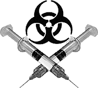
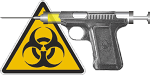

**Szczepionka - bomba czasowa**  
Artykuł Laury Orkan ze strony "[Gwiazdy mówią](http://www.gwiazdy.com.pl/51_99/26.htm)"

**Powszechnie uznaje się szczepionki za dobrodziejstwo nauki, które uchroniło miliony ludzi przed potwornymi chorobami. Jedynie specjaliści wiedzą, że ten cud medycyny to miecz Damoklesa wiszący nad nami przez nawet kilkadziesiąt lat**.

Jednym z najbardziej ryzykownych i zdradzieckich skutków szczepień jest ich potencjalna zdolność do wywoływania innych chorób. Zjawisko to nosi nazwę "choroby prowokowanej" i zostało opisane w wielu fachowych pismach i książkach przez lekarzy i naukowców. Chodzi o to, że zagrożeniem we wszelkiego rodzaju szczepieniach jest uaktywnienie znajdującego się w organizmie utajonego wirusa. Gdy człowiek jest zdrowy, szczepionka mu nie zaszkodzi, jeśli natomiast w organizmie znajduje się wirus jakiejś choroby, szczepionka może dać sygnał do jego rozwoju. Problem w tym, że nie ma sposobu na wcześniejsze ustalenie, czy szczepienie jest bezpieczne dla danego człowieka.

Wielu lekarzy uważa, że z powodu szczepień dzieci chorują na **zapalenia stawów**, **cukrzycę młodzieńczą**, **stwardnienie rozsiane**, **alergie**, **egzemę**, **zespół Reya**, **nowotwory** i wiele innych. Na IV sympozjum poświęconym zwalczaniu kokluszu, które odbyło się w 1979 r. w USA, przedstawiono dowody na to, że szczepionka przeciw **kokluszowi** może prowadzić do zaburzeń metabolizmu insuliny. Lekarze zastanawiali się, czy aby nie jest to wyjaśnienie nagłego wzrostu liczby chorych na cukrzycę młodzieńczą i hypoglikemię, które to schorzenia związane są właśnie z zaburzeniami metabolizmu insuliny. Profesor Leon Grigorski z Wydziału Medycyny w Atenach stwierdził: "Stosując szczepienia, sami stwarzamy choroby i zmierzamy do powszechnej epidemii raka oraz defektów umysłowych spowodowanych zapaleniem mózgu". To przerażająca wypowiedź, ale, niestety, znajduje ona potwierdzenie w wynikach badań i w historii skandali związanych ze szczepionkami.

**Wielkie medyczne skandale**

"Najgorszą ze wszystkich jest szczepionka przeciwko kokluszowi. Jest ona odpowiedzialna za wiele przypadków śmiertelnych i za to, że wiele dzieci cierpi na nieodwracalne uszkodzenia mózgu." - to stwierdzenie padło z ust doktora Archiego Kalokerinosa na zjeździe naukowym w Nowej Południowej Walii w 1987 roku. I żaden ze znajdujących się tam lekarzy nie zaprzeczył. Szczepionka została wprowadzona w Wielkiej Brytanii w 1957 roku i do 1968 roku zaszczepiono ponad 70% wszystkich dzieci. W 1969 roku Laboratorium Służby Zdrowia Publicznego opublikowało raport, w którym podano, że skuteczność szczepionki była znikoma, a ponadto po jej podaniu występowały poważne skutki uboczne. Potem połączono tę szczepionkę z dwiema innymi - przeciw dyfterytowi i tężcowi (ta szczepionka znana była jako Di-Per-Te) i okazało się, że jej skutki uboczne są jeszcze gorsze. Na początku lat 70. prof. W. Ehrengut z Hamburga i dr John Wilson z londyńskiego Szpitala dla Dzieci (Hospital for Children) stwierdzili niezależnie od siebie, że u niektórych dzieci wkrótce po podaniu potrójnej szczepionki zaczynają występować oznaki poważnego uszkodzenia mózgu lub paraliżu.

2 września 1978 roku Centrum Kontroli Chorób w Atlancie poprosiło lekarzy, by nie szczepili dzieci Di-Per-Te, gdyż u wielu z nich wystąpiły groźne skutki uboczne, między innymi wiele przypadków SIDS (Syndromu Nagłej Śmierci Noworodka). Dyrektor CDC w Atlancie dr Alan Hinman stwierdził: "Odkąd w 1978 roku CDC wprowadziło swój system monitorowania, otrzymaliśmy raporty o 44 przypadkach śmiertelnych występujących w ciągu 4 tygodni od zaszczepienia Di-Per-Te. Z tego 32 przypadki to SIDS". W 1979 roku na Uniwersytecie Kalifornijskim w Los Angeles podjęto badania, sponsorowane przez FDA (Urząd ds Leków i Żywności), które wykazały, że rocznie w samych Stanach Zjednoczonych umiera ponad 1000 dzieci w wyniku szczepień Di-Per-Te i że przypadki te są klasyfikowane jako zwykły SIDS. Zauważono jednak, że kiedy szczepiono niemowlęta w wieku 3 miesięcy, najwięcej przypadków śmiertelnych przypadało na okres między 3 a 4 miesiącem życia. Kiedy zaczęto szczepić dwumiesięczne dzieci, szczyt zaczął wypadać między 2 a 3 miesiącem. Najwyraźniej istniał związek między SIDS a szczepieniami. W latach 1974-78 opór przeciwko szczepionce na koklusz był tak silny, że w potrójnej szczepionce zastąpiono ją inną - przeciw **polio**. Skutki uboczne nowej szczepionki były wyraźnie słabsze.

**Paraliż sztucznie wywołany**

Jedną z najgorszych chorób jest polio - paraliż dziecięcy. Kiedy 26 kwietnia 1954 roku Amerykanin dr **Jonas Salk** zaszczepił pierwszą grupę 440 000 dzieci, wydarzenie to stało się świętem. Wynalazcę szczepionki ogłoszono bohaterem narodowym. Rok później, 12 kwietnia 1955 r., Fundacja ds. Paraliżu Dziecięcego ogłosiła, że szczepionka jest bezpieczna, silna i skuteczna. Dwa tygodnie później, 24 kwietnia, kilka dni wcześniej zaszczepione dziecko zachorowało na paraliż dziecięcy. Dwa dni później Departament Zdrowia Stanu Kalifornia podał, że stwierdzono jeszcze 250 zachorowań, z czego 150 dzieci zostało całkowicie sparaliżowanych, a 11 zmarło.

Zdarzyło się coś jeszcze gorszego - gdy zaszczepione dziecko wróciło do domu, zaraziło otrzymanym w szpitalu wirusem paraliżu dziecięcego rodzinę. Dziecko stało się nosicielem wirusa, chociaż samo nie chorowało! Największa w historii stanu Massachusetts epidemia polio wystąpiła po podaniu szczepionki Salka 130 000 dzieci - w porównaniu z 273 przypadkami polio z 1950 roku, w 1955 roku zachorowało 2027 dzieci. Władze stanu natychmiast zakazały jej stosowania.

Szczepionka Salka zawierała martwe wirusy. W 1960 roku zastąpiono ją szczepionką Sabin z żywymi kulturami. Nie była wiele bezpieczniejsza. Dwóch wirusologów, dr B.H.Sweet i dr M.R. Hilleman, odkryło, że obie szczepionki przeciw polio były zakażone wirusem znanym jako SV40, wywołującym nowotwory złośliwe u osesków chomików. Okazało się też, że z tkanek nerkowych małp, na których hoduje się wirusy do szczepionek, wyizolowano ponad 40 małpich wirusów - m.in. wirusa B, który powoduje zapalenie mózgu u ludzi, oraz SV40. Podobno współczesna szczepionka przeciw polio jest już bezpieczna. Ale o tamtych też tak mówiono... Lekarze alarmują, że szczepionki mogą być nie rozpoznaną przyczyną panującej od kilkunastu lat epidemii **białaczki**, a także fali **nowotworów dziecięcych**, **uszkodzeń przy porodzie**, **alergii** i chorób powodujących **obniżenie odporności**. W dodatku skutki uboczne szczepienia mogą się ujawnić nawet po 20 latach. Ostatnio mówi się także, że być może małpi wirus HIV wywołujący AIDS również przedostał się do organizmu człowieka za pośrednictwem "zbawiennych" szczepionek. Ale to tylko domysły.

Ponieważ badania medyczne wykazały, że w przypadku szczepionek przeciw **różyczce**, **odrze**, **ospie**, **gruźlicy**, a nawet **grypie** również pojawiają się groźne skutki uboczne (nie mówiąc już o wywołaniu samej choroby przez wszczepione wirusy), możemy zadać dramatyczne pytanie: szczepić się czy nie szczepić (na cokolwiek)? Cóż, całkowicie zdrowemu człowiekowi (dziecku czy dorosłemu) szczepionka nie zaszkodzi, a może nawet pomóc. Pytanie, skąd będziemy wiedzieli, że nam akurat nie zaszkodzi. Zwłaszcza że bomba może wybuchnąć za rok, pięć, dziesięć lat...

---

I tak "naukowi" mordercy chodzą w glorii bohaterów narodowych, odbierają "zasłużone" tytuły naukowe i pławią się w sławie znakomitych naukowców. Czy nie warto w medycynie wyodrębnić nowej gałęzi - mengelistyki stosowanej?

**Powszechna, darmowa akcja szczepień  
przeciwko rakowi szyjki macicy**  
Artykuł Jacka Lepiarza z "[wp.pl](http://wiadomosci.wp.pl/kat,1356,statp,cG93aWF6YW5l,wid,8790075,wiadomosc.html)"

**Po raz pierwszy w Niemczech ma zostać przeprowadzona finansowana przez kasy chorych powszechna akcja szczepień przeciwko rakowi szyjki macicy - podał niemiecki dziennik "Sueddeutsche Zeitung"**.

Stała Komisja Szczepień zaleciła poddać szczepieniu dziewczynki w wieku od 12 do 17 lat. Aby osiągnąć pełną ochronę przed tą chorobą, konieczne są trzy szczepienia. Ich łączny koszt wynosi 450 euro. Dotychczas kobiety mogły prywatnie zaszczepić się przeciwko rakowi szyjki macicy, a następnie starać się o zwrot kosztów. Na raka szyjki macicy zapada w Niemczech co roku 6500 kobiet. Rocznie około 1200 z nich umiera na tę chorobę. W większości przypadków nowotwór wywołuje wirus brodawczaka, przynoszony najczęściej podczas stosunku płciowego. Z tego powodu lekarze zalecają przeprowadzenie szczepienia przed pierwszym kontaktem seksualnym.

Jak podkreśla gazeta, naukowcom nie udało się opracować szczepionek przeciwko większości nowotworów. Szczepionka przeciwko rakowi szyjki macicy uważana jest jednak za skuteczną. Z danych Instytutu Chorób Zakaźnych im. Roberta Kocha wynika, że 12% ankietowanych dziewczynek i chłopców deklaruje pierwszy kontakt seksualny już w wieku 14 lat. Wśród 17-latków doświadczenia seksualne deklaruje 73% dziewcząt i 66% chłopców. Szczepionki przeciwko rakowi szyjki macicy dopuszczone są w Stanach Zjednoczonych od czerwca 2006 roku. Cztery miesiące później zgodę na ich stosowanie wydano w Europie - pisze "Sueddeutsche Zeitung".

---

Podobną akcję propaguje też "Radio Olsztyn" dla Warmii i Mazur. Na razie są to akcje "zachęcające" lecz nie jest wykluczone, że w niedalekiej przyszłości tego rodzaju szczepienie wpisze się na stałe do procedur medycyny państwowej i nie poddanie się temu "zbawczemu" zabiegowi" będzie miało natychmiastowe sankcje karne. Negatywne skutki szczepienia nie są brane pod uwagę (bo jak zwykle nie wiadomo jakie będą) i odszkodowań za ewentualne szkody na zdrowiu będzie można dochodzić tylko na drodze sądowej. I jak zwykle latami i za ciężkie pieniądze. Zdrowia jednak nie zwróci żaden sąd.
