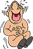
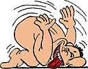

**Osteoporoza - wielki mit XX wieku**  
Artykuł Laury Orkan ze strony "[Gwiazdy mówią](http://www.gwiazdy.com.pl/24_99/26.htm)"

**Od kilkunastu lat osteoporoza robi na świecie zawrotną karierę - a wraz z nią firmy farmaceutyczne produkujące sztuczne hormony - i przemysł nabiałowy. Lobby przemysłowe jest tak potężne, że protesty naukowców, których badania zaprzeczają ogólnie głoszonym poglądom, zostają stłumione w zarodku. Jaka jest więc prawda o tej "chorobie kobiet dojrzałych"?**.

Przede wszystkim musimy ustalić, co to jest osteoporoza. Kampanie reklamowe produktów farmaceutycznych i spożywczych przedstawiają ją jako chorobę kobiet. Alarmują, że coraz więcej pań - i w coraz młodszym wieku - zapada na to schorzenie. Rysują obraz kości podziurawionych jak rzeszoto, które łamią się z byle powodu, doprowadzając biedne kobiety - tylko kobiety - do przedwczesnej śmierci. Przeciwdziałać osteoporozie można za pomocą estrogenów czy specjalnych leków oraz jedząc ogromne ilości produktów zawierających wapń (nabiał!) i preparatów wapniowych. Przerażone taką wizją kobiety faszerują się wapniem, lekami i hormonami, na długo zanim ich organizm wejdzie w fazę menopauzy. Nic w tym dziwnego, skoro lekarze twierdzą, że im wcześniej zaopatrzymy organizm w dodatkową ilość wapnia, tym mniejsze będzie niebezpieczeństwo zapadnięcia na osteoporozę. A tymczasem jest wręcz przeciwnie.

**Tajemnica wdowiego garbu**

Kość jest żywą tkanką. Przez całe nasze życie zużyte komórki zostają wchłaniane przez komórki zwane osteoklastami. W miejsce zużytej tkanki kostnej inne komórki, osteoblasty, produkują nową. U każdego człowieka po 50. roku życia zmniejsza się intensywność odbudowy tkanki kostnej, a tym samym zmniejsza się jej gęstość. Kiedy proces ten jest wyjątkowo gwałtowny, takie schorzenie nazywa się osteopenią. Osteopenia jest jednym z elementów osteoporozy i to ona jest odpowiedzialna za owo rzeszotowienie kości i złamania. W zaawansowanym stadium choroby mogą się zapadać całe kręgi. Jeśli zmiażdżonych zostanie zbyt wiele kręgów, kręgosłup się wykrzywia, prowadząc do tzw. wdowiego garbu.

Dr Bruce Ettinger, endokrynolog i profesor medycyny na Uniwersytecie Kalifornijskim, twierdzi, że kobiety nie powinny przejmować się osteoporozą. Ta postać choroby, która objawia się silnymi bólami i kalectwem, występuje bardzo rzadko. Tylko 5-7% 70-latków dozna zapaści kręgów kręgosłupa, tylko u połowy z nich uszkodzeniu ulegną dwa kręgi i prawdopodobnie u jednej na 5 lub 6 osób z osteoporozą wystąpią jakiekolwiek objawy choroby. Tak więc osteoporoza - czyli zmniejszenie się gęstości tkanki kostnej - jest zjawiskiem zupełnie naturalnym zarówno u kobiet, jak i u mężczyzn, i nie jest niebezpieczna. Badania naukowe przeprowadzone przez dr Susan E. Brown wykazały, że połowa osób, u których stwierdzono osteoporozę, nigdy nie doznała złamań kości. Niebezpieczna jest dopiero zaawansowana postać osteopenii, ale na to schorzenie cierpi niewielka liczba ludzi.

**Natura nie krzywdzi kobiet**

Na początku mówiono, że osteoporoza jest chorobą kości. Potem zaczęto twierdzić, że to choroba wyłącznie kobiet, mimo że mężczyźni o wiele częściej niż kobiety doznają złamań biodra i częściej od nich z tego powodu umierają. Dlaczego jednak "zapomniano" o mężczyznach? Otóż, wbrew wynikom badań naukowych, twierdzi się powszechnie, że przyczyną osteoporozy u kobiet jest brak estrogenów oraz dieta uboga w wapń. Firmy farmaceutyczne prowadzą kampanię mającą na celu przekonanie pań o konieczności długoletniego zażywania preparatów wapniowych oraz estrogenów, mimo że udowodniono ich rakotwórcze działanie. Kampania ta odniosła już wymierny skutek - do roku 1986 w samych tylko Stanach Zjednoczonych wydano na same preparaty wapniowe ponad 160 milionów dolarów.

Drugim lobby zainteresowanym oficjalnie podawanymi przyczynami powstawania osteoporozy jest przemysł spożywczy produkujący nabiał. "Pij co najmniej 3 szklanki mleka dziennie, jedz sery, wypijaj jogurty, a twoje kości będą jak nowe" - głoszą slogany reklamowe. Tymczasem w 1989 roku Narodowy Instytut Zdrowia USA zaczął ostrzegać, że firmy promujące wapń obiecują kobietom więcej korzyści z jego przyjmowania, niż jest on w stanie im dać. Było to bardzo łagodne ostrzeżenie, jako że prawda jest szokująca: Zbyt wiele wapnia może zniszczyć Twoje kości Na pytanie o przyczynę osteoporozy większość ludzi odpowie: brak wapnia, i dalej będzie się faszerować mlekiem, mięsem, serami i preparatami wapniowymi. Objadają się nimi nawet nastolatki obsesyjnie bojące się "cichego złodzieja kości". A przecież badania naukowe już dawno dowiodły, że w społeczeństwach, w których je się mniej nabiału, mniej ludzi zapada na osteoporozę.

Na przykład najliczniejsze afrykańskie plemię Bantu ma najniższy wskaźnik zachorowalności na osteoporozę ze wszystkich ludów na świecie. Ludzie ci jedzą od 175 do 476 miligramów wapnia na dobę. W Japonii średnia spożycia wapnia wynosi 540 miligramów na dobę, a przecież niezwykle rzadko zdarzają się tam u osób w okresie pomenopauzalnym złamania kręgosłupa - co jest tak częstym zjawiskiem na Zachodzie, gdzie kobietom zaleca się przyjmowanie wapnia w ilości 1000-1500 miligramów na dobę. Te dane mówią chyba same za siebie! Gorzej - udowodniono, że zażywanie dużych ilości preparatów wapniowych może spowodować, że kości będą się częściej łamać, gdyż będą zbyt kruche. Jedynie wapń podawany we wczesnym okresie dojrzewania dziecka ma pozytywny wpływ na stan jego kości.

Osteoporoza nie jest wynikiem starzenia się organizmu kobiety w okresie menopauzy. Dotyczy zarówno kobiet, jak i mężczyzn. Jest chorobą cywilizacyjną, wynikiem złego odżywiania, stresów, braku ruchu oraz skutkiem faszerowania się chemikaliami i sztucznymi hormonami. Kobiety żyjące w Malezji, które nie słyszały o estrogenach i tym podobnych dziwach, nawet w 30 lat po menopauzie w ogóle nie cierpią na osteoporozę. Żyją zdrowo i zgodnie z naturą.

**Kawa przyspiesza rozwój osteoporozy**

Zbyt częste picie kawy może przyspieszać rozwój osteoporozy, a na pewno zwiększa niebezpieczeństwo złamania kości. Do takich wniosków doszli szwedzcy naukowcy związani z Oddziałam Ortopedycznym Uniwersyteckiego Szpitala w Upsali oraz ze sztokholmskim Instytutem Karolińskim. Wśród amatorek kawy złamania kości dłoni, przedramienia, szyjki kości udowej, pęknięcia kręgów zdarzają się aż 20 proc. częściej niż u osób rzadziej pijących ten napój - wynika z badań szwedzkich naukowców. Jak poinformował dziennik "Upsala Nya Tidning", naukowcy przeprowadzili wspólne badania m.in. ankietując 32 tys. kobiet w średnim i starszym wieku. Okazało się, że kobiety które piją cztery lub więcej szklanek kawy dziennie, częściej ulegają wypadkom złamania kości niż ich rówieśniczki pijące zaledwie jedną szklankę kawy dziennie.

Naukowcy stwierdzili równocześnie, że podobnej zwiększonej częstotliwości złamań kości nie zaobserwowano wśród kobiet pijących często herbatę. Częstsze przypadki złamań kości naukowcy zaobserwowali także u osób pijących inne napoje zawierające kofeinę. Szwedzcy naukowcy są jednak ostrożni i nie chcą jeszcze formułować na podstawie tych badań zdecydowanych opinii o mechanizmie zjawiska. - Nie jesteśmy niczego jeszcze pewni. Przypuszczalne wytłumaczenie może być np. takie, że kofeina hamuje w jakiś sposób przenikanie do organizmu otrzymywanego w pokarmach wapna - powiedziała uczestnicząca w badaniach dr toksykolog Helena Hallstroem z Upsali. Dodała, że istnieją też dowody, wynikające z wcześniejszych badań, iż kofeina powoduje wypłukiwanie wapna z organizmu. Wyniki badań zostaną opublikowane w specjalistycznym piśmie naukowym "Osteoporosis International".
