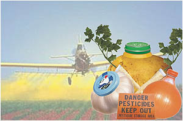
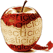

**Przyszedł czas na ludzi**  
Artykuł Waldemara Maszewskiego ze strony "[hotnews.pl](http://hotnews.pl/artnauka-80.html)"

**Coraz częściej firmy produkujące preparaty do ochrony roślin testują ich potencjalną szkodliwość dla organizmów żywych bezpośrednio na ludziach. Odkrycia tego makabrycznego procederu dokonali ostatnio autorzy niemieckiego programu telewizyjnego "Frontal 21", którzy do prekursorów używania ludzi w charakterze królików doświadczalnych zaliczyli koncern "Bayer"**.

Pestycydy, czyli inaczej chemiczne preparaty stosowane do ochrony roślin przed szkodnikami i chwastami, stają się w ostatnich latach bardzo częstą przyczyną poważnych chorób człowieka. Rocznie na europejskie pola rozsypuje się ponad 45000 ton trujących pestycydów. Aby uzyskać zgodę na wprowadzenie do sprzedaży poszczególnych pestycydów, firmy chemiczne są zmuszone przeprowadzać wiele badań naukowych mających wykluczyć te preparaty, których stosowanie mogłoby być groźne dla zdrowia ludzi, lub te, które mogłyby być zbyt uciążliwe dla środowiska. Konkretnie badania te mają m.in. określić, jakie dawki poszczególnych pestycydów teoretycznie mogą zaszkodzić zdrowiu żywych organizmów. W tym celu od wielu lat przeprowadza się testy na żywych organizmach - szczurach, myszach czy królikach. Jednak, jak się ostatnio okazało, na tym doświadczenia laboratoryjne się nie kończą.

Jak poinformowano niedawno w programie niemieckiej telewizji "Frontal 21", istnieją laboratoria, które przeprowadzają badania bezpośrednio na ludziach. Jako przykład podano prywatną klinikę w Edynburgu (Szkocja). Takie badania szkockiej klinice zlecił jeden z największych na świecie producentów pestycydów niemiecki koncern chemiczny "Bayer". Krytykowany za wykorzystywanie ludzi w charakterze królików doświadczalnych koncern "Bayer" w swojej obronie stwierdził lapidarnie, że tego typu badania prowadzi się "niezmiernie rzadko". Według zeznań jednego z uczestników tych badań, ludzie biorący w nich udział nie zdają sobie sprawy z prawdziwego niebezpieczeństwa, na jakie się narażają. Bruce Turnbull zgłosił się, gdy przeczytał ogłoszenie prasowe, że prywatna klinika poszukuje chętnych do przetestowania niektórych specyfików medycznych.

Osoba mająca poddać się testom nie otrzymuje dokładnych informacji, o jakie badania tak naprawdę chodzi. Tym bardziej nie informuje się danej osoby, iż w tym przypadku będzie poddawana działaniu trujących pestycydów. Turnbull, opisując swój przypadek, powiedział, że za około 700 euro za kilka dni prób, musiał połykać tabletki (teoretycznie medykamenty), które w rzeczywistości zawierały pestycydy. Okazało się, że klinika badała wpływ poszczególnych dawek trucizny na ludzki organizm. Relacjonując testy, Turnbull stwierdził, że połykanie tajemniczych tabletek było bardzo rygorystycznie pilnowane, aby czasami "pacjent", czyli w praktyce ludzki królik doświadczalny, nie wypluł jej. - Podczas podawania mi do połknięcia tabletki kilka pielęgniarek stało przy mnie, a lekarz przy moich nogach. Wszyscy dokładnie sprawdzali, czy na pewno połknąłem dany preparat - opowiadał Turnbull.

Niemiecka telewizja ZDF poinformowała, że badania dotyczące wpływu pestycydów na ludzki organizm z bezpośrednim wykorzystywaniem ludzi, przeprowadza się poza granicami Niemiec, ponieważ u naszych zachodnich sąsiadów jest to jak na razie zabronione. Makabryczność tych badań jest tym większa, że zdaniem wielu lekarzy, są one całkowicie niecelowe. Według dr. Wolfganga Lingka z Instytutu Żywienia, z wyników takich badań można wyprowadzić całkowicie błędne wnioski. Świadczyć mogą one nie tyle o granicach ludzkiej odporności na toksyczne substancje zawarte w pestycydach, lecz o podnoszeniu się granicy ludzkiej odporności na dany pestycyd. W konsekwencji może to doprowadzić do znacznego podniesienia progów na obecność w danych produktach dla wielu substancji chemicznych stosowanych dzisiaj w produkcji żywności.

[Medyczny skandal](http://fakty.interia.pl/nauka/news?inf=728216) **15 marca 2006**. Dwóch mężczyzn walczy o życie, czterech innych jest na oddziale intensywnej opieki w jednym z londyńskich szpitali po przyjęciu testowanego na nich leku, opracowanego przez jedną z niemieckich firm. Zdrowym ochotnikom podano w ramach testów klinicznych nowe lekarstwo m.in. przeciwko białaczce. W kilka godzin po przyjęciu leków u wszystkich wystąpiła gwałtowna reakcja i niedoczynność wielu wewnętrznych organów. Były to pierwsze testy lekarstwa na ludziach - ochotnikom za dzień badań płacono około 150 funtów.

[Medyczne eksperymenty na noworodkach](http://www.rmf.fm/fakty/?id=93199) **16 marca 2006**. Medyczny skandal wstrząsnął Turynem. Na jaw wyszło, że dwaj lekarze z miejskiego szpitala przeprowadzali nielegalne badania na noworodkach. Wyniki trafiały w ręce międzynarodowej firmy farmaceutycznej. Jak donosi włoska prasa, na każdym małym pacjencie firma zarabiała 300 tysięcy euro rocznie.

Według najnowszych danych instytutów sanitarno-epidemiologicznych, ilość groźnych dla naszego zdrowia pestycydów w poszczególnych produktach spożywczych jest o wiele wyższa, niż zakładają normy. W ostatnich latach stwierdzono, że pomimo zapewnień producentów o chemicznej czystości produktów żywnościowych wiele z nich znacznie przekracza dozwolone normy na zawartość pestycydów. Wyniki ogólnoniemieckich badań monitoringowych tutejszych artykułów spożywczych pod kątem ich zanieczyszczenia pestycydami są zatrważające. W **ziemniakach** na 794 zbadanych próbek w 264 stwierdzono aktywne pestycydy, w tym takie, których w ogóle w uprawie tego warzywa nie wolno stosować w Unii Europejskiej. Wykryto w nich takie związki, jak Profam lub Chloroprofam, które mają działanie rakotwórcze i wywołują uszkodzenia układu nerwowego.

Po zbadaniu 600 próbek **sałaty** w 257 przypadkach stwierdzono obecność pestycydów, w tym pięciu zabronionych przez prawo unijne. Wykryty w sałacie pestycyd Winklozolina powoduje choroby nowotworowe, uszkadza wątrobę i układ nerwowy, a także powoduje zaćmę i zaburzenia porodu. W kapuście na 472 próby aż w 249 wykryto niedozwolone dawki pestycydów. W nieco mniejszym stopniu zatrute pestycydami są **truskawki** i **jabłka**. Przykłady ponadnormatywnych dawek pestycydów w produktach spożywczych można by mnożyć. Jednak najbardziej zatrważające jest to, że we wszystkich rodzajach **warzyw** i **owoców** laboranci wykrywali również te pestycydy, których stosowanie od wielu lat jest w Europie całkowicie zakazane.

**Warto w tym miejscu przypomnieć, że w roku 1986 z powodu spożycia melonów zatrutych pestycydami w USA zmarło 6 osób, a 1350 uległo ciężkiemu zatruciu. Według niemieckiej publicznej kasy chorych AOK, rocznie w Niemczech dochodzi do ponad 20000 zatruć z powodu skażenia żywności pestycydami**.

**Firma farmaceutyczna testowała lek na dzieciach**  
Onet.pl, 8 maja 2006 r.

Lekarze w Nigerii zarzucają firmie farmaceutycznej Pfizer testowanie na dzieciach w tym kraju leku niedopuszczonego do obrotu - podały nigeryjskie media. Nigeryjscy eksperci stwierdzili, że największa na świecie firma farmaceutyczna pogwałciła prawo międzynarodowe, testując jeden ze swoich leków na chorych dzieciach podczas epidemii zapalenia opon mózgowych w 1996 roku - pisze w niedzielnym wydaniu amerykańska gazeta "The Washington Post". U pięciorga dzieci leczonych eksperymentalnym antybiotykiem i innymi lekami rozwinęły się objawy artretyzmu; nie ma dowodów, że przyczynił się do tego testowany na nich lek. Natomiast sześcioro dzieci leczonych innym lekiem zmarło - napisał "The Washington Post". Nigeryjscy eksperci medyczni stwierdzili, że eksperyment przeprowadzony na dzieciach przez Pfizera był "nielegalnym testowaniem niezarejestrowanego leku" i "oczywistym przypadkiem wykorzystywania niewiedzy".

Media i prawnicy przez pięć lat domagali się ujawnienia poufnego raportu dla nigeryjskiego rządu. "The Washington Post" uzyskał jego kopię ze źródła proszącego o zachowanie anonimowości ze względu na bezpieczeństwo. Szefowie koncernu Pfizer oświadczyli, że byłoby "niewłaściwe, aby firma ustosunkowała się do określonych punktów" raportu. "Jednakże, jak niejednokrotnie stwierdzaliśmy w ciągu minionych lat, Pfizer przeprowadził testowanie za pełną wiedzą nigeryjskiego rządu i w odpowiedzialny sposób, zgodny z nigeryjskim prawem i zaangażowaniem firmy Pfizer w zachowanie bezpieczeństwa pacjenta" - podano w oświadczeniu. Ale według autorów raportu Pfizer nie uzyskał zgody nigeryjskiego rządu na podanie leku niemal setce dzieci i niemowląt. Dzieci zostały zabrane na leczenie zakaźnego zapalenia opon mózgowych do szpitala w Kano - napisała gazeta.

Pfizer twierdzi, że starał się pomagać w zwalczaniu epidemii. Ale komisja nigeryjskich ekspertów uważa, że lekarze z Pfizera zakończyli swoje badania i wyjechali, a "epidemia szalała nadal". Według komisji Pfizer powinien zostać "stosownie ukarany", powinien też "bezwarunkowo przeprosić rząd i naród Nigerii". Firma powinna także zapłacić odszkodowanie; jego kwoty jeszcze nie określono. Dyrektor nigeryjskiej agencji rządowej ds. kontroli leków Dora Akunyili powiedziała, że nie wie, dlaczego raport utajniono. Poinformowała, że jej agencja niezależnie stwierdziła, że "ci ludzie nie mieli prawa przeprowadzać testowania leku".
