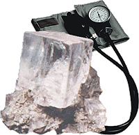

**Wojna o zwykłą sól ?**  
Artykuł Andrzeja Hołdysa ze strony "[Gazeta.pl](http://serwisy.gazeta.pl/nauka/1,34138,3132767.html)"

**Niezwykły proces rusza w przyszłym tygodniu za oceanem. Producenci soli domagają się od naukowców, by udowodnili, że sól rzeczywiście podwyższa ciśnienie krwi i zwiększa ryzyko zawału. Ci jednak odmawiają ujawnienia danych**.

Pozew do sądu przeciwko badaczom złożył Salt Institute - organizacja lobbystyczna reprezentująca interesy firm produkujących sól i handlujących nią. Jej prawnicy twierdzą, że nie ma jednoznacznych dowodów na to, że produkt ten stanowi zagrożenie dla układu krążenia. Dlatego domagają się, aby instytucje odpowiedzialne w USA za zdrowie publiczne, w tym przede wszystkim Narodowe Instytuty Zdrowia oraz nadzorujący je Departament Zdrowia, przestały twierdzić w swoich publikacjach, że obywatele powinni ograniczyć spożycie soli.

**Sól niedobra - nie jedzcie**

Sądowa bitwa, której celem jest rehabilitacja soli jako produktu zdrowego i nieszkodliwego, rozpoczęła się w październiku 2002 roku, kiedy to amerykański Narodowy Instytut Serca, Płuc i Krwi (NHLBI) - jedna z placówek naukowych podległych amerykańskiemu Departamentowi Zdrowia - przedstawił nowe, bardziej restrykcyjne normy spożycia soli. Badacze zalecali zatem obywatelom, aby dziennie zjadali nie więcej niż 6 gramów soli - tyle mniej więcej mieści się na łyżeczce do herbaty. W kolejnych rekomendacjach z 2003 roku twierdzili też, że dobrze byłoby zredukować konsumpcję tego produktu jeszcze o połowę. Te rady pojawiły się w wielu ulotkach i dokumentach, zostały powtórzone w setkach artykułów prasowych i skopiowane w innych krajach.

Na jakiej podstawie lekarze z NHLBI twierdzą tak kategorycznie, że sól w nadmiarze szkodzi sercu? Według nich przemawiają za tym wyniki wielu wcześniejszych badań, przede wszystkim jednak tego ostatniego o nazwie DASH-Sodium Trial. To ono stało się główną kością niezgody między światem nauki a biznesem.

W badaniu przeprowadzonym sześć lat temu wzięło udział 412 osób, którym podawano w diecie trzy różne dzienne dawki soli - 4, 6 i 8 gramów. Dodatkowo wszystkich podzielono na pół i jednym serwowano zwykłą amerykańską dietę, drugim zaś kazano jeść dużo warzyw, owoców i niskotłuszczowego nabiału. Opis badań ukazał się w styczniu 2001 roku w "New England Journal of Medicine" wraz z konkluzją, że łączne działanie dwóch czynników - diety warzywno-owocowo-nabiałowej i dawki soli kuchennej poniżej 6 gramów - doprowadziło w ciągu paru miesięcy do znaczącego obniżenia ciśnienia krwi u badanych. W ślad za tymi wynikami poszły zalecenia dietetyczne dla obywateli i lekarzy, które stały się przedmiotem sporu z Salt Institute.

**A gdzie dowody, że niedobra?**

Producenci soli nie żądają wcale, by naukowcy odwołali swoje badania. Domagają się natomiast pokazania surowych danych, na podstawie których wyciągnięto tak niekorzystne dla soli wnioski. Tych danych uczeni nie chcą z kolei ujawnić. Odpowiadają, że nie ma takiej potrzeby, ponieważ artykuł ukazał się w renomowanym piśmie i został wysoko oceniony przez recenzentów - słowem, badania zostały zweryfikowane w jedyny obowiązujący w nauce sposób i innej weryfikacji już nie potrzeba.

Biznes nie przyjmuje tej argumentacji i stąd cała awantura. Nauka nie jest sztuką dla sztuki, a oceny badaczy mogą mieć dla nas poważne konsekwencje finansowe. Dlatego wszystkie dane powinny ujrzeć światło dzienne, aby każdy mógł ocenić ich wartość - przedstawiają swój punkt widzenia przedsiębiorcy. Kiedy prośby pisane do NHLBI nie pomogły, złożyli pozew do sądu przeciwko Departamentowi Zdrowia, który dał pieniądze na badania. Jeśli wygrają, wtedy wynajęci przez Salt Institute konsultanci, czyli naukowcy z drugiej strony barykady, będą jednymi z pierwszych, którzy zlustrują eksperyment.

Szansa, że ta lustracja się powiedzie, jest spora. W sprawie szkodliwości soli nie ma bowiem zgody i właściwie każde badanie, a wykonano ich do tej pory setki, jest kwestionowane przez oponentów. Każdy znajdzie tu fakty potwierdzające jego ulubioną hipotezę wedle zasady "dla każdego coś miłego".

**Obywatel czeka na radę**

Na początku, czyli 30-40 lat temu, wszystko było jasne: sól szkodzi. Jednak z każdą kolejną pracą ogłoszoną przez naukowców wątpliwości przybywało. Pod koniec lat 80. lekarze w Szkocji po zbadaniu 7300 mężczyzn ogłosili, że owszem, potas, w który bogate są owoce i warzywa, prawdopodobnie obniża ciśnienie krwi, ale odwrotnego działania soli nie zauważyli. Dziesięć lat później powtórzyli badania, otrzymując ten sam wynik.

Także naukowcy z uniwersytetu w Kopenhadze, którzy w 1998 roku dokonali ponownej analizy 114 wcześniejszych badań, doszli do wniosku, że korzyści płynące z ograniczenia spożycia soli są dla ludzi z normalnym ciśnieniem krwi zerowe, a dla tych z nadciśnieniem - znikome. Pogląd ten został wsparty autorytetem takich szacownych organizacji jak Amerykańskie Towarzystwo Nadciśnienia i Chorób Serca czy Amerykańskie Towarzystwo Chorób Serca, podobnie uważają niektóre stowarzyszenia medyczne w Europie.

Z drugiej strony są największe badania w USA prowadzone od ponad 30 lat przez Narodowe Instytuty Zdrowia (w ich skład wchodzi NHLBI) - za każdym razem pokazują, że sól wyraźnie podwyższa ciśnienie krwi. I ten pogląd jest dziś obowiązujący w amerykańskiej polityce zdrowotnej, choć uczeni zdają sobie sprawę z tego, że na wszystkie pytania dotyczące działania soli na ludzki organizm nie znaleźli jeszcze odpowiedzi. - Zwykłych obywateli to jednak nie interesuje. Chcą jednoznacznej rady, a skoro jesteśmy przekonani, że sól szkodzi, mówimy to. Wierzę, że w ten sposób ratujemy życie wielu ludziom - mówi Claude Lenfant, dyrektor NHLBI.

**Koncerny mnożą wątpliwości**

Wielu zgadza się z takim podejściem - mówić, że sól szkodzi, nawet jeśli nie ma co do tego stuprocentowej pewności. Potępia zaś działanie firm, które próbują podkopać autorytet nauki w imię własnego interesu.

Badacze są łatwym celem dla takich ataków, bo przecież zajmują się odkrywaniem tego, co nieznane. Taki jest urok nauki, że rzadko daje ona jednoznaczne odpowiedzi. By być pewnym w stu procentach, że jakaś substancja szkodzi, trzeba by nią nafaszerować tysiące ludzi i czekać, aż się potrują. Tego robić nie wolno, więc nigdy nie uda się usunąć wszystkich wątpliwości - mówi Chris Mooney, autor wydanego niedawno bestselleru "The Republican War of Science" opisującego, jak za prezydentury George'a W. Busha wielkie koncerny zaczęły coraz śmielej atakować naukę, starając się podważyć wyniki niekorzystnych dla nich badań. Zatrudniają w tym celu zastępy własnych badaczy, których głównym zadaniem jest wyszukiwanie słabych punktów w pracach naukowych.

Pozew złożony przez Salt Institute jest modelowym przykładem takiego postępowania - twierdzi Mooney. - Tę drogę przetarły w latach 70. firmy tytoniowe, starając się obalić wyniki badań dowodzących szkodliwości tytoniu. Jak to ujął ponad 30 lat temu jeden z szefów koncernu tytoniowego Brown & Williamson: "Nasza robota polega na produkowaniu wątpliwości". W ich ślady poszedł przemysł chemiczny, farmaceutyczny, spożywczy, naftowy i wiele innych.

**Wszystkie badania są nasze**

Ta broń nazywa się Data Quality Act. Jest to przyjęty przez Kongres w 2001 roku przepis zobowiązujący wszystkich autorów badań, które są finansowane z funduszy publicznych, do skrupulatnego archiwizowania danych. A jeśli te badania posłużyły do tworzenia polityki państwa, na przykład ustalenia norm zanieczyszczeń środowiska, każdy obywatel może się domagać wglądu do nich.

Zapytacie, cóż złego w tym, że uczeni wydający pieniądze podatników muszą się przed nimi tłumaczyć z każdego centa? Właściwie nic, pewnie w niejednym kraju przydałby się taki akt. Rzecz w tym, że w Stanach korzystają z niego głównie duże koncerny, najczęściej po to, by zakwestionować rzetelność badań. Mając w ręku ekspertyzy z długą listą wątpliwości, można się następnie domagać od urzędników i polityków - to już rola lobbystów i prawników - wstrzymania prac legislacyjnych nad niebezpiecznymi z punktu widzenia jakiegoś lobby regulacjami prawnymi. W ten właśnie sposób koncerny paliwowe zdyskredytowały federalny raport National Assessment on Climat Change wskazujący, że spalanie ropy i gazu może być jedną z przyczyn globalnego ocieplenia. Firmy spożywcze podważyły zalecenie Światowej Organizacji Zdrowia, aby ograniczyć konsumpcję cukru, odsyłając do kosza raport dowodzący jego złego wpływu na zdrowie. - Zapewne do tego samego celu zostaną wykorzystane nasze badania - obawia się Lawrence Appel, jeden z autorów DASH-Sodium Trial.

Za wieloma takimi inicjatywami stoi lobbysta Jim Tozzi, który ostatnio wziął na muszkę raport wyliczający substancje rakotwórcze produkowane przez amerykański przemysł. Lobbysta zamierza dowieść, że raport jest wadliwy metodologicznie, a więc mało wart. Tozzi ma na pieńku z wieloma naukowcami między innymi dlatego, że to on w dużej mierze przyczynił się do powstania Data Quality Act (jak ustalili ostatnio naukowcy z Uniwersytetu Kalifornijskiego, działał na zlecenie koncernu Philip Morris). - Jeśli są wprowadzane przepisy, z powodu których firmy tracą miliardy dolarów, musimy mieć pewność, że oparto je na wynikach rzetelnie prowadzonych badań. To element społecznej kontroli nad wydatkami publicznymi. Uczeni powinni więc liczyć się z tym, że będą oceniani nie tylko przez swoich kolegów z uczelni - argumentuje lobbysta.

---

Jam nie z soli, ani z roli, ale z różnych alkoholi - zwykł mawiać Polak. Ale... czy sól szkodzi? O ciśnieniu naszej krwi, a także o równowadze kwasowo-zasadowej w organizmie decyduje stosunek zawartości sodu do potasu i jak powszechnie wiadomo sodu musi być wielokrotnie mniej. Wielu lekarzy, w tym wszyscy naturaliści, jest zdania że nadmiar sodu jest szkodliwy, soląc zaś potrawy dokładamy sobie sodu, który już jest zawarty w pokarmie w odpowiedniej proporcji i na dodatek z substancjami osłonowymi ułatwiającymi wchłanianie go przez organizm. Czysta rafinowana sól, to związek tylko dwóch, czystych pierwiastków - sodu i chloru, które by przyswoić nasz organizm musi uruchomić dodatkowe enzymy, biopierwiastki i witaminy czyli w sumie niekorzystnie naruszyć nasz wewnętrzny bilans energetyczny. W zdrowym odżywianiu, jak zawsze bezwzględnie, działa zasada umiaru.

O co więc w tym wszystkim chodzi? Jak zwykle o pieniądze i to duże pieniądze. Człowiek i jego zdrowie nie ma tu jakiegokolwiek znaczenia. Nasze "zdrowie" zawsze będzie w rękach tych, którzy wydali więcej pieniędzy na lobby i reklamę, a naukowcy (też ludzie) są istotami wielce podatnymi na działanie pieniędzy.
