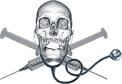

**Sitwa świętych krów**  
Artykuł Anny Binkowskiej ze strony "[Onet,pl](http://wiadomosci.onet.pl/1311617,2677,kioskart.html)"

**"Primum non nocere"** (ale tylko lekarzom)

**Najpierw w mediach wybucha bomba: "Chusta w brzuchu!", "Śmierć u dentysty!", "Zgon po pobraniu krwi!". Potem zapada cisza.**

Jak to się dzieje, że nawet w tak głośnych sprawach nie zapadł jeszcze żaden wyrok, mimo że minęły lata. Ten kuriozalny proces trwa od ośmiu lat! Już za dwa lata z mocy prawa nie będzie można ukarać winnych, bo sprawa ulegnie przedawnieniu. A serweta chirurgiczna pozostawiona po cesarskim cięciu w brzuchu Małgorzaty Król wciąż nie pozwala kobiecie spokojnie spać. Sąd pierwszej instancji nie dopatrzył się w postępowaniu lekarzy cech przestępstwa...

Dopiero po trzech latach śledztwa sprawa tragicznie zmarłej Kasi Szejnwald z Wrocławia trafiła na wokandę. Piętnastolatka zmarła na fotelu dentystycznym. Śliczną, zdrową dziewczynkę uśpił na śmierć lekarz anestezjolog, Michał O. Nie dość, że przedawkował środek znieczulający i korzystał ze sprzętu, który nie miał atestu, to użył przeterminowanych leków. Rodzice Kasi zgromadzili kilkaset stron dokumentacji. Prokuratura, ślimacząc śledztwo, zatarła ślady...

Od czterech lat wyjaśniane są okoliczności śmierci 41-letniego Dariusza Rafalskiego, który umierał, otoczony fachowym personelem medycznym w warszawskim szpitalu przy ul. Banacha. Lekarze zignorowali wykonanie pilnego, natychmiastowego badania pękniętej czaszki. Sąd pierwszej instancji za nic miał ustalenia prokuratury i umorzył sprawę, posiłkując się niewiarygodną opinią biegłych. Prokurator był wyjątkowo dociekliwy. Nie dał za wygraną...

**Szmata w brzuchu**

W połowie stycznia odbyła się kolejna rozprawa odwoławcza, w której pokrzywdzoną jest Małgorzata Król, a oskarżonymi lekarz i położna. Czy tym razem można liczyć na ukaranie winnych i zamknięcie tego kuriozalnego procesu, ciągnącego się od ośmiu lat? Była wina, nie ma kary. Żadne pieniądze nie są w stanie zrekompensować mi utraty zdrowia. Nie chcę, żeby lekarz trafił do więzienia, ale oczekuję, że sąd orzeknie choć na krótko zawieszenie go w wykonywaniu zawodu. Przez te lata nie wykazał ani odrobiny skruchy, wręcz przeciwnie, twierdzi, że to była moja wina, że podszywam się za osobę pokrzywdzoną, która chce na tym procesie zarobić! - mówi roztrzęsiona kobieta.

W ubiegłym roku skierowano ją na kolejną operację. Otworzyła się blizna sprzed lat, kiedy to usuwano z jej brzucha chustę chirurgiczną. Powstał stan zapalny, sączy się krwista wydzielina. - Już nie poddam się operacji, boję się - mówi pani Małgorzata. - Mój ośmioletni synek ma w przyszłym roku komunię. Chcę jeszcze pożyć, a nie jestem zdrowa. Pan Bóg i dobrzy ludzie dają mi siłę, mam dobrego obrońcę z urzędu, który mnie wspiera i uspokaja. Sprawa Małgorzaty Król ciągnie się od 1998 roku, kiedy przyszło na świat jej trzecie dziecko. Kobieta miała cesarkę przeprowadzoną w szpitalu w Wołominie. Lekarz Igor P. i położna Barbara W. podczas zabiegu pozostawili w ciele pacjentki serwetę chirurgiczną. Z tego powodu, parę miesięcy później kobieta musiała przejść kolejną operację. Usuwając szmatę, pozbawiono ją kawałka jelita cienkiego.

Chusta, która jest jednym z istotnych wątków tego długotrwałego śledztwa, budzi najwięcej kontrowersji, jako że **znikła natychmiast po operacji** i nie może być tym samym dowodem w sprawie. Ponieważ pani Małgorzata wcześniej już rodziła dzieci poprzez cesarskie cięcie, próbowano sugerować, że chusta zaległa w jej brzuchu już wcześniej. Na szczęście jeden z chirurgów, który ją usuwał, zeznał, że "była to serweta zbita, bardzo twarda". Wątpliwości rozstrzygnęli biegli sądowi - "jeśli tego typu chusty przebywają w jamie brzucha długo, to są przegniłe i rozpadają się" - stwierdził. Lekarz i położna stanęli przed sądem pod zarzutem nieumyślnego narażenia pacjentki na bezpośrednie niebezpieczeństwo ciężkiego uszczerbku na zdrowiu.

W 2002 roku pokrzywdzona "doczekała się" wreszcie rozstrzygnięcia sprawy... Sąd Rejonowy w Wołominie warunkowo umorzył postępowanie karne przeciwko oskarżonym. Mieli natomiast przekazać po 500 zł zadośćuczynienia na Centrum Zdrowia Dziecka. Sąd pierwszej instancji uznał, że "**wina i społeczna szkodliwość czynu nie są znaczne**". Prokuratura Rejonowa w Wołominie zaskarżyła wyrok, zarzucając sądowi, iż nie wziął pod uwagę wszystkich dowodów w sprawie. Apelację uwzględniono. Sąd okręgowy zaznaczył jednak, że "w pierwszym rzędzie należy rozważyć zasadność apelacji wniesionej przez obrońców oskarżonych". W ubiegłym roku sprawa Małgorzaty Król została przekazana do ponownego, trzeciego już, rozpoznania sądowi pierwszej instancji. - Zrujnowano mi psychikę. Powinnam poddać się terapii, ale nie mam na to ani siły, ani czasu, ani pieniędzy. Wciąż przeglądam akta sprawy. Już wiem, że to nie koniec, bo nie będą przesłuchani wszyscy trzej biegli sądowi. Jak długo jeszcze potrwa ten koszmar? Po 10 latach sprawa się przedawni i nikt nie zostanie ukarany - mówi pani Małgorzata.

**Operacja się udała, pacjent zmarł**

41-letni Dariusz Rafalski trafił do szpitala na "kosmetyczną" operację strun głosowych. Tuż przed zabiegiem, podczas pobierania krwi, zasłabł, osuwając się z krzesła na twardą posadzkę. Zmarł wskutek uszkodzenia czaszki, bo nikt w porę nie udzielił mu pomocy. Prokurator zarzucił lekarzowi narażenie na utratę życia i zdrowia pacjenta poprzez zaniedbanie przeprowadzenia badania tomografem komputerowym. Sąd Rejonowy dla Miasta Stołecznego Warszawy VIII Wydział Karny umorzył postępowanie. Uznał, że lekarz Adam Ch., który jako pierwszy badał pacjenta i przekazał go w ręce koleżanki po fachu, jest niewinny. Sprawa ponownie nabrała biegu, ale tylko za sprawą dociekliwego prokuratora, który w śledztwie nie przeoczył żadnego detalu. Zbigniew Gosk postawił pani doktor (zdążyła w tym czasie awansować na ordynatora oddziału) zarzut nieumyślnego narażenia na utratę życia lub zdrowia. To, co ustalił, przypomina precyzyjny, logiczny scenariusz z argumentami, których w żaden sposób obalić się nie da...

Operacja strun głosowych była wcześniej zaplanowana i skonsultowana. Tego typu zabiegi lekarze nazywają "kosmetycznymi". Rutynowe badanie krzepliwości krwi przeprowadza się przed każdą operacją. Na wypadek ewentualnego krwotoku czy transfuzji. Pielęgniarka pobrała krew z płatka ucha pacjenta i odwróciła się do stolika z narzędziami. W tym momencie Dariusz Rafalski osunął się z krzesła. Nie był to specjalistyczny fotel, chroniący pacjenta przed wypadnięciem, lecz zwykłe krzesło. Mężczyzna stracił przytomność, upadłszy na twardą posadzkę, niczym worek ziemniaków. Z ucha sączyła się krew. Z akt śledztwa wynika, że krwawił z tej części głowy, którą nie uderzył. Nie jestem lekarzem, ale pamiętam z kursu prawa jazdy zajęcia pomocy dla kierowców. To jest symptom zaistnienia wstrząśnienia mózgu - mówi prokurator Zbigniew Gosk.

**Czas na wagę życia**

Była 7.45, kiedy pacjentem zajął się lekarz. Dr Adam Ch. był po całonocnym dyżurze, lada moment miał opuścić szpital. Oczyścił ucho z krwi, założył wenflon i opatrunek, po czym odesłał pacjenta do sali, na łóżko. - W historii choroby znalazł się zapis, że zlecił też wykonanie rentgena czaszki, by sprawdzić, czy nie doszło do pęknięcia - relacjonuje prokurator. Na tym rola lekarza się zakończyła, bo i jego dyżur dobiegł końca. Teraz do akcji wkroczyła pełniąca obowiązki ordynatora oddziału otolaryngologii dr Jagna N. O godzinie 8.00 rano przeprowadza się tzw. obchód. Musiała więc zetknąć się z Rafalskim. Już o 8.05 pani doktor stwierdziła stan bezpośredniego zagrożenia życia i zdrowia, podejrzewając pęknięcie czaszki. Na cito (natychmiast!) zleciła wykonanie badania tomografem komputerowym. Tłumaczyła później (w charakterze podejrzanej; wcześniej świadka), że robiła, co mogła, dzwoniła do gabinetu, gdzie znajduje się tomograf komputerowy, ale telefon był zajęty lub nie odpowiadał. Materiał dowodowy przeczy jej argumentom. W tym dniu można było w każdej chwili dowieźć pacjenta na badanie. Jednak mijały minuty, a Dariusz Rafalski leżał spokojnie na łóżku, nieświadomy zagrożenia. Gabinet z tomografem komputerowym znajduje się w odległości zaledwie 200 metrów od sali, na której konał, nie trzeba było wzywać karetki, wystarczyło wwieźć chorego do windy.

Była 9.15, gdy stan pacjenta gwałtownie się pogorszył, chory wykazywał objawy zapaści. Wezwany neurochirurg podejrzewał pęknięcie czaszki, wiedział, że za chwilę mężczyzna może umrzeć. Osobiście zawiózł go na badanie tomografem. O 9.40 zaczęła się operacja pękniętej głowy. Dariusz Rafalski umierał. Doszło do poważnych uszkodzeń, pojawił się krwiak mózgu. O popełnieniu przestępstwa powiadomił Prokuraturę Rejonową Warszawa Ochota brat zmarłego. W wyniku długotrwałego śledztwa prokurator najpierw postawił zarzut lekarzowi Adamowi Ch. z art. 160 kk. - Opinię biegłych z Krakowa sąd przyjął na wiarę, nie zdroworozsądkowo. Skierował sprawę na posiedzenie i wydał postanowienie o umorzeniu postępowania - komentuje prokurator, który nie zgodził się na takie zakończenie i wniósł zażalenie do sądu okręgowego. Wkrótce sprawę ponownie rozpatrzy sąd pierwszej instancji.

**Przypadek incydentalny**

Stanisław Szejnwald, ojciec 15-letniej Kasi, która zmarła na fotelu dentystycznym, nie kryje oburzenia z powodu ignorancji wymiaru sprawiedliwości i środowiska medycznego. Ma dowody na to, że prokuratura pokryła koszt naprawy sprzętu, użytego przez lekarza do uśpienia na zawsze jego córki. Potem przez pewien czas ten sam lekarz posługiwał się tym samym aparatem... Zarówno anestezjolog, jak i stomatolog - była już właścicielka gabinetu - nie zostali w żaden sposób ukarani przez sąd lekarski. - W Naczelnej Izbie Lekarskiej dowiedziałem się, że zawieszenie lekarzy w wykonywaniu zawodu leży w gestii prokuratora, ale najpierw musi zapaść wyrok w sądzie powszechnym. Prokurator odpowiedział mi, że nie widzi powodu do zawieszenia, gdyż był to **przypadek incydentalny**! To ilu pacjentów powinien uśmiercić lekarz, żeby nie było incydentalnie? - pyta zrozpaczony Stanisław Szejwald.

Dramat rozegrał się w październiku 2002 roku. Kasię rozbolał ząb, a panicznie bała się dentysty. Rodzice dowiedzieli się, że można wyleczyć ząb pod narkozą. Zapewniali, że nie będzie nic czuła. Do gabinetu trafili z ogłoszenia zamieszczonego w "Panoramie Firm" - "Centrum leczenia stomatologicznego w narkozie, NEO DENT Wrocław". Tuż przed zabiegiem lekarz wykonał niezbędne badania i stwierdził, że są dobre. Zapewniał, że to rutynowy zabieg i dziewczynce nic nie grozi. Tata Kasi pojechał do banku po pieniądze (zabieg miał kosztować 1800 zł), a mama czekała przed gabinetem. W pewnej chwili, przez półprzezroczystą ścianę zauważyła, że córka leży na podłodze, a lekarz robi jej masaż serca. Próbowała wejść do środka, ale nie pozwolono. Przyjechała karetka reanimacyjna. Próbowaliśmy dowiedzieć się, co się stało, ale lekarz tłumaczył, że być może córka miała ukrytą wadę serca i doszło do niewydolności oddechowo-krążeniowej. Dentystka w ogóle nie pomagała w reanimacji, tylko wybiegła z gabinetu - płacze mama Kasi.

W zakładzie medycyny sądowej państwo Szejnwald dowiedzieli się, że na **wyniki sekcji zwłok będą czekać dwa-trzy miesiące**. Prokuratorowi nie było spieszno do zakończenia sprawy, wręcz przeciwnie. Podjęli śledztwo na własną rękę. Lista wykrytych przez nich nieprawidłowości jest długa. Dlaczego prokurator nie wystąpił po opinię do Sanepidu, dlaczego wstrzymał badania toksykologiczne przez dziewięć miesięcy, dlaczego na wyniki sekcji zwłok trzeba było czekać aż cztery miesiące itd. Niestety, ich dociekliwe pytania pozostawały bez odpowiedzi... Zdesperowani napisali nawet do programu "Zawsze po 21.00". "Panie Redaktorze! - skierowali się do red. Włodzimierza Frąckiewicza. - Po roku wiemy, że śledztwo nie ma wyjaśnić przyczyny zgonu naszej ukochanej córki, tylko chronić lekarzy przed odpowiedzialnością karną. Nie można wszystkiego wytłumaczyć niewiedzą czy nieudolnością prokuratora, gdyż wszystkie te potknięcia wytykamy we wnioskach i zażaleniach, które są konsekwentnie odrzucane. Nasuwa nam się tylko jedno zakończenie: sitwa działa".

**Co autor chciał powiedzieć**

Gabinet, w którym zmarła Kasia, nie był przystosowany do wykonywania zabiegów w znieczuleniu ogólnym. Nie posiadał odpowiedniego sprzętu ani leków. Anestezjolog nie miał uprawnień do wykonania zabiegu, podał dziecku dawki w proporcjach niedostosowanych do masy ciała. Jednak wcześniej konsultantka wojewódzka w dziedzinie anestezjologii i intensywnej terapii dla woj. dolnośląskiego, dr hab. n. med. Grażyna Durek orzekła: "lekarz posiadający pierwszy stopień specjalizacji powinien nadal kontynuować szkolenie zawodowe, dlatego według mnie wskazane byłoby, aby jego praca była nadzorowana przez specjalistę anestezjologa. Jednak aktualnie obowiązujące podstawy prawne dopuszczają możliwość otwarcia praktyki anestezjologicznej przez lekarza posiadającego pierwszy stopień specjalizacji". Michał O. nie został zawieszony w wykonywaniu obowiązków lekarskich, podobnie jak Anna K. K., która nie powinna dopuścić do wykonania zabiegu w swoim gabinecie. Była właścicielka gabinetu, stomatolog, stanęła pod zarzutem art. 163 par. 2 i 3 kk. (pozostawienie w niebezpieczeństwie).

Oto cytat pochodzący z aktu oskarżenia autorstwa prokuratora Jarosława Boby - "Odnosząc się do działania medycznego i diagnostycznego Anny K. K., zespół biegłych z Zakładu Medycyny Sądowej w Poznaniu stwierdza **brak jest podstaw do stwierdzenia, aby lekarz stomatolog Anna K. K. popełniła błąd w sztuce medycznej, a tym samym nie mogła przyczynić się do nastąpienia śmierci małoletniej Katarzyny Sz.**". Co chciał przez to powiedzieć autor tego bełkotu? Dlaczego nadzorujący śledztwo doprowadził do zniszczenia wycinków, pobranych do badań histopatologicznych? Źle przechowywane uległy rozłożeniu. Dlaczego nie ma odpowiedzi na pytanie, jak dużą dawkę śmiertelnych środków znieczulających dostała Kasia? Pewnym jest, że do jej śmierci przyczyniły się błędy diagnostyczne i lecznicze. Czy winni poniosą karę? Lekarze nie przyznali się do winy i odmówili składania wyjaśnień. - Kasia nam zaufała, bo mówiliśmy jej, że nie ma się czego bać. Jesteśmy jej winni wyjaśnienie, dlaczego nie żyje - rozpacza matka. Rozprawa zapowiedziana na koniec stycznia nie odbyła się, bo obrońca oskarżonego przyniósł zwolnienie lekarskie swego klienta. Sprawę znów odroczono. Tym razem do połowy marca.

**Rekordowe odszkodowanie** ([Fakty.Interia.pl](http://fakty.interia.pl/zdrowie/news?inf=718399))

Zdeformowana twarz, uszkodzenie mózgu, a nawet strata węchu - to wynik operacji, jaką 19-letnia krakowianka przeszła w Szpitalu Uniwersyteckim. Lekarze twierdzą, że zwiódł ich obraz choroby. \[...\] W ocenie ekspertów dziewczyna utraciła węch, ma zaburzenia emocjonalne, zdeformowaną twarz, przeszła zapalenie opon mózgowych, miała wodogłowie, zraniony płat czołowy i uszkodzoną tętnicę mózgu. \[...\] W trakcie operacji okazało się, że zmiany to nie guz, ale przepuklina oponowo-rdzeniowa. Właśnie na taką możliwość wskazywał jeden z lekarzy, który konsultował przypadek, czyli doc. Andrzej Urbanik - kierownik zakładu radiologii. - Dałem im takie rozpoznanie na piśmie - mówi Urbanik. Za guzem opowiedzieli się Marek Moskała - kierownik Kliniki Neurotraumatologii i prof. Jacek Składzień - kierownik Katedry i Kliniki Otolaryngologii.

Operował jednak doc. Maciej Modrzejewski, zastępca prof. Składzienia. Doc. Modrzejewskiego nie przesłuchano w sądzie, bo nikt o to nie wnioskował. Nam powiedział: - W pewnym momencie zorientowałem się, że to jest rzeczywiście przepuklina, jak sugerował doc. Urbanik, ale wtedy było już za późno, już wiedziałem, że popełniłem błąd. Że skubnąłem nożem uszkadzając oponę - opowiada Modrzejewski. \[...\] Dramat Karoliny trwa nadal. Mimo starań terapeutów nie odzyskała pełnej sprawności. Wycofała się z życia towarzyskiego, straciła rok nauki. Dlatego chce od szpitala renty, której jej na razie nie zasądzono, a nie tylko samego odszkodowania. To ostatnie - jak dowiedzieliśmy się, płacić będzie szpital z ubezpieczenia. Żaden z lekarzy nie zapłaci za błąd z własnej kieszeni.

---

Takie leczenie jakie i rządy Rzeczypospolitej. Nikt inny, tylko polski "Mengele" w randze ministra, w rządzie neobolszewickiej partii księcia Leszka Czerwonego, rozpieprzył powoli dochodzącą do siebie polską Służbę Zdrowia, tworząc dziwny twór nazywany już przez wszystkich Narodowym Funduszem Zgonów. Doświadczeni i znający zawód lekarze, nie widząć dla siebie miejsca w tym bagnie, woleli zrezygnować z zawodu lub szukać pracy za granicą. Pielęgniarki zdegradowano do roli dziewki pańszczyźnianej i niewolnicy. Na szpitale, jak na łatwą padlinę rzuciły się prawnicze sępy - komornicy. Kto więc pozostał? Wydaje się, że spora część niedołęg i niedouczonych konowałów, niezdolnych do jakiejkolwiek fachowej pomocy. Ostatnio w zawrotnym tempie mnożą się lekarze-alkoholicy, lekarze-mordercy i lekarze-łapówkarze każący sobie płacić dosłownie za wszystko. Czy tak miało być? Kto za to odpowiada? Oczywiście ludzie stojący za plecami "nietykalnych". Rząd, sejm, senat, izby lekarskie, biegli lekarze, prokuratorzy, sędziowie, obrońcy, a więc ponoć kwiat polskiej inteligencji.

Znikoma szkodliwość czynu, opieszałość prokuratorów i niszczenie dowodów, dziwne wyroki za medyczne morderstwa, to codzienność polskiej sprawiedliwości. Kto nas leczy? Przypadkowi ludzie bez sumienia i poczucia odpowiedzialności, których "błędy" ukrywają im podobni i którzy hasło "primum non nocere" uważają za odnoszące się wyłącznie do nich. W Izbach Lekarskich siedzi medyczna gerontokracja zadowolona z ciepłej posady, która nie widzi powodów do wprowadzania jakichkolwiek zmian. Biegli (też ponoć lekarze) nie widzą nic zdrożnego w uśmiercaniu ludzi przez kolesiów-lekarzy. Tandem konował-kauzyperda ma się doskonale i przynosi zyski sobie nawzajem. Czy nie czas w Polsce wrócić do starożytnego kodeksu Hammurabiego - "**Jeżeli lekarz zrobi człowiekowi głębokie cięcie nożem z brązu i spowoduje śmierć onego człowieka lub usuwając człowiekowi nożem z brązu bielmo uszkodzi mu oko - winno mu się uciąć ręce**"? Nie... To nie do pomyślenia w polskiej "demokracji", w której lekarz może bezkarnie zabić, a mordercy i bandyci żyją w "pierdlu" lepiej niż większość polskich rodzin.
