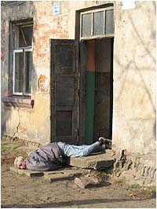

**Kokosy na bogatych pijakach**  
Artykuł Grzegorza Rzeczkowskiego i Mileny Rachid Chehab (Przekrój)

Błyskawiczne detoksy to jedna z najprężniej rozwijających się gałęzi usług medycznych w Polsce. Teraz, po świąteczno-noworocznym przepiciu narodu, odwykowy biznes szykuje się do żniw. Im ogłoszenie wyżej, tym większa szansa, że ktoś je dostrzeże. W gazetach codziennych te lakoniczne anonsy poprzedzane są więc długim rządkiem liter "a". W treści te same słowa: alkohol, odtrucia, esperal, detoks. Z rzadka ktoś z odrobiną inwencji dopisze: "przerywanie ciągów". Do tego numer czynnego całą dobę telefonu. I wystarczy. Zainteresowani wiedzą, o co chodzi.

**Kroplówka na gwoździu**

Pod numery telefonów z ogłoszeń ludzie dzwonią najczęściej w środku nocy. Alkohol do tego czasu już trochę wyparował. Przepity zdaje sobie więc sprawę, że za kilka godzin stanie przed obliczem szefa, klienta lub petenta. Na gwałt szuka detoksykacji, czyli odtrucia organizmu przez usunięcie z niego alkoholu. Wersja podstawowa: glukoza, sole mineralne i witaminy wypłuczą alkohol z krwi i zneutralizują. Wiele razy o trzeciej nad ranem słyszałem w słuchawce: proszę przyjeżdżać, bo ja muszę na ósmą iść do pracy - wspomina lekarz, który jeździł na szybkie detoksy.

Pięć godzin na szybki detoks to nie problem, ale bywa, że czasu jest mniej. Pielęgniarz z oddziału detoksykacyjnego szpitala w podwarszawskich Tworkach pamięta wysokiego rangą urzędnika państwowego, który miał towarzyszyć szefowi w podróży zagranicznej. Do startu samolotu zostały trzy godziny, a urzędnik był kompletnie pijany. W takiej sytuacji podaje się insulinę, która błyskawicznie spala alkohol - tłumaczy pielęgniarz. Do tego robi się "niagarę", czyli odkręca kroplówki na ful, by szybko wypłukać go z organizmu. To bardzo niebezpieczne, bo insulina może rozwalić trzustkę, a skaczące ciśnienie doprowadzić do udaru mózgu - mówi pielęgniarz, który takie metody nazywa "jazdami po bandzie". Znam zespół, który tym sposobem w sztok pijanego gościa postawił na nogi w godzinę. I żeby nie tracił czasu na wizyty w ubikacji, założyli mu nawet cewnik - wspomina.

Nie tylko pęcherz przechodzi wtedy ostry drenaż, ale również kieszeń pacjenta. Taka usługa może kosztować prawie dwa tysiące złotych. Cena jednak nie gra roli. Jak ktoś ma wiele do stracenia, zrobi wszystko, by się szybko zreanimować - tłumaczy pielęgniarz. Dzwoniąc pod numery telefonów z ogłoszeń, dowiemy się, że szybki detoks - czyli jednorazowa wizyta dorabiającego sobie lekarza lub pielęgniarki, wyposażonych w podstawowe medykamenty - kosztuje 150, 350, 500, a nawet 700 złotych. Zależy od dnia tygodnia i pory. Najdrożej jest nocą i w święta, wtedy najniższe stawki skaczą do 400 złotych. Cena rośnie też, gdy pacjent decyduje się na wszycie w pośladek esperalu. Lek ten nazywany jest "straszakiem", bo przy powrocie do picia potęguje objawy zatrucia alkoholowego.

Biznes jest nie tylko dochodowy, lecz także łatwy do rozkręcenia. Nie trzeba rejestrować prywatnej praktyki, tylko zaopatrzyć się w leki i dać ogłoszenie. Nie jest konieczny nawet stojak na kroplówkę, którą można zawiesić na gwoździu wbitym w ścianę. Dlatego w detoks wchodzą lekarze wszystkich specjalności. Prywatne przychodnie, które prowadzą szybki detoks na dużą skalę, mają w bazach danych nawet po 200 lekarzy gotowych w każdej chwili do wyjazdu. Ale żaden się z tym nie obnosi. Jeżdżenie po nocach do śmierdzących wódką "betonów" lub "worów" - jak nazywa się pijanych - to nie powód do satysfakcji. A poza tym to nieetyczne, bo siedząc przy pacjencie w domu, nie pomogę mu tak, jak pomógłbym w szpitalu - mówi lekarz z Mazowsza.

**Kop dla VIP-a**

Najbardziej opłacalnymi pacjentami są gwiazdy: aktorzy, dziennikarze, politycy, muzycy. Z braku czasu na długie leczenie, a także z obawy przed upublicznieniem wstydliwej choroby chętnie korzystają z domowego odtruwania. Ze strachu przed dekonspiracją nie korzystają jednak z ogłoszeń. Zbyt duże ryzyko - tłumaczy Paweł Kukiz, lider zespołu Piersi, który kilka lat temu walczył z nałogiem i korzystał z takich usług. Jeżeli już ktoś się decyduje na odtrucie, to szuka odpowiedniej osoby prywatnymi kanałami. Stale zaglądające do kieliszka Bardzo Ważne Osoby od lat mają swych zaufanych i dyspozycyjnych lekarzy. Ci lekarze to też ludzie na stanowiskach, z dobrą opinią w środowisku medycznym. Osoby znane przekazują sobie takie nazwiska. Do mnie żaden VIP nie zadzwoni - martwi się jeden z lekarzy, który robi w detoksach.

Detoks w wersji VIP to proteza leczenia z nałogu, a nie zatarcie śladów jednorazowego alkoholowego wyskoku. Dlatego obowiązuje ceremoniał. Najpierw lekarz bada pacjenta i wystawia zlecenie. Po nim zjawia się pielęgniarka, która zajmuje się resztą. Aplikuje "śpiocha", czyli koktajl z leków usypiających i przeciwbólowych. Podłącza kroplówkę, która podnosi poziom cukru we krwi, dzięki czemu pacjentowi poprawia się samopoczucie - wylicza Janusz Zimak, terapeuta specjalizujący się w leczeniu uzależnień. Potem pacjent dostaje sole mineralne i witaminę B, która likwiduje trzęsionkę. - Śpi z przerwami dwa, trzy dni, a podawane wówczas środki moczopędne albo stosowne ziółka sprawiają, że toksyny są szybciej wydalane z organizmu. Po takim "kopie do życia" może znowu iść do pracy - mówi Zimak. W Warszawie "kop" kosztuje od 1,5 do 1,8 tysiąca złotych.

**Delirka po detoksie**

Doktor Tomasz Nowak w latach 90. jeździł na szybkie detoksy. Dziś, jako właściciel prywatnego oddziału detoksykacyjnego, na wspomnienie tamtych czasów się krzywi: To był koszmar. Pieniądze niby niezłe, ale cały czas czułem strach, że któryś z pijanych pacjentów umrze po mojej wizycie. Do tego straszna harówka, bo jeździłem po nocach, i nieprzewidziane zdarzenia: a to jakiś pijak mnie opluł, a to inny zwymiotował mi na buty. Kto raz skorzysta z szybkiego odtrucia, przekona się, że tak naprawdę to fikcja - mówi doktor Marcin Wojnar, ordynator oddziału detoksykacyjnego warszawskiego Szpitala Nowowiejskiego. - Detoksykacja wypłucze alkohol z organizmu, ale nie przyniesie zdecydowanej poprawy - wyjaśnia.

Szybki detoks nie likwiduje bowiem najbardziej przykrych skutków długotrwałego picia, które lekarze określają w trzech słowach: alkoholowy zespół abstynencyjny. Paweł Kukiz mówi, że odczuć "człowieka z zespołem" nie da się opisać. - Straszne przeżycie. Potworny lęk, strach, pustka, bóle mięśni. Człowiek często boi się przerwać picie ze strachu, że go to dopadnie. Najgorsze zaczyna się jednak, gdy przychodzi delirka. Choć człowiek już wytrzeźwiał, nagle zaczyna majaczyć. Profesor Wiktor Osiatyński podkreśla z dumą, że skończył z piciem dokładnie 22 lata, siedem miesięcy i trzy tygodnie temu. Pamięta jednak do dziś delirki, podczas których wyraźnie słyszał, jak ktoś wszedł do mieszkania i chodzi po korytarzu. Inni widzą wokół siebie diabły, węże wpełzające do łóżka, zabójców. Jeden z pacjentów zaczepił mnie kiedyś i spytał, dlaczego na kroplówce siedzi krasnoludek i pompuje mu ją do żył - opowiada pielęgniarz z Tworek.

Najgorsi są ci, którzy siedzą cały dzień i skubią pościel, mówiąc: ale wy tu macie robaki. Bo nigdy nie wiadomo, co takiej osobie przyjdzie do głowy - mówi doktor Nowak. Osoby w takim stanie dostają napadu szału, biją głową o ścianę, chcą uciekać przed wyimaginowanym pożarem, mogą targnąć się na życie. Częściej jednak umierają na zawały, wylewy, niewydolność krążenia. Śmiertelność osób dotkniętych delirką wynosi aż 30 procent. Gdy więc po szybkim detoksie postawiony na nogi alkoholik zacznie widzieć białe myszki biegające po ścianach, nie ma wyjścia - musi trafić na szpitalny oddział detoksykacyjny. Coraz częściej może to być oddział prywatny.

**Szpital z kratami**

Gdy Tomasz Nowak - z zawodu chirurg specjalizujący się w medycynie estetycznej - pięć lat temu wpadł na pomysł założenia oddziału detoksykacyjnego, rynek był dziewiczy. Teraz w Warszawie i okolicach są trzy takie ośrodki. Działają także pod Ostrołęką i Bełchatowem, które oprócz detoksów zajmują się terapią uzależnień. Nie bardzo wiadomo, ile podobnych miejsc jest w Polsce, bo nikt nie zbiera takich danych - prawdopodobnie od kilku do kilkudziesięciu. Część odwyków, chcąc darować sobie żmudne procedury, nie rejestruje się jako oddziały szpitalne, ale jako hostele.

Ośrodek doktora Nowaka mieści się w jednym z budynków na terenie byłego PGR-u w Płochocinie obok Pruszkowa. Zielony, parterowy blok wzniesiony 60 lat temu dla robotników rolnych ma kilka przestronnych sal, w których są tylko łóżka, szafki i krzesła. Żadnych obrazków na ścianach ani kwiatków doniczkowych. Chodzi o bezpieczeństwo pacjentów. By nie zrobili sobie krzywdy. W środku atmosfera szpitalna - długi korytarz wyłożony wykładziną, lamperie na ścianach, cisza. Okna i wejście na korytarz zakratowane. Pacjenci mają do dyspozycji świetlicę z telewizją, są nawet piłkarzyki.

Inny prywatny ośrodek zajmuje jeden z dawnych magazynów Rolniczej Spółdzielni Produkcyjnej w Starej Wsi, 30 kilometrów od centrum Warszawy. Odludzie kompletne. Wewnątrz budynku, gdzie jeszcze niedawno planowano hodowlę homarów, nowoczesny szpital z miejscami dla 14 pacjentów. - Dyskretne miejsce, pacjent podjeżdża pod same drzwi niezauważony przez nikogo - zachwala właścicielka, która też woli pozostać anonimowa.

**Goście**

Właściciele prywatnych ośrodków nie chcą słyszeć o domowych detoksach, odrzucają wszelkie porównania. - Detoksy domowe to nie leczenie, tylko oszustwo, bandytyzm. U nas wykonujemy pacjentowi wszystkie badania krwi i poddajemy go leczeniu nawet przez dwa tygodnie - tłumaczy szefowa ośrodka ze Starej Wsi. U Nowaka rekordzista spędził dwa miesiące. Kilkanaście lat temu sprzedał ziemię pod budowę centrum handlowego w Jankach i od tamtej pory przepijał fortunę. Bo klienci ośrodków to najczęściej ludzie zamożni, rzadziej tacy, na których leczenie zrzuciła się rodzina. - Kiedyś przyjechał do nas facet mercem, jakiego w życiu nie widziałem. Była dziewiąta rano, a on już wypił pół litra, choć wcale po nim nie było widać. Stwierdził, że chce przerwać ciąg, bo pije po dwa litry wódy dziennie - opowiada pielęgniarz z prywatnego oddziału.

Czasem trafiają się znane twarze - prezenterzy telewizyjni, politycy, muzycy. Czeka na nich specjalna jedynka z łazienką. - Zawsze podają fałszywe nazwiska, co nas bardzo bawi, bo przecież trudno nie poznać polityka, który często pokazuje się w telewizji - mówi żona doktora Nowaka. Znanych wyróżnia jedno: nie są zbyt grzeczni. Awanturują się, narzekają na jedzenie, żądają, by wszystko podtykać im pod nos. Jakby oczekiwali wdzięczności, że łaskawie do nas przyszli - mówi Nowak. Klient rozpoczyna wizytę od dmuchania w alkomat. Rekord u Nowaków - 4,5 promila. W Starej Wsi - 5,8. Ten drugi podobno przyszedł na własnych nogach. Większość pacjentów przywozi jednak rodzina. Do Płochocina trafił kiedyś księgowy, któremu tak się trzęsły ręce, że nie mógł podpisywać faktur. Szef nie zdzierżył i przywiózł go na detoks.

Pacjenci to na ogół mężczyźni. Od 20-latków do przeszło 60-latków. Nowakowie pamiętają jednak 84-letnią kobietę, która trafiła do nich po kilku latach picia. Za pierwszą dobę pacjent płaci około 400 złotych, za każdą następną 350. Są jednak i takie ośrodki, gdzie jeden dzień pobytu dochodzi nawet do dwóch tysięcy. W cenę wliczone są wikt i opierunek. Plus gwarancja pełnej dyskrecji. Trzeba tylko zabrać gotówkę, bo ośrodki nie honorują kart płatniczych.

**Nie dupa, tylko głowa**

Rynek profesjonalnych detoksów stale się rozwija. Jest o co się bić. Według Państwowej Agencji Rozwiązywania Problemów Alkoholowych z każdym rokiem rośnie liczba alkoholików leczących się w publicznych szpitalach. W roku 2001 było ich 13 tysięcy, dwa lata później już 21 tysięcy. Na podstawie szczątkowych danych Narodowego Funduszu Zdrowia można oszacować, że w 2005 roku przez detoksy w szpitalach publicznych przewinęło się już około 30 tysięcy osób. Na ich leczenie NFZ wydał ponad 50 milionów złotych, w kolejnym planuje więcej. Część tych pacjentów mogą przejąć prywatne ośrodki. To z myślą o nich Nowakowie budują nowy obiekt, do którego przeniosą się z Płochocina. - Gdybyśmy zostali w tym starym budynku, konkurencja by nas zjadła - wyjaśniają.

Wszyscy nasi rozmówcy, którzy zajmują się dotoksykacją, ostrzegają: - Detoks to dopiero początek drogi do trzeźwości, która prowadzi przez psychoterapię. Alkoholicy określają to bardziej dobitnie: Alkoholizm to choroba głowy, a nie dupy, w którą ktoś wszył esperal.

---

A mnie się wydawało, że od ćwierć wieku rządzą nami trzeźwi ludzie.
