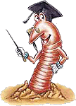

**Robale w groszku? Taka norma!  
Robak w konserwie jest zgodny z polskim prawem!**  
Super Ekspress 3 lipca 2006 r.

Mieszkanka Krakowa osłupiała po otwarciu kupionej w osiedlowym sklepie puszki groszku konserwowego. Zobaczyła w środku... 1,5-centymetrowego obrzydliwego robala. Jeszcze bardziej szokujące jest, że ten odpychający obcy miał prawo być w puszce, bo zezwalają na to polskie przepisy. Pani Halina zdenerwowana paskudnym znaleziskiem poprosiła o interwencję naszą redakcję. Natychmiast ruszyliśmy śladem robala.

Profesor Andrzej Wnuk z Katedry Entomologii Stosowanej Akademii Rolniczej w Krakowie bez problemu rozpoznał owada. - To jest pachówka strąkóweczka - twierdzi naukowiec. - Ona jest najczęściej spotykanym w groszku zielonym szkodnikiem - dodaje. Profesor spokojnie tłumaczy, że robak w puszce to nic nadzwyczajnego. Poza tym ma wszelkie prawo tam przebywać. - Polska norma stanowi, że część nasion może zawierać uszkodzenia w tym owady - mówi profesor Wnuk. - Nie rozumiem, skąd to zamieszanie. Przecież kupując świeże warzywa na bazarze, bardzo często znajdujemy na nich insekty. Dlaczego z puszkami miałoby być inaczej? - dziwi się profesor.

Sprawdziliśmy i rzeczywiście, ani robak, ani producent groszku prawa nie złamali. To, ile procent uszkodzonych ziaren zielonego groszku może trafić do przemysłu, precyzyjnie określa norma dotycząca "produktów warzywnych i warzyw konserwowych". Marta Szewczyk z krakowskiego sanepidu informuje, że ta ilość nie może przekroczyć 1,5 proc. w stosunku do masy "przetworu odsączonego". - Choć norma nie mówi wprost o szkodnikach, a jedynie o plamach i uszkodzeniach, to dotyczy również owadów - informuje Szewczyk. - W którymś ziarnie może przecież siedzieć robak, to się zdarza i nie ma na to rady - spokojnie tłumaczy. Może i racja, ale co z ludźmi, którzy z jakichś powodów nie mogą albo nie chcą jeść mięsa? Muszą bardzo dokładnie oglądać każdy groszek. Co powinien zrobić producent, gdy w jego produkcie znajdzie się zgodny z normą robal? Na pewno przeprosiny i kilka puszek groszku załatwią całkowicie sprawę.

Robale fasolowe nie są szkodliwe dla zdrowia. To normalne białko, tyle że obrzydliwe - spokojnie tłumaczy Stanisław Pawlus, kierownik działu nadzoru sanitarnego krakowskiego sanepidu. Specjalista twierdzi, że proces technologiczny nie wyeliminuje wszystkich insektów, które siedzą w groszku. - Nie bronię producenta, bo konsument powinien dostać rzecz nienaganną. Chcę tylko uzmysłowić, że takie przypadki się zdarzają i że ten robal miał prawo znaleźć się w puszce - bez cienia wątpliwości stwierdza kierownik Pawlus.

Dr Łuczaj poleca: **Robak na dziko - Larwy owadów są smaczne i zdrowe. Mają smak słoniny. Mnie smakują na surowo. Ale można je piec na rozgrzanej patelni. Jednak nie na tłuszczu, bo on zmienia ich smak. Można je też dorzucić do zupy, wtedy podnoszą wartość kaloryczną potrawy**. Tylko raz się zatrułem larwami. Jadłem nieznany gatunek, z czarnymi główkami. A najbezpieczniej jeść białe larwy.
