**Mojemu Dziadkowi - Edwardowi CYGANKIEWICZOWI - posterunkowemu Policji Państwowej,  
urodzonemu 17 lipca 1891 roku w Sułoszowej. Więźniowi obozu w Ostaszkowie, Zamordowanemu  
w dniu 13 lub 14 kwietnia 1940 roku w Kalininie (d. Twer), spoczywającemu w lesie pod Miednoje  
z kolegami i przyjaciółmi, z którymi we wrześniu 1939 roku wyruszył bronić Polski**

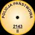

Leszek Wiktor Klimek

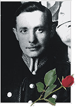

pp Edward Cygankiewicz

Dziadka mojego pamiętam tylko z opowiadań mojej Mamy. Opowiadała rzadko. Były to czasy kiedy głośne mówienie o Katyniu (wtedy jeszcze nic nie wiedziano o Miednoje) mogło sprowadzić kłopoty do domu. Z tego też powodu spaliła jedyną kartkę pocztową od dziadka, którą napisał już z Ostaszkowa. Miała też pewne kłopoty. Z dzieciństwa pamiętam strzępy rozmów w domu, z których zapamiętałem tylko "...przecież twój ojciec był granatowym policjantem". Pamiętam też, jak we dwoje z siostrą czekaliśmy do późnej nocy na przyjście rodziców "...byliśmy u państwa Nastarowiczów, aż za stawem Stefańskiego". Dziś domyślam się, że rozmawiali z synem policjanta, który wrócił stamtąd. Został aresztowany wraz z ojcem przez Rosjan, a potem przekazany Niemcom. Jego ojca Michała zamordowano w Twerze.

Dziadek pochodził z południa, z Sułoszowej. Był synem Jana Cygankiewicza i Joanny Płazak. Była to największa co do wielkości rodzina w okolicy. Dzisiaj w Sułoszowej prym wiedzie rodzina Gorajów, znana ze swych rodzinnych zjazdów. Nie wiem, co skłoniło dziadka, by wstąpić do policji. Służbę rozpoczął w Piotrkowie Trybunalskim, potem przeniesiono go do Ręczna, by w końcu trafić do Łodzi. Zamieszkali przy ul. Kilińskiego 228. W Łodzi spotkał go pierwszy kłopot, który niemalże nie zakończył jego pracy w Policji. Mama opowiadała jak pewnego razu przewoził tramwajem aresztanta, anarchistę albo komunistę, i ten po prostu mu uciekł. Tylko piękny szal z prawdziwej wełny, zrobiony przez babcię dla pani komendantowej załagodził sprawę. W domu nie było bogato. Pracował tylko dziadek, a do wyżywienia i ubrania miał pięć osób. Tak żyli do wybuchu wojny.

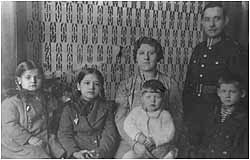

Dziadek z najbliższą rodziną

Wiem z historii, że Policja Państwowa dopiero w końcu lat dwudziestych otrzymała zadania na wypadek wojny. Miała stać się formacją militarną pod nazwą Wojskowy Korpus Służby Bezpieczeństwa. Wojna zbliżała się szybko, ale dopiero 28 sierpnia 1939 r. marszałek Rydz-Śmigły polecił głównemu komendantowi policji przeprowadzić mobilizację "na gwałt i za wszelką cenę". 29.VIII.1939 r. wydano odpowiednie rozkazy dla policji w całym państwie. Ostatniego sierpnia lub na początku września dziadek stawił się w punkcie mobilizacji w Łodzi i od tej pory losy jego nie są nam znane. Wiadomo, że 4 września 1939 r. w Łodzi rozpoczęto ewakuację administracji państwowej.

Policyjne okręgi północno-zachodniej Polski koncentrować się miały w Kowlu, południowo-zachodnich wycofywały się do Tarnopola (*Dwa były kierunki ewakuacji policji - do Tarnopola i Brześcia nad Bugiem. J. Tucholski "Dzieje zbrodni"* ). Jednostki policji miały się ufortyfikować na linii Bugu i tam czekać na Niemców. Niestety, 17 września, na mocy tajnego paktu Ribbentrop-Mołotow, Stalin zaatakował ziemie wschodnie II Rzeczypospolitej. Tysiące policjantów zginęło w czasie walk i masowych rozstrzeliwań, resztę na podstawie tzw. list proskrypcyjnych, zostało aresztowanych przez NKWD z pomocą stalinowskiego wojska.

Oblicza się, że w pierwszych dniach wojny z Robotniczo-Chłopską Armią Czerwoną poległo lub zostało zamordowanych około 3 tys. policjantów, drugie tyle zdołało ujść za granicę, aresztowano około 12 tys. policjantów.  

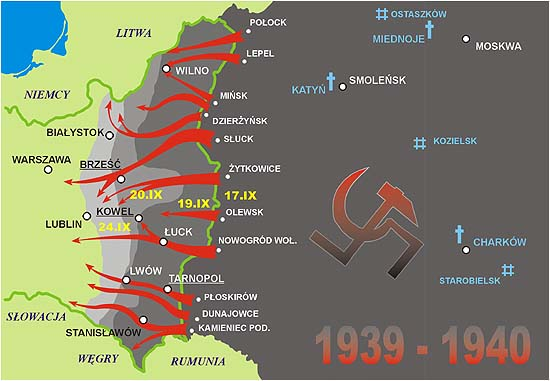

Jak niemiecko-radziecki plan był dopracowany, możesz zobaczyć na mapce. Po 17 września ucieczka na Węgry czy do Rumunii była już niemożliwa. Taki stan doskonale sprzyjał wyłapaniu polskiej inteligencji oraz polskich patriotów i fizycznym ich zlikwidowaniu, co uczyniono z bolszewicką nienawiścią i niemiecką dokładnością.

**Zbrodnia**

Już 19 września 1939 r. Beria powziął decyzję o utworzeniu zarządu ds. jeńców wojennych i wydał dyrektywę do utworzenia obozów przejściowo-rozdzielczych w Juchniowie, Kozielszczyźnie, Putywlu, Orankach, Ostaszkowie, Starobielsku, Kozielsku, Juży, Griazowcu i Zonkijewie. Wszyscy policjanci byli przewożeni do obozu w Ostaszkowie.

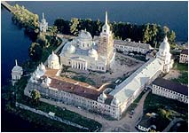

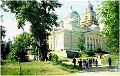

Monastyr Niłowa Pustyń. Dziś restaurowany. Władza postsowiecka starannie zaciera ślady.

Ostaszków (obóz jeniecki nr 41) był największym obozem. Założono go w monastyrze Niłowa Pustyń, na wyspie Stołbnyj na jeziorze Seliger, gdzie uprzednio wymordowano mnichów. Zgrupowano w nim około 6500 jeńców wojennych w większości policjantów.

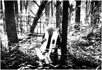

Zaniedbane polskie groby

Warunki w obozie były najgorsze ze wszystkich pozostałych obozów jenieckich. Budynki klasztorne, w których trzymano więźniów były nieogrzewane, a racja żywnościowa obliczona tylko na przetrwanie.

Pierwszych więźniów do monastyru transportowano łodziami, dopiero później jeńcy odbudowali groblę łączącą wysepkę Stołbnyj z półwyspem. Tu na skraju półwyspu znajduje się osada Świetlica, a obok niej cmentarz Trojeruczicki, gdzie pochowano 92 zmarłych z chorób i wycieńczenia. Na zdjęciu obok kapelan Rodzin Katyńskich ks. Zdzisław Peszkowski błogosławi miejsce ich ostatniego spoczynku. Nazwa cmentarza pochodzi od ikony Matki Bożej Trzyręcznej z Ostaszkowa.

Decyzją Politbiura w końcu lutego lub w początkach marca zarządzono likwidację obozów jenieckich. Znaczyło to tylko jedno - rozstrzelanie. Jeńców likwidowano na podstawie ściśle tajnych list przekazywanych bezpośrednio z Moskwy do obozów (ocaleni świadkowie twierdzą, że listy były dyktowane komendantom obozów przez telefon).

Fragment takiej listy, z nazwiskiem mojego Dziadka (nr 27), pokazuję niżej.

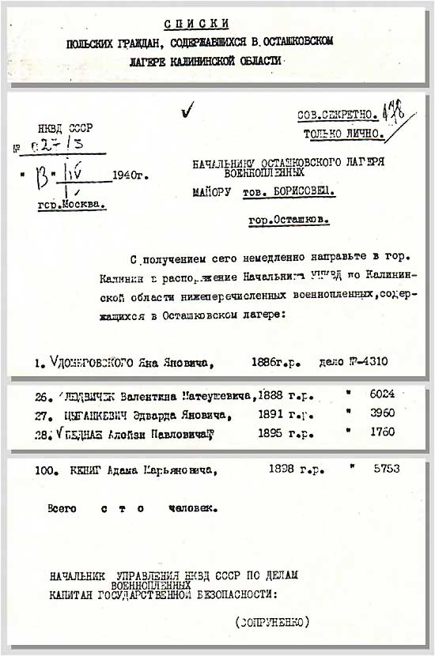

**"Lista śmierci" w tłumaczeniu:**       
  

---

NKWD ZSRR  
Nr 027/3  
13.IV.1940 r.  
miasto Moskwa

Ściśle tajne  
tylko osobiście

Naczelnik Obozu Jeńców Wojennych  
w Ostaszkowie  
major tow. Borysowiec  
m. Ostaszków  

Z otrzymaniem tegoż niezwłocznie skierować do m. Kalinin do dyspozycji naczelnika NKWD Obwodu Kalinińskiego niżej wymienionych jeńców wojennych, znajdujących się w obozie w Ostaszkowie.  

---

27.

Cygankiewicz Edwarda s. Jana

ur. 1891

Nr sprawy 3960

---

Wszystkich s t u ludzi

Naczelnik Zarządu NKWD ZSRR  
ds. Jeńców Wojennych  
kapitan bezpieczeństwa państwowego  
  
Soprunienko.

---

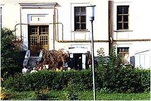

Tu w piwnicy zamordowano mojego Dziadka

Jedna lista śmierci zawierała zwykle 100 nazwisk. Jednorazową ilość jeńców (w Twerze - 250 osób przez noc) dobrano eksperymentalnie kierując się możliwościami ludzi i pistoletów (rosyjskie pistolety "Nagant" zacinały się i rozstrzeliwano pistoletami niemieckimi. Były to pistolety "Walther" wypożyczone z Moskwy).

Sądzę jednak, że liczba "100" była dobrana także ze względu na "wysoką" inteligencję rewolucyjnego personelu. Już Lenin doskonale rozumiał, że inteligencja jest niebezpieczna dla jego rządów i ci, którzy nie byli z nim lub przy nim zostali wymordowani. Reszta to sól ziemi, ślepo oddani, debilowaci robotnicy i chłopi dla których dostępnym liczydłem były tylko własne ręce. Ta "setka" to wszystkie palce u rąk tyle razy ile tych palców. Łatwo było się doliczyć, czy wszyscy dotarli do łap oprawców.

Likwidacja obozu ostaszkowskiego trwała od 4 kwietnia do 19 maja 1940 r. Za przebieg fizycznej likwidacji więźniów odpowiadał funkcjonariusz centrali NKWD, niejaki Błochin i komendant twerskiego więzienia. Codziennie, jeńców wybranych według list, pędzono pieszo, przez zamarznięte jezioro (ostatnie, majowe transporty już przez Ostaszków), do stacji kolejowej Soroga, przewożono w wagonach więziennych zwanych "stołpynkami" do Kalinina (obecnie Twer) i ze stacji "czarnymi krukami" (potoczna nazwa samochodu-więźniarki) do więzienia w piwnicach NKWD. Egzekucje zaczynano o zmroku, w specjalnej sali wyłożonej materiałem dźwiękochłonnym (wojłokiem). Kończono z nastaniem świtu. Dodatkowo, aby zagłuszyć strzały, na całą noc uruchamiano wielkie wentylatory. O świcie, zakrytymi samochodami, zwłoki wywożono do lasu nad rzeką Twercą, do ośrodka wypoczynkowego NKWD we wsi Jamok koło Miednoje.  

Z obozu ostaszkowskiego ocalały 124 osoby wysłane do Griazowca, przez obóz Pawliszczew Bór.

**Odkrywanie prawdy**

Prawda o bestialskim mordzie na polskich jeńcach wojennych była skrzętnie ukrywana. Pierwsze wieści pochodzą od Niemców, którzy w kwietniu 1943 r. dokonali ekshumacji ofiar w Katyniu.

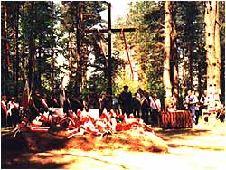

Uroczysta msza święta w Miednoje

Wieści te dotarły także do rodzin w Polsce, jednak nic więcej nie można było zrobić. Pozostało tylko czekać na zakończenie wojny i na cud. Mama też czekała, ale rok po roku nadzieja była coraz słabsza. Ówczesne polskie rządy w kraju całkowicie popierały stanowisko swego pracodawcy (ZSRR) - zbrodni dokonały hitlerowskie Niemcy (ta konkluzja, to efekt pracy "osławionej" komisji Burdenki, której głównym zadaniem było zatarcie śladów pozostałych po NKWD).  

Jedynym legalnym wydawnictwem tego czasu była książka Wandy Wasilewskiej "Prawda o Katyniu", gdzie 17 września był akcją obrony ludności Ukrainy i Białorusi przed Niemcami, a zbrodnia w Katyniu dziełem hitlerowców (po prostu przepisano ustalenia komisji Burdenki). Wanda Wasilewska, kanalia niewarta wzmianki, działaczka polskich komunistów w ZSRR, była niczym innym jak tylko małą trąbą Stalina, której zadaniem było przetłumaczenie z rosyjskiego i odtrąbienie tego po polsku.  

Fakt przemilczania zbrodni katyńskiej przez państwa zachodnie, skądinąd doskonale poinformowane o sprawcach, szczególnie przez Wielką Brytanię, stawia je w moich oczach na równi ze zbrodniarzami. Nie od dzisiaj wiadomo, że polityka to bagno osłonięte żywopłotem "dworskiej etykiety".

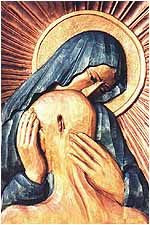

Pierwsze, prawdziwe wiadomości zaczęły nieśmiało przenikać do społeczeństwa w czasie radzieckiej "pierestrojki". Nie znaczy to jednak, że sowieci od razu uderzyli się w pierś. Nawet Gorbaczow, doskonale poinformowany o zbrodni, cedził słowa jak przez młyńskie sito. Dopiero Jelcyn, jak w Warszawie po sutej kolacji "przekonał" go Wałęsa (wtedy to, chwiejąc się jeszcze przy mównicy, opuchnięty i czerwony jak flaga ZSRR, łaskawie zezwolił nam na wejście do NATO), zgodził się na wydanie resztek dokumentów świadczących, że to jednak Związek Radziecki dopuścił się tej zbrodni.

Wszyscy wysoko postawieni funkcjonariusze państwowi ZSRR i byłego ZSRR byli doskonale poinformowani o zbrodni katyńskiej. Na dokumentach katyńskich przekazanych Polsce widnieją podpisy ludzi zapoznanych ze sprawą. Są tam między innymi podpisy Breżniewa, Kosygina, Susłowa, Andropowa, Gromyki, Rusakowa, Katuszewa, Ryżkowa, Ligaczowa, Jazowa, Dobrynina, i Gorbaczowa. Nie kto inny jak Chruszczow wydał polecenie zniszczenia 21857 teczek personalnych jeńców wojennych zamordowanych w roku 1940. Wszyscy wiedzieli i wszyscy milczeli przez 50 lat. Dlaczego nie zniszczono pozostałych, nielicznych już, dokumentów? Sądzę, że zrobiła to "magiczna" siła składanego podpisu. Stanowił on coś w rodzaju osobistej przysięgi o dozgonnym milczeniu. Był przysięgą na "relikwie" czerwonych przodków i pisemną zgodą na konsekwencje w razie zdrady.

Przez ten czas sprawę tuszowano, jak tylko było można. Za Bieruta, za "prawdę o Katyniu" można było iść na stryczek, za Gomułki do więzienia, za Gierka skutecznie szykanowano, ale już ogólnie, aparat partyjny uważał, że mówienie o tym "nie jest w dobrym tonie". W wojsku ówczesna "sekta" polityczna miała wyławiać "wichrzycieli" i wyrzucać z wojska. Ponad pół wieku ciszy i zasłony. Ponad pół wieku zmowy milczenia. Ponad pół wieku więzienia prawdy i nieśmiałej nadziei.

6 maja 1996 r. Gazeta Wyborcza opublikowała Kalendarium Katyńskie (kolor niebieski i czerwony - moje uzupełnienia):

| 2.X.1939 | Decyzja Biura Politycznego KC WKP(b) "O jeńcach wojennych". |
| --- | --- |
| 3.X.1939 | Rozkaz ludowego komisarza spraw wewnętrznych Ławrientija Berii o utworzeniu obozów dla polskich jeńców wojennych w Kozielsku, Ostaszkowie i Starobielsku. |
| II-III.1940 | III Konferencja Metodyczna NKWD i Gestapo w Zakopanem. Narady trwały 6 tygodni. Tu dopracowano metodykę i organizację zbrodni na polskich jeńcach. W konferencji wzięli udział zaproszeni przedstawiciele [wywiadu](http://www.rodzinapolska.pl/prawdahistor/archiwum/2002/99_1.htm) brytyjskiego. Wniosek - rządy Wielkiej Brytanii i hitlerowskich Niemiec doskonale znały plany wymordowania jeńców polskich!!! (Czy gen. Sikorski musiał zginąć, bo o tym wiedział?). |
| 5.III.1940 | Decyzja Politbiura o rozstrzelaniu 14,7 tys. polskich jeńców i 11 tys. polskich obywateli przetrzymywanych w więzieniach w zachodnich obwodach Białorusi i Ukrainy. Za rozstrzelaniem głosowali: Józef Stalin, Kliment Woroszyłow, Wiaczesław Mołotow, Anastas Mikojan, Łazar Kaganowicz, Michaił Kalinin, Ławrientij Beria. Nikt się nie wstrzymał. Nikt nie był przeciw. |
| 3.IV-19.V.1940 | Rozstrzelanie jeńców w Katyniu (z obozu w Kozielsku - 4421 osób), w w Twerze (z obozu w Ostaszkowie - 6311 osób) i w Charkowie (z obozu w Starobielsku - 3820 osób). |
| wiosna-lato 1940 | Rozstrzelanie 7305 polskich obywateli więzionych na Białorusi i Ukrainie. |
| 16.VIII.1941 | Konferencja gen. Andersa z przedstawicielami władz radzieckich (Panfiłow, Żukow). Strona radziecka uchyla się od odpowiedzi na temat obozów w Kozielsku, Ostaszkowie i Starobielsku. |
| wiosna 1942 | Polscy robotnicy przymusowi z załogi pociągu naprawczego Bahnzug 2005 München, poinformowani przez miejscową Polkę, odnajdują na uroczysku Kozie Góry w Lesie Katyńskim groby polskich oficerów i stawiają na nich dwa krzyże brzozowe. |
| 18.II.1943 | Początek rozkopywania grobów katyńskich i pierwsze ekshumacje dokonane przez Niemców. |
| IV-VI.1943 | Odkrycie grobów w Katyniu (??? - panie Michnik!) i pierwsza ekshumacja dokonana przez Niemców. |
| IV.1943 | Związek Patriotów Polskich (polscy komuniści) zwracają się z prośbą do rządu ZSRR o zgodę na utworzenie w ZSRR polskiej jednostki wojskowej. |
| 21.IV.1943 | Artykuł moskiewskiej "Prawdy" i Agencji TASS oskarżający Polaków o współpracę z Hitlerem. |
| 25-26.IV.1943 | Nota rządu ZSRR zrywająca stosunki z rządem polskim w Londynie. |
| V.1943 | Formowanie 1 Dywizji im. Tadeusza Kościuszki, ramienia zbrojnego dla przyszłego komunistycznego polskiego rządu. |
| 4.VII.1943 | W lotniczym wypadku pod Gibraltarem ginie gen. Sikorski. Samolot tonie dość długo, ale cało wychodzi tylko czeski pilot. Nikt poza nim nie próbuje opuścić tonącego samolotu, bo prawdopodobnie już w chwili startu żaden z pasażerów nie był żywy. Gen. Sikorski był prawdopodobnie trzecią osobą wśród aliantów, oprócz Stalina i Churchila, która znała prawdę o Katyniu. O jedną osobę za dużo. |
| IX.1943-I.1944 | Działanie komisji Nikołaja Burdenki, druga ekshumacja tym razem dokonana przez Rosjan. Zacieranie pozostałych śladów. |
| 8.X.1945 | Akt oskarżenia przeciwko niemieckim przestępcom wojennym odczytany w Berlinie w imieniu Wielkiej Brytanii, Francji, Stanów Zjednoczonych i Związku Radzieckiego, gdzie oskarżono Niemcy o popełnienie zbrodni katyńskiej. |
| 30.XI.1945 | W Egipcie ukazuje się Lista zaginionych jeńców z obozów rosyjskich Kozielsk, Ostaszków i Starobielsk, zestawiona przez Biuro Opieki nad Rodzinami Wojskowymi Dowództwa Polskich Sił Zbrojnych w ZSRR uzupełniona spisem Biura Pomocy Rodzinom Wojskowych i Jeńców Wojennych Dowództwa Wojsk Polskich na Środkowym Wschodzie (L. dz. 904/RW/45). |
| 13-14.II.1946 | Prokurator ZSRR płk Pokrowski oskarża Niemców w procesie norymberskim o popełnienie zbrodni katyńskiej. Wielka Brytania milczy. |
| 30.IX-1.X.1946 | Odczytanie wyroku w procesie norymberskim. W tekscie wyroku nie stwierdzono winy Niemców za dokonanie zbrodni katyńskiej. |
| 18.IX.1951-22.XII.1952 | Prace "Komisji do przeprowadzenia pełnych i całkowitych badań masakry katyńskiej" powołanej przez Kongres USA. Jej raport całkowicie obciążył ZSRR odpowiedzialnością za popełnioną zbrodnię. |
| 13.IV.1990 | Komunikat TASS: zbrodnia katyńska jest dziełem stalinowskiego NKWD. Tego samego dnia prezydent Michaił Gorbaczow przekazuje stronie polskiej pierwsze dokumenty katyńskie (tzw. listy śmierci). |
| 25.XII.1990 | Rozpoczęcie śledztwa w "sprawie katyńskiej", dochodzenie prowadzi Naczelna Prokuratura Wojskowa ZSRR we współpracy z Prokuraturą Generalną RP. |
| lato 1991 | Ekshumacja w Charkowie i Miednoje prowadzone przez polskich ekspertów na potrzeby śledztwa. |
| 4.X.1992 | Wysłannik prezydenta Rosji Jelcyna prof. Rudolf Pichoja wręcza w Belwederze dokumenty katyńskie m.in. decyzję Politbiura KC WKP(b) z 5 marca 1940 r. oraz notatkę szefa KGB Aleksandra Szelepina z 9 marca 1959 r. do Nikity Chruszczowa z propozycją zniszczenia 21857 teczek personalnych polskich jeńców i więźniów zamordowanych w 1940 r. |
| 5.V.1994 | Szef Służby Bezpieczeństwa Ukrainy gen. Andriej Chomicz daje polskiemu prokuratorowi Stefanowi Śnieżko wykaz 3435 nazwisk więźniów rozstrzelanych przez NKWD na Ukrainie na mocy decyzji Politbiura z 5 marca 1949 r. (tzw. listę Cwietuchina). |
| IX.1994 | Ciąg dalszy ekshumacji w Miednoje i Katyniu. |
| 21.IV.1995 | Szef Zarządu Zasobów Archiwalnych Federalnej Służby Bezpieczeństwa gen. Anatolij Krajuszkin oficjalnie informuje, że teczki osobowe i wyroki śmierci wydane przez trójkę NKWD ZSRR (Mierkułow, Kabułow, Basztakow) zostały spalone na Łubiance na przełomie marca i kwietnia 1959 r. na polecenie Chruszczowa. |
| 2004 | Śledztwo w sprawie katyńskiej trwa! Strona rosyjska nie wykazuje zainteresowania. Rząd polski też nie! Czy "starzy lewicowi przyjaciele" doszli do cichego porozumienia? Czy może czekają, aż przyschnie świeża rana na ciele niewinnej Rosji zadana przez niewdzięcznych Polaków? |

**Kalendarium poszukiwań "zaginionych" polskich jeńców wojennych**  
na podstawie: Andrzej Leszek Szczesniak "Katyń - tło historyczne, fakty, dokumenty", Alfa, 1989.

| 13-30.X.1940 | Rozmowy NKWD z polskimi oficerami-więźniami Butyrek i Łubianki na temat tworzenia polskiej "czerwonej" dywizji w ZSRR. Na żądanie płk. Berlinga o włączenie do dywizji polskich oficerów z Kozielska, Starobielska i Ostaszkowa. Mierkułow odpowiada: Nie, ci to nie. Zrobiliśmy z nimi wielką pomyłkę". |
| --- | --- |
| 30.VII.1941 | Podpisanie polsko-radzieckiego układu o współpracy. |
| 4.VIII.1941 | Zwolnienie gen. Andersa z radzieckiego więzienia. |
| 13.VIII.1941 | Rozporządzenie Prezydium Rady Najwyższej ZSRR o amnestii dla Polaków. |
| 14.VIII.1941 | Podpisanie polsko-radzieckiej umowy wojskowej. |
| 16.VIII.1941 | Pierwsza oficjalna konferencja gen. Andersa z przedstawicielami władz wojskowych (gen. Panfiłow i gen. Żukow z NKWD). Strona radziecka uchyla się od odpowiedzi na temat obozów w Kozielsku, Starobielsku i Ostaszkowie . |
| VIII.1941 | Utworzenie specjalnego biura Sztabu Armii Polskiej w ZSRR pod kierownictwem rtm. Józefa Czapskiego ds. Zaginionych z Kozielska, Starobielska i Ostaszkowa. |
| 6.IX.1941 | Ambasador polski w ZSRR St. Kot wręcza A. Wyszyńskiemu (wtedy zastępcy przewodniczącego Rady Komisarzy Ludowych) pierwszą listę zaginionych. |
| 20.IX.1941 | Interwencja St. Kota u A. Wyszyńskiego w sprawie zaginionych jeńców wojennych. |
| 27.IX.1941 | Nota ambasadora St. Kota do rządu ZSRR w sprawie nierealizowania układu z 30.VII 1941 r. |
| IX-X.1941 | Służby wywiadowcze Polski Walczącej na rozkaz gen. Sikorskiego poszukują w kraju i niemieckich oflagach zaginionych jeńców z Kozielska, Starobielska i Ostaszkowa rzekomo zwolnionych do Kraju. Bez rezultatu. |
| 6.X.1941 | Interwencja St. Kota u A. Wyszyńskiego w sprawie zaginionych jeńców wojennych. |
| 13.X.1941 | Nota Ambasady Polskiej do rządu ZSRR w sprawie niewypełnienia zobowiązań co do zwolnienia obywateli polskich. |
| 14.X.1941 | Interwencja St. Kota u A. Wyszyńskiego w sprawie zaginionych jeńców wojennych. |
| 15.X.1941 | Specjalna nota gen. Sikorskiego do radzieckiego ambasadora przy rządzie polskim Bogomołowa w sprawie zaginionych jeńców. Nota bez odpowiedzi. |
| 22.X.1941 | Interwencja St. Kota u W. Mołotowa w sprawie zaginionych jeńców wojennych. |
| 1.XI.1941 | Ambasador St. Kot wręcza W. Mołotowowi poufną notę, w której usiłuje skłonić rząd ZSRR do zwolnienia jeńców wojennych. |
| 2.XI.1941 | Interwencja St. Kota u A. Wyszyńskiego w sprawie zaginionych jeńców wojennych. |
| 3.XI.1941 | Interwencja brytyjska u władz ZSRR w sprawie zaginionych jeńców wojennych. |
| 4.XI.1941 | Pismo gen. Andersa do NKWD z prośbą o wyjaśnienie losu zaginionych jeńców wraz z podaniem liczby zaginionych - 8722 osób. |
| 8.XI.1941 | Nota W. Mołotowa do Rządu Polskiego o "pełnym wykonaniu ukazu amnestyjnego w stosunku do Polaków". |
| 12.XI.1941 | Interwencja St. Kota u A. Wyszyńskiego w sprawie zaginionych jeńców wojennych. |
| 14.XI.1941 | Nota ambasadora Bogomołowa do ambasadora Raczyńskiego stwierdzająca zwolnienie wszystkich jeńców. Przyjęcie St. Kota przez J. Stalina. Interwencja w sprawie zaginionych jeńców wojennych. |
| 1.XII.1941 | Notatka Ambasady Polskiej stwierdzająca, że brak jakichkolwiek śladów po 95% wszystkich jeńcach z Kozielska, Starobielska i Ostaszkowa. |
| 3.XII.1941 | Rozmowa gen. Sikorskiego ze Stalinem w obecności gen. Andersa i W. Mołotowa. Sikorski wręcza Stalinowi drugą listę 4000 zaginionych. Stalin oświadcza, że zaginieni uciekli do Mandżurii. |
| I.1942 | Rtm. Józef Czapski z upoważnienia gen. Andersa interweniuje u naczelnika NKWD obwodu czkałowskiego Bzyrowa oraz u szefa Gułagu gen. Nasiedkina. |
| 28.I.1942 | Oficjalna interwencja Rządu Polskiego w sprawie zaginionych jeńców (nota nr 49). Bez odpowiedzi. |
| 3.II.1942 | Rtm. Józef Czapski interweniuje u gen. Rajchmana z NKWD. |
| 8.III.1942 | Cenzura radziecka zabrania ogłaszania w piśmie "Polska" poszukiwań rodzin na terenie ZSRR. |
| 18.III.1942 | Gen. Anders i płk Okulicki u Stalina. Kolejna interwencja. Wręcznie kolejnej listy z 4518 zaginionych. |
| 19.V.1942 | Ambasada Polska składa w Moskwie "Memorandum w sprawie wykonania Protokołu Dodatkowego do Układu Polsko-Sowieckiego z dnia 30.VII.1941" dotyczace sprawy zaginionych jeńców. |
| 13.VI.1942 | Wiadomości z północy o "zatopieniu barek z jeńcami". Kolejna nota w sprawie zaginionych jeńców. |
| 8.VII.1942 | Aide-memoire rządu ZSRR na memorandum polskie z 19.V.1942 wyjaśnia, że jeńcy polscy: 1\. wyjechali do Polski, 2. uciekli za granicę, 3. zmarli w drodze. |
| 27.VII.1942 | Nota polskiego ministra spraw zagranicznych w Londynie w sprawie zamknięcia przez władze radzieckie poboru do Polskich Sił Zbrojnych na terytorium ZSRR oraz w sprawie zaginionych jeńców. Prawie dokładnie rok później w dziwnych okolicznościach ginie gen. Sikorski. Wraz ze śmiercią generała, w gronie aliantów "uśmiercona" zostaje sprawa Katynia. |

**Zadośćuczynienie**

Jedynym zadośćuczynieniem dla rodzin ofiar było przekazanie im przez Prezydenta RP medali pamiątkowych "Katyń", nadanych pośmiertnie ich bliskim, zamordowanym na wschodzie. Nie... nie przez naszego. Prezydenta RP na uchodźctwie w Londynie. Wałęsa nie kiwnął nawet małym palcem. Nie stać go nawet było, by zaprosić do siebie przedstawicieli Rodzin Katyńskich choć adres organizacji był doskonale znany. Nawet "listy śmierci" organizacja dostała jako ostatnia.

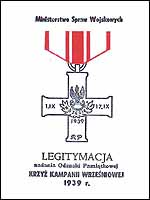

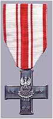

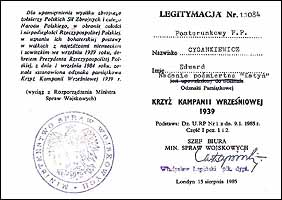

Najpierw Związek Sybiraków potem Rodziny Katyńskie. Te organizacje powstały spontanicznie bez żadnej pomocy i zainteresowania ze strony państwa. Nie sposób policzyć rodzin polskich, których nie dotknęłaby tragedia Katynia, Charkowa czy Miednoje. To tylko z ich inicjatywy pojawiły się pomniki ku czci zamordowanych na wschodzie. A państwo? Państwo wykonywało i wykonuje ruchy pozorowane, żeby nie powiedzieć frykcyjne. Uroczystości są organizowane tylko po to, by "wybrańcy narodu" zaistnieli w telewizji. Czy wywiera się polityczny nacisk na zakończenie (jeśli jest w ogóle prowadzone) ślamazarnego śledztwa w sprawie katyńskiej prowadzonego przez nowych, demokratycznych bolszewików? Absolutnie nie. Przecież właśnie po to rządząca, polska lewica rozwiązała zespół prokuratorów, którzy mieli prowadzić to śledztwo. Bez przerwy mydli nam się oczy.

Jak nasz rząd traktuje rodziny ofiar? Przeczytaj poniższy dokument.

|   | MINISTER SPRAWIEDLIWOŚCI Warszawa |
| --- | --- |
| List otwarty  Dnia 10 grudnia 1991 r. Instytut Katyński w Polsce zwrócił się do Ministra Sprawiedliwości i Ministra Spraw Zagranicznych w sprawie odszkodowań za zbrodnię katyńską przysługujących rodzinom zamordowanych w r. 1940 oficerów WP, funkcjonariuszy PP oraz innych ofiar, podając proponowaną podstawę prawną takiego wystąpienia. Ministerstwo Spraw Zagranicznych pismem z dnia 8 stycznia 1992 zajęło w tej sprawie kompetentne stanowisko. Minister Sprawiedliwości milczy. Minister Sprawiedliwości milczał przez lat pięćdziesiąt bez mała, a nie trzeba nikogo przekonywać, że właśnie Minister Sprawiedliwości i Prokurator Generalny ma szczególny obowiązek występowania z urzędu w poruszonej przez Instytut Katyński w Polsce sprawie. Ludzie uprawnieni do otrzymania odszkodowań - wdowy po ofiarach zbrodni katyńskiej - przekroczyły 80 rok życia, dzieci - 50 rok życia. O milczeniu Ministra Sprawiedliwości i Prokuratora Generalnego zarazem, informujemy opinię publiczną, podając pod jej osąd ten fakt. Instytut Katyński w Polsce domaga się odpowiedzi na pytanie, na co jeszcze czeka Minister Sprawiedliwości i Prokurator Generalny? Czyżby na odejście z tego świata zainteresowanych, którzy nie doczekają się nawet podjęcia kroków o odszkodowanie? |   |
| Kraków, dnia 25 marca 1992 r. | ZARZĄD Instytutu Katyńskiego w Polsce |

Napluli im w twarz. Oni odrzekli, że pada deszcz. Czy pamiętasz, kto wtedy był u władzy?  
Kiedyś jakaś "wybranka narodu", chyba nawet zlewicowana, powiedziała, że społeczeństwo, to zbiór przypadkowych ludzi. Wychodzi na to, że ci przypadkowi wybrali jeszcze bardziej przypadkowych.  

Na dobrą sprawę, czy Polak powinien przyjąć tę azjatycką jałmużnę, która jest niewiele większa od renty rosyjskiej babci klozetowej? Czy ma pokornie przyjąć następny policzek, tym razem od dzieci i wnuków zbrodniarzy?

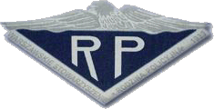

W kraju policja samorzutnie przeprowadziła inicjatywę powstania "Stowarzyszenia Rodzina Policyjna 1939 r.". Dla członków rodzin policjantów zamordowanych w Twerze wydano legitymacje uprawniające do leczenia się w placówkach służby zdrowia policji. Niestety, bardziej niż nieudolny sejm nie zdołał tego ani uszanować ani zachować.

Dla uczczenia pamięci pomordowanych najwięcej robią ich rodziny. Państwo nie przekazuje tej historii następnym pokoleniom (ukłony dla komuszej minister Łybackiej i jej podobnym). **Pamięć o pomordowanych zginie wraz ze śmiercią ich bliskich**. Patriotyzm stał się pustym słowem. Niemcy doskonale wiedzieli, że naród bez historii przestaje być narodem. Widać nasza władza czerpie z tej wiedzy pełnymi garściami. Kolejne rządy III Rzeczypospolitej robią wszystko, aby tak się stało. I takimi już się stajemy.

Mama chciała się dowiedzieć czegoś więcej o swoim ojcu. Jeszcze w roku 1988 wysłała pismo do Polskiego Czerwonego Krzyża, ale w odpowiedzi otrzymała tylko płachtę kwestionariusza do wypełnienia. Dziś wiadomo po co i komu to było. Napisała też do archiwum policyjnego w Łodzi, ale archiwum okazało się więcej niż ubogie. Czyżby PRL zniszczyło wszystko? Zobacz zresztą sam.

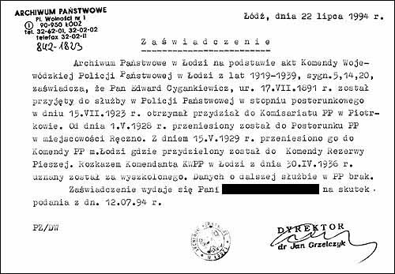

Wygląda to tak, jakby archiwum policji składało się z jednego stukartkowego zeszytu.

Dla mojej rodziny historia dziadka urywa się z wybuchem wojny. Odkrycie czegoś więcej ponad to co już wiemy, będzie chyba niemożliwe. Znam jeszcze policyjny numer ewidencyjny Dziadka - 2143 lub 2145. Czy był to numer "nieśmiertelnika"? Nie wiem. Także i szczątków dziadka nie sposób sprowadzić do kraju. Tu, w swojej Łodzi, ma tylko grób - symbol. Napisałem też wiersz dla mamy o dziadku, jej ojcu. Czułem, że jestem mu coś winny, a tylko w ten sposób mogłem uczcić Jego Pamięć.

Na początku wojny, Gdzieś drugiego września,  
nakazał nam wszystkim, aby się nie smucić.  
Wstał, pożegnał mamę, i nas, czworo dzieci,  
wyszedł, drzwi zamknął, by już nie powrócić.  

Poszedł pomny rozkazów i Swego honoru.  
Jesień złota była, złote było słońce ...  
Poszedł bronić tej ziemi oraz ojców grobów.  
Sam nie poszedł, bo Takich poszły też tysiące.  

Gdy na kresy bolszewik najechał ze wschodu,  
wzięto Ich do niewoli, nastał czas terroru.  
Zawszeni i wynędzniali, stłamszeni w wagonach  
dotarli na miejsce ... do ruin klasztoru.  

Zima była rosyjska, wszystko skuły lody.  
Na pryczach się z mrozem bratali.  
Prawie setka odeszła, ich groby pod płotem.  
Lecz Ci co przetrwali, czekali ...  

Z pierwszym tchnieniem wiosny i wiotką zielenią  
nadzieja wstąpiła w Ich serca.  
Żadnemu. Żadnemu nie przyszło do głowy,  
że wiosny też czekał morderca.  

W pałacowych komnatach, za Kremla murami,  
Bardzo dawno wyroki wydano.  
Już szły kartek tysiące, tysiące list śmierci,  
gdy w obozie na wolność czekano.  

I przyszła, ale nie ta ..... Na stację piechotą.  
Soroga, Kalinin ..... W piwnicy,  
płaszcz na głowę, strzał z tyłu,  
krzyk krótki i upadek, i kropla krwi z potylicy.  

Potajemnie, przed świtem, w las pod wsią Miednoje  
jechał mały konwój w karabiny zbrojny  
To w tym lesie, z innymi, bez grobu i krzyża  
leży Tato, policjant z przed wojny.  

W imieniu Mamy - syn, Braniewo 5 maja 1996 r.

Znalazłem także nieznaną mi pieśń, śpiewaną zapewne przez jeńców w Ostaszkowie, na melodię przedwojennej wojskowej piosenki legionów "Szara piechota". Jej tekst opublikował tygodnik katolicki "Niedziela" w numerze 12 z 20 marca 2005 r.

Na wyspie Iłowej, wśród lasów i wód,  
spędzamy dni szare niewoli.  
A z nami przebywa tęsknota i ból.  
Odwieczny towarzysz niedoli.  

Ostatni zeszliśmy z wytycznych nam wart,  
a troska okryła nam czoła,  
gdy wróg nasz moskiewski podstępem jak łotr  
jął szarpać Ojczyznę dokoła.  

Poszliśmy w niewolę bez żalu i skarg,  
na nędzę i życie tułacze,  
a po nas pozostał jęk matek i żon,  
modlitwy dziateczek i płacze.  

Gdy wrócim z niewoli do domów i chat,  
przez rzeki, jeziora i góry  
pierś naszą pokryją nie wstęgi i haft,  
lecz proste żołnierskie mundury.  

Gdy zajdzie potrzeba, gdy zechce tak los,  
niepomni na groby i rany,  
swe życie i zdrowie oddamy na stos  
dla Ciebie, mój Kraju Kochany.  

Pieśń powstała na przełomie lat 1939/1940, autor słów - nieznany.

**1200 km po śmierć**

Czy tak wyglądała droga po śmierć mojego Dziadka? Jest to możliwe. W artykule Jędrzeja Tucholskiego "Dzieje zbrodni" opublikowanym w specjalnym numerze historycznym Gazety Policyjnej z 1991 r. można było przeczytać: "Dwa były kierunki ewakuacji policji - do Tarnopola i Brześcia nad Bugiem. \[...\] W Tarnopolu nastąpiła koncentracja przede wszystkim Policji Województwa Śląskiego, \[...\] Początkowo jeńców umieszczono w licznych obozach przejściowych m. in. w Brodach, Podwołoczyskach, Wołoczyskach, Szepietówce, Talicy, Putiwlu oraz Kozielszczyźnie pod Połtawą."

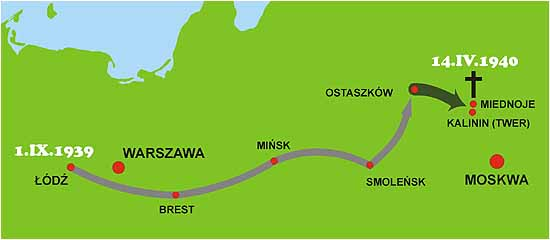

Drogę jednego z transportów przebytą etapami z Włodzimierza Wołyńskiego do Ostaszkowa udało się odtworzyć z notatek znalezionych przy ekshumacji zwłok w Miednoje: Łuck - Kiwerce - Kowel - Włodzimierz - Równe - Brody - Zdołbunowo - Szepietówka - Korosteń - Żłobin - Mohylew - Witebsk - Wielkie Łuki - Ostaszków - Seligier - Niłowa Pustyń.

**Ostatnia droga**

W tym samym artykule: "... obóz ostaszkowski - o obostrzonym reżimie - został przeznaczony dla funkcjonariuszy policji polskiej. \[...\] Decyzja o zagładzie jeńców zapadła na przełomie 1939/1940 r. na posiedzeniu Biura Politycznego KC WKP(b). Wywóz z Ostaszkowa rozpoczał się 4 kwietnia 1940 r. Obóz, w którym osadzono polskich policjantów, był zlokalizowany w odległości 11 km od Ostaszkowa, w monastyrze Niłowa Pustyń, na wysepce Stołbnyj na jeziorze Seligier. \[...\] 6295 jeńców, poczynając od 4 kwietnia 1940 r., pędzono (po skutym lodem jeziorze) dzień po dniu partiami, do przystanku kolejowego Soroga, gdzie byli ładowani do wagonów więziennych i przez Biełogoje transportowani do Kalinina (dzisiaj Twer) \[...\] przewożono ich "czarnymi woronami" ze stacji kolejowej do Zarządu Obwodowego NKWD przy ul. Sowieckiej, gdzie do wieczora byli więzieni w celach piwnicznych.

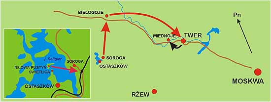

Rozstrzeliwania rozpoczynały się z nastaniem nocy i trwały do świtu. Pierwszy transport, według zeznań Tokariewa, szefa Zarządu NKWD w Kalininie, liczył 300 skazanych i kaci mieli trudności z zakończeniem przed nastaniem poranka. Następne nie przekraczały 250 ludzi. Strzelano przeważnie z pistoletów niemieckich typu Walther, dostarczonych z Moskwy. Egzekucja wyglądała następująco - w jednym z pomieszczeń piwnicznych sprawdzano tożsamość jeńca, po czym był on skuwany i przeprowadzany do celi śmierci wytłumionej wykładziną wojłokową. Egzekucję wykonywano natychmiast - tu także strzelano w tył głowy - po czym zwłoki wynoszono przez przeciwległe drzwi na zewnątrz i wrzucano na oczekujące samochody ciężarowe.

Przez całą noc pracowały jakieś maszyny (były to prawdopodobnie wentylatory), dodatkowo zagłuszające huk wystrzałów. O świcie kończono egzekucję i samochody odjeżdżały szosą Moskwa - Leningrad do odległej o około 30 km miejscowości Miednoje, gdzie w lesie, na terenie rekreacyjnym NKWD, znajdował się przygotowany przez koparkę dół głębokości około 5 m, mogący pomieścić 250 zwłok. Trupy zamordowanych zrzucano bezładnie z samochodów, po czym koparka przystępowała do ich zasypywania, kopiąc od razu kolejny dół. Dołów takich znajduje się na terenie tego lasu 25 do 26.

Ostatnią partię jeńców przywieziono z Ostaszkowa do Kalinina w dniu 19 maja 1940 r. Według zeznań Tokariewa, szefa Zarządu Obwodowego NKWD w Kalininie, w więzieniu "rozstrzelano 6295 Polaków i jednego bandytę".

**Mordercy z pod sierpa i młota**

Nazwiska poniżej, to tylko nieliczni mordercy polskich jeńców wojennych, których udało mi się odnaleźć w dokumentach (kolorem czerwonym - bezpośredni oprawcy jeńców z Ostaszkowa):

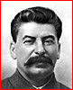

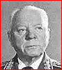

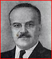

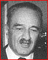

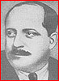

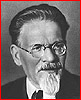

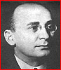

Stalin

Woroszyłow

Mołotow

Mikojan

Kaganowicz

Kalinin

Beria

**Józef Wisarionowicz STALIN** - główny morderca, szef pozostałych  
**Kliment WOROSZYŁOW** - ludowy komisarz obrony  
**Wiaczesław MOŁOTOW** - minister spraw zagranicznych (hr. Skriabin)  
**Anastas MIKOJAN** - zastępca przewodniczącego Rady Komisarzy Ludowych  
**Łazar KAGANOWICZ** - ludowy komisarz komunikacji, wicepremier  
**Michaił KALININ** - przewodniczący Prezydium Rady Najwyższej  
**Ławrientij BERIA** - szef NKWD (zgładzony przez Chruszczowa)

**BASZTAKOW** - naczelnik I specwydziału NKWD, jeden z "trójki" wydającej wyrok  
**Bohdan KABUŁOW** - zastępca Berii, jeden z "trójki" wydającej wyrok  
**Wsiewołod MERKUŁOW** - zastępca Berii, jeden z "trójki" wydającej wyrok

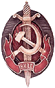

**Piotr SOPRUNIENKO** - szef Zarządu NKWD ds. Jeńców Wojennych  
**CHOCHOŁOW** - zastępca szefa Zarządu NKWD ds. Jeńców Wojennych

**BORYSOWIEC** - komendant obozu w Ostaszkowie

**Dymitr TOKARIEW** - szef zarządu NKWD w Twerze  
**W. BŁOCHIN** - komendant więzienia w Twerze  
**SINIEGUBOW** - oficer NKWD  
**KRIWIENKO** - oficer NKWD  
**SUCHARIEW** - kierowca Tokariewa  
**RUBANOW** - komendant (?)

Niestety, prawie żaden nie żyje i żadnego nie dosięgła sprawiedliwość. W roku 1991 z żywych morderców odnaleziono tylko Tokariewa i Soprunienkę. Za dobrze wykonaną pracę oprawcy otrzymali nagrody pieniężne (zachowały się dokumenty). Najbardziej aktywni - miesięczną pensję, pozostali po 800 rubli. Podejrzane dla mnie są okoliczności, w których niektórzy z nich (najaktywniejsi) pożegnali się z tym światem. Według zeznań żyjących świadków, prawie wszyscy popełnili samobójstwa, dostawszy uprzednio pomieszania zmysłów. Ręka Boga czy "rączki" NKWD?

Bezczelność potomków zbrodniarzy nie zna jednak granic. W grudniu 1991 r. sztab generalny już byłego ZSRR podliczył, że za wyzwolenie Polski jesteśmy im winni 26,7 mld rubli. Jakiś czerwony generałek niejaki Pokrowski uznał nawet, że cena jest zaniżona (czyżby to synuś prokuratora ZSRR Pokrowskiego, który oskarżał w Norymberdze?). Cóż, mentalność morderców nic się nie zmieniła od czasów carów wielkiej Rusi. Na tyle widać wycenili narzędzia zbrodni zużyte na naszym narodzie.

**W obronie Polaków wystąpił Instytut Katyński, który pyta wprost - co z odszkodowaniem za**:

\- zajęcie i okupację we wrześniu 1939 r. prawie połowy terytorium Polski,  
\- deportacji 1,5 mln Polaków, zagarnięcie ich mienia i zmuszenie do niewolniczej pracy,  
\- grabież mienia dalszych 3 mln obywateli polskich na okupowanych ziemiach,  
\- zniszczenie i grabież 80% majątku narodowego RP na zajętych ziemiach w roku 1939,  
\- wymordowanie około 26 tys. jeńców polskich na zajętych ziemiach w roku 1939,  
\- wymordowanie dalszych około 500 tys. Polaków deportowanych w głąb ZSRR,  
\- grabież narodowych dóbr kultury, majątku narodowego i prywatnego po wkroczeniu na tereny Polski w 1944 r.,  
\- mordowanie byłych żołnierzy AK, sił zbrojnych i organizacji niepodległościowych w Polsce po 1944 r.,  
\- grabienie majątku narodowego w latach 1944-1989 w ramach RWPG,  
\- koszty utrzymania Armii Czerwonej na terenie Polski, w tym olbrzymich zniszczeń ekologicznych.

Tego współcześni "carowie" z Moskwy nie chcą brać pod uwagę. Ich moralność, to w dalszym ciągu moralność średniowiecznych Mongołów i Tatarów. Instytut Katyński wyliczył, że odszkodowanie dla rodzin zamordowanych na wschodzie tylko w zbrodni katyńskiej wynosi 453 mln dolarów! I to bez odsetek! Prosty naród rosyjski ma inne zdanie niż politycy z Moskwy i doskonale nas rozumie. Gdy Polacy odjeżdżali z Miednoje, starsza Rosjanka żegnała ich słowami - "Przyjeżdżajcie tu, bo tu jest również ziemia wasza i waszych ojców".

**Miejsce pochówku**

Nie sposób nie wspomnieć tych, którym po półwieczu pierwszym dane było ujrzeć miejsce spoczynku pomordowanych. Byli to członkowie polskiej ekipy ekshumacyjnej, członkowie rosyjskiej prokuratury oraz oficerowie i żołnierze, jeszcze wtedy, Armii Radzieckiej.

| mgr Stefan Śnieżko | zastępca Prokuratora Generalnego Ministerstwa Sprawiedliwości |
| --- | --- |
| mgr Zbigniew Mielecki | prokurator w Ministerstwie Sprawiedliwości |
| płk dr Przemysław Tomaszewski | Prokuratura Warszawskiego Okręgu Wojskowego |
| płk mgr Andrzej Komarski | szef Prokuratury Warszawskiego Okręgu Wojskowego |
| prof. dr hab. Bronisław Młodziejowski | antropolog, dyrektor Instytutu Nauk Policyjnych w Legionowie |
| dr hab. Roman Mądro | docent w Katedrze i Zakładzie Medycyny Sądowej AM w Lublinie |
| dr Erazm Baran | adiunkt w Katedrze i Zakładzie Medycyny Sądowej AM w Krakowie |
| doc. dr hab Marian Głosek | Zakład Archeologii Polski Środkowej Instytutu Historii Kultury Materialnej PAN |
| płk w st. spocz. Zdzisław Sawicki | ekspert z zakresu falerystyki |
| mgr inż. Jarosław Rosiak | komisarz Policji, Centralne Laboratorium Kryminalistyki KG Policji |
| Aleksander Załęski | aspirant Policji, ekspert fotografii w Centralnym Laboratorium Kryminalistyki KG Policji |
| mgr inż. Jędrzej Tucholski | asystent Dyrektora Instytutu Elektrotechniki w Warszawie, ekspert z zakresu historii |
| Elżbieta Rejf | kierownik Biura Informacji i Poszukiwań w Zarządzie Głównym PCK |
| ks. Prałat Zdzisław Peszkowski | kapelan Rodzin Katyńskich, jeniec Kozielska, żołnierz II Korpusu Polskiego |
| Aleksiej Pamiatnych | polska sekcja Memoriał, astronom |
| mgr Józef Gębski | reżyser w Wytwórni Filmów Dokumentalnych w Warszawie |
| Waldemar Grodzki | kamerzysta |
| Jerzy Snoch | asystent operatora |
| mgr Stanisław Mikke | zastępca redaktora naczelnego "Palestry", adwokat |
| Waldemar Linek | kierowca polskiego autokaru |
| Paweł Czerwiński | ambasada Polska w Moskwie, tłumacz |

| gen. Wiaczesław Frołow | Naczelna Prokuratura Wojskowa ZSRR |
| --- | --- |
| gen. Władymir Kupiec | Naczelna Prokuratura Wojskowa ZSRR |
| gen. Jurij Rybakow | Moskiewski Okręg Wojskowy |
| płk Aleksander Tretiecki | Naczelna Prokuratura Wojskowa ZSRR |
| płk Mikołaj Anisimow | Naczelna Prokuratura Wojskowa ZSRR |
| płk Stefan Rodziewicz | Naczelna Prokuratura Wojskowa ZSRR |
| płk Jurij Szumiejko | Sztab Generalny Armii Radzieckiej |
| mjr Jabłokow | protokolant ochotnik |
| por. Włodzimierz Zadworniew | lekarz wojskowy |
| Sergiej Głuszkow | Memoriał |
| Nikołaj Wasilewicz Szerepier | żołnierz, Mołdawianin |
| Wasilij Waleriewicz Szerdiukow | żołnierz, spod Włodzimierza |
| Wasilij Linnik | żołnierz, szeregowiec |

Ekshumację wspomagało 54 żołnierzy z Kantymirowskiej Dywizji Pancernej pod dowództwem ppłk Wiktora Połyncowa oraz Twerski Czerwony Krzyż.

Oczywiście, nie zabrakło też funkcjonariuszy KGB, następców i spadkobierców NKWD. Co prawda nie wymordowali naszej ekipy, ale na pewno nie będą dobrze wspominani. Gotowi bardziej przeszkadzać (co robili) niż pomagać. Gen. Łakomcew, kpt. Kałasznikow, Kriwow, Skobielew, Kapitanow i inne kanalie z KGB panoszyli się podczas ekshumacji, próbowali zwalniać pracę a nawet podburzać żołnierzy. Spuścili z tonu, jak napisał Jędrzej Tucholski, dopiero po nieudanym puczu Janajewa. Jak bolszewicy i ich progenitury nienawidzili Polaków niech świadczy fakt, że na pogrzebanych zwłokach w wykopie nr 1 jeszcze w roku 1965 postawiono szambo.

W dniach 15-31 sierpnia 1991 r. dokonano pierwszej, sondażowej ekshumacji, pochówku zbiorowego polskich policjantów pod Miednoje. W dniu 31 sierpnia 1991 r. po eksploracji dołu nr 1 przeprowadzono uroczysty pochówek znalezionych szczątków w osobnym grobie. Określono także, że pochowane szczątki należały do conajmniej 243 zwłok.

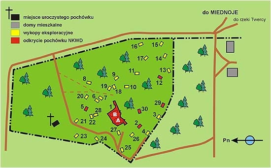

na podstawie: "W krainie śmierci... kronika ekshumacji Charków - Miednoje 22.VII - 3.IX.1991 r."

Ks. Zdzisław Peszkowski w swojej książce "... i ujrzałem doły śmierci" pisze, że z eksplorowanego dołu wydobyto dokument należący do Józefa Staszczyka z Siedlec, którego zidentyfikowano z listą NKWD nr 019/1 na poz. 15. Mój dziadek figuruje na liście NKWD nr 027/3 z dnia 13 kwietnia 1940 r. pod pozycją 27. Rozkaz Moskwy należało wykonać jak najszybciej, więc sądzę, że "pracowano" także i w niedzielę. Pisze też dalej ks. Peszkowski, że "Wszystko wskazuje na to, że w tym dole leży całe żniwo jednej nocy - 250 ofiar."

Pierwszy transport z Ostaszkowa odszedł 4 kwietnia. Z zeznań Tokariewa wynika, że ponad 300 ludzi nie można było zabić w ciągu jednej nocy, więc prawdopodobnie egzekucję dokończono w dniu następnym. Jeśli wielkość jednego transportu ustalono na 250 jeńców, to prawdopodobnie dziennie rozstrzeliwano na podstawie trzech list.

Jeśli moje rozumowanie jest słuszne (wybacz mi tą suchą szczerość), to w dniach:

\- **4-5 kwietnia** zabito jeńców z list nr 001, 002 i 003,  

\- **6 kwietnia** - nr 004, 005, 006,  

\- **7 kwietnia** - nr 007, 008, 009,  

\- **8 kwietnia** - nr 010, 011, 012,  

\- **9 kwietnia** - nr 013, 014, 015,  

\- **10 kwietnia** - nr 016, 017, 018,  

\- **11 kwietnia** - nr 019 (p. Staszczyk), 020, 021,  

\- **12 kwietnia** - nr 022, 023, 024  

\- **13 kwietnia** - 025, 026, 027 (mój Dziadek),  

itd. do 19 maja.

Czy mój Dziadek spoczywa dwa doły dalej?  
Jeśli listy numerowano na zasadzie: *nr kolejny listy*/*nr kolejny w danym dniu* (np. 025/1, 026/2, 027/3), to chyba tak było.

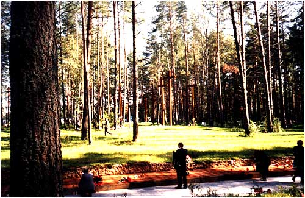

Po 60 latach, wreszcie pod polskim krzyżem i własnym imieniem. Miednoje 2000 r.

**Narodowa pamięć**

W końcu lat 80-tych Stowarzyszenie "Rodzina Katyńska" w Łodzi rozpoczęło przygotowania do odsłonięcia pomnika pamięci Polskim Jeńcom Wojennym z Kozielska, Starobielska, Ostaszkowa i innych obozów zamordowanym w 1940 r.

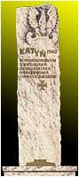

w Katyniu oraz w miejscach nieujawnionych na terenie ZSRR. Wykonania pomnika podjął się mgr artysta rzeźbiarz Włodzimierz Ciesielski syn ppor. Czesława Ciesielskiego zamordowanego w Katyniu.

Fundusze na budowę pomnika zgromadzono sprzedając "cegiełki" po 1000 ówczesnych złotych. Kupowali je przede wszystkim sami zainteresowani - matki, żony i dzieci ofiar pomordowanych na wschodzie oraz zwykli ludzie czujący potrzebę uhonorowania ofiar. Państwo, już przecież "wyzwolone" nie wykazało zbytniego zainteresowania. Początkowo pomnik miał stanąć przed kościołem garnizonowym pw. św. Ducha, ale w końcu, po perypetiach natury prawnej, akt erekcyjny wmurowano przed kościołem Matki Boskiej Zwycięskiej w dniu 15 sierpnia 1990 r.

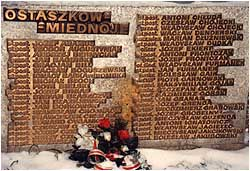

W akcie erekcyjnym zapisano słowa - "*Pomnik ten niech pozostanie przestrogą dla agresorów dążących do pohańbienia człowieka i wieczystym świadectwem triumfu prawdy nad zmową milczenia*". Pomnik odsłonięto w dniu 16 września 1990 r. w przeddzień 51 rocznicy napaści ZSRR na Polskę przed kościołem pw. Matki Boskiej Zwycięskiej przy ul Łąkowej w Łodzi. Na pomniku widnieje napis - Katyń 1940, pomordowanym z Kozielska, Starobielska, Ostaszkowa i innych obozów. Pod napisem sylwetka krzyża Virtuti Militari.

Pięć lat później 17 września 1995 r. to samo stowarzyszenie doprowadziło do odsłonięcia tablic pamiątkowych z nazwiskami pomordowanych. Jest także tam mój Dziadek (piąty od dołu w lewej kolumnie, przysłonięty czerwoną różą).

\* \* \*

W dniu **13 kwietnia 1943 r.** po raz pierwszy berlińskie radio hitlerowskich Niemiec nadało komunikat o odkryciu masowych grobów oficerów polskich w Katyniu pomordowanych wiosną 1940 r. przez bolszewików. Ten dzień ustanowiono jako

**Światowy Dzień Pamięci Ofiar Katynia**

**Kwiecień 2004 r.** - Warszawa, pomnik przy placu Zamkowym. Ogólnonarodowe obchody Światowego Dnia Pamięci Ofiar Katynia. Czy zauważyłeś to ogromne zainteresowanie pana Prezydenta? Czy zauważyłeś to ogromne zainteresowanie polskiego rządu? Czy zauważyłeś to ogromne zainteresowanie tych przypadkowych "wybrańców narodu" pospolicie zwanych sejmem i senatem?

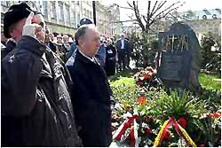

Pana Prezydenta "wszystkich Polaków" rozumiem, gdyż ma uraz do takich uroczystości od czasu, jak uroczyste otwarcia cmentarzy pomordowanych na Wschodzie rozpoczynał od stypy, ale reszta? Na tym zdjęciu, widzisz kto pielęgnuje narodową historię. Garstka rodzin, które pamiętają, a przede wszystkim, które jeszcze żyją i które mają jeszcze szczęście mieć pieniądze, by przyjechać do Warszawy. Trudno tu zauważyć matki i żony pomordowanych. Ci co oddają hołd, to już dzieci i wnuki ofiar.

Jest też współczesny policjant, ale z zajmowanej pozycji widać, że nie ma nic wspólnego z uroczystością i nie jest nią absolutnie zainteresowany. On musi pilnować, żeby przypadkiem starszym paniom i panom nic "nie strzeliło do głowy". A nuż rozgoryczeni ruszą na Wiejską, Krakowskie Przedmieście czy Belweder. Na tym polega współczesna tragedia Katynia, Charkowa i Miednoje. Absolutny brak zainteresowania naszych, polskich czynników państwowych doprowadzi do takiego paradoksu, że niedługo to święto zamiast Polaków będą obchodzić tylko Niemcy i może wnuki morderców.

Dziś o prawdę walczą już nieliczni, coraz starsi i coraz bardziej schorowani ludzie, którym zaczyna brakować sił, a przede wszystkim życia, bo usilnie dba o to utworzony przez lewicowego psychiatrę i pociotka dr Mengele - Narodowy Fundusz Zgonów. Sztafetę prawdy przejmują wnuki i prawnuki pomordowanych, ale droga do niej jest coraz bardziej wyboista i jeszcze bardziej "pod górkę". Nie wszyscy "Polacy" są tym zainteresowani, młodzieży w szkołach nie uczy się o naszej martyrologii, a w rządzie i w parlamencie zasiadają ludzie coraz bardziej przypadkowi - prostacy, złodzieje, oszuści, kryminaliści, pijacy i pieniacze, których interesuje tylko rozkradanie kraju i własna kiesa, a cmentarze Pamięci Narodowej na wschodzie otwiera pijany "wszystkich Polaków".

Żadne Ministerstwo Edukacji nie było i nie jest zainteresowane programem nauczania o najnowszej historii. Komuniści w parlamencie "czwartego miotu" tłamszą i niszczą działania Instytutu Pamięci Narodowej. Rząd nie widzi potrzeby porozumienia się w sprawie cmentarzy polskich na wschodzie, a jeden Andrzej Przewoźnik (sekretarz Rady Ochrony Pamięci, Walk i Męczennictwa) tego nie uczyni. Czy to jest szacunek do naszej przeszłości? Czy to jest szacunek dla tych, którzy życie oddali za Polskę? Dzisiejsza czerwona Targowica po raz kolejny sprzedała nas Moskwie.

**Kwiecień 2005 r.** - Dziwnie w tej naszej Polsce. W dniu 13 kwietnia (Światowy Dzień Pamięci Ofiar Katynia) odbyły się tylko drobne manifestacje przed ambasadą rosyjską, a jeśli były jakieś przed pomnikami pomordowanych, to prasa i telewizja jakoś je przemilczały. Widać mało medialne lub zbyt kameralne, a być może brakowało wypasionych gęb politykierów? Czy media wzięły na "przetrzymanie" czy otrzymały prezydencko-rządowe dyrektywy? Możliwe, bo oficjalne czynniki postanowiły uczcić pomordowanych trzy dni później (dlaczego?).

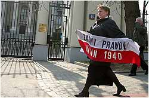

W stolicy odbyła się msza polowa, złożono wieńce pod pomnikiem Pomordowanym na Wschodzie, a także wręczono odznaczenia dla Rosjan zasłużonych w odkrywaniu prawdy (dlaczego tak późno?). Widać było ogromną rangę rocznicy i efekty pracy Ministerstwa Edukacji Narodowej, gdyż jak stwierdził prezes Rodziny Katyńskiej w Łodzi, Janusz Lange - *"Jestem rozczarowany, że przyszła tu garstka ludzi, i nie ma wśród nich właściwie w ogóle młodzieży. Martwię się, że tworzy się luka pokoleniowa. Jeśli umrze pokolenie synów i córek pomordowanych, to młodsze pokolenie już nie będzie o tamtych tragicznych wydarzeniach mówić"*. Skład też minimum. Przedstawiciele Rodzin Katyńskich, szef IPN Leon Kieres, prezydent na uchodźstwie Ryszard Kaczorowki oraz duchowni różnych Kościołów.

Pokazali się też starzy, sprawdzeni towarzysze, bo wybory blisko, a notowania mniej niż mierne. Wodza narodu nie było, wysłał za to nowego lokaja, prawnika i jedną nawiedzoną. Prezydentowi Polska już "zwisa", bo jest obrażony za "Orlen" i bezczelne obnażenie działań fundacji jego żony "Pieniądze bez barier", a i trzeciej kadencji też już nie będzie. Ważniejszy dla niego jest wyjazd z towarzyszem Jaruzelskim na "Dien Pobiedy" do Moskwy, gdzie pokaże się w doborowej stawce wielkich demokratów - Łukaszenki, Turkmen-paszy i oczywiście batiuszki Putina.

Ale co się stało z innymi? Gdzie ci "patrioci" z Ligi Pana Romana? Gdzie ta jego Wszapolska młodzież - bijące serce LPR? Gdzie te oszustki i kryminaliści z Samoobrony? Gdzie te "Sejmowe G..." Jagiellińskiego? Gdzie ta sól ziemi z PSL, co wszystko rozpoczyna od ryku "Nie rzucim władzy skąd nasz zysk"? Gdzie w końcu ci przyszli "zbawcy narodu" z PiS i PO??? Nie było żadnych i nie ma się czemu dziwić, skoro w tej hołocie przeważają tak bezczelni, że wzięli nawet państwowe diety za "prywatny" wyjazd na pogrzeb naszego Papieża.

Rodziny Katyńskie zmieniły taktykę widząc, że polski rząd, sejm i senat nic nie zrobili w ich sprawie, dlatego teraz w małych demonstracjach domagają się od Moskwy, by ujawniła jeszcze miejsca pochówku ponad 7000 Polaków pomordowanych wiosną 1940 r. przez NKWD. Historycy przypuszczają, że są to Bykownia i Kuropaty, ale nie ma możliwości sprawdzenia tego na miejscach zbrodni, bo na Białorusi panuje Łukaszyzm. W grudniu 2004 r. polskie śledztwo w tej sprawie rozpoczął Instytut Pamięci Narodowej, jak wbrew wcześniejszym obietnicom Rosjanie odmówili przekazania Polsce akt 14-letniego pozorowanego śledztwa. Instytut nie ma jednak poparcia ani w kancelarii prezydenta ani w rządzie ani w "tuczarni" z Wiejskiej, więc dalsze rokowania są więcej niż złe.

**9 maja 2005 r.** - Na tym dniu chyba zakończę cały ten artykulik. Pamięć o Dziadku jest ważniejsza od tego politycznego szamba. Polski prezydent pojechał na 60 rocznicę zwycięstwa nad faszyzmem do Moskwy tylko po to, by zostać upokorzonym przez pogrobowców Stalina. Na pokaz (chyba tylko dla Polaków), w ulewnym deszczu zmusił się do wygłoszenia paru oklepanych frazesów w cichym zakątku moskiewskiego cmentarza nad symbolicznymi grobami pomordowanych rodaków oraz w kameralnym gronie ambasady polskiej, gdzie wysłuchała go garstka polskojęzycznych towarzyszy. Za to rosyjscy weterani wojny byli wniebowzięci, bo władza dała im po goździku, parasolce, szklance wódki oraz łaskawie pozwoliła się cieszyć i pobrzęczeć medalami. Rano wszystkich emerytów i rencistów wsadzono na antyczne ciężarówki i przez Plac Czerwony przetoczyła się narodowa "Love Parade - Moskwa 2005" przy techno-ojczyźnianych dźwiękach, którą zakończył przelot kilku zabytkowych odrzutowców.

Cała Polska zobaczyła prawdziwą twarz dzisiejszej Rosji. Główną trybunę ustawiono przed mauzoleum woskowego dziadka - Lenina, dokładnie zasłoniętym, bo na sztandarach panoszył się jego partyjny wróg - Stalin, a na trybunie w pierwszym rzędzie (aż przetarłem oczy ze zdumienia) **państwa faszystowskiej osi** w komplecie - kanclerz Niemiec, premier Włoch, premier Japonii oraz dyktator Wszechrusi - syn KGB i wnuk NKWD - car Władimir Pierwszy. Żeby nie było wątpliwości - ogromny plakat, na którym wyjaśniono nieświadomym prawdy, że wojna dla Stalina rozpoczęła się dopiero w czerwcu 1941 r. Nasz "pierwszy" tow. Kwaśniewski pełen rozpierającej dumy, bo już w trzecim rzędzie, a mogło być gorzej. Prezydent Putin w krótkich słowach podziękował wielkiej Rusi za zwycięstwo nad faszyzmem, które uzyskała przy drobnej pomocy USA, Wielkiej Brytanii, Francji oraz... antyfaszystów z Niemiec i Włoch. O Polakach ani słowa. Po więcej niż szybkim powrocie tow. Kwaśniewski natychmiast zwołał konferencję prasową gdzie stwierdził, że jego wizyta była bardzo potrzebna, owocna i konstruktywna, a przemówienie prezydenta Putina określił jako "niezwykle poprawne politycznie, ważne i wyważone wystąpienie okolicznościowe"... Szczęka mi opadła w pierwszym momencie, ale później zrozumiałem - nie wolno drażnić "wielikoj Rusi".

Przelałeś krew na darmo drogi Dziadku, spoczywaj przynajmniej w spokoju na tej bydlęcej ziemi, bo dzisiejsza Polska pod rządami pociotków komuny takiej krwi nie szanuje.

---

**Korzystałem ze źródeł**:  
• Jędrzej Tucholski, "W krainie śmierci... kronika ekshumacji Charków - Miednoje 22.VII-3.IX.1991 r."  
• Ksiądz Zdzisław J. Peszkowski, "...i ujrzałem doły śmierci."  
• Andrzej Leszek Szcześniak, "Katyń. Tło historyczne, fakty, dokumenty."  
• Zbrodnia katyńska w świetle dokumentów z przedmową gen. Andersa.  
• My, Sybiracy. Związek Sybiraków Oddział Wojewódzki w Łodzi. Nr 2 1991 r.  
• Biuletyn katyński Nr 1(35), Kraków 1992.  
• Gazeta Policyjna, wydanie specjalne historyczne, 1991.  
• Codzienne wiadomości internetowe.
