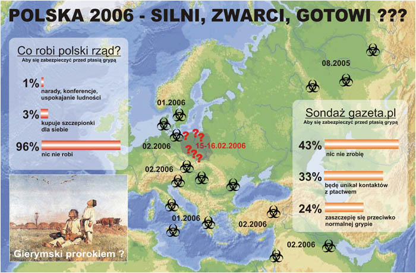

["GRYPTASIA" - SERWIS](http://www.biolog.pl/content-78.html)

 ** INFLUENZA ANTE PORTAS**

Czy chciałbyś żyć w państwie, które nie dba o własnych obywateli?  
Nie?... To masz pecha, bo właśnie w takim państwie żyjesz.

**Nie bądźmy naiwni**

Grypa grozi nam wszystkim. Czy to "ptasia" czy "zwykła" - wszystkie są groźne, a już najbardziej te nieleczone, zaleczone czy przechodzone, gdyż grożą bardzo poważnymi powikłaniami i niekoniecznie natychmiast. Prasa bije na alarm. Czytamy o zbliżającej się hekatombie i włos się jeży na głowie. Jak będzie naprawdę dowiemy się z gazet dopiero po wygaśnięciu epidemii, czyli jak zwykle po czasie ale nie znaczy to, że mamy czekać z założonymi rękami. Jedno jest pewne. Rzeczpospolita nie kiwnie palcem w obronie własnego obywatela, a tym bardziej w ochronie jego zdrowia, bowiem niepodzielnie panuje w niej instytucja urzędasów zwana NFZ, co należy tłumaczyć jako Narodowy Fundusz Zgonów - jedyna w Europie (a może i na świecie) instytucja zajmująca się systematyczną i prawnie usankcjonowaną eutanazją narodu.

Właściwe ministerstwo już obwieściło, że szczepionek i tak nie starczy dla wszystkich, bo dla rządu jest też za mało (jak policzyć "sterników narodu", ich rodziny i bliskich znajomych, a także NFZ z rodzinami, znajomymi i znajomymi znajomych, to ten milion szczepionek jest z pewnością kroplą w morzu potrzeb). Władza co prawda zapewnia, że szczepionki będą w przyszłym roku, co jak na polskie warunki już jest sukcesem, ale nie zmienia faktu, że wtedy ta szczepionka będzie nam tak potrzebna jak umarłemu kadzidło. Wniosek? Jeśli nie pomożemy sobie sami, to nikt nam nie pomoże. Dlatego skłoniło mnie to do opracowania niniejszego "miniporadnika", opartego na publikacjach prof. Michała Tombaka, zwolennika metod naturalnego leczenia, tym bardziej, że jego propozycje nie są uzależnione od kaprysów ministrów, urzędniczej miernoty czy producentów leków i narzucanych nam niekiedy niebotycznych cen.

**Uwaga, uwaga, nadfruwa...**

Z tego co już wiadomo, grypa jest choroba sezonową występującą z nadejściem jesieni i wiosny. Razem z nią atakują różne przeziębienia, anginy i tym podobne choroby. Czy zachorujemy czy nie, zależy to od nas samych, a bliżej od odporności naszego organizmu. Grypa przenosi się metodą kropelkową, a to oznacza, że najgroźniejsza jest w dużych skupiskach ludzi. Urzędy, markety, biura, zakłady, dobrze rozwinięta komunikacja miejska, międzymiastowa i międzynarodowa będą jej pomagać rozprzestrzeniać się w zawrotnym tempie. Wybuch i zasięg epidemii będzie zależał w szczególności od rozkładów jazdy, lotów i rejsów. Pamietać też należy, że można się zarazić dotykając przedmiotów, z którymi miał styczność chory na grypę.

Ptasia grypa, przed którą drży cały świat, nie powstała wczoraj ani przedwczoraj. To tylko zainteresowanie nią zaczęło się dopiero dwa lata temu, gdy "zachodni" świat zorientował się, że ich ludzie po powrocie z Azji zaczynają umierać na chorobę o symptomach grypy. Ptasia grypa towarzyszy nam od wieków, czego dowodem są ostatnie badania wirusa słynnej "hiszpanki". Wirus grypy mutuje bez przerwy od wersji "łagodnej" po "złośliwą" i co pare dziesiątek lat daje o sobie znak. W roku 1918 "Hiszpanka" zabiła 20 mln ludzi (nowe dane mówią o 50 milionach), "azjatycka" z roku 1957 pochłoneła około 1 miliona ofiar, w 1968 wirus zwany "Hong-Kong A2" uśmiercił 700 tysięcy ludzi, a ostatnia z większych "rosyjska" zdarzyła się w 1977 roku ale nie ma danych o ilości zgonów, być może dlatego że jest to "ściśle tajne" do dzisiaj.

Szczepionki na ptasią grypę nie ma i nie będzie. Te które są w sprzedaży, są skuteczne ale na wirusa który panował w roku ubiegłym. Rzekome "cudowne" leki na wirusa grypy, to tylko chwyt marketingowy nabijający kiesę producentowi. Nikt przecież nie zaskarży koncernu za to, że zachorował mimo użycia szczepionki czy leku. Polskie Ministerstwo Zdrowia nie wie co robić i nie robi nic, co jest najbardziej żenujące. Jedyna rada jaką mogą dać to ta, by "nie brać ptaszka do buzi" :-). Prawda jest taka, że nie ma się czego spodziewać po polskiej, partyjnej urzędokracji. Nawet sam prof. Religa, wybitny kardiochirurg, będzie potrzebował pomocy neurologa po uderzeniu głową w mur urzędniczej biurokracji.

**Uważajmy na objawy**

**Grypa zwykła** - zaczyna się wysoką gorączką, bólami głowy (zwłaszcza w okolicy czoła), bólami mięśni i stawów. Pojawia się chrypka, suchy kaszel, gardło jest zaczerwienione, niekiedy bolesne. Po 3-4 dniach gorączka opada i objawy mijają. Nieleczona atakuje serce, narządy jamy brzusznej, nerki i ośrodkowy układ nerwowy. Może zaatakować mózg powodując zapalenie mózgu. Atakuje skutecznie ludzi starszych lub obciążonych już innymi chorobami. Przeciętna epidemia powoduje zejście śmiertelne około 3% chorych.

**Grypa ptasia** - dawniej zwana "papuzicą". Zarazić się można przy kontakcie z kałem chorego ptaka lub od wirusów roznoszonych z pyłem z ptasich piór. Po 7-14 dniach pojawia się gorączka, bóle mięśni, czoła, poty, suchy kaszel ze skąpą plwociną podbarwioną krwią. Wirus atakuje przede wszystkim płuca (radiologicznie widoczne zmiany naciekowe płuc) stąd "nietypowe zapalenie płuc". Najbardziej narażeni są pracownicy zakładów drobiarskich, hodowcy drobiu a także pracownicy ogrodów zoologicznych.

Dziś już wiadomo, że głównym roznosicielem choroby jest dzikie, zarażone ptactwo, szczególnie niebezpieczne podczas sezonowych migracji. Krótko mówiąc "ptasia grypa" jest już wszędzie. Jest w Azji, w Europie, w Afryce i obu Amerykach (tam przenieśli ją ludzie). Tam gdzie jeszcze jej nie ma oznacza tylko to, że w tych miejscach nie przeprowadzono żadnych badań. Światowa medycyna jest bezsilna i jedynym lekarstwem jakie stosuje jest ptasiobójstwo domowego drobiu. Zdrowe czy chore, miliony ptaków idą z dymem, a jakie to daje efekty widać po ogniskach ptasiej grypy wybuchających w coraz to nowych miejscach.

**Co radzi prof. Tombak**

Za wszelkie zachorowania odpowiedzialny jest nasz system odpornościowy, zaś jego podstawą jest obecność witaminy C w naszym organizmie. Spożywanie witaminy C w tabletkach nie tylko nie pomaga, a wręcz jest szkodliwe dla naszego organizmu, a jej przedawkowanie grozi konsekwencjami natury zdrowotnej. Dlaczego?... Prof. Tombak pisze:

Syntetyczna witamina C szkodzi, gdyż nie jest łatwo przyswajalna przez organizm jako produkt chemicznie czysty. Zwiększa krzepliwość krwi i sprzyja powstawaniu kamieni w nerkach i pęcherzu moczowym. Niszczy witaminę B2. W cukrzycy zaburza proces produkcji insuliny i zwiększa zawartość cukru w moczu i krwi. Duże dawki sztucznej witaminy C hamują tempo przesyłania impulsów nerwowo-mięśniowych, co powoduje zmęczenie mięśni i zaburzenia koordynacji wzrokowych i ruchowych. Każda witamina wyprodukowana przez człowieka jest tylko jednym wyselekcjonowanym związkiem chemicznym, któremu brak naturalnych biokatalizatorów i substancji ułatwiających przyswojenie ich przez ludzki organizm. Każda posiada skutki uboczne, których producent nie umieszcza na opakowaniach z obawy o zysk.

Pan profesor proponuje działać profilaktycznie:

Codziennie od października do kwietnia stosować odżywkę przeciwgrypową: 2 cytryny zetrzeć na tarce usuwając uprzednio pestki, rozdrobnić 4 główki obranego czosnku, wszystko wymieszać i zalać 1,5 litrem gotowanej wody. Odstawić na 3 dni w ciemne miejsce o temperaturze pokojowej. Potem roztwór odcedzić i trzymać w lodówce. Spożywać po 1 łyżce stołowej na czczo i wieczorem przed snem (dzieci po 1 łyżeczce od herbaty).

Drugim ze sposobów jest picie soku z cytryny. Można go stosować przy takich chorobach jak osteoporoza, podagra, chroniczny reumatyzm, kamienie żółciowe i nerkowe, anemia, dna moczanowa, niektóre choroby nerwowe, cukrzyca, nadwaga, nadciśnienie, katar żołądka i choroby wątroby.

Profilaktykę prowadzimy sokiem z cytryny przez 10 dni, którą należy przeprowadzać najlepiej wczesną wiosną lub późną jesienią w okresie epidemii grypy, angin i przeziębień. W pierwszym dniu wypijamy sok z jednej cytryny, a w kolejnych dniach zwiększamy ilość cytryn o jedną do piątego dnia, szóstego wypijamy sok też z 5 cytrym, a w następnych zmniejszamy o jedną. Wygląda to tak (dzień/ilość cytryn) - 1/1, 2/2, 3/3, 4/4, 5/5, 6/5, 7/4, 8/3, 9/2 i 10/1. Jak przygotować sok z cytryny - cytrynę należy przekroić na pół i każdą połówkę wycisnąć. Sok pić bez dodatku cukru i bez rozcieńczania wodą, a jeśli ktoś ma problem z wypiciem czystego soku, to może go rozcieńczyć przegotowaną wodą i dodać łyżeczkę miodu na szklankę soku.

Jeśli ktoś jak ja, pali nałogowo papierosy, musi pamiętać o jeszcze jednym. Każdy wypalony papieros niszczy 25 mg witaminy C w organizmie, co stanowi 1/4 dziennego na nią zapotrzebowania, czyli praktycznie każdy palacz jest jej pozbawiony już po czwartym papierosie. Dzienne zapotrzebowanie (100 mg) zapewnia sok wyciśnięty z dwóch średnich cytryn. Stąd wniosek, że każdy palacz palący paczkę papierosów dziennie winien cały czas chodzić na "cytrynowej bani". Co zrobić, gdy ktoś nie cierpi soku z cytryny? Może sobie zamienić na coś innego. Witaminę C można znaleźć w 100 g następujących świeżych produktów: chrzan (700 mg), czarna porzeczka (200 mg), nać pietruszki (193 mg) czy papryka (120 mg). Przy okazji - żując nać pietruszki likwidujemy przykry zapach czosnku z ust.

Jeśli już grypa nas dopadła prof. Tombak proponuje następującą strategię:

•  należy mniej jeść, więcej pić, ruszać się, a co najważniejsze dobrze się wypocić,  
•  spożywać jak najwięcej świeżo przygotowanych soków i "odzywek" z zawartością czosnku i cebuli,  
•  do sporządzania "odżywek" wykorzystujemy każdy z przepisów, w skład których wchodzi czosnek, cebula, rzepa, pietruszka, cytryna, grapefruit, liście malin,  
•  od razu po zachorowaniu oczyścić jelito grube (lewatywa) wodą z sokiem cytryny (1,5 litra wody + sok z 1 cytryny) naprzemiennie z lewatywą czosnkową (3-4 ząbki czosnku zalać 1 szklanką wrzątku, odcedzić) przez 7 dni,  
•  wykonać płukanie nosa roztworem (do 1/2 szklanki ciepłej wody dodać 1 łyżeczki od herbaty soli i 1 łyżeczki od herbaty sody oczyszczonej, wymieszać, dodać 5 kropel jodyny). Roztwór wciągać kolejno prawą i lewą dziurką od nosa i wypluwać przez usta. Jeśli nie jesteśmy w stanie tego wykonać, to należy przyrządzić krople do nosa (drobno posiekać 2-3 ząbki czosnku, zalać 30-50 ml wrzątku, odczekać 1-2 godziny i przecedzić), wkraplać do nosa 2-3 krople 1-2 razy dziennie przez dwa dni,  
•  żeby nie zarazić domowników powinniśmy nosić na szyi woreczek z gazy z drobno posiekanym czosnkiem, dla małych dzieci taki woreczek przywiązujemy przy łóżeczku lub stawiamy obok łóżeczka spodeczek z posiekanym czosnkiem.

Jeśli ktoś ma genetyczny wstręt do lewatywy czy nie chce "śmierdzieć" czosnkiem w wytwornym towarzystwie albo nie ma zaufania do tak zwanej "ludowej" medycyny, to jego sprawa, ale chyba lepiej jest być żywym choć "pachnącym" czosnkiem niż wyperfumowanym trupem. Polskie Ministerstwo Zdrowia poradzi nam tylko jedno - "wybór należy do Ciebie".

**Dlaczego akurat Tombak?**

Od dawna interesowały mnie nie uznawane przez współczesną medycynę sposoby zwalczania chorób. Sposoby naszych babć poszły w zapomnienie, wyparte przez przemysł chemiczny i lekarzy wąsko wyspecjalizowanych, którzy dziś przypominają bardziej mechaników z warsztatu samochodowego. Dzisiaj leczone są tylko skutki. Najchętniej się amputuje, wymienia, zastępuje lub faszeruje "chemią". Leczyć należy "agresywnie" i szybko, bo każdy nowy pacjent to "świeży" pieniądz. Dlatego pytając lekarza - "doktorze, do której pan przyjmuje?" - można usłyszeć - "dzisiaj do prawej". To właśnie ta pogoń za pieniądzem zrodziła "medyczne bydło" z pogotowia ratunkowego w Pavulon City (kiedyś nazywanym Łodzią).

Starsi pamiętają jak w latach 50-tych i 60-tych zapamiętale niszczono "znachorów" jako relikt kapitalistycznej prywaty i nienaukowego leczenia. W ten właśnie sposób zabito polskie ziołolecznictwo. Przetrwało ono tylko za zakonnymi murami i dziś zielarze w habitach są wprost "rozrywani" przez ludzi, którzy stracili zaufanie do naukowej medycyny. Niektórzy sami na własnej skórze odczuli skutki leczenia specjalistycznego. Każdy lekarz przepisuje własne leki nie patrząc na te, które przepisał inny specjalista. W rezultacie leki wzajemnie się zwalczają lub wykluczają i jeśli pacjent sam nie przeczyta dokładnie przeciwwskazań podanych w ulotce, może w szybkim tempie przejść na wyższy stopień rozwoju duchowego.

Prof. Tombak nie patrzy na człowieka jak na magazyn pojedynczych części zamiennych ale postrzega go jako jeden wielki biologiczny "silnik", w którym każda cząstka spełnia ważne zadanie w ogólnym mechanizmie, gdzie wszelki ból jest tylko sygnałem, że w środku coś się dzieje, a nie sygnałem dla lekarza by go chemicznie uśmierzyć lub usunąć bolącą część. Prof. Tombak w swych książkach proponuje leczenie pożywieniem, a więc tym czego używamy na co dzień i co jest dużo tańsze od leków. Ponadto jako jeden z nielicznych, wytłumaczył i podał kompleksowy sposób oczyszczenia organizmu ze złogów, kamieni i trucizn, które połykamy przez całe nasze życie wraz z "podrasowanym" chemicznie pożywieniem. Wszelkie spotykane inne "cudowne" diety, to tylko wyrwane cząstki z tego, co proponuje prof. Tombak.

**Wiara w chemię nas nie uleczy**

Najbardziej znanym lekiem zawierającym kwas acetylosalicylowy jest aspiryna produkowana przez koncern chemiczny Bayer, zwany także farmaceutycznym. Kwas acetylosalicylowy w tabletkach przeważnie łączy się z witaminą C, kodeiną, fenacetyną, paracetamolem i etenzamidem. Połykamy go w lekach: Alka Prim, Antygrypin, Aspimag, Aspirin C, Aspirin forte, Aspro C, Aspro C forte, Calcipiryna, Polopiryna C, Tabletki od bólu głowy, Tabletki przeciw grypie, Paracetamol, Ibuprofen, Aspirin, Aspirin Direkt (tabletki do ssania), Aspirin Protect (tabletki dojelitowe), Aspirin Cardio, Acard, Acesan, Bestpiryna, Cardiopiryna, Galocard AlkaSeltzer, Andol, Anopyrin, Apo-ASA, Apyrin, Asopiryna, Aspegic, Aspotabs, Aspro, ASS-Ratiopharm, Bestpiryna, Encopiryn, Polopiryna i Polopiryna S, Rhonal, Togal, Upsarin i chyba to jeszcze nie wszystko. Czytajmy więc dokładnie skład leku. Jeśli pisze **acidum acetylsalicylicum**, to jest właśnie to czego szukamy.

Do dzisiaj kwas acetylosalicylowy jest lekiem bezskutecznie zwalczanym przez lekarzy homeopatów, jako środek wręcz trujący. Opisujący leczenie grypy w roku 1918 w artykule "[Epidemia grypy 1918 - homeopatia na ratunek](http://www.homeopatia.edu.pl/index.asp?idm=1&idp=12&ide=30)" Guy Beckly Stearns MD, New York, pisze:

Aspiryna oraz inne produkty wytwarzane ze smoły węglowej są potępiane przez lekarzy, ponieważ powodują ogromną liczbę niepotrzebnych zgonów. Wszędobylska aspiryna jest zdecydowanie najbardziej szkodliwym lekiem ze wszystkich. Jej fałszywie dobroczynne działanie przeciwbólowe wywołuje zaledwie krótką ulgę, nic nie znaczącą z punktu widzenia medycyny. W wielu przypadkach aspiryna osłabiła serce, negatywnie wpłynęła na poziom sił witalnych pacjentów, zwiększyła poziom śmiertelności oraz znacznie spowolniła proces rekonwalescencji. We wszystkich przypadkach aspiryna maskuje objawy, co znacznie bardziej utrudnia dobór odpowiednich leków. Aspiryna najprawdopodobniej wcale nie działa lecząco na żadną chorobę i powinna być wycofana z użycia.

Inny ze wspominających J.P. Huff MD, Olive Branch, stan Kentucky, opisuje:

Przysłano mi paczkę zawierającą 1000 tabletek aspiryny, o 994 za dużo. Wydaje mi się, że podałem zaledwie pół tuzina. Nigdzie nie mogłem tego schować. Używam bardzo niewielu leków. Prawie zawsze podaję Gelsemium i Bryonia. Prawie nigdy nie traciłem pacjenta, jeżeli przybyłem na wezwanie pierwszy, chyba że wcześniej pacjent wysłany był do apteki po aspirynę. W takiej sytuacji prawie zawsze musiałem zająć się nowym przypadkiem zapalenia płuc.

Proszę wziąć pod uwagę, że powyższe opinie powstały w roku 1918, a więc w roku epidemii słynnej "hiszpanki". Sądzę, że warto to wziąć pod uwagę.

Jeśli ktoś bezgranicznie wierzy w ożywiającą moc chemioterapii, to [aspirynę](http://chemik12.webpark.pl/org/aspiryna.htm) może zrobić samemu, a dla tych którzy sceptycznie odnoszą się do "nowoczesnej" medycyny polecam strony leczenia homeopatycznego - [grypa i przeziębienie](http://www.pfm.pl/u235/navi/199221) i sama [grypa](http://awe.mol.uj.edu.pl/~jjb/ogrypie.htm). Leki wymienione wyżej, Gelsemium i Bryonia są lekami ziołowymi. Gelsemium jest mieszanką ziołową, a Bryonia jest ziołem występującym pod nazwą "przestęp" (bryonia alba, bryonia dioica). Gelsemium produkuje Lehning Laboratoires i lek jest jeszcze dostępny w Polsce [w Sklepie Internetowym](http://homeopatia.net.pl/cgibin/shop?info=MM37&sid=770f1140) za jedyne 7 zł fiolka (słownie - siedem złotych), albo w [Aptece internetowej](http://aptekazdrowia.pl/index.php?products=product&prod_id=193520115978) za 15,30 zł.

**Jak się chronić przed wirusem**

[Gazeta.pl 28.02.2006](http://serwisy.gazeta.pl/nauka/1,34148,3186849.html)  
**•** Przed spożyciem drobiu trzeba się upewnić, że każda część jest ugotowana (nie jest różowa), a jajka są dogotowane (bez płynnych żółtek). Nie jemy żadnych surowych jajek - kogli-mogli ani jajek na miękko.  
**•** Jajka jeszcze przed przygotowywaniem powinno się wyparzyć - skorupka też może być zanieczyszczona.  
**•** Gdy kupujemy drób, należy przenosić go w osobnym opakowaniu, tak by nie miał kontaktu z innym pokarmem - warzywami, owocami, chlebem itp.  
**•** Przy patroszeniu i przygotowywaniu drobiu powinniśmy używać rękawiczek.  
**•** Po skończeniu przygotowywania drobiu, smażeniu jajek i dotykaniu brudnych skorupek ręce, a także wszystkie używane przedmioty (np. deskę do krojenia, zlew, stół, noże), które miały z nimi kontakt, powinniśmy dokładnie umyć. Wystarczy ciepła woda i mydło.  
**•** Gdy znajdziemy padłego ptaka, nie powinniśmy go w ogóle dotykać - najlepiej zawiadomić służby weterynaryjne.  
**•** Najlepiej unikać miejsc, przedmiotów zanieczyszczonych ptasimi odchodami lub krwią - kurników, przetwórni drobiu itp.

**Warto zapamiętać**

**Jeśli w tym roku nie dojdzie do epidemii grypy, to będziemy mieli szczęście. Pamietajmy jednak, że dzikie ptactwo rozpocznie ponowną wędrówkę już na wiosnę i tak co roku w odwiecznym rytmie. Groźba epidemii wcale nie zniknie, to tylko gazety przestaną o tym pisać. Powtórzmy więc profilaktykę wczesną wiosną, bo nasze zdrowie jest tego warte.**

**DONOSY Z POLA WALKI**

**Jak zarobić na ptasiej grypie**

23 grudnia 2005 r. ogłoszono, że wirus ptasiej grypy uległ mutacji. Tamiflu już nie pomaga.

---

I co robi współczesna medycyna? Szuka sposobu jak zarobić na ludzkiej głupocie i strachem przed ptasią grypą. Do pracy wzięli się rzymscy naukowcy i ogłosili w specjalistycznym (a więc najbardziej "wiarygodnym") piśmie "Journal of Infectious Diseases", że czerwone wino nie tylko ma dobroczynne działanie na układ sercowo-naczyniowy, ale jeden z jego składników o nazwie resweratrol pomaga obronić się przed grypą, bo jest zdolny zablokować proces mutowania wirusa grypy. Wykazano to na 60% zmniejszeniu umieralności wśród badanych myszy chorych na grypę, które regularnie upijano czerwonym winem. Białe myszy, jak wiadomo, mają genom zbliżony do genomu człowieka będącego pod wpływem. Od niechcenia dodano jeszcze, że z wcześniejszych badań wynika iż wypijanie dwóch kieliszków tego trunku dziennie pomaga zapobiec chorobom Alzheimera i Parkinsona oraz wzmacnia układ krwionośny. Trwają jeszcze prace nad zmuszeniem wirusa do picia wina.

---

I co ma zrobić człowiek, jak wino tańsze od szczepionki? Pić, ale tylko włoskie czerwone.

**Ptasia grypa odsłania twarz... ludzi**

W styczniu Agencja ITAR-TASS doniosła o nowej formie walki z ptasią grypą. Autorem jest nie kto inny, tylko wybraniec narodu rosyjskiego Władymir Żirinowski. "Należy zakazać ptakom powrotu do Rosji. Należy uruchomić całą rosyjską obronę przeciwlotniczą i zestrzeliwać powracające ptaki. Wszystkich myśliwych i posiadających broń należy rozstawić na granicy z Ukrainą i Białorusią i nakazać strzelać do wszystkiego co leci i macha skrzydłami".

---

Od dawna wiadomo, że ten człowiek nie jest głupi. On jest bardzo głupi.

**Wirusa H5N1 można skutecznie zwalczyć**

Substancja G-Cide, zawierająca aldehyd glutarowy, od 1990 r. stosowana w Afryce jako biocyd zwalczający różnego rodzaju patogeny (grzyby, wirusy, bakterie), jest bardzo efektywną substancją unieszkodliwiającą wirusa ptasiej grypy H5N1. Informuje o tym magazyn naukowy "[Chemistry World](http://wiadomosci.onet.pl/1232564,16,1,0,120,686,item.html)". Substancję zsyntetyzowała 1989 r. doktor Toni Martin. Obecnie technologię produkcji odsprzedano amerykańskiej firmie chemicznej. Właścicielem i jedynym producentem biocydów jest amerykańska firma chemiczna Dow, produkująca Glutex - szeroką gamę środków, którymi można zwalczyć wirusa H5N1. W minionym tygodniu firma Dow **podniosła o 10% ceny wszystkich produktów**, które zawierają dodatek G-Cide. Szef firmy, Mark Henning, tłumaczy zwiększenie cen "koniecznością przeprowadzenia dodatkowych testów oraz zwiększeniem wydajności produkcji, by sprostać ogromnemu zapotrzebowaniu światowego rynku".

---

Czy dalej wierzysz, że chodzi o zdrowie ludzi?

**Choroba wściekłych ptaków?**

Fakty.Interia.pl. 27.01.2006 - Naukowcy prawdopodobnie wiedzą już dlaczego wirus tej choroby jest tak niebezpieczny. Badania opublikowane dziś na łamach "Science" wskazują na to, że wirusy ptasiej grypy mogą mieć gen, który odpowiada za ich wyjątkową zjadliwość. Nie mają tego genu wirusy ludzkiej grypy. Odkrycie może teraz pomóc w wykrywaniu "szczególnie groźnych" odmian wirusa i oczywiście przy tworzeniu leków. Pojawiły się także kolejne obiecujące informacje na temat szczepionki. Badacze z Uniwersytetu w Pittsburgu informują, że wstępne testy nowej szczepionki, prowadzone na myszach i kurczakach wykazały jej stuprocentową skuteczność. Pierwsze testy na ludziach mają się rozpocząć już wkrótce.

---

Myszy i kurczaki przeżyły. Poczekajmy jak się zachowa daleki ich "ewolucyjny" krewny - człowiek.

**POLSKA - Mobilizacja 2006**

**Gazeta.pl. 16.02.2006** - Z różnych stron Polski nadchodzą doniesienia o padłych łabędziach. Jednak na razie nie ma potwierdzonych przypadków ptasiej grypy. Dziś mają być podane wyniki badań martwych łabędzi znalezionych wczoraj, późnym wieczorem w zachodniopomorskiem. Tymczasem kolejne padłe ptaki znaleziono w kilku różnych miejscach: w Skawinie i w Krakowie w Małopolsce, oraz na Warmii na rzece Elbląg i w Lidzbarku Warmińskim. Lekarze weterynarii uspokajają, że wiele przypadków śmierci tych ptaków ma przyczyny naturalne i jest związanych z ciężką zimą. \[...\] Pierwszy przypadek ptasiej grypy stwierdzono także w Dagestanie na południu Rosji. Wczoraj przypadki tej choroby potwierdzono w Austrii i Rumunii, a 5 dni temu w Grecji, Włoszech i Bułgarii.

**Onet.pl. 16.02.2006** - Minister zdrowia Zbigniew Religa uważa, że **istnieje znikome prawdopodobieństwo, by w Polsce doszło do epidemii ptasiej grypy wśród ludzi**. Zapewnił jednak w czwartek, że polska służba zdrowia jest dobrze przygotowana na wypadek epidemii. \[...\] Ptasia grypa jest chorobą ptaków, dlatego działem, który jest za to odpowiedzialny, są służby weterynaryjne i Ministerstwo Rolnictwa. \[...\] Rzecznik prasowy ministra Ryszard Wijas powiedział PAP w czwartek, że Polska zakupiła lek Tamiflu (oseltamiwiru). "Nie podajemy informacji na temat ilości zakupionego leku, to jest tajne. Natomiast możemy powiedzieć, że mamy dawki, które starczą dla tysiąca ludzi". (Tajne? Ha, ha, ha... Pamiętacie Laskowika? "Pani Pelagio, czy może nam pani powiedzieć jakie bombki produkujecie? Tego nie mogę powiedzieć, bo to jest tajemnica państwowa. Mogę tylko powiedzieć, że mam 5 złotych od bombki. A jaka jest norma dzienna? Jak się uprę, to zrobię ich 283...")

15 lutego ze stanowiska wiceministra rolnictwa wyleciała Stanisława Anna Okularczyk z PiS za szczerą wypowiedź, że "wyborcom obiecano bzdety i złote góry", a dzisiaj przedstawiciel Ministerstwa Rolnictwa (też z PiS) na pytanie, co rząd robi w zakresie ochrony przed ptasią grypą odpowiedział, że planuje się **jakieś** ćwiczenia, na **jakąś** małą skalę, w **jakiejś** miejscowości w Polsce, za **jakieś** parę dni. Stwierdził też, że ptasia grypa jak sama nazwa wskazuje, dotyczy tylko ptaków (sic!). Czy Ministerstwo Rolnictwa to fachowcy, czy jak zwykle partyjne matoły? Czy wirus ptasiej grypy zaczeka, zanim głupkowaci i niefrasobliwi ludzie z tego resortu wybudzą się z letargu? Na co czeka premier Marcinkiewicz? Czy rząd obudzi się dopiero, jak zaczną umierać pierwsi chorzy? A może rząd jest święcie przekonany, że przeżyje dzięki nic nie wartej szczepionce, zakupionej tylko dla siebie za nasze pieniądze?

W ościennych państwach padają ptaki zarażone ptasią grypą, ale u nas tylko ze zmęczenia i głodu. Czy polskie służby weterynaryjne są przygotowane na identyfikację wirusa ptasiej grypy? Dlaczego "zakneblowano" laboratorium w Puławach? Dlaczego nie wysyłamy próbek do Wielkiej Brytanii jak inne państwa? **Czy polski rząd jak zwykle okłamuje społeczeństwo?**

**Fakty.Interia.pl. 17.02.2006** - Szczątki padłych ptaków, które mogą zawierać wirusa H5N1, trafiają w Polsce do dwóch ośrodków badawczych - PIW w Puławach i ZHW w Gdańsku. Jak ustaliło "Życie Warszawy", **żadne z tych laboratoriów nie ma wymaganej przez Światową Organizację Zdrowia (WHO) trzeciej klasy bezpieczeństwa**. \[...\] **W gdańskim ośrodku brakuje m. in. specjalnych filtrów do oczyszczania powietrza**. - My tylko wstępnie badamy ptaki. Potem przesyłamy je do lepiej przygotowanego laboratorium w Puławach - tłumaczy się dyrektor gdańskiej placówki dr Andrzej Stryszak. Okazuje się jednak, że **laboratorium PIW** \[...\] **w Puławach nie jest w ogóle sklasyfikowane w systemie bezpieczeństwa WHO**. \[...\] W tych samych Puławach mieści się laboratorium, w którym można byłoby już dziś bezpiecznie badać wirusa ptasiej grypy. Wymagane normy bezpieczeństwa spełnia wojskowy Ośrodek Diagnostyki i Zwalczania Zagrożeń Biologicznych. Mamy do tego doskonałych fachowców i wszelki potrzebny sprzęt. **Brakuje pieniędzy na zakup zestawów diagnostycznych do wykrywania wirusa**. Potrzeba na to około 60 tys. zł - mówi dyrektor ODiZZB prof. Roman Bartoszcze.

Teraz można już zrozumieć, dlaczego "nasze" ptaki padają tylko z wycieńczenia lub głodu. Jeśli dodamy do tego koszty badań jednego padłego ptaka sytuacja jest jeszcze jaśniejsza. Obliczono, że jedno badanie w Puławach na obecność wirusa H5N1, to koszt około 207 zł. Po doliczeniu kosztów obsługi badania (transport w chłodni, dieta kierowcy) koszt wzrasta do około 700 zł. Wniosek jest taki, że za jedną średnią limuzynę rządową (około 140 tys. zł.) można wykonać 200 badań. Pomnóżmy to przez ilość limuzyn rządowych, dodajmy ilość samochodów dla nierobów i ich przydupasów ze wszystkich niepotrzebnych agencji rządowych, samochody dla "wybrańców narodu" z sejmu i senatu a wyjdzie suma, za którą możnaby przebadać padłe ptaki z połowy Europy. Powtarzam raz jeszcze - **rządu, partyjnych matołów i politykierów naród nie interesuje**. Naród jest tylko po to, by utrzymywać tę armię nierobów. Jeśli część narodu padnie w epidemii, to tym co przeżyją podwyższy się składki na ZUS, na NFZ oraz podatki, by wyrównać straty. Na **ICH** dobrobyt pieniądze muszą się znaleźć.

**RMF FM 17.02.2006 godz. 17:00** - Tysiące zdrowych kur zostanie zabitych podczas ćwiczeń sprawdzających gotowość do walki z ptasią grypą w Polsce. Dojdzie do tego w Wielkopolsce i Małopolsce na początku marca. Jednym z elementów ćwiczeń będzie zabicie kilku tysięcy sztuk drobiu. Kury mają zostać zagazowane tlenkiem węgla, całkowicie bezboleśnie - jak zapewnia zastępca Głównego Lekarza Weterynarii, Janusz Związek. Ministerstwo zapowiada zakupienie "wyeksploatowanych kur", które i tak trafiłyby pod nóż.  
Zdaje się, że działalność Ministerstwa Rolnictwa zaczyna przekraczać zdrowy rozsądek, o normach moralnych nie wspominając. Czy w ramach ćwiczeń nie można zarazić ptasią grypą pracowników tego ministerstwa i wypróbować na nich zakupione leki? Załatwiamy od razu trzy problemy - pozbywamy się nieudolnych ludzi, określamy przydatność leków i przekazujemy te parę tysięcy sztuk "wyeksploatowanego" drobiu do stołówek dla biednych i bezdomnych.

**Fakty.Interia.pl. 20.02.2006** - Co najmniej milion osób może umrzeć w Polsce, jeśli wirus ptasiej grypy zmutuje się z ludzkim - twierdzą naukowcy z Państwowego Zakładu Higieny. Sztaby kryzysowe w województwach wyznaczają już miejsca zbiorowego pochówku. \[...\] To, kiedy choroba dotrze do Polski, pozostaje już tylko kwestią czasu. - Nie wiemy na 100%, czy nie ma jej już w kraju - przyznają eksperci z Instytutu Weterynarii w Puławach, gdzie trafia codziennie kilkadziesiąt próbek w celu wykluczenia wirusa. **Koszt jednego badania to w sumie 200-500 zł, dlatego nie są sprawdzane wszystkie sygnały**.

**Wiadomości.wp 20.02.2006** - Stoimy przed coraz większym zagrożeniem, bo na wschód wracają dzikie ptaki. Jeśli zostaną wybite miliony sztuk drobiu, **będzie gospodarczy krach**. Zarezerwowane w budżecie 160 mln nie wystarczy na odszkodowania. \[...\] **Polska nie ma zapasu leku antywirusowego tamiflu (w rezerwie jest tylko 900 dawek), bo przespaliśmy termin jego zamówienia**.  
Nie wiem, czy "ptasiobójstwo" ma jakikolwiek sens. Kto oglądał telewizyjne wieści w dniu wczorajszym zauważył z pewnością znamienny szczegół. Niemiecka służba weterynaryjna zabierała padłego łabędzia do plastikowego worka, a obok na plaży mewa zajadała się padliną jego kolegi. Jedno jest pewne, zarażanie idzie w tempie wykładniczym i człowiek nie jest w stanie mu zapobiec. Jaki może być scenariusz? "Awiacyjnej grypy" nie unikniemy, a wybijemy całe domowe ptactwo i będziemy znów zmuszeni do konsumowania wieprzowiny. Do czasu, bowiem świnie też dokarmiamy kostną mączką, co rokuje pojawieniem się choroby wściekłych świń.

**Wiadomości.wp 21.02.2006** - Wczoraj na terenie Poznania, w forcie VIII, odkryto kilkanaście martwych kaczek. Niektóre **były już w stanie całkowitego rozkładu**. Ekipa z udziałem lekarza weterynarii, która udała się na miejsce zgłoszenia, miała bardzo utrudnione dojście do wszystkich padłych ptaków. Część z nich zostanie dzisiaj przetransportowana do Puław, gdzie mieści się jedyne laboratorium mogące zidentyfikować wirusa ptasiej grypy. Obecny podczas tej akcji lekarz weterynarii przypuszcza, iż przyczyną śmierci ptaków było prawdopodobnie jakieś zatrucie. \[...\] **Nie widzę niebezpieczeństwa na wypadek zagrożenia; mamy wyznaczone miejsca izolacji w szpitalu w Śremie, gdzie jest przygotowanych 20 łóżek na przyjęcie pacjentów**.  
Jeśli gospodarne i bogate "poznańskie" ma już 20 epidemicznych łóżek, to ile ma reszta? Tracimy czas i pieniądze. Obawiam się, że stosowana metodyka działania nie przyniesie oczekiwanych korzyści i fundusz na zwalczanie ptasiej grypy wykorzystamy przed jej wykryciem. Wirus, który zaatakuje ludzi nie będzie tym wirusem, którego szukamy dzisiaj, a zakupione szczepionki są na zupełnie inny rodzaj grypy. Rozkładające się ptaki, to dowód że wirus prawdopodobnie jest już od dawna w nowym miejscu, przeniesiony przez innego padlinożercę. Biedna Polska znowu wyda mnóstwo pieniędzy nie tam gdzie ich potrzeba najbardziej, a epidemia jak ma wybuchnąć, to i tak wybuchnie. Tyle, że wtedy już nie będzie pieniędzy na ratowanie chorych i jak zawsze do leczenia użyje się "sprawdzonej i doskonałej" aspiryny.

**Fakty.Interia.pl. 21.02.2006** - Rząd nigeryjski potwierdził dziś obecność groźnego także dla człowieka wirusa ptasiej grypy H5N1 w kolejnych trzech stanach i w stolicy kraju, Abudży. W sumie w Nigerii jest już siedem ognisk tej choroby. \[...\] Wirusa ptasiej grypy wykryto w północnej Nigerii 8 lutego. Od tego czasu w kraju wybito tysiące sztuk drobiu.  
Nie jesteśmy osamotnieni. Już nie tylko Azja i Europa ale nawet Murzyni nie są bezpieczni. Czy pokrzepiono serce Twoje?

**RMF FM 22.02.2006** - W przypadku potwierdzenia obecności szczepu H5N1 wirusa ptasiej grypy w Polsce, natychmiast zostaną wprowadzone specjalne środki ostrożności. Wokół miejsca, w którym został wykryty śmiercionośny szczep, natychmiast zostaną utworzone dwie strefy ochronne: jedna w promieniu 3 km, a druga - do 10 km. Do pierwszej strefy dostęp będą mieli jedynie mieszkańcy danej miejscowości. Wjazdu będą pilnować policjanci. Na granicach stref pojawią się maty odkażające, a także pojemniki z płynem do dezynfekcji rąk. Wszystkie hodowle ptaków w obu strefach będą dokładnie badane, a w przypadku wykrycia wirusa ptasiej grypy - wybijane.  
Ptactwo domowe nie przejdzie, bo jest mało mobilne, zresztą natychmiast ulegnie rytualnemu mordowi na ołtarzu Weterynusa. Co natomiast z głównym roznosicielem, czyli dzikimi kuzynami pracującymi w lotnictwie? Może polski rząd zastosuje metodę Władymira Żyrinowskiego? Obronę przeciwlotniczą mamy przecież nowoczesną i dobrze wyszkoloną, a w rezerwie jeszcze myśliwych i kurkowe bractwa. My tu obradujemy jak humanitarnie niszczyć pokarm, a Zachód podkłada nam świnię, czyli szczepi domowe ptactwo i te dzikie, które się dało złapać. Te które przeżyją, z błogosławieństwem człowieka będą dalej zarażać te nieszczepione. Jeszcze trochę i będziemy chłostać morza i strzelać do huraganów. Ewolucjoniści twierdzą, że mózg człowieka się powiększa. Od nadmiaru rozumu, czy puchnie z głupoty?

**RMF FM 22.02.2006** - Okazuje się, że Polsce w ostatnich latach zanotowano już przypadki ptasiej grypy. W 1995 roku na Warmii i Mazurach na wirusa zapadały indyki (choroba wygasła 1997 r,). Wirus H7 zabił z kolei jednego z weterynarzy. \[...\] Okazuje się, że groźny jest nie tylko znany już na całym świecie wirus o symbolu H5N1, ale także H7. \[...\] Przekłamaniem jest ukazywanie H5N1 jako skrzydlatej zarazy, także inne typy zarazka mogą wywołać zakażenie.

**RMF FM 23.02.2006** - Kolejne przypadki ptasiej grypy w Europie. Słowackie władze potwierdziły, że u dwóch padłych dzikich ptaków wykryto obecność groźnego także dla człowieka wirusa H5N1. Drugi przypadek ptasiej grypy odnotowała też Francja.  
No to jesteśmy okrążeni. Wirusa nie ma tylko u nas i na Białorusi. Białoruś, rozumiem. Tam nad wszystkim czuwa łukaszysta Tyranienko i bez jego wiedzy i zgody nawet wirus nie może oddychać. Co zatem u nas powstrzymuje wirusa? Czyżby wzgląd na nazwiska stojących wyżej ewolucyjnie braci?

**Fakty.Interia.pl. 25.02.2006** - Jak poinformowano, w Powiatowym Inspektoracie Sanitarnym w Sejnach, w Puńsku odnotowano prawie 200 przypadków zachorowań **przypominających grypę**. Jak podaje sanepid, w tej gminie jest najgorsza sytuacja.  
Czy już jesteśmy krajem namiastek? Dziennikarze (też chyba ersatz) zaczynają robić z nas jaja. Terroryzujemy kasjerki przedmiotami przypominającymi pistolety, teraz chorujemy na chorobę przypominającą grypę. Czy nie czas zaszczepić się przedmiotem przypominającym strzykawkę i leczyć się czymś przypominającym leki?

**RMF FM 26.02.2006** - Tylko jeden szpital i jeden oddział zakaźny na Warmii i Mazurach jest przygotowany do przyjęcia pacjentów zakażonych ptasią grypą. Sanepid twierdzi, że wyznaczył 4 placówki, ale nasz reporter ustalił, że trzy szpitale nie spełniają podstawowych wymogów. Tylko w Elblągu można bezpiecznie odizolować i leczyć zarażonych pacjentów. Nie nadają się do tego wyznaczone szpitale w Piszu, Ostródzie i Giżycku.  
No to już mamy dwa szpitale przygotowane do ptasiej grypy. Można odnieść wrażenie, że obecność wirusa H5N1 w Polsce ogłosimy dopiero wtedy, gdy "gotowość bojową" osiągnie przynajmniej jeden szpital na województwo. Nie obawiajmy się więc epidemii, wybuchnie za conajmniej parę lat.

**Fakty.Interia.pl. 27.02.2006** - Gdyby w związku z zagrożeniem ptasią grypą trzeba było wybić drób, rząd jest przygotowany do ewentualnego wypłacenia odszkodowań rolnikom - zapowiedział premier. Kazimierz Marcinkiewicz obiecał, że w budżecie państwa są na ten cel odpowiednie rezerwy. \[...\] Szef Obrony Cywilnej Kraju poinformował, że łączna kwota przeznaczona na walkę z ptasią grypa to 166 milionów złotych.  
Jak widać baśnie "Z tysiąca i jednej nocy" są lekturą obowiązkową każdego rządu. Na walkę z powodzią w 1997 też mieli i do dzisiaj ludzie mieszkają w zniszczonych ruderach. Jak odliczą na badania padłego ptactwa, na profilaktykę, na utrzymanie szpitali w "gotowości bojowej" i na leki dla siebie, to na odszkodowania niewiele zostanie. Jest też oczywiste, że rekompensatę w pierwszej kolejności dostaną znajomi królika, a reszta jeśli wogóle coś zostanie, to dostanie po pare groszy za kurczaka jak w skupie butelek.

**Wiadomości.wp. 28.02.2006** - **Wirusa ptasiej grypy wykryto u kota** na wyspie Rugii - poinformowała niemiecka prywatna stacja telewizyjna NTV. Zarażone zwierzę znaleziono w czasie minionego weekendu w pobliżu miejscowości Wittower Faehre na Rugii. W tym miejscu w połowie lutego znaleziono pierwsze martwe łabędzie, u których stwierdzono wirusa H5N1. \[...\] Pojedyncze przypadki zakażenia kotów, a także tygrysów wirusem H5N1 odnotowano w 2004 r. w Wietnamie i Tajlandii. W obu przypadkach zwierzęta nakarmiono mięsem chorych ptaków. \[...\] Szczególnie groźne może być zakażenie tym wirusem świń, ponieważ są to zwierzęta zdolne zakażać się zarówno ptasią, jak i ludzką grypą. Mogą więc stanowić pewien rodzaj miksera, w którym dwa szczepy wirusa zmieszają się, aby stworzyć nowy. W ten sposób prawdopodobnie powstała słynna grypa hiszpanka.

**Fakty.Interia.pl. 1.03.2006** - Nie ma groźby wystąpienia wśród ludzi epidemii ptasiej grypy - podkreślił na dzisiejszej konferencji prasowej w Warszawie minister zdrowia Zbigniew Religa. \[...\] **To jest ptasi problem, nie ludzki** - zapewnił po raz kolejny minister zdrowia. Dodał, że jednak każdy powinien zabezpieczyć się przed wirusem ptasiej grypy, są to bardzo proste czynności.  
Jakie to proste czynności, minister nie zapodał. Najgorzej będą mieli czerwonawi, oni nawet "Ojcze nasz" nie znają. A jak z ptasim problemem? Czy PiS planuje utworzenie Agencji Ptactwa Dzikiego, Agencji Ptactwa Domowego i Agencji Ptactwa Przelotnego? A co z Rzecznikiem Praw Ptasich? Wymarzona okazja by stworzyć nowe miejsca pracy (dla swoich).

**RMF FM 2.03.2006** - Szwedzcy i chińscy naukowcy w internetowym wydaniu czasopisma "Lancet" proponują zastosowanie do walki z ptasią grypą etopozydu - leku stosowanego w leczeniu nowotworów. Okazuje się, że objawy zakażenia wirusem H5N1 **przypominają symptomy** tzw. HLH, choroby wywołanej nieprawidłowym działaniem komórek odpornościowych, które po zwalczeniu infekcji zaczynają atakować zdrowe tkanki. Naukowcy ze Sztokholmu i Hong Kongu zwracają uwagę, że chemioterapia, która niszczy białe ciałka krwi i pozwala opanować HLH może okazać się skuteczna także w przypadkach ptasiej grypy u człowieka.  
Paranoja. Ponieważ ptasia grypa przypomina symptomy, wobec tego w leczeniu zastosujemy "chamoterapię", a nuż się uda. Prawdopodobnie w epidemii grypy najwięcej chorych uśmiercą lekarze. Już Galen powiedział - ludzie nie umierają od chorób, ludzie umierają od lekarstw.

**Onet.pl 3.03.2006** - Francuski biskup Philippe Breton wezwał katolików ze swojej diecezji do jedzenia drobiu nawet podczas postu. Ma to być wyraz solidarności z hodowcami, którym grożą straty z powodu epidemii ptasiej grypy.  
Ptasia grypa zaczyna już wchodzić na ołtarze, a Bóg przegrywać z przyziemnym business'em. Zdanie Benedykta XVI nie jest jeszcze znane.

**RMF FM 5.03.2006 10:00** - Jak donosi reporter RMF, w Toruniu zamknięto Bulwar Filadelfijski w centrum miasta, gdzie **dwa dni temu** odkryto martwego łabędzia. **10:30** - Polska - to jest wirus H5. **11:00** - Bruksela - Rzeczniczka KE (wiedziała już wczoraj!!!) potwierdza w rozmowie z RMF, że w Polsce wykryto pierwszy przypadek ptasiej grypy. **12:00** - Minister rolnictwa potwierdził zejście 2 łabędzi na H5, ale nie ma pewności czy na H5N1.  
Puk, puk. To ja H5xx, już jestem i przepraszam za spóźnienie... Nie ma za co... Proszę tylko bez paniki. Polski program antywirusowy działa w trzech etapach - patrol weterynaryjny wykrywa "H5", następny człon "N" mogą wykryć dopiero Puławy, a "1" dodaje wyspecjalizowana Wielka Brytania. Czas wykrycia - 2 + 1-2 dni + 4-5 dni = 7-9 dni. Ponieważ polski urzędnik nie pracuje w soboty i w niedziele dodajemy 2 dni i mamy czas pierwszej reakcji 9-11 dni, no i... po grypie.

**Wszystkie media 6.03.2006** - **Toruńskie łabędzie były zarażone groźnym także dla ludzi wirusem H5N1** - ustalił Państwowy Instytut Weterynaryjny w Puławach. \[...\] Test biologii molekularnej specyficzny dla H5 i N1 wypadł pozytywnie. \[...\] Bez paniki - apelował minister rolnictwa Krzysztof Jurgiel. - To grypa ptasia, a nie ludzka.  
Grypa ptasia, ale problem ludzki, a bardziej ludzkich pieniędzy. Zwykły obywatel płaci składki tylko po to, by władza mogła się leczyć, o czym niżej.

**RMF FM 6.03.2006** - Pracownicy Kancelarii Premiera mają do dyspozycji trzech lekarzy. Choć płacimy za nich wszyscy - bo pieniądze pochodzą z NFZ - to wstęp do budynku ma tylko określone grono 500 osób. \[...\] Budynek jest zamknięty. Mogą tam wejść jedynie posiadacze przepustek. \[...\] Durlik (szef szpitala MSWiA) przyznaje, że pieniądze pochodzą z kontraktu z Narodowym Funduszem Zdrowia. Tak być nie powinno, bo aby NFZ mógł płacić za usługi musi to być placówka otwarta a nie zamknięta.  
Teraz widzisz szary obywatelu RP, dlaczego musisz płacić tak wiele na zdrowie i mało ważne, że nie na swoje. Ty będziesz padać byle gdzie jak dziki łabędź, ale "wybrańcy" będą chorować w czystym łóżeczku otoczeni wianuszkiem specjalistów najwyższej klasy. **Oni mają Religę, a Tobie pozostała religia**.

**RMF FM 6.03.2006** - W Toruniu, gdzie znaleziono zarażone ptaki, zamknięto Bulwar Filadelfijski w centrum miasta. Wytyczono także dwie strefy: 3-kilometrową strefę ochronną i 10-kilometrową strefę obserwacyjną. \[...\] Stado, z którego pochodzi martwy ptak liczy około 100 łabędzi. \[...\] W tej chwili sztab kryzysowy zastanawia się co zrobić ze stadem. Rozważane są różne warianty, a jeden z nich zakłada nawet wybicie stada.  
No i mamy Festung Toruń. Kiedyś gęsi uratowały Rzym, dzisiaj łabędzie terroryzują Toruń. Najciekawsze jest to, że spodziewaliśmy się natarcia od granicy zachodniej, a tu bęc... w samym środku Polski. Nawet rodzimy "Grin-Pic" zamurowało. Już niedługo należy się spodziewać, że białoruscy łukaszyści oskarżą Polskę o eksport zarazy do ich kraju. Jest ptasia grypa, może być i ptasia wojna.

**Gazeta.pl 6.03.2006** - Minister zdrowia Zbigniew Religa powiedział w poniedziałek, że **została zarezerwowana wystarczająca liczba leków**, gdyby wystąpiły objawy ptasiej grypy u ludzi. Podkreślił jednak, że "takiego zagrożenia nie widzi".  
Ktoś, delikatnie mówiąc, robi z nas idiotów. Lekarstw jest ponoć na około 1000 zarażonych, szczepionki najwcześniej "dojdą" w przyszłym roku, Tamiflu dopiero za jakieś pół roku. Może faktycznie mamy zarezerwowane leki, ale dopiero u producenta i to na epidemię, która wybuchnie za parę lat. Łgarstwo IV RP ani na jotę nie ustępuje poprzednikom. Pan Religa zaś powinien zmienić okulistę.

**Fakty.Interia.pl. 6.03.2006** - Chociaż potwierdzono w Polsce pierwsze przypadki pojawienia się wirusa ptasiej grypy H5N1, nie należy panikować i biec do apteki w poszukiwaniu "cudownych" lekarstw - powiedział prof. Andrzej Gładysz z Akademii Medycznej we Wrocławiu. \[...\] **nie istnieje żaden lek ani żadna szczepionka na wirusa ptasiej grypy**. \[...\] Lekarze mają nadzieję, że w przypadku zachorowania człowieka na ptasią grypę będzie można zastosować tamiflu. **Skutki takiego leczenia są jednak nie do przewidzenia** - wyjaśnił Gładysz.  
Czyli nasze pieniądze rząd wyrzucił w błoto, zakupując i zamawiając bezużyteczne leki i szczepionki. Dzisiaj usłyszałem w TV, że **najlepszą szczepionką jest spożycie kurczaka zarażonego H5N1**, oczywiście po obróbce termicznej i przy zastosowaniu higienicznych środków bezpieczeństwa.

**Fakty.Interia.pl. 7.03.2006** - O tym, że już w sobotę laboratorium weterynaryjne w Puławach wiedziało, że w Polsce mamy wirus H5N1 i na **prośbę resortu rolnictwa ukryło tę informację**, napisała dzisiejsza "Gazeta Wyborcza". \[...\] Już w sobotę szef laboratorium dr Tadeusz Wijaszka najpierw zadzwonił do głównego lekarza weterynarii Krzysztofa Jażdżewskiego z tą informacją, potem przesłał mu ją faksem. W resorcie rolnictwa zaczęła się gorączkowa narada. Ostatecznie ktoś (Jażdżewski lub Jurgiel - gazeta nie wie) zadzwonił do doktora Wijaszki z prośbą, by **odciął ostatni człon z nazwy wirusa i na razie poinformował oficjalnie, że laboratorium wykryło wirusa H5**. Wijaszka się zgodził, ale w niedzielę po południu zaczął się coraz bardziej denerwować. Po pierwsze, jak wynika z informacji "GW", zaczął się obawiać o przyszłość swojego laboratorium, które teoretycznie powinno od razu wykryć wirusa H5N1, a nie na raty. Unia mogłaby przecież uznać, że nasze laboratorium nie spełnia wymagań, skoro nie potrafi wykryć wirusa.  
Ktoś nami manipuluje. Albo pierwsza albo czwarta władza. Albo Geniusz Wiosennej Orki albo Głos Targowicy - wybór należy do Ciebie. Być może jesteśmy świadkami użycia po raz pierwszy broni biologicznej w rodzimej walce politycznej.

**Fakty.Interia.pl. 7.03.2006** - Najlepszym sposobem, aby uchronić się przed wirusem jest więc **gotowanie jajka do momentu, aż woda zacznie wrzeć**. Według specjalistów wirus ginie już po 10 sekundach we wrzącej wodzie". \[...\] Natomiast jeżeli chodzi o kremy, to większość piekarni w ogóle nie wykorzystuje już tradycyjnych jajek: "Jedyne jajko, które się wykorzystuje do produkcji kremów to jajko pasteryzowane. Pasteryzacja przebiega temperaturze 75-85 stopni. To są jajka, które nie posiadają żadnych wirusów i bakterii".  
Duże jaja z małych jajek. Proszę ugotować tak, jak każą i zobaczyć w jakim stanie jest żółtko. Pasteryzacja zaś, to poddanie produktu temperaturze od 60-100°C w czasie od kilku do kilkunastu minut. Czy z jajka na twardo można zrobić krem? Tak radzą tylko gazeciani kuchmistrze, którym się nawet woda przypala.

**Gazeta.pl 7.03.2006** - Chorobę szalonych krów (BSE) wykryto w zeszłym tygodniu w gospodarstwie na terenie gminy Działoszyce w Świętokrzyskiem. Po uboju chorego zwierzęcia, siedem innych sztuk z tej hodowli poddano eutanazji. Sytuacja jest opanowana - zapewnił w poniedziałek wojewódzki lekarz weterynarii w Kielcach, Paweł Banasik.  
Kto dziś pamięta o takim "drobiazgu" jak BSE? W zasadzie to nieistotne, bo naukowa medycyna nie zna leku ani na BSE ani na ptasią grypę. Za to sprawiedliwości staje się zadość - nasze **świnie znów górą**.

**8.03.2006** - Cicho wszędzie, głucho wszędzie, głośno było, normal będzie. Burza przeszła..., wirus nie chciał się zmutować..., ludzie nie chcą chorować..., laboratorium w Puławach jakoś działa..., ministrowie już nie wyłączają komórek..., nuda... Już tylko lekkie podmuchy - w Toruniu nadzieja, że łabędzie same wpłyną do klatki, a nowe ognisko wykryto aż w Albanii..., H5N1 wypada z jadłospisu, bo nikt nie kupuje. Przynajmniej na razie. Ale nie jest tak źle. Mamy nowego wirusa M0D5 (mózg-zero, d...-pięć). W warmińsko-mazurskim stwierdzono pierwsze objawy zespołu **ptasiego móżdżka**. Miejscowy kmieć z pomocą a2'kata złożył pozew w sądzie o usunięcie bocianiego gniazda (samowola jest karalna). Grypy u bocianów jeszcze nie stwierdzono, bo jak dotąd nie doleciały, ale mądry mazurski kmieć dmucha już na lodowate. Nadleci panie, walnie panie kupe na kable i prundu może nie być. Kmieciu mazurski, więcej optymizmu. A co by to było jakby krowy latały?

**RMF FM 11.03.2006** - Wstępne badania próbek pobranych od padłego łabędzia znalezionego w **Bydgoszczy** potwierdziły wirus H5 ptasiej grypy. Wcześniej nadeszły kolejne doniesienia o ogniskach choroby w **Kostrzynie** (H5) nad Odrą w Lubuskiem i **Świnoujściu** (H?).  
Było cicho i spokojnie, aż tu nagle jak... Od razu w trzech miejscach. Co prawda, upadłego ptaszka podniesiono w Kostrzynie już 1 marca, ale powaga sytuacji i rzetelność badań wymagają 10 dniowego sprawdzania (albo wymiany korespondencji między władzą a nauką - podać czy nie podać dla motłochu). Taka sytuacja będzie zapewne trwać do pierwszego poważniejszego wiosennego ocieplenia. Co robić? Nic, czekać dalej, a póki co - kury smażyć i jaja parzyć. **Nie pijmy też wody prosto z kranu - żadne oczyszczalnie nie usuwają wirusów!**

**Fakty.Interia.pl. 13.03.2006** - W Przedborzu pod Radomskiem ktoś zakłuł widłami młodego żurawia. Przy ul. Pomorskiej w Łodzi wytruto stado gołębi. \[...\] Bogumiła Skowrońska, prezes Łódzkiego Towarzystwa Opieki nad Zwierzętami, widziała w markecie, jak małżeństwo szuka trutki na szczury do wytrucia gołębi. W łódzkiej lecznicy przy ul. Przybyszewskiego codziennie ustawiają się kolejki właścicieli domowych kotów, które chcą uśpić. \[...\] Mieszkaniec podłódzkich Prusinowic poinformował redakcję "DŁ", że sąsiedzi masowo przeganiają koty z gospodarstw. Mieszkańcy bloków przy ul. Kilińskiego w Zduńskiej Woli domagają się od spółdzielni mieszkaniowej "Lokator" wyłapania bezpańskich kotów.  
Zwierzofobia w Ciemnogrodzie. Podobno przyjęli nas do Unii, bo już jesteśmy inteligentni. Jeszcze na dobre się nie zaczęło, a już zabijamy wszystko co się rusza. Cóż, człowiek czasem może wyjść z wiochy, ale wiocha z człowieka nigdy.

**Fakty.Interia.pl. 15.03.2006** - 356 gołębi, w większości martwych, znaleziono w środę rano w lesie w miejscowości Kozłówek w gminie Tarłów (Świętokrzyskie). Prawdopodobnie ptaki wyrzucił w nocy z wtorku na środę nieustalony jeszcze hodowca. Rano, gdy na miejsce przyjechała policja wraz ze służbami weterynaryjnymi, żyły tylko dwa ptaki. Decyzją lekarza weterynarii do badań zabezpieczono 15 martwych gołębi oraz żyjące ptaki, które mają objawy biegunki. \[...\] **16.03.2006** - c.d. Ptaki pochodziły z hodowli na Lubelszczyźnie. Miały powiązane skrzydła i połamane szyje.  
Kroniki Ciemnogrodu ciąg dalszy. Miłował gołębie dopóki się opłacało. Ile takich "miłośników zwierząt" jest w Polsce? Miliony. Nawet w Sejmie widać zezwierzęcenie, ale tam mogą się nawet pozagryzać i byłoby to z korzyścią dla kraju.

**wp.pl. 15.03.2006** - W jednym z gdańskich szpitali na obserwacji z objawami infekcji górnych dróg oddechowych przebywa kobieta, która karmiła łabędzie. Według zastępcy wojewódzkiego inspektora sanitarnego w Gdańsku Andrzeja Jagodzińskiego, ryzyko zarażenia kobiety wirusem ptasiej grypy jest znikome. \[...\] Kobiecie pobrano wymazy, które badane są w sanepidzie pod kątem wykrycia jakiegokolwiek wirusa grypy. Wyniki mają być znane w czwartek.

**Fakty.Interia.pl. 16.03.2006** - Pierwsze wyniki badań materiału pobranego od pacjentki, która trafiła do gdańskiego szpitala z objawami infekcji górnych dróg oddechowych, a wcześniej miała kontakt z łabędziami, nie wykazały obecności w jej organizmie wirusa ptasiej grypy. Testy będą jednak nadal przeprowadzane.

**Onet.pl. 16.03.2006** - Stado 90 łabędzi niemych (gatunku pod ścisłą ochroną) z Torunia, wśród których wystąpił pierwszy w Polsce przypadek ptasiej grypy, **zostały zamknięte w wolierze niezgodnie z prawem** - uważa resort środowiska. \[...\] To jest formalność, ale działamy w państwie prawa, więc władze Torunia powinny zwrócić się do ministra o wydanie decyzji na przetrzymywanie tych ptaków. \[...\] Tymczasem w środę w odizolowanym stadzie znaleziono szóstego martwego łabędzia.  
Wynika z tego, że chore łabędzie należy natychmiast wypuścić. Jak one są pod ścisłą ochroną, to ich grypa tym bardziej. Czy to głupie prawo, czy to jeszcze głupsi ludzie? Polak potrafi. Medycyna może być bezsilna, ważne że rodzime urzędasy rosną w siłę i... żyje im się dostatniej.

**Fakty.Interia.pl. 17.03.2006** - Drugie ognisko ptasiej grypy wykryto w ścisłym centrum Bydgoszczy, tuż przy Starym Rynku. Trwa pilnie zwołane posiedzenie sztabu kryzysowego, na którym zapadnie decyzja o wytyczeniu zamkniętej strefy zapowietrzonej.

**Fakty.Interia.pl. 17.03.2006** - Toruński sztab kryzysowy zwrócił się do ministra środowiska o zgodę na wybicie stada łabędzi, zamkniętych w specjalnej klatce nad Wisłą. Decyzję o losie łabędzi może podjąć tylko minister ochrony środowiska, bo łabędzie są pod ścisłą ochroną gatunkową. Stado około 90 łabędzi jest zamknięte w specjalnej klatce od kilkunastu dni. Wśród ptaków stwierdzono kilka przypadków zarażenia wirusem H5N1, najbardziej zjadliwym spośród szczepów ptasiej grypy, a jednocześnie groźnym dla człowieka.  
Najpierw do obozu koncentracji i potem według starego scenariusza. W imię czego bracia więksi zgotowali ten los braciom mniejszym? Ciekaw jestem, jak zareagowałby pan minister na telefon ze szpitala - "Panie ministrze, pańska żona ma ptasią grypę. Niestety musimy ją zabić.".

**Fakty.Interia.pl. 21.03.2006** - Szczyt zachorowań na grypę w tym sezonie przypada właśnie na marzec. Przed chorobą najlepiej chroni szczepienie, należy też unikać kontaktu z osobami zagrypionymi - powiedziała w piątek PAP kierowniczka Krajowego Ośrodka ds. Grypy prof. Lidia Brydak. \[...\] Jak podkreśliła, **najlepszą formą walki z grypą, zgodnie z wymogami Światowej Organizacji Zdrowia, jest profilaktyka poprzez szczepienia**.  
Światowa Organizacja Zdrowia wymaga..., Krajowy Ośrodek ds. Grypy wymaga zgodnie z wymogami..., zwykły człowiek też chciałby wymagać, a w sumie to wszystko można rozbić o kant d..., bo wymaganej szczepionki nie ma. Nawet wiosna przyjechała na sankach.

**wp.pl. 21.03.2006** - Są już **dwie postacie wirusa H5N1**, który atakuje ptaki - poinformowano podczas międzynarodowej konferencji na temat chorób zakaźnych w Atlancie. Na szczęście, także tą odmianą ludzie zarażają się bardzo trudno i nie przenosi się ona z człowieka na człowieka. \[...\] Zdaniem specjalistów, pojawienie się drugiej odmiany wirusa H5N1 utrudni opracowanie skutecznej szczepionki.  
Niedługo będzie "kolejno odlicz" a szczepionki nie było, nie ma i nie będzie. "Smutno mi Boże, gdy się spać położę i widząc jak łóżka brzegiem ciągną wirusy szeregiem, a na myśl, że każdy uśmiercić mnie może, smutno mi Boże".

**No cóż, minął prawie miesiąc i cisza, więc wypada kończyć. Przynajmniej w tym roku. No, ale by nie było zbyt sielankowo, to na koniec widmo następnej, tym razem świńskiej, pandemii.**

**Interia.pl. 18.04.2006** - Choroba, którą ludzie zarażają się od świń, zabiła już w Chinach 38 osób. Zaraziło się ponad 200 - informuje "Rzeczpospolita". Według chińskich naukowców bakterie paciorkowca Streptococcus suis zmieniły się, zmutowały w taki sposób, że są obecnie śmiertelnie niebezpieczne dla człowieka. \[...\] Zmutowana odmiana mikrobów powoduje tzw. zespół paciorkowcowego wstrząsu toksycznego, znacznie trudniejszy w leczeniu. W epidemii w prowincji Syczuan zarejestrowano dotąd ponad 200 nowych przypadków. Zmarł co piąty pacjent. Nie ma obecnie dowodów na to, że choroba przenosi się między ludźmi - uspokajają eksperci. Prawdopodobnie ten sam szczep zaatakował 25 osób w prowincji Jiangsu w 1998 roku. Zmarło wtedy 14 chorych.  
Jedyna pociecha to ta, że świnie jeszcze nie latają.

**wp.pl. 20.04.2006** - Około 400 kur zostało uśpionych na fermie w Tarnowie (woj. małopolskie) w ramach pierwszych w Polsce ćwiczeń służb weterynaryjnych dotyczących zwalczania ptasiej grypy. W ćwiczeniach uczestniczy prawie 170 osób z całego kraju. W ramach ćwiczeń w jednym z kurników zostało uśpionych dwutlenkiem węgla około 400 kur niosek, przeznaczonych do uboju. Martwe ptaki zostały przeliczone i odesłane do utylizacji. Próba ta przebiegła zgodnie z planem, nie odnotowano żadnych komplikacji.  
Czyli kury nie stawiały oporu... Grypy ptasiej nie ma już od miesiąca, ale został gaz i szkoda by było, gdyby się zmarnował.

**interia.pl. 4.05.2006** - Uniwersalna szczepionka przeciwko grypie została z powodzeniem przetestowana na zwierzętach. Co to oznacza? Możliwe, że powstał jeden preparat, który zabezpieczy nas przed wszystkimi odmianami tej choroby. "Rzeczpospolita" donosi, że podczas eksperymentów okazało się, że szczepionka chroni zwierzęta przed wirusem ptasiej grypy H5N1, a także przed sezonowo występującymi wirusami powodującymi grypę u ludzi. Ten preparat może walczyć z nowymi wariantami wirusa - zapewnia dr Webby z St. Jude Children's Research Hospital.  
I jak tu nie kochać Hameryki? One wszystko umieją.

**interia.pl. 9.05.2006** - Ptasia grypa jest coraz groźniejsza. Wszystko przez komary, które mogą przenosić śmiercionośnego wirusa! Turyści wypoczywający nad jeziorami, działkowicze, amatorzy zbierania grzybów, dzieci grające w piłkę - wszyscy są narażeni na śmiertelne niebezpieczeństwo. Wystarczy jedno ukąszenie komara, a można zostać zarażonym wirusem ptasiej grypy, alarmuje "Super Express". \[...\] W sobotę odetchnęliśmy. Główny lekarz weterynarii ogłosił, że w Polsce nie ma już ptasiej grypy, a dotychczasowe ogniska tej choroby są już od niej wolne. Tymczasem dzień później, wieczorem instytut w Puławach poinformował, że u kolejnego martwego ptaka wykryto wirus. Ognisko choroby wykryto w gminie Warta, w powiecie sieradzkim, w okolicach mostu na rzece Warcie.  
Słyszałem, że najgroźniejszym nosicielem ptasiej grypy był wirus H5N1 :-). A co z kleszczami i muchami Chce-Chce? Kiedy będą szczepionki na komary? Czy można jeszcze wąchać kwiaty? Kiedy minister Lepper wprowadzi obowiązkowe opryski ludzi?

**RMF FM 9.05.2006** - Komary nie przenoszą ptasiej grypy. Tadeusz Wijaszka, dyrektor Państwowego Instytutu Weterynaryjnego w Puławach, nazwał absolutną bzdurą plotki, pojawiające się także w prasie - jakoby komary miały przenosić ptasią grypę.  
I co ty na to drogi czytelniku?

**interia.pl. 14.05.2006** - 115 osób zmarło na świecie z powodu ptasiej od roku 2003, a zaraziło się tą chorobą 208 osób (WHO). Zachorowania na ptasią grypę zarejestrowano w dziesięciu krajach - w Wietnamie, Chinach, Indonezji, Iraku, Kambodży, Egipcie, Turcji, Tajlandii, Azerbejdżanie i Dżibuti. Od początku 2006 r. na całym świecie odnotowano 64 przypadki zarażenia wirusem H5N1, z czego 34 zakończyły się śmiercią.

**onet.pl. 19.05.2006** - [Komu służy H5N1?](http://wiadomosci.onet.pl/1336280,720,kioskart.html). Niewykluczone, że już niebawem środki masowego przekazu zostaną oskarżone o wywoływanie w społeczeństwie nastrojów katastroficznych. Ptasia grypa okazała się wprost wymarzonym scenariuszem do medialnej telenoweli: ze stopniowaniem napięcia i pięknymi obrazami migrującego ptactwa w tle. Ale walka o widza lub czytelnika odsunęła na drugi plan ważniejsze, choć mniej widowiskowe problemy: ekonomiczne skutki epidemii i nielegalny handel drobiem.  
Koniec świata bliski. Teraz się może okazać, że najgroźniejszym nosicielem wirusa jest prasa, radio i telewizja.

**interia.pl. 22.05.2006** - Pomnik łabędzia upamiętni zmagania z pierwszym w Polsce ogniskiem ptasiej grypy, które wiosną wykryto w Toruniu. Pomnik będzie kosztować kilkadziesiąt tysięcy złotych. Pomnik ma nawiązywać do wypuszczenia na wolność 79 łabędzi, które po badaniach okazały się zdrowe. Pomnik ma stanąć na Bulwarze Filadelfijskim, na którym 5 marca znaleziono martwe ptaki zarażone wirusem ptasiej grypy. Przedstawiać będzie łabędzia wzbijającego się do lotu. Ptak ma być wykonany z brązu lub miedzi. Na cokole umieszczona będzie tablica informująca o ataku wirusa. Pomnik będzie kosztować kilkadziesiąt tysięcy złotych. Wzniesiemy go za pieniądze sponsorów, którzy już się zgłaszają, niebawem ogłosimy konkurs na projekt - poinformował Szmak. Na trwającą ponad miesiąc walkę z ptasią grypą miasto wydało ponad 360 tys. zł.  
Kilkadziesiąt tysięcy złotych? A nie lepiej zrobić pomnik wirusa H5N1? Byłby dużo tańszy.

**interia.pl. 23.05.2006** - Weterynarze nie ukrywają, że zakaz wypuszczania ptactwa na otwartą przestrzeń może obowiązywać nawet przez kilka lat. A ptasia grypa wróci do nas jesienią. To pewne jak w banku - przekonuje profesor Zygmunt Pielowski - przyleci ptactwo z dalekiej północy. Nie można wykluczyć, że wirus uderzy ze zdwojoną siłą. Przed powrotem ptasiej grypy ostrzegają też międzynarodowi eksperci. Ich zdaniem już teraz powinniśmy rozpocząć przygotowania do walki z z wirusem.

**gazeta.pl. 29.05.2006** - W Rumunii nadal szerzy się ptasia grypa. Jak poinformowały w poniedziałek rumuńskie władze weterynaryjne, liczba potwierdzonych ognisk ptasiej grypy oraz podejrzanych przypadków wynosi w sumie 115.  
Liczba ofiar śmiertelnych ptasiej grypy wzrosła w poniedziałek w Indonezji do 37. Tego dnia Światowa Organizacja Zdrowia (WHO) potwierdziła, że wirus H5N1 zabił 18-letniego chłopca.

**interia.pl. 1.06.2006** - W Indonezji nastąpił prawdziwy wybuch epidemii ptasiej grypy. Już średnio co dwa pół dnia umiera na tę chorobę człowiek i wkrótce Indonezja prześcignie Wietnam pod względem liczby zgonów - oceniają eksperci Światowej Organizacji Zdrowia (WHO). \[...\] Na Indonezję i Wietnam przypada łącznie już dwie trzecie wszystkich śmiertelnych przypadków ptasiej grypy u ludzi, których od wybuchu tej choroby w Azji Południowo - Wschodniej w styczniu 2003 roku naliczono do tej pory na całym świecie 127.  
W Rosji rozpoczęto testowanie na 240 ochotnikach szczepionki przeciwko ptasiej grypie, które potrwać ma aż do sierpnia. Wynalazcą preparatu jest firma Microgen. \[...\] Jak tłumaczył dyrektor Instytutu Szczepień w Moskwie Witalij Zwieriew podkreślił, że uczestnicy testów to głównie lekarze i dawcy krwi. Wszyscy mają powyżej 18 lat i są ubezpieczeni.  
Z rosyjskiego "ochotnik" to myśliwy więc cała ta zabawa, to tylko rosyjskie polowanie na dolary.

**wp.pl. 6.07.2006** - Ptasia grypa ponownie zaatakowała w Danii. Jak wynika z komunikatu duńskiej inspekcji sanitarnej, tysiące ptaków, głównie dzikich kaczek i bażantów, zostało zarażonych wirusem ptasiej grypy. Wirus, który tym razem wywołał chorobę, należy do mniej agresywnego typu, ale i tak postanowiono zlikwidować całe ptactwo na fermie - ok. 30 tys. ptaków. Miesiąc temu z powodu pojawienia się groźnego także dla ludzi wirusa ptasiej grypy H5N1 na duńskiej wyspie Fionii trzeba było zlikwidować ok. 20 tys. dzikich ptaków.

**interia.pl. 3.11.2006** -  Podatność ludzi na groźną odmianę H5N1 może mieć uwarunkowania genetyczne - uważa Światowa Organizacja Zdrowia.

**wp.pl. 15.11.2006** - Zwalczający ptasią grypę lek Tamiflu może powodować drgawki i halucynacje - podaje rząd Stanów Zjednoczonych. Po niepokojących doniesieniach tamtejsze ministerstwo żywności i leków wydało specjalne ostrzeżenie. Na co dzień Tamiflu stosowany jest przy zwykłej grypie i nie powoduje większych skutków ubocznych. Jednak ostatnio u ponad stu osób, głównie japońskich dzieci i nastolatków, odnotowano wstrząsy ciała, samookalecznenia, a nawet samobójstwa.

**interia.pl. 6.12.2006** - Wirus ptasiej grypy na swoje słabe strony - przekonują naukowcy z uniwersytetu w Houston. Dzięki ich odkryciu łatwiej będzie zwalczać nie tylko ptasią odmianę choroby, ale i zwykłą "ludzką" grypę.

**Ptasia grypa - rok 2007**

Jak było do przewidzenia - temat stał się niemedialny. Super lek Tamiflu, produkowany przez szwajcarski koncern Roche został sklasyfikowany jako nieskuteczny, by nie powiedzieć, że jest ordynarnym wyciąganiem pieniędzy od "spanikowanych" ludzi. Szczepionki, jak wiadomo, w dalszym ciągu nie ma, a maluczkim się wmawia, że jest to wina szybko mutującego się wirusa. Jak na razie za jedyną obronę przed choroba uznano zbiorowe ptasiobójstwo, chociać i tu do walki stanęła "nowoczesna" farmacja, która próbuje wyciągać teraz pieniadze od hodowców drobiu i zarabiać na rzekomo skutecznych szczepionkach dla ptactwa. Rzecz zapewne "chwyci" w bogatych państwach, bo biedne i tak bedą zmuszane do masowego uboju. A my dalej będziemy jeść szczepione ptactwo, aplikując sobie cały zestaw wirusów do organizmu, który będzie "mało odporny" w odróżnieniu od drobiu. Zaczynam z powrotem śledzenie uśpionej przez media "zarazy XXI wieku".

**wp.pl. 10.01.2007** - Chińskie Ministerstwo Zdrowia oznajmiło w środę, że wykryto nowy przypadek zachorowania człowieka na ptasią grypę.

**wp.pl. 13.01.2007** - 37-letnia kobieta, u której we wtorek zdiagnozowano ptasią grypę, zmarła w czwartek w Indonezji, jako 59. śmiertelna ofiara wirusa H5N1 w tym kraju. Dwie indonezyjskie kobiety zmarły wskutek ptasiej grypy podnosząc liczbę ofiar wirusa H5N1 w Indonezji do 61 ludzi - poinformował przedstawiciel lokalnych służb medycznych.

**wp.pl. 18.01.2007** - Badania nad wirusem grypy hiszpanki z 1918 roku mogą zapobiec epidemii ptasiej grypy wśród ludzi. Tak twierdzą badacze, którzy przetestowali działanie wirusa na małpach. Jak z tego widać badania mogą pomóc tylko tym ludziom, którzy czują się potomkami szympansa bonobo. Na pozostałych nie będzie to działać, bo jak twierdzi nauka - posiadają 255 genów nie spotykanych nawet u małp.

**wp.pl. 20.01.2007** - Nowe ognisko niebezpiecznej odmiany wirusa H5N1 wykryto na farmie drobiu w południowokoreańskiej miejscowości Cheonan, odległej o 92 km na południe od Seulu - poinformowało inisterstwo rolnictwa Korei Południowej. Kolejne ofiary śmiertelne ptasiej grypy. 19-latka zmarła w Indonezji, w Egipcie grypa zabiła 27-latkę.

**wp.pl. 23.01.2007** - Węgierskie służby weterynaryjne poinformowały o prawdopodobnym odkryciu ogniska ptasiej grypy na fermie drobiowej na południu kraju.

**wp.pl. 24.01.2007** - Badania laboratoryjne potwierdziły obecność niebezpiecznego również dla człowieka wirusa H5N1 ptasiej grypy u gęsi na fermie drobiowej na południu Węgier - poinformowało w środę węgierskie Ministerstwo Rolnictwa.

**wp.pl. 25.01.2007** - Sześcioletnia dziewczynka, która zmarła 19 stycznia, była chora na ptasią grypę. To 63. śmiertelna ofiara ptasiej grypy w Indonezji - poinformował przedstawiciel Ministerstwa Zdrowia tego kraju, Ahmad Priyatna.

**wp.pl. 29.01.2007** - Australijska firma farmaceutyczna specjalizująca się w produkcji szczepionek dla zwierząt oświadczyła, że próby zaszczepienia ptactwa przeciw ptasiej grypie zakończyły się powodzeniem.

**interia.pl. 29.01.2007** - Drób na fermie w prefekturze Okayama padł z powodu ptasiej grypy - oświadczyło w poniedziałek japońskie Ministerstwo Rolnictwa, potwierdzając tym samym trzecie w styczniu ognisko ptasiej grypy w tym kraju.

**onet.pl. 29.01.2007** - O pierwszych w tym roku przypadkach ptasiej grypy w Rosji poinformowała w poniedziałek rosyjska służba weterynaryjna. Na południu kraju, w rejonie Krasnodaru, u padłego ptactwa domowego wykryto ptasią grypę powodowaną przez groźnego także dla człowieka wirusa H5N1. Według danych Światowej Organizacji Zdrowia, od 2003 roku zanotowano 270 przypadków zarażenia się człowieka wirusem H5N1. 164 osoby zmarły (czyli śmiertelność wynosi 60,7%).

**wp.pl. 3.02.2007** - W następstwie wykrycia wirusa H5 ptasiej grypy na fermie drobiu w Suffolk we wschodniej Anglii inspektorzy Ministerstwa Ochrony środowiska, Aprowizacji i Wsi (Defra) ustanowili wokół niej 3 kilometrową strefę zamkniętą i 10-kilometrową strefę nadzoru. Do tej pory zdechło tam już około 1000 indyków. 22-letnia kobieta z Nigerii zmarła z powodu zakażenia wirusem H5N1. Jest to pierwsza śmiertelna ofiara ptasiej grypy w Nigerii, a tym samym także w całej Afryce subsaharyjskiej - potwierdziła Światowa Organizacja Zdrowia (WHO).

**onet.pl. 3.02.2007** - W tej chwili nie ma u nas bezpośredniego zagrożenia ptasią grypą. Nasze służby stale monitorują sytuację i w razie wzrostu zagrożenia, zostaną podjęte odpowiednie działania - powiedziała pełniąca obowiązki Głównego Lekarza Weterynarii, Ewa Lech.

Jesień minęła bez sensacji (jeśli nie liczyć prawie epidemii zapalenia płuc u dzieci na Pomorzu i grypy na granicy z Czechami), a tu już za progiem wiosna (bo zima nas tylko musnęła) i znowu sezon zachorowań na przeziębienia, grypki, anginy, a z sezonem migracji ptaków ponowne nadejdzie zagrożenie ptasią grypą. Krótko mówiąc - powtórka "jak podnieść odporność" nie zaszkodzi.

**Aktywność fizyczna** - to oprócz kondycji i dobrego humoru, zastrzyk dla własnego układu odpornościowego. Optymiści mniej chorują, a jeśli już, to szybciej zdrowieją. I co najważniejsze - ruch to najskuteczniejszy lek na serce.  
**Witaminy** - byle nie sztuczne, bo to tylko pieniądz dla koncernów chemicznych i w efekcie choroba dla Ciebie (trwałe uszkodzenie śluzówki żołądka i tegoż konsekwencje), a naturalne. Witaminy "C" szukaj w cytrusach, kiszonej kapuście, papryce, natce pietruszki i chrzanie. Witamina "A" to wątróbka i nabiał, a także marchew, papryka i brukselka, w której występuje w formie betakarotenu. Witaminę "E" zawiera olej, tłuste ryby, pestki (byle nie ze śliwek), orzechy. Witaminę "D" organizm wytwarza sam podczas przebywania na słońcu.  
**Mikroelementy** - Selen - występuje w orzechach, mięsie, produktach zbożowych. Cynk i miedź - aą w owocach morza, mięsie, roślinach strączkowych, przetworach zbożowych. Żelazo - wzmacnia odporność, najwięcej jest go w mięsie.  
**Hydroterapia** - prysznic naprzemian z ciepłej i zimnej wody. Powtarzać 4-5 razy kończąc zawsze zimną. Można masować się gąbką nasyconą zimną woda z dodatkiem soli kuchennej. Masujemy ciało zgodnie z zasadą - wszystko w kierunku do serca. Po masażu należy wziąć ciepły prysznic stopniowo schładzając wodę do zimnej.

Nie zapominajmy także o **jabłkach**. Te zbyt mało popularne owoce (być może dlatego, że nasze i łatwo dostępne) mają w sobie niezwykłą moc. Jedzmy je w całości ze skórką, wypluwając tylko najtwardsze, niemożliwe do przeżucia części. W pestkach jednego jabłka jest dzienna dawka jodu dla tarczycy. W jabłku są zawarte substancje zwalczające wirusy i potrafiące pokonać drobnoustroje odpowiedzialne za osłabienie odporności organizmu. Dwa zjedzone jabłka dziennie doskonale regulują nasz układ trawienny i zapobiegają zaparciom. Pamiętać należy, że każde zaparcie powyżej 24 godzin, to już zatruwanie organizmu gnijącymi resztkami nie wydalonych resztek pokarmu, a to z kolei osłabia nasz układ odpornościowy.

Jeśli już zachorowałeś - "przeproś" czosnek, cebulę i chrzan. Czosnek - działa odkażająco, niszczy grzyby (pleśnie) i odtruwa, zapobiega zawałom, obniża poziom cholesterolu i reguluje ciśnienie krwi. Korzystnie wpływa na pracę mózgu i układu pokarmowego (pomaga odtwarzać korzystną florę bakteryjną). Cebula - leczy grzybicę, infekcje dróg moczowych, reumatyzm, obniża poziom cukru i cholesterolu we krwi, zapobiega miażdżycy. Chrzan - dziesiątkuje bakterie chorobotwórcze, łagodzi kaszel i stany zapalne zatok, rozrzedza krew, obniża poziom cholesterolu, zmniejsza obrzęki.

Wyróbmy w sobie przeświadczenie, że trud poniesiony na profilaktykę jest dużo przyjemniejszy od trudu jaki musimy ponieść przy zwalczaniu chorób, a co najważniejsze - chroni nie tylko nasz organizm, ale także naszą kieszeń. Za Twoje zdrowie nie odpowiada lekarz, a tylko Ty sam. Lekarz, to tylko nieudolny pomocnik matki-Natury.

**Super Express 4.02.2007** - Spokojnie, to tylko zwykła grypa, ale... typu A "odpowiedzialna" za epidemie. Tysiące ludzi choruje w Czechach i na Ukrainie. W województwie morawskim, przygranicznym dla Polski, zachorowało w ubiegłym tygodniu ponad 33 tysiące osób. U nas jest wszystko pod kontrolą i lekarze każą się szczepić, tyle że... nie ma szczepionki.

**wp.pl 9.02.2007** - Czworo dzieci z podejrzeniem ptasiej grypy trafiło do szpitala w południowo-wschodniej Turcji. Nowe ognisko tej choroby wykryto u tamtejszego drobiu. Władze objęły kwarantanną Bogazkoy i dwie okoliczne wsie. W regionie wybito 1650 ptaków. W styczniu ubiegłego roku na ptasią grypę zachorowało w Turcji 12 osób, spośród których cztery zmarły. (Troje z czwórki tureckich dzieci hospitalizowanych z podejrzeniem ptasiej grypy nie ma tego wirusa - podało tureckie Ministerstwo Zdrowia. 10.02.2007)

**interia.pl 9.02.2007** - Wirus ptasiej grupy w groźnej dla ludzi odmianie H5N1 wykryty wykryty na fermie Bernarda Matthewsa w Holton w hrabstwie Suffolk, pod koniec ubiegłego tygodnia mógł pochodzić z produktu drobiowego importowanego z Węgier. Matthews ma fermy hodowlane na Węgrzech i w Polsce. Coś tu śmierdzi, bo wygląda na to, że angielskie indyki musiano karmić paszą z padłego drobiu na Węgrzech, zgodnie z zasadą - w mojej firmie nic się nie marnuje.

**wp.pl 10.02.2007** - Na fermie w południowokoreańskim Ansong wykryto nowe ognisko ptasiej grypy - poinformowało ministerstwo rolnictwa Korei Południowej, wzbudzając obawy, że środki ostrożności zastosowane wokół pięciu farm, gdzie w ostatnich miesiącach wykryto wirusa H5N1 były niewystarczające.

**wp.pl 16.02.2007** - 37-letnia Egipcjanka z prowincji Fajum jest 13 ofiarą śmiertelną ptasiej grypy w tym kraju (168 ofiara śmiertelna wirusa ptasiej grypy na świecie od 2003 roku). Wirus ptasiej grypy stał się przyczyną padania drobiu w obwodzie moskiewskim - potwierdził główny lekarz sanitarny Rosji Giennadij Oniszczenko. Moskwa niedawno potwierdziła, że wirus ptasiej grypy wykryty pod koniec stycznia u padłego ptactwa domowego w rejonie Krasnodaru, na południu Rosji, to groźny także dla człowieka H5N1. W roku 2006 w Rosji ujawniono ponad 60 przypadków ptasiej grypy u ptactwa domowego, większość na południu.

**wp.pl 17.02.2007** - W obwodzie moskiewskim wykryto trzecie ognisko ptasiej grypy - w jednym z prywatnych gospodarstw rejonu (powiatu) podolskiego, ok. 35 km na południe od Moskwy, padły 44 kury.

**wp.pl 18.02.2007** - Kolejne ognisko ptasiej grypy pod Moskwą. Służby weterynaryjne odnotowały padanie kur w jednym z gospodarstw rejonu (powiatu) taldomskiego, ok. 110 km na północ od Moskwy - poinformował główny lekarz weterynarii obwodu moskiewskiego Walerij Sitnikow. Trzy poprzednie ogniska epidemii leżą na południe i południowy zachód od Moskwy. Jednocześnie w Kraju Krasnodarskim, na południu Rosji, w czasie minionej doby znaleziono ponad 3 tys. martwych dzikich ptaków.

**interia.pl 18.02.2007** - Obecność niebezpiecznego dla ludzi szczepu wirusa H5N1 ptasiej grypy wykryto w kolejnych trzech miejscowościach obwodu moskiewskiego - poinformował we wtorek rzecznik prasowy służb weterynaryjnych, Aleksiej Aleksiejenko.

**interia.pl 21.02.2007** - Obecność niebezpiecznego dla ludzi szczepu wirusa H5N1 ptasiej grypy wykryto już w ośmiu miejscowościach obwodu moskiewskiego. Informacji na ten temat dostarczyła służba weterynaryjna obwodu moskiewskiego. Ogniska epidemii wykryto w tym dniu w miejscowościach Ramienskoje, Jerszowskije Daczy i Sołodowo. Wcześniej, od piątku zlokalizowano je w miejscowościach Pawłowskoje, Szychowo, Babienki, Makłakowo i Maruszkino.

**WIERZYĆ, NIE WIERZYĆ, SPRÓBOWAĆ WARTO** - Michał Tombak, "Uleczyć nieuleczalne" - Przepis, który podam poniżej należy wykorzystać od razu, gdy tylko zacznie "łapać" Państwa przeziębienie. Jak Państwo sądzą - dlaczego małe dziecko ssie palec? Aby jego organizm był odporny na infekcje (angina, grypa itd.). Na przestrzeni wieków mieszkańcy Syberii profilaktycznie przeciw grypie ssali kamień. Lekarze nazywali tę niezwykłą terapię samookłamywaniem się, jednak w trakcie najnowszych badań potwierdziło się, że ssanie kamienia jest całkiem efektywną metodą zapobiegania grypie. Rzecz w tym, że podczas ssania wydziela się obficie ślina, rozpuszczająca substancje mineralne, z których składa się kamień. Związki te zasilają system immunologiczny organizmu. A jeżeli wziąć pod uwagę, że przez jamę ustną w ciągu 30 minut przepływa około 4 litrów krwi, pozostaje tylko zdumiewać się nad mądrością naszych przodków. Dużą zaletą tego "lekarstwa" jest i to, że jest ono dostępne dla każdego bez recepty. Jedyny nieprzyjemny skutek uboczny, to możliwość przypadkowego połknięcia "preparatu". Aby tego uniknąć, jeżeli nie mamy pod reką kamyczka, można długo ssać suszone rodzynki lub morele. Zapewniam Państwa, że efekt jest doskonały.

**wp.pl 22.02.2007** - Do dziewięciu wzrosła liczba ognisk ptasiej grypy w obwodzie moskiewskim - poinformowała rosyjska służba nadzoru weterynaryjnego i fitosanitarnego (Rossielchoznadzor). Unia Europejska potrzebuje co najmniej dwóch lat, aby w pełni przygotować się do walki z ewentualną pandemią grypy - poinformowało Europejskie Centrum Zapobiegania i Kontroli Chorób (ECDC).

**interia.pl 8.03.2007** - 15-letnia Laotanka zmarła na ptasią grypę - podało laotańskie ministerstwo zdrowia. Jest to pierwsza potwierdzona śmiertelna ofiara tej choroby w Laosie.

**wp.pl 26.03.2007** - U trzyletniej dziewczynki w Egipcie wykryto ptasią grypę - podała egipska agencja prasowa MENA, powołując się na Ministerstwo Zdrowia. To 27 w tym kraju przypadek ptasiej grypy u człowieka. Dziewczynka w czwartek znalazła się w szpitalu w Asuanie na południu Egiptu. Testy wykazały u niej obecność wirusa. Do tej pory w Egipcie zmarło na ptasią grypę 13 osób.

**wp.pl 28.03.2007** - Indonezyjskie Ministerstwo Zdrowia poinformowało, że od soboty na ptasią grypę zmarło w tym kraju troje ludzi. Oznacza to, że liczba ofiar wirusa w Indonezji wzrosła do 69. Ofiary to 22-letnia kobieta, 15-letni chłopiec i 40-letni mężczyzna. U całej trójki obecność wirusa H5N1 została wykryta przy drugim teście.

**interia.pl 30.03.2007** - 16-letni chłopiec z prowincji Anhui (Anhuej) we wschodnich Chinach jest piętnastą ofiarą ptasiej grypy. Informację podała do wiadomości oficjalna agencja Xinhua. Władze sanitarne prowincji podały, że nastolatek z miasta Bengbu, zarażony wirusem H5N1, zmarł w nocy z wtorku na środę. U osób, które miały z nim kontakt, nie zarejestrowano objawów choroby.

**wp.pl 2.04.2007** - W Egipcie odnotowano trzy nowe przypadki zachorowań na ptasią grypę wśród ludzi - poinformowała egipska agencja MENA na podstawie danych z Ministerstwa Zdrowia. Egipt jest jednym z najsilniej dotkniętych ptasią grypą krajów poza Azją, skąd choroba się wywodzi. Od lutego 2006 r. na ptasią grypę zapadły w Egipcie 33 osoby, spośród których 13 zmarło.

**wp.pl 3.04.2007** - Czterech azjatyckich robotników w Kuwejcie trafiło do szpitala z podejrzeniem ptasiej grypy - podał przedstawiciel kuwejckiego Ministerstwa Zdrowia. Ahmed al-Szatti, powiedział, że na razie nic nie jest przesądzone. Hospitalizowani pracowali w brygadzie robotników, która zajmowała się ubojem ptactwa domowego w południowym regionie Wafra w pobliżu granicy z Arabią Saudyjską, gdzie na farmie kurcząt odkryto - mogący być śmiercionośnym też dla człowieka - wirus H5N1.
