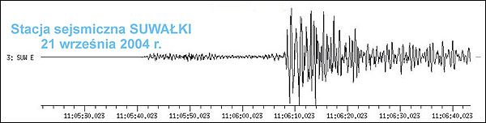
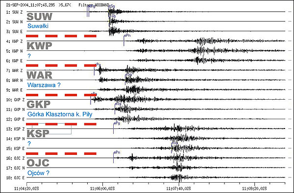
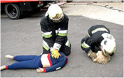
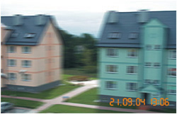
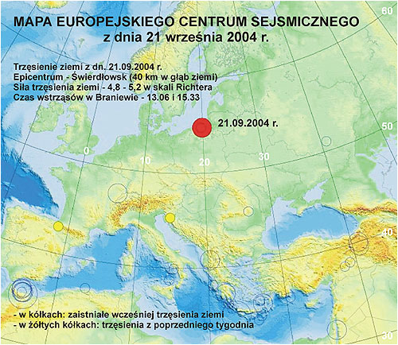
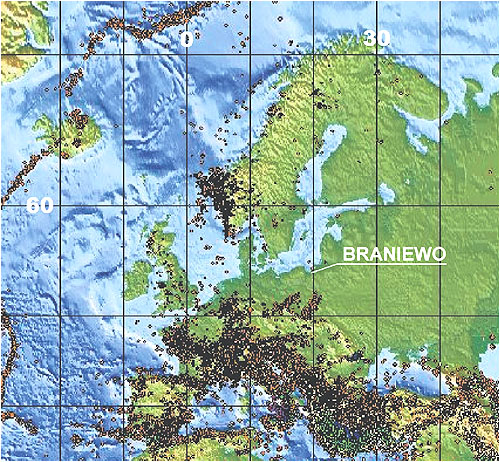

**Gaja pogroziła paluszkiem**  
Leszek Wiktor © Klimek

**Kodeks Rios** - Kiedyś, w dniu Naui Ollin, nastąpi koniec świata. Wszystko, co żyje, ulegnie zniszczeniu na skutek trzęsienia ziemi. Będzie to już czwarte zniszczenie ludzkości. Ale nie wiemy, czy i tym razem ludzkość będzie miała szczęście - po raz piąty - pozostawić nasienie...

**Nostradamus** - I ziemia zadrży tam, gdzie jantar leży. A będzie to przednówek strasznych rzeczy. Wody zaleją niziny od Renu do Dniestru. Płacz i lament wielu narodów będzie słyszan.

**21 września 2004 r.**

  
  

Usłyszałem głuchy pomruk i blok zaczął się trząść. Początkowo myślałem, że przejeżdża bardzo duży TIR, ale skąd tu TIR, jak droga bez wylotu? Błyskawicznie do mnie dotarło, że zatrzęsła się ziemia. Uczucie nie do pozazdroszczenia. Strach. Czy tylko to jedno i koniec, czy to dopiero początek. Było krótko po trzynastej. Momentalnie balkony na osiedlu zapełniły się ludźmi. Ci z parteru nie wierzyli. Podobno nic nie odczuli, ale ci z pięter byli lekko wystraszeni. Z bloku na przeciwko jakiś facet krzyczał, że pospadały u niego kwiaty w doniczkach. U mnie poprzekrzywiały się tylko obrazy wiszące na ścianie. W jednej chwili zrozumiałem całą swoją nicość.

Fragment zapisu sejsmografu z Suwałk (czas uniwersalny GMT)

Zadzwoniłem do córki do pracy. Odczuli to, ale nie wierzyli, że mogło to być trzęsienie ziemi. Ponieważ Braniewo militarnie jest terenem wybuchogennym, zapytałem, a czy słyszeliście jakiś wybuch? Nie? No widzisz... Gdyby to był wybuch to musiała byś go usłyszeć. Zresztą, żeby tak ziemia zadrżała, trzeba by wysadzić kilka ton trotylu, a i ziemia nie drżała by tyle czasu. Zadzwoniła za chwilę. Rozmawiała z mężem. Wstrząs "rzucił" go o biurko. Potem już było coraz więcej wiadomości.

O 14.00 radio Olsztyn już podawało, że zatrzęsło w całej północno-wschodniej Polsce. Najpierw mówiono o Kaliningradzie, Olsztynie, Braniewie i Elblągu. Potem okazało się, że wstrząs odczuto nawet w Suwałkachi i Toruniu. Epicentrum w mediach "wędrowało". Najpierw Bałtijsk potem Świetłogorsk, a ostatnia wiadomość dotyczyła pogranicza polsko-rosyjskiego (koło Bartoszyc). Burmistrz Braniewa zapytany w wywiadzie radiowym, czy miasto jest gotowe na taki rodzaj klęski, odpowiedział rozbrajająco szczerze - absolutnie nie. Zwolnił tylko wszystkie dzieci ze szkół do domu.

Fragment zapisów z kilku polskich sejsmografów; nie znam miejsc (czas uniwersalny GMT)

Drugi raz zatrzęsło o godzinie 15.33. Już krócej, ale za to silniej. O ile pierwszy wstrząs przyjąłem z niedowierzaniem, ale z dużą dawką adrenaliny, to drugi spowodował już strach. Nogi miałem jak z waty. Poczta balkonowa natychmiast doniosła, że w kiosku z półek pospadały artykuły. Zaczynało być straszno. Oczywiście nauka radziecka natychmiast przewidziała, że wystąpią wstrząsy wtórne i dużo silniejsze. Nasi uczeni pocieszali - mogą wystąpić, ale słabsze. Za to w ciągu kilku miesięcy.

Ze wszystkich wiadomości i radiowych i telewizyjnych wynikało, że nic się nie stało. W kilku miastach popękały mury, ale domy nadal nadają się do zamieszkania. Sprawdza się instalacje, szczególnie gazowe. Rozbitych szklanek, kwiatów czy luster historia nie notuje, a zwykłej ludzkiej obawy czy strachu nie da się wycenić. Jest też i refleksja. Jedynie w Urzędzie Celnym i Europa-Center w Olsztynie kierownictwo stanęło na wysokości zadania. Jako jedyni w całym regionie, gdzie odnotowano wstrząsy, zarządzili natychmiastową ewakuację. Powinni dostać nagrodę za szybką i prawidłową reakcję. Pozostali decydenci oniemieli. Porozdziawiali, zapewne ze zdumieniem, urzędnicze gęby i czekali... na następne... większe.

Od takich nie otrzymałbym szybkiej pomocy. Ludzie, w jakim kraju ja żyję? Żebym nie słyszał radia po polsku, to myślałbym że jestem u ojca narodu - Łukaszenki, albo na innym słowiańskim zadupiu. Gdzie idą te pieniądze na szkolenie w sytuacjach kryzysowych? Jak człowiekowi pomogą tak szkoleni, jak ci obok na zdjęciu? Może faktycznie zanim przystąpią do ratowania, najpierw głowę ci urwą. Czy szkolenia zespołów kryzysowych to prawdziwe szkolenie, czy tylko tańce, hulanki, swawole...? Być może brak reakcji usprawiedliwia fakt, że do tej pory trzęsienie ziemi na tym terenie było czymś nieprawdopodobnie niemożliwym. Z drugiej jednak strony - czy na tym ma polegać przewidywanie? Czy to nie jest kolejny głos, tym razem najwyższej instancji, że potrzebna jest ustawa o ratownictwie? Ale czy dojdzie to do tych pajaców z Wiejskiej?

Jeszcze "lepiej" było u sąsiadów w Kaliningradzie. Tam od razu wysiadły telefony stacjonarne i sieć komórkowa. Panika. Ludzie powybiegali na ulice i bali się wracać do budynków. Wszyscy przerwali pracę. Radio Wszechrusi od razu nadało stosowny komunikat, że nie prowadzi się aktualnie prób z żadną bronią (nawet atomową), prosi się o nie wpadanie w panikę i postępowanie według własnego uznania. Dobre, prawda? Było tam chyba jednak gorzej, bo kilkanaście osób znalazło się w szpitalu. Jedna ze złamanymi nogami po skoku z drugiego piętra.

Jak przyjęto trzęsienie ziemi w internecie? Jak to w Polsce, przeważnie na wesoło, a nawet bardzo...

•   Trzęsły się meble, książki spadały z półek... nikt nie wiedział co się dzieje... (Puck)  
•   Mój kolega jak biegł do kiosku i zatrzęsło to się wyje..ł (Gdynia)  
•   Siedziałem przed kompem po 15.00, mieszkam na 2 piętrze, nawet nieźle zatrzęsło na kiliniaku. (Ełk)  
•   Wychowałam się na Kilińskiego, a teraz mieszkam w Olsztynie. Od 5 lat dokładnie. U mnie też się trzęsło. Myślałam, że sąsiad z górnego piętra miał jakiś wypadek, później kwiatek przywitał się z dywanem. (Olsztyn)

•   Tego po piętnastej nie czułem, ale ten wcześniejszy to zatrząsł, że na początku myślałem, że się ojciec do garażu nie zmieścił. (Ostrołęka)  
•   Mówię wam ludzie idzie koniec świata. Tak było w przepowiedniach. Babcia mi mówiła. (Ostrołęka)  
•   Sejny x 3!!!! Trzy wstrząsy w Sejnach (30 km od Suwałk).  
•   Zatrzęsło moją chałupą, ale że mieszkam na skrzyżowaniu, gdzie jak po tych płytach przejedzie przegubowiec, to nieźle trzęsie. Pomyślałem - "a co to za wielka cholera jedzie koło domu", wyjrzałem za okno, ale tam nic... nawet mi nie przyszło do głowy, że to trzęsienie ziemi. Chyba Ormiańce je przywieźli ze sobą do Gdańska. (Pruszcz Gdański)

•   Siedzieliśmy na działce i piliśmy piwo. Zaczęło nam się bujać w pucharach piwo. Miało to miejsce w Elblągu po 15.  
•   Ch..j że wszyscy zginiemy! LECHIA ŻYJE! Rozbiło mi 2 szklanki. (Gdańsk)  
•   Było leciutkie trzęsienie, ale szklanki nawet podskakiwały, ale prawie nie było czuć chociaż leciutko!! Babki stare na pewno nie odczuły, bo one są inne. (Barczewo)  
•   W naszym mieście były odczuwalne trzy trzęsienia, ale zdecydowanie najsilniejszy był drugi ok. 15-tej. Żadnych większych szkód nie było. (Giżycko)

•   Pierwszego nie odczułem, bo byłem w szkole. Drugi był zaj...sty. Replay please! (Kwidzyn)  
•   U mnie były 2 trzęsienia, jedne jak byłem w szkole na WOS-ie i drugie na wersalce, a babce obok tak się galoty trzęsły, że dla niej były tak naprawdę 3 trzęsienia. (Malbork)  
•   A kiedy będą kolejne? Będzie ich więcej? Jestem taka podniecona, ech. (Gdańsk)  
•   Zaczął się trząść komp na biurku, szafki stukały no i podłoga dygotała mi pod nogami. (Ełk)

•   Mieszkam na Chwarznie i tam trzęsło nie wiem ile stopni dokładnie, ale mi się monitor trząsł i czułem że się rusza podłoga siedząc na krześle. (Gdynia)  
•   Wstrząs był tak silny, że myślałam że kwiaty mi spadną na głowę. Boje się troszkę, co będzie w nocy! Ale bądźmy dobrej myśli i módlmy się. (Elbląg)  
•   Ostróda. Siedziałam na wersalce, po czym ta zaczęła się trząść! Myślałam, że zwariowałam, bo Polska jest krajem asejsmicznym!  
•   No, siedziałam na kanapie aż tu nagle się rusza... Myślę sobie trzęsienie ziemi, ale nie na poważnie. No i psikus, bo w faktach powaga o trzęsieniu! To pierwsze w moim życiu. (Toruń)

•   Ja myślałem że to sąsiad marszczy freda, a to trzęsienie ziemi? (Nowe Miasto Lubawskie)  
•   Ja nie mogę, jak zadrżało to normalnie aż pot mi po dupie płynął ze strachu.  
•   A mówili w biurze, że nie wytrzeźwiałem. :-) (Tczew)  
•   Na II piętrze w bloku czułem się jak przy hamowaniu pulsacyjnym w samochodzie. Ale jazda ... (Sztum)

•   Kwietnik (ale taki duży - od podłogi do sufitu) rzucał we mnie doniczkami ... Ale na myśl mi w tamtym momencie nie przyszło, że to było trzęsienie. Ciekawe doświadczenie. (Mikołajki Pomorskie)  
•   Mieszkam na 7-mym i czułem to! Siora wybiegła z pokoju i się drze, że jej się rusza łóżko. Pomyślałem idiotka jakaś. Ale prawda! Znajomy na 10 tym mieszka i jeździł na krześle ... (Toruń)  
•   Około godz.15:30 książki, które stały na półce przewróciły się. Filiżanka do kawy stojąca na podstawce zadrżała. (Połczyn Zdrój)  
•   Siedzę sobie w biurze, a tu mi się zaczyna wszystko trząść - myślałam ze obok kamienicę rozwalają. Dopiero w domu dowiedziałam się, że to trzęsienie ziemi. (Brodnica)

•   Trzęsła mi się szafa w pokoju - zastanawiałam się co to może być, a teraz już wiem. Nigdy nie myślałam, że przeżyje trzęsienie ziemi. (Wejherowo)  
•   Latem widziałem nad zatoką trąbę powietrzną, a teraz te wstrząsy.....No cóż to wszystko pewnie w ramach offsetu od Hamerykanów... (Puck)  
•   Od ok. 15 było w Olsztynie kilka dość mocno odczuwalnych na 11 piętrze trzęsień. Bujało i to ostro ludziska. Moja kobieta kiedy wróciła z pracy, to aż się pokochaliśmy, bo to może ostatni raz stwierdziła...  
•   W Lęborku też nieźle trzęsło!!! Leżałem na kanapie, a tu nagle kanapa zaczęła mi się odsuwać od ściany!!!! Jazda na całego!!!

•   Byłem w pracy, w warsztacie. Nagle zatrzęsły się szyby, ale myślałem ze to pociąg, bo mieszkam i pracuję w pobliżu torów kolejowych. Potem poszedłem do domu, usiadłem przy kompie i zaczęła mi się d... na krześle trząść, monitor na biurku, okna i meble lekko nawet. Dla mnie to nieporozumienie że w Polsce są trzęsienia ziemi. Według mnie, to to drugie było silniejsze. (Rumia)  
•   Ełk, a że mieszkam tuż obok torów sądziłem, że to pociąg. Jednak pomyłka, ponowny wstrząs wybił mnie z letargu i ale jazda - drugie Los Angeles mamy na mazurach. hahahahaha.  
•   Hehe, dajcie spokój z trzęsieniami to pewnie ruski cos kombinują albo araby, hehe... (Gdańsk)  
•   Powstanie nowy ocean na granicy z Rosją i Białorusią, aby miały gdzie pływać łodzie podwodne Białorusi! No i zapaść się musi ta Wszapolska pod ziemię!

•   Nie lękajcie się, to prałat dymał ministrantów.  
•   Słyszałem, że przez dziurę ozonową zmienia się klimat, ale że trzęsienia w Gdańsku, to coś nowego.  
•   Pozdrowienia dla Olsztyna i Gdańska z Meksyku. Rzeczywiście wstrząsy sejsmiczne w północnej Polsce to ewenement geologiczny. Czy rzeczywiście nie było żadnych prób nuklearnych w regionie kaliningradzkim?  
•   Pierwszy raz w życiu przeżyłam cos takiego, czytałam książkę na kanapie, gdy nagle poczułam, że kanapa rusza się pode mną, wszystko drży dookoła, mój kotek stoi na wyprostowanych łapkach i patrzy na mnie. To trwało króciutko, ale byłam spocona ze strachu. (Gdańsk)

•   A to dla tego, żeby nie popadać w przekonanie, że coś takiego jak trzęsienie ziemi nam nie grozi... Bądźcie grzeczni chłopcy i dziewczynki - nie palcie papierosów, nie pijcie alkoholu i nie uprawiajcie zbyt wcześnie sexu bo ręka Boga was dosięgnie nawet na warmii i mazurach.  
•   Strona rosyjska przewiduje słabsze wstrząsy wtórne, a to już całkiem spora informacja. Następny Kursk?  
•   Tata myślał, że mu serce kołacze i się przestraszył. Tylko że jeszcze się nie zdarzyło, żeby skutkiem kołatania serca było dzwonienie szyb! (Olsztyn)  
•   ....ha ha. Ja autentycznie rwałem na dół z 9 piętra mojego bloku. Przez małą chwilę nawet myślałem żeby zabrać rower...no i może kompa. Okropne doświadczenie.

Przed 22.00 wrócił mój syn z Elbląga. Cała szkoląca się grupa niczego nie zauważyła. Dowiedział się o trzęsieniu ziemi wracając autobusem do Braniewa. Był strasznie zbulwesowany, że nic takiego nie przeżył. Eeeech ta dzisiejsza młodzież.

Mapa Europejskiego Centrum Sejsmicznego. Dziś tylko jedno trzęsienie ziemi.

Od 15.33 nic nie było. Teraz, a jest już prawie północ, słychać tylko dziwne trzaski, jakby "pracował" cały blok. Postawiłem papierosa na sztorc. Mam teraz własny sejsmograf. Najnormalniej w świecie boję się iść spać.

**Historia polskich trzęsień**

  
  
  

Nigdy nie interesowałem się trzęsieniami ziemi na naszym terenie, bo uważałem je za nieprawdopodobne. Prędzej bym się spodziewał najazdu czerwonych twarzy z północno-wschodniego kierunku strategicznego. Po ostatnich wydarzeniach zmieniłem zdanie i to tak dokładnie, że bez przerwy szukam danych po internecie. A nuż się powtórzy, ale wtedy zginę mądrzejszy.

I co się okazuje. U nas tak spokojnie nie jest.

| **Rok** | **Miejsce** | **Skutki** |
| --- | --- | --- |
| 1200 | Pieniny | Zniszczone wiele wież i warowni. |
| 1259 | Okolice Krakowa | Zburzone budynki. |
| 1443 | Południe Polski | Doszło do największego trzęsienia ziemi w historii Polski (około 6°R). Wstrząs, którego epicentrum znajdowało się prawdopodobnie na północ od Wrocławia, odczuła cała środkowa część naszego kontynentu. Wstrząsy szczególnie silnie dotknęły Wrocław, a w Krakowie zawaliło się sklepienie kościoła Św. Katarzyny. Jan Długosz, który był bezpośrednim świadkiem trzęsienia, zanotował, że "wieże i gmachy waliły się na ziemię, rzeki występowały z łożysk, a ludzie nagłym strachem zdjęci, od zmysłów i rozumu odchodzili". |
| 1662 | Rejon Tatr | Epicentrum wypadło w okolicy Sławkowskiego Szczytu. Jego wysokość obniżyła się wówczas o około 300 m. |
| 1774 | Śląsk | Brak bliższych danych |
| 1785-1786 | Rejon całej Polski | Seria 14 trzęsień ziemi nawiedziła ziemie polskie - od morza po góry. Co najmniej trzy z nich miały siłę 6°R. Szczególnie poważne były dwa ostatnie. |
| 1786 | Południe Polski | Trzęsienie z epicentrum między Cieszynem a Opawą odczuto od Wiednia po Piotrków Trybunalski i od Wrocławia po Sandomierz. W Cieszynie uszkodzone zostały murowane budynki i wybuchła panika, w Cierliczku pękło sklepienie kościoła, zaś w Mysłowie uszkodzona została wieża kościelna. Na Śląsku, w Bytomiu trzęsienie było tak silne, że dzwony kościelne zaczęły same dzwonić.. |
| 12.1786 | Myślenice | Ostatnie z bardzo silnych trzęsień w Polsce. Epicentrum wypadło między Kętami a Myślenicami. Drgania odczuwano od Wrocławia po Lwów i od Głogowa i Kalisza po Koszyce na Słowacji. Wstrząs spowodował znaczne zniszczenia: w Krakowie burzyła się woda w Wiśle, w kościołach spadały gzymsy i tynki, samoczynnie odzywały się dzwony. |
| 1840 | Pieniny | Brak danych. |
| 1875 | Dolny Śląsk | Brak danych. |
| 1895 | Hrubieszów | Brak danych. |
| 02.1932 | Płock, Kielce, Lublin | Brak danych. |
| 1992-1993 | Beskid | Brak danych. |
| 1995 | Podhale | W nielicznych budynkach wstrząsy poczyniły zauważalne szkody. |

Ogółem w ciągu ostatniego tysiąclecia w Polsce zarejestrowano 76 trzęsień ziemi.

**Nasi uczeni uspakajają**

  
  
  
Polska ma dwa główne obszary występowania trzęsień ziemi. Jeden rejon obejmuje Góry Kaczawskie, Przedgórze Sudeckie, Nizinę Śląską, Wał Trzebnicki i Nizinę Wielkopolską wzdłuż linii Jelenia Góra-Leszno. Drugi - Kotlinę Oświęcimską oraz wyżyny Śląską i Krakowsko-Częstochowską wzdłuż linii Oświęcim-Herby. Teraz już trzeba koniecznie dodać do tego granicę "przyjaźni polsko-radzieckiej".

**prof. Piekarek-Jankowska** - Wstrząsy na tym obszarze są notowane co kilkadziesiąt lat. Na szczęście znajdujemy się na tzw. platformie wschodnioeuropejskiej, która jest starą i sztywną strukturą geologiczną, gdzie nie występują silne, katastrofalne trzęsienia ziemi.

**dr Paweł Wiejacz** - Jest kilka możliwych scenariuszy rozwoju sytuacji w północno-wschodniej Polsce w związku z odnotowanym tam trzęsieniem ziemi. Według sejsmologów, najprawdopodobniej nastąpi seria coraz słabszych tzw. wstrząsów następczych. Jeżeli wtorkowe wstrząsy są zjawiskiem naturalnym, to należy spodziewać się pewnej ilości wstrząsów następczych. Te wstrząsy będą występowały przez parę tygodni, może parę miesięcy, może nawet rok lub dłużej. Będą one słabsze od wstrząsów głównych. Będą odczuwalne przez ludzi, ale nie będą niosły zagrożenia.

Obydwa wstrząsy miały podobną siłę. Jednak drugi z nich był nieco silniejszy. Należy to uznać za dwie fazy tego samego zjawiska. Można sobie wyobrazić, że takich faz może być więcej i w przeciągu następnych godzin wstrząsy o podobnej sile będą się powtarzać, ale równie dobrze może to być już koniec i będziemy mieli do czynienia tylko ze wstrząsami następczymi. Z którym z wariantów mamy do czynienia, rozstrzygnie się w ciągu najbliższej doby.

Jest mało prawdopodobne, aby wtorkowe trzęsienia ziemi były jedynie wstrząsami poprzedzającymi silniejsze zjawisko. Specjaliści nie mogą tego stanowczo wykluczyć, jednak statystycznie takie zjawiska występują bardzo rzadko, w jednej dwudziestej aktywnych sejsmicznie miejsc na świecie. W tej części Europy trzęsienia ziemi występowały tak rzadko, że trudno określić czy zaliczamy się do tej jednej dwudziestej. Ale statystyka wskazuje, że raczej nie.

**doc. dr hab. Edward Perchuć** - Wstrząs po godzinie 15 był silniejszy niż ten pierwszy, po nim zanotowaliśmy jeszcze jeden - dużo słabszy. Oznacza to zapewne wygasanie tego zjawiska i choć kolejne wstrząsy mogą występować jeszcze przez kilka dni, prawdopodobnie ich nie odczujemy. Tak silne trzęsienie w tym rejonie to rzadkość, ale zapisy sejsmografów wskazują, że przyczyną były naturalne zjawiska tektoniczne w rejonie Kaliningradu.

Nie wszyscy odczuli tak samo. Fale sejsmiczne nie rozchodzą się równomiernie, tak jak nierównomiernie zbudowana jest skorupa ziemska. Są kanały, którymi wstrząsy przenoszą się całkiem daleko, a są miejsca, gdzie napotykają blokadę nie do pokonania.

Śpij spokojnie, polska nauka czuwa. Już znaleziono winnego. To Skandynawia, pnąca się w górę od 12 tys. lat po uwolnieniu się z okowów lodowca. Nie mogę tylko zrozumieć, jak płyta podnosząca się kilka milimetrów na rok może spowodować takie trzęsienie? Dlaczego epicentrum znajdowało się w rejonie półwyspu Sambijskiego, a nie w Skandynawii? Czy pod Bałtykiem przebiega jakieś pęknięcie skorupy ziemskiej, o którym nikt nie ma zielonego pojęcia? Przecież, jak tłumaczą sejsmolodzy, trzęsienia ziemi są wynikiem uwolnienia się ogromnej energii przez ocierające się o siebie płyty tektoniczne, a najbliższe granice naszej europejskiej płyty to Azja Mniejsza i grzbiet środkowo-atlantycki. Coś mi tu nie gra...

Mapa trzęsień ziemi w Europie z lat 1975-1995. (NEAC - USA)

Spójrz na mapę. Południe Europy jakby pszczoły obsiadły. A Skandynawia? Z tego co widać to najwięcej trzęsień występuje tylko na południowym wschodzie półwyspu. To co się wreszcie podnosi? Jakiś sejsmolog porównał przyczyny do wyginania ołówka, który w pewnym momencie musi pęknąć gdzieś w środku. Jak przyjmiemy Skandynawię i południe Europy za końce ołówka, to środek ołówka może być faktycznie gdzieś koło nas. Tylko w którą stronę go się wygina i dlaczego jednocześnie nie podnosi się południe Europy? Mnie się wydaje, że pod Bałtykiem są pęknięcia skorupy ziemi, o których nic nie wiemy i one same zdecydowały przypomnieć o sobie. Sejsmolodzy nie mają pomysłu i mydlą nam oczy.

Zauważ także, że w Obwodzie Kaliningradzkim w ciągu tych dwudziestu lat odnotowano kilka trzęsień ziemi. Czerwony carat rozumiem, bo tam do dzisiaj puszczenie bąka jest ściśle tajne, ale dlaczego nasi nie powiadomili o tym opinii publicznej, przynajmniej w naszym regionie? Nie chcieli siać niepokoju, czy zlekceważyli ludzi? Czy przypadkiem Rosjanie wykorzystując rzadkie, bądź co bądź, zjawisko w tym rejonie nie przeprowadzili próby atomowej pod dnem Bałtyku??? Czy drugie trzęsienie ziemi o godz. 15.33 z epicentrum pod ziemią nie było następstwem pierwszego z godz. 13.06 z epicentrum pod dnem morza? Czy kiedykolwiek dowiemy się prawdy mając takich sąsiadów?

**Skale zniszczeń**

  
  
  

Skala **Richtera** służy do określania efektów energetycznych trzęsienia ziemi w jego epicentrum. Jest to skala logarytmiczna, co oznacza, że ilekroć intensywność trzęsienia ziemi wzrasta o jedną jednostkę, grunt trzęsie się 10-krotnie silnej, a ognisko trzęsienia wyzwala 30-krotnie więcej energii.

| **Stopień** | **Skutki** |
| --- | --- |
| 1 2-3 4-5 6 7 8 | wykrywalne tylko za pomocą sejsmografów   ledwie wyczuwalne przez ludzi   może spowodować niewielkie szkody   dość niszczycielskie   duże trzęsienie ziemi   bardzo niszczycielskie trzęsienie ziemi |

Zmodyfikowana skala **Marcallego** służy do określania intensywności drgań gruntu w danym miejscu na skutek trzęsienia ziemi. Jest to tzw. odczuwalna intensywność. Sama skala zaś jest rejestrem opisanych skutków trzęsienia ziemi.

| **Stopień** | **Skutki** |
| --- | --- |
| 1 2 3 4 5 6 7 8 9 10 11 12 | Nieodczuwalne dla ludzi   Odczuwalne przez ludzi zamieszkujących wyższe piętra   Zawieszone na ścianach przedmioty mogą się poruszać   Zawieszone na ścianach przedmioty poruszają się, pojawia się drżenie okien i drzwi   Odczuwalne na dworze. Małe przedmioty poruszają się   Odczuwalne przez każdego. Poruszają się meble. Chwieją się drzewa i krzewy   Ludzie z trudem utrzymują się na nogach. Budynki pękają   Powstają duże szkody w budynkach. Łamią się gałęzie drzew   W gruncie tworzą się duże pęknięcia. Niektóre domy rozpadają się   Obsuwa się powierzchnia ziemi. Liczne budynki leżą w gruzach   Duże przekształcenia powierzchni ziemi, wyginają się szyny kolejowe   Zniszczenia są niemal całkowite |

Przeżyliśmy więc trzęsienie ziemi o sile 4-5° w skali Richtera i 6-7° w skali Marcallego.

**Najsmutniejsze rekordy świata**

  
  
  
Braniewo miało absolutne szczęście. Popatrz na miejsca, gdzie niektórzy nie mieli go wcale. Nie potrafię sobie czegoś takiego wyobrazić. To musiał być najprawdziwszy horror. Nie są to oczywiście wszystkie trzęsienia ziemi, a tylko te, które udało mi się odnaleźć.

| **Rok** | **Miejsce** | **Stopień** | **Bilans** |
| --- | --- | --- | --- |
| 526 556 1775 1906 1908 1923 1950 1976 1988 1999 | Antiochia Shaan-xi Lizbona San Francisko Messyna, Reggio Tokio, Jokohama Assam Chiny Armenia Tajwan | ? ? ? ? ? ? 8,6°R ? 7,3°R ? | 250 000 zabitych 830 000 zabitych 30 000 do 70 000 (szacunkowo, większość ciał zmyła tsunami) 50 000 zabitych, zniszczone całe miasto 100 000 zabitych 250 000 zabitych Najsilniejsze w ostatnim półwieczu, brak danych 242 000 zabitych 55 000 zabitych ponad 2000 zabitych |

Znając życie, to Chiny nie podały zapewne całej prawdy. U nich jest cały czas modny współczynnik 10.

**Ciąg dalszy nastąpi ???**

  
  
  
**22.09.2004**

W życiu nie spałem tak czujnie. Najlżejszy stuk czy skrzypnięcie, a już podrywało mnie na łóżku. Na szczęście mój sejsmograf nie wykazywał nic groźnego. Stał pionowo na szafce przy łóżku. Naprawdę nie życzę najgorszemu wrogowi takiego przeżycia. Oby już nie było potrzeby dopisywania dalszego ciągu. Ale, póki co, strona nie jest zakończona.

•   Jednak. W Braniewie ewakuowano cztery rodziny. Istnieje groźba przewrócenia się komina starej mleczarni przy ul. Sikorskiego na budynek mieszkalny. Według Straży Pożarnej komin został naruszony przez wczorajsze trzęsienie ziemi, a prognozy przewidują silne wiatry.  
Na ul. Wojska Polskiego zarysowały się budynki mieszkalne. Chyba chodzi o te przedwojenne, mieszkalne. Dziwne, że nic nie mówią o budynkach jednostki wojskowej przy tej samej ulicy. Budowane były w tym samym czasie. Czyżby tajemnica wojskowa?

Wieczorem, około 21.00 żona wyczuwała drżenie budynku. Ja nic nie czułem, choć siedziałem obok niej. Widać kobiety mają lepszy wewnętrzny sejsmograf.

To trzęsienie ziemi ma też dobre strony. Jest wspaniała okazja dla braniewskiej władzy. Burmistrz teraz może nie tylko wyburzyć poniemiecki zabytkowy basen, ale nawet pół Braniewa.

**23.09.2004**

Radio podaje, że dziś nad ranem sejsmografy zanotowały wtórne trzęsienia ziemi na Warmii i Mazurach. Osobiście nie odczułem żadnego (spałem jak zabity), ale rano żona powiedziała, że obudziło ją drżenie wersalki. Mnie dręczy jakiś wewnętrzny niepokój. Każdy przejeżdżający samochód stawia mnie na równe nogi. Trauma czy co?

Mówi się już o dwóch odrębnych trzęsieniach ziemi. Pierwsze miało epicentrum pod Bałtykiem na półnoć od półwyspu sambijskiego (54,83°N i 19,71°E), drugie z epicentrum już pod lądem w rejonie Świetłogorska. Jest coraz lepiej... Strach się bać.

**25.09.2004**

Co potrafią naukowcy? Nic!!! Zero!!! Podsuwają nam papkę w rodzaju:

Za 50 milionów lat zniknąć ma Morze Śródziemne. Ulegając wypiętrzeniu znikną również kraje położone na jego północnym brzegu. Afryka całkowicie przysunie się do Europy, Australia znajdzie się blisko Eurazji i powstanie jeden kontynent. Odsuną się od niego obie Ameryki, by 200 milionów lat później znowu się połączyć. A Polska? Według geologów za 250 mln lat "będziemy mogli" pieszo dojść na Florydę. Wszystko dlatego, że skorupa ziemska ciągle jest w ruchu. Dowodem na to są m.in. trzęsienia ziemi np. to, które w ubiegłym tygodniu nawiedziło nasze wybrzeże.

Pytanie - po co mnie takie pierdoły? Co mnie obchodzi, że za 250 mln lat pójdę pieszo na Florydę? Ja? Do kogo? Czy tylko po to biorą pieniądze, żeby opowiadać bajki? Niech powiedzą co będzie jutro, pojutrze, czy już mam pakować manele i wyjeżdżać, czy jeszcze mogę pomieszkać w Braniewie. To mnie interesuje, a nie jakaś naukowa bleblologia i wydumane mrzonki.
