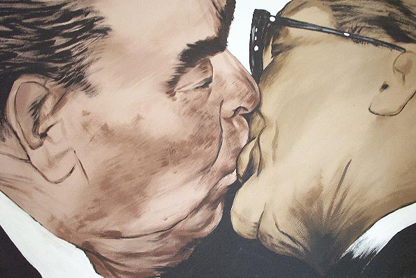

  
Polska, lewicowa tolerancja ma swoje naukowe, historyczne i takie... ludzkie korzenie

\[[1](056-usmiechnij-sie.md)\] \[[2](057-najlepsza-pasta-do-szorowania-mozgu.md)\] \[[3](058-wybory-obraz.md)\] \[4\]
