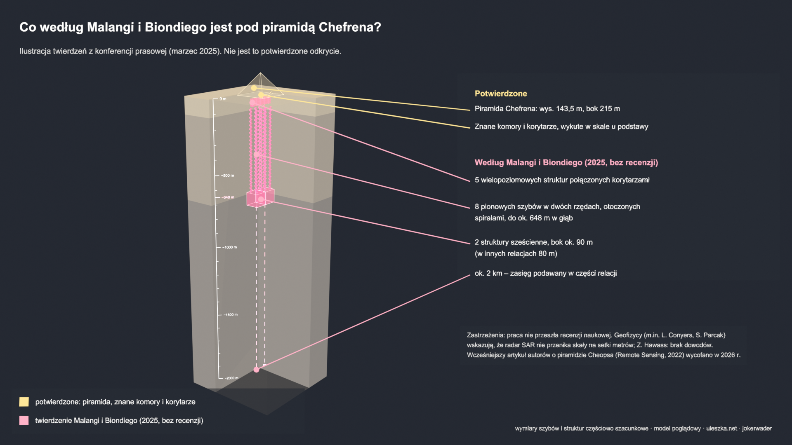

# Pod piramidą Chefrena: twierdzenia Malangi i Biondiego (2025) w 3D

Model poglądowy do karty [Piramidy w Gizie](https://uleszka.net/atlas/piramidy-w-gizie.html) w Atlasie Leszka
i do filmów podcastu (1920×1080). Pokazuje w jednej skali:

- **co jest potwierdzone** (kolor piaskowy i złoty): piramidę Chefrena i jej znane komory oraz korytarze;
- **co jest tylko twierdzeniem** Corrado Malangi i Filippo Biondiego z konferencji prasowej w marcu 2025
  (kolor czerwono-różowy): 8 szybów ze spiralami, 5 wielopoziomowych struktur, 2 „sześciany”
  i zasięg „ok. 2 km”.

**To nie jest odkrycie, tylko ilustracja tego, co twierdzą autorzy.** Ich praca o Chefrenie nie
przeszła recenzji naukowej. Geofizycy i archeolodzy (m.in. Lawrence Conyers, Sarah Parcak,
Flint Dibble, Zahi Hawass) wskazują, że radar z apertury syntetycznej (SAR) nie przenika skały
na setki metrów; w podobnych warunkach sięga do kilku metrów. Wcześniejszy artykuł tych autorów
o piramidzie Cheopsa (Remote Sensing, 2022) został w sierpniu 2026 r. wycofany przez czasopismo
z powodu poważnych błędów metodologicznych i statystycznych.

Model zbudowano wyłącznie z opisów i liczb w relacjach prasowych. Nie kopiowano grafik autorów.

## Pliki

| Plik | Co to jest |
|---|---|
| `build_chefren_sar.py` | Skrypt Blendera, który buduje całą scenę od zera, zapisuje `.blend`, eksportuje `.glb` i renderuje kadry |
| `chefren-sar.blend` | Scena Blendera (kamery, nakładki z podpisami, kolekcje „POTWIERDZONE” i „TWIERDZENIA_…”) |
| `chefren-sar.glb` | Model do przeglądarki 3D na stronie (np. `<model-viewer>`), 1 jednostka = 1 m |
| `render-01-widok-ogolny.png` | Widok ogólny całej kolumny skały do 2 km |
| `render-02-przekroj.png` | Przekrój północ–południe, widok od południa, do ok. 840 m |
| `render-03-szyby-zblizenie.png` | Zbliżenie: piramida, znane komory, górne struktury i szyby |
| `render-04-opis.png` | Kadr z podpisami po polsku i zastrzeżeniami |
| `chefren-sar-obrot.mp4` | Film obrotowy 16 s, 1920×1080, 30 kl./s |



## Źródła

Twierdzenia Malangi i Biondiego (marzec 2025) i krytyka:

- National Geographic, C. Moss, 16.04.2025: [Is there really a secret city under Egypt’s pyramids?](https://www.nationalgeographic.com/history/article/is-there-a-secret-city-under-the-pyramids-)
  – 8 szybów ze spiralami, 2 sześciany po 90 m, 5 struktur połączonych korytarzami, „2 km”; krytyka Parcak, Dibble’a, Conyersa, Hawassa, Rossiego.
- Jerusalem Post, 23.03.2025: [artykuł 847207](https://www.jpost.com/archaeology/archaeology-around-the-world/article-847207)
  – 8 szybów „ok. 2100 stóp” (ok. 640 m), sześciany po 80 m, 5 struktur wielopoziomowych; krytyka Conyersa, Hawassa, Abdel-Basira.
- Egyptian Streets, 26.03.2025: [Unraveling the pyramid mystery](https://egyptianstreets.com/2025/03/26/unraveling-the-pyramid-mystery-claims-of-an-underground-city-debunked/)
  – „ponad 2100 stóp”, brak recenzji, krytyka.
- Retraction Watch, 31.08.2026: [Journal retracts paper claiming network of corridors inside the Great Pyramid of Giza](https://retractionwatch.com/2026/08/31/retraction-corridors-inside-great-pyramid-giza/)
  – wycofanie artykułu z 2022 r.; streszczenie twierdzeń z 2025 r.
- G. Gillett, 16.03.2026: [Revisiting 2025 Claims on Massive Wells Under the Pyramid of Khafre](https://underus.substack.com/p/revisiting-2025-claims-on-massive) – analiza krytyczna (blog).

Wcześniejsza praca autorów o piramidzie Cheopsa:

- F. Biondi, C. Malanga, *Synthetic Aperture Radar Doppler Tomography Reveals Details of Undiscovered
  High-Resolution Internal Structure of the Great Pyramid of Giza*, Remote Sensing 14(20), 5231, 2022:
  [mdpi.com/2072-4292/14/20/5231](https://www.mdpi.com/2072-4292/14/20/5231).
  **Wycofany 10.08.2026**: [nota o wycofaniu, Remote Sensing 18(16), 2679](https://www.mdpi.com/2072-4292/18/16/2679).

Piramida i znane komory:

- Wikipedia: [Pyramid of Khafre](https://en.wikipedia.org/wiki/Pyramid_of_Khafre) (CC BY-SA 4.0) – wymiary piramidy, położenie wejść, komora grobowa.

## Przyjęte wymiary

Układ: X = wschód, Y = północ, Z = góra. Z = 0 to poziom skały pod piramidą, środek podstawy w (0, 0, 0).

### Potwierdzone (piramida i znane komory)

| Element | Wartość w modelu | Pochodzenie |
|---|---|---|
| Bok podstawy | 215,25 m | podane wprost (Wikipedia) |
| Wysokość pierwotna | 143,5 m | podane wprost (Wikipedia) |
| Górne wejście | 11,54 m nad podstawą, ściana północna | podane wprost (Wikipedia) |
| Przesunięcie korytarzy | 12 m na wschód od osi | podane wprost (Wikipedia) |
| Komora grobowa | 14,15 × 5 m, oś wschód–zachód, w skale, strop dwuspadowy | podane wprost (Wikipedia) |
| Wysokość komory grobowej | 6,83 m do szczytu stropu | wartość z literatury, w tej sesji nie sprawdzona w źródle pierwotnym |
| Komora boczna | 10,41 × 3,12 × 2,61 m | wartość z literatury, nie sprawdzona; Wikipedia podaje tylko, że jest tej samej długości co Komora Królewska Cheopsa |
| Położenie komory grobowej, kąty i długości korytarzy, głębokość korytarza dolnego (11 m) | | **szacunek**; przebieg korytarzy jest schematyczny |

### Twierdzenia Malangi i Biondiego

| Element | Wartość w modelu | Pochodzenie |
|---|---|---|
| Liczba szybów | 8 | podane wprost (wszystkie relacje) |
| Układ szybów | 2 równoległe rzędy wzdłuż osi północ–południe | podane wprost w części relacji |
| Spirale wokół szybów | tak | podane wprost (NatGeo, JPost) |
| Dno szybów | 648 m pod powierzchnią | JPost i Egyptian Streets: „ok. 2100 stóp” ≈ 640 m; 648 m to liczba z wielu relacji |
| Struktury sześcienne | 2, bok 90 m | NatGeo: 90 m; **JPost: 80 m** |
| 5 struktur wielopoziomowych połączonych korytarzami | nad szybami | podane wprost (NatGeo, JPost), bez wymiarów |
| Zasięg „ok. 2 km” | linia przerywana do 2000 m | NatGeo i Retraction Watch; NatGeo pisze o 2 km jako głębokości szybów, inne relacje o 2100 stopach. Model pokazuje obie wersje: szyby do 648 m i linię do 2 km |
| Średnica szybu | 10 m | **szacunek** (nikt jej nie podał) |
| Rozstaw szybów (rzędy x = ±25 m, y = ±20 i ±70 m) | | **szacunek** |
| Spirala: promień 9 m, skok 25 m, grubość 3,2 m | | **szacunek** |
| Górna krawędź szybów: 80 m pod powierzchnią | | **szacunek** |
| 5 struktur: 24 × 24 m, 4 poziomy po 10 m, od 15 do 64 m pod powierzchnią, w linii północ–południe | | **szacunek** (podano tylko „wielopoziomowe”) |
| Położenie sześcianów: jeden pod północną, drugi pod południową czwórką szybów | | **szacunek** |

Rozbieżności w relacjach: część mediów (JPost, za rzeczniczką projektu) pisze, że cylindry są pod każdą
z trzech piramid; National Geographic pisze tylko o Chefrenie. Model pokazuje wyłącznie Chefrena.

### Grunt

Warstwy skały są **schematyczne**: wapień formacji Mokattam (eocen) do ok. 120 m, niżej starsze wapienie
i margle do ok. 700 m, dalej głębsze skały osadowe. Grubości są orientacyjne, nie z odwiertów.
Blok gruntu ma 700 × 700 m i 2100 m głębokości. Na kadrach część bloku jest wycięta (przekrój w kształcie
litery L), a w filmie i w `.glb` cały blok jest półprzezroczysty, z granicami warstw.

## Jak odtworzyć

Potrzebny Blender 5.x (testowane na 5.3.0). Z katalogu repozytorium:

```bash
blender -b --factory-startup --python grafiki/3d/chefren-sar/build_chefren_sar.py -- --blend --glb --stills
```

Film obrotowy: najpierw klatki PNG, potem sklejenie w MP4 programem ffmpeg:

```bash
blender -b --factory-startup --python grafiki/3d/chefren-sar/build_chefren_sar.py -- --frames klatki
```

```bash
ffmpeg -framerate 30 -i klatki/klatka_%04d.png -c:v libx264 -pix_fmt yuv420p -crf 18 grafiki/3d/chefren-sar/chefren-sar-obrot.mp4
```

Przydatne opcje skryptu: `--scale 50` (pół rozdzielczości do prób), `--samples 16`, `--only ogolny,opis`.
Napisy w kadrach używają czcionki Arial z Windows; na innych systemach Blender użyje swojej domyślnej.

## Uwagi do osadzenia na stronie

- `chefren-sar.glb` ma ok. 1,7 MB. Obiekty mają nazwy po polsku (`Piramida_Chefrena`, `Komora_grobowa_Belzoniego`,
  `Szyb_1`…`Szyb_8`, `Spirala_…`, `Szescian_polnocny`, `Struktura_…`, `Zasieg_2km_…`, `Grunt_…`, `Skala_…`),
  więc można je podpisać lub ukryć w przeglądarce.
- Materiały mają prefiks `potw_` (potwierdzone) lub `twierdz_` (twierdzenia), co ułatwia legendę.
- Model jest w metrach i ma 2,1 km wysokości, a piramida tylko 143 m, więc warto ustawić kamerę startową
  na górną część albo dodać przycisk „przybliż piramidę”.

Autor modelu, skryptu i renderów: jokerwader (uleszka.net). Licencja MIT z pliku `LICENSE` obejmuje tylko
foldery `src/` i `scripts/`, więc warunki użycia tego folderu ustala autor repozytorium.
