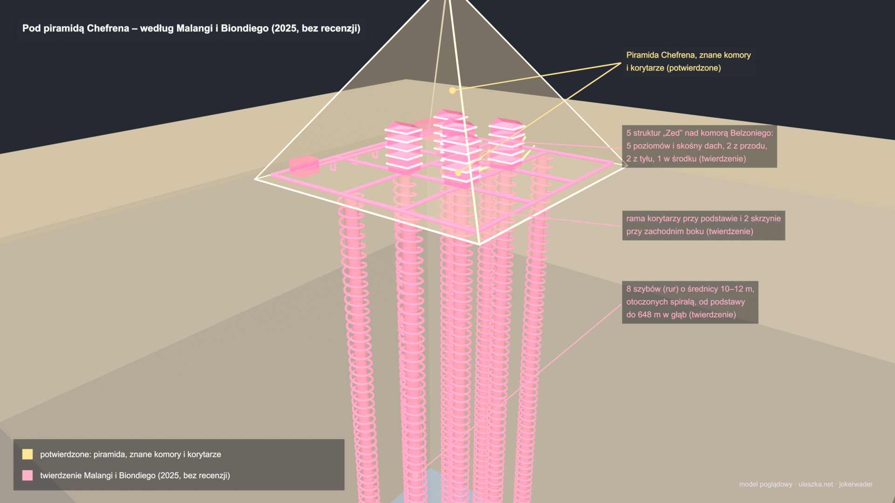
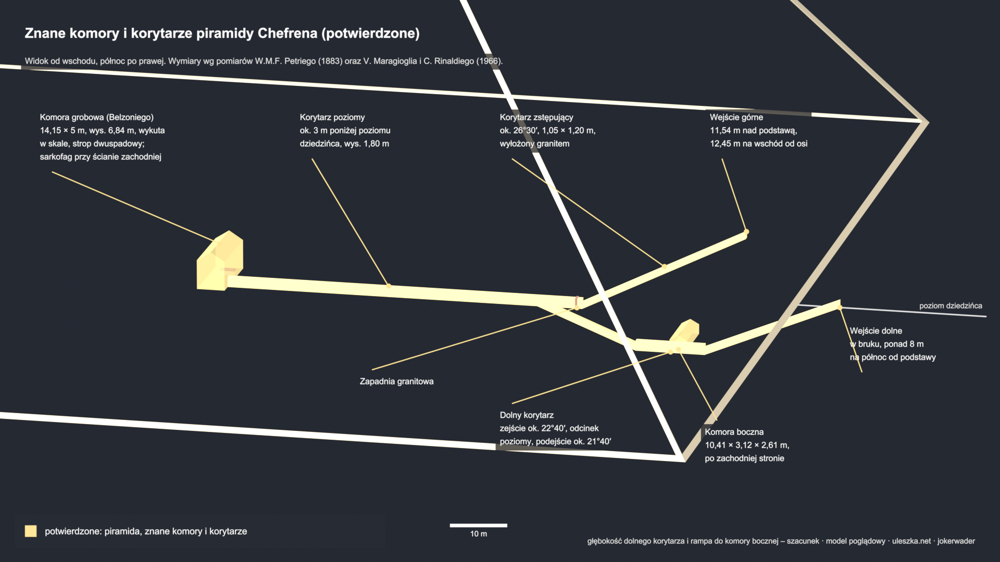

# Pod piramidą Chefrena: twierdzenia Biondiego i Malangi (2025) w 3D

Model poglądowy do karty [Piramidy w Gizie](https://uleszka.net/atlas/piramidy-w-gizie.html) w Atlasie Leszka
i do filmów podcastu (kadry 1920×1080). Pokazuje w jednej skali:

- **co jest potwierdzone** (kolor piaskowy i złoty): piramidę Chefrena oraz jej znane komory i korytarze,
  odtworzone z pomiarów Petriego (1883) oraz Maragioglia i Rinaldiego (1966);
- **co jest tylko twierdzeniem** Filippo Biondiego, Corrado Malangi i Armando Meia (kolor czerwono-różowy):
  5 struktur „Zed” w środku piramidy, ramę korytarzy i dwie skrzynie przy zachodnim boku, 8 szybów ze spiralami,
  2 „skrzynie” o boku 80 m na głębokości 648 m, wodę, strefę „miasta” na ok. 1200 m i zasięg „ok. 2 km”.

**To nie jest odkrycie, tylko ilustracja tego, co pokazują i mówią autorzy.** Ich praca o Chefrenie nie
przeszła recenzji naukowej. Geofizycy i archeolodzy (m.in. Lawrence Conyers, Sarah Parcak,
Flint Dibble, Zahi Hawass) wskazują, że radar z apertury syntetycznej (SAR) nie przenika skały
na setki metrów; w podobnych warunkach sięga do kilku metrów. Wcześniejszy artykuł tych autorów
o piramidzie Cheopsa (Remote Sensing, 2022) został w sierpniu 2026 r. wycofany przez czasopismo
z powodu poważnych błędów metodologicznych i statystycznych.

## Skąd wzięto kształt twierdzeń

1. **Liczby** pochodzą z oficjalnego streszczenia projektu (podpisane: Filippo Biondi, Armando Mei, Corrado Malanga,
   marzec 2025) oraz z wypowiedzi Malangi na konferencji prasowej 15.03.2025.
2. **Układ** (co gdzie leży) pochodzi z modelu 3D autorów: sześciu widoków ze slajdów konferencji, z obrysem piramidy,
   zielonymi strukturami „Zed”, białymi korytarzami i skrzyniami, niebieskimi szybami ze spiralami,
   skrzyniami na dole i płaszczyzną wody. Grafik autorów nie kopiowano; odczytano z nich położenie
   i proporcje elementów.
3. Model autorów **nie ma skali pionowej**: szyby mają tam ok. dwóch wysokości skrzyni, choć według liczb powinny
   mieć osiem. Tam, gdzie padła liczba, model używa liczby. Tam, gdzie jej nie ma, zachowuje proporcje
   względem piramidy z modelu autorów i oznacza wynik jako **szacunek**.
4. W modelu autorów znane korytarze (komora Belzoniego z dojściem od północy) są zaznaczone na fioletowo.
   Tutaj są pokazane dokładniej, z pomiarów egiptologicznych, w kolorze „potwierdzone”.

## Pliki

| Plik | Co to jest |
|---|---|
| `build_chefren_sar.py` | Skrypt Blendera, który buduje całą scenę od zera, zapisuje `.blend`, eksportuje `.glb` i renderuje kadry |
| `chefren-sar.blend` | Scena Blendera (kamery, nakładki z podpisami, kolekcje „POTWIERDZONE” i „TWIERDZENIA_…”) |
| `chefren-sar.glb` | Model do przeglądarki 3D na stronie (np. `<model-viewer>`), 1 jednostka = 1 m |
| `render-01-widok-ogolny.png` | Widok ogólny całej kolumny skały do 2 km |
| `render-02-przekroj.png` | Przekrój zachód–wschód, widok od południa, do ok. 840 m |
| `render-03-szyby-zblizenie.png` | Zbliżenie: piramida, struktury „Zed”, rama korytarzy i górne odcinki szybów |
| `render-04-opis.png` | Kadr z podpisami po polsku i zastrzeżeniami |
| `render-05-znane-komory.png` | Tylko to, co potwierdzone: znane komory i korytarze z wymiarami |

Filmu obrotowego nie ma w repozytorium (usunięty na życzenie autora). Skrypt nadal potrafi wyrenderować
jego klatki opcją `--frames`.






## Źródła

Twierdzenia Biondiego, Malangi i Meia:

- Opus Magnum (T. Grassi): [Khafre Project Gallery](https://opusmagnum.org/khafre-project-gallery/)
  – skan oficjalnego streszczenia („Abstract of the Conference on March 16, 2025”) i slajdy konferencji,
  w tym widoki modelu 3D autorów. Główne źródło układu i liczb.
- J. Evatt, 23.03.2025: [The Khafre Revelation](https://jonathanevatt.substack.com/p/the-khafre-revelation-whats-really)
  – angielska transkrypcja konferencji prasowej z 15.03.2025 (tłumaczenie maszynowe, miejscami zniekształcone).
- Megalithic Marvels, 2.01.2026: [4 Satellites Confirm Khafre Pyramid SAR Scan…](https://megalithicmarvels.com/2026/01/02/4-satellites-confirm-khafre-pyramid-sar-scan-discovery-of-massive-structures-underground/)
  – cytaty z wywiadu Biondiego (American Alchemy): skrzynie „ok. 80 m szerokości i wysokości”, rury ze spiralnym rdzeniem, woda.
- National Geographic, C. Moss, 16.04.2025: [Is there really a secret city under Egypt’s pyramids?](https://www.nationalgeographic.com/history/article/is-there-a-secret-city-under-the-pyramids-)
  – streszczenie twierdzeń i krytyka Parcak, Dibble’a, Conyersa, Hawassa. Podaje sześciany 90 m, inaczej niż autorzy.
- Jerusalem Post, 23.03.2025: [artykuł 847207](https://www.jpost.com/archaeology/archaeology-around-the-world/article-847207) – krytyka Conyersa i Hawassa.
- Egyptian Streets, 26.03.2025: [Unraveling the pyramid mystery](https://egyptianstreets.com/2025/03/26/unraveling-the-pyramid-mystery-claims-of-an-underground-city-debunked/) – brak recenzji, krytyka.
- Retraction Watch, 31.08.2026: [Journal retracts paper claiming network of corridors inside the Great Pyramid of Giza](https://retractionwatch.com/2026/08/31/retraction-corridors-inside-great-pyramid-giza/).
- G. Gillett, 16.03.2026: [Revisiting 2025 Claims on Massive Wells Under the Pyramid of Khafre](https://underus.substack.com/p/revisiting-2025-claims-on-massive) – analiza krytyczna (blog).
- F. Biondi, C. Malanga, Remote Sensing 14(20), 5231, 2022 (o piramidzie Cheopsa):
  [mdpi.com/2072-4292/14/20/5231](https://www.mdpi.com/2072-4292/14/20/5231).
  **Wycofany 10.08.2026**: [nota o wycofaniu](https://www.mdpi.com/2072-4292/18/16/2679).

Piramida i znane komory:

- W.M.F. Petrie, *The Pyramids and Temples of Gizeh* (1883), rozdz. 8–9
  ([kopia tekstu](https://www.rombergintegrali.org/gizapiramitleri/Pyramids_and_Temples_of_Gizeh/c9.html)). Cale przeliczono na metry (× 0,0254).
- V. Maragioglio, C. Rinaldi, *L’Architettura delle Piramidi Menfite*, cz. V (1966), s. 51–62
  ([archive.org](https://archive.org/download/51maragiogliovrinaldiclarchitetturadellepiramidimenfitetestolepiramididizedefraedichefren1966lr/)). Dalej „M&R”.
- Wikipedia: [Pyramid of Khafre](https://en.wikipedia.org/wiki/Pyramid_of_Khafre) i [Chephren-Pyramide](https://de.wikipedia.org/wiki/Chephren-Pyramide) (CC BY-SA 4.0).

## Przyjęte wymiary

Układ: X = wschód, Y = północ, Z = góra. Z = 0 to poziom dziedzińca (podstawy), środek podstawy w (0, 0, 0).

### Potwierdzone (piramida i znane komory)

| Element | Wartość w modelu | Pochodzenie |
|---|---|---|
| Bok podstawy | 215,25 m | Petrie |
| Wysokość pierwotna | 143,5 m | Petrie: 143,87 m; Wikipedia: 143,5 m |
| Oś korytarzy | 12,45 m na wschód od osi piramidy | Petrie, M&R |
| Górne wejście | 11,54 m nad podstawą, ściana północna | zachowany próg (Wikipedia; M&R: 11,50 m); M&R rekonstruują pierwotny próg na 12,90 m |
| Korytarz zstępujący | kąt 26°30′, przekrój 1,05 × 1,20 m | M&R (26°30′–26°46′), Petrie |
| Korytarz poziomy | posadzka 3 m poniżej dziedzińca, wysokość 1,80 m, do północnej ściany komory | M&R, Petrie |
| Zapadnia granitowa | 1,04 m za końcem pochyłego stropu | Petrie |
| Komora grobowa (Belzoniego) | 14,17 × 4,97 m, ściany 5,24 m, szczyt stropu 6,84 m, strop dwuspadowy, oś wschód–zachód | Petrie, Perring |
| Położenie komory grobowej | ściana zachodnia 1,19 m na wschód od osi N–S; ściana południowa 1,17 m na północ od osi W–E | Petrie; druga liczba od Perringa, mniej pewna |
| Sarkofag | 2,63 × 1,07 × 0,97 m, 1,09 m od ściany zachodniej, zagłębiony w posadzce | Petrie |
| Dolne wejście | w bruku, 8 m na północ od krawędzi podstawy, w tej samej płaszczyźnie co górne | de.wikipedia: „ponad 8 m”; M&R: ta sama płaszczyzna |
| Dolny korytarz | zejście 22°40′, podejście do górnego korytarza 21°40′, połączenie 7 m na południe od zapadni | M&R |
| Komora boczna | 10,41 × 3,12 × 2,61 m, po zachodniej stronie, wejście pośrodku ściany wschodniej, strop dwuspadowy | Petrie (10,46 × 3,13 m), M&R, Wikipedia |
| Poziom dolnego odcinka poziomego: 10 m poniżej dziedzińca (długość wychodzi 12,3 m) | | **szacunek**, źródła nie podają |
| Rampa do komory bocznej: 6 m długości, 1,5 m spadku; wysokość ścian komory bocznej 1,75 m | | **szacunek** |

Pominięto tunel rabunkowy nad górnym wejściem, ukryty szyb X i wnękę naprzeciw rampy.

### Twierdzenia Biondiego, Malangi i Meia

| Element | Wartość w modelu | Pochodzenie |
|---|---|---|
| Struktury „Zed” | 5, w środku piramidy, nad komorą Belzoniego: dwie z przodu, dwie z tyłu, jedna w środku | streszczenie; Malanga; model 3D autorów |
| Budowa „Zeda” | 5 poziomów i skośny dach | streszczenie |
| Połączenia | „geometryczne ścieżki” łączące „Zedy” i „struktury dodatkowe” | streszczenie; w modelu autorów: rama białych rur przy krawędziach podstawy, krata przez „Zedy”, dwie skrzynie przy zachodnim boku |
| Liczba szybów | 8, w dwóch równoległych rzędach z północy na południe, poniżej poziomu zero | streszczenie |
| Średnica szybu | 11 m | Malanga: „ok. 10–12 metrów” |
| Głębokość szybów | do 648 m | streszczenie |
| Szyby puste w środku, otoczone schodzącą spiralą | tak | streszczenie |
| „Skrzynie” na dole | 2, bok 80 m; do każdej wchodzą 4 szyby; kwadratowe otwory w ścianach | streszczenie (80 m); Malanga (po 4 szyby); rysunek autorów (otwory) |
| Woda | płaszczyzna przecinająca szyby | Malanga: „poniżej pewnego poziomu jest woda”; model autorów. Głębokości nie podano |
| Strefa na ok. 1200 m | półprzezroczysta warstwa bez kształtów | Malanga: jasne plamy, „prawdziwe miasto, w cudzysłowie” |
| Zasięg „ok. 2 km” | linia przerywana do 2000 m | streszczenie: struktury pod piramidami Chefrena, Cheopsa i Mykerinosa „ok. dwóch kilometrów poniżej poziomu zero” |
| „Zed”: rzut 20 × 16 m, wysokość ok. 38 m | | **szacunek** z modelu autorów (ok. 1/10 boku i ok. 1/4 wysokości piramidy) |
| Oś układu 8,3 m na wschód od osi piramidy, nad komorą grobową | | **szacunek** z rzutu z góry i podpisu „BELZONI + ZED” na slajdzie |
| Rozstaw: rzędy 28 m od osi układu, szyby co 60 m (y = ±30 i ±90 m); cztery „Zedy” nad wewnętrznymi szybami | | **szacunek** z modelu autorów, dokładność rzędu 10 m |
| Rama korytarzy 98 m od środka, rury o średnicy 3 m, tuż nad poziomem podstawy | | **szacunek** z modelu autorów |
| Skrzynie przy zachodnim boku: 20 × 28 × 16 m (północna) i 14 × 18 × 12 m (południowa), belka i 5 „haków” między nimi | | **szacunek** z modelu autorów, uproszczone |
| Spirala: promień 9 m, skok 8 m | | **szacunek**, proporcje jak w modelu autorów |
| Głębokość wody: 470 m | | **szacunek**: ok. 73% długości szybów, jak w modelu autorów |

Rozbieżności u samych autorów:

- Na rysunkach autorów rury szybów są grubsze (ok. 1/3 boku skrzyni, czyli ponad 20 m), a Malanga mówi o 10–12 m. Model używa 11 m.
- Na rysunkach skrzynie na dole stykają się ze sobą i razem mają szerokość podstawy piramidy. Przy podanych 80 m i szybach
  rozstawionych na prawie całej długości podstawy między skrzyniami zostaje ok. 40 m przerwy.
- Model autorów ma jeszcze podwójną poręcz z rur przy jednym boku i kilka wygiętych rur za narożnikiem. Tych szczegółów nie odtworzono.

Model pokazuje wyłącznie Chefrena, choć streszczenie mówi o strukturach także pod Cheopsem i Mykerinosem.

### Grunt

Warstwy skały są **schematyczne**: wapień formacji Mokattam (eocen) do ok. 120 m, niżej starsze wapienie
i margle do ok. 700 m, dalej głębsze skały osadowe. Grubości są orientacyjne, nie z odwiertów.
Blok gruntu ma 700 × 700 m i 2100 m głębokości. Na kadrach część bloku jest wycięta (przekrój w kształcie
litery L), a w `.glb` cały blok jest półprzezroczysty, z granicami warstw.

## Jak odtworzyć

Potrzebny Blender 5.x (testowane na 5.3.0). Z katalogu repozytorium:

```bash
blender -b --factory-startup --python grafiki/3d/chefren-sar/build_chefren_sar.py -- --blend --glb --stills
```

Przydatne opcje skryptu: `--scale 50` (pół rozdzielczości do prób), `--samples 16`, `--only ogolny,komory`.
Napisy w kadrach używają czcionki Arial z Windows; na innych systemach Blender użyje swojej domyślnej.

W pliku `.blend` każdy kadr ma własną kamerę, własne napisy i własną wersję gruntu. Przełącza je funkcja
`activate("ogolny" | "przekroj" | "szyby" | "opis" | "komory" | "obrot")` ze skryptu.

## Uwagi do osadzenia na stronie

- `chefren-sar.glb` ma ok. 3 MB i 211 siatek. Obiekty mają nazwy po polsku (`Piramida_Chefrena`,
  `Komora_grobowa_Belzoniego`, `Komora_boczna`, `Korytarz_gorny_…`, `Korytarz_dolny_…`, `Sarkofag`, `Zed_1`…`Zed_5`,
  `Korytarz_ramy_…`, `Skrzynia_zachodnia_…`, `Hak_…`, `Szyb_1`…`Szyb_8`, `Spirala_…`, `Skrzynia_polnocna`,
  `Skrzynia_poludniowa`, `Woda_…`, `Strefa_1200m_…`, `Zasieg_2km_…`, `Grunt_…`, `Skala_…`), więc można je
  podpisać lub ukryć w przeglądarce.
- Materiały mają prefiks `potw_` (potwierdzone) lub `twierdz_` (twierdzenia), co ułatwia legendę.
- Model jest w metrach i ma 2,1 km wysokości, a piramida tylko 143 m; znane korytarze mają ok. 1 m szerokości.
  Warto ustawić kamerę startową na górną część albo dodać przycisk „przybliż piramidę”.

Autor modelu, skryptu i renderów: jokerwader (uleszka.net). Licencja MIT z pliku `LICENSE` obejmuje tylko
foldery `src/` i `scripts/`, więc warunki użycia tego folderu ustala autor repozytorium.
